# 0220 · -ive — 具有某种作用、倾向、性质；有时转成名词

[逐词精讲目录](../00_逐词精讲目录.md) · [总目录](../00_总目录_按常用程度.md)

## 核心词根与来源

不是每个 -ive 都译成主动的。a supportive friend 是给支持的朋友，a restrictive rule 是限制人的规则，a cumulative effect 是逐次积累的效果。objective、detective、incentive 还可常作名词，必须看完整单词的实际用法。

**-IVE：有这种作用，或容易这样做**

supportive 给人支持；excessive 超过合适程度；combative 容易交锋。先找到动作、性质，再看形容的是谁。

- **行动、创造与产出**：active · creative · productive · effective
- **过量与逐次累积**：excessive · cumulative
- **强迫、交锋与报复**：coerce · coercive · combat · combative · vindicate · vindictive
- **后退、退化与感染**：recede · recessive · degenerate · degenerative · infect · infective
- **推理、疑问与关联**：deduce · deduction · deductive · interrogate · interrogative · correlate · correlative
- **挤压和提取**：compress · compressive · extract · extractive
- **方向随对象判断**：supportive · restrictive · receptive · dismissive
- **feast、festival、festive：庆典和宴饮的同源材料**：feast · festival · festive
- **initiative：把开头做起来的主动性**：initiate · initiative
- **festival → festivals：节日与文化节庆**：festival · festivals
- **infect → infected：浸入、染上与感染**：infect · infected · infection
- **initiative → initiatives：主动发起的一项项行动**：initiative · initiatives
- **incentive → incentives：多个激励因素**：incentive · incentives

## 词形与演化规律

多接拉丁 -ivus，也有经法语 -if 借入，再在英语中继续类推。形容词词干常与动作名词相应：produce、production、productive；deduce、deduction、deductive。词干会变，不能每次删除 ive 就要求剩下一整个现代英语动词。某些历史法语形式后来在英语变成 -y，但 jolly 的远源不确定，本页不把它硬接成确定的 -ive 范例。

三者接拉丁节庆词族而借入路径不同；feast 可说盛宴或节日，festival 是节庆活动，festive 是有节日气氛的。

initiative 经法语借入，连接拉丁 initiare 开始、initium 开端及相应 -ivus 材料；主动性与发起的一项行动分别举例。

节日的形容词经名词化形成活动名称，现代音乐、电影等也可办节。

拉丁 in 与 facere 到 inficere、infectus，染色、使染上的背景经借入到英语。

法语借词，远接拉丁 initium、initiare 开始，具体倡议可数。

ive 在历史形容词材料中，英语名词加复数 s。

## 单词速览（按词族由简到繁）

同一基础词的相关扩展放在一起，先读基础形式，再读扩展；各组之间优先读常用的。具体词源关系见各词讲解。

| 单词 | 音标 | 核心意思 |
|---|---|---|
| [active](#w-1) | /ˈæktɪv/ | 活跃的；正在起作用的；主动的 |
| [reactive](#w-31) | /riˈæktɪv/ | 反应性的；事后应对的；易反应的 |
| [effective](#w-2) | /ɪˈfɛktɪv/ | 有效的；生效的 |
| [massive](#w-3) | /ˈmæsɪv/ | 巨大的；大量的；沉重厚实的 |
| [feast](#w-132) | /fiːst/ | 盛宴、大餐；节日庆典；尽情享用 |
| [festival](#w-131) | /ˈfestɪvəl/ | 节庆、节日；以某种活动为主题的盛会 |
| [festivals](#w-135) | /ˈfestɪvəlz/ | 节日；音乐节、电影节等集中活动〔festival 的复数〕 |
| [festive](#w-27) | /ˈfestɪv/ | 节庆的；喜庆、欢乐的 |
| [creative](#w-4) | 英、美 /kriˈeɪtɪv/ | 有创造力的；有创意的；创作的 |
| [competitive](#w-5) | /kəmˈpetɪtɪv/ | 竞争性的；有竞争力的；好胜的 |
| [combat](#w-117) | 名词英 /ˈkɒmbæt/、美 /ˈkɑːmbæt/；动词也常同音 | 战斗；对抗、打击 |
| [combative](#w-69) | 英 /ˈkɒmbətɪv/；美 /kəmˈbætɪv/ | 好斗的；爱争辩的；斗志强的 |
| [attractive](#w-6) | /əˈtræktɪv/ | 有吸引力的；好看的；诱人的 |
| [impressive](#w-7) | 英 /ɪmˈpresɪv/；美 /ɪmˈpresɪv/ | 令人赞叹的；给人深刻印象的 |
| [administrative](#w-8) | 英 /ədˈmɪnɪstrətɪv/；美 /ədˈmɪnəstreɪtɪv/ | 行政的；管理事务的 |
| [defensive](#w-9) | /dɪˈfensɪv/ | 防御的；戒备的；急于自我辩护的 |
| [objective](#w-10) | 英、美 /əbˈdʒektɪv/ | 客观的；目标；物镜 |
| [initiate](#w-134) | 动词 /ɪˈnɪʃieɪt/；名词 /ɪˈnɪʃiət/ | 发起、启动；使入门；新加入者〔名词，较正式〕 |
| [initiative](#w-133) | /ɪˈnɪʃətɪv/ | 主动性；率先采取的行动；倡议、措施 |
| [initiatives](#w-138) | /ɪˈnɪʃətɪvz/ | 倡议、举措、主动发起的行动〔复数〕 |
| [infect](#w-121) | /ɪnˈfɛkt/ | 使感染；感染他人情绪 |
| [infection](#w-136) | /ɪnˈfekʃən/ | 感染；感染性疾病；计算机受感染的状态 |
| [infected](#w-137) | /ɪnˈfektɪd/ | 感染、使受感染了；受感染的〔过去式、过去分词〕 |
| [infective](#w-102) | /ɪnˈfektɪv/ | 能引起感染的；具有感染作用的 |
| [aggressive](#w-11) | 英、美 /əˈɡresɪv/ | 好斗的；咄咄逼人的；积极进取的；强烈的 |
| [legislative](#w-12) | 英 /ˈledʒɪslətɪv/；美 /ˈledʒɪsleɪtɪv/ | 立法的；有立法权的 |
| [productive](#w-13) | /prəˈdʌktɪv/ | 有成效的；产出多的 |
| [detective](#w-14) | /dɪˈtektɪv/ | 侦探；刑警；侦探题材的 |
| [respective](#w-15) | /rɪˈspektɪv/ | 各自的；分别对应的 |
| [excessive](#w-16) | /ɪkˈsesɪv/ | 过量的；过度的 |
| [innovative](#w-17) | 英 /ˈɪnəvətɪv/；美 /ˈɪnəveɪtɪv/ | 富有创新性的；采用新办法的 |
| [intensive](#w-18) | /ɪnˈtensɪv/ | 密集的；集中的；强度大的 |
| [supportive](#w-19) | 英 /səˈpɔːtɪv/；美 /səˈpɔːrtɪv/ | 给予支持的；鼓励人的 |
| [extract](#w-118) | 动词 /ɪkˈstrækt/；名词 /ˈekstrækt/ | 提取；拔出；摘录；提取物 |
| [extractive](#w-91) | /ɪkˈstræktɪv/ | 提取的；采掘的；榨取性的 |
| [incentive](#w-20) | /ɪnˈsentɪv/ | 激励；促使人行动的因素 |
| [incentives](#w-139) | /ɪnˈsentɪvz/ | 激励因素、诱因、奖励措施〔复数〕 |
| [abusive](#w-21) | 常读 /əˈbjuːsɪv/；美语也读 /əˈbjuːzɪv/ | 辱骂的；虐待的；滥用的 |
| [decisive](#w-22) | /dɪˈsaɪsɪv/ | 决定性的；果断的 |
| [subjective](#w-23) | 英、美 /səbˈdʒektɪv/ | 主观的；取决于个人感受的 |
| [collaborative](#w-24) | /kəˈlæbərətɪv/ | 合作的；依靠共同参与的 |
| [investigative](#w-25) | /ɪnˈvestɪɡətɪv/，也读 /ɪnˈvestɪɡeɪtɪv/ | 调查性的；深入查证的 |
| [adaptive](#w-26) | 英、美 /əˈdæptɪv/ | 能适应的；有适应作用的；会自动调节的 |
| [reflective](#w-28) | /rɪˈflektɪv/ | 反光的；沉思的；能反映某事的 |
| [cumulative](#w-30) | /ˈkjuːmjələtɪv/ | 逐渐累积的；累计的 |
| [descriptive](#w-119) | /dɪˈskrɪptɪv/ | 描述性的；描写生动的 |
| [restrictive](#w-32) | /rɪˈstrɪktɪv/ | 限制性的；约束过多的 |
| [preventive](#w-33) | /prɪˈventɪv/ | 预防性的；用于防止问题的 |
| [retrospective](#w-34) | 英 /ˌretrəˈspektɪv/；美 /ˌretroʊˈspektɪv/ | 回顾的；追溯的；回顾展 |
| [disruptive](#w-35) | /dɪsˈrʌptɪv/ | 扰乱秩序的；使正常运行受阻的；改变既有格局的 |
| [deduce](#w-126) | 英 /dɪˈdjuːs/；美 /dɪˈduːs/ | 推断；推导出 |
| [deduction](#w-120) | /dɪˈdʌkʃən/ | 推断；演绎；扣除；扣除额 |
| [deductive](#w-83) | /dɪˈdʌktɪv/ | 演绎的；基于演绎推理的 |
| [oppressive](#w-36) | 英 /əˈpresɪv/；美 /əˈpresɪv/ | 压迫性的；令人压抑的；闷热难耐的 |
| [obsessive](#w-37) | /əbˈsesɪv/ | 过分执着的；反复纠缠心思的；痴迷者 |
| [expansive](#w-38) | /ɪkˈspænsɪv/ | 广阔的；范围大的；健谈开朗的 |
| [predictive](#w-39) | /prɪˈdɪktɪv/ | 预测性的；用于预测的 |
| [degenerate](#w-122) | 动词 /dɪˈdʒenəreɪt/；形容词、名词 /dɪˈdʒenərət/ | 退化、恶化；退化的；堕落者〔贬义名词〕 |
| [degenerative](#w-60) | /dɪˈdʒenərətɪv/ | 退行性的；逐渐退化、恶化的 |
| [intrusive](#w-40) | 英、美 /ɪnˈtruːsɪv/ | 侵扰的；干涉隐私的；侵入的 |
| [elective](#w-41) | /ɪˈlektɪv/ | 可选择的；选修课；由选举产生的 |
| [receptive](#w-123) | /rɪˈseptɪv/ | 乐于接受的；能接收的 |
| [cohesive](#w-42) | 英 /kəʊˈhiːsɪv/；美 /koʊˈhiːsɪv/ | 有凝聚力的；紧密结合的；整体协调的 |
| [corrective](#w-43) | 英、美 /kəˈrektɪv/ | 纠正性的；矫正的；纠偏措施 |
| [secretive](#w-44) | /ˈsiːkrətɪv/ | 遮遮掩掩的；不愿透露情况的 |
| [immersive](#w-45) | 英 /ɪˈmɜːsɪv/；美 /ɪˈmɜːrsɪv/ | 让人沉浸其中的；沉浸式的 |
| [manipulative](#w-46) | 英 /məˈnɪpjələtɪv/；美 /məˈnɪpjəleɪtɪv/ | 善于操控他人的；操作性的；数学操作教具 |
| [appreciative](#w-47) | /əˈpriːʃətɪv/ | 表示感谢的；懂得欣赏的 |
| [conducive](#w-48) | 英 /kənˈdjuːsɪv/；美 /kənˈduːsɪv/ | 有助于……的；有利于……的 |
| [seductive](#w-49) | /sɪˈdʌktɪv/ | 诱人的；有诱惑力的；带有性吸引力的 |
| [adoptive](#w-50) | 英 /əˈdɒptɪv/；美 /əˈdɑːptɪv/ | 收养关系中的；收养方的 |
| [suggestive](#w-51) | 英 /səˈdʒestɪv/；美 /səɡˈdʒestɪv/ | 使人联想到的；暗示的；有性暗示的 |
| [correlate](#w-124) | 动词：英 /ˈkɒrəleɪt/、美 /ˈkɔːrəleɪt/；名词末尾常 /lət/ | 相关联；使对应；相关物〔名词〕 |
| [correlative](#w-110) | 英 /kəˈrelətɪv/；美 /kəˈrelətɪv/ | 相互关联的；成对呼应的 |
| [assertive](#w-52) | 英 /əˈsɜːtɪv/；美 /əˈsɜːrtɪv/ | 敢于表达立场的；坚定自信的 |
| [repulsive](#w-53) | /rɪˈpʌlsɪv/ | 令人厌恶的；排斥的 |
| [repressive](#w-54) | 英 /rɪˈpresɪv/；美 /rɪˈpresɪv/ | 压制性的；限制自由的 |
| [compress](#w-125) | 动词：英、美 /kəmˈpres/；名词：英 /ˈkɒmpres/、美 /ˈkɑːmpres/ | 压缩；挤紧；压敷布 |
| [compressive](#w-88) | /kəmˈpresɪv/ | 压缩的；受压的；产生挤压作用的 |
| [conductive](#w-56) | /kənˈdʌktɪv/ | 导电的；导热的 |
| [dismissive](#w-57) | /dɪsˈmɪsɪv/ | 轻视的；不屑一顾的 |
| [instinctive](#w-58) | /ɪnˈstɪŋktɪv/ | 本能的；不假思索的；自然产生的 |
| [illustrative](#w-59) | 英 /ɪˈlʌstrətɪv/；美 /ɪˈlʌstrətɪv/ | 说明性的；用作例证的 |
| [instructive](#w-62) | /ɪnˈstrʌktɪv/ | 有启发性的；能让人学到东西的 |
| [vindictive](#w-63) | /vɪnˈdɪktɪv/ | 爱报复的；怀恨在心的 |
| [coerce](#w-128) | 英 /kəʊˈɜːs/；美 /koʊˈɜːrs/ | 强迫；胁迫 |
| [coercive](#w-61) | 英 /kəʊˈɜːsɪv/；美 /koʊˈɜːrsɪv/ | 强制的；胁迫性的 |
| [obstructive](#w-64) | /əbˈstrʌktɪv/ | 阻挠的；妨碍通行的；阻塞性的 |
| [regressive](#w-65) | 英、美 /rɪˈɡresɪv/ | 倒退的；退行的；累退的 |
| [integrative](#w-66) | 英 /ˈɪntɪɡreɪtɪv/；美 /ˈɪntəˌɡreɪtɪv/ | 起整合作用的；综合多方面的 |
| [recessive](#w-67) | /rɪˈsesɪv/ | 隐性的〔遗传学〕；退缩、后退的〔较少用〕 |
| [interrogate](#w-127) | 英、美 /ɪnˈterəɡeɪt/ | 审问；盘问；深入查询 |
| [interrogative](#w-100) | 英 /ˌɪntəˈrɒɡətɪv/；美 /ˌɪntəˈrɑːɡətɪv/ | 疑问的；表示提问的；疑问词、疑问结构 |
| [recursive](#w-68) | 英 /rɪˈkɜːsɪv/；美 /rɪˈkɜːrsɪv/ | 递归的；自我引用的 |
| [reconstructive](#w-71) | /ˌriːkənˈstrʌktɪv/ | 重建的；修复性的 |
| [reflexive](#w-72) | /rɪˈfleksɪv/ | 反身的；自反的；反射性的、下意识的 |
| [presumptive](#w-73) | 英、美 /prɪˈzʌmptɪv/ | 推定的；暂可认定的；预计将取得某地位的 |
| [preemptive](#w-74) | /ˌpriːˈemptɪv/ | 抢先的；先发制人的 |
| [associative](#w-75) | 英 /əˈsəʊsiətɪv/；美 /əˈsoʊsiətɪv/；/si/ 也常读 /ʃi/ | 联想的；关联的；满足结合律的 |
| [reclusive](#w-76) | /rɪˈkluːsɪv/ | 隐居的；不爱与外界来往的 |
| [pejorative](#w-77) | 英 /pɪˈdʒɒrətɪv/；美 /pɪˈdʒɔːrətɪv/ | 贬义的；贬义词 |
| [recede](#w-129) | /rɪˈsiːd/ | 退去；后退；逐渐减弱 |
| [demonstrative](#w-86) | 英 /dɪˈmɒnstrətɪv/；美 /dɪˈmɑːnstrətɪv/ | 感情外露的；指示的〔语法〕；用于显示、证明的 |
| [assistive](#w-90) | /əˈsɪstɪv/ | 辅助的；提供帮助的 |
| [vindicate](#w-130) | /ˈvɪndɪkeɪt/ | 证明无辜；证明判断、做法正确 |
| [suppressive](#w-93) | 英 /səˈpresɪv/；美 /səˈpresɪv/ | 有抑制作用的；压制性的 |
| [transgressive](#w-95) | 英、美 /trænzˈɡresɪv/ | 越界的；违反规范的；挑战禁忌的 |
| [derisive](#w-99) | /dɪˈraɪsɪv/ | 嘲弄的；轻蔑的 |
| [evaluative](#w-104) | 英、美 /ɪˈvæljuətɪv/ | 评价性的；用于评估的 |
| [contrastive](#w-114) | 英 /kənˈtrɑːstɪv/；美 /kənˈtræstɪv/ | 对比性的；具有区别作用的 |
| [allusive](#w-116) | /əˈluːsɪv/ | 含暗示或典故的；旁敲侧击的 |

## 逐词讲解

### 1. active — 活跃的；正在起作用的；主动的

**音标**：/ˈæktɪv/

**先抓住这个画面**

active 像一个已经进入工作状态的按钮，也像一个愿意参与、经常活动的人。

**怎么拆**

现代对应 act + -ive；历史来自拉丁语 āctīvus，经法语传入。

**怎么变成今天的意思**

随对象变化：active member 积极参与，active account 账号有效，active ingredient 是实际发挥作用的成分。

**常见搭配与例句**

an active member；remain active；an active role；the active voice。

> She plays an active role in the club.

她积极参与俱乐部事务。

> Your account is now active.

你的账号现在已可使用。

**别混淆**

active 是参与或起作用；busy 是忙，忙碌并不保证在某件事上积极参与。

### 2. reactive — 反应性的；事后应对的；易反应的

**音标**：/riˈæktɪv/

**先抓住这个画面**

reactive 在工作方式上像等警报响了才处理，在化学里像很容易与别的物质发生反应。

**怎么拆**

react + -ive。

**怎么变成今天的意思**

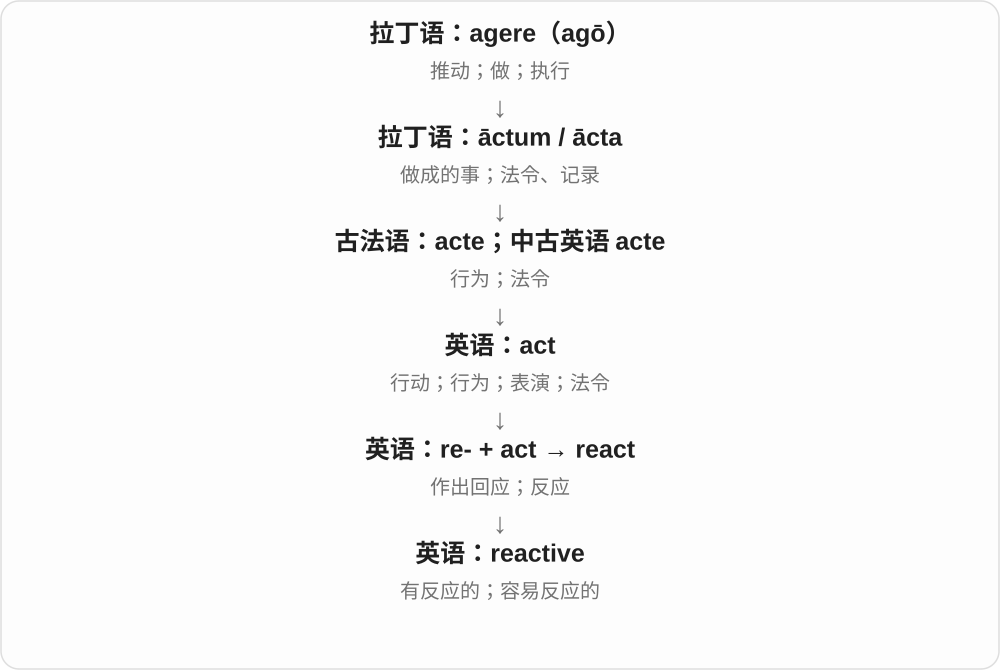

管理讨论中常与 proactive 对比；化学语境则描述反应倾向。容易反应不等于必然危险，仍取决于物质与条件。

**常见搭配与例句**

a reactive approach；reactive maintenance；a highly reactive substance。

> The team wants to replace reactive maintenance with regular inspections.

团队希望用定期检查替代出了问题才维修。

> The lesson compares reactive and relatively stable substances.

这节课比较容易反应与相对稳定的物质。

**别混淆**

reactive 回应已经出现的情况；proactive 提前采取措施。

### 3. effective — 有效的；生效的

**音标**：/ɪˈfɛktɪv/

**先抓住这个画面**

门打不开，换把钥匙就打开了：新办法 effective，因为它确实达到想要的结果。

**怎么拆**

effect 一支 + -ive；历史对应拉丁语 effectivus，表示产生作用的。

**怎么变成今天的意思**

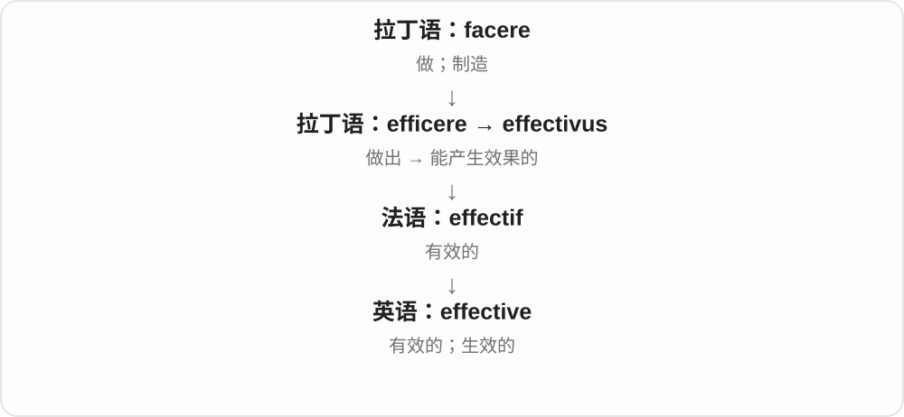

从“做出的效果”转为“有这种效果”。日期语境中 effective 则强调规定已开始起作用。

**常见搭配与例句**

an effective method；effective from Monday；effective against…。

> A short break can be an effective way to regain focus.

短暂休息能有效帮助人重新集中注意力。

> The change is effective from 1 June.

这项变更从六月一日起生效。

**别混淆**

efficient 看花费是否少，effective 看目标是否达成；费时的办法也可能有效。

### 4. massive — 巨大的；大量的；沉重厚实的

**音标**：/ˈmæsɪv/

**先抓住这个画面**

大得很显眼，既能说建筑体量，也能说变化、支出或成功的程度。

**怎么拆**

经法语 massif 相关形容词进入英语，现代与 mass + -ive 对应。最初有大块、厚实的意味，后来常夸量、程度巨大。

**怎么变成今天的意思**

**希腊 maza 面饼、面团 → 拉丁 massa → 法语 masse → mass**  
一团物质 → 一大堆、总量

↓

**现代 mass**  
物理质量；大量；弥撒 Mass 另接拉丁 missa

↓

**法语 massif → massive**  
大块厚实 → 巨大、大量

a massive building 巨大建筑，a massive increase 大幅增长，massive success 巨大成功。

**常见搭配与例句**

a massive building；a massive increase；a massive amount。

> The storm caused massive damage.

风暴造成了巨大损失。

> The project required a massive amount of planning.

项目需要大量规划。

**别混淆**

massive 不仅是有质量；a massive success 是成功程度大，不是在秤上称成功。

### 5. feast — 盛宴、大餐；节日庆典；尽情享用

**音标**：/fiːst/

**先抓住这个画面**

桌上摆满好吃的，大家一起庆祝，是 a feast。也能把饱享搬到眼睛、耳朵上：a feast for the eyes 视觉盛宴。

**怎么拆**

经古法语 feste 庆典、宗教节日等，接拉丁 festa 节庆、宴饮，属于 festus 欢乐、节日的词族。英语从庆祝活动发展出丰盛餐食与享受之义。

**怎么变成今天的意思**

**拉丁 festa、festus → 法语 feste**  
节庆、宴饮、欢乐

↓

**英语 feast**  
庆典、盛宴；尽情欣赏或享用

a wedding feast 婚宴；prepare a feast 准备盛宴；feast on something 大快朵颐、尽情享用；a feast for the eyes 视觉盛宴。

**常见搭配与例句**

a generous feast；feast one’s eyes on something。

> They prepared a feast for the whole family.

他们为全家准备了一桌盛宴。

> The colourful garden was a feast for the eyes.

色彩丰富的花园让人饱享眼福。

**别混淆**

meal 只是一次餐食，feast 常突出丰盛、庆祝或极大的享受。fast 作禁食时与 feast 的历史节日场景可形成对比，但拼写相近不能互换。

### 6. festival — 节庆、节日；以某种活动为主题的盛会

**音标**：/ˈfestɪvəl/

**先抓住这个画面**

把吃喝、音乐、仪式或展演集中在一段时间，许多人一起参加，这种安排就是 festival 的常见样子。

**怎么拆**

经法语 festival 或中世纪拉丁 festivalis 节日的，接拉丁 festum 节庆。英语名词由 festival day 等表达简化而来，后来扩展到电影节、音乐节等。

**怎么变成今天的意思**

**拉丁 festum → festivalis／法语 festival**  
节庆 → 节日的

↓

**festival day 等 → 名词 festival**  
节庆日；主题活动盛会

a music festival 音乐节；a film festival 电影节；a religious festival 宗教节日；a festival of local food 地方美食节。

**常见搭配与例句**

hold a festival；attend a festival。

> The town holds a music festival every summer.

小镇每年夏天都会举办音乐节。

> We watched several films at the festival.

我们在电影节上看了几部电影。

**别混淆**

feast 常把宴饮、享受突出出来；festival 更常说一整套庆典或主题活动，不要求每次都有盛大餐宴。

### 7. festivals — 节日；音乐节、电影节等集中活动〔festival 的复数〕

**音标**：/ˈfestɪvəlz/

**先抓住这个画面**

把大家聚起来，集中庆祝、欣赏表演或作品的一段活动，是 festivals；既可以是传统节庆，也可以围绕音乐、电影来办节。

**怎么拆**

festival + -s，/l/ 后读 /z/。festival 先经法语或中世纪拉丁 festīvālis 作节日的形容词，较早接拉丁 festum 节庆；英语从 festival day 等表达发展出活动名词。

**怎么变成今天的意思**

**拉丁 festum、festīvālis → festival 形容词**  
节庆 → 节日的

↓

**英语活动名词 festival + -s → festivals**  
多个节庆；不同主题的文化节

music festivals 音乐节；film festivals 电影节；local festivals 当地节庆。

**常见搭配与例句**

festivals held each summer；festivals celebrating local food。

> The town hosts music festivals every summer.

这个镇每年夏天举办音乐节。

> The museum collects stories about local festivals.

博物馆收集当地节庆的故事。

**别混淆**

festival 不一定是法定放假日，也可是一组专门活动。holiday 更常关注假日、休息安排，festival 更常关注节庆内容。

### 8. festive — 节庆的；喜庆、欢乐的

**音标**：/ˈfestɪv/

**先抓住这个画面**

彩灯亮起、大家聚在一起庆祝，那种像过节的热闹气氛是 festive。普通一天也可以被装点得很喜庆。

**怎么拆**

经法语 festif 接拉丁 festivus，与节庆 festum 等材料相关。今天与 feast 同族相照，但不是 feast 直接保留全部拼写加 -ive。

**怎么变成今天的意思**

**拉丁 festum 节庆等 → festivus → 法语 festif → festive**  
与庆典有关；欢乐、有节日气氛

↓

**拉丁 festivitas 经法语 → festivity**  
节庆活动；欢庆的状态

a festive atmosphere 节日气氛；festive decorations 喜庆装饰；the festive season 英式常指圣诞、新年这一节庆时段。

**常见搭配与例句**

a festive atmosphere；festive decorations。

> The lights gave the room a festive atmosphere.

灯光让房间有了喜庆气氛。

> Everyone was in a festive mood.

大家都沉浸在欢庆的心情里。

**别混淆**

festive 是有庆祝气氛，festival 是节庆、艺术节等名词；修饰房间时可说 looks festive，不用把它当举办了一场 festival。

### 9. creative — 有创造力的；有创意的；创作的

**音标**：英、美 /kriˈeɪtɪv/

**先抓住这个画面**

能想出有新意的做法，或把现有材料组合成别人没想到的样子。

**怎么拆**

通常分析为 create + -ive；也有词源资料联系后期拉丁语 creativus。早期说具有创造功能，后来突出艺术、想象力和新方法。

**怎么变成今天的意思**

**拉丁语 creare**  
使产生、创造、生育；远源与生长相联系

↓

**英语 create + -ive；另有后期拉丁语 creativus 对应来源说**  
具有创造作用或能力

↓

**英语 creative**  
有创造力的、有创意的

a creative solution 不一定华丽，可能只是很巧的省力办法。creative accounting 却常带贬义，指用取巧的账务安排美化数字。

**常见搭配与例句**

creative thinking；a creative solution；the creative process。

> The team found a creative way to use the small space.

团队想出了一个巧妙利用小空间的办法。

> The workshop encourages creative thinking.

工作坊鼓励有创造性的思考。

**别混淆**

original 强调原创、非照搬；creative 强调想象、组合和创造能力，两者常相关但不完全相同。

### 10. competitive — 竞争性的；有竞争力的；好胜的

**音标**：/kəmˈpetɪtɪv/

**先抓住这个画面**

这个词有三种视角：事情需要与别人争，条件足以与别人比，或者一个人特别想赢。

**怎么拆**

借拉丁 competere 的分词词干 competit- 加 -ive 形成英语形容词。现代与 compete、competition 对应，但不必说成给英语 compete 直接加一个完整词尾。

**怎么变成今天的意思**

**拉丁 petere**  
朝向、寻求、争取；也可指扑向、攻击或请求

↓

**拉丁 com- 一起 + petere → competere**  
走到一起、相合、适合；后来也指一起争取某物

↓

**拉丁分词词干 competit- + 英语 -ive → competitive**  
涉及竞争的；具有竞争力或好胜的

a competitive market 竞争激烈；competitive prices 价格有吸引力、比得过别人；a competitive child 是好胜的孩子。具体中文由它修饰什么决定。

**常见搭配与例句**

a competitive market；competitive prices；a competitive salary；a competitive personality。

> The firm offers competitive salaries to attract engineers.

公司提供有竞争力的薪酬来吸引工程师。

> He becomes very competitive whenever we play board games.

每次玩桌游，他都会变得特别好胜。

**别混淆**

competent 是有能力把事做好；competitive 是涉及竞争、能与人比或很想赢。有能力不等于凡事都好胜。

### 11. combat — 战斗；对抗、打击

**音标**：名词英 /ˈkɒmbæt/、美 /ˈkɑːmbæt/；动词也常同音

**先抓住这个画面**

可以是真正交战，也可以把污染、欺诈当成要对抗的问题：不是只讨论它，而是主动采取措施去压制它。

**怎么拆**

名词、动词经法语 combat、combattre 的材料进入英语；com- 一起与 battre 打相联。不是 comb 梳子 + at。

**怎么变成今天的意思**

**法语 combattre，关联 com- 与 battre 打**  
交战、战斗的材料

↓

**英语 combat → combative**  
战斗；打击问题；好斗、好争论的

in combat 在战斗中；combat pollution 防治污染；combat fraud 打击欺诈。动词直接接宾语，不必加 against。

**常见搭配与例句**

combat crime；combat pollution。

> The soldiers had been trained for combat.

士兵接受过作战训练。

> The city introduced new measures to combat air pollution.

这座城市推出新措施防治空气污染。

**别混淆**

combat 是对抗、采取措施，不保证已经打赢；eliminate 才明确强调消除。

### 12. combative — 好斗的；爱争辩的；斗志强的

**音标**：英 /ˈkɒmbətɪv/；美 /kəmˈbætɪv/

**先抓住这个画面**

别人说一句，他马上顶一句，总像准备迎战，这种态度叫 combative；未必真要动手，也可能是辩论中的强硬。

**怎么拆**

combat + -ive；把战斗引申为倾向于交锋、争论的姿态。

**怎么变成今天的意思**

**法语 combattre，关联 com- 与 battre 打**  
交战、战斗的材料

↓

**英语 combat → combative**  
战斗；打击问题；好斗、好争论的

a combative attitude 好斗的态度；a combative interview 交锋激烈的访谈。

**常见搭配与例句**

a combative tone；a combative style。

> He adopted a combative tone during the interview.

采访时，他的语气带着强烈的交锋意味。

> Her combative style divided the audience.

她强硬好辩的风格让观众评价不一。

**别混淆**

combative 是好交锋，competitive 是求胜、想做得比别人好；竞争心强不一定爱吵架。

### 13. attractive — 有吸引力的；好看的；诱人的

**音标**：/əˈtræktɪv/

**先抓住这个画面**

attractive 让人愿意靠近、选择或多看一眼。人可以好看，价格可以划算，工作机会可以很值得考虑。

**怎么拆**

经法语 attractif，来自拉丁语 attractīvus；现代对照 attract + -ive。

**怎么变成今天的意思**

它把“吸引”变成对象的特点。attractive salary 通常是薪资条件不错，绝不是说数字长得漂亮。

**常见搭配与例句**

an attractive offer；an attractive price；look attractive；attractive to buyers。

> The apartment is attractive to people who work downtown.

这套公寓对在市中心工作的人很有吸引力。

> They offered her an attractive salary.

他们给她开出了诱人的薪资。

**别混淆**

beautiful 更直接评价美；attractive 的范围更广，能包括实惠、便利和机会。

### 14. impressive — 令人赞叹的；给人深刻印象的

**音标**：英 /ɪmˈpresɪv/；美 /ɪmˈpresɪv/

**先抓住这个画面**

规模、能力或成果大到让人停下来认真看一眼。

**怎么拆**

impress + -ive，表示能够产生深刻印象的。

**怎么变成今天的意思**

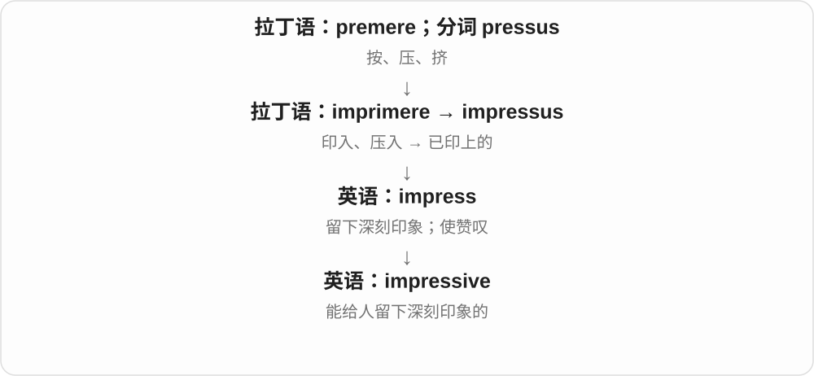

可以赞技术、成绩、建筑，也能说 impressive evidence，强调证据有分量。

**常见搭配与例句**

an impressive achievement；an impressive collection；look impressive。

> The students made impressive progress in six weeks.

学生们六周内取得了令人赞叹的进步。

> The bridge is an impressive piece of engineering.

这座桥是一项令人赞叹的工程。

**别混淆**

impressive 不等于 expensive：昂贵的东西未必出色，简单的解决办法也能令人赞叹。

### 15. administrative — 行政的；管理事务的

**音标**：英 /ədˈmɪnɪstrətɪv/；美 /ədˈmɪnəstreɪtɪv/

**先抓住这个画面**

不是直接授课、治病或生产，而是安排人员、记录、手续，让这些工作能正常进行。

**怎么拆**

借自拉丁语 administrativus，由 administrat- 分词词干构成；现代可对照 administrate + -ive 理解，但不能把英语拆分直接当成借入历史。

**怎么变成今天的意思**

**拉丁语：minor / minus**  
较小、较少；小于另一方

↓

**拉丁语：minister**  
居从属位置的服务者、助手

↓

**拉丁语：ministrare**  
服侍、提供服务

↓

**拉丁语：ad- + ministrare → administrare**  
协助料理、管理、执行

↓

**拉丁语 administrat- → administrativus → 英语 administrative**  
负责或涉及事务管理的

administrative assistant 处理日程、文书等事务；administrative error 常指手续或记录方面的错误。

**常见搭配与例句**

administrative staff；administrative costs；administrative support。

> The school hired two new administrative assistants.

学校新聘了两名行政助理。

> The delay was caused by an administrative error.

这次延误是由手续处理上的错误造成的。

**别混淆**

managerial 更突出经理的管理职责；administrative 常突出日常运转和手续。

### 16. defensive — 防御的；戒备的；急于自我辩护的

**音标**：/dɪˈfensɪv/

**先抓住这个画面**

对方才提一个问题，你已经像举起盾牌一样准备反击。

**怎么拆**

defens- + -ive 可帮助识别；历史上经法语 defensif 与中世纪拉丁 defensivus 等形式进入英语。

**怎么变成今天的意思**

**拉丁复合词中的 -fendere**  
击打、推撞；通常不独立使用

↓

**拉丁 de-“离开” + -fendere → defendere**  
把攻击挡开 → 保护、防卫

↓

**拉丁 defens- → 中世纪拉丁 defensivus；法语 defensif**  
用于防御的

↓

**英语 defensive**  
防守的；也形容对批评高度戒备的态度

a defensive strategy 是守住阵地的策略。说一个人 gets defensive，通常是他把意见听成攻击，马上解释、否认或反驳。这个心理用法不是简单地说他真的遭受了不公平攻击，而是在描述他的应对姿态。

**常见搭配与例句**

a defensive position；defensive driving；get defensive；be on the defensive。

> He became defensive when I asked about the delay.

我问到延误时，他马上摆出了自我辩护的姿态。

> The team adopted a defensive strategy.

球队采取了防守策略。

**别混淆**

defensible 是“有理由可以辩护”；defensive 是“正在采取防卫姿态”。一个很 defensive 的回应也可能并不 defensible。

### 17. objective — 客观的；目标；物镜

**音标**：英、美 /əbˈdʒektɪv/

**先抓住这个画面**

评价时尽量看事情本身，不让自己的好恶替事实做决定；名词则是努力对准的目标。

**怎么拆**

来自或仿照中世纪拉丁语 obiectivus，也经法语；现代客观义经过哲学语义变化形成。目标名词义联系 objective point“目标地点”等用法，不是客观自动变成目的。

**怎么变成今天的意思**

**拉丁语：iacere；分词 iactus**  
投掷、抛出

↓

**拉丁语：ob- + iacere → obicere / obiect-**  
放在面前；提出反对

↓

**中世纪拉丁语 obiectum → obiectivus；法语 objectif**  
认识所面对的对象 → 与对象有关的

↓

**英语：objective**  
客观的；目标〔后起名词义〕

an objective assessment 是尽量不偏私的评估；a learning objective 是学习目标。显微镜的 objective 是靠近标本的物镜。

**常见搭配与例句**

objective evidence；an objective assessment；achieve an objective。

> We need an objective assessment of the evidence.

我们需要对证据作客观评估。

> The main objective is to reduce waiting times.

主要目标是减少等待时间。

**别混淆**

goal 和 objective 都可指目标；objective 作形容词时与 subjective“主观的”相对。

### 18. initiate — 发起、启动；使入门；新加入者〔名词，较正式〕

**音标**：动词 /ɪˈnɪʃieɪt/；名词 /ɪˈnɪʃiət/

**先抓住这个画面**

一个项目原先没动，你把它启动；一个新人还不了解某领域，你领他入门，这两种带进开始都能用 initiate。

**怎么拆**

接拉丁 initiatus，来自 initiare 开始、引入，与 initium 开始相连，更早有进入的材料。-ate 在常用动词读 /eɪt/，名词新加入者末尾弱读。

**怎么变成今天的意思**

**拉丁 in- 进入 + ire 去 → initium 开始 → initiare**  
进入某个过程；开始、引入

↓

**initiatus、initiatio → initiate、initiation**  
发起、引导入门；开始或入门过程

initiate a project 启动项目；initiate talks 发起谈判；initiate someone into something 引导某人入门。名词 an initiate 指新入门的人，较正式。

**常见搭配与例句**

initiate talks；initiate a process；initiate someone into。

> The council initiated a review of the plan.

委员会启动了对计划的审查。

> Her tutor initiated her into the basics of the subject.

导师带她学习这门学科的基础。

**别混淆**

initiate 强调让事情开始，implement 是把计划付诸执行；启动讨论不等于方案已落实。

### 19. initiative — 主动性；率先采取的行动；倡议、措施

**音标**：/ɪˈnɪʃətɪv/

**先抓住这个画面**

大家都等别人开头，你先把第一步做起来，这是 initiative。把一个新目标启动起来的一整项行动，也可以叫 an initiative。

**怎么拆**

借法语 initiative，连接拉丁 initiare 开始、initium 开端及相应形容词材料。更早 initium 接进入、开始的 inire；主动发起的能力再扩成具体倡议。

**怎么变成今天的意思**

**拉丁 initium → initiare → 法语 initiative**  
开端 → 发起；有发起作用的性质

↓

**英语 initiative**  
主动开始的能力；一项发起的行动

take the initiative 主动迈出第一步；show initiative 表现主动性；on one’s own initiative 自发地；launch an initiative 发起一项行动。

**常见搭配与例句**

a local education initiative；use your initiative。

> She took the initiative and arranged the first meeting.

她主动安排了第一次会议。

> The town launched an initiative to repair old bicycles.

小镇发起了一项维修旧自行车的活动。

**别混淆**

initiative 说主动性时通常不可数，a new initiative 则是可数的一项新行动、倡议。initiative 不只是心里有想法，还含着着手推动的意思。

### 20. initiatives — 倡议、举措、主动发起的行动〔复数〕

**音标**：/ɪˈnɪʃətɪvz/

**先抓住这个画面**

不是等事情自己发生，而是先动起来、发起一件要推进的事，就是 initiative。具体的一项项行动便是 initiatives。

**怎么拆**

initiative + -s，/v/ 后读 /z/。initiative 借法语相应形式，远接拉丁 initium 开端、initiare 开始、发起的词族。

**怎么变成今天的意思**

**拉丁 initium、initiare → 法语 initiative → 英语 initiative**  
开端、发起 → 主动开始的能力、行动

↓

**initiative + -s → initiatives**  
一项项主动发起的计划、举措

community initiatives 社区倡议；new initiatives 新举措；launch initiatives 发起行动计划。

**常见搭配与例句**

educational initiatives 教育举措；support local initiatives 支持当地倡议。

> The group supports local environmental initiatives.

这个团体支持当地的环保倡议。

> The school introduced several reading initiatives.

学校推出了几项阅读促进举措。

**别混淆**

initiatives 数具体发起的事情；take the initiative 是掌握主动，show initiative 是表现主动性，通常不因为多次主动就机械改成复数。

### 21. infect — 使感染；感染他人情绪

**音标**：/ɪnˈfɛkt/

**先抓住这个画面**

一滴颜色进入清水，慢慢染开：infect 的早期画面就是染入、沾染，后来常用于病原体传播。

**怎么拆**

in-（进入）+ facere 形成 inficere，分词 infectus 经法语等途径传入。

**怎么变成今天的意思**

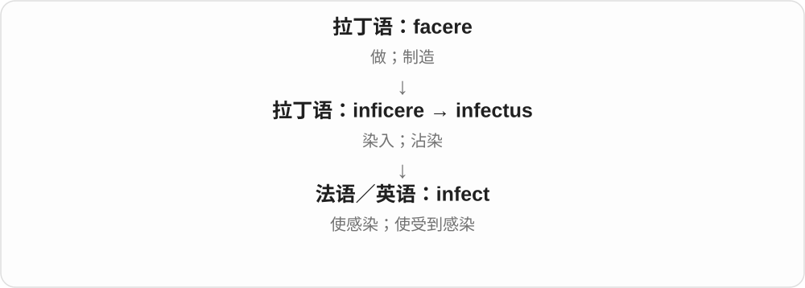

染入东西 → 使受到污染 → 使感染。情绪用法借同一种扩散画面，但 enthusiasm 的感染可以是好事。

**常见搭配与例句**

infect someone with…；infected tissue；infectious enthusiasm。

> The virus can infect several plant species.

这种病毒能感染几种植物。

> Her enthusiasm infected the whole team.

她的热情感染了整个团队。

**别混淆**

affect 是宽泛影响；infect 常涉及病原体或情绪的传播。

### 22. infection — 感染；感染性疾病；计算机受感染的状态

**音标**：/ɪnˈfekʃən/

**先抓住这个画面**

不是表面碰了一下，而是感染性因素进入宿主、建立相应过程。电脑被恶意程序侵入也借这个感染的画面。

**怎么拆**

经古法语 infection、infeccion 等接晚期拉丁 īnfectiō、inficere。更早有浸染、沾染的意义；现代对应 infect + -ion，不是 in- 否定 + fiction 小说。

**怎么变成今天的意思**

**拉丁 in- 向内 + facere 的相关形式 → inficere**  
浸入、染色；沾染、污染

↓

**拉丁 īnfectiō 经法语等 → infection**  
污染、感染；现代也借用于计算机感染

a bacterial infection 细菌感染，prevent infection 预防感染，a computer infection 计算机感染。infection 可说过程，也能可数说一次、某种感染。

**常见搭配与例句**

a bacterial infection；prevent infection；a computer infection。

> The textbook distinguishes bacterial and viral infections.

教材区分了细菌感染和病毒感染。

> The scan found signs of infection on the computer.

扫描发现了电脑受感染的迹象。

**别混淆**

infection 感染与 inflammation 炎症不同：前者说感染过程，后者说机体反应，不能只因中文相近便互换。

### 23. infected — 感染、使受感染了；受感染的〔过去式、过去分词〕

**音标**：/ɪnˈfektɪd/

**先抓住这个画面**

某种造成影响的东西进入其中，让原有状态被染上、改变，是 infected 的历史方向。现代常说生物感染，软件里也借说受到恶意程序影响。

**怎么拆**

infect + -ed，/t/ 后读 /ɪd/。较早拉丁 in- 进入与 facere 形成 inficere，分词 infectus，经法语等借入；旧有浸入、染色、使染上的用法。

**怎么变成今天的意思**

**拉丁 inficere、infectus → 法语等 → infect**  
浸入、染上 → 传染、使受感染

↓

**infect + -ed → infected**  
感染动作已发生；形容受到感染的状态

infected cells 受感染细胞；infected with 受某种病原、程序等感染；infected files 受恶意程序影响的文件。

**常见搭配与例句**

an infected computer 受感染的电脑；infected plants 受感染的植物。

> The study compared infected cells with unaffected cells.

研究比较了受感染细胞与未受影响细胞。

> The program identified several infected files.

程序识别出几个受感染文件。

**别混淆**

infected 说已经受到相应感染；infectious 常说能传染的性质。软件中的病毒是技术比喻，与生物病原的机制不同。

### 24. infective — 能引起感染的；具有感染作用的

**音标**：/ɪnˈfektɪv/

**先抓住这个画面**

重点是能让感染发生：病原体仍有这种作用时，可以说它 infective。常见于医学、实验报告，不是日常“笑声很有感染力”的首选。

**怎么拆**

历史接拉丁 infectivus、inficere 染入、使受污染的材料；现代可与 infect + -ive 对应，但有借入词形的历史。

**怎么变成今天的意思**

**拉丁 inficere、infectivus**  
染入、使受污染；具有相应作用

↓

**医学英语 infective**  
能引起感染的

an infective agent 能引起感染的因子；remain infective 保持感染能力。

**常见搭配与例句**

an infective agent；remain infective。

> The study examined how long the virus remained infective.

研究考察这种病毒能在多长时间内保持感染能力。

> The sample was tested for infective agents.

样本接受了感染因子检测。

**别混淆**

infective 与 infectious 在医学语境有重合；日常形容笑声、热情有感染力通常用 infectious，不随便替换成 infective。

### 25. aggressive — 好斗的；咄咄逼人的；积极进取的；强烈的

**音标**：英、美 /əˈɡresɪv/

**先抓住这个画面**

主动向前逼近，力度大到可能让别人有压力。

**怎么拆**

接拉丁 aggress-，来自 ad-“朝向” + gradī → aggredī“接近、进攻”；现代可按 aggress + -ive 理解。

**怎么变成今天的意思**

**拉丁 gradus；gradī / gradior**  
一步、台阶、等级；走、迈步

↓

**拉丁 ad- + gradī → aggredī → aggressus**  
朝对方迈去 → 接近、攻击

↓

**英语 aggressive**  
有进攻倾向的；采取强力行动的

aggressive behaviour 多为负面；aggressive marketing 说推广力度很大，是否赞许要看语境；aggressive disease 说发展迅速或严重。

**常见搭配与例句**

aggressive behaviour；an aggressive strategy；become aggressive。

> His aggressive tone made the discussion harder.

他咄咄逼人的语气让讨论更难进行。

> The company launched an aggressive marketing campaign.

公司开展了一场力度很大的营销活动。

**别混淆**

assertive 是清楚坚定地表达自己，不必侵犯别人；aggressive 容易带压迫或进攻感。

### 26. legislative — 立法的；有立法权的

**音标**：英 /ˈledʒɪslətɪv/；美 /ˈledʒɪsleɪtɪv/

**先抓住这个画面**

谈的不是执行现成规则，而是谁能制定规则、规则怎样被制定。

**怎么拆**

历史上由 legislator 的词干配 -ive 形成；现代也可与 legislate 对照，但不能把较晚出现的英语动词硬画成最初来源。

**怎么变成今天的意思**

**拉丁语 lex，属格 legis**  
法律、规则

↓

**拉丁语 legis lator / legislator**  
法律的提出者；lator 接 ferre“带来”的 latus 分支

↓

**英语 legislator**  
立法者、议员

↓

**英语 legislator 词干 + -ive → legislative**  
立法的；有立法权的

legislative power 是立法权；a legislative body 是立法机关；the legislative process 是法案审议、通过等立法流程。

**常见搭配与例句**

legislative power；a legislative body；legislative reform。

> The course explains the country’s legislative process.

这门课程解释该国的立法程序。

> The proposal needs legislative approval before it can take effect.

这项提案需要得到立法机关批准才能生效。

**别混淆**

executive 偏行政执行，judicial 偏司法裁判，legislative 偏制定法律。

### 27. productive — 有成效的；产出多的

**音标**：/prəˈdʌktɪv/

**先抓住这个画面**

productive 关心“忙过以后留下了什么”。讨论解决了问题、工作交出了成果，才叫 productive，不只是一直在动。

**怎么拆**

来自晚期拉丁语 prōductīvus，与 product、produce 同族；-ive 表示具有相关作用或倾向。

**怎么变成今天的意思**

可形容人、土地、会议或一天的工作。重点是实际产出；在语言学中也可说一种构词方式能不断产生新词。

**常见搭配与例句**

a productive meeting（有成效的会议）；a productive day（成果充实的一天）；productive land（高产土地）。

> We had a productive meeting and agreed on the next steps.

会议很有成效，我们确定了下一步安排。

> She is most productive early in the morning.

她清晨工作最有成效。

**别混淆**

busy 是忙；productive 是有产出。efficiency 还涉及花了多少投入，同样多的产出也可能消耗不同时间。

### 28. detective — 侦探；刑警；侦探题材的

**音标**：/dɪˈtektɪv/

**先抓住这个画面**

专门把隐藏的事实找出来的人。

**怎么拆**

detect 的 dētect- 词干 + -ive 先构成“用于侦查的”形容词；detective officer 等短语省掉后面的名词，得到 detective“侦探”。

**怎么变成今天的意思**

**拉丁 tegere / tectus**  
盖住；tectus 是分词词干

↓

**拉丁 dē- + tegere → dētegere / dētectus**  
去掉遮盖、揭露

↓

**英语 detective〔形容词〕→ detective officer**  
用于查明事实的 → 侦查人员

↓

**英语 detective〔名词〕**  
由较长职称省略而来；侦探、刑警

可以指警察系统里的侦查员，也可以指私人调查人员。detective story 是以查案为主的故事。它不是所有 police officer 的通称，也不保证一定是故事里那种单独破案的天才。

**常见搭配与例句**

a private detective；a police detective；a detective novel。

> The detective noticed that the two statements did not match.

侦探注意到两份陈述对不上。

> She enjoys detective novels with believable clues.

她喜欢线索可信的侦探小说。

**别混淆**

detector 通常是检测装置；detective 通常是调查的人。两者都接“发现”，承担任务的主体不同。

### 29. respective — 各自的；分别对应的

**音标**：/rɪˈspektɪv/

**先抓住这个画面**

respective 像把东西放回各自的格子：你的职责归你，我的职责归我。

**怎么拆**

来自中世纪拉丁语 respectivus，连着 respectus“关系、顾及”；现代可看出 respect + -ive。

**怎么变成今天的意思**

它保留“分别涉及某对象”的关系义，而不是尊敬义。their respective homes 就是每个人自己的家。

**常见搭配与例句**

our respective roles；their respective countries；the respective owners。

> The students returned to their respective classrooms.

学生们回到了各自的教室。

> We agreed on our respective responsibilities.

我们就各自的职责达成了一致。

**别混淆**

respective 不等于 respectful。respective roles 是各自职责，respectful behavior 才是尊重人的举止。

### 30. excessive — 过量的；过度的

**音标**：/ɪkˈsesɪv/

**先抓住这个画面**

不是单纯很多，而是超过合适、必要或允许的程度，多得成了问题，这才叫 excessive。

**怎么拆**

经法语 excessif 接中世纪拉丁 excessivus，现代对应 excess 过量 + -ive；历史与超出、越过界限的材料相联。

**怎么变成今天的意思**

**excess；法语 excessif、拉丁 excessivus 等**  
超出界限、过量的相关材料

↓

**英语 excessive**  
超过合适程度的

excessive noise 过大噪声；excessive costs 过高成本；excessive use 过度使用。

**常见搭配与例句**

excessive pressure；excessive spending。

> The machine stopped because of excessive heat.

机器因过热停了下来。

> The report criticized excessive spending on decoration.

报告批评在装修上花费过度。

**别混淆**

large 是量大，excessive 还判断多得不合适；大项目的费用很高，也不一定就 excessive。

### 31. innovative — 富有创新性的；采用新办法的

**音标**：英 /ˈɪnəvətɪv/；美 /ˈɪnəveɪtɪv/

**先抓住这个画面**

遇到问题时会换个办法来做，或者某个方案确实带来了新的做法，就可称 innovative。

**怎么拆**

innovate + -ive；英语形容词构词。

**怎么变成今天的意思**

**拉丁 novus**  
新的

↓

**拉丁 in- + novāre → innovāre / innovātus**  
使更新、引入变化

↓

**英语 innovate**  
革新；引入新方法

↓

**英语 innovate + -ive → innovative**  
革新 → 善于或体现革新的

可形容人、团队、方案。常带赞许语气，但新颖本身不保证有效，仍要看具体效果。

**常见搭配与例句**

an innovative design；an innovative approach；innovative thinking。

> The school adopted an innovative approach to teaching science.

学校采用了一种新颖的科学教学方法。

> The design is innovative, but it still needs testing.

这个设计有新意，但仍需要测试。

**别混淆**

creative 侧重想象、创造力；innovative 更突出引入新方法或改变现有做法。

### 32. intensive — 密集的；集中的；强度大的

**音标**：/ɪnˈtensɪv/

**先抓住这个画面**

intensive 像把很多时间、精力或资源集中投入到一小段过程里。

**怎么拆**

经法语 intensif 来自中世纪拉丁 intēnsīvus，与 intēnsus 同族。

**怎么变成今天的意思**

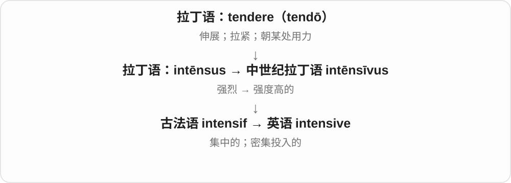

intensive course 是安排紧凑、学习投入多的课程。物理里的 intensive property 则指不随体系大小直接成比例变化的性质，如温度。

**常见搭配与例句**

intensive training；an intensive course；intensive care。

> She completed an intensive language course.

她完成了一门密集语言课程。

> The project required intensive preparation.

这个项目需要大量集中的准备工作。

**别混淆**

extensive 强调广度；intensive 强调集中投入。技术上的强度量也与广延量 extensive property 对照。

### 33. supportive — 给予支持的；鼓励人的

**音标**：英 /səˈpɔːtɪv/；美 /səˈpɔːrtɪv/

**先抓住这个画面**

supportive 常形容一种让人站得稳的态度：你遇到困难时，对方愿意听、鼓励，并在需要时帮一把。

**怎么拆**

support + -ive，构成描述性质或态度的形容词。

**怎么变成今天的意思**

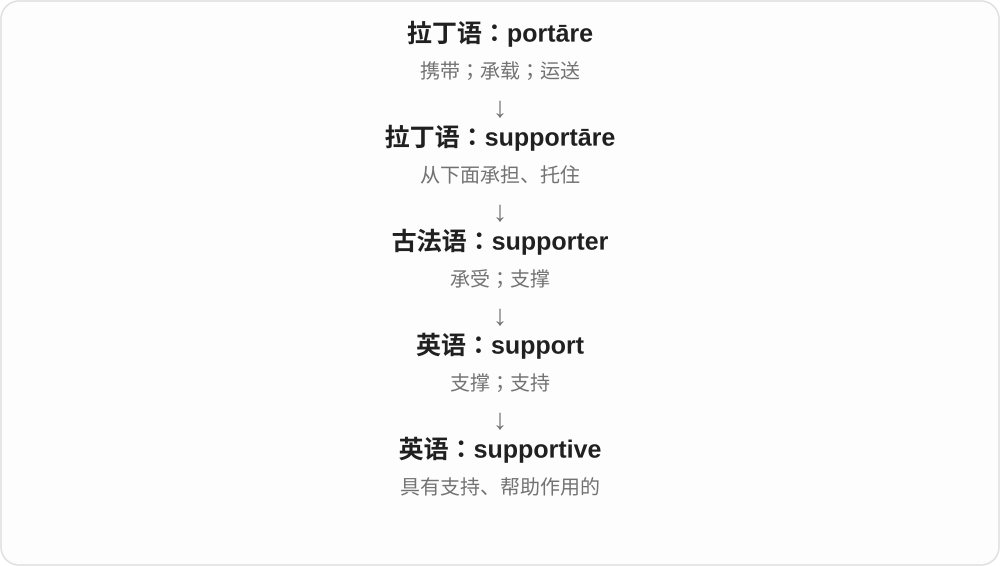

supportive parents 不只是口头同意，更能让孩子感到有人在支持自己。也可描述有帮助的环境或支持某计划的立场。

**常见搭配与例句**

a supportive friend（支持你的朋友）；a supportive environment（给予支持的环境）；be supportive of…（支持……）。

> Her friends were supportive during a difficult year.

在艰难的一年里，朋友们一直支持她。

> The manager was supportive of the new proposal.

经理对新提案持支持态度。

**别混淆**

supportive 侧重态度和作用；supporting 常直接表示辅助角色或具体支撑材料，如 supporting evidence。

### 34. extract — 提取；拔出；摘录；提取物

**音标**：动词 /ɪkˈstrækt/；名词 /ˈekstrækt/

**先抓住这个画面**

extract 是从里面把目标拿出来：从牙床拔牙，从植物提取物质，从长文摘出一段。

**怎么拆**

ex-（向外）+ trahere（拉）形成 extrahere，相关形式 extractum 进入英语。

**怎么变成今天的意思**

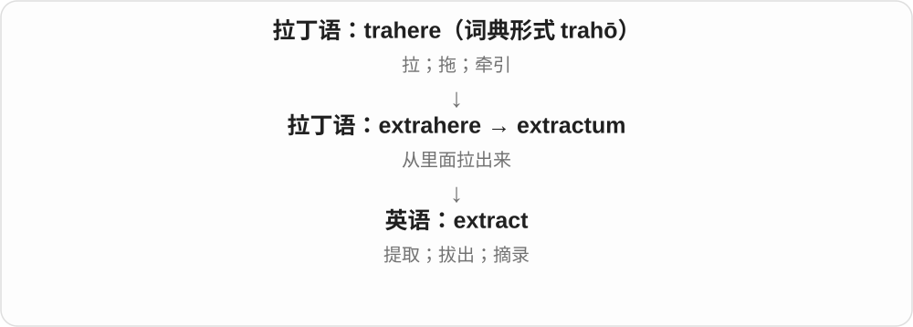

动作未必真要用力拉；现代数据处理中，extract 也能说把需要的数据取出来。名词可以指取出的物质或文章片段。

**常见搭配与例句**

extract data from…；extract a tooth；vanilla extract；an extract from a novel。

> The program extracts dates from the documents.

这个程序从文档中提取日期。

> We read an extract from her latest novel.

我们读了她最新小说中的一个片段。

**别混淆**

extract 常强调从更大整体中取出某部分；remove 只说移走。名词重音在前，动词在后。

### 35. extractive — 提取的；采掘的；榨取性的

**音标**：/ɪkˈstræktɪv/

**先抓住这个画面**

把东西从原来的地方拿出来，extractive 保留这个取出的画面。采矿是取资源；批评某种关系时，则可能说它只顾榨取价值。

**怎么拆**

extract + -ive；历史接拉丁 ex- 向外 + trahere 拉及 extract- 变化词干。

**怎么变成今天的意思**

**拉丁 ex- + trahere → extract-**  
向外拉、取出

↓

**extractive**  
与提取、采掘有关；引申为榨取性的

extractive industries 采掘业；an extractive process 提取过程。批评语境 an extractive model 常强调只取走价值、不充分回馈。

**常见搭配与例句**

extractive industries；extractive practices。

> Mining is a major extractive industry in the region.

采矿是该地区重要的采掘业。

> The author criticizes the platform’s extractive business model.

作者批评该平台榨取价值的商业模式。

**别混淆**

extractive 强调把资源、价值取出来；productive 强调生产。两词描述的角度不同，不能只当褒贬词机械互换。

### 36. incentive — 激励；促使人行动的因素

**音标**：/ɪnˈsentɪv/

**先抓住这个画面**

让人觉得“去做这件事是值得的”的那个推动因素。

**怎么拆**

拉丁 incinere“起调”形成 incentivus，晚期拉丁 incentivum 表激发物；转义可能受 incendere“点燃”影响，不是英文 in + cent“钱币”。

**怎么变成今天的意思**

**拉丁语 canere，词典形 cano**  
唱、吟诵

↓

**拉丁语 incinere → incentivus / 晚期拉丁语 incentivum**  
起调 → 激发；可能受 incendere“点燃”影响

↓

**英语 incentive**  
促使人行动的理由、奖励

奖金可以是 incentive，节省时间、获得认可也可以。an incentive to work 是促使工作的动力条件；它不必是内心已经产生的强烈欲望。

**常见搭配与例句**

an incentive to；financial incentives；provide an incentive。

> The discount gives customers an incentive to return.

折扣让顾客更有理由再次光顾。

> Saving time was our main incentive for changing the process.

节省时间是我们改变流程的主要动力。

**别混淆**

motivation 更常说人的动机、积极性；incentive 常是能激发动机的外部条件或利益。

### 37. incentives — 激励因素、诱因、奖励措施〔复数〕

**音标**：/ɪnˈsentɪvz/

**先抓住这个画面**

原本不一定想做，看到某个好处或理由后更愿意行动，这些推动因素就是 incentives。钱、认可、便利等都可能成为诱因。

**怎么拆**

incentive 接拉丁 incinere 起调、incentivus 与晚期拉丁 incentivum 激发物，和唱的词族相连；转义可能受 incendere 点燃影响。现代加 -s，/v/ 后读 /z/。

**怎么变成今天的意思**

**拉丁起调、激发材料 → incentive**  
带起声音、行动 → 推动人做事的理由

↓

**incentive + -s → incentives**  
多个激励因素、措施

incentives to learn 学习的激励；provide incentives 提供激励；financial incentives 金钱激励。

**常见搭配与例句**

strong incentives 强烈诱因；incentives for volunteers 给志愿者的激励。

> The game gives players small incentives to explore.

游戏给玩家一些小激励，鼓励他们探索。

> Recognition can create incentives to help the group.

得到认可会使人更愿意为集体出力。

**别混淆**

incentives 不只等于奖金。只要是让人更愿意做的理由，都可能这样说；也不保证这个理由一定有效。

### 38. abusive — 辱骂的；虐待的；滥用的

**音标**：常读 /əˈbjuːsɪv/；美语也读 /əˈbjuːzɪv/

**先抓住这个画面**

abusive 形容某种言语或行为会伤人、压人，而不只是态度不够客气。

**怎么拆**

经法语 abusif，追溯到拉丁语 abūsīvus。现代可与 abuse + -ive 对照；常见读音用 /s/，另有美语 /z/ 变体。

**怎么变成今天的意思**

abuse 是伤害性的行为或言语；abusive 则用来描述它的性质。an abusive relationship 说一段关系中存在虐待或控制，语气比“经常吵架”重。

**常见搭配与例句**

abusive language；abusive behavior；an abusive partner；an abusive use of power。

> The moderator removed the abusive comments.

管理员删除了那些辱骂性的评论。

> She left an abusive relationship and moved in with her sister.

她离开了一段存在虐待的关系，搬去和姐姐同住。

**别混淆**

rude 是没礼貌；abusive 常涉及辱骂、虐待或严重恶劣的对待。不要把所有不愉快的对话都说成 abusive。

### 39. decisive — 决定性的；果断的

**音标**：/dɪˈsaɪsɪv/

**先抓住这个画面**

事情还在摇摆时，这一下能把结果定住；说人时，则是能及时拿定主意。

**怎么拆**

中世纪拉丁 decisivus 接 decisus，英语也经法语 decisif 传入；现代对应 decide 与 -ive，但并非只能分析为英语新造。

**怎么变成今天的意思**

**拉丁 caedere，分词 caesus；复合词常见 -cidere / -cisus**  
切、砍、击杀

↓

**拉丁 de- + caedere → decidere；分词 decisus**  
切断 → 了结争执、作出判断

↓

**中世纪拉丁 decisivus；中古法语 decisif → 英语 decisive**  
能决定结果的；后来也指果断的

a decisive factor 是决定结果的因素；a decisive leader 是果断的领导。果断不自动保证判断正确。

**常见搭配与例句**

a decisive victory；a decisive factor；decisive action。

> Her experience was the decisive factor in the final choice.

她的经验是最终选择中的决定性因素。

> The team needed a decisive response to the sudden change.

团队需要果断应对突然的变化。

**别混淆**

decided 常是明确、确定的；decisive 更突出能把悬而未决的局面定下来。

### 40. subjective — 主观的；取决于个人感受的

**音标**：英、美 /səbˈdʒektɪv/

**先抓住这个画面**

同一道菜，有人觉得刚好，有人觉得太辣；判断受各自感受影响。

**怎么拆**

联系拉丁语 subiectivus，与 subject“主体”支线相连；现代主观义经历哲学用法的演变，不等于词根“下面”直接就是主观。

**怎么变成今天的意思**

**拉丁语：iacere；分词 iactus**  
投掷、抛出

↓

**拉丁语：sub- + iacere → subicere / subiect-**  
置于下面；使受支配

↓

**后期拉丁语 subiectivus → 英语 subjective**  
与主体有关；后来常指依个人感受的

subjective judgment 不自动表示错误；审美、疼痛体验等本就包含个人感受。

**常见搭配与例句**

a subjective judgment；highly subjective；subjective experience。

> Choosing the most beautiful painting is partly subjective.

挑选最美的画，在一定程度上取决于个人感受。

> The report separates measured results from subjective impressions.

报告把测量结果与主观印象分开。

**别混淆**

objective 尽量以外在事实为准；subjective 以观察者的感受或立场为重要部分。

### 41. collaborative — 合作的；依靠共同参与的

**音标**：/kəˈlæbərətɪv/

**先抓住这个画面**

工作方式是让参与者一起投入、互相接力，而不是各自闷头做完。

**怎么拆**

collaborate 的词基 + -ive，现代英语派生形容词。

**怎么变成今天的意思**

**拉丁语 labor**  
劳动、费力、辛苦；更早来源不确定

↓

**拉丁语 laborare**  
劳动、努力

↓

**拉丁语 com- + laborare → collaborare**  
一起工作

↓

**法语 collaborateur → 英语 collaborator；另有法语 collaborer、拉丁 collaboratus**  
先有合作者名词，以及相关法语、拉丁形式

↓

**英语 collaborate**  
可能从 collaborator 反构，或仿法语、拉丁语形成

↓

**英语 collaborate + -ive → collaborative**  
合作 → 以合作为特点的

collaborative writing 是共同写作；a collaborative person 愿意配合和一起想办法。它说明工作方式，不保证所有意见都完全一致。

**常见搭配与例句**

a collaborative project；collaborative learning；a collaborative approach。

> The course ends with a collaborative research project.

课程最后有一个合作研究项目。

> We need a more collaborative approach to solving these problems.

解决这些问题需要更注重协作的方法。

**别混淆**

collective 强调群体整体；collaborative 更强调成员之间有实际协作。

### 42. investigative — 调查性的；深入查证的

**音标**：/ɪnˈvestɪɡətɪv/，也读 /ɪnˈvestɪɡeɪtɪv/

**先抓住这个画面**

不满足于照搬一个说法，要继续追线索、核事实。

**怎么拆**

investigate 去词尾 e + -ive。

**怎么变成今天的意思**

**拉丁 vestigium**  
脚印、足迹、留下的痕迹

↓

**拉丁 vestigare → in- + vestigare → investigare**  
沿足迹追踪 → 深入查找、调查

↓

**英语 investigate**  
可能由 investigation 逆构，也可能直接接拉丁分词 investigatus

↓

**英语 investigative**  
与调查有关、以深入查证为特点的

investigative journalism 是通过调查发现事实的新闻报道，不只是把采访记录抄出来。investigative skills 则是搜集材料、辨认矛盾、追问原因等调查能力。

**常见搭配与例句**

investigative journalism；investigative reporting；investigative skills。

> The magazine published an investigative report on unsafe housing.

杂志刊登了一篇关于不安全住房的调查报道。

> The course helps students develop investigative skills.

这门课帮助学生培养调查能力。

**别混淆**

investigatory 也表示调查性的，常见于权力、程序等正式搭配；两者有重合，不必强分成相反含义。

### 43. adaptive — 能适应的；有适应作用的；会自动调节的

**音标**：英、美 /əˈdæptɪv/

**先抓住这个画面**

条件一变，它也会跟着改变，而不是死守一个设置。

**怎么拆**

adapt + -ive，英语形容词派生。

**怎么变成今天的意思**

**拉丁语：ad**  
朝向；靠近；加到

↓

**拉丁语：aptāre → adaptāre**  
使合适 → 调整到合适

↓

**中古英语 adapten → 英语 adapt**  
适应；改编

↓

**英语：adapt + -ive → adaptive**  
能随条件改变的

adaptive learning 会根据学习者表现调整内容；生物学里的 adaptive trait 是有助于适应环境的特征。

**常见搭配与例句**

adaptive behaviour；adaptive learning；an adaptive system。

> The app uses adaptive exercises that become harder as you improve.

这个应用的练习会随你的进步自动增加难度。

> Changing feeding times can be an adaptive response to heat.

改变进食时间可以是一种适应高温的反应。

**别混淆**

adaptable 常说“有被调整或适应的能力”；adaptive 常说“正在以变化作出适应”。

### 44. reflective — 反光的；沉思的；能反映某事的

**音标**：/rɪˈflektɪv/

**先抓住这个画面**

一面把光送回来；另一面把心思收回来，慢慢想清楚。

**怎么拆**

reflect + -ive，把动作变成一种性质或状态。

**怎么变成今天的意思**

**拉丁 flectere；分词 flexus**  
弯曲、使转向

↓

**拉丁 re- + flectere → reflectere**  
向后 + 弯转 → 折回

↓

**古法语 reflecter → 英语 reflect**  
反射；映出；回想、反思

↓

**英语 reflect + -ive → reflective**  
反射、思考 → 反光的、沉思的

reflective clothing 会把照来的光反射出去，让人更容易看见；a reflective mood 是安静回想、认真琢磨的心情。be reflective of a trend 则是“能反映某种趋势”，不是说趋势正在思考。

**常见搭配与例句**

reflective material；a reflective mood；reflective writing；be reflective of。

> The cyclist wore a jacket with reflective strips.

骑车的人穿着带反光条的外套。

> She became quiet and reflective after the meeting.

会后她安静下来，陷入思考。

**别混淆**

reflective 常表示认真思考；reflexive 在反应义中却常表示自动、未经思考。两者只差几个字母，意思可能正好不同。

### 45. cumulative — 逐渐累积的；累计的

**音标**：/ˈkjuːmjələtɪv/

**先抓住这个画面**

今天一点，明天一点，以前的没有清零，新的继续往上加，最终的效果或总数就是 cumulative。

**怎么拆**

接拉丁 cumulare 堆积、cumulatus 等材料与 -ive；也可与英语 cumulate 对应。与 accumulate、accumulation 同族，但不是把 accumulation 直接换一段尾就能说明全部历史。

**怎么变成今天的意思**

**拉丁 cumulus → cumulare、cumulatus**  
一堆 → 堆积起来

↓

**英语 cumulative**  
由接连增加而形成、累计的

a cumulative effect 累积效应；cumulative sales 累计销量；cumulative total 累计总数。

**常见搭配与例句**

a cumulative effect；a cumulative total。

> The cumulative effect of small delays was significant.

一次次小延误累积起来，影响很大。

> The chart shows cumulative sales since January.

图表显示了一月以来的累计销量。

**别混淆**

cumulative 说历次加起来，annual 说每年的；annual sales 与 cumulative sales 的统计区间不同。

### 46. descriptive — 描述性的；描写生动的

**音标**：/dɪˈskrɪptɪv/

**先抓住这个画面**

告诉你它是什么样、发生了什么，是 descriptive 的基本方向；如果文字细节鲜明，还能说描写得很生动。

**怎么拆**

与拉丁 describere 描写及 descript- 变化词干相联，再接 -ive；现代把 describe、description、descriptive 一起看，不把剩下的 descript 当作必须单背的常用动词。

**怎么变成今天的意思**

**拉丁 describere → descript- 等**  
写下、描写的材料

↓

**英语 descriptive**  
以描述为性质、用途；描写鲜明的

a descriptive passage 描写段落；descriptive statistics 描述统计；descriptive grammar 描述实际用法的语法研究。

**常见搭配与例句**

descriptive language；a descriptive account。

> The essay opens with a descriptive passage about the harbour.

文章开头描写了港口的景象。

> The report is descriptive and makes no forecast.

报告只作描述，没有作预测。

**别混淆**

descriptive 侧重描述，prescriptive 侧重规定应该怎样；predictive 侧重预测。三个形容词回答的问题不同。

### 47. restrictive — 限制性的；约束过多的

**音标**：/rɪˈstrɪktɪv/

**先抓住这个画面**

规定把活动空间收得很小，让人觉得不好施展。

**怎么拆**

现代与 restrict + -ive 对照；历史接中古拉丁 restrictivus，词典也记录法语 restrictif 参与，不是必须由英语 restrict 现造。

**怎么变成今天的意思**

**拉丁语 stringere**  
拉紧、捆紧、压在一起

↓

**拉丁语 re- + stringere → restringere**  
往回拉紧 → 限制、抑制

↓

**中古拉丁 restrictivus / 法语 restrictif → 英语 restrictive**  
使收紧的 → 限制性的

a restrictive policy 常带着“限制太多”的评价。语法中的 restrictive clause 是限定所指范围的从句，例如 the people who live here，who live here 指明是哪群人。

**常见搭配与例句**

restrictive rules；a restrictive agreement；a restrictive clause。

> The team found the approval process too restrictive.

团队觉得审批流程限制太多。

> A restrictive clause helps identify exactly which person or thing is meant.

限制性从句帮助明确所说的究竟是哪一个人或事物。

**别混淆**

restricted 说已经受限；restrictive 说某物在施加限制。

### 48. preventive — 预防性的；用于防止问题的

**音标**：/prɪˈventɪv/

**先抓住这个画面**

机器还没坏就保养，木头还没腐朽就做保护，这些措施目的在于防患于未然，是 preventive。

**怎么拆**

与新拉丁语 praeventīvus 相连；现代可按 prevent + -ive 理解，表示有预防作用的。

**怎么变成今天的意思**

它说明行动的目的，不表示所有风险已经归零。preventive maintenance 是为了避免故障而进行的维护。

**常见搭配与例句**

preventive measures；preventive maintenance；preventive action。

> The factory schedules preventive maintenance every month.

工厂每个月安排预防性维护。

> Simple preventive measures can reduce avoidable damage.

简单的预防措施可以减少本可避免的损坏。

**别混淆**

preventive 是预先防止；corrective 是纠正已经出现的问题。preventative 是同义的另一常见形式。

### 49. retrospective — 回顾的；追溯的；回顾展

**音标**：英 /ˌretrəˈspektɪv/；美 /ˌretroʊˈspektɪv/

**先抓住这个画面**

retrospective 像把镜头转向身后的路，重新看已经发生的事或一个人多年来的作品。

**怎么拆**

retro-（向后）与 spect-（看）相连；英语 retrospective 与 retrospect + -ive 对应。

**怎么变成今天的意思**

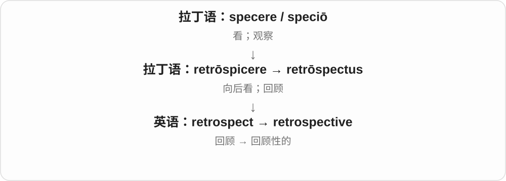

展览中可作名词，汇集艺术家不同时期作品。研究中表示利用已发生的资料回头分析。

**常见搭配与例句**

a retrospective exhibition；a retrospective study；a career retrospective。

> The gallery held a retrospective of her paintings.

画廊举办了她的绘画回顾展。

> The report offers a retrospective view of the project.

报告回顾了整个项目。

**别混淆**

prospective 朝未来看；retrospective 回头看。回顾不等于事先就已知道结果。

### 50. disruptive — 扰乱秩序的；使正常运行受阻的；改变既有格局的

**音标**：/dɪsˈrʌptɪv/

**先抓住这个画面**

它一出现，原来的活动或运行方式就难以照旧。

**怎么拆**

disrupt + -ive，把扰乱的动作转为具有这种作用的性质。

**怎么变成今天的意思**

**拉丁 rumpere；完成分词 ruptus**  
打破、断裂；被打破的

↓

**拉丁 dis- + rumpere → disrumpere／disruptus**  
分开打碎、使分裂

↓

**英语 disrupt**  
扰乱、破坏正常运行

↓

**英语 disrupt + -ive → disruptive**  
具有扰乱、破坏原有运作作用的

disruptive behaviour 指打乱课堂、会议等秩序的行为。商业报道里的 disruptive technology 常指改变现有市场格局的技术；严格的颠覆性创新理论还有特定含义，不能简单等于所有重大新发明。

**常见搭配与例句**

disruptive behaviour；a disruptive influence；disruptive technology。

> The teacher addressed the disruptive behaviour without stopping the whole lesson.

老师处理了扰乱课堂的行为，同时让课程继续进行。

> The article examines whether the new service is disruptive or merely convenient.

文章考察这项新服务究竟改变了原有格局，还是仅仅更方便。

**别混淆**

innovative 强调有新意；disruptive 强调对既有秩序或运行方式造成改变。新颖未必扰乱市场，扰乱也未必是好事。

### 51. deduce — 推断；推导出

**音标**：英 /dɪˈdjuːs/；美 /dɪˈduːs/

**先抓住这个画面**

deduce 像沿着几条线索走，最后走到一个结论。不是凭空猜，而是能指出“我是根据这些信息判断的”。

**怎么拆**

拉丁语 dē-（从……、离开）+ dūcere（引导），产生“引出、推导”的意思。

**怎么变成今天的意思**

日常 deduce 常是根据迹象推断；严格逻辑演绎要求结论由前提必然推出。不要把所有日常推断都当成数学证明。

**常见搭配与例句**

deduce that…（推断……）；deduce something from evidence（从证据推断某事）。

> From the wet coats, I deduced that it was raining outside.

从湿外套我推断外面正在下雨。

> What can we deduce from these figures?

我们能从这些数字推断出什么？

**别混淆**

deduce 是推断；deduct 是扣除。guess 可以没有充分线索，deduce 则突出根据。

### 52. deduction — 推断；演绎；扣除；扣除额

**音标**：/dɪˈdʌkʃən/

**先抓住这个画面**

deduction 一头是“从已有信息引出结论”，另一头是“从总数拿掉一部分”。所以它既能是推断，也能是扣款。

**怎么拆**

来自法语 déduction、拉丁语 dēductiō。它与 deduce“推断”和 deduct“扣除”共享来源，两种现代动词不能互换。

**怎么变成今天的意思**

读句子时看周围：logical deduction 谈推理；a deduction from pay 谈钱。一个名词保留两条意思，不代表所有同族动词也有两条。

**常见搭配与例句**

make a deduction（作出推断）；logical deduction（逻辑演绎）；a deduction from wages（工资扣款）。

> Your deduction fits all the facts we know.

你的推断与我们已知的事实都相符。

> The receipt shows a deduction of twenty dollars.

收据显示扣除了二十美元。

**别混淆**

deduce a conclusion 是推出结论；deduct a fee 是扣掉费用。两者的名词都可用 deduction。

### 53. deductive — 演绎的；基于演绎推理的

**音标**：/dɪˈdʌktɪv/

**先抓住这个画面**

先有一般规则，再看眼前情况符合什么条件，按规则推出结论，这是 deductive reasoning 的典型方向。

**怎么拆**

与拉丁 deducere 引出、推出的词族相联；现代对应 deduct + -ive，推理义可与 deduce、deduction 一起记，不等于把金额扣掉的全部场景。

**怎么变成今天的意思**

**拉丁 deducere，de- + ducere**  
引出、推出

↓

**deduction、deductive 等推理用法**  
由前提依规则推出结论

deductive reasoning 演绎推理；a deductive argument 演绎论证。结论靠不靠谱，还要看前提与推导是否成立。

**常见搭配与例句**

deductive reasoning；a deductive argument。

> The course introduces deductive reasoning through simple examples.

课程用简单例子介绍演绎推理。

> Her deductive argument relied on two stated assumptions.

她的演绎论证依赖两个明确说出的假设。

**别混淆**

deductive 通常从前提按规则推出结论；inductive 常从观察归纳一般规律。演绎这个标签本身不保证前提真实。

### 54. oppressive — 压迫性的；令人压抑的；闷热难耐的

**音标**：英 /əˈpresɪv/；美 /əˈpresɪv/

**先抓住这个画面**

像一层沉重的东西盖下来，人的活动空间或呼吸的轻松感都被挤掉。

**怎么拆**

来自中世纪拉丁语 oppressivus，与 opprimere、oppressus 同族；现代可分析为 oppress + -ive。

**怎么变成今天的意思**

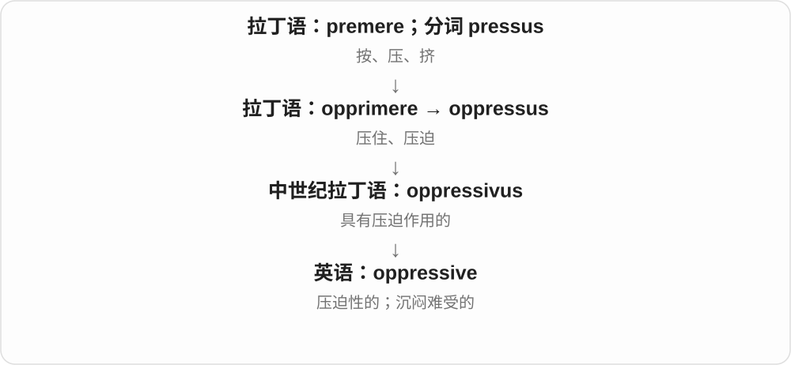

oppressive laws 是压迫性法律；oppressive heat 是闷热；an oppressive silence 是让人难受的沉默。

**常见搭配与例句**

an oppressive regime；oppressive heat；an oppressive atmosphere。

> The heat became oppressive by midday.

到中午时，天气已经闷热得让人难受。

> An oppressive silence filled the room.

房间里弥漫着令人压抑的沉默。

**别混淆**

oppressive 强调沉重、受压；depressing 强调令人沮丧。天气可以同时令人感到两者。

### 55. obsessive — 过分执着的；反复纠缠心思的；痴迷者

**音标**：/əbˈsesɪv/

**先抓住这个画面**

obsessive 像注意力被一个点牢牢吸住，反复回去检查、研究或担心。

**怎么拆**

obsess + -ive，表示具有这种持续纠缠、过度投入的特点。

**怎么变成今天的意思**

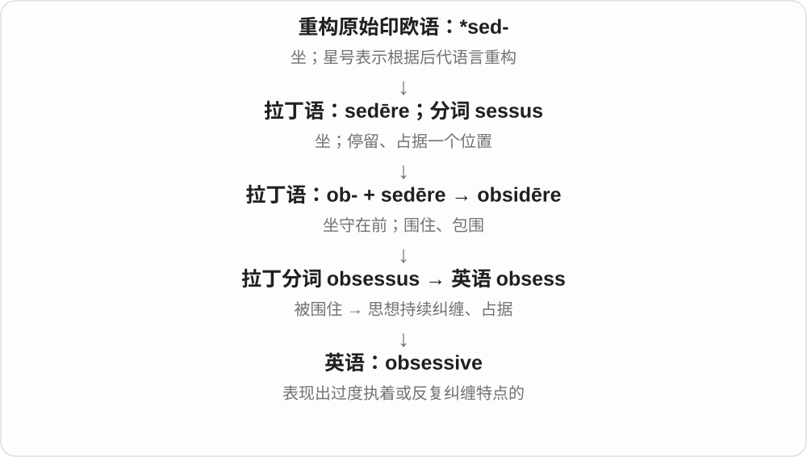

可形容 behaviour、attention、fear，也可作名词指痴迷者。日常说 obsessive about tidiness 并不等于给人作临床诊断。

**常见搭配与例句**

obsessive attention to detail；obsessive behaviour；obsessive about。

> His obsessive attention to detail slowed the editing process.

他对细节近乎执着的关注拖慢了编辑进度。

> The club attracts railway obsessives from across the country.

这个俱乐部吸引了全国各地的铁路迷。

**别混淆**

careful 是细心；obsessive 往往进一步暗示过头、难以停下来，临床术语另依具体语境。

### 56. expansive — 广阔的；范围大的；健谈开朗的

**音标**：/ɪkˈspænsɪv/

**先抓住这个画面**

空间舒展开来叫广阔；一个人的心情和谈话也向外打开，就显得健谈、热情。

**怎么拆**

拉丁 expāns- 是 expandere 的分词词干，接 -ive；现代与 expand / expansion 相连。

**怎么变成今天的意思**

**拉丁 pandere / pandō**  
展开、伸开

↓

**拉丁 expandere / expāns- + -ive → expansive**  
向外展开 → 广阔；性情开朗舒展

an expansive view 是开阔景观；an expansive mood 是愿意多说、热情外露的心情。后者不是在说此人体型变大。

**常见搭配与例句**

an expansive view；an expansive gesture；in an expansive mood。

> The balcony offers an expansive view of the valley.

从阳台望出去，山谷景色十分开阔。

> He was in an expansive mood and told us several stories.

他兴致很高，健谈地给我们讲了好几个故事。

**别混淆**

expansive 是广阔、舒展的；expensive 是昂贵的。只差一个字母，却不属于同一个意义系统。

### 57. predictive — 预测性的；用于预测的

**音标**：/prɪˈdɪktɪv/

**先抓住这个画面**

不是回头描述已经发生的事，而是拿信息往前看，估计还没发生的结果。

**怎么拆**

来自拉丁语 praedictīvus；现代可理解为 predict + -ive。

**怎么变成今天的意思**

a predictive model 是用于预测的模型；predictive value 是某个信息对预测结果能提供多少帮助。名称本身不保证模型准确。

**常见搭配与例句**

a predictive model；predictive accuracy；predictive value；predictive text。

> The team built a predictive model of customer demand.

团队建立了一个预测顾客需求的模型。

> This measure has little predictive value on its own.

单靠这个指标，几乎不能有效预测结果。

**别混淆**

predictive 是用来预测；predictable 是能被预测。天气模型可以 predictive，天气本身却未必 predictable。

### 58. degenerate — 退化、恶化；退化的；堕落者〔贬义名词〕

**音标**：动词 /dɪˈdʒenəreɪt/；形容词、名词 /dɪˈdʒenərət/

**先抓住这个画面**

讨论本来有秩序，后来变成相互指责，就是 degenerate into。物体、组织或关系也能从原有状态走向较差状态。

**怎么拆**

接拉丁 degeneratus、degenerare，de- 离开、向下等与 genus 种类、出身的材料。动词末尾 /eɪt/，形容词、名词弱读，专门学科的退化另有定义。

**怎么变成今天的意思**

**拉丁 de- + gener- 等 → degenerare、degeneratus**  
偏离原有类别、品质；变差

↓

**英语 degenerate**  
退化、恶化；评价或学科中的相应性质

degenerate into a quarrel 变成争吵；degenerate tissue 退变组织；a degenerate 作称人名词带强烈贬义。

**常见搭配与例句**

degenerate into；degenerate tissue。

> The discussion degenerated into a quarrel.

讨论变成了争吵。

> The textbook describes a degenerate case of the equation.

教材描述了这个方程的一种退化情形。

**别混淆**

degenerate 的专业退化义不必是道德谴责；把人骂作 a degenerate 则是在评价人，两种用法不能混。

### 59. degenerative — 退行性的；逐渐退化、恶化的

**音标**：/dɪˈdʒenərətɪv/

**先抓住这个画面**

原有结构、功能随着过程慢慢变差，degenerative 常用来形容这种退化性质；在医学里常修饰 disease、condition。

**怎么拆**

与 degenerate 退化的动词、形容词材料相联，加 -ive；现代对应词族关系，不必据此假定每个医学术语都是临时英语拼词。

**怎么变成今天的意思**

**degenerate**  
退化、失去原有状态的材料

↓

**degenerative**  
具有或引起退化性质的

a degenerative disease 退行性疾病；degenerative changes 退行性变化。具体病程要看具体疾病，不能从后缀推定速度。

**常见搭配与例句**

a degenerative condition；degenerative changes。

> The article explains the term degenerative disease.

文章解释了“退行性疾病”这个术语。

> The report described degenerative changes in the joint.

报告描述了关节的退行性变化。

**别混淆**

degenerative 说明变化性质，infective 说明感染有关的致病作用；退化不等于感染。

### 60. intrusive — 侵扰的；干涉隐私的；侵入的

**音标**：英、美 /ɪnˈtruːsɪv/

**先抓住这个画面**

东西或行为挤进来，占了你想保留的空间和注意力。

**怎么拆**

以拉丁 intrus- 分词词干加 -ive 解释，也有从英语 intrusion 改成形容词的分析。共同历史核心是 intrudere“推入”；不要把 -sive 当成另一个“推”的词根。

**怎么变成今天的意思**

**拉丁 intrudere → 分词词干 intrus-**  
向里推、挤入

↓

**intrus- + -ive；或英语 intrusion 改构**  
形成侵入、打扰的形容词

↓

**英语 intrusive**  
打扰生活或隐私；地质上指地下侵入成岩

intrusive questions 是问得太私密，让人觉得被越界；intrusive advertising 是广告不停挤到眼前。地质中的 intrusive rock 指岩浆在地下冷却形成的岩石，后来即使被侵蚀露出地面，分类也不因此改变。

**常见搭配与例句**

intrusive questions；intrusive advertising；intrusive thoughts；intrusive igneous rock。

> The interviewer avoided intrusive questions about her family.

采访者避开了有关她家人的过于私人的问题。

> The new player removes the intrusive adverts that interrupt every song.

这款新播放器去掉了那些打断每首歌的烦人广告。

> Granite is an intrusive rock that forms when magma cools underground.

花岗岩是一种由岩浆在地下冷却形成的侵入岩。

**别混淆**

obtrusive 重在碍眼、抢注意力；intrusive 重在侵入私人空间或正常活动。intrusive thoughts 指不由自主闯入的念头，单凭这个词不能判断某人患什么病。

### 61. elective — 可选择的；选修课；由选举产生的

**音标**：/ɪˈlektɪv/

**先抓住这个画面**

elective 像课程表里可以按兴趣选的一栏，核心是有选择。

**怎么拆**

elect + -ive。

**怎么变成今天的意思**

教育中是选修；职位可指民选；医疗中的 elective 通常指可计划安排的，不能直接等于不必要。

**常见搭配与例句**

an elective course；an elective office；an elective procedure。

> I chose photography as an elective.

我选了摄影作选修课。

> The position is elective rather than appointed.

这个职位通过选举产生。

**别混淆**

optional 泛指可选；elective 在课程、职位和医疗安排中有固定用法。

### 62. receptive — 乐于接受的；能接收的

**音标**：/rɪˈseptɪv/

**先抓住这个画面**

别人提出新想法，你愿意先听、考虑，而不是一开始就关门，这种开放态度是 receptive。

**怎么拆**

借中世纪拉丁 receptivus，接拉丁 receptus，来自 recipere 接受；recept- 是与 receive 对应的历史词干，不是 receipt 收据的唯一义。

**怎么变成今天的意思**

**拉丁 recipere 接受 → receptus → 中世纪拉丁 receptivus**  
能够接收、容纳

↓

**英语 receptive → receptivity**  
乐于接受、能接收；开放接受的性质

be receptive to ideas 愿意接受想法；a receptive audience 愿意听的观众；receptive language 理解性语言能力，专门用法。

**常见搭配与例句**

be receptive to；a receptive audience。

> The team was receptive to new ideas.

团队愿意听取新想法。

> She found a receptive audience for her proposal.

她的提案遇到了愿意听取的听众。

**别混淆**

receptive 是愿意接收、考虑，不保证最后同意；agree 是同意，阶段不同。

### 63. cohesive — 有凝聚力的；紧密结合的；整体协调的

**音标**：英 /kəʊˈhiːsɪv/；美 /koʊˈhiːsɪv/

**先抓住这个画面**

各部分不是各干各的，而能作为一个整体运作。

**怎么拆**

拉丁分词词干 cohaes- 加英语 -ive 形成形容词。并不是现代英语 cohesion 直接减掉 -ion 的历史过程。

**怎么变成今天的意思**

**拉丁 haerēre，相关词干 haes-**  
黏住、贴住、停在原处

↓

**拉丁 co- + haerēre → cohaerēre**  
黏在一起；相互连贯

↓

**拉丁分词词干 cohaes- + 英语 -ive → cohesive**  
能结合成整体的

a cohesive team 是关系紧密、协作良好的团队；a cohesive design 是元素互相照应，不显得东拼西凑。注意 s 读 /s/，与 cohesion 的 /ʒ/ 不同。

**常见搭配与例句**

a cohesive team；a cohesive group；a cohesive design。

> The workshop turned several separate ideas into a cohesive plan.

工作坊把几个独立想法整合成了一套完整协调的计划。

> They became a cohesive team after working together for a year.

一起工作一年后，他们成了一支有凝聚力的团队。

**别混淆**

coherent 更偏逻辑连贯；cohesive 更偏各部分紧密联系、形成整体。

### 64. corrective — 纠正性的；矫正的；纠偏措施

**音标**：英、美 /kəˈrektɪv/

**先抓住这个画面**

已经看见偏差，现在采取的办法就是把它修回来。

**怎么拆**

经法语 correctif，追到拉丁语 corrigere / correct- 的形容词支线；现代可理解为 correct + -ive。

**怎么变成今天的意思**

**拉丁语：regere**  
引导、使直；治理

↓

**拉丁语：corrigere**  
纠正、使正

↓

**拉丁语：correctus**  
已经纠正的；corrigere 的分词形式

↓

**法语：correctif**  
用于纠正的

↓

**英语：corrective**  
矫正的；纠偏办法

corrective action 是针对问题采取改进措施；corrective lenses 是用来矫正视力的镜片。名词 a corrective to 指能抵消某种偏颇的东西。

**常见搭配与例句**

take corrective action；corrective lenses；a corrective to…。

> The team took corrective action after the failed inspection.

检查未通过后，团队采取了纠正措施。

> The essay offers a useful corrective to the usual heroic account.

这篇文章有助于纠正惯常叙述中过度英雄化的倾向。

**别混淆**

preventive 着眼于事情发生之前；corrective 着眼于已发现的错误或缺陷。

### 65. secretive — 遮遮掩掩的；不愿透露情况的

**音标**：/ˈsiːkrətɪv/

**先抓住这个画面**

secretive 像一个人始终把抽屉关着，别人问到某件事，他也只肯透露一点点。

**怎么拆**

中古英语已有 secretife，现代对应 secret + -ive；这里讲日常“爱保密”的读音与用法。

**怎么变成今天的意思**

be secretive about plans 是对计划不愿多说。它通常让人感觉过分封闭或引起疑心；不是 secret 的所有用法都能换成它。

**常见搭配与例句**

secretive about；a secretive manner；a secretive organization。

> He has been unusually secretive about his new project.

他最近对新项目格外不愿透露情况。

> Her secretive manner made the others curious.

她遮遮掩掩的样子让其他人很好奇。

**别混淆**

secret meeting 是秘密会议；secretive person 是一个不愿透露情况的人。前者说事情保密，后者说行为倾向。

### 66. immersive — 让人沉浸其中的；沉浸式的

**音标**：英 /ɪˈmɜːsɪv/；美 /ɪˈmɜːrsɪv/

**先抓住这个画面**

体验把你的注意力包围起来，让你像进入了那个世界。

**怎么拆**

immerse 去词尾 e + -ive，形成形容词。

**怎么变成今天的意思**

**拉丁 mergere，分词 mersus**  
浸入、沉下去

↓

**拉丁 in- + mergere → immergere，分词 immersus**  
放入、浸在里面

↓

**英语 immerse**  
浸入液体 → 把注意力放进一件事

↓

**英语 immersive**  
能够使人投入、沉浸的

an immersive exhibition 可以通过声音、空间、故事等让人投入。它不自动表示必须戴头显，也不等于设备多；一本抓人的小说也能提供 immersive experience。

**常见搭配与例句**

an immersive experience；immersive storytelling；an immersive exhibition。

> Sound and lighting made the exhibition more immersive.

声音和灯光让展览更有沉浸感。

> The novel creates an immersive world with very little description.

这本小说用不多的描写就营造了一个让人投入其中的世界。

**别混淆**

immersive 修饰体验的吸引力或包围感；immersed 描述参与者已经投入的状态。

### 67. manipulative — 善于操控他人的；操作性的；数学操作教具

**音标**：英 /məˈnɪpjələtɪv/；美 /məˈnɪpjəleɪtɪv/

**先抓住这个画面**

manipulative 形容人时像暗中拉线，让别人照自己的意思走；教学中则可能是可以拿在手里摆弄的实物。

**怎么拆**

manipulate + -ive；动词本身由 manipulation 逆构。

**怎么变成今天的意思**

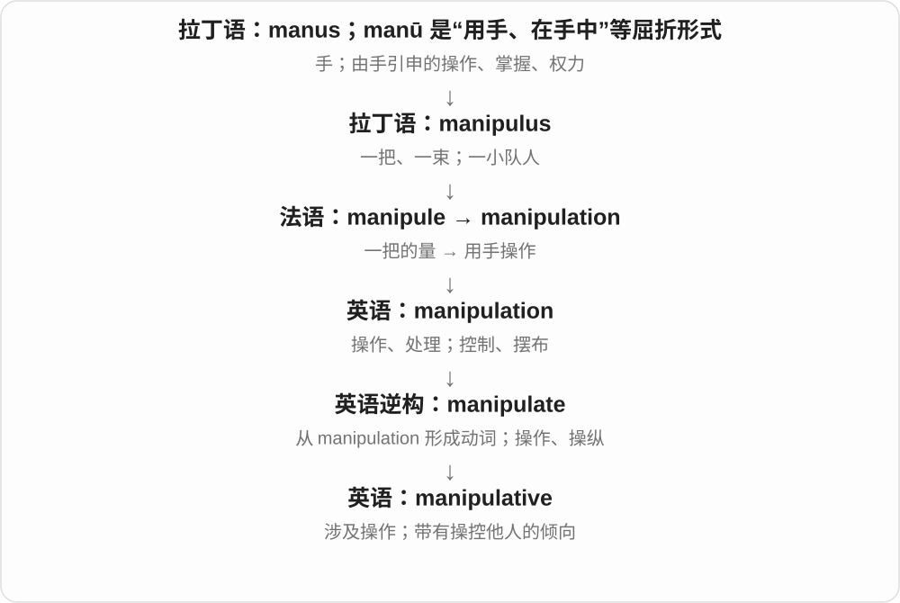

a manipulative person 常含贬义；math manipulatives 是积木、计数片等教具，名词复数没有阴险的意思。

**常见搭配与例句**

manipulative behaviour；a manipulative tactic；math manipulatives。

> The message used a manipulative appeal to guilt.

那条消息利用内疚感来操控对方。

> The teacher used manipulatives to explain fractions.

老师用实物教具解释分数。

**别混淆**

persuasive 是有说服力；manipulative 往往暗示绕过别人清楚、自主的判断，为自己谋求结果。

### 68. appreciative — 表示感谢的；懂得欣赏的

**音标**：/əˈpriːʃətɪv/

**先抓住这个画面**

能看见别人付出的价值，并把认可或感谢表现出来。

**怎么拆**

appreciate + -ive；尾部不是照动词完整读出 -ate。

**怎么变成今天的意思**

**拉丁 pretium**  
价格、价值、报酬

↓

**晚期拉丁 ad- + pretium → appretiāre / appretiātus**  
给出价格、估量价值

↓

**英语 appreciate**  
看出价值、欣赏、感谢；充分理解；增值

↓

**英语 appreciate + -ive → appreciative**  
懂得欣赏；表示感激的

an appreciative audience 会认真听、给予认可；an appreciative smile 是带着感激的笑。appreciative of 常接被感谢或欣赏的对象。

**常见搭配与例句**

be appreciative of；an appreciative audience；an appreciative smile。

> The musician played for a small but appreciative audience.

音乐家为一小群懂得欣赏的听众演奏。

> She was appreciative of the extra help.

她很感谢大家额外提供的帮助。

**别混淆**

appreciable 是大到能察觉的；appreciative 才是感激或会欣赏的，别只看共有的 appreciate。

### 69. conducive — 有助于……的；有利于……的

**音标**：英 /kənˈdjuːsɪv/；美 /kənˈduːsɪv/

**先抓住这个画面**

conducive 像一条顺路的坡：环境让某件事更容易发生。安静有助于专注，就可以说 conducive to concentration。

**怎么拆**

conduce（有助于）+ -ive（形容词），追溯到 condūcere。这里重点是“把事情带向某个结果”。

**怎么变成今天的意思**

通常不是保证结果一定发生，而是条件有利。to 在这里是介词，因此后面可接名词或 doing。

**常见搭配与例句**

conducive to learning（有利于学习）；an atmosphere conducive to discussion（有利于讨论的氛围）。

> A quiet room is conducive to careful reading.

安静的房间有利于仔细阅读。

> The schedule is not conducive to getting enough rest.

这个日程不利于获得足够休息。

**别混淆**

conducive 是有利于；conductive 是能传导热或电的。多一个 t，含义就不同。

### 70. seductive — 诱人的；有诱惑力的；带有性吸引力的

**音标**：/sɪˈdʌktɪv/

**先抓住这个画面**

某种诱惑像在旁边招手，让你离开原先的打算，想朝它走过去。

**怎么拆**

基于拉丁 seducere 引到一旁的分词词干 seduct- 加 -ive；se- 离开 + ducere 引导。现代与 seduce 诱惑对应。

**怎么变成今天的意思**

**拉丁前缀 se-／sed-**  
分开；离开；到一边

↓

**拉丁 se- + ducere → seducere，分词词干 seduct-**  
把人引到一边

↓

**seduct- + -ive → seductive**  
具有诱惑力，让人想追随的

可以形容人的魅力，也可以形容方案、承诺和想法。a seductive promise of easy success 是“轻松成功”的诱人承诺，常隐含它太好听、让人放下警惕；因此不限于性意味。

**常见搭配与例句**

a seductive smile；a seductive idea；the seductive promise of success。

> The offer was seductive, but the conditions were unclear.

这个提议很诱人，但附带条件并不清楚。

> The film gives its villain a calm, seductive voice.

影片让反派拥有一种平静而充满诱惑力的嗓音。

**别混淆**

attractive 是有吸引力的，seductive 更强调把人吸过去、让人难以抵抗的力量，有时暗含值得警惕。

### 71. adoptive — 收养关系中的；收养方的

**音标**：英 /əˈdɒptɪv/；美 /əˈdɑːptɪv/

**先抓住这个画面**

描述因收养而形成的家庭关系，常落在父母、家庭这一侧。

**怎么拆**

由古法语 adoptif 或拉丁 adoptivus 借入，远接 adoptare；英语 adoptive 的早期记录甚至早于 adopt。

**怎么变成今天的意思**

**拉丁语 optare**  
选择、希望；更早来源有争议

↓

**拉丁语 ad- + optare → adoptare**  
为自己选择 → 接纳、收养

↓

**拉丁语 adoptivus → 古法语 adoptif；亦可直接借拉丁语**  
属于收养关系的

↓

**英语 adoptive**  
收养的、因收养形成的

adoptive mother 是养母，adoptive family 是收养家庭。它不是说母亲本人被别人收养；具体关系方向需要结合名词判断。

**常见搭配与例句**

adoptive parents；an adoptive family；an adoptive mother。

> Her adoptive parents encouraged her to explore her family history.

她的养父母鼓励她了解自己的家庭历史。

> The workshop brings together members of adoptive families.

工作坊聚集了收养家庭的成员。

**别混淆**

adopted 常表示被收养；adoptive 常修饰收养方或收养关系。

### 72. suggestive — 使人联想到的；暗示的；有性暗示的

**音标**：英 /səˈdʒestɪv/；美 /səɡˈdʒestɪv/

**先抓住这个画面**

没有把话说透，却给你一根线，让你自己顺着想到某种意思。

**怎么拆**

suggest + -ive，在英语中形成；根部仍追到拉丁语 suggerere“提出、提供”。

**怎么变成今天的意思**

**拉丁语：sub + gerere → suggerere**  
从下送上、提供 → 把想法提到面前

↓

**拉丁语 suggestus → 英语 suggest**  
提出；使人联想到

↓

**英语：suggest + -ive → suggestive**  
能引起某种联想的

suggestive of rain 可以说某种迹象使人想到要下雨；a suggestive joke 通常指带性暗示的笑话。不是所有 suggestive 都有色情含义。

**常见搭配与例句**

suggestive of；a suggestive comment。

> The pattern is suggestive of a common source.

这种分布模式暗示它们可能有共同来源。

> The editor removed a suggestive joke from the children’s edition.

编辑从儿童版里删去了一则带性暗示的笑话。

**别混淆**

conclusive 能作定论；suggestive 只指向某个解释，还留着不确定空间。

### 73. correlate — 相关联；使对应；相关物〔名词〕

**音标**：动词：英 /ˈkɒrəleɪt/、美 /ˈkɔːrəleɪt/；名词末尾常 /lət/

**先抓住这个画面**

看两组变化是否有对应关系：一边变化时，另一边是否也按某种方式变化。correlate 把镜头放在这种关联。

**怎么拆**

cor- 是 con- 共同、一起的同化形式 + relate。现代形成使相互关联、呈相关关系的用法；动词词尾 -ate 读 /eɪt/，名词常弱读。

**怎么变成今天的意思**

**拉丁 referre 带回，其分词 relātus → 法语 relater 等**  
带回消息、报告、讲述

↓

**英语 relate 的发展**  
讲述；联系、有关联；再有心理上的理解、共鸣

↓

**cor- + relate → correlate**  
使建立对应关系；有相关性

correlate with 与……相关，correlate A with B 比较、联系A与B，a correlate of 某物的相关物〔名词〕。统计里方向可正可负，具体强弱靠数据分析。

**常见搭配与例句**

correlate with；correlate A with B；a correlate of。

> The two measurements correlate closely.

这两项测量结果关系密切。

> The study asks whether the scores correlate with experience.

研究考察分数是否与经验有关联。

**别混淆**

correlate 说明关联，不自动证明一项造成另一项。相关也不要求两条线每一点完全同步、数值相同。

### 74. correlative — 相互关联的；成对呼应的

**音标**：英 /kəˈrelətɪv/；美 /kəˈrelətɪv/

**先抓住这个画面**

两个部分不是孤零零各说各话，而是相互对应、一起起作用，这叫 correlative。语法里的 both…and… 就是一对呼应形式。

**怎么拆**

可按 correlate + -ive 或 cor- 与 relative 的相应材料理解；历史上属于共同关联、相互对应的词族，别从后缀推导因果。

**怎么变成今天的意思**

**correlate、relative 等关联材料**  
联系、对应

↓

**correlative**  
相互关联、配对呼应的

correlative conjunctions 呼应连词；a correlative relationship 相互关联的关系。这里先讲形容词，不另列连词本身为词条。

**常见搭配与例句**

correlative conjunctions；correlative terms。

> The grammar chapter explains correlative conjunctions.

语法这一章解释成对呼应的连词。

> The study found a correlative relationship but did not establish causation.

研究发现了关联关系，但没有确定因果关系。

**别混淆**

correlative 是相互关联；causal 是因果的。一起变化不自动证明一个造成另一个。

### 75. assertive — 敢于表达立场的；坚定自信的

**音标**：英 /əˈsɜːtɪv/；美 /əˈsɜːrtɪv/

**先抓住这个画面**

清楚说出“我需要什么、我不同意哪里”，同时给别人保留表达空间。

**怎么拆**

现代可分析为 assert + -ive；词源资料也列中世纪拉丁语 assertivus 的借入路线。早期重在明确宣称，后来常形容坚持自身立场。

**怎么变成今天的意思**

**拉丁语 serere**  
把东西连接、排列在一起

↓

**拉丁语 ad- + serere → asserere / assertus**  
提出权属主张；断言、维护

↓

**两种分析：中世纪拉丁语 assertivus；英语 assert + -ive**  
宣称的、坚定表达的

↓

**英语 assertive**  
敢于表达立场和需要的

沟通培训中常把 assertive 与 aggressive 区分：前者清楚坚定，后者可能带攻击、压迫。其他语境中 assertive 也可偏强势，要看语气。

**常见搭配与例句**

an assertive response；be assertive about one’s needs。

> She gave a calm but assertive response.

她平静而坚定地作了回应。

> The course helped him become more assertive in meetings.

这门课帮助他在会议上更敢于表达意见。

**别混淆**

passive 是消极不表达；assertive 明确表达；aggressive 则可能侵犯别人边界。

### 76. repulsive — 令人厌恶的；排斥的

**音标**：/rɪˈpʌlsɪv/

**先抓住这个画面**

某种样子、气味或行为让你想立刻退开；物理里则是真正有力把东西推开。

**怎么拆**

法语 repulsif 接中世纪拉丁 repulsīvus，来自 repellere 的分词 repulsus；不是英语 repel 直接替换尾字母的历史。

**怎么变成今天的意思**

**拉丁 pellere；过去分词 pulsus**  
推、驱赶、击打

↓

**拉丁 repellere → repulsus → 中世纪拉丁 repulsīvus**  
推回 → 有排斥作用的

↓

**法语 repulsif → 英语 repulsive**  
排斥的；使人反感的

日常通常是很强的负面评价；repulsive force 则是中性的排斥力。根据宾语判断是感受还是物理关系。

**常见搭配与例句**

a repulsive smell；repulsive behaviour；a repulsive force。

> A repulsive smell came from the abandoned fridge.

废弃冰箱里传出一股令人作呕的气味。

> The diagram shows the repulsive force between the particles.

图示展示了粒子之间的排斥力。

**别混淆**

unpleasant 是令人不舒服；repulsive 通常强得多，带明显厌恶和退避感。

### 77. repressive — 压制性的；限制自由的

**音标**：英 /rɪˈpresɪv/；美 /rɪˈpresɪv/

**先抓住这个画面**

不让声音出来、不让人自由行动，靠持续压制维持控制。

**怎么拆**

经古法语 repressif 或直接借自中世纪拉丁语 repressivus，根在 reprimere“遏制”的分词词干 repress-；现代可对照 repress + -ive。

**怎么变成今天的意思**

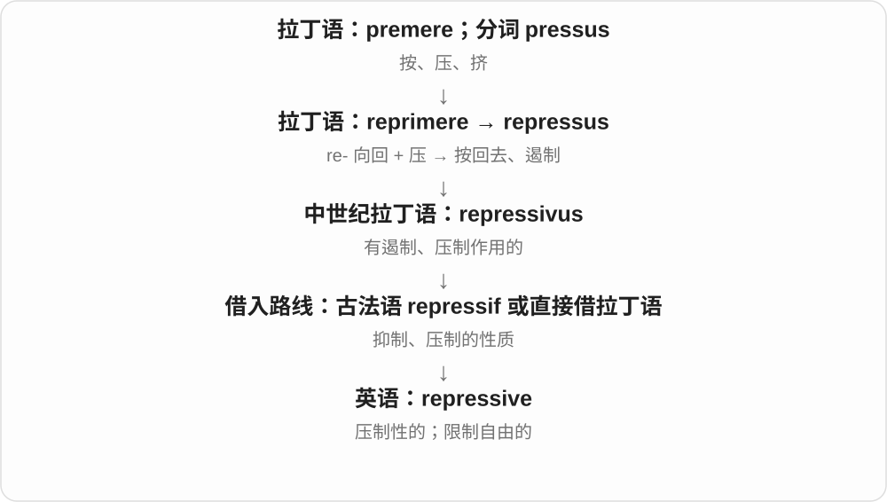

常修饰 laws、regime、measures，带明显负面评价；不是任何严格要求都自然叫 repressive。

**常见搭配与例句**

repressive laws；a repressive regime；repressive measures。

> The report criticized the country’s repressive laws.

报告批评了该国压制自由的法律。

> The novel explores life under a repressive regime.

小说探讨了压制性政权下的生活。

**别混淆**

repressive 着重限制表达和自由；oppressive 更宽地说沉重、不公正的压迫。

### 78. compress — 压缩；挤紧；压敷布

**音标**：动词：英、美 /kəmˈpres/；名词：英 /ˈkɒmpres/、美 /ˈkɑːmpres/

**先抓住这个画面**

把松散的空间挤小：行李压紧，文字缩短，文件也换成占空间更少的表示。

**怎么拆**

拉丁语 com- 一起 + premere → comprimere；后经 compressus、compressāre、法语 compresser 等形式进入英语。

**怎么变成今天的意思**

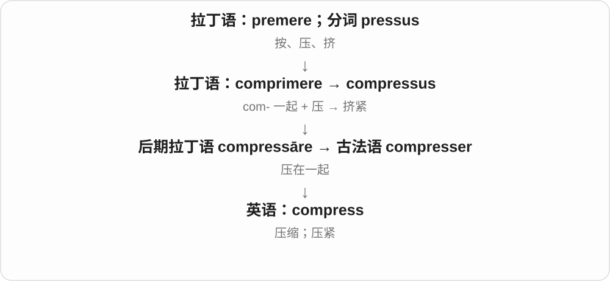

compress a file 是压缩文件；compress a report into two pages 是把报告缩至两页。名词 a cold compress 指冷敷用的布或敷垫，重音在前。

**常见搭配与例句**

compress into；compress data；a cold compress。

> The software can compress the images without changing their dimensions.

软件可以压缩这些图片的数据，而不改变像素尺寸。

> She compressed a long explanation into three sentences.

她把一大段解释浓缩成了三句话。

**别混淆**

compress 强调变得紧凑、体积或篇幅减小；suppress 强调把表现或发展压住。

### 79. compressive — 压缩的；受压的；产生挤压作用的

**音标**：/kəmˈpresɪv/

**先抓住这个画面**

从两端往里压，让东西承受挤压，这个压的方向就是 compressive 的核心，工程里常用来修饰力、应力、强度。

**怎么拆**

compress 压缩 + -ive；compress 的历史接拉丁 com- 一起与 premere 压及 compress- 等变化材料。

**怎么变成今天的意思**

**拉丁 com- + premere → compress- 等**  
一起压、压紧

↓

**compress + -ive → compressive**  
与挤压、压缩作用有关的

compressive force 压力；compressive stress 压应力；compressive strength 抗压强度。

**常见搭配与例句**

compressive stress；compressive strength。

> The sample was tested under a compressive load.

样品在压缩载荷下接受测试。

> The report compares the compressive strength of the two materials.

报告比较两种材料的抗压强度。

**别混淆**

compressive 是往里压；tensile 是拉伸的。材料抗压强，不代表抗拉也同样强。

### 80. conductive — 导电的；导热的

**音标**：/kənˈdʌktɪv/

**先抓住这个画面**

conductive 形容一条通得过去的路：某种材料能让电或热通过。

**怎么拆**

conduct + -ive，形成形容词。这里的 conduct 用的是“传导”义。

**怎么变成今天的意思**

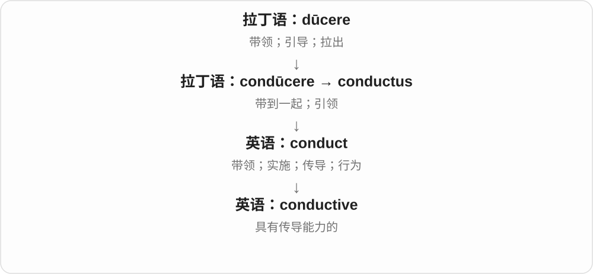

常见于材料说明。electrically conductive 指导电；thermally conductive 指导热，最好看清修饰词。

**常见搭配与例句**

conductive material（导电或导热材料）；conductive ink（导电油墨）；thermally conductive（导热的）。

> The sensor uses a thin layer of conductive ink.

传感器使用了一层薄薄的导电油墨。

> The design requires a thermally conductive material.

这项设计需要一种导热材料。

**别混淆**

conductive 谈传导性能；conducive to 谈某个条件有利于某种结果。不能说 a conducive wire 表示导线导电。

### 81. dismissive — 轻视的；不屑一顾的

**音标**：/dɪsˈmɪsɪv/

**先抓住这个画面**

dismissive 像别人刚开口，你就摆摆手：“这不值得谈。”重点是把对方的话轻轻推开、不认真看待。

**怎么拆**

dismiss + -ive。

**怎么变成今天的意思**

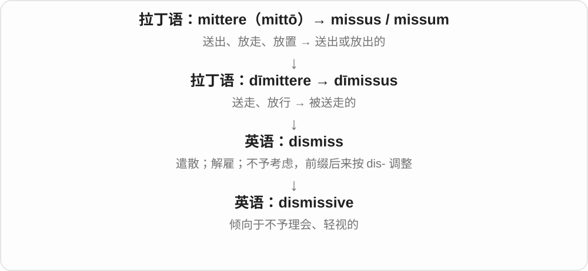

通常形容态度、语气或动作，而不是正式解雇人的手续。可以表达批评：对方没有给足认真考虑。

**常见搭配与例句**

a dismissive tone；a dismissive gesture；be dismissive of… 。

> He was dismissive of her concerns.

他对她的担忧不屑一顾。

> A dismissive shrug ended the conversation.

一个不以为然的耸肩结束了谈话。

**别混淆**

critical 可以认真分析后批评；dismissive 常带不愿仔细听、轻视的感觉。

### 82. instinctive — 本能的；不假思索的；自然产生的

**音标**：/ɪnˈstɪŋktɪv/

**先抓住这个画面**

反应快过了有意识的盘算：手先伸过去接住东西，之后才意识到自己做了什么。

**怎么拆**

可按 instinct + -ive 理解，也有从拉丁分词词干 instinct- 加 -ive 的分析。不要把它说成一个已经查明的拉丁 instinctivus 借词。

**怎么变成今天的意思**

**拉丁 instinguere〔in- + stinguere〕**  
激起、驱使；有向内刺激的形象

↓

**拉丁 instinctus**  
推动、冲动；动词分词的名词化

↓

**拉丁词干 instinct- 与 -ive；也可对应英语 instinct + -ive**  
形成描述本能、自然反应的形容词

↓

**英语 instinctive**  
出于本能或不假思索的

an instinctive reaction 是自发反应；an instinctive dislike 是说不清理由就产生的反感。熟练技能也可被日常语言称为 instinctive，不代表训练完全没作用。

**常见搭配与例句**

an instinctive response；an instinctive dislike；instinctive behaviour。

> She made an instinctive move to catch the falling glass.

她本能地伸手去接掉下来的杯子。

> His instinctive dislike of the idea softened after he heard the details.

听完细节后，他最初对这个主意的直觉性反感减轻了。

**别混淆**

instinctual 也表示与本能有关，较常用于本能冲动的讨论；instinctive 广泛描述自然、立即的反应，二者并无绝对界线。

### 83. illustrative — 说明性的；用作例证的

**音标**：英 /ɪˈlʌstrətɪv/；美 /ɪˈlʌstrətɪv/

**先抓住这个画面**

illustrative examples 是拿来帮你看懂的例子，illustrative figures 是说明问题的数字、图示。它强调起说明作用，不保证样本完整或数值就是最后结果。

**怎么拆**

对应 illustrate + -ive，使用 illustrat- 词干，去末尾 e 加 -ive → illustrative。形成具有说明、展示作用的形容词。

**怎么变成今天的意思**

**拉丁语 illustrare 照亮、使清楚 → illustratus、illustratio 等**  
光照与使人明白的比喻

↓

**英语 illustration 等 → illustrate，也有拉丁分词形式影响**  
举例说明、配图说明；+ -or、-ive

↓

**illustrat- + -ive → illustrative**  
用于说明、展示、举例的

an illustrative example 说明性例子；for illustrative purposes 为了说明；illustrative of 体现、说明……。

**常见搭配与例句**

an illustrative example；for illustrative purposes。

> The figures are included for illustrative purposes.

这些数字列出来是为了便于说明。

> The case is illustrative of a wider problem.

这个案例说明了一个更广泛的问题。

**别混淆**

illustrative 与 illustrated 不同：前者说有说明作用，后者常说已经配图的。

### 84. instructive — 有启发性的；能让人学到东西的

**音标**：/ɪnˈstrʌktɪv/

**先抓住这个画面**

instructive 像看别人把一个错误走完，你一下明白了“原来问题出在这里”。

**怎么拆**

instruct + -ive，表示能起到教导、启发作用。

**怎么变成今天的意思**

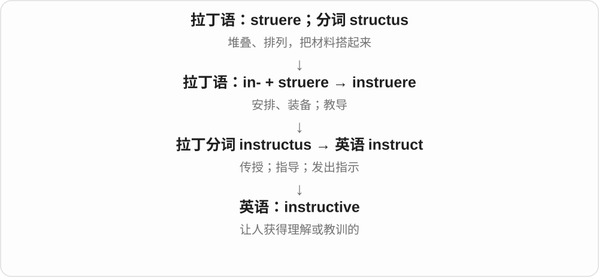

an instructive example 是能说明问题的例子；it is instructive to compare… 表示把两者比较一下会很有收获。失败也可以很 instructive。

**常见搭配与例句**

an instructive example；an instructive comparison；it is instructive to。

> Comparing the two drafts was surprisingly instructive.

比较这两份草稿出乎意料地让人受益。

> The failed experiment provided an instructive example of the problem.

这次失败的实验提供了一个很能说明问题的例子。

**别混淆**

informative 强调提供有用信息；instructive 常进一步强调帮助理解规律、方法或教训。

### 85. vindictive — 爱报复的；怀恨在心的

**音标**：/vɪnˈdɪktɪv/

**先抓住这个画面**

一点得罪也记很久，有机会就想让对方难受，vindictive 常在批评这种强烈的报复心。

**怎么拆**

来自拉丁 vindicta 复仇等材料与 -ive；和 vindicate 同属较远历史词族，却不是“证明正确”的形容词。

**怎么变成今天的意思**

**拉丁 vindicare、vindicta 等**  
主张权利、保护、申辩、报复等相关意义材料

↓

**英语 vindicate 与 vindictive**  
证明无辜、证明正确；另一支是爱报复的

a vindictive person 爱记仇、报复的人；vindictive behaviour 报复行为。

**常见搭配与例句**

a vindictive attack；a vindictive response。

> She described the dismissal as a vindictive act.

她认为这次解雇是一次报复行为。

> He became bitter and vindictive after the dispute.

争执后，他变得怨恨而爱报复。

**别混淆**

vindictive 与 vengeful 都可说报复心；vindicate 的今天常用义是洗清指责、证明正确，不能望形乱译。

### 86. coerce — 强迫；胁迫

**音标**：英 /kəʊˈɜːs/；美 /koʊˈɜːrs/

**先抓住这个画面**

对方本来不愿意，却被威胁、强力或压力逼着做，这叫 coerce。重点不是说服他想通，而是压着他不得不做。

**怎么拆**

借拉丁 coercere，关联 co- 一起 + arcere 围住、限制的材料；从约束走到强迫。现代不能拆成 co + 一个独立英语 erce。

**怎么变成今天的意思**

**拉丁 co- + arcere → coercere**  
一起收拢、围住、约束

↓

**英语 coerce → coercive**  
强迫；带强制、胁迫性质的

coerce someone into doing something 胁迫某人做某事；be coerced into 被迫……。

**常见搭配与例句**

coerce someone into signing；coerce someone into agreeing。

> They tried to coerce him into signing the statement.

他们试图逼他签下声明。

> She said she had been coerced into accepting the deal.

她说自己是被迫接受这笔交易的。

**别混淆**

persuade 侧重说服，coerce 侧重强迫；同样得到了同意，不代表过程相同。

### 87. coercive — 强制的；胁迫性的

**音标**：英 /kəʊˈɜːsɪv/；美 /koʊˈɜːrsɪv/

**先抓住这个画面**

不是只下了一个建议，而是用后果、惩罚或强力把人逼向某个选择；这种手段、权力可以说 coercive。

**怎么拆**

对应 coerce 去 e 加 -ive → coercive，形容具有强迫性质或作用。

**怎么变成今天的意思**

**拉丁 co- + arcere → coercere**  
一起收拢、围住、约束

↓

**英语 coerce → coercive**  
强迫；带强制、胁迫性质的

coercive measures 强制措施；coercive power 强制性权力；coercive tactics 胁迫手段。

**常见搭配与例句**

coercive measures；coercive pressure。

> The committee opposed the use of coercive tactics.

委员会反对使用胁迫手段。

> The essay examines the limits of coercive power.

文章探讨强制性权力的边界。

**别混淆**

coercive 常突出逼迫，compulsory 常突出按规则必须做；要看措施实际怎样起作用，不只是换个正式说法。

### 88. obstructive — 阻挠的；妨碍通行的；阻塞性的

**音标**：/əbˈstrʌktɪv/

**先抓住这个画面**

obstructive 描写“老是在前面挡一下”的人、做法或状况。

**怎么拆**

obstruct + -ive，表示造成阻碍的。

**怎么变成今天的意思**

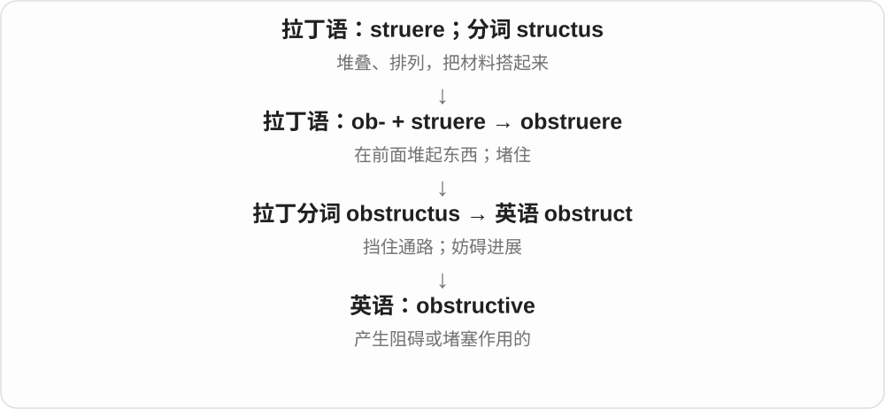

说一个人 obstructive，通常在批评他故意不配合。医学术语中的 obstructive 则表示某条通道受到阻塞，没有道德评价。

**常见搭配与例句**

obstructive behaviour；an obstructive attitude；obstructive measures。

> His obstructive attitude made a simple task much harder.

他处处阻挠的态度让一件简单任务难了许多。

> The chair asked members to stop using obstructive tactics.

主席要求成员停止采取阻挠手段。

**别混淆**

critical 可以提出必要的批评；obstructive 带“妨碍事情正常进行”的负面判断，不能把一切不同意见都叫 obstructive。

### 89. regressive — 倒退的；退行的；累退的

**音标**：英、美 /rɪˈɡresɪv/

**先抓住这个画面**

越走越回到旧状态；税制里则是负担占比向低收入者倾斜。

**怎么拆**

现代可按 regress + -ive 理解；词源资料也有拉丁 regressīvus 借入分析。

**怎么变成今天的意思**

**拉丁 gradus；gradī / gradior**  
一步、台阶、等级；走、迈步

↓

**拉丁 regredī → regressus；拉丁 regressīvus 或英语 regress + -ive**  
回退；形成“回退的”形容词

↓

**英语 regressive**  
倒退的；税负比例随收入增加而下降的

regressive tax 说低收入者缴税占收入的比例较高，不是说高收入者缴的绝对金额一定更少。

**常见搭配与例句**

a regressive policy；regressive taxation；regressive behaviour。

> The report describes the sales tax as regressive.

报告把这种销售税描述为累退税。

> She regarded the ban as a regressive policy.

她认为这项禁令是一项倒退的政策。

**别混淆**

progressive tax 的税负比例随收入增加而上升；regressive 的方向相反。

### 90. integrative — 起整合作用的；综合多方面的

**音标**：英 /ˈɪntɪɡreɪtɪv/；美 /ˈɪntəˌɡreɪtɪv/

**先抓住这个画面**

一种方法把分散的观点或工具拉到一起考虑。

**怎么拆**

integrate + -ive，去词尾 e；形容有整合作用或倾向。

**怎么变成今天的意思**

**拉丁 integer**  
完整、未受损；历史上与否定 in- 和 tangere 触碰的词根有关

↓

**拉丁 integrare → integratus → 英语 integrate**  
使完整 → 完整的；英语后来用作整合的动词

↓

**英语 integrate + -ive → integrative**  
整合 → 促进整合的

an integrative approach 会结合多个角度处理同一问题；an integrative review 会综合不同研究。重点在做综合的方式，不保证所有分歧都已经消除。

**常见搭配与例句**

an integrative approach；integrative thinking；an integrative review。

> The course takes an integrative approach to language and culture.

这门课把语言与文化结合起来教学。

> Her review offers an integrative account of several competing theories.

她的综述综合讨论了几种相互竞争的理论。

**别混淆**

integrated 强调已整合的状态；integrative 强调促成整合的方法或作用。

### 91. recessive — 隐性的〔遗传学〕；退缩、后退的〔较少用〕

**音标**：/rɪˈsesɪv/

**先抓住这个画面**

在简单的显隐性遗传例子里，一种等位基因对应的性状被另一种掩住，没有表现出来；recessive 的常用科学义就是这种隐性关系。不是说它不存在。

**怎么拆**

与拉丁 recedere 后退及其变化词干 recess- 相联，或经新拉丁 recessivus；-ive 构成形容词。退到后面的历史画面被用于遗传学命名，不代表基因真的往后走。

**怎么变成今天的意思**

**拉丁 recedere → recess-、recessivus 等**  
后退、退居的材料

↓

**遗传学 recessive**  
在相应显隐性关系中被掩盖的

a recessive allele 隐性等位基因；a recessive trait 隐性性状。常见常染色体简单模型里通常需两个相应隐性拷贝才表现；具体遗传方式仍要看所讨论的情况。

**常见搭配与例句**

a recessive allele；recessive inheritance。

> The lesson uses a simple example of a recessive trait.

这节课用一个简单例子讲隐性性状。

> The researchers studied the inheritance of a recessive allele.

研究者研究了一种隐性等位基因的遗传。

**别混淆**

recessive 不等于罕见、较弱或有害；dominant 也不等于在人群中一定占多数。这些词说的是性状表达关系。

### 92. interrogate — 审问；盘问；深入查询

**音标**：英、美 /ɪnˈterəɡeɪt/

**先抓住这个画面**

问题一个接一个地追下去，要把信息问出来。

**怎么拆**

拉丁 inter- + rogare → interrogare。英语来源有两种分析：借拉丁分词 interrogatus，或从更早的英语 interrogation 反构；两种路线都回到拉丁“询问”。

**怎么变成今天的意思**

**拉丁 rogare**  
询问、请求；也指提出法案、提名

↓

**拉丁 inter- + rogare → interrogare**  
询问、盘问

↓

**两种来源分析**  
拉丁分词 interrogatus 借入；或从已借入英语的 interrogation 反构

↓

**英语 interrogate**  
审问；深入追问或查询

对人用时，往往带正式、持续甚至咄咄逼人的感觉。对资料、假设或数据库用时，则是深入追问、检索：不接受表面答案，继续查它到底说明什么。

**常见搭配与例句**

interrogate a suspect；interrogate somebody about something；interrogate the data。

> The detective interrogated the suspect about the missing documents.

侦探就丢失的文件审问了嫌疑人。

> The researchers interrogated the data to find where the estimates had gone wrong.

研究人员深入检查数据，寻找估算出错的地方。

**别混淆**

ask 很普通；interrogate 明显更强。日常向朋友问个时间，用 interrogate 会像在开玩笑说自己被审讯。

### 93. interrogative — 疑问的；表示提问的；疑问词、疑问结构

**音标**：英 /ˌɪntəˈrɒɡətɪv/；美 /ˌɪntəˈrɑːɡətɪv/

**先抓住这个画面**

把“他来了”换成“他来了吗”，句子转向提问。interrogative 在语法里给这种疑问形式贴标签，也可说带询问意味的口气。

**怎么拆**

接晚期拉丁 interrogativus，与 interrogare 询问的材料相联；现代对应 interrogate 与 -ive。词尾变化后不是简单拼成 interrogateive。

**怎么变成今天的意思**

**拉丁 interrogare、interrogativus**  
询问；用于提问的

↓

**英语 interrogative**  
疑问形式；带询问意味的

an interrogative sentence 疑问句；an interrogative pronoun 疑问代词；an interrogative tone 询问的口气。

**常见搭配与例句**

an interrogative sentence；an interrogative pronoun。

> The exercise asks students to change the sentence into the interrogative form.

练习让学生把句子改成疑问形式。

> She repeated his name in an interrogative tone.

她用询问的口气重复了他的名字。

**别混淆**

interrogative 说疑问形式或性质，interrogation 常是审问、详细盘问。问一句普通问题也能用疑问句，不等于在审讯。

### 94. recursive — 递归的；自我引用的

**音标**：英 /rɪˈkɜːsɪv/；美 /rɪˈkɜːrsɪv/

**先抓住这个画面**

这条规则在解释自己时，又会用到自己的一小份。比如函数处理子文件夹时，再调用同一个函数。

**怎么拆**

来自新拉丁语 recursīvus，与拉丁语 recurrere“返回”同族；现代可联系 recurse + -ive。

**怎么变成今天的意思**

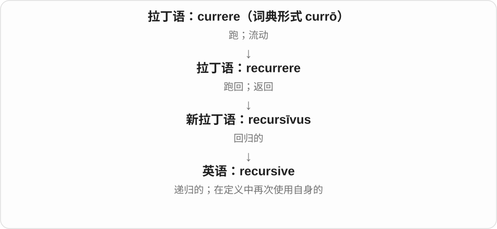

形容定义、算法或结构有自我引用关系。递归常见于程序，但也可用于数学定义和语言结构。

**常见搭配与例句**

a recursive function；a recursive definition；a recursive algorithm。

> A recursive function may call itself with a smaller input.

递归函数可以用更小的输入再次调用自身。

> The book gives a recursive definition of the sequence.

书中给出了这个数列的递归定义。

**别混淆**

recurrent 是某个现象反复出现；recursive 是内部规则再次用到自身，二者不等同。

### 95. reconstructive — 重建的；修复性的

**音标**：/ˌriːkənˈstrʌktɪv/

**先抓住这个画面**

reconstructive 强调把受损、缺失的部分重新搭好，让形态或功能得到恢复。

**怎么拆**

reconstruct + -ive，表示以重建为作用或目的。

**怎么变成今天的意思**

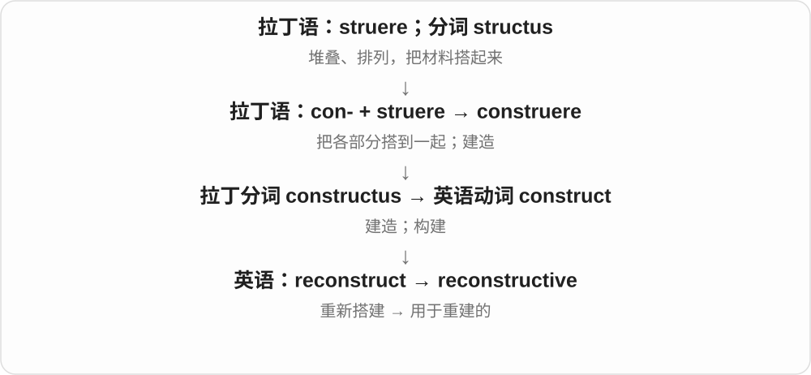

常见 reconstructive surgery，即修复身体结构、功能的外科手术；也可以谈 reconstructive work，重建工作。这里只是在解释用途，不等于保证能完全恢复原样。

**常见搭配与例句**

reconstructive surgery；reconstructive work；reconstructive techniques。

> She underwent reconstructive surgery after the accident.

事故后，她接受了修复重建手术。

> The museum documented every stage of the reconstructive work.

博物馆记录了重建工作的每个阶段。

**别混淆**

constructive 是有建设性的；reconstructive 多强调对已有损伤或缺失进行重建。

### 96. reflexive — 反身的；自反的；反射性的、下意识的

**音标**：/rɪˈfleksɪv/

**先抓住这个画面**

箭头发出去，又指回发出箭头的那个人或事物。

**怎么拆**

接中世纪拉丁 reflexivus；现代能看出 reflex + -ive，但历史上形容词有自己的借入路线。

**怎么变成今天的意思**

**拉丁 flectere；分词 flexus**  
弯曲、使转向

↓

**拉丁 reflexus → 中世纪拉丁 reflexivus**  
折回的 → 指回自身的

↓

**英语 reflexive**  
反身的、自反的；反射性的

She blamed herself 中，herself 指回 she，所以是 reflexive pronoun。数学里“等于”是 reflexive relation，因为每个对象都等于自己。a reflexive response 又可以指下意识的反应，不能把这里的 reflexive 误读成“仔细反思过的”。

**常见搭配与例句**

a reflexive pronoun；a reflexive relation；a reflexive response。

> “Herself” is a reflexive pronoun in this sentence.

这句话里的 herself 是反身代词。

> Equality is a reflexive relation: every value equals itself.

相等是一种自反关系：每个值都等于它自身。

> His first response was a reflexive refusal.

他的第一反应是下意识地拒绝。

**别混淆**

reflexive 可说自动反应或指回自身；reflective 才常说沉思、反思。句法里的 myself 也可能作强调成分，须看它在句中的功能。

### 97. presumptive — 推定的；暂可认定的；预计将取得某地位的

**音标**：英、美 /prɪˈzʌmptɪv/

**先抓住这个画面**

根据眼下情况，先认为大概如此，但最后确认可能还没完成。

**怎么拆**

来自后期、中世纪拉丁语 praesumptivus、presumptivus，基于 praesumere 的 praesumpt- 词干；部分词典也列法语中介。

**怎么变成今天的意思**

**拉丁语 prae + sumere → praesumere**  
事先 + 拿取 → 预先认定；擅自承担

↓

**后期、中世纪拉丁语 praesumptivus / presumptivus → 英语 presumptive**  
依推定或可能性判断的；亦有法语中介解释

the presumptive winner 是目前看来最有可能获胜的人，并不等于正式宣布的胜者。heir presumptive 是推定继承人，其地位可能因更优先的继承人出现而改变。

**常见搭配与例句**

the presumptive nominee；the presumptive winner；an heir presumptive。

> Reporters described her as the presumptive nominee.

记者们把她称为预计将获提名的人选。

> He was the heir presumptive until the king’s son was born.

在国王的儿子出生前，他一直是推定继承人。

**别混淆**

presumptuous 是冒昧、自作主张的；presumptive 通常说依据现有信息作出的推定。

### 98. preemptive — 抢先的；先发制人的

**音标**：/ˌpriːˈemptɪv/

**先抓住这个画面**

在预料中的问题或对方行动之前先出手。

**怎么拆**

现代可按 preempt + -ive 理解。历史上的形容词却早于常用动词，接 preemption 的词干加 -ive；不能用现代拆分倒推首次形成顺序。

**怎么变成今天的意思**

**拉丁语 emere；分词 emptus**  
买、取得；更早有“取”的含义

↓

**拉丁语 emptio；中世纪拉丁 praeemptio**  
购买；优先购买

↓

**英语 preemption**  
可解释为中世纪拉丁借入，也有 pre- + emption 的英语构词分析；先于动词 preempt

↓

**英语 preemption 的词干 + -ive → preemptive**  
与先买、先占有关；后来扩展到抢先应对

a preemptive explanation 是别人尚未追问，你先解释清楚。这个词也用于军事，但一般工作语境只强调把行动提前，不必脑补成攻击。

**常见搭配与例句**

a preemptive measure；a preemptive move；a preemptive response；preemptive action。

> She sent a preemptive email explaining why the figures had changed.

她预先发邮件，解释了数字变化的原因。

> The company made a preemptive move to answer concerns before the launch.

公司在发布前抢先采取行动，回应可能出现的担忧。

**别混淆**

preventive 泛指预防；preemptive 更突出抢在预期行动之前采取措施。提前维修是 preventive，提前回应即将来的指责可说 preemptive。

### 99. associative — 联想的；关联的；满足结合律的

**音标**：英 /əˈsəʊsiətɪv/；美 /əˈsoʊsiətɪv/；/si/ 也常读 /ʃi/

**先抓住这个画面**

一个念头牵出另一个念头；数学里则是几个数连接运算时，先把哪一对括起来都不改变结果。

**怎么拆**

associate + -ive。数学术语把“组合、联系”的意思专门化。

**怎么变成今天的意思**

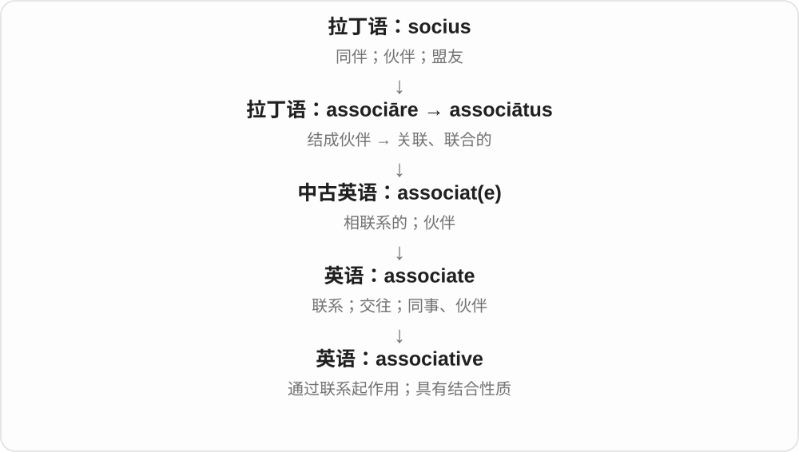

associative memory 是靠联系回忆；associative operation 满足 (a·b)·c = a·(b·c)。这里变的是括号，不是元素顺序。

**常见搭配与例句**

associative learning；associative memory；an associative operation。

> The exercise uses associative learning to link sounds with pictures.

练习通过联结学习，把声音与图片对应起来。

> Addition is associative, so changing the grouping does not change the sum.

加法满足结合律，因此改变分组不改变总和。

**别混淆**

associative 是换括号；commutative 是交换顺序。加法两者都有，但两个性质不是一回事。

### 100. reclusive — 隐居的；不爱与外界来往的

**音标**：/rɪˈkluːsɪv/

**先抓住这个画面**

生活方式朝独处那边靠，很少出现在公众场合。

**怎么拆**

recluse + -ive，从隐居者或隐居状态形成形容词。

**怎么变成今天的意思**

**拉丁 claudere；分词 clausus**  
关上、围住、使结束；复合词常变为 -cludere / -clusus

↓

**晚期拉丁 reclūdere / reclūsus → 古法语 reclus**  
闭居、隔绝；古典拉丁同词也曾表示打开

↓

**中古英语 reclus → 英语 recluse**  
隐居者 → 很少与外界来往的人

↓

**英语 recluse + -ive → reclusive**  
倾向隐居、避开社交的

a reclusive artist 可以只是长期回避公众，并不说明没有亲友。它描写可观察到的生活方式，不必推断对方是否孤独、是否快乐。

**常见搭配与例句**

a reclusive writer；a reclusive lifestyle；increasingly reclusive。

> The reclusive painter rarely gave interviews.

这位深居简出的画家很少接受采访。

> She chose a quiet, reclusive life in the mountains.

她选择在山中过安静的隐居生活。

**别混淆**

private 只是重视隐私；reclusive 的社交退避程度通常更明显。

### 101. pejorative — 贬义的；贬义词

**音标**：英 /pɪˈdʒɒrətɪv/；美 /pɪˈdʒɔːrətɪv/

**先抓住这个画面**

一个称呼不只指人或事，还顺手把它往低处踩。

**怎么拆**

最终来自拉丁 peior 更坏 → peiorare 使更坏；通过其分词词干 peiorat- 和法语 péjoratif 等形式形成英语 pejorative。

**怎么变成今天的意思**

**拉丁 peior → peiorare → peiorat-**  
更坏 → 使变坏

↓

**法语 péjoratif → 英语 pejorative**  
以较差评价表达事物；贬义的

pejorative term 是带贬低意味的词。例如把不愿花钱的人叫 stingy，而非较中性的 careful with money，就带上了负面判断。这个词说的是表达方式的贬低色彩，不等于这句话的事实一定错误。

**常见搭配与例句**

a pejorative term；a pejorative label；pejorative connotations；use a word as a pejorative。

> The dictionary marks the term as pejorative.

词典把这个词标为贬义。

> He used “amateur” as a pejorative, even though the work was excellent.

尽管作品很出色，他仍把“业余人士”当成贬低人的称呼。

**别混淆**

negative 范围很广，可以只说否定或不利；pejorative 更专门地说词语带轻视、贬损。作为名词 a pejorative 指这样的词或说法。

### 102. recede — 退去；后退；逐渐减弱

**音标**：/rɪˈsiːd/

**先抓住这个画面**

原来靠近眼前的边缘，慢慢往后撤。

**怎么拆**

拉丁 re-“向后” + cēdere；经中古法语 receder 及拉丁词进入中古英语 receden。

**怎么变成今天的意思**

**拉丁 cēdere；分词词干 cess-**  
走、离开；让步、让出

↓

**拉丁 re- + cēdere → recēdere**  
往后走、退去

↓

**中古法语 receder／拉丁 recēdere → 中古英语 receden → 英语 recede**  
向后退；潮水、声音、记忆等渐远

潮水退去是最直观的画面。发际线后移、远去的脚步声、渐淡的恐惧，也都可用。recede 通常是不及物动词。

**常见搭配与例句**

the tide recedes；a receding hairline；recede into the distance。

> The floodwater began to recede overnight.

洪水在夜间开始退去。

> The sound of the train receded into the distance.

火车声渐渐消失在远处。

**别混淆**

retreat 常有主动撤退的意味；recede 也能描述自然退去和逐渐减弱。

### 103. demonstrative — 感情外露的；指示的〔语法〕；用于显示、证明的

**音标**：英 /dɪˈmɒnstrətɪv/；美 /dɪˈmɑːnstrətɪv/

**先抓住这个画面**

把内心感情明显表现出来；语法里则像伸出手指，告诉别人“这一个、那一个”。

**怎么拆**

拉丁 demonstrativus 经法语进入英语，接 demonstrare；不是必须由现代英语 demonstrate 去尾形成。

**怎么变成今天的意思**

**拉丁语 monere → monstrum**  
提醒、警告 → 被视为征兆的异常现象

↓

**拉丁语 monstrare**  
把东西显示、指给人看

↓

**拉丁语 de- + monstrare → demonstrare**  
加强显示 → 指明、证明

↓

**拉丁语 demonstrativus → 法语 démonstratif → 英语 demonstrative**  
显示、指明的 → 感情外露的；语法中指示的

a demonstrative person 会明显表达亲热、喜悦等感情。this、that 在语法里属于 demonstrative 一类，用来指明所谈对象。两个意义都保留“显示给人看”的方向。

**常见搭配与例句**

a demonstrative person；demonstrative affection；a demonstrative pronoun。

> He comes from a warm and demonstrative family.

他来自一个温暖、感情表达直接的家庭。

> In “that book”, “that” is a demonstrative determiner.

在 that book 中，that 是指示限定词。

**别混淆**

emotional 是有强烈感情；demonstrative 特别强调把感情表现出来，内心强烈不一定外露。

### 104. assistive — 辅助的；提供帮助的

**音标**：/əˈsɪstɪv/

**先抓住这个画面**

工具替人补上一部分不便，让人更容易自己完成事情。

**怎么拆**

英语 assist + -ive；现代常用于支持残障人士活动与沟通的技术。

**怎么变成今天的意思**

**拉丁 sistere〔与 stāre“站”相关〕**  
使站住、放置；站定、停住

↓

**拉丁 ad- + sistere → assistere**  
站到旁边、在场支持

↓

**古法语 assister → 中古英语 assisten → 英语 assist**  
在旁帮助；后来也转为名词“助攻”等

↓

**英语 assist + -ive → assistive**  
具有帮助、辅助功能的

assistive technology 可以是读屏软件，也可以是帮助移动、沟通的设备。它不是只指高科技，更不意味着把使用者的全部判断和行动接管。

**常见搭配与例句**

assistive technology；assistive devices；assistive communication tools。

> The library installed assistive software for readers with visual impairments.

图书馆安装了帮助视障读者使用的辅助软件。

> A simple grip aid can be an assistive device.

一个简单的辅助握持工具也可以算辅助器具。

**别混淆**

assistant 通常是角色或工具名称；assistive 描述功能，即“用来提供帮助的”。

### 105. vindicate — 证明无辜；证明判断、做法正确

**音标**：/ˈvɪndɪkeɪt/

**先抓住这个画面**

别人说你错了、冤枉了你，后来证据站到了你这边，vindicate 就是替你洗清指责，或证明你当初判断对了。

**怎么拆**

借拉丁 vindicatus，接 vindicare 主张权利、保护、申辩等材料。历史词族义广，现代 vindicate 不能直接按 vindictive 的报复来理解。

**怎么变成今天的意思**

**拉丁 vindicare、vindicta 等**  
主张权利、保护、申辩、报复等相关意义材料

↓

**英语 vindicate 与 vindictive**  
证明无辜、证明正确；另一支是爱报复的

vindicate someone’s decision 证明某人的决定正确；be vindicated by evidence 得到证据支持、洗清指责。

**常见搭配与例句**

vindicate a decision；vindicate someone’s position。

> The later results vindicated her decision to wait.

后来的结果证明她决定等待是正确的。

> New evidence vindicated the accused researcher.

新证据洗清了那位被指责的研究者。

**别混淆**

vindicate 常是在受到质疑后得到证明；vindictive 是爱报复。相近词干走出了不同常用义。

### 106. suppressive — 有抑制作用的；压制性的

**音标**：英 /səˈpresɪv/；美 /səˈpresɪv/

**先抓住这个画面**

描述一种作用方向：让某种活动难以继续、扩大或显露。

**怎么拆**

suppress + -ive，形成描述作用性质的形容词。

**怎么变成今天的意思**

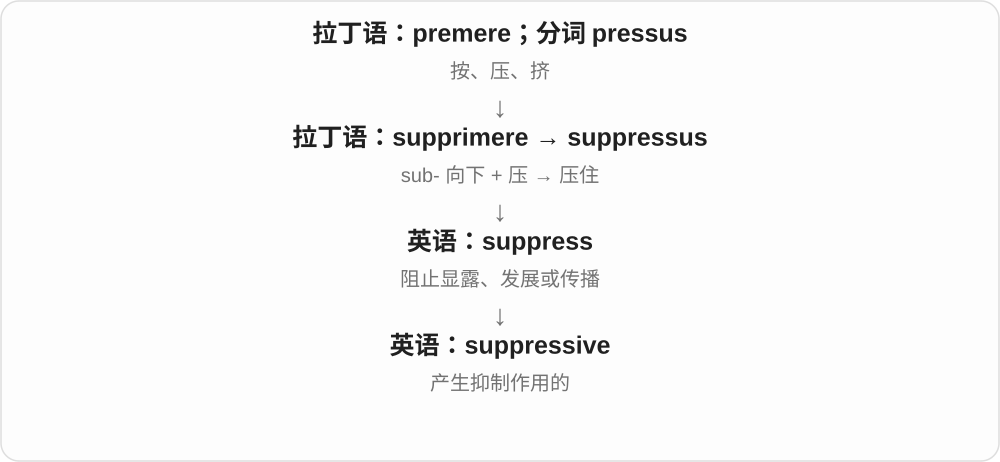

技术语境可能只是说抑制效应；社会政治语境则常含压制的负面意思。

**常见搭配与例句**

a suppressive effect；suppressive measures；suppressive policies。

> The study found a suppressive effect on cell growth.

研究发现了一种抑制细胞生长的效应。

> The essay examines the consequences of suppressive policies.

文章考察压制性政策的后果。

**别混淆**

suppressive 说有抑制作用；suppressed 说已经受到抑制的状态。

### 107. transgressive — 越界的；违反规范的；挑战禁忌的

**音标**：英、美 /trænzˈɡresɪv/

**先抓住这个画面**

脚跨过了大家原先划出的那条线。

**怎么拆**

英语 transgress + -ive；trans- 是跨越，gress 接“迈步”。

**怎么变成今天的意思**

**拉丁 gradus；gradī / gradior**  
一步、台阶、等级；走、迈步

↓

**拉丁 trans- + gradī → transgredī → transgressus**  
跨过去、越过

↓

**法语 transgresser 与拉丁形式 → 中古英语 transgressen → transgress**  
越界 → 违反规范或禁令

↓

**英语 transgress + -ive → transgressive**  
越过规范、界限的

文学或艺术里常指故意挑战社会禁忌；不一定构成法律犯罪，也不自动表示作品有价值。

**常见搭配与例句**

transgressive art；transgressive behaviour；a transgressive act。

> The novel was praised for its transgressive treatment of social conventions.

这部小说因挑战社会惯例的写法而受到赞赏。

> The performance was deliberately transgressive.

这场表演有意挑战禁忌。

**别混淆**

illegal 明确说违法；transgressive 可以只是触犯风俗、道德或艺术惯例。

### 108. derisive — 嘲弄的；轻蔑的

**音标**：/dɪˈraɪsɪv/

**先抓住这个画面**

描述笑声、表情或语气里那股“我看不起你这想法”的味道，关注说话者如何对待别人。

**怎么拆**

有拉丁分词词干 deris- 加 -ive 的分析；也有从英语 derision 类比 decision／decisive 造形容词的解释。两种分析都接 deridere，不把现代 deride + -ive 写成唯一历史。

**怎么变成今天的意思**

**拉丁 ridere；相关分词、词干 risus／ris-**  
笑；更早来源未定

↓

**拉丁 de- + ridere → deridere**  
带贬低意味地笑某人、嘲弄

↓

**拉丁分词词干 deris-；另有英语 derision 的类推分析**  
接 -ive，或类比 decision／decisive 形成形容词

↓

**英语 derisive**  
表现出嘲笑、轻蔑的

a derisive laugh 是带讥讽的笑；a derisive comment 是轻蔑评论。它常描述表达态度的动作或声音。

**常见搭配与例句**

derisive laughter；a derisive snort；a derisive remark；a derisive tone。

> A derisive laugh came from the back of the room.

房间后面传来一声轻蔑的笑。

> Her derisive tone made a reasonable question sound foolish.

她讥讽的语气把一个合理问题弄得像傻话。

**别混淆**

derisive 通常是“在嘲笑别人”；derisory 常说某事少得、差得可笑。但词典也记录二者在嘲弄义上有重叠。

### 109. evaluative — 评价性的；用于评估的

**音标**：英、美 /ɪˈvæljuətɪv/

**先抓住这个画面**

不只是说“发生了什么”，还在说“这样好不好、效果怎样”。

**怎么拆**

evaluate + -ive，形成形容词；不是 evaluation 去掉 -ion 后随便加词尾。

**怎么变成今天的意思**

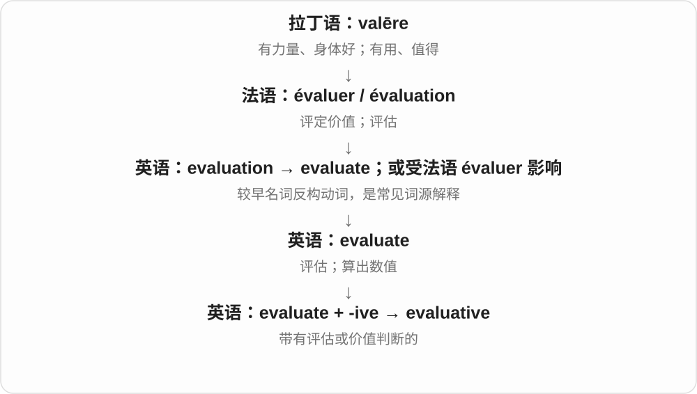

“房间有三扇窗”偏描述；“房间采光设计很好”含评价。evaluative language 可以正面也可以负面。

**常见搭配与例句**

evaluative comments；an evaluative approach；evaluative criteria。

> The report should include evaluative comments, not just a list of activities.

报告应包含评价性意见，而不只是活动清单。

> Words such as “excellent” and “poor” are evaluative.

“优秀”和“糟糕”这样的词带有评价性质。

**别混淆**

descriptive 主要描述；evaluative 加入按标准作出的判断。

### 110. contrastive — 对比性的；具有区别作用的

**音标**：英 /kənˈtrɑːstɪv/；美 /kənˈtræstɪv/

**先抓住这个画面**

专门把两个系统并排来看差别，或某个差别能区分意义，这种作用可叫 contrastive。

**怎么拆**

contrast + -ive，表示具有对比或区别作用。

**怎么变成今天的意思**

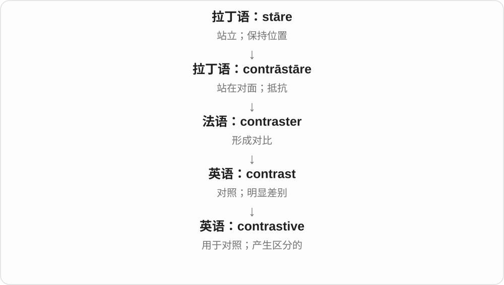

语言学常用它描述两种语言的比较，以及能区分意义的特征。机器学习的 contrastive learning 则借用比较差异来学习表示。

**常见搭配与例句**

contrastive analysis；contrastive stress；contrastive learning。

> The course includes a contrastive analysis of English and Chinese.

课程包括英语和汉语的对比分析。

> Contrastive stress can change which part of a sentence is emphasized.

对比重音可以改变句子强调的部分。

**别混淆**

contrasting 是普通的“形成对比的”；contrastive 常是研究方法或技术特征的描述。

### 111. allusive — 含暗示或典故的；旁敲侧击的

**音标**：/əˈluːsɪv/

**先抓住这个画面**

说话或写作时不直说，而让文字不断指向别的故事、观念或事件。

**怎么拆**

拉丁 alludere 的分词词干 allus- + -ive；词根里的玩发展为借题影射。

**怎么变成今天的意思**

**拉丁 ludere 玩、戏弄；ludus 游戏**  
既可娱乐，也可戏弄或用技巧躲闪

↓

**拉丁 ad- 向 + ludere → alludere；分词词干 allus-**  
对着某事打趣、影射 → 间接提及

↓

**拉丁分词词干 allus- + -ive → 英语 allusive**  
间接提及的；富于典故的

an allusive style 是多用暗指、典故的风格；an allusive remark 是有所影射的话。它可以精巧，也可能让不了解背景的人难懂。

**常见搭配与例句**

an allusive style；allusive language；an allusive reference。

> Her allusive prose rewards readers who know classical literature.

熟悉古典文学的读者更能体会她那充满典故的散文。

> He made an allusive remark about the previous election.

他旁敲侧击地提了一句上次选举的事。

**别混淆**

elusive 是难以捉摸；allusive 是含暗指。含典故的文字可能难懂，但这不是两个词本身同义。

## 这一组要分清什么

vindicate 证明无辜、正确与 vindictive 爱报复分清；excessive 不只是数量大；cumulative 是接连累计；recessive 隐性不等于在人群中少见；correlative 关联不自动等于 causal 因果。

## 串起来练习

The report was descriptive rather than predictive, but its cumulative evidence was impressive.

这份报告重在描述而非预测，但其累积证据很有说服力。
