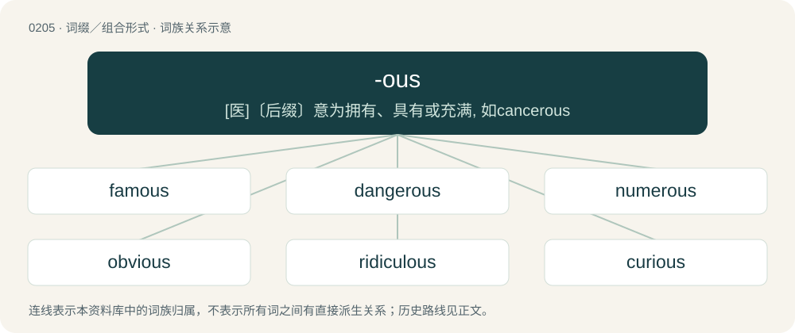

# 0227 · -ous — \[医\]〔后缀〕意为拥有、具有或充满, 如cancerous

[总目录](../00_总目录_按常用程度.md)

**类型**：词缀／组合形式　｜　**来源语言**：见词源记录

## 核心含义与来源

- 核心含义：\[医\]〔后缀〕意为拥有、具有或充满, 如cancerous
- 英文含义：possession of
- 词形：-ous

**来源记录 1**（后缀／后置成分；possession of）

From Middle English -ous, from Old French -ous, -os, -us, from Latin -ōsus (“full of”). Doublet of -ose and -wise in unstressed position. Many English adjectives ending in -ous were taken from preexisting French or Latin adjectives that end in one of the above suffixes (e.g. envious corresponds directly to Old French envious which in turn corresponds directly to Latin invidiōsus). In addition, -ous (or the variant form -ious) has at times been attached to English nouns to form derived adjectives that lack precedents in French or Latin, such as slumberous from slumber or blizzardous from blizzard. It has also been used in some cases as a means of adapting adjectives borrowed from Latin that originally ended simply in -us, -a, -um (for example, obvious and previous are derived from Latin obvius and praevius, not \*obviōsus or \*praeviōsus).

## 词族图

## 单词速览（常用到不常用）

| 单词 | 音标 | 释义 |
|---|---|---|
| [famous](#w-1) | /ˈfeɪ.məs/ | a. 出名的, 极好的 |
| [dangerous](#w-2) | 英 /ˈdeɪn.ʒ(ə.)ɹəs/；美 /ˈdeɪn.d͡ʒ(ə.)ɹəs/ | a. 危险的；\[法\] 危险的, 危害的 |
| [numerous](#w-3) | 英 /ˈnjuːməɹəs/；美 /ˈnuməɹəs/ | a. 很多的, 数目众多的, 多数的；\[机\] 多数的, 甚多的 |
| [obvious](#w-4) | 英 /ˈɒ.vɪəs/；美 /ˈɑb.vi.əs/ | a. 明显的, 明白的, 显然的, 平淡无奇的 |
| [ridiculous](#w-5) | 英 /ɹɪˈdɪk.jʊ.ləs/；美 /ɹɪˈdɪk.jə.ləs/ | a. 荒谬的, 可笑的 |
| [curious](#w-6) | /ˈkjuəriəs/ | 【英文】Containing or pertaining to trivalent curium. |
| [nervous](#w-7) | 英 /ˈnɜːvəs/；美 /ˈnɝvəs/ | a. 神经紧张的, 不安的, 神经的；\[医\] 神经的; 神经质的, 神经过敏的 |
| [enormous](#w-8) | 英 /ɪˈnɔː.məs/；美 /ɪˈnoɹ.məs/ | a. 巨大的, 庞大的 |
| [anonymous](#w-9) | 英 /əˈnɒn.ə.məs/；美 /əˈnɑ.nə.məs/ | a. 姓氏不详的, 无名的, 无特色的；\[计\] 无记录 |
| [mysterious](#w-10) | 英 /mɪˈstɪə̯.ɹi.əs/；美 /mɪˈstɪɹi.əs/ | a. 神秘的, 难解的, 不可思议的 |
| [indigenous](#w-11) | 英 /ɪnˈdɪdʒɪnəs/；美 /ɪnˈdɪd͡ʒənəs/ | a. 本土的, 国产的, 固有的；\[医\] 原产的, 本土的 |
| [fabulous](#w-12) | /ˈfæbjʊləs/ | a. 传说的, 寓言般的, 难以置信的 |
| [glorious](#w-13) | 英 /ˈɡlɔː.ɹi.əs/；美 /ˈɡloɹ.i.əs/ | a. 光荣的 |
| [tremendous](#w-14) | /tɹɪˈmɛndəs/ | a. 巨大的, 非常的, 可怕的 |
| [autonomous](#w-15) | 英 /ɔːˈtɒnəməs/；美 /ɔˈtɑnəməs/ | a. 自治的；\[医\] 自主的 |
| [vicious](#w-16) | /ˈvɪʃəs/ | a. 邪恶的, 堕落的, 品性不端的, 恶毒的, 恶性的, 有错误的；\[医\] 缺点的, 恶的 |
| [cautious](#w-17) | 英 /ˈkɔːʃəs/；/ˈkɔʃəs/ | a. 谨慎的, 小心的 |
| [outrageous](#w-18) | 英 /aʊtˈɹeɪ.d͡ʒəs/ | a. 暴虐的, 极无礼的, 可恶的 |
| [hazardous](#w-19) | 美 /ˈhæ.zɚ.dɪs/ | a. 危险的, 冒险的, 碰运气的；\[法\] 危险的, 冒险的, 碰运气的 |
| [disastrous](#w-20) | 英 /dɪˈzɑː.stɹəs/；美 /dɪˈzæs.tɹəs/ | a. 损失惨重的, 悲伤的 |
| [humorous](#w-21) | 英 /ˈhjuːməɹəs/；美 /ˈhjuːməɹəs/ | a. 富幽默感的, 滑稽的, 诙谐的 |
| [poisonous](#w-22) | /ˈpɔɪzənəs/ | a. 有毒的, 恶毒的, 讨厌的；\[医\] 有毒的 |
| [marvelous](#w-23) | 英 /ˈmɑːvələs/；美 /ˈmɑɹvələs/ | a. 令人惊异的, 了不起的, 不平常的 |
| [glamorous](#w-24) | 英 /ˈɡlæ.mə.ɹəs/ | a. 富有魅力的, 迷人的 |
| [tedious](#w-25) | 英 /ˈtiː.dɪəs/；美 /ˈti.di.əs/ | a. 沉闷的, 冗长乏味的 |
| [horrendous](#w-26) | /həˈɹɛndəs/ | a. 可怕的, 骇人的, 不得了的 |
| [ubiquitous](#w-27) | 英 /juːˈbɪkwɪtəs/；美 /juˈbɪkwɪtəs/ | a. 无所不在的, 到处存在的, 普遍存在的 |
| [mountainous](#w-28) | 英 /ˈmaʊn.tɪ.nəs/；美 /ˈmaʊn.tɪ.nəs/ | a. 多山的, 如山的, 巨大的 |
| [murderous](#w-29) | 英 /ˈmɜːdəɹəs/；美 /ˈmɝdəɹəs/ | a. 凶狠的, 杀人的, 致命的；\[法\] 谋杀的, 杀人的, 残酷的 |
| [analogous](#w-30) | 英 /əˈnæl.ə.ɡəs/ | a. 类似的, 相似的；\[医\] 类似的, 类同的 |
| [advantageous](#w-31) | /ˌædvənˈteɪd͡ʒ(i)əs/ | a. 有利的, 有益的 |
| [treacherous](#w-32) | /ˈtɹɛt͡ʃəɹəs/ | a. 不可信任的, 危险的, 背叛的, 不可靠的；\[法\] 奸诈的, 背叛的, 背信弃义的 |
| [illustrious](#w-33) | 英 /ɪˈlʌs.tɹɪ.əs/；美 /ɪˈlʌs.tɹi.əs/ | a. 著名的, 辉煌的, 明亮的 |
| [conscientious](#w-34) | 英 /ˌkɒn.ʃiˈɛn.ʃəs/；美 /ˌkɑn.ʃiˈɛn.ʃəs/ | a. 有责任心的, 负责的, 本着良心的；\[法\] 凭良心做的, 有道德感的 |
| [ferocious](#w-35) | 英 /fəˈɹəʊʃəs/；美 /fəˈɹoʊʃəs/ | a. 残忍的, 凶猛的, 可怕的 |
| [grievous](#w-36) | /ˈɡɹiː.vəs/ | a. 痛苦的, 严重的, 充满悲伤的；\[法\] 极大的, 严重的, 惨无人道的 |
| [perilous](#w-37) | /ˈpɛɹ.ɪ.ləs/ | a. 危险的, 濒临毁灭的 |
| [contiguous](#w-38) | 英 /kənˈtɪɡ.ju.əs/ | a. 邻近的, 接近的；\[医\] 接触的 |
| [aqueous](#w-39) | 英 /ˈæ.kwi.əs/ | a. 水的, 似水的, 水成的；\[化\] 水的; 含水的; 水成的 |
| [momentous](#w-40) | 英 /məʊˈmɛn.təs/；美 /moʊˈmɛn.təs/ | a. 重大的, 重要的 |
| [venomous](#w-41) | 英 /ˈvɛnəməs/ | a. 有毒的, 恶毒的, 分泌毒液的, 有毒腺的；\[医\] 毒的, 有毒的 |
| [nauseous](#w-42) | 英 /ˈnɔːziːəs/；美 /ˈnɔʃəs/ | a. 令人作呕的, 厌恶的；\[医\] 恶心的, 致恶心的 |
| [pompous](#w-43) | 英 /ˈpɒmpəs/；美 /ˈpɑmpəs/ | a. 爱炫耀的, 虚夸的, 盛大的 |
| [tenuous](#w-44) | 英 /ˈtɛ.njʊ.əs/；美 /ˈtɛn.ju.əs/ | a. 稀薄的, 微细的, 纤细的, 脆弱的；\[医\] 细薄的, 纤细的 |
| [synchronous](#w-45) | 英 /ˈsɪŋkɹənəs/ | a. 同时的, 同步的；\[计\] 同步 |
| [endogenous](#w-46) | 英 /ɛnˈdɒd͡ʒ.ɪ.nəs/；美 /ɛnˈdɑ.d͡ʒə.nəs/ | a. 内源的；\[医\] 内生的, 内原的 |
| [luscious](#w-47) | /ˈlʌʃəs/ | a. 甘美的, 浓厚的, 满足感官的 |
| [amorphous](#w-48) | /əˈmɔ(ɹ)fəs/ | a. 无定形的, 无组织的；\[化\] 非晶形的; 无定形的 |
| [delirious](#w-49) | 英 /dɪˈlɪə̯.ɹi.əs/ | a. 神志昏迷的, 发狂的；\[医\] 谵妄的, 发狂的, 妄想的 |
| [monotonous](#w-50) | 英 /məˈnɒtənəs/；美 /məˈnɑtənəs/ | a. 单调的, 无变化的 |
| [fibrous](#w-51) | /ˈfaɪbɹəs/ | a. 纤维的, 纤维性的；\[医\] 纤维性 |
| [venous](#w-52) | /ˈviː.nəs/ | a. 静脉的, 在静脉中的, 有脉的；\[医\] 静脉的 |
| [prodigious](#w-53) | 英 /pɹəˈdɪd͡ʒəs/；美 /pɹəˈdɪd͡ʒəs/ | a. 庞大的, 惊人的, 异常的 |
| [blasphemous](#w-54) | 英 /ˈblæs.fəm.əs/；美 /ˈblæs fə məs/ | a. 亵渎神明的, 不敬神的；\[法\] 侮辱性的, 诽谤性的 |
| [ferrous](#w-55) | /ˈfɛɹəs/ | a. 铁的, 含铁的, 亚铁的；\[医\] 亚铁的 |
| [flirtatious](#w-56) | /flɚˈteɪʃəs/ | a. 爱调戏的, 轻浮的 |
| [thunderous](#w-57) | 英 /ˈθʌn.də.ɹəs/；美 /ˈθʌn.dɚ.əs/ | a. 将要打雷的, 像打雷的 |
| [mucous](#w-58) | /ˈmjuːkəs/ | a. 粘液的, 粘的, 粘液性的；\[医\] 粘液的 |
| [cavernous](#w-59) | 英 /ˈkav.ən.əs/；美 /ˈkæv.ɚ.nəs/ | a. 似巨穴的；\[医\] 空洞的 |
| [deleterious](#w-60) | 英 /ˌdɛl.ɪˈtɪə̯.ɹi.əs/；美 /ˌdɛ.ləˈtɪɹ.i.əs/ | a. 有害的, 造成伤害的；\[医\] 有害的 |
| [incestuous](#w-61) | 英 /ɪnˈsɛstjuəs/；美 /ɪnˈsɛst͡ʃuəs/ | a. 近亲相奸的, 乱伦的；\[法\] 乱伦的, 犯乱伦罪的 |
| [androgynous](#w-62) | 英 /ænˈdɹɒd͡ʒ.ɪn.əs/；美 /ænˈdɹɑd͡ʒ.ən.əs/ | a. 雌雄同体的, 雌雄同序的, 两性畸形的；\[医\] 两性畸形的, 雌雄同体的, 男子女化的 |
| [treasonous](#w-63) |  | a. 叛逆的, 谋反的, 犯叛国罪的, 涉及叛国罪的 |
| [bulbous](#w-64) | /ˈbʌlbəs/ | a. 球茎的, 球茎状的, 由球茎生长的；\[医\] 球状的, 球的 |
| [lustrous](#w-65) | 美 /ˈlʌ.stɹəs/ | a. 有光泽的, 光辉的 |
| [contemptuous](#w-66) | 英 /kənˈtɛm(p).tʃu.əs/；美 /kənˈtɛmp.t͡ʃu.əs/ | a. 轻蔑的, 鄙视的, 瞧不起人的 |
| [vicarious](#w-67) | 英 /vɪˈkɛəɹi.əs/；/vaɪˈkɛɹi.əs/ | a. 代理的, 代用的, 替代的；\[医\] 替代的, 错位的 |
| [injurious](#w-68) | 英 /ɪnˈdʒʊə.ɹɪ.əs/；美 /ɪnˈd͡ʒʊɹ.i.əs/ | a. 有害的, 不公正的；\[法\] 伤害的, 有害的, 不公平的 |
| [melodious](#w-69) | 英 /məˈləʊdi.əs/；美 /məˈloʊdi.əs/ | a. 旋律美妙的, 旋律优美的, 有乐曲的 |
| [precipitous](#w-70) | /pɹɪˈsɪpɪtəs/ | a. 陡峭的, 轻率的 |
| [sanctimonious](#w-71) | 英 /ˌsæŋk.tɪˈməʊ.ni.əs/；美 /ˌsæŋk.tɪˈmoʊ.ni.əs/ | a. 假装圣洁的, 假装虔诚的, 假装诚实的 |
| [acrimonious](#w-72) | 英 /ˌæk.ɹɪˈməʊ.nɪ.əs/；美 /ˌæk.ɹɪˈmoʊ.ni.əs/ | a. 尖刻的, 讥讽的, 激烈的 |
| [efficacious](#w-73) | 英 /ˌɛf.ɪˈkeɪ.ʃəs/；美 /ˌɛf.əˈkeɪ.ʃəs/ | a. 有效的, 灵验的 |
| [coniferous](#w-74) | /kəˈnɪfəɹəs/ | a. 松柏目的, 结球果的 |
| [vacuous](#w-75) | /ˈvækju.əs/ | a. 空的, 空虚的, 没有思想的 |
| [gelatinous](#w-76) | 英 /d͡ʒəˈlæt.ɪn.əs/ | a. 凝胶状的；\[医\] 胶状的 |
| [phosphorous](#w-77) | /ˈfɒsfərəs/ | a. 亚磷的, 含磷的；\[化\] 亚磷的; 三价磷的 |
| [riotous](#w-78) | /ˈɹaɪətəs/ | a. 引起骚扰的, 暴乱的, 放荡的 |
| [slanderous](#w-79) | 美 /ˈslændəɹəs/ | a. 中伤性的, 中伤的, 挖苦人的；\[法\] 诽谤的, 造谣中伤的, 诋毁的 |
| [fuscous](#w-80) | 英 /ˈfʌskəs/ | a. 暗褐色的, 黑棕色的 |
| [vociferous](#w-81) | 英 /vəʊˈsɪfəɹəs/；美 /voʊˈsɪfəɹəs/ | a. 大声叫的, 喊叫的, 喧嚷的 |
| [autologous](#w-82) | /ɔːˈtɔlə^əs/ | \[医\] 自体固有的, 正型结构的 |
| [anhydrous](#w-83) | /ænˈhaidrəs/ | a. 无水的；\[医\] 无水的 |
| [duplicitous](#w-84) | 英 /djʊˈplɪsɪtəs/；美 /duːˈplɪsətəs/ | a. 奸诈的；双重的；搞两面派的 |
| [rapturous](#w-85) | /ˈɹæp.t͡ʃəɹ.əs/ | a. 兴高采烈的, 狂喜的, 欢天喜地的 |
| [rapacious](#w-86) | 英 /ɹəˈpeɪ.ʃəs/ | a. 强夺的, 贪欲的, 贪婪的 |
| [ambidextrous](#w-87) | 英 /ˌæm.biˈdɛk.stɹəs/；美 /ˌæm.bɪˈdɛk.stɹəs/ | a. 两手俱利的, 搞两面派的；\[医\] 两手同利的 |
| [libelous](#w-88) | 英 /ˈlaɪ.bəl.əs/ | a. 诽谤的, 败坏名誉的, 爱诽谤的, 诽谤性的 |
| [disadvantageous](#w-89) | 英 /dɪsˌædvənˈteɪdʒəs/ | a. 不利的, 蔑视的, 贬抑的 |
| [fractious](#w-90) | 美 /ˈfɹæk.ʃəs/ | a. 易怒的, 倔强的, 脾气不好的 |
| [lecherous](#w-91) | 英 /ˈlɛtʃ.ə.ɹəs/；美 /ˈlɛt͡ʃ.ɚ.əs/ | a. 好色的, 引起淫欲的, 纵欲的, 淫荡的 |
| [serendipitous](#w-92) | /ˌsɛ.ɹɛnˈdɪp.ɪ.təs/ | a. 偶然发现的 |
| [cartilaginous](#w-93) | 英 /ˌkɑː.tɪˈlad͡ʒ.ɪn.əs/；美 /ˌkɑɹ.təˈlæd͡ʒ.ən.əs/ | a. \[解剖\]软骨的, 软骨质的 |
| [herbivorous](#w-94) | 美 /(h)ɜːɹˈbɪvəɹəs/ | a. 食草的；\[医\] 草食的, 食草的 |
| [filamentous](#w-95) | /.filəˈmentəs/ | a. 细丝状的, 如丝的, 纤维所成的；\[医\] 丝状的, 丝性的 |
| [dexterous](#w-96) | /ˈdɛkstɹəs/ | a. 灵巧的, 惯用右手的 |
| [scurrilous](#w-97) | 英 /ˈskʌ.ɹə.ləs/；美 /ˈskɜɹələs/ | a. 说话粗鄙恶劣的, 下流的；\[法\] 语言粗鄙的, 庸俗的 |
| [vexatious](#w-98) | /vɛkˈseɪʃəs/ | a. 叫人发急的, 使人为难的, 无理缠讼的；\[经\] 苛捐杂税 |
| [homonymous](#w-99) | /hɒˈmɒniməs/ | a. 同音异义的, 同名的, 意义模棱两可的；\[医\] 同名的, 同侧的, 同一关系的 |
| [gluttonous](#w-100) | 英 /ˈɡlʌt(ə)nəs/ | a. 暴食的, 贪吃的, 贪心的 |
| [polyamorous](#w-101) | 美 /ˌpɑliˈæmərəs/ | 多重多元恋的 |
| [felonious](#w-102) | /fəˈləunjəs/ | a. 凶恶的, 极恶的, 重罪的 |
| [membranous](#w-103) | /ˈmɛm.bɹən.əs/ | a. 膜的, 膜性的；\[医\] 膜的 |
| [tuberous](#w-104) | /ˈt(j)uːbəɹəs/ | a. 有块茎的, 块茎状的, 有结节的；\[医\] 有结节的, 结节状的, 隆凸的; 有块茎的, 块茎状的 |
| [parsimonious](#w-105) | 英 /pɑː.sɪˈməʊ.ni.əs/；美 /pɑɹ.sɪˈmoʊ.ni.əs/ | a. 过度节俭的, 吝啬小气的 |
| [idolatrous](#w-106) | /aɪˈdɒlətrəs/ | a. 崇拜偶像的, 盲目崇拜的 |
| [beauteous](#w-107) | 英 /ˈbjuːtɪəs/ | a. 美丽的 |
| [portentous](#w-108) | 美 /pɔrˈtɛn(t)əs/；/pɔː(ɹ)ˈtɛntəs/ | a. 前兆的, 不吉的, 可惊的, 自大的 |
| [pugnacious](#w-109) | 英 /pʌɡˈneɪ.ʃəs/ | a. 好斗的 |
| [salubrious](#w-110) | 英 /səˈl(j)uː.bɹi.əs/；美 /səˈlu.bɹi.əs/ | a. 有益健康的, 健康的；\[医\] 增进健康的, 适于卫生的 |
| [autochthonous](#w-111) | 英 /ɔːˈtɒkθənəs/；美 /ɔˈtɑkθənəs/ | a. 土著的, 土生土长的, 本地的；\[医\] 本处发生的 |
| [garrulous](#w-112) | 英 /ˈɡæɹ.ʊ.ləs/；美 /ˈɡɛɹ.ə.ləs/ | a. 饶舌的, 多嘴的, 喋喋不休的 |
| [loquacious](#w-113) | 英 /ləʊˈkweɪʃəs/；美 /loʊˈkweɪʃəs/ | a. 多嘴的, 好辩的, 吵闹的, 潺潺的 |
| [nitrogenous](#w-114) | /naiˈtrɒdʒənəs/ | a. 氮的, 含氮的；\[医\] 含氮的 |
| [iniquitous](#w-115) | 英 /ɪˈnɪkwɪtəs/；美 /ɪˈnɪkwɪtəs/ | a. 不公正的, 邪恶的 |
| [numinous](#w-116) | 英 /ˈnjuːmɪnəs/；美 /ˈn(j)umənəs/ | a. 精神上的, 超自然的 |

## 逐词详解

### 1. famous

**词性**：形容词　｜　**音标**：/ˈfeɪ.məs/

**中文释义**：a. 出名的, 极好的

**英文义项**：Well known. / In the public eye.

**构词拆分**：fame + -ous

**词源与演化**：

From Middle English famous, from Anglo-Norman famous, from Latin fāmōsus, equivalent to fame + -ous. Displaced native Old English hlīsful.

**例句**：

> Some people are only famous within their city.

该用例对应义项：In the public eye.

### 2. dangerous

**词性**：形容词　｜　**音标**：英 /ˈdeɪn.ʒ(ə.)ɹəs/；美 /ˈdeɪn.d͡ʒ(ə.)ɹəs/

**中文释义**：a. 危险的；\[法\] 危险的, 危害的

**英文义项**：Full of danger. / Causing danger; ready to do harm or injury.

**构词拆分**：danger + -ous

**词源与演化**：

From Middle English daungerous (“difficult, severe, domineering, arrogant, fraught with danger”), dangerous, from Anglo-Norman \[Term?\], from Old French dangereus (“threatening, difficult”), from dangier. Equivalent to danger + -ous. Displaced native Old English frēcne.

**例句**：

> Railway crossings without gates are highly dangerous.

该用例对应义项：Full of danger.

### 3. numerous

**词性**：形容词　｜　**音标**：英 /ˈnjuːməɹəs/；美 /ˈnuməɹəs/

**中文释义**：a. 很多的, 数目众多的, 多数的；\[机\] 多数的, 甚多的

**英文义项**：Indefinitely large numerically; many. / Consisting of a large number of individuals or parts.

**构词拆分**：numero- + -ous

**词源与演化**：

From Middle English numerous from Latin numerōsus (“numerous, abundant; harmonious”), from numerus (“number”). Doublet of numerose. Analyzeable as numero- + -ous.

**例句**：

> The reasons to refrain are numerous.

该用例对应义项：Indefinitely large numerically; many.

### 4. obvious

**词性**：形容词　｜　**音标**：英 /ˈɒ.vɪəs/；美 /ˈɑb.vi.əs/

**中文释义**：a. 明显的, 明白的, 显然的, 平淡无奇的

**英文义项**：Easily discovered, seen, or understood; self-explanatory.

**词源与演化**：

16th century, from Latin obvius (“being in the way so as to meet, meeting, easy to access, at hand, ready, obvious”) + -ous, from ob- (“before”) + via (“way”).

**例句**：

> Most scientific breakthroughs are nothing else than the discovery of the obvious.

### 5. ridiculous

**词性**：形容词　｜　**音标**：英 /ɹɪˈdɪk.jʊ.ləs/；美 /ɹɪˈdɪk.jə.ləs/

**中文释义**：a. 荒谬的, 可笑的

**英文义项**：Deserving of ridicule; foolish, absurd. / Astonishing, extreme, unbelievable.

**构词拆分**：ridicule + -ous

**词源与演化**：

Borrowed from Latin rīdiculus (“laughable, ridiculous”); Equivalent to ridicule + -ous.

**例句**：

> Gaines is a classic motor player with a low center of gravity and ridiculous strength.

该用例对应义项：Astonishing, extreme, unbelievable.

### 6. curious

**词性**：形容词　｜　**音标**：/ˈkjuəriəs/

**英文义项**：Containing or pertaining to trivalent curium.

**构词拆分**：curium + -ous

**词源与演化**：

From curi(um) + -ous.

### 7. nervous

**词性**：形容词　｜　**音标**：英 /ˈnɜːvəs/；美 /ˈnɝvəs/

**中文释义**：a. 神经紧张的, 不安的, 神经的；\[医\] 神经的; 神经质的, 神经过敏的

**英文义项**：Full of sinews. / Having strong or prominent sinews; sinewy, muscular.

**构词拆分**：nerve + -ous

**词源与演化**：

From Middle English nervous (“composed of or incorporating nerves”), from Latin nervōsus (“nervous; sinewy; energetic, vigorous”), from nervus (“nerve; muscle; sinew, tendon; (figuratively) energy, power; nerve; force, strength, vigour”) (ultimately from Proto-Indo-European \*snéh₁wr̥ (“sinew, tendon”)) + -ōsus (suffix meaning ‘full of, prone to’ forming adjectives from nouns). The English word is analysable as nerve + -ous.

**例句**：

> Being in a crowd of strangers makes me nervous.

该用例对应义项：Easily agitated or alarmed; edgy, on edge.

### 8. enormous

**词性**：形容词　｜　**音标**：英 /ɪˈnɔː.məs/；美 /ɪˈnoɹ.məs/

**中文释义**：a. 巨大的, 庞大的

**英文义项**：Deviating from the norm; unusual, extraordinary. / Exceedingly wicked; atrocious or outrageous.

**词源与演化**：

From Latin ēnormis. An assimilated form of ex- (“out of”) + norma (“rule, norm”) + -ous.

**例句**：

> The enormous Jupiter is the largest planet in the Solar System.

该用例对应义项：Extremely large; greatly exceeding the common size, extent, etc.

### 9. anonymous

**词性**：形容词　｜　**音标**：英 /əˈnɒn.ə.məs/；美 /əˈnɑ.nə.məs/

**中文释义**：a. 姓氏不详的, 无名的, 无特色的；\[计\] 无记录

**英文义项**：Lacking a name; not named, for example an animal not assigned to any species . / Without any name acknowledged of a person responsible.

**构词拆分**：anonym + -ous；an- + -onym + -ous

**词源与演化**：

Borrowed into English around 1600 from Late Latin anonymus, from Ancient Greek ᾰ̓νώνῠμος (ănṓnŭmos, “without name”), from ᾰ̓ν- (ăn-, “un-”) with ὄνῠμᾰ (ónŭmă), Aeolic and Doric dialectal form of ὄνομᾰ (ónomă, “name”). English equivalent anonym + -ous, its full etymology being an- + -onym + -ous.

**例句**：

> No customer personal data will be retained unless it is rendered anonymous.

该用例对应义项：Of unknown name; whose name is withheld

### 10. mysterious

**词性**：形容词　｜　**音标**：英 /mɪˈstɪə̯.ɹi.əs/；美 /mɪˈstɪɹi.əs/

**中文释义**：a. 神秘的, 难解的, 不可思议的

**英文义项**：Of unknown origin. / Having unknown qualities.

**词源与演化**：

From Middle English \*misterius (implied in misteriusly), probably partly from Middle French mystérieux and partly from Latin mystērium + -ous. By surface analysis, mystery + -ous.

**例句**：

> Our boss is a mysterious man who hardly ever meets with us.

该用例对应义项：Having unknown qualities.

### 11. indigenous

**词性**：形容词　｜　**音标**：英 /ɪnˈdɪdʒɪnəs/；美 /ɪnˈdɪd͡ʒənəs/

**中文释义**：a. 本土的, 国产的, 固有的；\[医\] 原产的, 本土的

**英文义项**：Native to a land, especially before colonization. / In particular, of or relating to a people (or their language or culture) that inhabited a region prior to the arrival of people of other cultures which became dominant (e.g., through colonialism), and which maintains a distinct culture.

**词源与演化**：

Borrowed from Late Latin indigenus (“native, born in a country”), from indi- (indu-), an old derivative of in (“in”), gen- the root of gignō (“give birth to”), and English -ous. Compare indigene, Ancient Greek ἐνδογενής (endogenḗs, “born in the house”), and the separately formed piecewise doublet endogenous. Unrelated to Indian.

**例句**：

> The Ainu are the indigenous ethnic group of Japan's Hokkaido Island.

该用例对应义项：In particular, of or relating to a people (or their language or culture) that inhabited a region prior to the arrival of people of other cultures which became dominant (e.g., through colonialism), and which maintains a distinct culture.

### 12. fabulous

**词性**：形容词　｜　**音标**：/ˈfæbjʊləs/

**中文释义**：a. 传说的, 寓言般的, 难以置信的

**英文义项**：Of or relating to fable, myth or legend. / Characteristic of fables; marvelous, extraordinary, incredible.

**构词拆分**：fable + -ous

**词源与演化**：

From Late Middle English fabulous, fabulose, from Latin fābulōsus (“celebrated in fable”); Equivalent to fable + -ous.

**例句**：

> In the blue sea, among the green islands, fabulous Viking ships sail.

### 13. glorious

**词性**：形容词　｜　**音标**：英 /ˈɡlɔː.ɹi.əs/；美 /ˈɡloɹ.i.əs/

**中文释义**：a. 光荣的

**英文义项**：Exhibiting attributes, qualities, or acts that are worthy of or receive glory. / Excellent, wonderful; delightful.

**构词拆分**：glory + -ous

**词源与演化**：

From Middle English glorious, from Anglo-Norman glorius and Old French glorïos, from Latin glōriōsus. Displaced native Middle English wulderful, from Old English wuldorfull (“glorious”), among other terms. Equivalent to glory + -ous.

**用法示例／搭配（非完整句）**：

> glorious deeds

该用例对应义项：Exhibiting attributes, qualities, or acts that are worthy of or receive glory.

### 14. tremendous

**词性**：形容词　｜　**音标**：/tɹɪˈmɛndəs/

**中文释义**：a. 巨大的, 非常的, 可怕的

**英文义项**：Awe-inspiring; terrific. / Notable for its size, power, or excellence.

**词源与演化**：

Adapted borrowing of Latin tremendus (“fearful, terrible”, gerundive of tremō (“to tremble”)) + -ous. Doublet of tremend.

**例句**：

> Van Beethoven's ninth symphony is a tremendous piece of music.

该用例对应义项：Notable for its size, power, or excellence.

### 15. autonomous

**词性**：形容词　｜　**音标**：英 /ɔːˈtɒnəməs/；美 /ɔˈtɑnəməs/

**中文释义**：a. 自治的；\[医\] 自主的

**英文义项**：Governing itself independently. / Of or relating to a territory that governs itself independently.

**构词拆分**：autonomy + -ous

**词源与演化**：

From autonomy + -ous.

**用法示例／搭配（非完整句）**：

> an autonomous territory

该用例对应义项：Governing itself independently.

### 16. vicious

**词性**：形容词　｜　**音标**：/ˈvɪʃəs/

**中文释义**：a. 邪恶的, 堕落的, 品性不端的, 恶毒的, 恶性的, 有错误的；\[医\] 缺点的, 恶的

**英文义项**：Violent, destructive and cruel. / Savage and aggressive.

**构词拆分**：vice + -ous

**词源与演化**：

From Middle English vicious, from Anglo-Norman vicious, (modern French vicieux), from Latin vitiōsus, from vitium (“fault, vice”). Equivalent to vice + -ous.

**例句**：

> Conflict escalation frequently results from a vicious circle of action and reaction.

### 17. cautious

**词性**：形容词　｜　**音标**：英 /ˈkɔːʃəs/；/ˈkɔʃəs/

**中文释义**：a. 谨慎的, 小心的

**英文义项**：Using or exercising caution; careful; tentative

**构词拆分**：cauti(on) + -ous

**词源与演化**：

From cauti(on) + -ous. Compare Latin cautus.

**例句**：

> He took a few cautious steps toward the cave.

该用例对应义项：Using or exercising caution; careful; tentative

### 18. outrageous

**词性**：形容词　｜　**音标**：英 /aʊtˈɹeɪ.d͡ʒəs/

**中文释义**：a. 暴虐的, 极无礼的, 可恶的

**英文义项**：Violating morality or decency; provoking indignation or affront. / Transgressing reasonable limits; extravagant, immoderate.

**构词拆分**：outrage + -ous

**词源与演化**：

From Anglo-Norman outrageus, Middle French outrageus, from outrage; equivalent to outrage + -ous.

**例句**：

> Subjected to outrageous cruelty.

该用例对应义项：grossly offensive to decency or morality; causing horror

### 19. hazardous

**词性**：形容词　｜　**音标**：美 /ˈhæ.zɚ.dɪs/

**中文释义**：a. 危险的, 冒险的, 碰运气的；\[法\] 危险的, 冒险的, 碰运气的

**英文义项**：Risky; dangerous; with the nature of a hazard. / Of or involving chance.

**构词拆分**：hazard + -ous

**词源与演化**：

From Middle French hasardeux, equivalent to hazard + -ous.

**例句**：

> Skydiving is a hazardous sport.

该用例对应义项：involving risk or danger

### 20. disastrous

**词性**：形容词　｜　**音标**：英 /dɪˈzɑː.stɹəs/；美 /dɪˈzæs.tɹəs/

**中文释义**：a. 损失惨重的, 悲伤的

**英文义项**：Of the nature of a disaster; calamitous. / Foreboding disaster; ill-omened.

**构词拆分**：disaster + -ous

**词源与演化**：

From disaster + -ous, after Middle French desastreux (modern French désastreux; from desastre (modern French désastre, “disaster”; from des- + astre, a calque of Italian disastro) + -eux), itself after Italian disastroso, from disastro + -oso, from dis- (“away, without”) (from Latin dis-) + astro (“star, planet”) (from Latin astrum (“star, celestial body”), from Ancient Greek ᾰ̓́στρον (ắstron)).

**例句**：

> The benefits are debatable, but the long term consequences might be disastrous.

### 21. humorous

**词性**：形容词　｜　**音标**：英 /ˈhjuːməɹəs/；美 /ˈhjuːməɹəs/

**中文释义**：a. 富幽默感的, 滑稽的, 诙谐的

**英文义项**：Full of humor or arousing laughter; funny. / Showing humor; witty, jocular.

**构词拆分**：humor + -ous

**词源与演化**：

From Middle English humorous (compare Medieval Latin hūmorōsus), equivalent to humor + -ous.

**例句**：

> The waiters were so humorous - one even did a backflip for us, when we asked him.

该用例对应义项：Full of humor or arousing laughter; funny.

### 22. poisonous

**词性**：形容词　｜　**音标**：/ˈpɔɪzənəs/

**中文释义**：a. 有毒的, 恶毒的, 讨厌的；\[医\] 有毒的

**英文义项**：Containing sufficient poison to be dangerous to touch or ingest. / Of an animal such as a snake or spider, or parts of its body: producing a toxin intended for defensive or offensive use which is usually injected into an enemy or prey by biting or stinging; hence, of a bite or sting: injecting poison.

**构词拆分**：By surface analysis, poison + -ous

**词源与演化**：

From Middle English poisounous, poysonouse. By surface analysis, poison + -ous.

**例句**：

> While highly poisonous to dogs, this substance is completely harmless if ingested by humans.

该用例对应义项：Containing sufficient poison to be dangerous to touch or ingest.

### 23. marvelous

**词性**：形容词　｜　**音标**：英 /ˈmɑːvələs/；美 /ˈmɑɹvələs/

**中文释义**：a. 令人惊异的, 了不起的, 不平常的

**英文义项**：Exciting wonder or surprise; astonishing; wonderful.

**构词拆分**：marvel + -ous

**词源与演化**：

First attested from 1300 as Middle English merveilous, from Old French merveillus, from merveille (“a wonder”), equivalent to marvel + -ous.

**例句**：

> I went to a marvelous party last week.

该用例对应义项：Exciting wonder or surprise; astonishing; wonderful.

### 24. glamorous

**词性**：形容词　｜　**音标**：英 /ˈɡlæ.mə.ɹəs/

**中文释义**：a. 富有魅力的, 迷人的

**英文义项**：Having glamour; stylish, attractive. / Appealing, enticing.

**构词拆分**：glamor + -ous

**词源与演化**：

From glamor + -ous.

**例句**：

> Mary earns a lot of money and has a glamorous lifestyle.

### 25. tedious

**词性**：形容词　｜　**音标**：英 /ˈtiː.dɪəs/；美 /ˈti.di.əs/

**中文释义**：a. 沉闷的, 冗长乏味的

**英文义项**：Boring, monotonous, time-consuming, wearisome, livelong.

**构词拆分**：tedi(um) + -ous

**词源与演化**：

English tedi(um) + -ous, from Old French tedieus, from Late Latin taediōsus, from Latin taedium (“weariness, tedium”).

**例句**：

> I don't wish you a lot of happiness, that would be tedious.

### 26. horrendous

**词性**：形容词　｜　**音标**：/həˈɹɛndəs/

**中文释义**：a. 可怕的, 骇人的, 不得了的

**英文义项**：Extremely bad; awful; terrible.

**词源与演化**：

Borrowed from Latin horrendus, future passive participle (gerundive) of horreō (“to dread”) + -ous.

**例句**：

> There was horrendous carnage at the scene of the plane crash.

该用例对应义项：Extremely bad; awful; terrible.

### 27. ubiquitous

**词性**：形容词　｜　**音标**：英 /juːˈbɪkwɪtəs/；美 /juˈbɪkwɪtəs/

**中文释义**：a. 无所不在的, 到处存在的, 普遍存在的

**英文义项**：Being everywhere at once: omnipresent. / Appearing to be everywhere at once; being or seeming to be in more than one location at the same time.

**构词拆分**：ubiquity + -ous

**词源与演化**：

From ubiquity + -ous, from Medieval Latin ubīquitās, from Latin ubīque (“everywhere”), from ubī̆ (“where”) + -que (“each, ever”). Compare ubiety.

**例句**：

> In Christianity, Hinduism, and Judaism, God is ubiquitous.

该用例对应义项：Being everywhere at once: omnipresent.

### 28. mountainous

**词性**：形容词　｜　**音标**：英 /ˈmaʊn.tɪ.nəs/；美 /ˈmaʊn.tɪ.nəs/

**中文释义**：a. 多山的, 如山的, 巨大的

**英文义项**：Having many mountains; characterized by mountains; of the nature of a mountain; rough (terrain); rocky. / Resembling a mountain, especially in size; huge; towering.

**构词拆分**：mountain + -ous

**词源与演化**：

From mountain + -ous after Middle French montagneux, from Late Latin montāniōsus, from montānia, from Latin montem (“mountain”).

**例句**：

> A mountainous dark man.

该用例对应义项：like a mountain in size and impressiveness

### 29. murderous

**词性**：形容词　｜　**音标**：英 /ˈmɜːdəɹəs/；美 /ˈmɝdəɹəs/

**中文释义**：a. 凶狠的, 杀人的, 致命的；\[法\] 谋杀的, 杀人的, 残酷的

**英文义项**：Of, characterized by, or pertaining to murder or murderers. / Of a person: intending or likely to commit murder; bloodthirsty, homicidal.

**构词拆分**：murder + -ous (suffix forming adjectives from nouns denoting possession or presence of a quality)

**词源与演化**：

From murder + -ous (suffix forming adjectives from nouns denoting possession or presence of a quality).

**例句**：

> She gave me a murderous look.

该用例对应义项：Of a person: intending or likely to commit murder; bloodthirsty, homicidal.

### 30. analogous

**词性**：形容词　｜　**音标**：英 /əˈnæl.ə.ɡəs/

**中文释义**：a. 类似的, 相似的；\[医\] 类似的, 类同的

**英文义项**：Having analogy, the status of an analogue; corresponding to something else; bearing some resemblance or similar proportion (often followed by "to".) / Functionally similar, but arising through convergent evolution rather than being homologous.

**构词拆分**：analogue + -ous

**词源与演化**：

From Latin analogus, from Ancient Greek ᾰ̓νᾰ́λογος (ănắlogos); Its English equivalent is analogue + -ous. The application to similar features of organisms is nearly as old as the general sense. Recognizably modern uses of the second sense, distinguishing analogous from homologous, appear in the mid-19th century.

**例句**：

> The wings of a bee and those of a hummingbird are analogous.

该用例对应义项：corresponding in function but not in evolutionary origin

### 31. advantageous

**词性**：形容词　｜　**音标**：/ˌædvənˈteɪd͡ʒ(i)əs/

**中文释义**：a. 有利的, 有益的

**英文义项**：Being of advantage, beneficial.

**构词拆分**：advantage + -ous

**词源与演化**：

From advantage + -ous or from Middle French avantageus (French avantageux). See advantage.

**例句**：

> A contract advantageous to our country.

该用例对应义项：giving an advantage

### 32. treacherous

**词性**：形容词　｜　**音标**：/ˈtɹɛt͡ʃəɹəs/

**中文释义**：a. 不可信任的, 危险的, 背叛的, 不可靠的；\[法\] 奸诈的, 背叛的, 背信弃义的

**英文义项**：Exhibiting treachery. / Deceitful; inclined to betray.

**构词拆分**：treacher + -ous

**词源与演化**：

From Old French trecheros, tricheros (“deceitful”), equivalent to treacher + -ous. See treacher.

**用法示例／搭配（非完整句）**：

> a treacherous mountain trail

该用例对应义项：Unreliable; dangerous.

### 33. illustrious

**词性**：形容词　｜　**音标**：英 /ɪˈlʌs.tɹɪ.əs/；美 /ɪˈlʌs.tɹi.əs/

**中文释义**：a. 著名的, 辉煌的, 明亮的

**英文义项**：Admired, distinguished, respected, or well-known.

**词源与演化**：

From Latin illūstris (“bright, shining; distinguished, prominent, illustrious”) + -ous (suffix forming adjectives from nouns, to denote possession or presence of a quality in any degree). Illūstris is derived from illūstrō (“to brighten, illuminate; to make famous or illustrious”), from in- (“in, inside”) + lūstrō (“to purify by making a sacrifice; to brighten, illuminate”) (from lūstrō (“purificatory sacrifice”), possibly ultimately from Proto-Indo-European \*lewk- (“bright; to shine”) or \*lewh₃- (“to wash”)).

**例句**：

> Our illustrious leader wrote those words before he rose to power.

### 34. conscientious

**词性**：形容词　｜　**音标**：英 /ˌkɒn.ʃiˈɛn.ʃəs/；美 /ˌkɑn.ʃiˈɛn.ʃəs/

**中文释义**：a. 有责任心的, 负责的, 本着良心的；\[法\] 凭良心做的, 有道德感的

**英文义项**：Thorough, careful, or vigilant in one’s task performance; painstaking. / Influenced by conscience; principled; governed by a strict regard to the dictates of conscience, or by the known or supposed rules of right and wrong (said of a person).

**构词拆分**：conscient + -ous

**词源与演化**：

From Middle French conscientieux, from Medieval Latin cōnscientiōsus. Its English equivalent could possibly be analyzed as conscient + -ous. See more at conscience.

**例句**：

> He was a thoughtful and conscientious worker.

该用例对应义项：Thorough, careful, or vigilant in one’s task performance; painstaking.

### 35. ferocious

**词性**：形容词　｜　**音标**：英 /fəˈɹəʊʃəs/；美 /fəˈɹoʊʃəs/

**中文释义**：a. 残忍的, 凶猛的, 可怕的

**英文义项**：Marked by extreme and violent energy. / Extreme or intense.

**词源与演化**：

Taken from Latin ferōx (“wild, bold, savage, fierce”) + -ous.

**例句**：

> Danny DeVito and ferocious lions and tigers are best avoided.

### 36. grievous

**词性**：形容词　｜　**音标**：/ˈɡɹiː.vəs/

**中文释义**：a. 痛苦的, 严重的, 充满悲伤的；\[法\] 极大的, 严重的, 惨无人道的

**英文义项**：Causing grief, pain, or sorrow. / Serious, grave, dire, or dangerous.

**构词拆分**：grief + -ous

**词源与演化**：

From Middle English grevous, from Anglo-Norman grevous, from Old French grever, from Latin gravō (“to burden”). Developed in the 13th century. Equivalent to grief + -ous.

**例句**：

> But the Lord scourged Pharaoh and his house with most grievous stripes for Sarai, Abram's wife.

### 37. perilous

**词性**：形容词　｜　**音标**：/ˈpɛɹ.ɪ.ləs/

**中文释义**：a. 危险的, 濒临毁灭的

**英文义项**：Dangerous, full of peril.

**构词拆分**：peril + -ous

**词源与演化**：

From Middle English perilous, from Old French perilleus, equivalent to peril + -ous, from the noun peril, or from Latin perīculōsus. Doublet of periculous.

**例句**：

> Learning without thought is labor lost; thought without learning is perilous.

### 38. contiguous

**词性**：形容词　｜　**音标**：英 /kənˈtɪɡ.ju.əs/

**中文释义**：a. 邻近的, 接近的；\[医\] 接触的

**英文义项**：Connected; touching; abutting. / Adjacent; neighboring.

**词源与演化**：

From Latin contiguus (“touching”) + -ous, from contingere (“to touch”); see contingent, contact, contagion.

**例句**：

> The contiguous 48 states.

该用例对应义项：connecting without a break; within a common boundary

### 39. aqueous

**词性**：形容词　｜　**音标**：英 /ˈæ.kwi.əs/

**中文释义**：a. 水的, 似水的, 水成的；\[化\] 水的; 含水的; 水成的

**英文义项**：Of or relating to water. / Consisting mostly of water. Often used in the expression "aqueous solution".

**词源与演化**：

Formed from Latin aqua + -ous (or from Medieval Latin aqueus), partly the analogy of Middle French aqueux (itself actually from Latin aquosus). Or based on the analogy of Latin terreus from terra.

**例句**：

> An aqueous solution is one where water is the solvent.

### 40. momentous

**词性**：形容词　｜　**音标**：英 /məʊˈmɛn.təs/；美 /moʊˈmɛn.təs/

**中文释义**：a. 重大的, 重要的

**英文义项**：Outstanding in importance, of great consequence.

**构词拆分**：moment + -ous

**词源与演化**：

From moment (“weight, importance”) + -ous.

**例句**：

> The falling of the Berlin Wall was truly a momentous occasion.

### 41. venomous

**词性**：形容词　｜　**音标**：英 /ˈvɛnəməs/

**中文释义**：a. 有毒的, 恶毒的, 分泌毒液的, 有毒腺的；\[医\] 毒的, 有毒的

**英文义项**：Of an animal (specifically a snake) or parts of its body: producing venom (“a toxin intended for defensive or offensive use”) which is usually injected into an enemy or prey by biting or stinging; hence, of a bite or sting: injecting venom. / Of or pertaining to venom.

**构词拆分**：venom + -ous

**词源与演化**：

From Middle English venymous, from Old French venimos, composed of venim (“venom”) + -os (adjective-forming suffix). Synchronically analysable as venom + -ous. Compare Modern French venimeux. Piecewise doublet of venenous.

**例句**：

> His attitude toward me is utterly venomous.

该用例对应义项：Hateful; malignant; spiteful.

### 42. nauseous

**词性**：形容词　｜　**音标**：英 /ˈnɔːziːəs/；美 /ˈnɔʃəs/

**中文释义**：a. 令人作呕的, 厌恶的；\[医\] 恶心的, 致恶心的

**英文义项**：Causing nausea; sickening or disgusting. / Afflicted with nausea; sick.

**构词拆分**：nausea + -ous

**词源与演化**：

From Latin nauseōsus (“causing nausea”), corresponding synchronically to nausea + -ous.

**例句**：

> The more Ziri avoided thinking about vomiting, the more nauseous he got.

### 43. pompous

**词性**：形容词　｜　**音标**：英 /ˈpɒmpəs/；美 /ˈpɑmpəs/

**中文释义**：a. 爱炫耀的, 虚夸的, 盛大的

**英文义项**：Affectedly grand, solemn or self-important.

**构词拆分**：pomp + -ous

**词源与演化**：

From Middle English pompous, from Old French pompeux, pompos, from Late Latin pomposus, from Latin pompa (“pomp”), from Ancient Greek πομπή (pompḗ, “a sending, a solemn procession, pomp”), from πέμπω (pémpō, “to send”), equivalent to pomp + -ous. Doublet of pomposo.

**例句**：

> Not that the parting speech caused Amelia to philosophise, or that it armed her in any way with a calmness, the result of argument; but it was intolerably dull, pompous, and tedious; and having the fear of her schoolmistress greatly before her eyes, Miss Samuel did not venture, in her presence, to give way to any ebullitions of private grief.

该用例对应义项：Affectedly grand, solemn or self-important.

### 44. tenuous

**词性**：形容词　｜　**音标**：英 /ˈtɛ.njʊ.əs/；美 /ˈtɛn.ju.əs/

**中文释义**：a. 稀薄的, 微细的, 纤细的, 脆弱的；\[医\] 细薄的, 纤细的

**英文义项**：Thin in substance or consistency. / Insubstantial.

**构词拆分**：Latin tenuis (“thin, slight”) + -ous

**词源与演化**：

Irregularly formed from Latin tenuis (“thin, slight”) + -ous. Compare tenuious.

**例句**：

> His argument was not convincing in the debate, considering how tenuous it was.

该用例对应义项：Insubstantial.

### 45. synchronous

**词性**：形容词　｜　**音标**：英 /ˈsɪŋkɹənəs/

**中文释义**：a. 同时的, 同步的；\[计\] 同步

**英文义项**：At the same time, at the same frequency. / Interacting with other elements in series; blocking; interacting with the same program or thread as other operations, thereby preventing those operations from resuming until the operation of interest is complete.

**构词拆分**：synchrony + -ous

**词源与演化**：

Borrowed from Late Latin synchronus, from Ancient Greek σύγχρονος (súnkhronos, “contemporaneous”), from σῠν- (sŭn-, “with, together”) + χρόνος (khrónos, “time”). By surface analysis, syn- + chron- + -ous = synchrony + -ous; however, all related words (e.g., synchronic, synchrony, synchronicity, diachronous, diachronic, diachrony, diachronicity) were coined later, either as back-formations from, or otherwise by analogy with the surface analysis of, synchronous.

**例句**：

> Recovery was synchronous with therapy.

该用例对应义项：occurring or existing at the same time or having the same period or phase

### 46. endogenous

**词性**：形容词　｜　**音标**：英 /ɛnˈdɒd͡ʒ.ɪ.nəs/；美 /ɛnˈdɑ.d͡ʒə.nəs/

**中文释义**：a. 内源的；\[医\] 内生的, 内原的

**英文义项**：Produced, originating or growing from within. / Of a natural process: caused by factors within the body.

**构词拆分**：endogen + -ous；endo- + -genous

**词源与演化**：

From endogen + -ous or endo- + -genous. Piecewise doublet of indigenous.

### 47. luscious

**词性**：形容词　｜　**音标**：/ˈlʌʃəs/

**中文释义**：a. 甘美的, 浓厚的, 满足感官的

**英文义项**：Sweet and pleasant; delicious; juicy, succulent. / Sexually appealing; seductive.

**构词拆分**：lusty (“pleasant, delicious”) + -ous

**词源与演化**：

From earlier lushious, lussyouse (“luscious, richly sweet, delicious”), a corruption of lustious, from lusty (“pleasant, delicious”) + -ous. Shakespeare uses both lush (short for lushious) and lusty in the same sense: "How lush and lusty the grass looks" (The Tempest ii. I.52). An alternative etymology connects luscious to a Middle English term: lucius, an alteration of licious, believed to be a shortening of delicious.

**例句**：

> What gives this chocolate mousse its luscious smoothness?

### 48. amorphous

**词性**：形容词　｜　**音标**：/əˈmɔ(ɹ)fəs/

**中文释义**：a. 无定形的, 无组织的；\[化\] 非晶形的; 无定形的

**英文义项**：Lacking a definite form or clear shape. / Being without definite character or nature.

**词源与演化**：

From Ancient Greek ἄμορφος (ámorphos, “without form, shapeless, deformed”) (itself from ἀ- (a-, “without”) + μορφή (morphḗ, “form”) + -ous. By surface analysis, a- + -morphous.

**例句**：

> The enormous pile of spaghetti landed on the floor in an amorphous heap.

该用例对应义项：Lacking a definite form or clear shape.

### 49. delirious

**词性**：形容词　｜　**音标**：英 /dɪˈlɪə̯.ɹi.əs/

**中文释义**：a. 神志昏迷的, 发狂的；\[医\] 谵妄的, 发狂的, 妄想的

**英文义项**：Being in the state of delirium. / Having uncontrolled excitement; ecstatic.

**词源与演化**：

From delirium + -ous; see also Latin delirus (“silly, doting, crazy”).

**用法示例／搭配（非完整句）**：

> delirious with joy

该用例对应义项：Having uncontrolled excitement; ecstatic.

### 50. monotonous

**词性**：形容词　｜　**音标**：英 /məˈnɒtənəs/；美 /məˈnɑtənəs/

**中文释义**：a. 单调的, 无变化的

**英文义项**：Having an unvarying pitch or tone. / Tedious, repetitious, or lacking in variety.

**构词拆分**：monotone + -ous

**词源与演化**：

From monotone + -ous.

**例句**：

> Nothing is so monotonous as the sea.

该用例对应义项：tediously repetitious or lacking in variety

### 51. fibrous

**词性**：形容词　｜　**音标**：/ˈfaɪbɹəs/

**中文释义**：a. 纤维的, 纤维性的；\[医\] 纤维性

**英文义项**：Of or pertaining to fibre. / Containing many fibres - referring mainly to food.

**构词拆分**：fibre + -ous

**词源与演化**：

From fibre + -ous.

**例句**：

> Keratin is one of a family of fibrous structural proteins known as scleroproteins.

### 52. venous

**词性**：形容词　｜　**音标**：/ˈviː.nəs/

**中文释义**：a. 静脉的, 在静脉中的, 有脉的；\[医\] 静脉的

**英文义项**：Of or pertaining to veins. / Having passed through the capillaries and given up oxygen for the tissues and become charged with carbon dioxide.

**构词拆分**：vein + -ous

**词源与演化**：

Morphologically vein + -ous, which is a borrowing from Latin vēnōsus (“full of veins, veiny”), from vēna (“a blood vessel, vein”) + -ōsus (“-ous, -ose”, adjectival suffix). Doublet of venose.

**例句**：

> Her venous circulation was poor, leading to varicose veins.

该用例对应义项：Of or pertaining to veins.

### 53. prodigious

**词性**：形容词　｜　**音标**：英 /pɹəˈdɪd͡ʒəs/；美 /pɹəˈdɪd͡ʒəs/

**中文释义**：a. 庞大的, 惊人的, 异常的

**英文义项**：Extraordinarily amazing. / In a positive sense: marvellous, wonderful; (specifically) extremely talented, especially at a young age.

**构词拆分**：prodigy + -ous

**例句**：

> The number of English words exceeds twenty times Shakespeare's prodigious vocabulary.

### 54. blasphemous

**词性**：形容词　｜　**音标**：英 /ˈblæs.fəm.əs/；美 /ˈblæs fə məs/

**中文释义**：a. 亵渎神明的, 不敬神的；\[法\] 侮辱性的, 诽谤性的

**英文义项**：Lacking piety or respect for the sacred; resembling blasphemy.

**构词拆分**：blaspheme + -ous

**词源与演化**：

From Latin blasphēmus (“blaspheming”), from Ancient Greek βλάσφημος (blásphēmos, “uttering ill-omened words”), equivalent to blaspheme + -ous.

**例句**：

> His taking the name of God in vain was considered blasphemous.

该用例对应义项：Lacking piety or respect for the sacred; resembling blasphemy.

### 55. ferrous

**词性**：形容词　｜　**音标**：/ˈfɛɹəs/

**中文释义**：a. 铁的, 含铁的, 亚铁的；\[医\] 亚铁的

**英文义项**：Of or containing iron. / Of compounds of iron in which it has a valence or oxidation number of +2.

**构词拆分**：ferro- + -ous

**词源与演化**：

From ferro- + -ous, from Latin ferreus directly or via French ferreux, from ferrum (“iron”) + -eus (“-ous: forming adjectives”).

**用法示例／搭配（非完整句）**：

> ferrous metals

该用例对应义项：Of or containing iron.

### 56. flirtatious

**词性**：形容词　｜　**音标**：/flɚˈteɪʃəs/

**中文释义**：a. 爱调戏的, 轻浮的

**英文义项**：Of or pertaining to flirtation. / Having a tendency to flirt often.

**构词拆分**：flirtation + -ous

**词源与演化**：

From flirtation + -ous.

**用法示例／搭配（非完整句）**：

> flirtatious behaviour

该用例对应义项：Of or pertaining to flirtation.

### 57. thunderous

**词性**：形容词　｜　**音标**：英 /ˈθʌn.də.ɹəs/；美 /ˈθʌn.dɚ.əs/

**中文释义**：a. 将要打雷的, 像打雷的

**英文义项**：Very loud; that sounds like thunder; thundersome. Also in metaphorical expressions, signifying fury.

**构词拆分**：thunder + -ous

**词源与演化**：

From thunder + -ous.

**例句**：

> Mary rose from her seat and walked on stage to thunderous applause.

### 58. mucous

**词性**：形容词　｜　**音标**：/ˈmjuːkəs/

**中文释义**：a. 粘液的, 粘的, 粘液性的；\[医\] 粘液的

**英文义项**：Pertaining to mucus. / Having the qualities of mucus; resembling mucus.

**构词拆分**：muco- + -ous

**词源与演化**：

Naturalized from Late Latin mūcōsus, from Latin mūcus. By surface analysis, muc(us) + -ous = muco- + -ous.

**例句**：

> Mucous glands of the intestine.

该用例对应义项：of or secreting or covered with or resembling mucus

### 59. cavernous

**词性**：形容词　｜　**音标**：英 /ˈkav.ən.əs/；美 /ˈkæv.ɚ.nəs/

**中文释义**：a. 似巨穴的；\[医\] 空洞的

**英文义项**：Resembling a cavern in size, shape, or atmosphere. / Giving the impression of vast, dark depths.

**构词拆分**：cavern + -ous

**词源与演化**：

Late Middle English cavernous, cavernose, borrowing from Old French caverneux or Latin cavernōsus (“full of hollows or cavities”), from caverna (“a hollow, cavity, cave”) + -ōsus (“-ous, -ose”, adjectival suffix); equivalent to cavern + -ous.

**用法示例／搭配（非完整句）**：

> cavernous eyes

该用例对应义项：Giving the impression of vast, dark depths.

### 60. deleterious

**词性**：形容词　｜　**音标**：英 /ˌdɛl.ɪˈtɪə̯.ɹi.əs/；美 /ˌdɛ.ləˈtɪɹ.i.əs/

**中文释义**：a. 有害的, 造成伤害的；\[医\] 有害的

**英文义项**：Harmful, often in a subtle or unexpected way. / Having lower fitness.

**词源与演化**：

Adapted borrowing (1640s; 1582 as deletorious) of New Latin dēlētērius, dēlētōrius + -ous, from Ancient Greek δηλητήριος (dēlētḗrios, “noxious, deleterious”), from δηλητήρ (dēlētḗr, “a destroyer”), from δηλέομαι (dēléomai, “I hurt, damage, spoil, waste”). Not related to delete or deleble. Doublet of deletery.

**用法示例／搭配（非完整句）**：

> deleterious to someone's health

该用例对应义项：Harmful, often in a subtle or unexpected way.

### 61. incestuous

**词性**：形容词　｜　**音标**：英 /ɪnˈsɛstjuəs/；美 /ɪnˈsɛst͡ʃuəs/

**中文释义**：a. 近亲相奸的, 乱伦的；\[法\] 乱伦的, 犯乱伦罪的

**英文义项**：Pertaining to or engaging in incest. / Characterized by mutual relationships that are intimate and exclusive to the detriment of outsiders.

**构词拆分**：incest + -ous

**词源与演化**：

From incest + -ous.

**例句**：

> If you engaged in an incestuous relationship with a family member, that would make you an inbreeder.

该用例对应义项：Pertaining to or engaging in incest.

### 62. androgynous

**词性**：形容词　｜　**音标**：英 /ænˈdɹɒd͡ʒ.ɪn.əs/；美 /ænˈdɹɑd͡ʒ.ən.əs/

**中文释义**：a. 雌雄同体的, 雌雄同序的, 两性畸形的；\[医\] 两性畸形的, 雌雄同体的, 男子女化的

**英文义项**：Possessing the sex organs of both sexes. / Pertaining to a feature or characteristic that is not definitively of either sex.

**构词拆分**：andro- + gyno- + -ous

**词源与演化**：

From Latin androgynus (“man-woman, hermaphrodite”), from Ancient Greek ἀνδρόγῠνος (andrógŭnos), from ἀνήρ (anḗr, “man”) + γῠνή (gŭnḗ, “woman”) + -ος (-os, “-ous”, adjectival suffix), equivalent to andro- + gyno- + -ous.

**例句**：

> Nicknames like Pat, Sam, and Chris are androgynous, used by both men and women.

该用例对应义项：Pertaining to a feature or characteristic that is not definitively of either sex.

### 63. treasonous

**词性**：形容词

**中文释义**：a. 叛逆的, 谋反的, 犯叛国罪的, 涉及叛国罪的

**英文义项**：Like or in the way of treason.

**构词拆分**：treason + -ous

**词源与演化**：

From treason + -ous.

**例句**：

> His treasonous actions earned Benedict Arnold eternal scorn.

该用例对应义项：Like or in the way of treason.

### 64. bulbous

**词性**：形容词　｜　**音标**：/ˈbʌlbəs/

**中文释义**：a. 球茎的, 球茎状的, 由球茎生长的；\[医\] 球状的, 球的

**英文义项**：Having the shape of or resembling a bulb, bloated. / Overweight and round in shape.

**构词拆分**：bulb + -ous

**词源与演化**：

From bulb + -ous or alteration of Latin bulbosus.

**例句**：

> A bulbous man sat at a table in the corner.

### 65. lustrous

**词性**：形容词　｜　**音标**：美 /ˈlʌ.stɹəs/

**中文释义**：a. 有光泽的, 光辉的

**英文义项**：Having a glow or lustre. / As if shining with a brilliant light; radiant.

**构词拆分**：lustre + -ous

**词源与演化**：

From lustre + -ous.

**例句**：

> She brushed her hair until it fell in lustrous auburn waves.

该用例对应义项：made smooth and bright by or as if by rubbing; reflecting a sheen or glow

### 66. contemptuous

**词性**：形容词　｜　**音标**：英 /kənˈtɛm(p).tʃu.əs/；美 /kənˈtɛmp.t͡ʃu.əs/

**中文释义**：a. 轻蔑的, 鄙视的, 瞧不起人的

**英文义项**：Showing contempt; expressing disdain; showing a lack of respect. / Worthy of contempt; contemptible.

**词源与演化**：

From Latin contemptus (whence contempt) + -ous.

**例句**：

> I don't know that guy, but he just gave me a contemptuous look.

该用例对应义项：Showing contempt; expressing disdain; showing a lack of respect.

### 67. vicarious

**词性**：形容词　｜　**音标**：英 /vɪˈkɛəɹi.əs/；/vaɪˈkɛɹi.əs/

**中文释义**：a. 代理的, 代用的, 替代的；\[医\] 替代的, 错位的

**英文义项**：Delegated. / Experienced or gained by taking in another person’s experience rather than through first-hand experience, such as through watching or reading.

**词源与演化**：

From Latin vicārius (“vicarious, substituted”) + English -ous. First attested in the 17th century. Doublet of vicar.

**例句**：

> People experience vicarious pleasures through watching television.

该用例对应义项：Experienced or gained by taking in another person’s experience rather than through first-hand experience, such as through watching or reading.

### 68. injurious

**词性**：形容词　｜　**音标**：英 /ɪnˈdʒʊə.ɹɪ.əs/；美 /ɪnˈd͡ʒʊɹ.i.əs/

**中文释义**：a. 有害的, 不公正的；\[法\] 伤害的, 有害的, 不公平的

**英文义项**：Causing physical harm or injury; harmful, hurtful. / Causing harm to one's reputation; invidious, defamatory, libelous, slanderous.

**构词拆分**：injury + -ous

**词源与演化**：

From Middle English injurious, from Anglo-Norman enjurius, from Latin iniūriōsus; analysable as injury + -ous.

**例句**：

> The report contends the current system is injurious to mental well-being and violates the human rights of patients.

### 69. melodious

**词性**：形容词　｜　**音标**：英 /məˈləʊdi.əs/；美 /məˈloʊdi.əs/

**中文释义**：a. 旋律美妙的, 旋律优美的, 有乐曲的

**英文义项**：Having a pleasant melody or sound; tuneful.

**构词拆分**：By surface analysis, melod(i) + -ous

**词源与演化**：

Inherited from Middle English melodious, from Middle French melodieus, melodieux. By surface analysis, melod(i) + -ous.

**例句**：

> The melodious song of a meadowlark.

该用例对应义项：containing or constituting or characterized by pleasing melody

### 70. precipitous

**词性**：形容词　｜　**音标**：/pɹɪˈsɪpɪtəs/

**中文释义**：a. 陡峭的, 轻率的

**英文义项**：Steep, like a precipice / Headlong

**构词拆分**：precipice (“steep cliff, brink”) + -ous

**词源与演化**：

From obsolete French précipiteux, from Vulgar Latin \*praecipitōsus, from praeceps, praecipit- (“ precipice”) + -ōsus (“-ful, -ous”), from prae- (“before”) + caput (“head”). Equivalent to precipice (“steep cliff, brink”) + -ous.

**用法示例／搭配（非完整句）**：

> a precipitous mountain

该用例对应义项：Steep, like a precipice

### 71. sanctimonious

**词性**：形容词　｜　**音标**：英 /ˌsæŋk.tɪˈməʊ.ni.əs/；美 /ˌsæŋk.tɪˈmoʊ.ni.əs/

**中文释义**：a. 假装圣洁的, 假装虔诚的, 假装诚实的

**英文义项**：Making a show of being morally better than others, especially hypocritically pious.

**构词拆分**：sanctimony + -ous

**词源与演化**：

From sanctimony + -ous.

**例句**：

> A sickening sanctimonious smile.

该用例对应义项：excessively or hypocritically pious

### 72. acrimonious

**词性**：形容词　｜　**音标**：英 /ˌæk.ɹɪˈməʊ.nɪ.əs/；美 /ˌæk.ɹɪˈmoʊ.ni.əs/

**中文释义**：a. 尖刻的, 讥讽的, 激烈的

**英文义项**：Harsh and sharp, or bitter and not pleasant to the taste; acrid, pungent. / Angry, acid, and sharp in delivering argumentative replies: bitter, mean-spirited, sharp in language or tone.

**构词拆分**：acrimony + -ous

**词源与演化**：

From acrimony + -ous; compare French acrimonieux (“acrimonious”), from Latin ācrimōniōsus (“acrimonious”), from ācrimōnia (“pungency, sharpness; acrimony, austerity”) + -ōsus (suffix meaning “full of; prone to”, forming adjectives from nouns) (ultimately from Proto-Indo-European \*-went- or \*-wont- + \*-to-). Ācrimōnia is derived from Latin ācer (“sharp; bitter, sour”) (from Proto-Indo-European \*h₂eḱrós (“sharp”), from \*h₂eḱ- (“sharp”) + \*-rós (suffix forming adjectives from Caland system roots)) + Latin -mōnia (the feminine form of -mōnium (suffix forming collective nouns and nouns designating legal status or obligation), ultimately from Proto-Indo-European \*-mō (suffix forming agent nouns from verbs)).

**例句**：

> Tom and Mary had an acrimonious divorce and custody battle for their children.

### 73. efficacious

**词性**：形容词　｜　**音标**：英 /ˌɛf.ɪˈkeɪ.ʃəs/；美 /ˌɛf.əˈkeɪ.ʃəs/

**中文释义**：a. 有效的, 灵验的

**英文义项**：Effective; possessing efficacy.

**词源与演化**：

From Old French efficacieux (whence -acious), from Latin efficāx (“efficacious”) + -ous, from efficere (“to effect, to accomplish”); see effect.

**例句**：

> This medicine is efficacious.

该用例对应义项：Effective; possessing efficacy.

### 74. coniferous

**词性**：形容词　｜　**音标**：/kəˈnɪfəɹəs/

**中文释义**：a. 松柏目的, 结球果的

**英文义项**：Bearing cones, as the pine and cypress. / Of, or pertaining to, a conifer.

**构词拆分**：conifer + -ous (“pertaining to”)

**词源与演化**：

From Latin. By surface analysis, cone + -i- + -ferous (“bearing”), or conifer + -ous (“pertaining to”), as reflected in the meanings.

**例句**：

> A large part of the territory of Siberia is covered by coniferous forests.

### 75. vacuous

**词性**：形容词　｜　**音标**：/ˈvækju.əs/

**中文释义**：a. 空的, 空虚的, 没有思想的

**英文义项**：Empty; void; lacking meaningful content. / Showing a lack of thought or intelligence; vacant.

**词源与演化**：

Learned borrowing from Latin vacuus (“empty, vacant”) + -ous.

**例句**：

> The movie was criticized for its vacuous dialogue.

该用例对应义项：Empty; void; lacking meaningful content.

### 76. gelatinous

**词性**：形容词　｜　**音标**：英 /d͡ʒəˈlæt.ɪn.əs/

**中文释义**：a. 凝胶状的；\[医\] 胶状的

**英文义项**：Jelly-like. / Of or referring to gelatin.

**构词拆分**：gelatine + -ous

**词源与演化**：

From gelatine + -ous; probably modeled on French gélatineux.

**例句**：

> The umbilical cord contains Wharton's jelly, a gelatinous substance which protects the blood vessels inside and acts as a mucous connective tissue.

### 77. phosphorous

**词性**：形容词　｜　**音标**：/ˈfɒsfərəs/

**中文释义**：a. 亚磷的, 含磷的；\[化\] 亚磷的; 三价磷的

**英文义项**：Of or pertaining to phosphorus. / Resembling phosphorus.

**构词拆分**：phosphorus + -ous

**词源与演化**：

From phosphorus + -ous.

**例句**：

> Israel used banned white phosphorous weapons on Lebanon.

### 78. riotous

**词性**：形容词　｜　**音标**：/ˈɹaɪətəs/

**中文释义**：a. 引起骚扰的, 暴乱的, 放荡的

**英文义项**：Having the characteristics of a riot. / Causing, inciting or taking part in a riot.

**构词拆分**：riot + -ous

**词源与演化**：

Inherited from Middle English riotous, from Anglo-Norman riotous; equivalent to riot + -ous.

### 79. slanderous

**词性**：形容词　｜　**音标**：美 /ˈslændəɹəs/

**中文释义**：a. 中伤性的, 中伤的, 挖苦人的；\[法\] 诽谤的, 造谣中伤的, 诋毁的

**英文义项**：Both untrue and harmful to a reputation.

**构词拆分**：slander + -ous

**词源与演化**：

From slander + -ous.

**例句**：

> A slanderous tongue is an indication of a bad heart.

### 80. fuscous

**词性**：形容词　｜　**音标**：英 /ˈfʌskəs/

**中文释义**：a. 暗褐色的, 黑棕色的

**英文义项**：Of a dark, brownish-grey color; dark-hued, dusky, swarthy.

**词源与演化**：

From Latin fusc(us) (“dark, dusky”) + -ous.

### 81. vociferous

**词性**：形容词　｜　**音标**：英 /vəʊˈsɪfəɹəs/；美 /voʊˈsɪfəɹəs/

**中文释义**：a. 大声叫的, 喊叫的, 喧嚷的

**英文义项**：Making or characterized by a noisy outcry; clamorous. / Vocally and forcefully opinionated.

**词源与演化**：

From Latin vōcifer + -ous.

**例句**：

> Not even the most vociferous advocates of reform were willing to go to such lengths.

该用例对应义项：Vocally and forcefully opinionated.

### 82. autologous

**词性**：形容词　｜　**音标**：/ɔːˈtɔlə^əs/

**中文释义**：\[医\] 自体固有的, 正型结构的

**英文义项**：Derived from part of the same individual (i.e. from the recipient rather than a different donor).

**构词拆分**：autology + -ous

**词源与演化**：

From autology + -ous.

### 83. anhydrous

**词性**：形容词　｜　**音标**：/ænˈhaidrəs/

**中文释义**：a. 无水的；\[医\] 无水的

**英文义项**：Having little or no water. / Having no water of crystallization.

**词源与演化**：

From an- + Ancient Greek ὕδωρ (húdōr, “water”) + -ous.

**例句**：

> The sorcerer's potion failed because the ingredients were not kept entirely anhydrous.

### 84. duplicitous

**词性**：形容词　｜　**音标**：英 /djʊˈplɪsɪtəs/；美 /duːˈplɪsətəs/

**中文释义**：a. 奸诈的；双重的；搞两面派的

**英文义项**：Given to or marked by deliberate deceptiveness in behavior or speech.

**构词拆分**：duplicity + -ous

**词源与演化**：

From duplicity + -ous.

**例句**：

> Fadil fell hard for a duplicitous married woman.

### 85. rapturous

**词性**：形容词　｜　**音标**：/ˈɹæp.t͡ʃəɹ.əs/

**中文释义**：a. 兴高采烈的, 狂喜的, 欢天喜地的

**英文义项**：Full of rapture.

**构词拆分**：rapture + -ous

**词源与演化**：

From rapture + -ous.

**用法示例／搭配（非完整句）**：

> the rapturous emotions on the pulpit

该用例对应义项：Full of rapture.

### 86. rapacious

**词性**：形容词　｜　**音标**：英 /ɹəˈpeɪ.ʃəs/

**中文释义**：a. 强夺的, 贪欲的, 贪婪的

**英文义项**：Voracious; avaricious. / Given to taking by force or plundering; aggressively greedy.

**词源与演化**：

Perhaps from rapacity + -ous, in any case ultimately from Latin rapāx (“grasping, greedy”) + -acious.

**例句**：

> A rapacious divorcee on the prowl.

该用例对应义项：excessively greedy and grasping

### 87. ambidextrous

**词性**：形容词　｜　**音标**：英 /ˌæm.biˈdɛk.stɹəs/；美 /ˌæm.bɪˈdɛk.stɹəs/

**中文释义**：a. 两手俱利的, 搞两面派的；\[医\] 两手同利的

**英文义项**：Having equal or comparable ability in both hands; in particular, able to write well with both hands. / Equally usable by left-handed and right-handed people (as a tool or instrument).

**构词拆分**：Medieval Latin ambidexter + -ous

**词源与演化**：

From Medieval Latin ambidexter + -ous, the former from ambi- (“both”) + dexter (“right”), thus literally “both hands being like a right hand”. By surface analysis, ambi- (“both”) + dextrous (“skillful; agile”). The Latin word is first attested in the Vetus Latina, calquing Ancient Greek ἀμφοτεροδέξιος (amphoterodéxios) in Judges 3:15 after the Septuagint, itself translating Hebrew אִטֵּר יַד יְמִינוֹ (iṭṭēr yaḏ yəmīnō, literally “bound in his right hand”). This phrase is now generally translated as “left-handed”; the Septuagint translation is either from a variant reading or from a different interpretation.

**例句**：

> Michelangelo was a very ambidextrous artist, producing sculptures and frescoes with equal ability.

该用例对应义项：Exceptionally skillful; adept in more than one medium, genre, style, etc.

### 88. libelous

**词性**：形容词　｜　**音标**：英 /ˈlaɪ.bəl.əs/

**中文释义**：a. 诽谤的, 败坏名誉的, 爱诽谤的, 诽谤性的

**英文义项**：Defamatory, libeling, referring to something that causes harm to someone's reputation especially with malice or disregard. / Meeting the legal standards for libel.

**构词拆分**：libel + -ous

**词源与演化**：

From libel + -ous.

**例句**：

> The court found the statement was not libelous because it was true.

该用例对应义项：Meeting the legal standards for libel.

### 89. disadvantageous

**词性**：形容词　｜　**音标**：英 /dɪsˌædvənˈteɪdʒəs/

**中文释义**：a. 不利的, 蔑视的, 贬抑的

**英文义项**：Not advantageous.

**构词拆分**：disadvantage + -ous

**词源与演化**：

From disadvantage + -ous.

**例句**：

> The Roma remain in a particularly disadvantageous position throughout the region.

### 90. fractious

**词性**：形容词　｜　**音标**：美 /ˈfɹæk.ʃəs/

**中文释义**：a. 易怒的, 倔强的, 脾气不好的

**英文义项**：Given to troublemaking. / Irritable; argumentative; quarrelsome.

**构词拆分**：fraction (“discord”) (now obsolete) + -ous

**词源与演化**：

From fraction (“discord”) (now obsolete) + -ous.

**例句**：

> A fractious child is a troublesome thing to deal with, but a fractious man is far worse.

### 91. lecherous

**词性**：形容词　｜　**音标**：英 /ˈlɛtʃ.ə.ɹəs/；美 /ˈlɛt͡ʃ.ɚ.əs/

**中文释义**：a. 好色的, 引起淫欲的, 纵欲的, 淫荡的

**英文义项**：Given to excessive sexual activity and debauchery.

**构词拆分**：lecher + -ous

**词源与演化**：

From Middle English lecherous, licherous, from Old French \*lecherous (attested in Old French lecherousement (“lecherously”)), from Old French lecherie, licherie (“gluttony, sensuality, lewdness, lechery”), from Old French lecher, lechier, lekier, lescher (“to lick, live in gluttony or sensuality”), from Old Frankish \*lekkōn, \*likkōn (“to lick”), from Proto-Germanic \*likkōną (“to lick”), from Proto-Indo-European \*leyǵʰ- (“to lick”), equivalent to lecher + -ous. More at lick.

**例句**：

> A lecherous gleam in his eye.

该用例对应义项：given to excessive indulgence in sexual activity

### 92. serendipitous

**词性**：形容词　｜　**音标**：/ˌsɛ.ɹɛnˈdɪp.ɪ.təs/

**中文释义**：a. 偶然发现的

**英文义项**：by serendipity; by unexpected good fortune / good, beneficial, favorable

**构词拆分**：serendipity + -ous

**词源与演化**：

From serendipity + -ous.

**例句**：

> The weather was serendipitous for our vacation.

该用例对应义项：good, beneficial, favorable

### 93. cartilaginous

**词性**：形容词　｜　**音标**：英 /ˌkɑː.tɪˈlad͡ʒ.ɪn.əs/；美 /ˌkɑɹ.təˈlæd͡ʒ.ən.əs/

**中文释义**：a. \[解剖\]软骨的, 软骨质的

**英文义项**：Related to or resembling cartilage. / Having a skeleton of cartilage.

**构词拆分**：cartilage + -ous

**词源与演化**：

Borrowed from Latin cartilāginōsus (“full of cartilage, very gristly”), from cartilāgō (“cartilage, gristle”) + -ōsus (“-ous, -ose”); compare French cartilagineux. Equivalent to cartilage + -ous, with modifications made to its morphology.

**例句**：

> Cartilaginous fish such as the angler fish have a skeletal structure made up of cartilage.

该用例对应义项：Having a skeleton of cartilage.

### 94. herbivorous

**词性**：形容词　｜　**音标**：美 /(h)ɜːɹˈbɪvəɹəs/

**中文释义**：a. 食草的；\[医\] 草食的, 食草的

**英文义项**：Feeding chiefly on plants.

**词源与演化**：

Adapted borrowing of New Latin herbivorus + -ous, from Latin herba (“grass”) and -vorus, from vorō (“to devour”).

**例句**：

> Manatees, also known as sea cows, are large, aquatic and mostly herbivorous marine mammals.

### 95. filamentous

**词性**：形容词　｜　**音标**：/.filəˈmentəs/

**中文释义**：a. 细丝状的, 如丝的, 纤维所成的；\[医\] 丝状的, 丝性的

**英文义项**：Thin and elongated; wirelike. / Having the form of threads or filaments.

**构词拆分**：filament + -ous

**词源与演化**：

From filament + -ous.

### 96. dexterous

**词性**：形容词　｜　**音标**：/ˈdɛkstɹəs/

**中文释义**：a. 灵巧的, 惯用右手的

**英文义项**：Skillful with one's hands. / Skillful in some specific thing.

**构词拆分**：Latin dexter (“right, ready”) + -ous

**词源与演化**：

From Latin dexter (“right, ready”) + -ous. Displaced native Old English handcræftiġ.

**例句**：

> Dexterous of hand and inventive of mind.

该用例对应义项：skillful in physical movements; especially of the hands

### 97. scurrilous

**词性**：形容词　｜　**音标**：英 /ˈskʌ.ɹə.ləs/；美 /ˈskɜɹələs/

**中文释义**：a. 说话粗鄙恶劣的, 下流的；\[法\] 语言粗鄙的, 庸俗的

**英文义项**：Of a person, given to vulgar verbal abuse; foul-mouthed. / Coarse, vulgar, or abusive.

**词源与演化**：

From Latin scurrīlis (“buffoon-like”) + -ous, from scurra (“a buffoon”).

**例句**：

> We have had our address used by scurrilous crooks in the past to gain assets by fraud.

该用例对应义项：Unscrupulous, evil.

### 98. vexatious

**词性**：形容词　｜　**音标**：/vɛkˈseɪʃəs/

**中文释义**：a. 叫人发急的, 使人为难的, 无理缠讼的；\[经\] 苛捐杂税

**英文义项**：Causing vexation or annoyance; teasing; troublesome. / Commenced for the purpose of giving trouble, without due cause.

**构词拆分**：vexation + -ous

**词源与演化**：

a 1650 vexation + -ous

**用法示例／搭配（非完整句）**：

> a vexatious litigant

该用例对应义项：In the habit of starting vexatious litigation and therefore liable to have restraints placed on one's ability to access the courts.

### 99. homonymous

**词性**：形容词　｜　**音标**：/hɒˈmɒniməs/

**中文释义**：a. 同音异义的, 同名的, 意义模棱两可的；\[医\] 同名的, 同侧的, 同一关系的

**英文义项**：Having the same name as another (i.e., like a namesake). / Of or pertaining to a homonym.

**词源与演化**：

Adapted borrowing of Latin homōnymus (“having the same name”) + -ous, from Ancient Greek ὁμώνυμος (homṓnumos). By surface analysis, homonym + -ous.

**例句**：

> In Russian, the words for "caress, endearment" and "least weasel" are homonymous and possibly related etymologically.

### 100. gluttonous

**词性**：形容词　｜　**音标**：英 /ˈɡlʌt(ə)nəs/

**中文释义**：a. 暴食的, 贪吃的, 贪心的

**英文义项**：Given to excessive eating; prone to overeating. / Greedy.

**构词拆分**：glutton + -ous

**词源与演化**：

From Middle English glotenose, glotenouse, glotonos, glotonous, glotounius, glotynous, from Middle French glotonos; equivalent to glutton + -ous.

**例句**：

> Over-fed women and their gluttonous husbands.

该用例对应义项：given to excess in consumption of especially food or drink

### 101. polyamorous

**词性**：形容词　｜　**音标**：美 /ˌpɑliˈæmərəs/

**中文释义**：多重多元恋的

**英文义项**：Having relationships with multiple partners, with the knowledge and consent of all involved; engaging in polyamory. / Open to having such relationships, regardless of one's experience or current practices.

**构词拆分**：poly- + amorous；polyamory + -ous

**词源与演化**：

From a 1990 article by Morning Glory Zell-Ravenheart, A Bouquet of Lovers, formed poly- + amorous or polyamory + -ous.

**例句**：

> Tom and Mary are in a polyamorous relationship with John and Alice.

### 102. felonious

**词性**：形容词　｜　**音标**：/fəˈləunjəs/

**中文释义**：a. 凶恶的, 极恶的, 重罪的

**英文义项**：Of, relating to, being, or having the quality of felony. / Done with intent to commit a crime.

**构词拆分**：felony + -ous

**词源与演化**：

From Middle English \*felonious (implied in feloniously; compare felonous); equivalent to felony + -ous.

**例句**：

> The defendant must show that any bail money he hopes to post did not come from the felonious means.

该用例对应义项：Of, relating to, being, or having the quality of felony.

### 103. membranous

**词性**：形容词　｜　**音标**：/ˈmɛm.bɹən.əs/

**中文释义**：a. 膜的, 膜性的；\[医\] 膜的

**英文义项**：Having the qualities of, or pertaining to, a membrane. / Accompanying the formation of a usually abnormal membrane or membranous layer.

**构词拆分**：membrane + -ous

**词源与演化**：

From Middle French membraneux; equivalent to membrane + -ous.

### 104. tuberous

**词性**：形容词　｜　**音标**：/ˈt(j)uːbəɹəs/

**中文释义**：a. 有块茎的, 块茎状的, 有结节的；\[医\] 有结节的, 结节状的, 隆凸的; 有块茎的, 块茎状的

**英文义项**：Relating to, resembling, or producing tubers. / Relating to tuberosities.

**构词拆分**：tuber + -ous

**词源与演化**：

From tuber + -ous.

### 105. parsimonious

**词性**：形容词　｜　**音标**：英 /pɑː.sɪˈməʊ.ni.əs/；美 /pɑɹ.sɪˈmoʊ.ni.əs/

**中文释义**：a. 过度节俭的, 吝啬小气的

**英文义项**：Exhibiting parsimony; sparing in the expenditure of money; frugal, possibly to excess. / Using a minimal number of assumptions, steps, or conjectures.

**构词拆分**：parsimony + -ous

**词源与演化**：

From parsimony + -ous.

**例句**：

> She was so parsimonious; she only bought vegetables if they were on sale.

### 106. idolatrous

**词性**：形容词　｜　**音标**：/aɪˈdɒlətrəs/

**中文释义**：a. 崇拜偶像的, 盲目崇拜的

**英文义项**：Partaking in idolatry; worshipping idols or false gods. / Engaging in excessive attachment or reverence; inordinately or profanely devoted.

**构词拆分**：idolatry + -ous

**词源与演化**：

From idolatry + -ous.

**例句**：

> An idolatrous veneration for antiquity.

该用例对应义项：Engaging in excessive attachment or reverence; inordinately or profanely devoted.

### 107. beauteous

**词性**：形容词　｜　**音标**：英 /ˈbjuːtɪəs/

**中文释义**：a. 美丽的

**英文义项**：beautiful.

**构词拆分**：beauty + -ous；beauty + -eous

**词源与演化**：

From Middle English beautevous, bewteose, beautuous, boyteous, beuteus, beuteowse, bewtyvows, equivalent to beauty + -ous and/or beauty + -eous.

**例句**：

> How beauteous mankind is! O brave new world, That has such people in't!

### 108. portentous

**词性**：形容词　｜　**音标**：美 /pɔrˈtɛn(t)əs/；/pɔː(ɹ)ˈtɛntəs/

**中文释义**：a. 前兆的, 不吉的, 可惊的, 自大的

**英文义项**：Of momentous or ominous significance. / Ominously prophetic.

**构词拆分**：By surface analysis, portent + -ous

**词源与演化**：

Of multiple origins: \* Borrowed from Latin portentōsus, from portentus (“predicted”) + -ōsus. Compare earlier portentuous (via Middle English from Latin portentuōsus). By surface analysis, portent + -ous. \* Borrowed from French portentueux

**例句**：

> Such a portentous...monster raised all my curiosity.

该用例对应义项：of momentous or ominous significance

### 109. pugnacious

**词性**：形容词　｜　**音标**：英 /pʌɡˈneɪ.ʃəs/

**中文释义**：a. 好斗的

**英文义项**：Naturally aggressive or hostile; combative; belligerent; bellicose.

**词源与演化**：

From the stem of Latin pugnāx + -ous, from pugnō (“to fight”), from pugnus (“fist”). By surface analysis, Latin pugn- + -acious.

**例句**：

> The general appearance, pugnacious behavior, and whitish mouth of water-snakes (Natrix) have earned them a bad reputation.

### 110. salubrious

**词性**：形容词　｜　**音标**：英 /səˈl(j)uː.bɹi.əs/；美 /səˈlu.bɹi.əs/

**中文释义**：a. 有益健康的, 健康的；\[医\] 增进健康的, 适于卫生的

**英文义项**：Promoting health or well-being; wholesome, especially relating to food or air.

**词源与演化**：

From Latin salūbris (“healthy”) + -ous.

**例句**：

> The salubrious mountain air and water.

该用例对应义项：promoting health; healthful

### 111. autochthonous

**词性**：形容词　｜　**音标**：英 /ɔːˈtɒkθənəs/；美 /ɔˈtɑkθənəs/

**中文释义**：a. 土著的, 土生土长的, 本地的；\[医\] 本处发生的

**英文义项**：Native to the place where found; indigenous. / Originating where found; found where it originates.

**构词拆分**：autochthon + -ous

**词源与演化**：

Literally, “native to the soil”; from autochthon + -ous.

**例句**：

> Autochthonous rocks and people and folktales.

该用例对应义项：originating where it is found

### 112. garrulous

**词性**：形容词　｜　**音标**：英 /ˈɡæɹ.ʊ.ləs/；美 /ˈɡɛɹ.ə.ləs/

**中文释义**：a. 饶舌的, 多嘴的, 喋喋不休的

**英文义项**：Excessively or tiresomely talkative. / Excessively wordy and rambling.

**词源与演化**：

Adapted borrowing of Latin garrulus (“talkative”) + -ous, from the verb garriō (“to chatter”).

**例句**：

> Garrulous as he may have been, that old philosopher made some very poignant arguments about economics and society.

### 113. loquacious

**词性**：形容词　｜　**音标**：英 /ləʊˈkweɪʃəs/；美 /loʊˈkweɪʃəs/

**中文释义**：a. 多嘴的, 好辩的, 吵闹的, 潺潺的

**英文义项**：Talkative; chatty.

**构词拆分**：Latin loquāx, loquācis (“talkative”) + -ous；loquacity + -ous

**词源与演化**：

From Latin loquāx, loquācis (“talkative”) + -ous or from loquacity + -ous, ultimately from Latin loquor + -acious.

**例句**：

> Her loquacious new beau was there, talking everyone's heads off.

### 114. nitrogenous

**词性**：形容词　｜　**音标**：/naiˈtrɒdʒənəs/

**中文释义**：a. 氮的, 含氮的；\[医\] 含氮的

**英文义项**：of, relating to, or containing nitrogen

**构词拆分**：nitrogen + -ous

**词源与演化**：

From nitrogen + -ous.

**例句**：

> Other nitrogenous residues are contained in the urine of animals, and several other excretory products may be formed.

### 115. iniquitous

**词性**：形容词　｜　**音标**：英 /ɪˈnɪkwɪtəs/；美 /ɪˈnɪkwɪtəs/

**中文释义**：a. 不公正的, 邪恶的

**英文义项**：Morally objectionable; sinful, wicked. / Grossly unfair or unjust.

**构词拆分**：iniquity + -ous (suffix forming adjectives indicating the presence of a quality in any degree (typically an abundance))

**词源与演化**：

From iniquity + -ous (suffix forming adjectives indicating the presence of a quality in any degree (typically an abundance)).

### 116. numinous

**词性**：形容词　｜　**音标**：英 /ˈnjuːmɪnəs/；美 /ˈn(j)umənəs/

**中文释义**：a. 精神上的, 超自然的

**英文义项**：Of or relating to a numen (divinity); indicating the presence of a divinity. / Evoking a sense of the mystical, sublime, or transcendent; awe-inspiring.

**词源与演化**：

From Latin nūmen (“nod of the head; divine sway or will; divinity”) + -ous (suffix forming adjectives from nouns, denoting possession or presence of a quality). Nūmen is believed to derive either from Latin \*nuō (“to nod”) or from Ancient Greek νοούμενον (nooúmenon, “influence perceptible by the mind but not the senses”) (ultimately from νόος (nóos, “mind; thought; purpose”)).

**例句**：

> His interest in numinous objects led him on a quest for the Holy Grail.

该用例对应义项：Of or relating to a numen (divinity); indicating the presence of a divinity.
