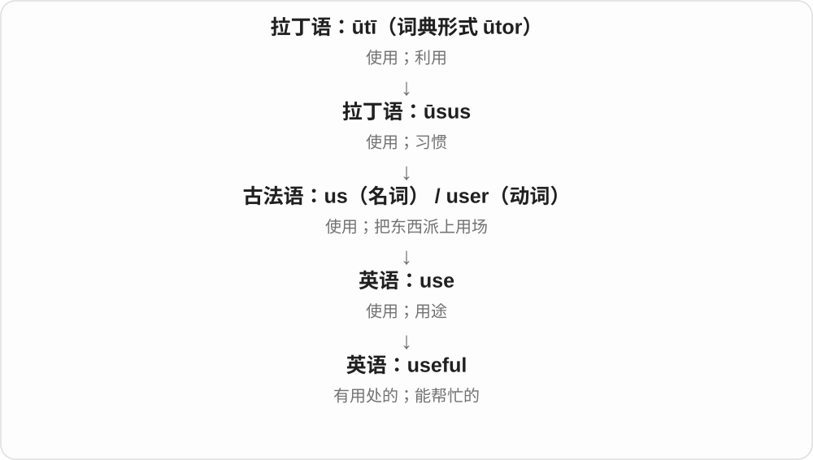
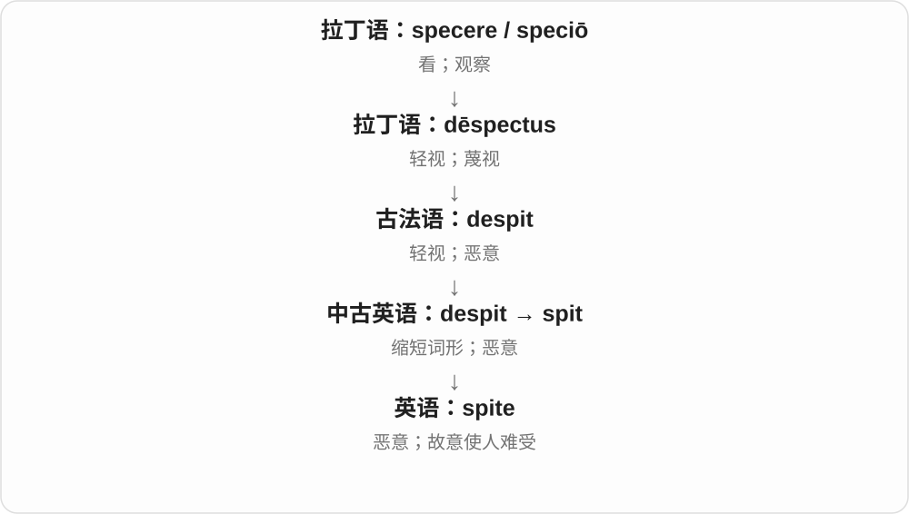
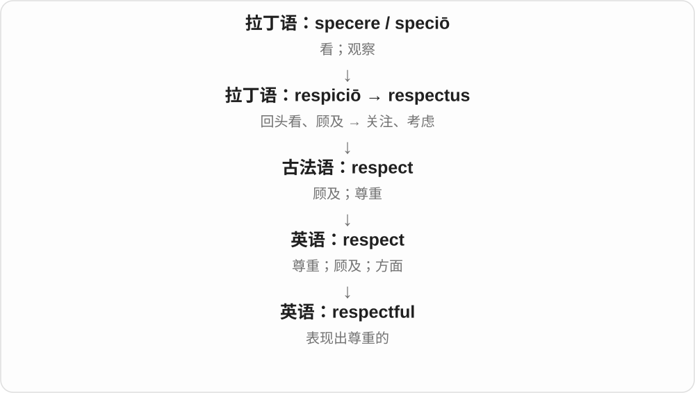
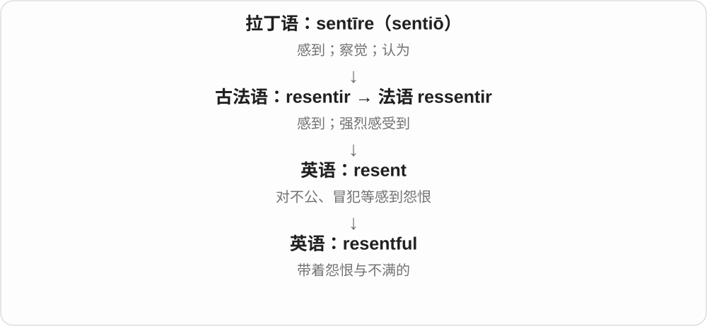

# 0240 · -ful — 有某种性质；带来某种感受；容器或身体部位所容纳的量

[逐词精讲目录](../00_逐词精讲目录.md) · [总目录](../00_总目录_按常用程度.md)

## 核心词根与来源

先问前面那份东西落在谁身上。a fearful child 是孩子害怕，a dreadful event 是事情令人害怕；不是所有 -ful 都朝一个方向。一到 handful、mouthful，则换成手、嘴能容下的量，再可产生少量、难应付等引申。

**-FUL：某种特点很显眼，或有这么一满份**

joyful 带着喜悦；delightful 令人愉快；handful 一把的量。同一个词尾，落点可以是自身状态、对人的效果或数量。

- **喜悦、见解和幸福**：delight · delightful · insight · insightful · bliss · blissful · glee · gleeful
- **报复、欺骗和恶意**：vengeance · vengeful · deceit · deceitful · spite · spiteful
- **慷慨、恐惧和悲伤**：bounty · bountiful · fright · frightful · mourn · mournful · woe · woeful
- **不信任、害羞和自夸**：distrust · distrustful · mistrust · mistrustful · bashful · boast · boastful
- **轻蔑与懊悔**：disdain · disdainful · scorn · scornful · rue · rueful
- **状态与造成的感受**：careful · fearful · joyful · painful · delightful · dreadful
- **一满份与固定引申**：handful · mouthful · spoonful · earful
- **glee → gleeful → gleefully：喜悦的方式**：gleeful · gleefully
- **mourn 的悲伤、哀悼与人、活动形式**：mourn · mourns · mourned · mourning · mourner · mourners · mournful

## 词形与演化规律

接古英语 -ful、-full，历史上与 full 满的相联，逐渐成为词尾；现代词尾通常写一个 l，发音多为弱读 /fəl/。加 -ly 时是 carefully 等，不把两个 l 随意删成 carefuy。y 有时改 i，如 beauty → beautiful、bounty → bountiful；但 joy → joyful，元音字母后的 y 通常保留。bashful 的历史词干与 abash 使窘迫相关，不是现代 bash 猛打；vengeful 的 venge 是旧报复动词。awful、wonderful 等已有固定常用义，需连用法理解。

gleeful 加完整 -ly，形成表示欢喜表现方式的副词，两个 l 分属 ful、ly。

古英语 murnan 传承为 mourn；mourning 与 morning 同音而来源不同，mourners 接哀悼者名词。

## 单词速览（按词族由简到繁）

同一基础词的相关扩展放在一起，先读基础形式，再读扩展；各组之间优先读常用的。具体词源关系见各词讲解。

| 单词 | 音标 | 核心意思 |
|---|---|---|
| [beautiful](#w-1) | /ˈbjuːtɪfəl/ | 美丽的；优美的；出色、令人愉悦的 |
| [successful](#w-2) | /səkˈsesfəl/ | 成功的；达到目的的 |
| [wonderful](#w-3) | 英 /ˈwʌndəfəl/；美 /ˈwʌndərfəl/ | 非常好的；令人赞叹的 |
| [useful](#w-4) | /ˈjuːsfəl/ | 有用的；能帮上忙的 |
| [careful](#w-5) | 英 /ˈkeəfəl/；美 /ˈkerfəl/ | 小心的；仔细周到的 |
| [awful](#w-6) | 英 /ˈɔːfl/；美 /ˈɔːfl/ 或 /ˈɑːfl/ | 糟糕的；可怕的；极大的〔部分搭配〕 |
| [helpful](#w-7) | /ˈhelpfəl/ | 有帮助的；乐于助人的 |
| [grateful](#w-8) | /ˈɡreɪtfəl/ | 感激的；心存谢意的 |
| [painful](#w-9) | /ˈpeɪnfəl/ | 疼痛的；令人痛苦的；难堪的 |
| [insight](#w-109) | /ˈɪnsaɪt/ | 洞见、深入理解；有帮助的认识 |
| [insightful](#w-33) | /ɪnˈsaɪtfəl/ | 有洞察力的；见解深刻的 |
| [meaningful](#w-10) | /ˈmiːnɪŋfəl/ | 有意义的；重要、有价值的；意味深长的 |
| [handful](#w-11) | /ˈhændfʊl/ | 一把；少量；难以应付的人或事 |
| [faithful](#w-12) | 英、美 /ˈfeɪθfəl/ | 忠诚的；忠实于原作的；虔诚的 |
| [spite](#w-110) | /spaɪt/ | 恶意；故意使人难受 |
| [spiteful](#w-66) | /ˈspaɪtfəl/ | 恶意的；存心伤人、使坏的 |
| [delight](#w-111) | /dɪˈlaɪt/ | 喜悦；令人高兴的事物；使高兴 |
| [delightful](#w-19) | /dɪˈlaɪtfəl/ | 令人愉快的；讨人喜欢的 |
| [harmful](#w-13) | 英 /ˈhɑːmfəl/；美 /ˈhɑːrmfəl/ | 有害的、会造成损害的 |
| [thankful](#w-14) | /ˈθæŋkfəl/ | 感激的；庆幸的 |
| [stressful](#w-15) | /ˈstresfl/ | 令人紧张的；压力很大的 |
| [thoughtful](#w-16) | 英 /ˈθɔːtfəl/；美 /ˈθɔːtfəl/ | 深思的；考虑周到的；体贴的 |
| [colorful](#w-17) | 美 /ˈkʌlərfəl/；英 /ˈkʌləfəl/ | 色彩鲜艳的；生动有趣的；经历丰富的 |
| [hopeful](#w-18) | 英 /ˈhəʊpfəl/；美 /ˈhoʊpfəl/ | 抱有希望的；有希望的；有望成功者〔名词〕 |
| [bliss](#w-112) | /blɪs/ | 极大的幸福；无比愉悦 |
| [blissful](#w-57) | /ˈblɪsfəl/ | 幸福无比的；令人极其愉悦的 |
| [bounty](#w-113) | 英 /ˈbaʊnti/；美 /ˈbaʊnti/ | 赏金；慷慨给予；丰饶、丰富的馈赠 |
| [bountiful](#w-68) | /ˈbaʊntɪfəl/ | 丰盛的；大量的；慷慨的 |
| [respectful](#w-20) | /rɪˈspektfəl/ | 尊重人的；恭敬的 |
| [mourn](#w-118) | 英 /mɔːn/；美 /mɔːrn/ | 哀悼；为失去而悲伤 |
| [mourning](#w-127) | 英 /ˈmɔːnɪŋ/；美 /ˈmɔːrnɪŋ/ | 哀悼、服丧；正在悲伤、悼念 |
| [mourned](#w-128) | 英 /mɔːnd/；美 /mɔːrnd/ | 哀悼、悲伤了；受到悼念的 |
| [mourners](#w-129) | 英 /ˈmɔːnəz/；美 /ˈmɔːrnərz/ | 哀悼者们；参加葬礼的吊唁者们 |
| [mourns](#w-130) | 英 /mɔːnz/；美 /mɔːrnz/ | 哀悼；为失去而悲伤〔第三人称单数〕 |
| [mournful](#w-76) | 英 /ˈmɔːnfəl/；美 /ˈmɔːrnfəl/ | 悲伤的；哀切的；令人悲伤的 |
| [mourner](#w-131) | 英 /ˈmɔːnə/；美 /ˈmɔːrnər/ | 哀悼者；参加葬礼悼念的人 |
| [vengeance](#w-114) | /ˈvendʒəns/ | 报复；复仇 |
| [dreadful](#w-21) | /ˈdredfəl/ | 可怕的；糟糕透顶的 |
| [lawful](#w-22) | /ˈlɔːfəl/ | 合法的；法律认可的 |
| [cheerful](#w-23) | 英 /ˈtʃɪəfəl/；美 /ˈtʃɪrfəl/ | 愉快、乐观的；明快、令人愉快的 |
| [fearful](#w-24) | 英 /ˈfɪəfl/；美 /ˈfɪrfl/ | 害怕、担忧的；可怕的；很厉害的〔部分搭配〕 |
| [youthful](#w-25) | /ˈjuːθfəl/ | 年轻的；青春洋溢的；有年轻特点的 |
| [shameful](#w-26) | /ˈʃeɪmfəl/ | 可耻的、丢脸的 |
| [rue](#w-115) | /ruː/ | 懊悔；后悔 |
| [rueful](#w-102) | /ˈruːfəl/ | 懊悔的；带着无奈、苦笑的 |
| [colourful](#w-27) | 英 /ˈkʌləfəl/；美 /ˈkʌlərfəl/ | 色彩丰富的；生动的；富有传奇色彩的 |
| [playful](#w-28) | /ˈpleɪfəl/ | 爱玩的；调皮的；开玩笑的 |
| [doubtful](#w-29) | /ˈdaʊtfəl/ | 拿不准的；不大可能的；可疑的 |
| [hateful](#w-30) | /ˈheɪtfəl/ | 充满仇恨的；令人厌恶的 |
| [boast](#w-116) | 英 /bəʊst/；美 /boʊst/ | 自夸；值得自豪的事；拥有值得称道的事物 |
| [boastful](#w-89) | 英 /ˈbəʊstfəl/；美 /ˈboʊstfəl/ | 爱自夸的；吹嘘的 |
| [glee](#w-117) | /ɡliː/ | 欢喜；兴高采烈 |
| [gleeful](#w-94) | /ˈɡliːfəl/ | 兴高采烈的；喜不自胜的 |
| [gleefully](#w-126) | /ˈɡliːfəli/ | 欢喜地、兴高采烈地；幸灾乐祸地〔按语境〕 |
| [mindful](#w-31) | /ˈmaɪndfəl/ | 留意的；意识到并顾及的 |
| [truthful](#w-32) | /ˈtruːθfəl/ | 诚实的；如实的 |
| [distrust](#w-119) | /dɪsˈtrʌst/ | 不信任；怀疑可靠性 |
| [distrustful](#w-82) | /dɪsˈtrʌstfəl/ | 不信任的；持怀疑态度的 |
| [joyful](#w-34) | /ˈdʒɔɪfəl/ | 喜悦的；充满欢乐的 |
| [graceful](#w-35) | /ˈɡreɪsfəl/ | 优雅的；动作顺畅自然的；得体平稳的 |
| [disgraceful](#w-39) | /dɪsˈɡreɪsfəl/ | 可耻的；很不体面的；令人愤慨的 |
| [rightful](#w-36) | /ˈraɪtfəl/ | 正当拥有的；合法应得的 |
| [plentiful](#w-37) | 英、美 /ˈplentɪfəl/ | 大量存在的；充足的 |
| [disdain](#w-120) | /dɪsˈdeɪn/ | 轻蔑；鄙视；因看不上而不屑做 |
| [disdainful](#w-95) | /dɪsˈdeɪnfəl/ | 轻蔑的；鄙视的 |
| [wrongful](#w-40) | 英 /ˈrɒŋfəl/；美 /ˈrɔːŋfəl/ | 不正当的；不公正的；法律语境中非法或侵权的 |
| [woe](#w-121) | 英 /wəʊ/；美 /woʊ/ | 悲痛；灾祸；烦恼、麻烦 |
| [woeful](#w-78) | 英 /ˈwəʊfəl/；美 /ˈwoʊfəl/ | 悲惨的；悲伤的；非常糟糕的 |
| [fright](#w-122) | /fraɪt/ | 惊吓；一阵害怕 |
| [frightful](#w-71) | /ˈfraɪtfəl/ | 可怕的；糟糕的；严重得惊人的 |
| [fruitful](#w-41) | /ˈfruːtfəl/ | 富有成果的；有成效的；多产的 |
| [hurtful](#w-42) | 英 /ˈhɜːtfəl/；美 /ˈhɜːrtfəl/ | 伤人的；让人难受的 |
| [merciful](#w-43) | 英 /ˈmɜːsɪfəl/；美 /ˈmɜːrsɪfəl/ | 仁慈的；宽恕人的；令人少受苦的 |
| [wasteful](#w-44) | /ˈweɪstfəl/ | 浪费的、造成不必要耗用的 |
| [deceit](#w-123) | /dɪˈsiːt/ | 欺骗；欺诈手段 |
| [deceitful](#w-62) | /dɪˈsiːtfəl/ | 骗人的；不诚实、蓄意误导的 |
| [forceful](#w-45) | 英 /ˈfɔːsfəl/；美 /ˈfɔːrsfəl/ | 有力的；坚定有说服力的 |
| [pitiful](#w-46) | /ˈpɪtɪfəl/ | 可怜的；差劲得令人叹息的 |
| [scorn](#w-124) | 英 /skɔːn/；美 /skɔːrn/ | 鄙视、轻蔑；轻蔑地拒绝 |
| [scornful](#w-98) | 英 /ˈskɔːnfəl/；美 /ˈskɔːrnfəl/ | 轻蔑的；嘲讽的 |
| [skillful](#w-47) | /ˈskɪlfəl/ | 有技巧的、巧妙熟练的 |
| [soulful](#w-48) | 英 /ˈsəʊlfəl/；美 /ˈsoʊlfəl/ | 深情的、富有内在情感的 |
| [wishful](#w-49) | /ˈwɪʃfəl/ | 抱有愿望的；一厢情愿的 |
| [watchful](#w-50) | 英 /ˈwɒtʃfəl/；美 /ˈwɑːtʃfəl/ | 警觉的；留心观察的 |
| [resourceful](#w-51) | 英 /rɪˈsɔːsfl/、/rɪˈzɔːsfl/；美 /rɪˈsɔːrsfl/ | 足智多谋的；善于想办法的 |
| [purposeful](#w-52) | 英 /ˈpɜːpəsfəl/；美 /ˈpɜːrpəsfəl/ | 有明确目标的；坚定有效的；有意图的 |
| [fateful](#w-53) | /ˈfeɪtfəl/ | 影响重大的；决定命运的 |
| [masterful](#w-54) | 英 /ˈmɑːstəfl/；美 /ˈmæstərfl/ | 技艺高超的；有支配力、强势的 |
| [mistrust](#w-125) | /ˌmɪsˈtrʌst/ | 不信任；怀疑 |
| [mistrustful](#w-105) | /mɪsˈtrʌstfəl/ | 不信任的；猜疑的 |
| [eventful](#w-55) | /ɪˈventfəl/ | 多事的；经历丰富的；充满波折的 |
| [mouthful](#w-56) | /ˈmaʊθfʊl/ | 一口的量；拗口的词句〔比喻〕 |
| [tasteful](#w-58) | /ˈteɪstfəl/ | 有品位的、雅致得体的 |
| [distasteful](#w-60) | /dɪsˈteɪstfəl/ | 令人反感、令人不快的 |
| [vengeful](#w-59) | /ˈvendʒfəl/ | 想报复的；充满复仇心的 |
| [tearful](#w-61) | 英 /ˈtɪəfəl/；美 /ˈtɪrfəl/ | 含泪的；想哭的；令人落泪的 |
| [fanciful](#w-63) | /ˈfænsɪfəl/ | 富于想象的；想入非非的；不切实际的 |
| [resentful](#w-64) | /rɪˈzentfəl/ | 心怀不满的；怨愤的 |
| [artful](#w-67) | 英 /ˈɑːtfəl/；美 /ˈɑrtfəl/ | 巧妙的；狡黠的；善用手段的 |
| [forgetful](#w-69) | 英 /fəˈɡetfəl/；美 /fərˈɡetfəl/ | 健忘的；容易忘事的 |
| [spoonful](#w-70) | /ˈspuːnfəl/ | 一勺的量 |
| [healthful](#w-72) | /ˈhelθfəl/ | 有益健康的 |
| [wilful](#w-73) | /ˈwɪlfəl/ | 任性的；执意的；故意的 |
| [restful](#w-74) | /ˈrestfəl/ | 宁静的；让人休息、放松的 |
| [suspenseful](#w-75) | 英、美 /səˈspensfəl/ | 充满悬念的；令人紧张期待的 |
| [sorrowful](#w-77) | 英 /ˈsɒrəʊfəl/；美 /ˈsɑːroʊfəl/ | 悲伤的、忧伤的；令人伤心的 |
| [flavorful](#w-79) | 英 /ˈfleɪvəfəl/；美 /ˈfleɪvərfəl/ | 味道丰富的；有滋味的 |
| [dutiful](#w-81) | 英 /ˈdjuːtɪfəl/；美 /ˈduːtɪfəl/ | 尽责的；顺从本分的 |
| [remorseful](#w-83) | 英 /rɪˈmɔːsfl/；美 /rɪˈmɔːrsfl/ | 懊悔的；内疚的 |
| [tactful](#w-84) | /ˈtæktfəl/ | 得体的；说话做事有分寸的 |
| [fistful](#w-85) | /ˈfɪstfʊl/ | 一把、一拳握住的量；少量 |
| [regretful](#w-86) | /rɪˈɡretfəl/ | 感到后悔、遗憾的；流露遗憾的 |
| [bashful](#w-87) | /ˈbæʃfəl/ | 害羞的；腼腆的 |
| [earful](#w-96) | 英 /ˈɪəfʊl/；美 /ˈɪrfʊl/ | 一顿训斥；一大通抱怨、话 |
| [fitful](#w-100) | /ˈfɪtfəl/ | 断断续续的；一阵阵的 |
| [tuneful](#w-101) | 英 /ˈtjuːnfəl/；美 /ˈtuːnfəl/ | 旋律优美的、悦耳的 |

## 逐词讲解

### 1. beautiful — 美丽的；优美的；出色、令人愉悦的

**音标**：/ˈbjuːtɪfəl/

**先抓住这个画面**

事物有美感，或完成得很出色、让人满意，不只指外表漂亮。

**怎么拆**

beauty + -ful，y 变 i；-ful 形成具有美这种性质的形容词，现代拼写只有一个结尾 l。

**怎么变成今天的意思**

**拉丁语 bellus → 通俗拉丁语 \*bellitās、古法语 beauté 等形式**  
好看、悦目 → 美这一性质

↓

**中古英语 bewte / beaute → 英语 beauty**  
美；美的事物、人；还有优点的比喻用法

↓

**beauty + -ful → beautiful**  
美 → 具有美感、出色的

a beautiful landscape 美丽风景，a beautiful voice 优美嗓音，a beautiful solution 漂亮、巧妙的解决办法。

**常见搭配与例句**

a beautiful view；a beautiful voice；a beautiful performance；a beautiful solution。

> The room has a beautiful view of the mountains.

房间能看到美丽山景。

> She found a beautiful solution to a difficult design problem.

她为棘手的设计问题找到了一个漂亮的解决办法。

**别混淆**

beautiful 比 pretty 更容易涵盖广阔、壮丽、深层美感，但两者范围可重叠；不是靠词长评定美的客观等级。

### 2. successful — 成功的；达到目的的

**音标**：/səkˈsesfəl/

**先抓住这个画面**

把要办的事办成了。

**怎么拆**

success + -ful；-ful 在这里表示具有成功结果。

**怎么变成今天的意思**

**拉丁 cēdere；分词词干 cess-**  
走、离开；让步、让出

↓

**拉丁 sub- + cēdere → succēdere**  
接着来、接替；事情进展顺利

↓

**拉丁 successus → 英语 success**  
结果、进展 → 好结果、成功

↓

**英语 success + -ful → successful**  
取得预期结果的

successful repair 是修好了；successful application 是申请获准。形容人时常指事业或工作有成，但不必理解为有钱才成功。

**常见搭配与例句**

a successful attempt；successful in doing…。

> The team made a successful landing on the test field.

团队在试验场完成了成功的着陆。

> She was successful in finding a new supplier.

她成功找到了新的供应商。

**别混淆**

successive 是接连发生的；successful 才是成功的，拼写相近而重点不同。

### 3. wonderful — 非常好的；令人赞叹的

**音标**：英 /ˈwʌndəfəl/；美 /ˈwʌndərfəl/

**先抓住这个画面**

最初是让人惊叹，如今日常经常只是很棒、非常令人愉快。

**怎么拆**

wonder + -ful，相应组合古英语已有。由充满惊奇、令人惊叹，扩展成常用赞美形容词。

**怎么变成今天的意思**

**古英语 wundor、wundrian → 中古英语 wonder、wondren**  
令人惊奇的事；感到惊奇

↓

**现代 wonder**  
惊叹 → 好奇、心里想知道

↓

**wonder + -ful → wonderful**  
令人惊叹的 → 很棒的

a wonderful idea 很棒的主意，have a wonderful time 玩得很开心；不要求事情超自然或史无前例。

**常见搭配与例句**

a wonderful idea；wonderful news；have a wonderful time。

> Thank you for a wonderful evening.

谢谢你让我度过一个美好的夜晚。

> That is a wonderful idea for the school project.

那是一个很棒的学校项目点子。

**别混淆**

wonderful 常正面赞美；wonder 本身可以只是好奇，不能把 I wonder 译成我觉得很棒。

### 4. useful — 有用的；能帮上忙的

**音标**：/ˈjuːsfəl/

**先抓住这个画面**

useful 的重点是“对眼前这件事有帮助”。一张简单的纸条，只要能让你少走弯路，就很 useful。

**怎么拆**

use + -ful。-ful 在这里形成“有这种作用或性质”的形容词，不是说东西被“使用”装满了。

**怎么变成今天的意思**

use 作为名词有“用处”的意思，useful 就是有用处。它评价的是对象与需要之间的关系：对修车有用，不表示对做饭也有用。

**常见搭配与例句**

useful for doing something；useful to someone；a useful tip；come in useful（派上用场）。

> This map is useful for finding the smaller streets.

这张地图对寻找小街巷很有帮助。

> Your notes came in useful when I missed the class.

我缺课时，你的笔记帮了大忙。

**别混淆**

useful 是能帮忙；usable 是还能用。一个 usable 的旧工具能正常操作，却未必对当前任务 useful。

### 5. careful — 小心的；仔细周到的

**音标**：英 /ˈkeəfəl/；美 /ˈkerfəl/

**先抓住这个画面**

手里拿着容易碎的东西，会放慢些、留意些；做判断也能这样谨慎。

**怎么拆**

care + -ful，接古英语 carful、中古英语 careful 等；旧时也有忧虑等意义，现代常用义偏留心、谨慎。-ful 只有一个 l。

**怎么变成今天的意思**

**古英语 caru / ċearu；carian → 中古英语 care / caren**  
忧虑、挂心；关照、在意

↓

**古英语 carful → 中古英语 careful → careful**  
怀有挂虑、留心 → 谨慎仔细

be careful with glass 是拿玻璃小心，be careful about details 是留意细节，a careful analysis 是细致分析。be careful not to do 提醒避免某事。

**常见搭配与例句**

be careful with；be careful not to；a careful review。

> Be careful with that bowl; it is very old.

小心拿那个碗，它很有年头了。

> The decision followed a careful review of the evidence.

决定是在细致审查证据后作出的。

**别混淆**

careful 重谨慎、细致，caring 重对人的关怀；一个 caring 的人也可能收拾东西不够 careful。

### 6. awful — 糟糕的；可怕的；极大的〔部分搭配〕

**音标**：英 /ˈɔːfl/；美 /ˈɔːfl/ 或 /ˈɑːfl/

**先抓住这个画面**

历史上也是令人敬畏，后来负面的可怕感越来越突出，日常就成了“真糟”。

**怎么拆**

awe + -ful，经中古英语相应形式。早期有引起敬畏、恐惧义，后来常用义贬化为很坏；不是今天直接把 awe 翻出来就够。

**怎么变成今天的意思**

**古诺尔斯语 agi → 中古英语 awe**  
惧怕、敬畏，与本族相关旧词汇合

↓

**英语 awe**  
面对强大、壮观之物的敬畏与惊叹

↓

**awe + -ful → awful**  
令人敬畏、可怕 → 很糟糕

awful weather 糟糕天气，feel awful 身体难受或心里很不好受，an awful lot 非常多，是加强程度。

**常见搭配与例句**

awful weather；feel awful；an awful smell；an awful lot。

> The weather was awful throughout the trip.

旅途中天气一直很糟。

> I felt awful about forgetting her birthday.

忘了她的生日，我心里很过意不去。

**别混淆**

awful 与 awesome 今天通常褒贬相反；an awful lot of help 则只强调帮助很多，不是在批评帮助糟。

### 7. helpful — 有帮助的；乐于助人的

**音标**：/ˈhelpfəl/

**先抓住这个画面**

一句说明正好解开问题，或一个人主动把你卡住的地方处理了。

**怎么拆**

help + -ful；-ful 在这里造“具有帮助作用”的形容词。中古英语已有同形相关用法，不按字面译成“满是帮助”。

**怎么变成今天的意思**

**古英语 help；helpan**  
帮助；帮助这一动作

↓

**中古英语 help／helpen → 英语 help**  
帮助、协助；使情况好转

↓

**help + -ful → helpful**  
提供帮助或能派上用场的

a helpful guide 是能解决问题的指南；helpful staff 是愿意并能给顾客帮助的工作人员。helpful to someone、helpful for doing 常说明对象或用途。

**常见搭配与例句**

helpful advice；a helpful suggestion；find something helpful。

> The receptionist was friendly and helpful.

接待员亲切又乐于助人。

> It would be helpful to see a concrete example.

看一个具体例子会有帮助。

**别混淆**

helpful 评价帮助作用，useful 评价有用途；a useful tool 不一定像 a helpful person 那样带有待人友善的意味。

### 8. grateful — 感激的；心存谢意的

**音标**：/ˈɡreɪtfəl/

**先抓住这个画面**

别人给了支持、照顾或机会，你意识到这份好，心里说一句谢谢。

**怎么拆**

英语旧形容词 grate“令人愉快的”来自拉丁 gratus，再加 -ful。它不接 grate“刨碎”或“金属栅格”那两条来源，也不拼作 greatful。

**怎么变成今天的意思**

**拉丁 gratus**  
令人喜欢、受欢迎；也指心怀感谢

↓

**英语旧形容词 grate + -ful → grateful**  
令人愉快、受欢迎 → 心存感谢；旧时也表令人愉快

be grateful to someone for something。I would be grateful if… 是礼貌请求，意思是“如果能……我将很感激”，不是保证对方已经答应。

**常见搭配与例句**

grateful for your help；grateful to someone；I would be grateful if。

> I am grateful to you for staying late to help.

谢谢你留下来加班帮忙，我很感激。

> We were grateful for a quiet place to rest.

能有一个安静的地方休息，我们很感激。

**别混淆**

grateful 感谢已有的好意；gratified 对某种结果感到满意，未必是在感谢谁。

### 9. painful — 疼痛的；令人痛苦的；难堪的

**音标**：/ˈpeɪnfəl/

**先抓住这个画面**

有的痛落在身体上，有的落在回忆或尴尬场面里；painful 都从“让人难受”这一点展开。

**怎么拆**

中古英语已有 paynful 等形式，等于 pain + -ful。-ful 在此表示带来或充满某种感受，不是把一份 pain 真正装满容器。

**怎么变成今天的意思**

**古希腊 poinē → 拉丁 poena**  
赔偿、罚金、处罚；后来也指折磨、痛苦

↓

**古法语 peine → 中古英语 peyne**  
痛苦、费力

↓

**中古英语 paynful → 英语 painful**  
充满痛苦、造成痛苦的

a painful knee 是疼痛的膝盖，a painful memory 是让人难受的回忆，a painful silence 则可能是难堪的沉默。它常修饰造成痛感或痛苦的部位、事件、经历。

**常见搭配与例句**

a painful injury；a painful memory；a painful decision；painful to watch。

> Walking up the stairs was painful after the long hike.

长途徒步后，上楼梯都很疼。

> It was painful to admit that the plan had failed.

承认计划已经失败，让人很难受。

**别混淆**

painful 往往指让人难受的事物；pained 常指人显出的难受神情。a pained expression 是难受的表情，a painful experience 是令人痛苦的经历。

### 10. insight — 洞见、深入理解；有帮助的认识

**音标**：/ˈɪnsaɪt/

**先抓住这个画面**

不只看见表面发生什么，而是看出里面为什么这样运作。一个关键认识，能让整件事突然明白。

**怎么拆**

中古英语 insight、insiht 已有，现代对应 in- 向内 + sight 看见。更早与旧英语同形词的继承关系有不同分析，从可靠中古英语心理视觉义讲。

**怎么变成今天的意思**

**中古英语 insight、insiht 等**  
内在、心智的看见、理解；可能有更早对应形式

↓

**in- + sight 的表面结构 → insight**  
深入认识、洞见；有助理解的发现

insight into something 对某事的深入认识，gain insight 获得洞见，a useful insight 一个有用认识。既有不可数理解力，也有可数具体洞见。

**常见搭配与例句**

insight into；gain insight；a valuable insight；offer insights。

> The interview gave us insight into how the team works.

访谈让我们深入了解了团队怎样运作。

> Her comment offered a useful insight into the problem.

她的评论为理解问题提供了一个有用认识。

**别混淆**

insight 理解，eyesight 视力；oversight 可疏漏或监督，hindsight 事后看法，不能只按 sight 一律译眼睛看见。

### 11. insightful — 有洞察力的；见解深刻的

**音标**：/ɪnˈsaɪtfəl/

**先抓住这个画面**

别人只看见表面现象，你指出了背后的关键，这种能看进去的理解就是 insightful。

**怎么拆**

insight 洞察、深刻理解 + -ful。sight 看见的画面进入心理层面，成为看懂内里，再形容能带来这种理解的人或评论。

**怎么变成今天的意思**

**insight**  
对内在情况的深刻理解

↓

**insight + -ful → insightful**  
有洞察力、帮助人看懂问题

an insightful comment 不只信息多，还点出关键；也可说 an insightful observer 目光敏锐的观察者。

**常见搭配与例句**

an insightful analysis；an insightful question。

> Her insightful question changed the direction of the discussion.

她那个有洞见的问题改变了讨论方向。

> The review offers an insightful analysis of the novel.

这篇评论对小说作出了深刻分析。

**别混淆**

informative 是提供很多有用信息，insightful 是帮助理解深层关系；资料丰富的文章未必见解深刻。

### 12. meaningful — 有意义的；重要、有价值的；意味深长的

**音标**：/ˈmiːnɪŋfəl/

**先抓住这个画面**

不是表面走个过场，而是真有内容、能产生作用；一个眼神也能不说话却带意思。

**怎么拆**

meaning + -ful，表示有意义、充满所指内容。后缀只有一个 l，不写成 meaningfull。

**怎么变成今天的意思**

**古英语 mǣnan → 中古英语 menen → mean**  
意指、打算、表示

↓

**中古英语 mening → meaning**  
所指、意图 → 含义、意义、重要性

↓

**meaning + -ful → meaningful**  
有含义、内容或价值；意味深长

a meaningful conversation 有内容的交谈，meaningful progress 有实质价值的进展，a meaningful look 意味深长的一眼。

**常见搭配与例句**

a meaningful conversation；meaningful progress；a meaningful look。

> We had a meaningful conversation about our plans.

我们认真聊了各自的打算，谈得很有内容。

> She gave him a meaningful look before leaving.

离开前，她意味深长地看了他一眼。

**别混淆**

meaningful 不只代表语法能解析；a meaningful change 强调变化真有分量。significant 常也说重要，但搭配、语气不总相同。

### 13. handful — 一把；少量；难以应付的人或事

**音标**：/ˈhændfʊl/

**先抓住这个画面**

手一握装不了多少；如果一个孩子把你两只手都忙满了，又会觉得够你应付。

**怎么拆**

hand + -ful，上接古英语 handfull；-ful 在此形成一手容量名词，后延伸少量与足够让人忙的对象。只有一个 l，不拼成 handfull。

**怎么变成今天的意思**

**古英语 handfull → 中古英语 handful → handful**  
手能拿住的量

↓

**handful 的延伸用法**  
少量；让人难应付的对象

a handful of rice 是一把米，a handful of people 是寥寥几人，The twins are a handful 是双胞胎很难带。量并不固定为五个。

**常见搭配与例句**

a handful of；only a handful；be a handful。

> Add a handful of fresh herbs.

加一把新鲜香草。

> Only a handful of visitors stayed until the end.

只有少数访客留到最后。

> The energetic puppy is a real handful.

那只精力旺盛的小狗真够人忙的。

**别混淆**

handful 一把或少数，full hand 分开只说手满了；a handful of people 不是说把人真抓在手里。

### 14. faithful — 忠诚的；忠实于原作的；虔诚的

**音标**：英、美 /ˈfeɪθfəl/

**先抓住这个画面**

关系、职责或原来的内容没有被你背弃，也没有被你随便改掉。

**怎么拆**

faith + -ful；中古英语已有 feithful。这里 -ful 表示具有这种性质，不按字面量成装满信仰。

**怎么变成今天的意思**

**拉丁语 fides，宾格 fidem**  
信任、信义、信仰

↓

**古法语 feid / fei → 中古英语 faith → faith**  
经过法语的日常词形 → 信任；信仰

↓

**中古英语 feithful → faithful**  
faith + -ful → 忠诚、忠实的

a faithful friend 是一直靠得住的朋友；a faithful translation 是忠于原文的翻译。the faithful 也可整体指虔诚的信徒。

**常见搭配与例句**

be faithful to；a faithful friend；a faithful reproduction；the faithful。

> She remained faithful to her oldest friends.

她一直忠于相识最久的朋友们。

> The film is a faithful adaptation of the novel.

这部电影忠实地改编了那部小说。

**别混淆**

loyal 常说对人或组织忠诚；faithful 还常说复制、翻译忠于原物。

### 15. spite — 恶意；故意使人难受

**音标**：/spaɪt/

**先抓住这个画面**

spite 像明知这样会让对方不高兴，却偏要这样做；动作可能很小，心思却是冲着人去的。

**怎么拆**

中古英语把 despit 缩短成 spit，成为今天的 spite；despit 也产生了 despite。

**怎么变成今天的意思**

由轻视、恶意发展为故意使人为难。out of spite 强调动机；in spite of 则已成为“尽管”的固定结构。

**常见搭配与例句**

out of spite；do something to spite someone；in spite of。

> He hid the keys out of spite.

他出于恶意把钥匙藏了起来。

> She succeeded in spite of the difficulties.

尽管困难重重，她还是成功了。

**别混淆**

anger 是生气，spite 是带有使对方受挫的恶意；生气的人不一定会故意报复。

### 16. spiteful — 恶意的；存心伤人、使坏的

**音标**：/ˈspaɪtfəl/

**先抓住这个画面**

明知一句话会刺痛别人，还故意说出去；不是为了解决问题，而是想让对方难受，就是 spiteful。

**怎么拆**

中古英语有相应形式，现代对应 spite 恶意 + -ful。spite 的历史与 despite 的旧形式相联；现代意思不能照着 despite 尽管来猜。

**怎么变成今天的意思**

**较早 despit 等 → spite**  
轻蔑、恶意的材料

↓

**spite + -ful → spiteful**  
存心使别人难受的

spiteful remarks 恶意伤人的话；a spiteful act 存心使坏的行为。

**常见搭配与例句**

a spiteful comment；a spiteful smile。

> There was no need for such a spiteful remark.

没必要说那样恶意伤人的话。

> He deleted the file in a spiteful attempt to upset her.

他恶意删掉了文件，想让她难受。

**别混淆**

spiteful 可以是小心眼地伤人，不必有具体旧仇；vengeful 更明确围绕报复。

### 17. delight — 喜悦；令人高兴的事物；使高兴

**音标**：/dɪˈlaɪt/

**先抓住这个画面**

收到惊喜时眼睛一亮，是 delight 的感觉。作名词可指这份喜悦，也可指带来喜悦的人或事；作动词就是让人高兴。

**怎么拆**

经古法语接拉丁 delectare。早期英语有 delite；后来的 gh 不代表来自 light 光，也不单独发音。

**怎么变成今天的意思**

**拉丁 delectare → 古法语 deliter**  
使愉快、使喜爱

↓

**中古英语 delite → delight**  
喜悦；gh 是后来受 light 等拼写影响而出现的字母

to my delight 令我高兴的是；take delight in doing 乐于做；delight someone 使某人高兴。

**常见搭配与例句**

to someone’s delight；take delight in。

> To her delight, the old tree had flowered again.

令她高兴的是，老树又开花了。

> The unexpected visit delighted the children.

这次意外的来访让孩子们很开心。

**别混淆**

delight 通常比普通 pleasure 更鲜明，常有开心、惊喜的感觉；delighted 说人很高兴，delightful 常说人或事令人愉快。

### 18. delightful — 令人愉快的；讨人喜欢的

**音标**：/dɪˈlaɪtfəl/

**先抓住这个画面**

一个小花园、一顿午餐、一个有趣的人，让你接触后心情变好了，就可以说 delightful。

**怎么拆**

中古英语已有相应形式；现代对应 delight + -ful。这里突出带来喜悦，不是说花园自己在高兴。

**怎么变成今天的意思**

**拉丁 delectare → 古法语 deliter**  
使愉快、使喜爱

↓

**中古英语 delite → delight**  
喜悦；gh 是后来受 light 等拼写影响而出现的字母

↓

**delight + -ful → delightful**  
令人愉快、讨人喜欢

评价经历、地方、人、细节都能用，语气常较温暖、赞赏。

**常见搭配与例句**

a delightful afternoon 愉快的下午；a delightful surprise 令人欣喜的意外。

> We spent a delightful afternoon by the lake.

我们在湖边度过了一个愉快的下午。

> The book is full of delightful little details.

这本书里有许多讨人喜欢的小细节。

**别混淆**

delightful 说对象给人的感受；delighted 通常说感到高兴的人：a delightful gift，a delighted child。

### 19. harmful — 有害的、会造成损害的

**音标**：英 /ˈhɑːmfəl/；美 /ˈhɑːrmfəl/

**先抓住这个画面**

某物、某做法会伤害对象，所以是 harmful；它说有损害的性质，不是盛满一个叫 harm 的容器。

**怎么拆**

harm + -ful 形成性质形容词，中古英语已有相应形式。词尾读弱音 /fəl/，不是 full 满的重读。

**怎么变成今天的意思**

**古英语 hearm → 中古英语 harm、herm → harm**  
损害、痛苦等

↓

**harm + -ful → harmful**  
造成或可能造成损害的

harmful to wildlife 对野生生物有害，a harmful effect 有害影响，harmful substances 有害物质。

**常见搭配与例句**

harmful to；a harmful effect；harmful substances。

> The chemical was harmful to the plants.

这种化学物质对植物有害。

> The report examined the harmful effects of the waste.

报告考察了废物的有害影响。

**别混淆**

harmful 有害，harmless 无害；helpful 有帮助是另一个正面方向，不把一个词尾 -ful 自动当褒义。

### 20. thankful — 感激的；庆幸的

**音标**：/ˈθæŋkfəl/

**先抓住这个画面**

有人帮到自己，或坏事没发生，心里松一口气，觉得值得感谢。

**怎么拆**

thank + -ful，古英语 þancful、中古英语 thankful 等已有对应形式；-ful 表充满、带有这种感受。

**怎么变成今天的意思**

**古英语 þanc〔名词〕、þancian〔动词〕→ 中古英语 thank / thanken**  
感念、感谢；表达谢意

↓

**英语 thank、thanks**  
感谢；谢意、谢谢

↓

**thank + -ful；旧形容词形式延续**  
感激、庆幸的

thankful for 感谢某事，thankful that 庆幸某个事实。常含坏结果被避开后的松口气，但也能普通表达感激。

**常见搭配与例句**

thankful for；thankful that；deeply thankful。

> I am thankful for your support.

我感谢你的支持。

> We were thankful that the rain stopped before the ceremony.

我们很庆幸仪式前雨停了。

**别混淆**

thankful 与 grateful 都可感激；thankful 常适合庆幸顺利脱险等语境，不能硬分成只对事、只对人。

### 21. stressful — 令人紧张的；压力很大的

**音标**：/ˈstresfl/

**先抓住这个画面**

这件事会把压力加到人身上，让人难以放松。

**怎么拆**

stress + -ful，表示充满压力或带来压力。

**怎么变成今天的意思**

**拉丁语 stringere**  
拉紧、捆紧、压在一起

↓

**拉丁语 strictus 及其衍生形式 → 古法语 estrece / estrecier 等**  
紧、狭窄 → 压迫、施压

↓

**英语 stress〔名、动〕；也部分来自 distress 的缩短**  
压力、强调、重音；不是仅由英语名词派生出动词

↓

**英语 stress + -ful → stressful**  
带来压力的

a stressful week 是一周的事情让人压力大；a stressful job 则是工作本身经常带来压力。一般用来描述情境，不说 I am stressful 表示自己紧张。

**常见搭配与例句**

a stressful situation；a stressful journey；find something stressful。

> Moving house can be stressful even when everything goes well.

即使一切顺利，搬家也可能让人压力很大。

> She finds large social events stressful.

她觉得大型社交活动很让人紧张。

**别混淆**

stressful 是事情令人有压力；stressed 是人已经感到有压力。

### 22. thoughtful — 深思的；考虑周到的；体贴的

**音标**：英 /ˈθɔːtfəl/；美 /ˈθɔːtfəl/

**先抓住这个画面**

肯多想一步；想到事情本身，也想到别人的需要。

**怎么拆**

thought 思考 + -ful 有……的。早期侧重沉思、谨慎，后来也常指替别人着想。

**怎么变成今天的意思**

**英语 thought；-ful**  
思考；具有……的

↓

**早期 thoughtful**  
沉思、认真考虑的

↓

**体贴义 thoughtful**  
把别人的需要也考虑进去的

a thoughtful answer 是经过认真思考的回答；a thoughtful gift 是送礼的人考虑了收礼者真正需要什么。两义都能从“多用了一点心思”理解，但前者未必是在关心人。

**常见搭配与例句**

a thoughtful response；a thoughtful gesture；thoughtful of someone。

> She gave a thoughtful answer after a long pause.

她停顿了很久，给出一个经过认真思考的回答。

> It was thoughtful of you to bring an extra umbrella for me.

你想到给我多带一把伞，真体贴。

**别混淆**

thoughtful 不只是脑中想法多，更不是焦虑想太多。体贴义接近 considerate，深思义接近 reflective。

### 23. colorful — 色彩鲜艳的；生动有趣的；经历丰富的

**音标**：美 /ˈkʌlərfəl/；英 /ˈkʌləfəl/

**先抓住这个画面**

画面有颜色，故事也可以有颜色：细节多、变化多，让人觉得鲜活。

**怎么拆**

英语 color + -ful 充满，先说色彩丰富，也发展出有趣、有特色的比喻义。

**怎么变成今天的意思**

**拉丁 color**  
颜色；肤色；外表

↓

**古法语 color、英法语 colur 等 → 英语 color / colour**  
颜色；引申为特色、看事情的色彩

↓

**英语 color + -ful → colorful**  
色彩丰富 → 生动、有特色

a colorful jacket 是颜色鲜艳的夹克；a colorful character 是有个性、经历或言行不平淡的人。colorful language 有时委婉指粗话，不是单纯夸文笔漂亮。具体褒贬要看搭配。

**常见搭配与例句**

colorful flowers；a colorful story；a colorful character；colorful language。

> Colorful flags lined the street for the festival.

节日里，街道两侧挂满了鲜艳的旗帜。

> His colorful account of the trip kept everyone laughing.

他把旅途讲得绘声绘色，逗得大家一直笑。

**别混淆**

multicolor 主要强调多种颜色；colorful 还强调鲜亮、有趣，甚至可以完全不谈视觉。

### 24. hopeful — 抱有希望的；有希望的；有望成功者〔名词〕

**音标**：英 /ˈhəʊpfəl/；美 /ˈhoʊpfəl/

**先抓住这个画面**

人心里觉得还有戏，或某个迹象让大家看见还有戏。

**怎么拆**

hope + -ful，-ful 表带有、充满相应性质，只有一个 l；末尾 hope 的 e 保留。

**怎么变成今天的意思**

**古英语 hopian → 中古英语 hopen**  
希望、期待

↓

**英语 hope〔相应名词也有古英语前身〕**  
希望；抱有实现可能的愿望

↓

**hope + -ful → hopeful**  
抱有或带来希望的；有望成功者

be hopeful about 对某事抱希望，a hopeful sign 是好兆头。名词 Olympic hopefuls 指有望入选、获佳绩的奥运竞争者，不是已经获胜的人。

**常见搭配与例句**

hopeful about；hopeful of；a hopeful sign；young hopefuls。

> We are hopeful about the project’s future.

我们对项目未来抱有希望。

> The trial attracted several young hopefuls.

选拔吸引了几位有望脱颖而出的年轻人。

**别混淆**

hopeful 是对结果抱希望；confident 更强调确信、自信。hopeful candidate 不保证一定被录取。

### 25. bliss — 极大的幸福；无比愉悦

**音标**：/blɪs/

**先抓住这个画面**

忙了一整天，终于躺在安静的吊床上，觉得这一刻真舒服。这种近乎没有烦恼的幸福，可以叫 bliss。

**怎么拆**

延续古英语 bliss 等形式，旧义就是喜悦、幸福；不是 bless 祝福加一个变化尾。

**怎么变成今天的意思**

**古英语 bliss，较早有 blids、bliths 等形式**  
喜悦、幸福

↓

**现代 bliss → blissful**  
极大的幸福；沉浸在幸福中或带来这种幸福

pure bliss 纯粹的幸福；marital bliss 婚姻的幸福；ignorance is bliss 是说不知道有时反而少烦恼。

**常见搭配与例句**

pure bliss；a moment of bliss。

> An hour without messages felt like pure bliss.

一小时没人发消息，感觉简直太幸福了。

> She closed her eyes in bliss as the music began.

音乐响起时，她幸福地闭上了眼睛。

**别混淆**

bliss 比一般 happiness 更浓，常突出沉浸其中的满足；拼写相似的 bless 是祝福的动词。

### 26. blissful — 幸福无比的；令人极其愉悦的

**音标**：/ˈblɪsfəl/

**先抓住这个画面**

一个人舒服得仿佛暂时忘了烦恼，可以说 blissful；一段时光也能 blissful，因为它让人这样幸福。

**怎么拆**

中古英语已有 blisful 等形式，现代对应 bliss + -ful。

**怎么变成今天的意思**

**古英语 bliss，较早有 blids、bliths 等形式**  
喜悦、幸福

↓

**现代 bliss → blissful**  
极大的幸福；沉浸在幸福中或带来这种幸福

a blissful smile 幸福的微笑；blissful ignorance 是浑然不知而无忧，常略带讽刺。

**常见搭配与例句**

a blissful holiday；blissfully unaware 的对应形容词基础。

> They enjoyed a blissful week on the island.

他们在岛上幸福地过了一周。

> He remained in blissful ignorance of the coming trouble.

他对即将到来的麻烦浑然不知，仍然无忧无虑。

**别混淆**

blissful ignorance 不表示知识丰富；恰恰是没意识到问题，因而暂时无忧。

### 27. bounty — 赏金；慷慨给予；丰饶、丰富的馈赠

**音标**：英 /ˈbaʊnti/；美 /ˈbaʊnti/

**先抓住这个画面**

抓到某人有一笔悬赏，那笔钱叫 bounty；说大自然丰厚的馈赠，也会用 bounty。两义都和有所给予的历史材料有关。

**怎么拆**

经法语 bonté 接拉丁 bonitas 善、优良。英语中走向慷慨、给予物，再有奖励、赏金等用法；不是 bound 边界的词族。

**怎么变成今天的意思**

**拉丁 bonitas → 古法语 bonté → 英语 bounty**  
善、慷慨等材料

↓

**现代 bounty；bounty + -ful → bountiful**  
赏金、丰饶；丰盛、慷慨

a bounty on someone 悬赏捉拿某人；a bug bounty 发现软件漏洞可获的奖励；nature’s bounty 大自然的丰厚馈赠。

**常见搭配与例句**

a bug bounty；nature’s bounty。

> The company runs a bug bounty programme.

这家公司设有漏洞奖励计划。

> The market displayed the bounty of the autumn harvest.

市场展现了秋收的丰饶物产。

**别混淆**

bounty 是赏金或丰厚馈赠；salary 是按工作定期支付的薪水，不能把固定工资都叫 bounty。

### 28. bountiful — 丰盛的；大量的；慷慨的

**音标**：/ˈbaʊntɪfəl/

**先抓住这个画面**

餐桌上摆满食物，田里收获很多，或一个人给得很大方，都能用 bountiful。它把丰厚地给予的感觉留了下来。

**怎么拆**

bounty + -ful，y 改 i → bountiful。重点是丰盛、慷慨，不是说含很多赏金。

**怎么变成今天的意思**

**拉丁 bonitas → 古法语 bonté → 英语 bounty**  
善、慷慨等材料

↓

**现代 bounty；bounty + -ful → bountiful**  
赏金、丰饶；丰盛、慷慨

a bountiful harvest 丰收；a bountiful supply 丰富供应；a bountiful host 慷慨好客的主人。

**常见搭配与例句**

a bountiful harvest；bountiful supplies。

> Good weather brought a bountiful harvest.

好天气带来了丰收。

> Our hosts provided a bountiful breakfast.

主人为我们准备了丰盛的早餐。

**别混淆**

bountiful 带丰厚、慷慨的色彩；countless 强调数不清，不表达给予的感觉。

### 29. respectful — 尊重人的；恭敬的

**音标**：/rɪˈspektfəl/

**先抓住这个画面**

respectful 描述你的态度：认真听别人说话，不随意踩过别人的边界。

**怎么拆**

respect + -ful，把“尊重”变成表现出这种态度的形容词。

**怎么变成今天的意思**

可以尊重地表达反对，也可以保持适当距离；它不是要求卑微服从。

**常见搭配与例句**

a respectful tone；be respectful of；a respectful distance。

> Please use a respectful tone during the discussion.

讨论时请保持尊重人的语气。

> They remained respectful of each other’s opinions.

他们仍尊重彼此的意见。

**别混淆**

respectful 是态度，respectable 是值得尊重或体面；respective 是各自的。

### 30. mourn — 哀悼；为失去而悲伤

**音标**：英 /mɔːn/；美 /mɔːrn/

**先抓住这个画面**

失去了重要的人，心里有一块空着；mourn 可以说这种哀痛，也可以说公开悼念。失去机会、旧生活时也可比喻使用。

**怎么拆**

延续古英语 murnan，经中古英语成为 mourn。不是 morning 早晨的缩短，虽然两者在常见口音里同音。

**怎么变成今天的意思**

**古英语 murnan → 中古英语 mournen**  
悲伤、哀痛

↓

**现代 mourn → mournful**  
哀悼、悲伤；带着或引起悲伤的

mourn someone 哀悼某人；mourn the loss of 为失去……而悲伤；mourn for someone 也可用。

**常见搭配与例句**

mourn the loss of；mourn for。

> The town gathered to mourn the victims.

镇上的人聚在一起悼念遇难者。

> She still mourns the loss of her old home.

她仍为失去旧家园感到悲伤。

**别混淆**

mourn 侧重失去之后的哀痛，miss someone 侧重想念；哀悼中可以包含想念，但不是所有想念都叫 mourn。

### 31. mourning — 哀悼、服丧；正在悲伤、悼念

**音标**：英 /ˈmɔːnɪŋ/；美 /ˈmɔːrnɪŋ/

**先抓住这个画面**

失去亲人后的悲伤、悼念，以及相应的服丧期，可以统称 mourning。它既能是活动，也能是人在经历的状态。

**怎么拆**

mourn + 完整 -ing；直接相接。由哀悼动词形成活动名词、进行形式，也可修饰哀悼相关事物。

**怎么变成今天的意思**

**古英语 murnan → 中古英语 mournen → mourn**  
悲伤、哀痛

↓

**现代 mourn**  
为失去的人、事悲伤；悼念逝者

↓

**mourn + -ing → mourning**  
哀悼的活动、状态 → 服丧

in mourning 是在服丧、哀悼中；a period of mourning 是一段哀悼期。

**常见搭配与例句**

mourning clothes 丧服；mourning the loss 为失去而悲伤。

> The family was in mourning after their grandfather’s death.

祖父去世后，全家处在哀悼之中。

> She was still mourning the loss of her friend.

她仍在为朋友的离去悲痛。

**别混淆**

mourning 与 morning 早晨在常见口音里同音，前者有 mourn 的哀悼词族，后者是一天的时段。

### 32. mourned — 哀悼、悲伤了；受到悼念的

**音标**：英 /mɔːnd/；美 /mɔːrnd/

**先抓住这个画面**

过去曾为失去的人、事悲伤，叫 mourned；一个人被大家悼念，也可说 was mourned。

**怎么拆**

mourn + 完整 -ed，/n/ 后读 /d/；英式常不发词中 r，美式通常保留，词尾都不添 /ɪd/。

**怎么变成今天的意思**

**古英语 murnan → 中古英语 mournen → mourn**  
悲伤、哀痛

↓

**现代 mourn**  
为失去的人、事悲伤；悼念逝者

↓

**mourn + -ed → mourned**  
过去哀悼；受到悼念

mourned his friend 是悼念朋友，was mourned by the community 是受到社区的人悼念。

**常见搭配与例句**

deeply mourned 深受悼念的；mourned the loss 为失去而伤感。

> She mourned the loss of her childhood home.

她为失去童年居住的家而伤感。

> He was mourned by friends across the town.

镇上各处的朋友们都悼念他。

**别混淆**

mourned 说明哀悼动作或被悼念，morning 是早晨；同音的 mourn、morn 近源不同。

### 33. mourners — 哀悼者们；参加葬礼的吊唁者们

**音标**：英 /ˈmɔːnəz/；美 /ˈmɔːrnərz/

**先抓住这个画面**

一群前来悼念的人，叫 mourners。这个词把注意力放在他们因失去而聚到一起。

**怎么拆**

mourner + -s，/z/ 词尾；先 mourn + -er 指人，再加复数，不直接给 mourn 加 -ers 当作一个词尾。

**怎么变成今天的意思**

**古英语 murnan → 中古英语 mournen → mourn**  
悲伤、哀痛

↓

**现代 mourn**  
为失去的人、事悲伤；悼念逝者

↓

**mourn + -er → mourner；mourner + -s → mourners**  
哀悼者 → 多位哀悼者

mourners gathered 是哀悼者聚集，a crowd of mourners 是一群前来悼念的人。

**常见搭配与例句**

silent mourners 沉默的哀悼者们；mourners at the funeral 葬礼上的吊唁者们。

> Mourners gathered outside the small church.

哀悼者们聚集在小教堂外。

> The mourners walked slowly behind the family.

吊唁者们缓缓跟在家属身后。

**别混淆**

mourners 指人，mourning 指哀悼活动、状态；词尾 -er、-ing 帮助分清谁在做与在做什么。

### 34. mourns — 哀悼；为失去而悲伤〔第三人称单数〕

**音标**：英 /mɔːnz/；美 /mɔːrnz/

**先抓住这个画面**

重要的人离开了，或熟悉的生活失去了，心里为这份失去难过，就是 mourns。

**怎么拆**

mourn + -s，/n/ 后读 /z/。古英语 murnan 传承下来的动词，现代直接接词尾。

**怎么变成今天的意思**

**古英语 murnan → 中古英语 mournen → mourn**  
悲伤、哀痛

↓

**现代 mourn**  
为失去的人、事悲伤；悼念逝者

↓

**mourn + -s → mourns**  
他、她哀悼、悲伤

mourns her friend 是哀悼她的朋友，mourns the loss of... 是为失去某人、某物悲伤。

**常见搭配与例句**

mourns a loved one 哀悼亲人；mourns the passing of an era 为一个时代过去而伤感。

> The whole village mourns the loss of its oldest resident.

全村都在哀悼那位最年长居民的离世。

> She mourns the quiet neighbourhood she once knew.

她为失去从前熟悉的安静街区而伤感。

**别混淆**

mourn 常突出失去之后的哀伤，miss 是想念、感到缺少；想念暂时出门的朋友，通常不说 mourn。

### 35. mournful — 悲伤的；哀切的；令人悲伤的

**音标**：英 /ˈmɔːnfəl/；美 /ˈmɔːrnfəl/

**先抓住这个画面**

低低的乐声、失落的眼神，让人感到有一份失去后的悲伤，这种情调可以说 mournful。

**怎么拆**

mourn 悲伤、哀悼 + -ful；可形容自己带着哀伤，也可形容声音、景象使人感到哀伤。

**怎么变成今天的意思**

**古英语 murnan → 中古英语 mournen**  
悲伤、哀痛

↓

**现代 mourn → mournful**  
哀悼、悲伤；带着或引起悲伤的

a mournful voice 哀切的声音；a mournful melody 哀伤的旋律。

**常见搭配与例句**

a mournful look；a mournful song。

> The dog gave a mournful howl.

狗发出一声哀切的长嚎。

> A mournful melody drifted from the next room.

隔壁传来一段哀伤的旋律。

**别混淆**

mournful 是哀伤，不是一定有人正在正式举行 mourning 悼念仪式；也可形容情调。

### 36. mourner — 哀悼者；参加葬礼悼念的人

**音标**：英 /ˈmɔːnə/；美 /ˈmɔːrnər/

**先抓住这个画面**

来到葬礼、纪念场合，为逝者表达哀伤的人，是 a mourner。它从动作直接命名做这件事的人。

**怎么拆**

mourn + 完整 -er，构成做哀悼动作的人；不是把 mourning 的 -ing 随意改几个字母。

**怎么变成今天的意思**

**古英语 murnan → 中古英语 mournen → mourn**  
悲伤、哀痛

↓

**现代 mourn**  
为失去的人、事悲伤；悼念逝者

↓

**mourn + -er → mourner**  
哀悼的人、吊唁者

a mourner at the funeral 是参加葬礼的哀悼者，a lone mourner 是独自悼念的人。

**常见搭配与例句**

a silent mourner 沉默的哀悼者；a fellow mourner 另一位一起悼念的人。

> A lone mourner stood beside the grave.

一位独自悼念的人站在墓旁。

> Each mourner placed a flower near the photograph.

每位哀悼者都在照片旁放了一朵花。

**别混淆**

mourner 关注悼念逝者的人，grief 是悲痛感受；有 grief 的人不一定出现在公开葬礼场合。

### 37. vengeance — 报复；复仇

**音标**：/ˈvendʒəns/

**先抓住这个画面**

不是只想把损失补回来，而是觉得受了伤害，非要让对方也付出代价，这种报复就是 vengeance。

**怎么拆**

经盎格鲁诺曼语、古法语 vengeance 接 vengier 报复；与旧动词 venge 和 -ance 材料相联，不是 revenge 去 re 再任意加尾。

**怎么变成今天的意思**

**拉丁 vindicare → 古法语 vengier**  
报复、惩处；相关意义材料

↓

**法语 vengeance → 英语 vengeance；旧动词 venge + -ful → vengeful**  
报复；一心想报复的

seek vengeance 寻求报复；take vengeance on someone 向某人报复；with a vengeance 可表示猛烈地、变本加厉地。

**常见搭配与例句**

seek vengeance；with a vengeance。

> She refused to let a desire for vengeance control her life.

她不愿让复仇欲控制自己的人生。

> The rain returned with a vengeance.

雨又猛烈地下了起来。

**别混淆**

vengeance 突出报复，justice 突出公正；一个人把报复叫正义，不代表两词本来就同义。

### 38. dreadful — 可怕的；糟糕透顶的

**音标**：/ˈdredfəl/

**先抓住这个画面**

原本是让人 dread 的、可怕的；日常又常夸张说天气、服务、味道糟透了。a dreadful meal 往往是难吃，不是吃饭遇到怪物。

**怎么拆**

dread + -ful，承中古英语 dredful 等形式；由令人畏惧发展到极差、不愉快的评价。

**怎么变成今天的意思**

**古英语 ondraedan、draedan 等 → 中古英语 dreden → dread**  
强烈害怕、畏惧；也有敬畏

↓

**dread + -ful → dreadful**  
令人畏惧的 → 很糟糕的

dreadful weather 糟糕天气，a dreadful mistake 严重错误，a dreadful experience 可怕或很糟的经历。

**常见搭配与例句**

dreadful weather；a dreadful mistake。

> The weather was dreadful all weekend.

整个周末天气都糟透了。

> They realised they had made a dreadful mistake.

他们意识到犯了一个严重错误。

**别混淆**

dreadful 的糟糕义很常见；-ful 在这里形成形容性质，不必每次逐字翻成装满恐惧。

### 39. lawful — 合法的；法律认可的

**音标**：/ˈlɔːfəl/

**先抓住这个画面**

把行为、身份或用途放到法律规则旁边核对，落在允许、认可的范围内。

**怎么拆**

law + -ful，中古英语有 laweful，也与相近的 leful、leveful 等旧形式发生合流。-ful 表具有相应性质，不是“装满法律条文”。

**怎么变成今天的意思**

**古诺尔斯语 lǫg → 古英语 lagu**  
原意为放下、确立的事物 → 法、规章

↓

**中古英语 lawe → 英语 law**  
法律、规则、定律

↓

**中古英语 laweful 等 → lawful**  
合乎法律、被法律认可的

lawful use 是合法使用，lawful authority 是合法权限或获认可的权威。是否真合某地法律，要看现实制度，词本身只是作出这一描述。

**常见搭配与例句**

lawful use；lawful authority；a lawful purpose。

> The document explains the lawful use of the material.

文件说明了材料的合法使用方式。

> The character questions whether the order came from a lawful authority.

角色质疑命令是否来自合法权威。

**别混淆**

lawful 与 legal 常相近；moral 道德的关注面不同，合乎法律不自动回答所有道德判断。

### 40. cheerful — 愉快、乐观的；明快、令人愉快的

**音标**：英 /ˈtʃɪəfəl/；美 /ˈtʃɪrfəl/

**先抓住这个画面**

人心情好、显得积极，是 cheerful；房间颜色明快、让人舒服，也能借同样的好心情形容。

**怎么拆**

中古英语已有 chereful 等，现代对应 cheer + -ful。-ful 表有这种性质，不意味着字面装满欢呼声。

**怎么变成今天的意思**

**晚期拉丁 cara → 古法语 chiere、chere**  
脸、面容、表情

↓

**表情 → 心情 → 好心情、鼓励**  
英语 cheer 的积极意义逐渐占主流

↓

**cheer + -ful → cheerful**  
愉快、乐观；能让人心情好的

a cheerful smile 愉快笑容，a cheerful voice 愉快声音，a cheerful room 明快房间，cheap and cheerful 便宜又令人满意〔常见英式〕。

**常见搭配与例句**

a cheerful smile；a cheerful room；cheap and cheerful。

> She greeted us with a cheerful smile.

她带着愉快的笑容迎接我们。

> The yellow curtains make the kitchen cheerful.

黄色窗帘让厨房显得明快。

**别混淆**

cheerful 可以形容环境效果，happy 更常直接说人高兴、满意。cheerful appearance 也不保证知道对方全部内心状态。

### 41. fearful — 害怕、担忧的；可怕的；很厉害的〔部分搭配〕

**音标**：英 /ˈfɪəfl/；美 /ˈfɪrfl/

**先抓住这个画面**

人心里装满害怕，是 fearful；另一些搭配却说事情吓人、程度很大，需要看它修饰谁。

**怎么拆**

fear + -ful，中古英语已有造成恐惧和满怀恐惧等义。-ful 不能保证所有词都只有装满这种感受一条解释。

**怎么变成今天的意思**

**古英语 fær；相关动词 færan**  
突然的危险、灾祸；使恐惧

↓

**中古及现代 fear**  
对危险的恐惧；害怕、担忧

↓

**fear + -ful → fearful**  
满怀恐惧；令人恐惧；加强程度

fearful of failure 害怕失败，fearful that 担心，a fearful noise 可说非常吓人或很大的噪声。

**常见搭配与例句**

fearful of；fearful that；a fearful expression；a fearful noise。

> The children were fearful of entering the dark room.

孩子们害怕进入黑屋。

> There was a fearful crash as the tree fell.

树倒下时发出一声吓人的巨响。

**别混淆**

fearful 常描述害怕者，但保留可怕义；fearsome 更稳定地说引起畏惧。用补语 of/that 时方向通常更清楚。

### 42. youthful — 年轻的；青春洋溢的；有年轻特点的

**音标**：/ˈjuːθfəl/

**先抓住这个画面**

人可能已不算小，却仍有年轻人的活力、外表或热情。

**怎么拆**

youth + -ful，th /θ/ 保留；不像 youth 末尾直接加一个普通复数 s。

**怎么变成今天的意思**

**youth**  
青春、青年时期

↓

**youth + -ful → youthful**  
带青春特点、活力的

youthful energy 青春活力，a youthful appearance 年轻外表，youthful enthusiasm 年轻人的热情。也可说 youthful mistakes 年轻时的不成熟错误。

**常见搭配与例句**

youthful energy；a youthful appearance；youthful enthusiasm。

> She still has a youthful enthusiasm for learning.

她对学习仍有年轻般的热情。

> The actor has a surprisingly youthful appearance.

这位演员的外表显得年轻得让人意外。

**别混淆**

young 多说实际年龄或阶段，youthful 多说表现、气质；an elderly but youthful person 并不矛盾。

### 43. shameful — 可耻的、丢脸的

**音标**：/ˈʃeɪmfəl/

**先抓住这个画面**

这件事坏得让人觉得应该羞愧，是在评价行为或情况；不只是当事人此刻脸红。

**怎么拆**

shame + -ful，英语很早已有对应派生形式。-ful 在这里组成值得羞耻、带来羞耻的性质，不按装满多少羞耻作数量计算。

**怎么变成今天的意思**

**古英语 sċamu、sċamian → 中古英语 schame、schamen**  
羞耻、丢脸；感到或使人羞耻

↓

**英语 shame 与古老派生延续**  
羞耻、遗憾；shameful 可耻的；shameless 不知羞耻的

↓

**shame + -ful → shameful**  
令人羞耻、可耻的性质

shameful behaviour 可耻行为，a shameful episode 丢脸的一段经历，shameful treatment 可耻的对待方式。

**常见搭配与例句**

shameful behaviour；a shameful episode；shameful treatment。

> The report described the shameful treatment of the workers.

报告描述了工人受到的可耻待遇。

> She called the cover-up a shameful episode.

她把掩盖真相称为丢脸的一幕。

**别混淆**

ashamed 是人感到羞愧，shameful 是事情值得羞耻；He was ashamed 与 His conduct was shameful 观察角度不同。

### 44. rue — 懊悔；后悔

**音标**：/ruː/

**先抓住这个画面**

当初以为没关系，后来吃了苦头，心想早知道就不那样做了，这种后悔可以用 rue。

**怎么拆**

延续古英语 hreowan 等悲伤、悔恨材料；与表示芸香植物的另一个 rue 是不同词源，不混成同一条故事。

**怎么变成今天的意思**

**古英语 hreowan → 中古英语 rewen 等**  
悲伤、后悔

↓

**现代 rue → rueful**  
后悔；带着懊悔、无奈的

rue the day 后悔当初那一天；rue a decision 后悔某个决定，常较书面。

**常见搭配与例句**

rue the day；live to rue a decision。

> He came to rue the decision to ignore the warning.

后来他后悔没把警告当回事。

> She would rue the day she signed that agreement.

她后来会后悔签下那份协议的那一天。

**别混淆**

rue 是 regret 的较书面、戏剧化近义词；rule 规则、统治只多一个 l，却是另一个词。

### 45. rueful — 懊悔的；带着无奈、苦笑的

**音标**：/ˈruːfəl/

**先抓住这个画面**

出了糗，自己也知道做得不妙，只好苦笑一下；rueful 常是这种后悔又有点自嘲的神情。

**怎么拆**

中古英语有 ruful、rewful 等形式，现代对应 rue + -ful；常用义从悲伤、后悔落在无奈、懊悔的表情上。

**怎么变成今天的意思**

**古英语 hreowan → 中古英语 rewen 等**  
悲伤、后悔

↓

**现代 rue → rueful**  
后悔；带着懊悔、无奈的

a rueful smile 苦笑；a rueful admission 带着懊悔的承认。

**常见搭配与例句**

a rueful grin；a rueful look。

> He gave a rueful smile when he saw his mistake.

发现自己的错误后，他苦笑了一下。

> With a rueful laugh, she admitted that the shortcut had taken longer.

她无奈地笑着承认，走捷径反而花了更久。

**别混淆**

rueful 不一定痛哭悔恨，也可只是承认自己判断失误的苦笑；remorseful 通常更突出对过错的悔恨。

### 46. colourful — 色彩丰富的；生动的；富有传奇色彩的

**音标**：英 /ˈkʌləfəl/；美 /ˈkʌlərfəl/

**先抓住这个画面**

从平淡的灰色里跳出来，让人一下子注意到它的鲜活和特点。

**怎么拆**

英语 colour + -ful，是 colorful 的主要英式拼写。形容词的 -ful 只写一个 l。

**怎么变成今天的意思**

**拉丁 color**  
颜色；肤色；外表

↓

**古法语 color、英法语 colur 等 → 英语 color / colour**  
颜色；引申为特色、看事情的色彩

↓

**英语 colour + -ful → colourful**  
充满色彩；引申为丰富、生动

a colourful past 可以说一个人的过去丰富而不平凡，有时还含一点不规矩、惹争议的暗示。a colourful description 则说描写很生动。它不要求对象本身有多种真实颜色。

**常见搭配与例句**

a colourful display；a colourful past；a colourful description。

> The shop window was filled with colourful paper birds.

商店橱窗里摆满了色彩缤纷的纸鸟。

> The biography explores the actor’s colourful past.

这本传记探寻了那位演员丰富而不平凡的过往。

**别混淆**

colourful 和 colorful 是同一个词的拼写变体。full 单独作词有两个 l，作后缀 -ful 时只有一个。

### 47. playful — 爱玩的；调皮的；开玩笑的

**音标**：/ˈpleɪfəl/

**先抓住这个画面**

不是严肃较劲，而是带着玩心，轻轻逗一下、试一下。

**怎么拆**

play + -ful，-ful 说具有这种倾向，中古英语已有 pleiful 等相关形式。

**怎么变成今天的意思**

**古英语 plegian／plegan；plega**  
游戏、活动；游戏这一名词

↓

**中古英语 pleyen／pleye → 英语 play**  
玩、比赛、表演、演奏；剧作等

↓

**play + -ful → playful**  
爱玩、带玩笑意味的

a playful puppy 是爱玩的小狗，a playful remark 是玩笑话。是否让别人舒服仍取决于内容和关系，playful 不自动等于无伤害。

**常见搭配与例句**

a playful smile；a playful mood；playful teasing。

> The puppy was energetic and playful.

小狗精力旺盛，又爱玩。

> She gave him a playful smile.

她朝他调皮地笑了笑。

**别混淆**

playful 描述活泼、玩笑的态度，playable 说明能不能玩或演奏；词尾换了，评价对象也不同。

### 48. doubtful — 拿不准的；不大可能的；可疑的

**音标**：/ˈdaʊtfəl/

**先抓住这个画面**

看着眼前的信息，还不能点头说“没问题”。

**怎么拆**

中古英语 douteful／doutfull，由当时 doubt 的形式加 -ful；现代 doubt + -ful。-ful 表充满或具有，不是说“很多个疑问”才可用。

**怎么变成今天的意思**

**拉丁 duo**  
二、两个

↓

**拉丁 dubitāre → 古法语 doter／douter；名词 dote**  
在两种可能之间摇摆 → 拿不准、怀疑；也曾有畏惧义

↓

**中古英语 doute + -ful → douteful → 英语 doubtful**  
怀疑 → 抱疑虑的、未能确定的

I’m doubtful about the plan 是对计划有疑虑；It is doubtful whether... 常表示某事是否能实现很难说。a doubtful claim 也可说一个不太可信的主张。

**常见搭配与例句**

doubtful about；doubtful whether；a doubtful claim；a doubtful outcome。

> She looked doubtful when I explained the timetable.

我说明时间安排时，她露出怀疑的神情。

> It is doubtful whether the road will reopen today.

这条路今天能否重新开放还很难说。

**别混淆**

doubtful 可形容人的态度或事情的可靠性；doubting 更常突出正在怀疑的动作或态度，如 a doubting voice。

### 49. hateful — 充满仇恨的；令人厌恶的

**音标**：/ˈheɪtfəl/

**先抓住这个画面**

一句话可以带着恨意；一种行为也能让人觉得非常可憎。两个方向都在这个词里。

**怎么拆**

hate + -ful，历史有充满恨、值得恨等固定用法。-ful 不能机械只译装满，现代会评价内容、性质和给人感受。

**怎么变成今天的意思**

**古英语 hatian、hete 等 → 中古英语 hate**  
强烈厌恶、敌意；相应名词词族

↓

**现代 hate 词族**  
仇恨、讨厌；人、话语、被讨厌状态分别派生

↓

**hate + -ful → hateful**  
仇恨 → 含仇恨或招人厌恶的

hateful comments 充满仇恨的评论，hateful behaviour 可憎行为；并不是 ordinary criticism 普通批评的统一名称。

**常见搭配与例句**

hateful comments；hateful language；hateful behaviour。

> The moderator removed the hateful comments.

版主删除了充满仇恨的评论。

> The story condemns the character’s hateful behaviour.

故事谴责了这个角色可憎的行为。

**别混淆**

hated 被人讨厌的，hateful 充满恨意或可憎；两个词末尾一换，施受关系和评价也会变。

### 50. boast — 自夸；值得自豪的事；拥有值得称道的事物

**音标**：英 /bəʊst/；美 /boʊst/

**先抓住这个画面**

不停说自己多厉害，是 boast；介绍城市 boast a fine museum，则是这座城拥有一个值得称道的博物馆，句子不必真在批评城市自大。

**怎么拆**

来自中古英语 bost、bosten，远源有北日耳曼语等解释，未必能定成单一路线。现代不能拆成 boat 船加 s。

**怎么变成今天的意思**

**中古英语 bost、bosten**  
夸耀、张扬的说法和行为

↓

**现代 boast → boastful**  
自夸；爱夸耀的

boast about something 吹嘘某事；boast that 自夸说；the hotel boasts a pool 酒店拥有引以为豪的泳池。

**常见搭配与例句**

boast about；boast that。

> He never boasts about his achievements.

他从不吹嘘自己的成就。

> The town boasts a beautifully restored theatre.

这座镇子有一座修复得很漂亮的剧院。

**别混淆**

boast about oneself 常含炫耀色彩；boast a feature 在介绍中可只是有值得称道的设施。

### 51. boastful — 爱自夸的；吹嘘的

**音标**：英 /ˈbəʊstfəl/；美 /ˈboʊstfəl/

**先抓住这个画面**

话题总绕回自己多成功、多有本事，boastful 就是在评价这种爱夸耀的口气或人。

**怎么拆**

中古英语已有相应形式，现代对应 boast + -ful，表示带着或倾向于自夸。

**怎么变成今天的意思**

**中古英语 bost、bosten**  
夸耀、张扬的说法和行为

↓

**现代 boast → boastful**  
自夸；爱夸耀的

a boastful manner 自吹自擂的样子；boastful claims 吹嘘之词。

**常见搭配与例句**

boastful remarks；a boastful tone。

> His boastful stories soon annoyed the other guests.

他那些自吹自擂的故事很快让其他客人厌烦了。

> She described the achievement without sounding boastful.

她讲了这项成就，听起来却不自夸。

**别混淆**

confident 是自信，boastful 是把自我夸耀显露出来；肯定自己不一定需要吹嘘。

### 52. glee — 欢喜；兴高采烈

**音标**：/ɡliː/

**先抓住这个画面**

愿望实现时忍不住笑、甚至拍手，那种很外露的欢喜就是 glee。有时也可因对手倒霉而暗自得意。

**怎么拆**

延续古英语 gleo 等欢乐、娱乐材料；旧时也与音乐有关，今天 glee club 仍可指合唱团。

**怎么变成今天的意思**

**古英语 gleo 等 → 中古英语 gle**  
欢乐、娱乐、音乐等材料

↓

**现代 glee → gleeful**  
欢喜；喜不自胜的

with glee 兴高采烈地；shout with glee 高兴得叫起来；a glee club 合唱团。

**常见搭配与例句**

with glee；childish glee。

> The children shouted with glee when the lights came on.

灯一亮，孩子们高兴得叫了起来。

> He could not hide his glee at the result.

看到结果，他掩饰不住自己的喜悦。

**别混淆**

glee 通常是一阵鲜明、外露的欢喜；contentment 更像安稳、持续的满足，不一定笑出声。

### 53. gleeful — 兴高采烈的；喜不自胜的

**音标**：/ˈɡliːfəl/

**先抓住这个画面**

开心得藏不住，脸上、语气里都透出欢喜，就叫 gleeful；看笑点、赢比赛时都可能出现这种神情。

**怎么拆**

glee 欢喜 + -ful；形容人、表情、反应等带着明显欢喜。

**怎么变成今天的意思**

**古英语 gleo 等 → 中古英语 gle**  
欢乐、娱乐、音乐等材料

↓

**现代 glee → gleeful**  
欢喜；喜不自胜的

a gleeful laugh 欢快的笑；a gleeful expression 喜悦的表情。

**常见搭配与例句**

a gleeful shout；a gleeful smile。

> She gave a gleeful laugh when she solved the puzzle.

解开谜题时，她开心地笑了。

> The announcement was met with gleeful cheers.

公告引来了欢快的欢呼声。

**别混淆**

gleeful 并不永远善意；可能为别人失败而得意，要看快乐的原因，不能固定译成天真无邪。

### 54. gleefully — 欢喜地、兴高采烈地；幸灾乐祸地〔按语境〕

**音标**：/ˈɡliːfəli/

**先抓住这个画面**

高兴藏不住，笑着宣布、蹦着去做，动作带着明显喜悦，就是 gleefully。若高兴的是别人倒霉，也会带幸灾乐祸。

**怎么拆**

glee 欢喜 + -ful → gleeful，再加完整 -ly → gleefully；两个 l 分属 -ful 与 -ly，不把整个 -fully 当这一步唯一拆分。

**怎么变成今天的意思**

**古英语 gleo 等 → glee**  
欢乐、娱乐等历史材料

↓

**glee + -ful → gleeful + -ly → gleefully**  
喜悦的性质 → 带喜悦的动作方式

said gleefully 是高兴地说，laughed gleefully 是欢喜地笑；语境决定是纯粹喜悦还是带幸灾乐祸。

**常见搭配与例句**

announce gleefully 欢喜地宣布；grin gleefully 咧嘴乐笑。

> She gleefully announced that the exams were over.

她兴高采烈地宣布考试结束了。

> The children gleefully jumped into the puddles.

孩子们高高兴兴地跳进水洼。

**别混淆**

happily 范围更广，gleefully 常让人感到明显、压不住的兴奋喜悦。

### 55. mindful — 留意的；意识到并顾及的

**音标**：/ˈmaɪndfəl/

**先抓住这个画面**

一件事没被放到脑后，而是留在注意力里，做事时会顾到它。

**怎么拆**

mind + -ful，古英语 ġemyndful 旧义有记性好，中古英语 myndeful 等延续；今天重点是留意、顾及。

**怎么变成今天的意思**

**古英语 mynd / ġemynd → 中古英语 minde**  
记忆、思想、留在心里的东西

↓

**英语 mind**  
头脑、心意；在意、留心、照看

↓

**mind + -ful；承接古英语相应形式**  
记着 → 留意、顾及的

be mindful of the cost 留意成本，mindful of others 顾及他人。心理训练语境另有专门的正念用法，但普通 mindful 不只限冥想。

**常见搭配与例句**

mindful of；mindful that；mindful of others’ needs。

> Please be mindful of other passengers.

请顾及其他乘客。

> We are mindful that everyone has limited time.

我们清楚大家时间都有限。

**别混淆**

mindful 留意，mindless 不动脑、没意义等；mindful of the noise 不是单纯脑中装满了声音。

### 56. truthful — 诚实的；如实的

**音标**：/ˈtruːθfəl/

**先抓住这个画面**

人说话愿意照事实来，叙述也尽量不给事实拧弯。

**怎么拆**

truth + -ful，-ful 表具有相应性质，不是 physically full of truth；与 true 的结构不同，th /θ/ 保留。

**怎么变成今天的意思**

**truth**  
真实、事实

↓

**truth + -ful → truthful**  
说实话的；符合事实的

a truthful person 诚实的人，a truthful account 如实叙述，be truthful about 对某事如实说明。

**常见搭配与例句**

a truthful answer；a truthful account；truthful about。

> She gave a truthful account of what happened.

她如实叙述了发生的事情。

> Please be truthful about how much time you need.

请如实说明你需要多少时间。

**别混淆**

true statement 说陈述属实；truthful person 说人诚实。true person 通常不能直接替换诚实的人。

### 57. distrust — 不信任；怀疑可靠性

**音标**：/dɪsˈtrʌst/

**先抓住这个画面**

觉得可能靠不住，因此不愿轻易相信、交付或依赖。

**怎么拆**

dis- 否定、相反 + trust，构成名词和动词。与 mistrust 用法大幅重叠，不硬分成一个有证据、一个绝无证据。

**怎么变成今天的意思**

**日耳曼语信心、支持词族 → 中古英语 trust、trost**  
信赖、保护；英语具体传承或北欧借入关系有争论

↓

**现代 trust**  
相信可靠 → 委托责任；另有信托、托拉斯等专门用法

↓

**dis- + trust → distrust**  
信任的反面 → 不信任

distrust the information 不信这些信息，distrust of authority 对权威的不信任；a deep distrust 深深的不信任。

**常见搭配与例句**

distrust of；deep distrust；distrust the source。

> Years of broken promises created deep distrust.

多年不兑现的承诺造成了深深的不信任。

> She distrusted the figures in the report.

她不信任报告里的数字。

**别混淆**

distrust 与 mistrust 都可说不信任；dislike 是不喜欢，可能不喜欢某人却仍觉得他办事可靠。

### 58. distrustful — 不信任的；持怀疑态度的

**音标**：/dɪsˈtrʌstfəl/

**先抓住这个画面**

对方说得很好听，你还是觉得不能放心交给他，这种抱着不信任的态度，就是 distrustful。

**怎么拆**

distrust 不信任 + -ful；dis- 在 trust 前形成否定意义，整体再成为形容词。

**怎么变成今天的意思**

**dis- + trust → distrust**  
不信任

↓

**distrust + -ful → distrustful**  
抱有不信任的态度

be distrustful of someone/something 不信任某人、某事；a distrustful glance 怀疑的目光。

**常见搭配与例句**

distrustful of；a distrustful look。

> Residents were distrustful of the company’s promises.

居民不信任公司的承诺。

> He gave the stranger a distrustful look.

他怀疑地看了那个陌生人一眼。

**别混淆**

distrustful 是不信任别人的人、态度；untrustworthy 是这个对象靠不住，方向不同。

### 59. joyful — 喜悦的；充满欢乐的

**音标**：/ˈdʒɔɪfəl/

**先抓住这个画面**

欢乐显出来，写在笑声、场面或人的表情上。

**怎么拆**

joy + -ful 充满……的，中古英语已有相应形式。不是 joy + full 两个词在句中任意连写。

**怎么变成今天的意思**

**拉丁 gaudium、gaudia → 法语 joie → 中古英语 joye**  
喜悦、快乐

↓

**英语 joy 词族**  
喜悦本身；感到、表现出喜悦及乐趣

↓

**joy + -ful → joyful**  
喜悦 → 充满喜悦、欢乐的

a joyful reunion 欢乐的重逢，joyful news 喜讯，a joyful celebration 欢乐庆典。

**常见搭配与例句**

a joyful reunion；a joyful celebration；joyful laughter。

> It was a joyful reunion after years apart.

分别多年后的重逢令人喜悦。

> Joyful laughter filled the room.

欢乐笑声充满了房间。

**别混淆**

joyful 是形容词，joy 是名词；tears of joy 喜悦的眼泪，a joyful smile 喜悦的微笑。

### 60. graceful — 优雅的；动作顺畅自然的；得体平稳的

**音标**：/ˈɡreɪsfəl/

**先抓住这个画面**

动作像没有多余的用力，线条和节奏都顺；退出、收尾也能用这个词说从容得体。

**怎么拆**

英语 grace + -ful，中古英语已有这个构词；-ful 表具有某种性质。

**怎么变成今天的意思**

**拉丁 gratus**  
令人喜欢、受欢迎；也指心怀感谢

↓

**拉丁 gratia → 古法语 grace → 英语 grace**  
好意、恩惠、感谢 → 风度、恩典、宽待等

↓

**英语 grace + -ful → graceful**  
有优美、自然、得体的风度

a graceful dancer 动作优美；a graceful exit 可以是得体退出。软件里 graceful shutdown 指有步骤地完成必要收尾再关闭，借用“平稳而有序”的意思。

**常见搭配与例句**

graceful movements；a graceful curve；a graceful exit。

> The bird made a graceful turn above the lake.

那只鸟在湖面上方优雅地转了个弯。

> She found a graceful way to end the awkward conversation.

她找了个得体的方式结束了这段尴尬对话。

**别混淆**

graceful 不只是漂亮，还常包含动作或过渡自然顺畅；gracious 更强调待人方式。

### 61. disgraceful — 可耻的；很不体面的；令人愤慨的

**音标**：/dɪsˈɡreɪsfəl/

**先抓住这个画面**

某种行为差到让人觉得应该为之羞愧，而不是仅仅不够漂亮。

**怎么拆**

disgrace + -ful；历史上也有 dis- + graceful 的分析用于不优雅义，现代常见的是“带来耻辱、值得谴责”。

**怎么变成今天的意思**

**拉丁 gratus**  
令人喜欢、受欢迎；也指心怀感谢

↓

**拉丁 gratia → 意大利 grazia → disgrazia / disgraziare**  
恩惠 → 失宠、不幸／使失去好名声

↓

**法语 disgrace / disgracier → 英语 disgrace〔名词／动词〕**  
失宠、羞耻／使蒙羞

↓

**英语 disgrace + -ful → disgraceful**  
令人蒙羞、应受谴责的

常评价行为、待遇、条件。a disgraceful delay 带强烈批评，强调拖延不可接受。

**常见搭配与例句**

disgraceful behaviour；disgraceful treatment；a disgraceful state。

> The report described the workers’ living conditions as disgraceful.

报告称工人的居住条件糟糕得令人愤慨。

> It was disgraceful to blame a child for the adults’ mistake.

把大人的错误怪到孩子头上，实在可耻。

**别混淆**

graceless 常说粗鲁、不优雅；disgraceful 通常有更强的道德或体面上的谴责。

### 62. rightful — 正当拥有的；合法应得的

**音标**：/ˈraɪtfəl/

**先抓住这个画面**

一件东西属于谁，不只看眼下在谁手里，还看谁本该有它。

**怎么拆**

right（权利、正当）+ -ful，接中古英语及更早对应形式；表示符合正当权利，不是“右边装满了”。

**怎么变成今天的意思**

**古英语 riht → 中古英语 right**  
直、正；适当、正确

↓

**英语 right**  
正确；右；权利；纠正等用法

↓

**right + -ful → rightful**  
按照权利应得或有资格的

the rightful owner 是正当所有者，take one’s rightful place 是取得理应有的位置。究竟谁有权，需要事实、制度或语境支持，词本身不作裁决。

**常见搭配与例句**

the rightful owner；a rightful claim；one’s rightful place。

> The painting was returned to its rightful owner.

画作归还给了正当所有者。

> She finally took her rightful place among the leading researchers.

她终于跻身顶尖研究者之列，这是她应有的位置。

**别混淆**

rightful 重点是应得、归属正当；right 可说答案正确。the rightful answer 一般不能代替 the right answer。

### 63. plentiful — 大量存在的；充足的

**音标**：英、美 /ˈplentɪfəl/

**先抓住这个画面**

需要的时候很容易找到，因为数量不少、供应充足。

**怎么拆**

plenty + -ful，拼写 y 变 i；早在中古英语已有 plentiful。

**怎么变成今天的意思**

常形容 food、water、jobs、opportunities，也可说 something is plentiful。它不等于装在某个容器里已经满了，而是总体数量丰富。

**常见搭配与例句**

a plentiful supply；plentiful food；opportunities are plentiful。

> Fresh fruit is plentiful here in summer.

这里夏天有大量新鲜水果。

> The village has a plentiful supply of clean water.

村里干净的水供应充足。

**别混淆**

full 常说某个容器或整体已满；plentiful 说某种东西数量多、容易获得。

### 64. disdain — 轻蔑；鄙视；因看不上而不屑做

**音标**：/dɪsˈdeɪn/

**先抓住这个画面**

不是只说我不喜欢，而是觉得这东西、这个人不配让我重视，这种居高临下的看不上，就是 disdain。

**怎么拆**

经古法语 desdeignier 进入英语，历史材料与认为值得、尊严一类概念相联；不能把今天的 dain 当作独立英语词来背。

**怎么变成今天的意思**

**古法语 desdeignier → 中古英语 disdeynen**  
认为不值得、轻视

↓

**现代 disdain → disdainful**  
轻蔑；带着轻蔑的

with disdain 轻蔑地；disdain for something 对某事物的鄙视；disdain to do something 不屑做某事，较正式。

**常见搭配与例句**

with disdain；disdain for。

> She looked at the cheap imitation with disdain.

她轻蔑地看着那件廉价仿品。

> He disdained to answer such a petty accusation.

他不屑回应如此琐碎的指控。

**别混淆**

dislike 是不喜欢；disdain 多了认为对方低劣、不值得的轻蔑感。

### 65. disdainful — 轻蔑的；鄙视的

**音标**：/dɪsˈdeɪnfəl/

**先抓住这个画面**

一句“就这？”、一个看不起人的眼神，可能都带 disdainful 的感觉：认为对方不值得认真对待。

**怎么拆**

disdain 轻蔑 + -ful；把轻蔑作为人、神情、态度的特征。

**怎么变成今天的意思**

**古法语 desdeignier → 中古英语 disdeynen**  
认为不值得、轻视

↓

**现代 disdain → disdainful**  
轻蔑；带着轻蔑的

a disdainful look 轻蔑的眼神；be disdainful of 对……不屑一顾。

**常见搭配与例句**

a disdainful glance；disdainful of。

> He gave the suggestion a disdainful smile.

他对这个建议露出了轻蔑的笑。

> She was disdainful of work she considered too easy.

她看不上那些她认为过于简单的工作。

**别混淆**

disdainful 常含看不起，indifferent 只是无所谓、不关心；冷淡不一定出于轻蔑。

### 66. wrongful — 不正当的；不公正的；法律语境中非法或侵权的

**音标**：英 /ˈrɒŋfəl/；美 /ˈrɔːŋfəl/

**先抓住这个画面**

不是简单算错一道题，而是某种行为不应这样做，侵犯了正当利益。

**怎么拆**

wrong + -ful，形成描述不正当、不公行为的形容词；-ful 不是在这里按容器里装满错误逐字理解。

**怎么变成今天的意思**

**古诺斯语 rangr / vrangr；英语早期 wrang 等形式**  
歪的、扭曲的；不对的

↓

**中古英语 wrong → 英语 wrong**  
不正确、不合适、不公正；出毛病

↓

**wrong + -ful → wrongful**  
不公、不当 → 不正当的、不合法的

wrongful dismissal 不当解雇，wrongful conviction 错判。常见于正式、法律相关文字，具体法律认定还依所用制度和案件。

**常见搭配与例句**

wrongful dismissal；wrongful conviction；a wrongful act。

> The documentary follows a campaign against a wrongful conviction.

纪录片跟拍了一场反对错判的行动。

> The article discusses the meaning of wrongful dismissal.

文章讨论不当解雇这个说法的含义。

**别混淆**

wrong answer 普通错误答案，不用 wrongful answer；wrongful 更关注行为不当、不公或侵害权利。

### 67. woe — 悲痛；灾祸；烦恼、麻烦

**音标**：英 /wəʊ/；美 /woʊ/

**先抓住这个画面**

从一声痛苦的“唉”理解它：woe 可说深重悲伤；复数 woes 常说一堆让人发愁的困境。

**怎么拆**

来自古英语 wa 等悲叹材料，由感叹走成可谈论的痛苦、祸患。不要与 who 谁混淆。

**怎么变成今天的意思**

**古英语 wa**  
表示悲痛的感叹材料

↓

**现代 woe → woeful**  
痛苦、灾祸、烦恼；悲惨或糟糕的

financial woes 财务困境；a tale of woe 满腹苦水的故事；woe is me 是较戏剧化的我真命苦。

**常见搭配与例句**

financial woes；a tale of woe。

> The club’s financial woes continued into the new season.

俱乐部的财务困境延续到了新赛季。

> He arrived with another tale of woe.

他又带着满腹苦水来了。

**别混淆**

woes 常是令人忧愁的麻烦，不只心里忧伤；sadness 更直接指悲伤情绪。

### 68. woeful — 悲惨的；悲伤的；非常糟糕的

**音标**：英 /ˈwəʊfəl/；美 /ˈwoʊfəl/

**先抓住这个画面**

既能说一张愁苦的脸，也常说表现、准备差得令人叹气。不是轻微不理想，而是差得让人摇头。

**怎么拆**

中古英语已有 woful 等形式，现代对应 woe + -ful。由悲苦引出可悲、糟糕的评价。

**怎么变成今天的意思**

**古英语 wa**  
表示悲痛的感叹材料

↓

**现代 woe → woeful**  
痛苦、灾祸、烦恼；悲惨或糟糕的

a woeful performance 糟糕的表现；woeful preparation 极其不足的准备。

**常见搭配与例句**

a woeful expression；a woeful record。

> The team gave a woeful performance in the final.

球队在决赛中的表现糟透了。

> She looked at the empty box with a woeful expression.

她一脸愁苦地看着空盒子。

**别混淆**

woeful 可指表现差，mournful 更常突出哀伤情调；一场比赛踢得 woeful 不等于球员在悼念。

### 69. fright — 惊吓；一阵害怕

**音标**：/fraɪt/

**先抓住这个画面**

突然一响，人心里一紧，这一阵受惊可以说 a fright。比一直担心未来的 anxiety 更容易指突来的害怕。

**怎么拆**

接古英语 fryhtu、fyrhto 等，经中古英语到 fright；gh 在现代不发音。不是 frighten 去掉 en 后才新造的词。

**怎么变成今天的意思**

**古英语 fryhtu、fyrhto 等 → fright**  
惊惧、害怕的日耳曼语名词

↓

**fright + -en → frighten**  
使产生惊惧

give someone a fright 吓某人一跳；get a fright 受到惊吓；with fright 因害怕。

**常见搭配与例句**

give someone a fright；get a fright。

> The sudden noise gave me a fright.

突然的声音吓了我一跳。

> She froze with fright for a moment.

她吓得一时愣住。

**别混淆**

fright /fraɪt/ 是惊吓，fight /faɪt/ 是打斗；别漏掉那个有发音的 r。

### 70. frightful — 可怕的；糟糕的；严重得惊人的

**音标**：/ˈfraɪtfəl/

**先抓住这个画面**

可怕的事故当然 frightful；日常也可能夸张地说天气、噪声糟糕得要命。它常把不好的程度放大。

**怎么拆**

延续古英语 forhtfull、中古英语相应形式；旧时也有胆怯义，现代常见义转向令人害怕、很糟。现代对应 fright + -ful。

**怎么变成今天的意思**

**古英语 forhtfull**  
胆怯、惧怕等旧义

↓

**现代 frightful**  
令人害怕；非常糟糕

a frightful accident 可怕的事故；a frightful mess 一团糟。部分夸张用法带较老派或英式口气。

**常见搭配与例句**

a frightful noise；a frightful mess。

> A frightful noise came from the engine.

发动机发出一阵可怕的噪声。

> The room was in a frightful mess.

房间里乱得一塌糊涂。

**别混淆**

frightened 是人受惊，frightful 常说事情令人怕、很糟；a frightened child 与 a frightful accident 方向不同。

### 71. fruitful — 富有成果的；有成效的；多产的

**音标**：/ˈfruːtfəl/

**先抓住这个画面**

做过一番工作后，手里真的有了收获。

**怎么拆**

英语 fruit + -ful。早期可说树木丰产，后来用于研究、讨论和合作等带来成果的活动。

**怎么变成今天的意思**

**拉丁 frui 享用 → fructus 收获、收益、果实**  
收获的东西，也是人能享用的成果

↓

**古法语 fruit → 中古英语 fruit → fruit**  
水果；果实；努力带来的成果

↓

**英语 fruit + -ful → fruitful**  
结出果实的；有成果的

a fruitful discussion 不一定双方完全同意，但谈出了想法、决定或进展。fruitful 也能保留树木多产的本义；现代工作语境里更常见抽象的“有收获”。

**常见搭配与例句**

a fruitful discussion；fruitful cooperation；a fruitful line of inquiry。

> The meeting was fruitful: we agreed on three practical changes.

这次会议很有成果：我们商定了三项可行的调整。

> Good growing conditions made it a fruitful year for the orchard.

适宜的生长条件让果园迎来了丰收的一年。

**别混淆**

successful 强调达到目标，fruitful 强调产生值得保留的结果；一次未解决全部问题的讨论也能 fruitful。

### 72. hurtful — 伤人的；让人难受的

**音标**：英 /ˈhɜːtfəl/；美 /ˈhɜːrtfəl/

**先抓住这个画面**

一句话戳中别人痛处，或一个举动让人心里受伤；强调造成伤害的效果。

**怎么拆**

hurt + -ful，含造成伤害的性质。不是受伤的人已经充满疼痛这个分词状态。

**怎么变成今天的意思**

**古北部法语 hurter 等 → 中古英语 hurten → hurt**  
撞击、碰撞；伤害；直接来源、远源仍有争议

↓

**现代 hurt**  
伤害、受伤；疼；感情受伤

↓

**hurt + -ful → hurtful**  
容易造成伤害，尤其言语、行为伤人

hurtful comments 伤人评论，hurtful words 伤人的话，find something hurtful 觉得某事很伤人。

**常见搭配与例句**

hurtful comments；hurtful words；find it hurtful。

> The comment was unnecessary and hurtful.

那句话既没必要，又伤人。

> She found his silence more hurtful than an argument.

她觉得他的沉默比争吵更伤人。

**别混淆**

hurtful 常说言语、态度伤人，harmful 范围更广，可损害健康、环境等。两者有重合，不能所有伤害都只选一词。

### 73. merciful — 仁慈的；宽恕人的；令人少受苦的

**音标**：英 /ˈmɜːsɪfəl/；美 /ˈmɜːrsɪfəl/

**先抓住这个画面**

有机会把事情做得很残酷，却愿意缓一缓、放过对方。

**怎么拆**

mercy + -ful，拼写 y 变 i；中古英语已有这一构词。-ful 在这里表示具有这种品质。

**怎么变成今天的意思**

**拉丁语 merx，属格 mercis**  
货物、商品

↓

**拉丁语 merces，宾格 mercedem**  
报酬、酬劳；奖赏

↓

**后期拉丁语与法语 merci**  
恩惠、恩典；怜悯

↓

**中古英语 merci → mercy**  
宽恕、慈悲、怜悯

↓

**中古英语 merci + -ful → merciful**  
有慈悲心的

a merciful judge 强调愿意从轻、宽宥；a merciful release 可说某种结束使人免于继续受苦。语气常比 kind 庄重。

**常见搭配与例句**

a merciful ruler；be merciful to…。

> The story describes a merciful ruler who forgave his enemies.

故事描写了一位宽恕敌人的仁慈统治者。

> The rain brought a merciful end to the unbearable heat.

这场雨总算结束了难以忍受的酷热。

**别混淆**

kind 泛说友善；merciful 常含对方处于弱势或正在受苦的背景。

### 74. wasteful — 浪费的、造成不必要耗用的

**音标**：/ˈweɪstfəl/

**先抓住这个画面**

用十份材料却白白丢掉五份，或者不需要开着的灯一直亮着；是在评价用法不节省。

**怎么拆**

waste + -ful，中古英语已有 wastful。-ful 表具有这种特点，不是说一袋里装满垃圾才叫 wasteful。

**怎么变成今天的意思**

**法语 wast、waste、waster 等 → 中古英语 wast、wasten**  
荒废、毁坏、空旷；拉丁语与日耳曼语背景交互影响

↓

**英语 waste**  
荒废、无效耗用 → 浪费；废料、废物

↓

**waste + -ful → wasteful**  
以浪费为特点、造成浪费的

a wasteful habit 浪费的习惯，wasteful spending 不必要的开销，wasteful of resources 浪费资源。

**常见搭配与例句**

wasteful spending；a wasteful habit；wasteful of resources。

> Leaving the lights on all night is wasteful.

整夜不关灯很浪费。

> The old process was wasteful of both water and energy.

旧工艺既浪费水，也浪费能源。

**别混淆**

wasteful 造成浪费，wasted 已被浪费、被耗掉；a wasteful process 浪费资源的过程，wasted material 被浪费的材料。

### 75. deceit — 欺骗；欺诈手段

**音标**：/dɪˈsiːt/

**先抓住这个画面**

让别人相信不是真的事情，以便自己得利，deceit 把这种骗人行为或手段作为名词来谈。

**怎么拆**

经中古英语、古法语 deceite 接拉丁 decipere 欺骗，与 deceive 同族；今天不能靠读音把它硬分成 de + seat。

**怎么变成今天的意思**

**拉丁 decipere → 古法语 deceite**  
欺骗；骗人的行为、手段

↓

**英语 deceit → deceitful**  
欺骗；故意骗人的

a web of deceit 一张谎言交织的网；obtain something by deceit 靠欺骗取得。

**常见搭配与例句**

by deceit；lies and deceit。

> The plan depended on secrecy and deceit.

这个计划依靠保密和欺骗。

> Their friendship ended when the deceit came to light.

欺骗败露后，他们的友谊结束了。

**别混淆**

deceit 聚焦故意误导；a mistake 可以只是无心弄错，不能见到错误就说有 deceit。

### 76. deceitful — 骗人的；不诚实、蓄意误导的

**音标**：/dɪˈsiːtfəl/

**先抓住这个画面**

表面说一套，实际故意把你往错处引，deceitful 常用来批评这种不诚实的人或做法。

**怎么拆**

deceit 欺骗 + -ful；有这种行为倾向，或本身带欺骗性质。

**怎么变成今天的意思**

**拉丁 decipere → 古法语 deceite**  
欺骗；骗人的行为、手段

↓

**英语 deceit → deceitful**  
欺骗；故意骗人的

deceitful behaviour 欺骗行为；a deceitful person 不诚实的人。

**常见搭配与例句**

deceitful behaviour；a deceitful excuse。

> The advertisement was criticized as deceitful.

这则广告被批评具有欺骗性。

> He gave a deceitful account of how the money was spent.

他对钱的去向作了不实说明。

**别混淆**

deceitful 通常带蓄意不诚实的判断；deceptive 也可说外表容易使人误判，未必是人主动说谎。

### 77. forceful — 有力的；坚定有说服力的

**音标**：英 /ˈfɔːsfəl/；美 /ˈfɔːrsfəl/

**先抓住这个画面**

表现出足够力量，让人感到它的分量。

**怎么拆**

英语 force + -ful，表示充满力量或力度。

**怎么变成今天的意思**

**拉丁 fortis**  
强壮、坚固、勇敢；更早来源有不同分析

↓

**后期／通俗拉丁 fortia → 古法语 force**  
由 fortis 的中性复数名词化，表示力量

↓

**中古英语 force → 英语 force〔名词〕**  
力量、强制力；队伍、作用力

↓

**英语 force + -ful → forceful**  
有力的；表达坚定、鲜明的

a forceful argument 是论证有力，不是把别人按住才算。forceful personality 则说人坚定、能推动局面；语气可褒可贬，要看是否压过别人。

**常见搭配与例句**

a forceful argument；a forceful response；a forceful speaker。

> She gave a forceful explanation of why the plan would fail.

她有力地解释了这个计划为什么行不通。

> A forceful push opened the jammed door.

用力一推，卡住的门开了。

**别混淆**

forcible 常指靠武力或强制完成；forceful 更多评价表达或动作的力度。

### 78. pitiful — 可怜的；差劲得令人叹息的

**音标**：/ˈpɪtɪfəl/

**先抓住这个画面**

处境让人心疼，或数量、表现少得差得让人直摇头。

**怎么拆**

中古英语由 pity 与 -ful 构成，早期也可说充满同情；现代常见义转向引起同情或令人失望。

**怎么变成今天的意思**

**拉丁 pius 尽责的、虔诚的、慈爱的**  
善待神、人和应尽的责任

↓

**拉丁 pietas → 古法语 piete / pite**  
尽责、虔诚 → 也含慈爱、怜悯

↓

**古法语 pite → 英语 pity〔名词〕；pitier 与英语名词共同影响动词**  
慈悲、怜悯；也发展出可惜、遗憾

↓

**中古英语 pity + -ful → pitiful**  
有怜悯之意 → 令人怜悯、糟糕得可怜

a pitiful sight 是可怜的景象；a pitiful excuse 是差劲的借口。a pitiful amount 往往是在批评实在太少，不是在赞美同情心。

**常见搭配与例句**

a pitiful sight；a pitiful amount；a pitiful excuse；pitiful wages。

> The abandoned dog was a pitiful sight.

那只被遗弃的狗看着很可怜。

> They offered a pitiful amount of money for a week’s work.

干一周活，他们却只给少得可怜的一点钱。

**别混淆**

pitying 是表现出怜悯的；pitiful 通常是引起怜悯、让人失望的。方向不同。

### 79. scorn — 鄙视、轻蔑；轻蔑地拒绝

**音标**：英 /skɔːn/；美 /skɔːrn/

**先抓住这个画面**

觉得某事根本不值一提，甚至嗤之以鼻，是 scorn。作动词还可说因为看不起而拒绝帮助、建议等。

**怎么拆**

名词、动词经法语相应形式进入英语；更远的日耳曼语联系有不同解释，不必把不确定的远源编成故事。

**怎么变成今天的意思**

**古法语 escarn、escharnir → 中古英语**  
嘲弄、轻蔑的名词和动词材料

↓

**现代 scorn → scornful**  
鄙视、轻蔑地拒绝；带着嘲讽轻蔑的

pour scorn on 对……大加嘲讽；scorn an offer 不屑接受提议；with scorn 轻蔑地。

**常见搭配与例句**

pour scorn on；scorn an offer。

> Critics poured scorn on the proposal.

批评者对这个提案大加嘲讽。

> She scorned his offer of help.

她不屑接受他的帮助。

**别混淆**

scorn 不只是 reject 拒绝，往往带鄙夷；因为没时间而拒绝邀请通常不叫 scorn。

### 80. scornful — 轻蔑的；嘲讽的

**音标**：英 /ˈskɔːnfəl/；美 /ˈskɔːrnfəl/

**先抓住这个画面**

笑不是友善的笑，而像在说“这也值得认真？”；这种带着鄙视、嘲弄的表情就是 scornful。

**怎么拆**

中古英语已有 scornful，现代对应 scorn + -ful。

**怎么变成今天的意思**

**古法语 escarn、escharnir → 中古英语**  
嘲弄、轻蔑的名词和动词材料

↓

**现代 scorn → scornful**  
鄙视、轻蔑地拒绝；带着嘲讽轻蔑的

a scornful laugh 轻蔑的笑；be scornful of 对……表示鄙视。

**常见搭配与例句**

scornful of；a scornful remark。

> His scornful reply ended the conversation.

他那轻蔑的回答让谈话结束了。

> They were scornful of the claim that nothing could be improved.

他们对“什么也改进不了”的说法嗤之以鼻。

**别混淆**

scornful 与 disdainful 接近；scornful 在许多场景更显出嘲弄，但不能把这种常见语感当成绝对分界。

### 81. skillful — 有技巧的、巧妙熟练的

**音标**：/ˈskɪlfəl/

**先抓住这个画面**

不只具备资格，而是这次做得很有章法、技巧；常夸处理、表演、运用材料的熟练。

**怎么拆**

skill + -ful，中古英语已有相应形式；英式常拼 skilful，读音、核心意思相同。-ful 不拼成末尾双 l 的 full。

**怎么变成今天的意思**

**古诺斯语 skil、skilja → 中古英语 skill 等**  
区分、辨别、理解

↓

**从判断到做得好**  
实践知识、方法、熟练能力

↓

**skill + -ful → skillful；也拼 skilful**  
充满技巧、表现熟练

skillful handling 巧妙处理，skillful use of colour 巧妙运用颜色，a skillful performance 技巧娴熟的演出。

**常见搭配与例句**

skillful handling；skillful use of；a skillful performance。

> Her skillful handling prevented an argument.

她巧妙处理，避免了一场争执。

> The painting shows skillful use of colour.

这幅画表现出娴熟的色彩运用。

**别混淆**

skilled 常描述人已具某领域本领，skillful 常夸具体做法有技巧；两者有重叠，别把侧重点当绝对禁用规则。

### 82. soulful — 深情的、富有内在情感的

**音标**：英 /ˈsəʊlfəl/；美 /ˈsoʊlfəl/

**先抓住这个画面**

声音、眼神像把心里的感情露出来，听着、看着都能感受到，不是空有动作。

**怎么拆**

soul + -ful，形成富于情感的形容词。-ful 在这里说内在精神表达，不是数学上装了几份灵魂。

**怎么变成今天的意思**

**古英语 sāwol → 中古英语 soule → soul**  
灵魂、生命、内在精神；更远来源不定

↓

**英语 soul**  
内在情感、精神；借指人，及音乐表达等

↓

**soul + -ful → soulful**  
表达深厚情感、有感染力的

a soulful voice 深情嗓音，soulful eyes 深情眼神，a soulful performance 富有情感的演出。

**常见搭配与例句**

a soulful voice；soulful eyes；a soulful performance。

> She sang the ballad in a soulful voice.

她用深情的嗓音唱了那首抒情歌。

> The actor gave a quiet but soulful performance.

演员的表演安静克制，却富有情感。

**别混淆**

soulful 深情不等于一定 sorrowful 悲伤；也不保证属于 soul music 这一具体音乐类型。

### 83. wishful — 抱有愿望的；一厢情愿的

**音标**：/ˈwɪʃfəl/

**先抓住这个画面**

很想结果如自己所愿，甚至可能把想要当成了会发生。最常见在 wishful thinking。

**怎么拆**

wish + -ful，充满愿望。现代固定搭配 wishful thinking 尤其突出受愿望驱动、缺乏现实依据的想法。

**怎么变成今天的意思**

**古英语 wȳsċan → 中古英语 wisshen → wish**  
希望、想要

↓

**现代 wish**  
愿望、祝愿；也可说与事实相反的期待

↓

**wish + -ful → wishful**  
满怀愿望 → 一厢情愿的

wishful thinking 一厢情愿，a wishful look 渴望的眼神；并不是所有 wishful 都必须译成愚蠢。

**常见搭配与例句**

wishful thinking；a wishful look；mere wishful thinking。

> Expecting the project to finish tomorrow is wishful thinking.

指望项目明天完成，只是一厢情愿。

> He gave the last piece of cake a wishful look.

他渴望地望了一眼最后那块蛋糕。

**别混淆**

hopeful 有希望或抱希望，wishful thinking 往往批评把愿望当事实；语气不能简单等同乐观。

### 84. watchful — 警觉的；留心观察的

**音标**：英 /ˈwɒtʃfəl/；美 /ˈwɑːtʃfəl/

**先抓住这个画面**

注意力没松，随时能发现哪里变化、哪里不对。

**怎么拆**

watch + -ful，中古英语有 waccheful；ful 表带有相应注意、警觉性质，不是物理装满手表。

**怎么变成今天的意思**

**古英语 wæċċe〔名词〕、wæċċan〔动词〕→ 中古英语 wacche / wacchen**  
清醒守望、观察、值守

↓

**英语 watch**  
持续看、留意、守卫；闹醒计时装置后发展出便携表义

↓

**watch + -ful → watchful**  
警觉、持续留意的

a watchful eye 警觉目光，keep a watchful eye on 留心照看、监看。可关心保护，也可防范审查，依场景。

**常见搭配与例句**

a watchful eye；keep a watchful eye on；remain watchful。

> The guide kept a watchful eye on the group.

向导一直留心照看队伍。

> The cat remained watchful by the open door.

猫守在开着的门旁，仍很警觉。

**别混淆**

watchful 留心，不等于 suspicious 怀疑；照看玩耍孩子时 watchful 可以出于关心。

### 85. resourceful — 足智多谋的；善于想办法的

**音标**：英 /rɪˈsɔːsfl/、/rɪˈzɔːsfl/；美 /rɪˈsɔːrsfl/

**先抓住这个画面**

工具不齐也不会干瞪眼，能把手边有限的东西凑成一个解决办法。

**怎么拆**

resource + -ful；这里 resource 包含可用的办法，不是单说钱多或矿产多。

**怎么变成今天的意思**

**拉丁语：regere**  
引导、使直；治理

↓

**拉丁语：sub- + regere → surrigere / surgere**  
从下向上挺起 → 升起

↓

**拉丁语：resurgere**  
re- 再次 + surgere → 再升起

↓

**古法语 resourdre → resourse**  
重新起来、恢复 → 可补充的来源

↓

**法语 → 英语 resource**  
可借助的办法、资源

↓

**英语：resource + -ful → resourceful**  
办法多；善于利用现有条件

通常是对人的赞美。一个人即使没有很多资源，也可以很 resourceful，因为他会找替代办法。

**常见搭配与例句**

a resourceful person；resourceful and practical。

> She is resourceful enough to repair the shelter with what she finds nearby.

她很会想办法，能用附近找来的东西修好棚屋。

> A resourceful teacher turned empty boxes into learning materials.

一位善于动脑筋的老师把空盒子变成了教学材料。

**别混淆**

wealthy 是有钱；resourceful 是会想办法，条件紧张时尤其能看出来。

### 86. purposeful — 有明确目标的；坚定有效的；有意图的

**音标**：英 /ˈpɜːpəsfəl/；美 /ˈpɜːrpəsfəl/

**先抓住这个画面**

知道下一步要往哪走，动作不漫无目的；脚步、讨论、工作都可带这种劲头。

**怎么拆**

purpose + -ful，表示有目的、目标感；不是简单比 purposely 更长，所以只能当副词。

**怎么变成今天的意思**

**古法语 porposer、purposer → porpos、purpos**  
提出、打算 → 意图、目标；词形受 poser 等影响

↓

**中古英语 purpos → purpose**  
目标、意图、用途；动词意欲

↓

**远源比较**  
对应拉丁提出概念，但法语词形经过改造，不是一条字形原样直借线

↓

**purpose + -ful → purposeful**  
有目标、意图；行动坚定

a purposeful walk 目标明确、坚定的步伐，purposeful activity 有目的的活动，a purposeful discussion 有明确目标的讨论。

**常见搭配与例句**

a purposeful walk；purposeful activity；a purposeful discussion。

> She crossed the room with a purposeful stride.

她迈着坚定步子穿过房间。

> The meeting became more purposeful once we set an agenda.

定好议程后，会议更有明确目标了。

**别混淆**

purposeful 有目标，useful 有用；目标明确的行动未必对每个人有用，评价维度不同。

### 87. fateful — 影响重大的；决定命运的

**音标**：/ˈfeɪtfəl/

**先抓住这个画面**

看似一个普通时刻，却把后来的人生或事情带向了另一条路。

**怎么拆**

fate + -ful；表示充满命运影响，并不等于 fatal“致命”。

**怎么变成今天的意思**

**拉丁 fārī**  
说、讲

↓

**拉丁 fātum／fāta**  
说出的话、预言、已定的命运

↓

**中古英语 fate → 英语 fate**  
命运；最终结局

↓

**英语 fate + -ful → fateful**  
对后来的结局有重大影响

a fateful meeting 可能促成一生的合作，也可能引发灾难。这个词常在回顾时出现，因为当时的人未必知道那一刻会怎样改变未来。

**常见搭配与例句**

a fateful decision；a fateful day；a fateful encounter。

> That fateful meeting began a partnership that lasted thirty years.

那次改变命运的相遇开启了一段持续三十年的合作。

> She later regretted the fateful decision to ignore the warning.

她后来后悔作出了无视警告的重大决定。

**别混淆**

fateful 强调后果重大；fatal 强调死亡或不可挽回的失败。重大不一定坏，更不一定死人。

### 88. masterful — 技艺高超的；有支配力、强势的

**音标**：英 /ˈmɑːstəfl/；美 /ˈmæstərfl/

**先抓住这个画面**

一面是像高手一样把事情做得漂亮，一面是像主人一样强力控制局面；上下文决定褒贬。

**怎么拆**

master + -ful，中古英语已有相应形式。早有专横、主导义，高超、娴熟义也有长期历史，不能用旧规范否认现代实际用法。

**怎么变成今天的意思**

**拉丁 magister → 古英语 mægester 等；古法语 maistre**  
负责人、老师；两条传入形式在中古英语汇合

↓

**现代 master**  
主人、师傅、高手、硕士；掌握；主版本、母版

↓

**master + -ful → masterful**  
有主人式控制力；有大师技艺

a masterful performance 精湛表演，masterful handling 高明处理，a masterful manner 强势作风。看修饰的是技能还是控制态度。

**常见搭配与例句**

a masterful performance；masterful handling；a masterful manner。

> She gave a masterful performance of the concerto.

她精湛地演奏了这首协奏曲。

> His masterful manner left little room for disagreement.

他强势的作风几乎不容别人提出异议。

**别混淆**

masterful 与 masterly 在高超义上可重合；masterful 还可强势、专横。不能按 -ful 永远负面、-ly 永远正面的死规则判断。

### 89. mistrust — 不信任；怀疑

**音标**：/ˌmɪsˈtrʌst/

**先抓住这个画面**

心里不肯把可靠性这一票投给对方，总觉得哪里靠不住。

**怎么拆**

mis- + trust；这里已经形成“不信任”的意思，不应按字面译成“信任错了人”。

**怎么变成今天的意思**

**日耳曼语系的 mis-，古英语已有**  
方向或结果不对；不是希腊“厌恶”

↓

**中古英语 mistrust／mistrusten**  
怀疑、不信任

↓

**英语 mistrust**  
名词或动词：不信任

mistrust 可指对人的怀疑，也可指对某种制度、数字或技术的不信任。a climate of mistrust 是大家互相疑虑的气氛。它不必达到 hatred“憎恨”的程度。

**常见搭配与例句**

mistrust someone；mistrust of institutions；mutual mistrust。

> Years of secrecy created deep mistrust between the two teams.

多年的信息不透明让两个团队之间产生了深深的不信任。

> I mistrust figures that come without any explanation of how they were collected.

对于那些不说明收集方法的数字，我抱有怀疑。

**别混淆**

mistrust 与 distrust 大量重叠，不必硬分成一个一定“怀疑”、另一个一定“确认不可信”。语境和搭配更有用。

### 90. mistrustful — 不信任的；猜疑的

**音标**：/mɪsˈtrʌstfəl/

**先抓住这个画面**

听见解释仍心里打鼓，觉得背后可能有问题，这种不放心、猜疑的姿态可叫 mistrustful。

**怎么拆**

mistrust + -ful；mistrust 来自中古英语相应形式，现代对应 mis- + trust，不要把 mis- 机械译成“信错了”而漏掉实际的不信任。

**怎么变成今天的意思**

**mis- + trust → mistrust**  
猜疑、不信任

↓

**mistrust + -ful → mistrustful**  
抱着猜疑的

be mistrustful of authority 不信任权威；a mistrustful expression 猜疑的表情。

**常见搭配与例句**

mistrustful of；a mistrustful glance。

> Past failures had made her mistrustful of easy promises.

过去的失败让她不再轻信轻巧的承诺。

> The two sides remained mistrustful of each other.

双方仍然互不信任。

**别混淆**

mistrustful 与 distrustful 大量重合，不能硬定一个永远较轻、另一个永远较重；看具体语气。

### 91. eventful — 多事的；经历丰富的；充满波折的

**音标**：/ɪˈventfəl/

**先抓住这个画面**

一天里接连发生许多值得一说的事，回想起来内容很多，就是 eventful。

**怎么拆**

event + -ful，表示充满事件或重要经历。

**怎么变成今天的意思**

这里的事可以好也可以坏。an eventful journey 可能很精彩，也可能一路延误、意外不断，要看上下文。

**常见搭配与例句**

an eventful day；an eventful journey；an eventful life。

> It was an eventful day, with a new job offer and a surprise visit.

这是经历丰富的一天：既收到了新工作的录用通知，又迎来意外到访。

> After an eventful journey, we were glad to be home.

经历一路波折后，回到家让我们很高兴。

**别混淆**

exciting 强调令人兴奋；eventful 强调事情多、变化多。忙得平淡的一天不一定 eventful。

### 92. mouthful — 一口的量；拗口的词句〔比喻〕

**音标**：/ˈmaʊθfʊl/

**先抓住这个画面**

一口能装下、吞下的那份东西。一个名字太长，说出来像嘴里塞得满满的，也会被比喻成 a mouthful。

**怎么拆**

mouth + 量的后缀 -ful，中古英语已有相应形式，更早部分形式是重建。-ful 在这里给出口的容量单位，不只是形容词充满某性质。

**怎么变成今天的意思**

**古英语 mūþ → 中古英语 mouth → mouth**  
嘴、口；开口处

↓

**英语名词转动词及比喻**  
用嘴作动作、说话；河口、容器口等开口

↓

**mouth + -ful → mouthful**  
一口的量；比喻难一口说顺的长词句

a mouthful of water 一口水，take a mouthful 喝、吃一口，That name is a mouthful 那名字真拗口。

**常见搭配与例句**

a mouthful of；take a mouthful；a bit of a mouthful。

> He took a mouthful of cold water.

他喝了一口凉水。

> The organization’s full name is quite a mouthful.

那个组织的全名相当拗口。

**别混淆**

a mouthful 一口的量，a full mouth 装满东西的嘴，观察对象不同；复数 mouthfuls，-s 加在整个词尾。

### 93. tasteful — 有品位的、雅致得体的

**音标**：/ˈteɪstfəl/

**先抓住这个画面**

颜色、摆设、分寸搭配得让人觉得合适，不俗气；这里 taste 在评价审美和得体程度。

**怎么拆**

taste + -ful，具有良好品味。词尾保留 e，写 tasteful；常用义不同于 tasty 美味。

**怎么变成今天的意思**

**法语 taster〔触摸、尝试、品尝等〕→ 中古英语 tasten → taste**  
通过接触、试尝来感知；更早拉丁语形式的具体发展有不同分析

↓

**英语 taste**  
品尝、味道、味觉；少量体验；喜好、审美判断

↓

**taste + -ful → tasteful**  
体现好品味、合宜得体的

tasteful decoration 雅致装饰，tasteful furniture 有品位的家具，a tasteful design 雅致设计。

**常见搭配与例句**

tasteful decoration；a tasteful design；tasteful furniture。

> The room has simple, tasteful furniture.

房间里摆着简洁雅致的家具。

> They chose a tasteful design for the invitation.

他们为邀请函选了一个雅致的设计。

**别混淆**

tasteful 有品味，不等于 expensive 贵；便宜、简洁的布置也可 tasteful。tasty 则主要说好吃。

### 94. distasteful — 令人反感、令人不快的

**音标**：/dɪsˈteɪstfəl/

**先抓住这个画面**

事情摆在面前，让人想避开、不愿接受。重点在引起不喜欢，不一定说味道难吃。

**怎么拆**

可按 distaste + -ful，或 dis- + tasteful 分析。两种材料关系都能帮助认形；实际先掌握令人反感的常见用法。

**怎么变成今天的意思**

**法语 taster〔触摸、尝试、品尝等〕→ 中古英语 tasten → taste**  
通过接触、试尝来感知；更早拉丁语形式的具体发展有不同分析

↓

**英语 taste**  
品尝、味道、味觉；少量体验；喜好、审美判断

↓

**distaste + -ful / dis- + tasteful → distasteful**  
使人不喜欢、反感的

find something distasteful 觉得某事令人反感，a distasteful task 令人不快的任务，distasteful remarks 令人反感的言论。

**常见搭配与例句**

find it distasteful；a distasteful task；distasteful to someone。

> She found his comments distasteful.

她觉得他的评论令人反感。

> He accepted the distasteful task of clearing out the abandoned shed.

他接下了清理废弃棚屋这件令人不快的差事。

**别混淆**

distasteful 令某人反感，tasteless 常批评缺乏分寸；两词有重叠，但一个必要、合规的任务也可能让某人觉得 distasteful。

### 95. vengeful — 想报复的；充满复仇心的

**音标**：/ˈvendʒfəl/

**先抓住这个画面**

心里一直记着对方怎样伤过自己，想着有机会一定还回去，这就是 vengeful。

**怎么拆**

旧动词 venge 报复 + -ful；venge 如今少单独用，但材料还在 vengeance、vengeful 中。

**怎么变成今天的意思**

**拉丁 vindicare → 古法语 vengier**  
报复、惩处；相关意义材料

↓

**法语 vengeance → 英语 vengeance；旧动词 venge + -ful → vengeful**  
报复；一心想报复的

a vengeful person 怀有报复心的人；a vengeful response 带报复意味的回应。

**常见搭配与例句**

vengeful thoughts；a vengeful act。

> The story follows a vengeful ruler who trusts no one.

故事讲一个满心报复、谁也不信的统治者。

> She resisted the urge to send a vengeful message.

她忍住了发报复性消息的冲动。

**别混淆**

vengeful 强调报复欲；angry 只是生气，生气的人未必想报复。

### 96. tearful — 含泪的；想哭的；令人落泪的

**音标**：英 /ˈtɪəfəl/；美 /ˈtɪrfəl/

**先抓住这个画面**

眼里已有泪，或情绪已经顶到眼眶边。

**怎么拆**

英语眼泪义 tear + -ful，表示充满泪或容易带出泪的状态。这里的 tear 读 /tɪə/、/tɪr/，不接撕裂那个同形词。

**怎么变成今天的意思**

**日耳曼眼泪词族；与拉丁 lacrima 远同源**  
日耳曼和拉丁是旁支，不是英语从拉丁借入

↓

**古英语 tear／teor → 中古英语 ter／tere → 英语 tear**  
眼里流出的液滴；也发展出流泪动词用法

↓

**英语 tear + -ful → tearful**  
从眼泪转成情绪、表情或场面的特点

a tearful child 是含着泪的孩子，a tearful farewell 是让人掉泪的告别。可以因悲伤流泪，也能因感动、喜悦或如释重负而眼眶湿润。

**常见搭配与例句**

a tearful smile；a tearful farewell；become tearful；look tearful。

> She gave him a tearful smile before boarding the train.

上火车前，她含着泪对他笑了笑。

> The reunion was joyful but tearful.

重逢充满喜悦，也让人泪流满面。

**别混淆**

sad 只说悲伤，tearful 把泪的外在表现带进来；crying 更直接表示正在哭。

### 97. fanciful — 富于想象的；想入非非的；不切实际的

**音标**：/ˈfænsɪfəl/

**先抓住这个画面**

想象的笔画多了，现实依据少了；可以很有趣，也可以不可信。

**怎么拆**

fancy + -ful；这里 -ful 把“充满想象”变成一种性质。拼写是 fanciful，不是 fancyful。

**怎么变成今天的意思**

**希腊 phaínein／phaínesthai**  
使显现、显现出来；与光亮有关

↓

**希腊 phantasía 经拉丁、法语 → 中古英语 fantasy／fancy**  
想象；心里的念头

↓

**英语 fancy + -ful → fanciful**  
富于想象；偏离现实依据的

fanciful illustrations 可以是迷人的奇想插画；a fanciful explanation 则可能是缺乏事实支持的解释。褒贬取决于场合是否需要对现实负责。

**常见搭配与例句**

a fanciful tale；a fanciful explanation；fanciful creatures。

> The book contains fanciful drawings of animals wearing hats.

书中有许多动物戴帽子的奇想插画。

> The detective rejected the fanciful explanation and asked for evidence.

侦探否定了那个想当然的解释，要求提供证据。

**别混淆**

fancy 常说讲究、花哨；fanciful 更突出想象成分。一个 fancy hotel 可以完全真实，并不 fanciful。

### 98. resentful — 心怀不满的；怨愤的

**音标**：/rɪˈzentfəl/

**先抓住这个画面**

嘴上可能没有争吵，表情和语气却带着“我被亏待了”的不满。

**怎么拆**

resent + -ful，表示充满相应情绪。

**怎么变成今天的意思**

形容人、目光、语气或态度。它指出情绪状态，不自动说明对方正在采取报复行动。

**常见搭配与例句**

feel resentful；a resentful glance；resentful of someone。

> He sounded resentful about the extra work.

说起额外工作时，他的语气带着不满。

> She grew resentful of always having to apologize first.

总是要她先道歉，让她越来越不满。

**别混淆**

revengeful 更指想报复；resentful 可以只是心中怨愤而没有报复计划。

### 99. artful — 巧妙的；狡黠的；善用手段的

**音标**：英 /ˈɑːtfəl/；美 /ˈɑrtfəl/

**先抓住这个画面**

做事很会拿捏：可以巧妙安排画面，也可以巧妙绕过问题。

**怎么拆**

art 的技艺、手段义 + -ful；先有熟练、有技巧义，后来也发展出狡黠义。

**怎么变成今天的意思**

**拉丁 ars，词干 art-**  
技艺；技能

↓

**英语 art 技艺、手段 + -ful → artful**  
充满技巧的

↓

**artful 的语义扩展**  
巧妙的；善用心计的

an artful arrangement 可以赞美安排巧妙；an artful excuse 则可能暗示借口精心编过。这个词的褒贬，取决于技巧被用在创作上还是操纵别人上。

**常见搭配与例句**

an artful arrangement；an artful response；an artful excuse。

> The display was an artful mixture of old and new objects.

这次陈列巧妙地把新旧物件混在了一起。

> He offered an artful excuse that avoided the real question.

他给出一个巧妙的借口，避开了真正的问题。

**别混淆**

artistic 偏艺术与审美；artful 偏技巧、策略，有时带狡猾意味。夸人会画画时，直接说 artistic 更稳妥。

### 100. forgetful — 健忘的；容易忘事的

**音标**：英 /fəˈɡetfəl/；美 /fərˈɡetfəl/

**先抓住这个画面**

事情刚放进脑中，过一会儿又找不到了。

**怎么拆**

forget + -ful；这个后缀在此表示具有某种倾向，不是里面装满“忘记”这种物质。

**怎么变成今天的意思**

**英语 forget**  
忘记

↓

**forget + -ful → forgetful**  
容易忘记的

forgetful 说一个人常常忘事，或者某段时间比较容易忘事。它不是对某种疾病的诊断，也不一定表示此人不在乎别人；忙乱、分心时也会这样。forgetful of 则是疏忽了某件应当记住的事。

**常见搭配与例句**

a forgetful person；become forgetful；forgetful of one’s duties。

> I’ve been rather forgetful this week.

我这周有点健忘。

> He keeps a list because he is forgetful about small errands.

他容易忘记零碎的差事，所以会列一张清单。

**别混淆**

forgetful 是容易忘记；forgettable 是不出彩、很快会被忘掉。a forgetful speaker 是健忘的演讲者，a forgettable speech 是没留下印象的演讲。

### 101. spoonful — 一勺的量

**音标**：/ˈspuːnfəl/

**先抓住这个画面**

手里这把勺装一次能装多少，就是 a spoonful。重点不是又多了一把勺，而是勺里承载的那一份。

**怎么拆**

spoon + -ful，-ful 在这里是容器所容纳量的名词后缀；中古英语已有相应形式。

**怎么变成今天的意思**

**古英语 spōn**  
木片、削下的薄片

↓

**中古英语 spon、spoon**  
木片名走向取食、盛食的勺；北欧相应词也有联系

↓

**spoon + -ful → spoonful**  
一勺能容下的量

↓

**spoon + -ful → spoonful**  
一勺所容纳的量

a spoonful of sugar 一勺糖，two spoonfuls 两勺量，a heaped spoonful 堆得冒尖的一勺，a level spoonful 平平一勺。

**常见搭配与例句**

a spoonful of；a heaped spoonful。

> She added a spoonful of sugar to the bowl.

她往碗里加了一勺糖。

> He ate two spoonfuls and put the spoon down.

他吃了两勺，就把勺子放下了。

**别混淆**

复数通常 spoonfuls；只有 spoonful 没规定勺子大小和是否冒尖，精确配方需看其他限定。

### 102. healthful — 有益健康的

**音标**：/ˈhelθfəl/

**先抓住这个画面**

重点不是东西自己身体好，而是它对人的健康有好处。

**怎么拆**

health + -ful，中古英语有 helthful 等形式；-ful 形成性质形容词，不是字面装满健康。

**怎么变成今天的意思**

**古英语 hǣlþ → 中古英语 helthe**  
健康、完好，与 whole 的完整词族有关

↓

**英语 health**  
健康；运行良好、健全的状态

↓

**health + -ful → healthful**  
有助健康的

a healthful diet 有益健康的饮食。比 healthy 更偏正式、也较少见；日常 healthy food 一样自然，不必为此纠正别人。

**常见搭配与例句**

a healthful diet；healthful food；a healthful environment。

> The brochure describes the benefits of a healthful diet.

小册子介绍有益健康饮食的好处。

> The school aims to provide a healthful environment.

学校希望提供有益健康的环境。

**别混淆**

healthful 主要说有益健康，healthy 范围更广；说一个孩子身体好通常用 healthy child，而不是机械套 healthful child。

### 103. wilful — 任性的；执意的；故意的

**音标**：/ˈwɪlfəl/

**先抓住这个画面**

明知道别人不同意，还是坚持“我就是要这样”，可以叫 wilful。说行为时，它又常强调事情是有意做出的。

**怎么拆**

will 名词加 -ful，中古英语已有 wilful 等形式。英国英语通常写 wilful，北美英语通常写 willful，含义和读音相同；不是两种程度不同的品质。

**怎么变成今天的意思**

**英语 will〔意愿、意志〕；-ful**  
自己的意愿；充满、具有

↓

**中古英语 wilful／willesful 等 → 英语 wilful／willful**  
按自己意愿坚持；又用于有意做出的行为

a wilful child 常说孩子任性，wilful damage 则说故意造成的损坏。前者评价性格，后者判断行为是否出于有意，通常都带负面语气。

**常见搭配与例句**

a wilful child；wilful ignorance；wilful disregard。

> As a child, she was wilful and resisted every bedtime rule.

她小时候很任性，任何睡觉时间的规定都要反抗。

> The review criticized his wilful disregard of the evidence.

评论批评他故意无视证据。

**别混淆**

willing 是愿意配合，wilful 往往是偏要按自己的意思来。determined 可以赞美坚定，wilful 更常带任性、执拗的批评。

### 104. restful — 宁静的；让人休息、放松的

**音标**：/ˈrestfəl/

**先抓住这个画面**

环境或时段让你可以停下、安定下来，不再绷着。

**怎么拆**

rest 休息、安静 + -ful，形容能带来休息感、宁静感；不是说里面装满了剩饭。

**怎么变成今天的意思**

**两条来路：古英语 ræst、restan；拉丁语 restāre 经法语 reste、rester**  
前者休息、安静、支撑；后者留下、剩余

↓

**英语同形 rest**  
休息、支托；另一支为其余、剩下的部分；部分动词用法后来交叠

↓

**rest 的休息义 + -ful → restful**  
休息、宁静 → 令人放松的

a restful holiday 轻松休息的假期，a restful colour 让人放松的颜色。常描述效果、气氛，不是必须完全无声。

**常见搭配与例句**

a restful night；a restful place；a restful atmosphere。

> We spent a restful weekend in the countryside.

我们在乡下度过了一个轻松休息的周末。

> The room’s soft colours create a restful atmosphere.

房间柔和的色彩营造出宁静气氛。

**别混淆**

restful 让人安定，restless 是静不下来，两者不只差一个字母而意义相同。

### 105. suspenseful — 充满悬念的；令人紧张期待的

**音标**：英、美 /səˈspensfəl/

**先抓住这个画面**

让你忍不住继续看，因为事情还没揭晓，下一步又似乎很关键。

**怎么拆**

英语 suspense + -ful；-ful 在这里表示带有、充满这种效果，不是可以单独搬出一个 full 来作历史借入解释。

**怎么变成今天的意思**

**拉丁 pendēre；相关动词 pendere**  
悬垂；使悬挂、称量

↓

**拉丁 suspendere → 分词 suspensus**  
挂起、停止 → 悬着、未定

↓

**盎格鲁法语 suspens／古法语 sospense → 英语 suspense**  
事情暂不作决定 → 等待结果的紧张感

↓

**英语 suspense + -ful → suspenseful**  
带来悬念、让人紧张期待的

a suspenseful scene 不一定有暴力或恐怖画面。一个人等电话、门把手慢慢转动，也能通过节奏和信息控制形成悬念。

**常见搭配与例句**

a suspenseful scene；a suspenseful ending；a suspenseful thriller。

> The last chapter is suspenseful without relying on a surprise villain.

最后一章没有靠突然冒出的反派，也写得悬念十足。

> A long silence makes the scene even more suspenseful.

一段长长的沉默让这个场景更令人紧张期待。

**别混淆**

scary 是吓人的；suspenseful 是让人急于知道结果。比赛结尾可以 suspenseful，却不一定 scary。

### 106. sorrowful — 悲伤的、忧伤的；令人伤心的

**音标**：英 /ˈsɒrəʊfəl/；美 /ˈsɑːroʊfəl/

**先抓住这个画面**

sorrow 是心里的哀伤，sorrowful 把它放到脸、声音、故事上：看起来、听起来都带着悲意。

**怎么拆**

古英语 sorhful、sorgful 等形容词延续，现代对应 sorrow + -ful。-ful 只有一个 l，读轻 /fəl/。

**怎么变成今天的意思**

**古英语 sorg、sorh 忧虑、悲伤 → 中古英语 sorwe → sorrow**  
忧伤、哀痛；不同于 sorry 的另一来源

↓

**旧 sorhful 等 → sorrowful**  
现代可对应 sorrow + -ful，充满悲伤

a sorrowful expression 悲伤表情；a sorrowful voice 忧伤声音；a sorrowful tale 伤心故事。

**常见搭配与例句**

a sorrowful expression；a sorrowful voice。

> He gave her a sorrowful look.

他忧伤地看了她一眼。

> The song tells a sorrowful tale of separation.

歌曲讲述了一个悲伤的离别故事。

**别混淆**

sorrowful 主要写悲伤，不是 apologetic 道歉的通用替代词；不要因为 sorry 相近就把它都翻成抱歉。

### 107. flavorful — 味道丰富的；有滋味的

**音标**：英 /ˈfleɪvəfəl/；美 /ˈfleɪvərfəl/

**先抓住这个画面**

入口能尝出饱满、明显而讨喜的味道。

**怎么拆**

英语 flavor + -ful“充满……的”，不是 full 独立拼在后面，所以词尾只有一个 l。更早的 flavor 从气味发展出风味义。

**怎么变成今天的意思**

**古法语 flaor / flaour**  
气味；更早可能接通俗拉丁 flator 与 flare“吹气”

↓

**中古英语 flavour**  
气味，往往指香气；v 在英语演变中出现

↓

**现代英语 flavor / flavour**  
从气味扩到风味、滋味，也比喻特色；名词再转用为动词

↓

**英语 flavor + -ful → flavorful**  
有丰富风味的

一道菜不辣、盐也不重，照样可以 flavorful：香草、烘烤或食材本身都能带来滋味。它通常在夸好吃，重点是味道有内容。

**常见搭配与例句**

a flavorful sauce；a flavorful broth；rich and flavorful。

> Slow cooking produced a rich, flavorful broth.

慢炖做出了浓郁鲜美的汤底。

> The dish is flavorful without being too salty.

这道菜很有滋味，又不会太咸。

**别混淆**

flavorful 不等于 spicy“辛辣的”，也不等于 salty“咸的”。说 flavored 则只是“调了某种味”，不保证味道丰富。

### 108. dutiful — 尽责的；顺从本分的

**音标**：英 /ˈdjuːtɪfəl/；美 /ˈduːtɪfəl/

**先抓住这个画面**

觉得自己应当做，就认真履行，不随便撂下责任，这种人或举动可用 dutiful。

**怎么拆**

duty + -ful，y 变 i；意思是有履行义务的态度。

**怎么变成今天的意思**

它可以称赞忠实尽责；有时也暗示“是出于义务做的，未必热情很高”，如 dutiful applause。

**常见搭配与例句**

a dutiful child；a dutiful employee；dutiful attention；a dutiful visit。

> She made a dutiful visit to her elderly uncle every week.

她每周都尽责地去看望年迈的叔叔。

> The audience gave a brief, dutiful round of applause.

观众出于礼貌责任感，简短地鼓了一阵掌。

**别混淆**

diligent 强调勤奋认真；dutiful 强调履行本分。一个人可以 dutiful，却并不喜欢所做的事。

### 109. remorseful — 懊悔的；内疚的

**音标**：英 /rɪˈmɔːsfl/；美 /rɪˈmɔːrsfl/

**先抓住这个画面**

一个人被悔意占据，知道自己做错了，也为此难受。

**怎么拆**

英语 remorse + -ful，表示充满悔意；保留 remorse 末尾的 e，再接 -ful。

**怎么变成今天的意思**

**拉丁 mordere，分词词干 mors-**  
咬；咬下、咬住

↓

**拉丁 remordere → 中世纪拉丁 remorsus / remorsum**  
咬回来；使心里受折磨

↓

**古法语 remors → 英语 remorse**  
因做错事而受到的内心谴责

↓

**英语 remorse + -ful → remorseful**  
悔意 → 怀着悔意的

可形容人，也可形容表情、语气或道歉。a remorseful apology 强调说话者显露出自责，而不是只为避免麻烦而走个道歉流程。是否真正后悔仍要结合行为判断，形容词本身只是叙述者的描述。

**常见搭配与例句**

feel remorseful；look remorseful；remorseful about / for something。

> He looked remorseful after realizing how much his words had hurt her.

意识到自己的话让她多么受伤后，他显得很内疚。

> She was remorseful about spreading the rumour.

她对自己传播那个谣言感到懊悔。

**别混淆**

remorseful 不只是 sad 难过；它把难过与自己做过的错事联系起来。受到委屈很 sad，却不一定有理由 remorseful。

### 110. tactful — 得体的；说话做事有分寸的

**音标**：/ˈtæktfəl/

**先抓住这个画面**

知道怎样把真实意见说出来，又顾及对方处境。

**怎么拆**

tact + -ful“具有……的”；不是身体接触多，而是人际判断细腻。

**怎么变成今天的意思**

**拉丁 tangere；完成分词 tactus**  
碰、触及、达到

↓

**拉丁 tactus → 英语 tact；法语 tact 影响比喻义**  
触觉 → 察觉该怎样说、怎样做的分寸感

↓

**英语 tact + -ful → tactful**  
有分寸、会顾及场合的

a tactful response 可以婉转指出问题而不羞辱人。要点不是永远顺着别人，而是选对说法、时机和方式。

**常见搭配与例句**

a tactful reply；a tactful approach；be tactful about；a tactful suggestion。

> His tactful suggestion helped us notice the mistake without blaming anyone.

他得体的建议让我们发现了错误，同时没有责怪任何人。

> She was tactful about the delay but still asked for a clear deadline.

她对延误的措辞很有分寸，但仍要求给出明确期限。

**别混淆**

tactful 是有分寸；tactical 是策略或战术上的。一个 tactful suggestion 不必是某项斗争策略。

### 111. fistful — 一把、一拳握住的量；少量

**音标**：/ˈfɪstfʊl/

**先抓住这个画面**

手合起来能攥住多少，就是 a fistful。它是凭手来估计的一小把，不是固定毫升或固定克数。

**怎么拆**

fist + -ful → fistful。这里 -ful 形成容量、数量名词，像 handful、spoonful；不是形容词后缀“充满某性质”。

**怎么变成今天的意思**

**古英语 fyst → 中古英语 fist → fist**  
手指向掌心蜷起形成拳

↓

**fist + 数量 -ful → fistful**  
一拳可握的量；泛说少量

a fistful of coins 一把硬币；a fistful of sand 一把沙。复数常用 fistfuls。

**常见搭配与例句**

a fistful of；two fistfuls of。

> He pulled a fistful of coins from his pocket.

他从口袋里掏出一把硬币。

> The child squeezed a fistful of wet sand.

孩子攥着一把湿沙。

**别混淆**

fistful 是估量，实际量随手、材料改变；-ful 只写一个 l。

### 112. regretful — 感到后悔、遗憾的；流露遗憾的

**音标**：/rɪˈɡretfəl/

**先抓住这个画面**

后悔装在人的心里，也能露在眼神、语气上；regretful 对准这个感受及其表现。

**怎么拆**

regret + -ful，-ful 表充满、带有，不是完整的 full 再原样拼上。后缀首音为辅音，regret 不双写 t。

**怎么变成今天的意思**

**古法语 regreter**  
哀叹、怀念而悲伤；后半可能接日耳曼语哭泣词

↓

**英语 regret**  
遗憾、后悔，希望当初不是这样

↓

**regret + -ful → regretful**  
带有后悔、遗憾情绪的

feel regretful 感到后悔，a regretful smile 带遗憾的笑，a regretful tone 遗憾的语气。

**常见搭配与例句**

feel regretful；a regretful smile；a regretful tone。

> She sounded regretful about leaving so early.

她听起来很遗憾这么早就要离开。

> He gave a regretful smile and put the photograph away.

他遗憾地笑了笑，把照片收起来。

**别混淆**

regretful 主要说有遗憾感；regrettable 说事情值得遗憾。a regretful decision 若无特殊拟人语境，不如 a regrettable decision 表错得可惜清楚。

### 113. bashful — 害羞的；腼腆的

**音标**：/ˈbæʃfəl/

**先抓住这个画面**

被大家一夸，脸红了，眼神躲开，不好意思站到人群中间，这种腼腆就是 bashful。

**怎么拆**

来自与旧时 baish、abash 使窘迫相联的材料加 -ful；具体远源解释有分歧。这里的 bash- 不是现代 bash 猛打，不能讲成打得满满的。

**怎么变成今天的意思**

**旧时 baish、abash 一类材料**  
窘迫、失去镇定

↓

**相关词干 + -ful → bashful**  
腼腆、害羞

a bashful smile 腼腆的笑；feel bashful about 不好意思……。

**常见搭配与例句**

a bashful child；a bashful smile。

> The child gave a bashful smile and hid behind his mother.

孩子腼腆地笑了笑，躲到妈妈身后。

> She was bashful about accepting the compliment.

面对夸奖，她有些不好意思。

**别混淆**

bashful 常突出社交中害羞、不好意思；ashamed 是为某事羞愧，并不只是性格腼腆。

### 114. earful — 一顿训斥；一大通抱怨、话

**音标**：英 /ˈɪəfʊl/；美 /ˈɪrfʊl/

**先抓住这个画面**

对方滔滔不绝地训你、抱怨，像把一大堆话往耳朵里灌；a real earful 常让人想到听得够呛。

**怎么拆**

ear + -ful，借一耳朵的量形成名词；和 pocketful 一兜的量类似，但常用成一顿训斥的习语。后缀只有一个 l。

**怎么变成今天的意思**

**古英语 ēare → ear**  
听觉器官、耳朵

↓

**ear + -ful → earful**  
一大堆听到的话 → 训斥、抱怨等

give someone an earful 把某人训一顿、倒一通抱怨，get an earful 挨一顿训；实际说了什么看上下文。

**常见搭配与例句**

give someone an earful；get an earful。

> I got an earful for arriving late again.

我又迟到，挨了一顿训。

> She gave me an earful about the noise upstairs.

她向我抱怨了一大通楼上的噪声。

**别混淆**

earful 不是耳朵满了的客观容量，通常是话语量和态度比喻；a handful 的难对付者等义也不能据此机械类推。

### 115. fitful — 断断续续的；一阵阵的

**音标**：/ˈfɪtfəl/

**先抓住这个画面**

睡一会儿醒一会儿，风吹一阵停一阵；重点是不连续、不稳定。

**怎么拆**

fit 一阵、发作 + -ful，接另一路名词 fit，不是 fit 合适加后缀。成词后表示一阵一阵出现。

**怎么变成今天的意思**

**另一路名词 fit**  
突然一阵、发作；来源也不明确，fitful 接这一路

↓

**fit（一阵）+ -ful → fitful**  
多次阵发 → 断续、不稳定的

fitful sleep 断续不安的睡眠，fitful progress 时断时续的进展；通常不是在夸状态很适合。

**常见搭配与例句**

fitful sleep；fitful progress；a fitful breeze。

> He managed only a few hours of fitful sleep.

他只断断续续睡了几个小时。

> The project made fitful progress during the winter.

项目整个冬天进展时断时续。

**别混淆**

fitful 断续，fitting 合宜；睡得 fitfully 是时睡时醒，不是十分健康地睡。

### 116. tuneful — 旋律优美的、悦耳的

**音标**：英 /ˈtjuːnfəl/；美 /ˈtuːnfəl/

**先抓住这个画面**

有一段容易听进去、让人愿意跟着哼的旋律。

**怎么拆**

tune + -ful，表示具有曲调、富于旋律；现代常带悦耳的评价。

**怎么变成今天的意思**

**希腊 teinein → tonos**  
拉伸 → 张紧、琴弦张力；音调

↓

**拉丁 tonus → 古法语 ton → 英语 tone**  
声音、音调 → 语气等

↓

**中古英语 tone／tune 两种形式**  
同族变体；元音变化的具体原因不明

↓

**英语 tune**  
曲调；调准音高或设备

↓

**英语 tune + -ful → tuneful**  
富于悦耳旋律的

a tuneful song 是旋律好听的歌，不是在说音量大、速度快或技术复杂。它也可以形容鸟鸣等有音乐感的声音。评价重点是旋律与听感，而不是演奏者有多少炫技。

**常见搭配与例句**

a tuneful song；a tuneful melody；tuneful music。

> The show is full of short, tuneful songs.

这场演出里有许多简短悦耳的歌曲。

> A tuneful whistle came from the garden.

花园里传来一阵悦耳的口哨声。

**别混淆**

in tune 强调音准合适，tuneful 强调旋律悦耳；不走音不自动等于作品旋律优美。

## 这一组要分清什么

delightful 令人高兴与 delighted 感到高兴分方向；grateful 是感激，不能造个常用词 grate 来解释它；bashful 不接猛打义 bash；bountiful 是丰盛、慷慨，不是赏金很多。

## 串起来练习

The thoughtful host prepared a delightful meal and gave each guest a handful of sweets.

体贴的主人准备了愉快的一餐，还给每位客人一把糖。
