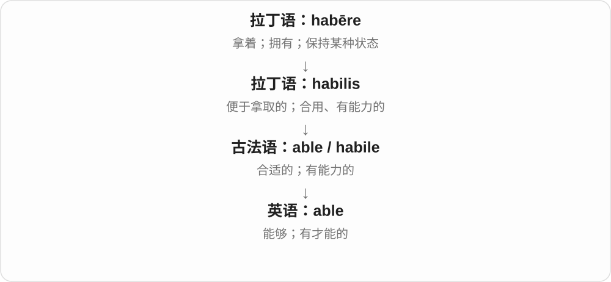
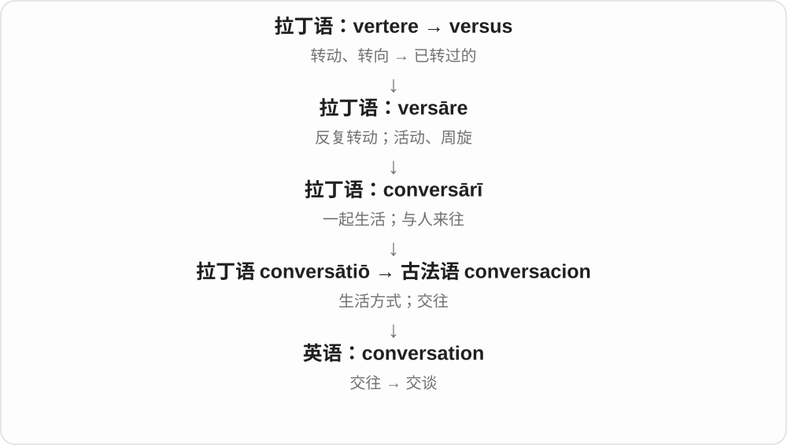
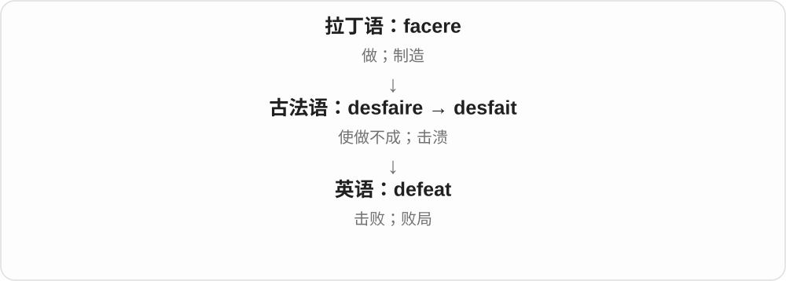
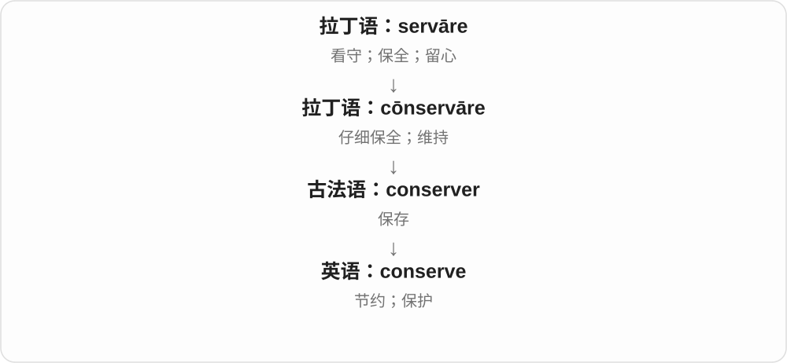
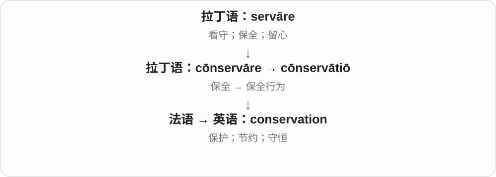

# 0244 · -ist — 从事者、主张者及某类人物；部分词也作形容词

[逐词精讲目录](../00_逐词精讲目录.md) · [总目录](../00_总目录_按常用程度.md)

## 核心词根与来源

-ist 经法语 -iste、拉丁 -ista 远接希腊 -istēs 等人物后缀。最有用的读法是先认前面的活动或主张，再问这个人和它是什么关系：演奏、研究、倡导、从事，还是因某种行为被命名。不能统一死译成专家。

**IST：从一门活动、技艺或主张，转到与它相关的人**

同一个舞台上：guitar 吉他旁有 guitarist，piano 钢琴旁有 pianist；讨论桌上，立场不同的人也可用 -ist 命名。

- **演奏什么乐器**：guitar · guitarist；piano · pianist；violin · violinist；cello · cellist；harp · harpist；saxophone · saxophonist；keyboard · keyboardist
- **参加、从事或研究**：medal · medalist · medallist；lobby · lobbyist；archive · archivist；essay · essayist；hobby · hobbyist；criminology · criminologist
- **主张与态度**：abolition · abolitionist；conservation · conservationist；defeat · defeatist；able · ableist；supremacy · supremacist
- **具体身份及使用语气**：alchemy · alchemist；alarm · alarmist；humor · humorist；masochism · masochist；conversation · conversationalist；rape · rapist；panelist · panellist
- **archive → archives：公共文书到保存的档案**：archive · archives
- **medal → medals；获得奖牌的人另接表人词尾**：medal · medals · medalist
- **essay → essays：短文、论说文与尝试**：essay · essays · essayist
- **archive 的归档动作与常用形式**：archive · archived · archiving
- **乐器名称到演奏者及常用复数**：piano · pianos · pianist · pianists · guitar · guitars · guitarist · guitarists · violin · violins · violinist · violinists
- **管弦乐器与 -ist 演奏者名称**：trombone · trombones · trombonist · clarinet · clarinets · clarinetist · clarinetists · flutist · flutists · flautist · flautists · saxophone · saxophones · saxophonist · saxophonists · viola · violas · cello · cellos · cellist · cellists · harp · harps · harpist · harpists

## 词形与演化规律

guitar + -ist；piano 去 o + -ist；cello 去 o + -ist；rape 去 e + -ist；hobby、lobby 接 -ist 保留 y；conversationalist 中还有 -al，conservationist、abolitionist 中还有 -tion。medalist／medallist、panelist／panellist 有常见英美拼写差别。-ism 与 -ist 常成对，但名词长短不代表出现先后。

法语、拉丁 archivum 接希腊 arkheion 政务建筑、文书材料，现代归档动词由名词发展。

钱币、纪念章借词走向奖励的金属章，medals 只是复数或动词三单，不带表人词尾。

文章名经法语 essai 尝试、检验，ist 表写作者，复数 s 另分。

接希腊公共政务建筑、档案材料，经拉丁、法语借入；英语再发展归档动词。

-ist 帮助认出演奏者；pianist 还有法语、意大利语借词路线，不能把所有乐手名称都说成英语现场新拼。

trombone、clarinet 等先有借词名称，再形成或借入演奏者名。viola 也是 violin、violoncello 的历史命名材料；不是 -ist 的直系派生词。

## 单词速览（按词族由简到繁）

同一基础词的相关扩展放在一起，先读基础形式，再读扩展；各组之间优先读常用的。具体词源关系见各词讲解。

| 单词 | 音标 | 核心意思 |
|---|---|---|
| [able](#w-248) | /ˈeɪbəl/ | 能够……的；有才能的 |
| [ableist](#w-182) | /ˈeɪbəlɪst/ | 歧视残障者的；持这种偏见的人 |
| [conversation](#w-249) | 英 /ˌkɒnvəˈseɪʃən/；美 /ˌkɑːnvərˈseɪʃən/ | 交谈；谈话 |
| [defeat](#w-250) | /dɪˈfiːt/ | 击败；失败 |
| [defeatist](#w-164) | 英 /dɪˈfiːtɪst/；美 /dɪˈfiːtɪst/ | 失败主义者；未战先认输的 |
| [guitar](#w-251) | 英 /ɡɪˈtɑː/；美 /ɡɪˈtɑːr/ | 吉他 |
| [guitars](#w-279) | 英 /ɡɪˈtɑːz/；美 /ɡɪˈtɑːrz/ | 吉他〔复数〕 |
| [guitarist](#w-16) | 英 /ɡɪˈtɑːrɪst/；美 /ɡɪˈtɑːrɪst/ | 吉他手；吉他演奏者 |
| [guitarists](#w-282) | /ɡɪˈtɑːrɪsts/ | 吉他手、吉他演奏者〔复数〕 |
| [rape](#w-252) | /reɪp/ | 强奸；实施强奸；另有油菜义〔不同源〕 |
| [rapist](#w-18) | /ˈreɪpɪst/ | 强奸犯；实施强奸的人 |
| [medal](#w-253) | /ˈmedəl/ | 奖牌；奖章 |
| [medals](#w-275) | /ˈmedəlz/ | 奖牌、奖章〔复数〕；获得奖牌〔第三人称单数〕 |
| [medalist](#w-39) | /ˈmedəlɪst/ | 奖牌获得者〔常见美式拼写〕 |
| [medallist](#w-271) | /ˈmedəlɪst/ | 奖牌获得者〔常见英式拼写〕 |
| [conserve](#w-267) | 动词：英 /kənˈsɜːv/、美 /kənˈsɜːrv/；食品名词常 /ˈkɒnsɜːv/（英） | 节约；保护；保存；果酱 |
| [conservation](#w-254) | 英 /ˌkɒnsəˈveɪʃən/；美 /ˌkɑːnsərˈveɪʃən/ | 保护；节约；守恒 |
| [conservationist](#w-101) | 英 /ˌkɒnsəˈveɪʃənɪst/；美 /ˌkɑːnsərˈveɪʃənɪst/ | 自然环境、野生生物保护者 |
| [piano](#w-255) | 乐器：英 /piˈænəʊ/，美 /piˈænoʊ/；弱奏：英 /piˈɑːnəʊ/，美 /piˈɑːnoʊ/ | 钢琴；轻柔地演奏 |
| [pianist](#w-23) | 英 /ˈpɪənɪst/；美 /ˈpiːənɪst/ | 钢琴演奏者；钢琴家 |
| [pianists](#w-283) | 英 /ˈpɪənɪsts/；美 /ˈpiːənɪsts/ | 钢琴家、钢琴演奏者〔复数〕 |
| [pianos](#w-280) | 英 /piˈænəʊz/；美 /piˈænoʊz/ | 钢琴〔复数〕 |
| [alarm](#w-256) | 英 /əˈlɑːm/；美 /əˈlɑːrm/ | 警报；闹钟；惊慌；使担忧 |
| [alarmist](#w-124) | 英 /əˈlɑːmɪst/；美 /əˈlɑːrmɪst/ | 危言耸听者；过分渲染危险的 |
| [essay](#w-257) | 名词 /ˈeseɪ/；动词 /eˈseɪ/ | 短文；论说文；尝试〔正式动词〕 |
| [essays](#w-276) | 名词 /ˈeseɪz/；动词 /eˈseɪz/ | 短文、论说文〔复数〕；尝试〔第三人称单数，较正式〕 |
| [essayist](#w-106) | /ˈeseɪɪst/ | 散文家；随笔、论说文作者 |
| [humor](#w-258) | 英 /ˈhjuːmə/；美 /ˈhjuːmər/ | 幽默；心情、脾气；迁就〔动词〕 |
| [humorist](#w-153) | 英 /ˈhjuːmərɪst/；美 /ˈhjuːmərɪst/ | 幽默作家；善于幽默表达的表演者 |
| [keyboard](#w-259) | 英 /ˈkiːbɔːd/；美 /ˈkiːbɔːrd/ | 键盘；键盘乐器 |
| [keyboardist](#w-134) | 英 /ˈkiːbɔːdɪst/；美 /ˈkiːbɔːrdɪst/ | 键盘乐器演奏者；键盘手 |
| [archive](#w-261) | 英 /ˈɑːkaɪv/；美 /ˈɑːrkaɪv/ | 档案、档案库；归档、存档；归档文件 |
| [archives](#w-274) | 英 /ˈɑːkaɪvz/；美 /ˈɑːrkaɪvz/ | 档案、档案收藏；档案馆〔复数及集合用法〕；归档〔第三人称单数〕 |
| [archived](#w-277) | 英 /ˈɑːkaɪvd/；美 /ˈɑːrkaɪvd/ | 归档、存档了；存档的 |
| [archivist](#w-84) | 英 /ˈɑːkɪvɪst/；美 /ˈɑːrkɪvɪst/ | 档案管理员；档案工作者 |
| [archiving](#w-278) | 英 /ˈɑːkaɪvɪŋ/；美 /ˈɑːrkaɪvɪŋ/ | 归档、存档的过程 |
| [lobby](#w-260) | 英 /ˈlɒbi/；美 /ˈlɑːbi/ | 大厅、门厅；游说；利益游说团体 |
| [lobbyist](#w-54) | 英 /ˈlɒbiɪst/；美 /ˈlɑːbiɪst/ | 游说者；游说团体代表 |
| [hobby](#w-262) | 英 /ˈhɒbi/；美 /ˈhɑːbi/ | 业余爱好 |
| [hobbyist](#w-123) | 英 /ˈhɒbiɪst/；美 /ˈhɑːbiɪst/ | 业余爱好者 |
| [viola](#w-285) | 英 /viˈəʊlə/；美 /viˈoʊlə/ | 中提琴 |
| [violin](#w-263) | /ˌvaɪəˈlɪn/ | 小提琴 |
| [violinist](#w-55) | /ˌvaɪəˈlɪnɪst/ | 小提琴演奏者；小提琴家 |
| [violinists](#w-284) | /ˌvaɪəˈlɪnɪsts/ | 小提琴手、小提琴家〔复数〕 |
| [violins](#w-281) | /ˌvaɪəˈlɪnz/ | 小提琴〔复数〕 |
| [cello](#w-268) | 英 /ˈtʃeləʊ/；美 /ˈtʃeloʊ/ | 大提琴 |
| [cellist](#w-99) | /ˈtʃelɪst/ | 大提琴演奏者；大提琴家 |
| [cellists](#w-299) | /ˈtʃelɪsts/ | 大提琴演奏者〔复数〕 |
| [cellos](#w-292) | 英 /ˈtʃeləʊz/；美 /ˈtʃeloʊz/ | 大提琴〔复数〕 |
| [violas](#w-293) | 英 /viˈəʊləz/；美 /viˈoʊləz/〔乐器义〕 | 中提琴〔复数〕 |
| [supremacy](#w-264) | /suːˈpreməsi/ | 至高地位；支配优势；至上主义〔特定搭配〕 |
| [supremacist](#w-38) | /suːˈpreməsɪst/ | 某群体至上主义者；至上主义的 |
| [abolition](#w-265) | 英 /ˌæbəˈlɪʃən/；美 /ˌæbəˈlɪʃən/ | 废除、废止；废奴 |
| [abolitionist](#w-94) | 英 /ˌæbəˈlɪʃənɪst/；美 /ˌæbəˈlɪʃənɪst/ | 主张废除某制度者；废奴主义者〔常见历史义〕 |
| [harp](#w-266) | 英 /hɑːp/；美 /hɑːrp/ | 竖琴；反复唠叨〔harp on〕 |
| [harps](#w-288) | 英 /hɑːps/；美 /hɑːrps/ | 竖琴〔复数〕；反复唠叨〔第三人称单数，常接 on〕 |
| [harpist](#w-198) | 英 /ˈhɑːpɪst/；美 /ˈhɑːrpɪst/ | 竖琴演奏者 |
| [harpists](#w-300) | 英 /ˈhɑːpɪsts/；美 /ˈhɑːrpɪsts/ | 竖琴演奏者〔复数〕 |
| [alchemy](#w-269) | /ˈælkəmi/ | 炼金术；奇妙的转化、融合〔比喻〕 |
| [alchemist](#w-56) | /ˈælkəmɪst/ | 炼金术士；善于奇妙转化的人〔比喻〕 |
| [saxophone](#w-270) | 英 /ˈsæksəfəʊn/；美 /ˈsæksəfoʊn/ | 萨克斯管 |
| [saxophonist](#w-96) | 英 /ˌsækˈsɒfənɪst/；美 /ˈsæksəfoʊnɪst/ | 萨克斯管演奏者 |
| [saxophonists](#w-298) | 英 /sækˈsɒfənɪsts/；美 /ˈsæksəfoʊnɪsts/ | 萨克斯管演奏者〔复数〕 |
| [saxophones](#w-291) | 英 /ˈsæksəfəʊnz/；美 /ˈsæksəfoʊnz/ | 萨克斯管〔复数〕 |
| [clarinet](#w-286) | /ˌklærɪˈnet/ | 单簧管、黑管 |
| [clarinets](#w-289) | /ˌklærɪˈnets/ | 单簧管〔复数〕 |
| [clarinetist](#w-296) | /ˌklærɪˈnetɪst/ | 单簧管演奏者 |
| [clarinetists](#w-302) | /ˌklærɪˈnetɪsts/ | 单簧管演奏者〔复数〕 |
| [criminology](#w-272) | 英 /ˌkrɪmɪˈnɒlədʒi/；美 /ˌkrɪmɪˈnɑːlədʒi/ | 犯罪学 |
| [criminologist](#w-180) | 英 /ˌkrɪmɪˈnɒlədʒɪst/；美 /ˌkrɪməˈnɑːlədʒɪst/ | 犯罪学研究者 |
| [trombone](#w-287) | 英 /ˌtrɒmˈbəʊn/；美 /ˌtrɑːmˈboʊn/ | 长号 |
| [trombones](#w-290) | 英 /ˌtrɒmˈbəʊnz/；美 /ˌtrɑːmˈboʊnz/ | 长号〔复数〕 |
| [trombonist](#w-295) | 英 /trɒmˈbəʊnɪst/；美 /trɑːmˈboʊnɪst/ | 长号手、长号演奏者 |
| [panelist](#w-107) | /ˈpænəlɪst/ | 小组讨论成员、嘉宾；评审组成员 |
| [panellist](#w-201) | /ˈpænəlɪst/ | 讨论小组、评审团成员〔常见英式拼写〕 |
| [masochism](#w-273) | /ˈmæsəkɪzəm/ | 受虐倾向；从自己受苦中寻求满足〔亦可比喻〕 |
| [masochist](#w-155) | /ˈmæsəkɪst/ | 有受虐倾向者；自找苦吃的人〔常见夸张说法〕 |
| [conversationalist](#w-171) | 英 /ˌkɒnvəˈseɪʃənəlɪst/；美 /ˌkɑːnvərˈseɪʃənəlɪst/ | 善于交谈的人；谈话者 |
| [flutist](#w-294) | 英、美 /ˈfluːtɪst/ | 长笛演奏者 |
| [flutists](#w-301) | /ˈfluːtɪsts/ | 长笛演奏者〔复数，尤美式〕 |
| [flautist](#w-297) | 英 /ˈflɔːtɪst/；美 /ˈflɔːtɪst/，亦 /ˈflaʊtɪst/ | 长笛演奏者 |
| [flautists](#w-303) | /ˈflɔːtɪsts/，亦 /ˈflaʊtɪsts/ | 长笛演奏者〔复数，尤英式〕 |

## 逐词讲解

### 1. able — 能够……的；有才能的

**音标**：/ˈeɪbəl/

**先抓住这个画面**

事情摆在面前，你有本领、有条件把它做成，就是 able。an able teacher 则是说这位老师很能干。

**怎么拆**

经古法语来自拉丁语 habilis，最初有便于拿取、合用的意思，根在 habēre。不能把它当作所有 -able 后缀的历史祖先。

**怎么变成今天的意思**

东西合手、适用 → 人胜任、有本领。现代 be able to 也能说条件允许，不一定只谈个人天赋。

**常见搭配与例句**

be able to do…；an able assistant；will be able to…。

> Will you be able to finish by Friday?

你能在星期五前完成吗？

> She is an able organizer who keeps everyone informed.

她是个能干的组织者，会让所有人及时了解情况。

**别混淆**

can 是情态动词；able 是形容词，要说 be able to。able 与后缀 -able 后来在意义上靠近，但来源不同。

### 2. ableist — 歧视残障者的；持这种偏见的人

**音标**：/ˈeɪbəlɪst/

**先抓住这个画面**

默认所有人都该按没有残障的方式行动，还因此排斥或贬低残障者，就可能被批评为 ableist。

**怎么拆**

able 有能力的 + -ist，按 racist、sexist 等偏见词的模式形成，并与 ableism 对应。这里不是表扬有能力的人。

**怎么变成今天的意思**

**able + -ist 的类比构词**  
围绕身体、心智能力建立偏见的命名

↓

**ableist**  
歧视残障者的；持相应偏见的人

ableist language 歧视残障者的说法；ableist assumptions 带有这类偏见的假定。可批评措辞、规则或态度，不只用于人物标签。

**常见搭配与例句**

ableist language；an ableist assumption。

> The guide asks writers to avoid ableist language.

指南要求作者避免歧视残障者的措辞。

> The discussion challenged ableist assumptions about work.

这场讨论质疑了工作话题中歧视残障者的假定。

**别混淆**

ableist 不等于 able 能干，也不宜简单译成所有按能力评价都叫歧视；词义要落到对残障者的偏见或不公平对待。

### 3. conversation — 交谈；谈话

**音标**：英 /ˌkɒnvəˈseɪʃən/；美 /ˌkɑːnvərˈseɪʃən/

**先抓住这个画面**

人们经常在一起生活、来往，就会互相说话。这个词走的是“共处 → 交往 → 交谈”的路线。

**怎么拆**

经法语 conversacion 借自拉丁语 conversātiō；现代与 converse 配套，但不是英语先造 converse 再机械加 -ation。

**怎么变成今天的意思**

真正的 conversation 通常有来有回，不只是一个人长篇发言。它也能比喻公共讨论，如 a conversation about education。

**常见搭配与例句**

have a conversation with…；start a conversation；join the conversation。

> We had a long conversation about our plans.

我们就各自的打算聊了很久。

> She joined the conversation after listening for a few minutes.

她听了几分钟后加入了谈话。

**别混淆**

conversation 是交谈过程；speech 通常是一人对众人讲话；conversion 少一个 a，意思是转变。

### 4. defeat — 击败；失败

**音标**：/dɪˈfiːt/

**先抓住这个画面**

对手本来要完成自己的计划，你把它打断、瓦解了：这就是 defeat 的画面。

**怎么拆**

古法语 desfaire 是“拆掉、使落空”，由否定、逆转成分加 faire“做”构成；英语借用相关形式。

**怎么变成今天的意思**

从使事情不能完成，发展到挫败目的和击败对手。名词 defeat 说一次败局，动词直接接被击败的人或计划。

**常见搭配与例句**

defeat an opponent；suffer a defeat；defeat the purpose。

> Our team defeated the champions.

我们队击败了冠军队。

> Adding more steps would defeat the purpose of simplifying the process.

再加步骤就违背了简化流程的目的。

**别混淆**

beat 更口语；win 接比赛或奖项，通常不直接说 win a person。

### 5. defeatist — 失败主义者；未战先认输的

**音标**：英 /dɪˈfiːtɪst/；美 /dɪˈfiːtɪst/

**先抓住这个画面**

事情还没开始，就一直说肯定没用、肯定会输，连尝试都放弃：这是 defeatist 的典型感觉。

**怎么拆**

defeat 失败 + -ist，可作名词或形容词；也与 defeatism 失败主义对应。不是简单指曾经输过的人。

**怎么变成今天的意思**

**defeat**  
击败；失败

↓

**defeat + -ist → defeatist**  
预先接受失败的人；这种态度的

a defeatist attitude 未战先认输的态度；Don’t be so defeatist 别这么轻易就认输。

**常见搭配与例句**

defeatist thinking；a defeatist attitude。

> We should test the idea before adopting a defeatist attitude.

我们应该先试试这个想法，别提前就认输。

> Her response sounded defeatist rather than practical.

她的回答听起来是在提前认输，而不是务实分析。

**别混淆**

pessimistic 是不乐观，defeatist 更容易包含因此不愿行动、提前认输；承认困难不自动就是 defeatist。

### 6. guitar — 吉他

**音标**：英 /ɡɪˈtɑː/；美 /ɡɪˈtɑːr/

**先抓住这个画面**

一只手按住琴颈上的弦，另一只手拨弦或扫弦：这是吉他最容易认出的演奏画面。

**怎么拆**

英语有法语 guitare 与直接西班牙语 guitarra 的传播路线，较远接希腊 kithara、拉丁 cithara 等弦乐器名。阿拉伯 qīthāra 在相关语言间的借用方向有不同分析，不排成唯一确定的单线。

**怎么变成今天的意思**

**希腊 kithara → 拉丁 cithara → 古法语相关形式**  
弦乐器名称传播，器物形制并非处处相同

↓

**法语 guitare；西班牙 guitarra → 英语 guitar**  
法语形式受西班牙等形式影响，英语也直接借西班牙形式

↓

**阿拉伯 qīthāra 等相关形式**  
具体传播先后、借用方向有不同词源分析

play the guitar 弹吉他；acoustic guitar 原声吉他；electric guitar 电吉他。日常典型吉他有六根弦，但也有其他弦数。

**常见搭配与例句**

play the guitar；an electric guitar。

> He plays the guitar in a local band.

他在一支当地乐队里弹吉他。

> She bought an acoustic guitar to practise at home.

她买了一把原声吉他在家练习。

**别混淆**

guitar 是乐器，guitarist 是弹它的人；它与 sitar 印度西塔琴不能只按相似词尾当作同一个词。

### 7. guitars — 吉他〔复数〕

**音标**：英 /ɡɪˈtɑːz/；美 /ɡɪˈtɑːrz/

**先抓住这个画面**

一只手按弦改变音高，另一只手拨弦或扫弦，几把这样的乐器就是 guitars。先抓住拨弦乐器的画面。

**怎么拆**

guitar + -s，末尾读 /z/。英语名称有法语 guitare、直接西班牙语 guitarra 等路线，更远接拉丁 cithara、希腊 kithara 等弦乐器名；阿拉伯相关词的借用方向有争论。

**怎么变成今天的意思**

**希腊 kithara → 拉丁 cithara 等欧洲相关形式**  
较远的弦乐器名称来源

↓

**法语 guitare、西班牙语 guitarra → guitar → guitars**  
多条传播路线；多把吉他

acoustic guitars 原声吉他，electric guitars 电吉他；具体弦数、结构要看种类。

**常见搭配与例句**

play guitars 弹吉他；a collection of guitars 收藏的多把吉他。

> The shop sells both acoustic and electric guitars.

商店出售原声吉他和电吉他。

> Three guitars were hanging on the wall.

墙上挂着三把吉他。

**别混淆**

guitars 在数乐器，guitarists 在数演奏者；play the guitar 则常泛说会弹、在弹这种乐器。

### 8. guitarist — 吉他手；吉他演奏者

**音标**：英 /ɡɪˈtɑːrɪst/；美 /ɡɪˈtɑːrɪst/

**先抓住这个画面**

把镜头从那把吉他移到弹琴的人，就从 guitar 到 guitarist。

**怎么拆**

guitar + -ist；-ist 把乐器名接到相应的演奏者。这里不需要先有某种 guitarism 思想。

**怎么变成今天的意思**

**guitar**  
吉他

↓

**guitar + -ist → guitarist**  
弹吉他的人

a lead guitarist 主音吉他手；a rhythm guitarist 节奏吉他手；可以是职业演奏者，也可以是业余乐手。

**常见搭配与例句**

a talented guitarist；the band’s guitarist。

> The guitarist played a short solo.

吉他手演奏了一小段独奏。

> Our guitarist also writes most of the songs.

我们的吉他手还负责写大多数歌曲。

**别混淆**

guitarist 说演奏角色，musician 范围更广；不能把 guitarist 当作吉他本身。

### 9. guitarists — 吉他手、吉他演奏者〔复数〕

**音标**：/ɡɪˈtɑːrɪsts/

**先抓住这个画面**

同样一把吉他，有人负责旋律，有人负责节奏；这些弹吉他的人都可以叫 guitarists。

**怎么拆**

guitar + -ist → guitarist，再加 -s。-ist 命名从事某活动的人；guitar 的借词历史先于这一人物名称。

**怎么变成今天的意思**

**guitar + -ist → guitarist**  
演奏吉他的人

↓

**guitarist + -s → guitarists**  
多位吉他演奏者

lead guitarists 常担任主音吉他，rhythm guitarists 常负责节奏、和弦支撑，具体分工也能交替。

**常见搭配与例句**

jazz guitarists 爵士吉他手；two guitarists 两位吉他手。

> The band has two guitarists and a drummer.

乐队有两位吉他手和一位鼓手。

> Several guitarists joined the final song.

几位吉他手加入了最后一首歌的演奏。

**别混淆**

英音 guitar 末尾 r 常不发音，但 guitarist 中 r 后面接元音，通常读出来；不要照搬独立 guitar 的词尾处理。

### 10. rape — 强奸；实施强奸；另有油菜义〔不同源〕

**音标**：/reɪp/

**先抓住这个画面**

本词族的旧画面是强行夺走、带走；现代常见义涉及未经同意的性暴力。

**怎么拆**

性暴力义经中古英语、盎格鲁法语 rap／rape、raper 等接拉丁 rapere，部分细节有争议；植物义另接拉丁 rapa／rapum“芜菁”。

**怎么变成今天的意思**

**拉丁 rapere 与盎格鲁法语 rap／rape／raper 等相关路线**  
夺取、强行带走

↓

**中古英语 rape／rapen → 英语 rape**  
抢夺、劫掠、掳走 → 现代性暴力义

↓

**另一个同形词：拉丁 rapa／rapum → 英语 rape**  
芜菁词族 → 油菜

现代新闻中的 rape 通常说强奸，既可作名词也可作动词；重点涉及没有同意，而不只是某种外表可见的暴力。农业文本中的 rape 则可能是油菜，如 rapeseed。两者同拼写、不同来源，必须按语境区分。

**常见搭配与例句**

rape survivors；report a rape；rape prevention；oilseed rape。

> The organisation provides support for survivors of rape.

这个组织为强奸幸存者提供支持。

> The report examines how rape is discussed in the news.

报告考察了新闻如何讨论强奸问题。

> The farmer planted the field with rape.

农民在这块田里种了油菜。

**别混淆**

rape 与 rapeseed 的植物用法不是同一词源。现代也不宜把 rape 随便当成“比赛惨败”的玩笑说法，那会淡化严重的性暴力。

### 11. rapist — 强奸犯；实施强奸的人

**音标**：/ˈreɪpɪst/

**先抓住这个画面**

这是指实施强奸的人，语义严肃，不能只按 -ist 泛译成某方面从业者。

**怎么拆**

rape 去末尾 e + -ist；rape 的历史材料经法语上接拉丁 rapere 强夺等，但现代这个人物名明确指性暴力行为实施者。

**怎么变成今天的意思**

**rape**  
强奸这一现代核心义

↓

**rape + -ist → rapist**  
实施该行为的人

a convicted rapist 已定罪的强奸犯；在报道事实或作品情节中准确使用，不能把尚未证实的指控当作已定事实。

**常见搭配与例句**

a convicted rapist；identify the rapist。

> The novel ends with the rapist being brought to justice.

小说以强奸犯被绳之以法结尾。

> The report referred to him as a convicted rapist.

报道将他称为已被定罪的强奸犯。

**别混淆**

rapist 指行为实施者，suspect 是嫌疑人；两者在事实状态上不同，不因词尾表示人就可以随意替换。

### 12. medal — 奖牌；奖章

**音标**：/ˈmedəl/

**先抓住这个画面**

比赛结束，获奖者脖子上挂的一块金属牌是 medal；纪念或表彰用的奖章也可这样叫。

**怎么拆**

经法语 médaille 接意大利语 medaglia、中世纪拉丁 medalia 等钱币名材料，后来用于纪念、奖励的金属章。不要因为更早的钱币名涉及半数，就说现代奖牌固定表示半个奖。

**怎么变成今天的意思**

**意大利 medaglia → 法语 médaille**  
钱币、金属纪念章等名称

↓

**英语 medal**  
奖章；比赛奖牌

win a medal 赢奖牌；a gold medal 金牌；a medal for bravery 英勇奖章。

**常见搭配与例句**

win a gold medal；an Olympic medal。

> She won a silver medal in the final.

她在决赛中获得银牌。

> The museum displays his medals for bravery.

博物馆展出了他的英勇奖章。

**别混淆**

medal 是奖章，metal 是金属，读音接近但不是同一个词；trophy 多说奖杯或其他奖品形体。

### 13. medals — 奖牌、奖章〔复数〕；获得奖牌〔第三人称单数〕

**音标**：/ˈmedəlz/

**先抓住这个画面**

比赛后挂在获奖者胸前的一枚枚金属章，是 medals。它把成绩或贡献变成一个能拿在手里的表彰物。

**怎么拆**

medal 经法语 médaille、意大利 medaglia 及较早钱币名材料，走到纪念、奖励用的金属章。现代 medal + -s，/l/ 后读 /z/；它没有 -ist 表人后缀。

**怎么变成今天的意思**

**钱币名材料 → 意大利 medaglia → 法语 médaille → medal**  
金属钱币、纪念章 → 奖章

↓

**medal + -s → medals**  
多枚奖牌；运动语境动词三单也可表示拿到奖牌

gold medals 金牌；win medals 赢得奖牌；a collection of medals 一批奖章。

**常见搭配与例句**

two silver medals 两枚银牌；display the medals 展示奖牌。

> The team won three gold medals.

这支队伍赢得了三枚金牌。

> His medals are displayed in a glass case.

他的奖章陈列在玻璃柜里。

**别混淆**

medals 末尾 /əlz/，metals 金属末尾也是 /əlz/，但中间词干是 d 与 t 的区别。奖牌是物，medalist 是获奖牌的人。

### 14. medalist — 奖牌获得者〔常见美式拼写〕

**音标**：/ˈmedəlɪst/

**先抓住这个画面**

medal 是领奖的牌，medalist 是拿到牌的人。可以拿铜牌，不专指冠军。

**怎么拆**

medal + -ist；美式常写 medalist，英式常写 medallist。这里 -ist 标获得某种荣誉的人，不是研究奖牌的专家。

**怎么变成今天的意思**

**medal**  
奖牌、奖章

↓

**medal + -ist → medalist**  
获奖牌的人

a gold medalist 金牌得主；an Olympic medalist 奥运奖牌获得者。

**常见搭配与例句**

a silver medalist；an Olympic medalist。

> The Olympic medalist visited her old school.

这位奥运奖牌得主回访了母校。

> He became the youngest medalist in the event.

他成为这项赛事最年轻的奖牌获得者。

**别混淆**

medalist 不一定是 winner 冠军；银牌和铜牌得主也属于 medalists。

### 15. medallist — 奖牌获得者〔常见英式拼写〕

**音标**：/ˈmedəlɪst/

**先抓住这个画面**

和 medalist 是同一个身份；多出来的 l 是拼写习惯，不是多领一块牌。

**怎么拆**

medal + -ist，英式常双写 l → medallist；美式常见 medalist。词义和基本读音相同。

**怎么变成今天的意思**

**medal + -ist**  
从奖牌名构成人物名

↓

**medallist／medalist**  
常见英美拼写差别

a gold medallist 金牌得主；a bronze medallist 铜牌得主。写作时随所选英美拼写规范保持一致。

**常见搭配与例句**

an Olympic medallist；a bronze medallist。

> The bronze medallist thanked her coach.

铜牌得主感谢了教练。

> Several former medallists attended the ceremony.

几位往届奖牌获得者参加了仪式。

**别混淆**

medallist 是得奖牌的人，不是 medal 奖牌本身；两种拼写通常不表示两种不同级别。

### 16. conserve — 节约；保护；保存；果酱

**音标**：动词：英 /kənˈsɜːv/、美 /kənˈsɜːrv/；食品名词常 /ˈkɒnsɜːv/（英）

**先抓住这个画面**

手里的水、体力和自然资源都有限，别白白消耗，让它们留得更久。

**怎么拆**

拉丁语 cōnservāre，经法语 conserver；con- 在这里加强保全的动作，不必逐字译成一起服务。

**怎么变成今天的意思**

conserve water 是节约水，conserve wildlife 是保护野生生物。食品名词 conserve 是一种果酱，沿保存食物的意思发展。

**常见搭配与例句**

conserve energy；conserve water；conserve natural habitats。

> We turned off the lights to conserve energy.

我们关掉灯以节约能源。

> The project aims to conserve the wetland habitat.

这个项目旨在保护湿地栖息地。

**别混淆**

conserve 常突出节制使用、妥善管理；preserve 常突出保持完整。实际搭配可以有重叠。

### 17. conservation — 保护；节约；守恒

**音标**：英 /ˌkɒnsəˈveɪʃən/；美 /ˌkɑːnsərˈveɪʃən/

**先抓住这个画面**

把资源和事物好好留下来；物理学里则是某个量在规定条件下总量保持不变。

**怎么拆**

经法语来自拉丁语 cōnservātiō，与 cōnservāre 同族；现代对应 conserve + -ation。

**怎么变成今天的意思**

wildlife conservation 是保护野生生物；energy conservation 在日常用法是节能，在物理学中也指能量守恒。

**常见搭配与例句**

nature conservation；water conservation；conservation of energy。

> The school runs a water conservation programme.

学校开展节水项目。

> The lesson explains the conservation of energy in an isolated system.

这一课讲解孤立系统中的能量守恒。

**别混淆**

conservation 不是 conversation“谈话”。energy conservation 的两种意思要按生活或物理语境区分。

### 18. conservationist — 自然环境、野生生物保护者

**音标**：英 /ˌkɒnsəˈveɪʃənɪst/；美 /ˌkɑːnsərˈveɪʃənɪst/

**先抓住这个画面**

看见湿地被填、物种减少，努力把自然环境保留下来的人，可叫 conservationist。

**怎么拆**

conservation 保护、保存 + -ist；通常接自然保护这一常见义，而不是泛指所有保存文件的人。

**怎么变成今天的意思**

**conserve → conservation**  
保护、节约等行为或工作

↓

**conservation + -ist → conservationist**  
尤其从事自然保护的人

wildlife conservationists 野生生物保护者；a leading conservationist 知名自然保护人士。

**常见搭配与例句**

a wildlife conservationist；local conservationists。

> Conservationists are working to restore the wetland.

自然保护人士正努力恢复那片湿地。

> The conservationist explained why the nesting area matters.

这位保护人士解释了那片筑巢区为何重要。

**别混淆**

conservationist 自然保护人士与 conservative 政治上的保守派不能混同；相近词形不代表政治立场相同。

### 19. piano — 钢琴；轻柔地演奏

**音标**：乐器：英 /piˈænəʊ/，美 /piˈænoʊ/；弱奏：英 /piˈɑːnəʊ/，美 /piˈɑːnoʊ/

**先抓住这个画面**

钢琴这个名字原本突出“能轻、也能响”；谱子上的 piano 则只是在提醒轻一点。

**怎么拆**

乐器名是意大利语 pianoforte“轻与响”的缩略，也经法语传播。力度标记 piano 直接来自意大利语“轻柔的”，更早追到拉丁语 planus。

**怎么变成今天的意思**

**拉丁语：planus；planum**  
平坦的；平面、平地

↓

**意大利语：piano**  
平缓、轻柔；音乐中轻声的

↓

**两条借入：piano；pianoforte → piano**  
弱奏指令；轻响可变的键盘乐器名称缩略

↓

**英语：piano**  
钢琴；音乐力度中的弱

play the piano 是弹钢琴；play piano 在音乐指令中也可表示轻声演奏，靠语境分辨。谱上常用 p。

**常见搭配与例句**

a grand piano；piano lessons；a passage marked piano。

> He practises the piano every evening.

他每天晚上练钢琴。

> The score asks the strings to play piano in this passage.

乐谱要求弦乐在这一段轻声演奏。

**别混淆**

piano 的“轻”不等于 slow；力度与速度是两回事。

### 20. pianist — 钢琴演奏者；钢琴家

**音标**：英 /ˈpɪənɪst/；美 /ˈpiːənɪst/

**先抓住这个画面**

坐到钢琴前弹奏的人是 pianist，是否已经成名不由这个后缀决定。

**怎么拆**

借法语 pianiste，材料是 piano 与 -iste；piano 又缩自意大利语 pianoforte。现代可对应 piano 去末尾 o + -ist，而不是读成完整 piano 后再机械接音。

**怎么变成今天的意思**

**意大利 pianoforte → piano**  
钢琴的名称缩短

↓

**法语 pianiste → 英语 pianist**  
弹钢琴的人

a concert pianist 音乐会钢琴家；a jazz pianist 爵士钢琴手。音标这里列牛津学习词典的一组常见英美读法，实际还有读音变体。

**常见搭配与例句**

a concert pianist；an accomplished pianist。

> The pianist accompanied the singer.

钢琴演奏者为歌手伴奏。

> She hopes to become a professional pianist.

她希望成为职业钢琴演奏者。

**别混淆**

piano 是钢琴，pianist 是人；a famous pianist 强调著名，但 pianist 本身不等于世界级大师。

### 21. pianists — 钢琴家、钢琴演奏者〔复数〕

**音标**：英 /ˈpɪənɪsts/；美 /ˈpiːənɪsts/

**先抓住这个画面**

piano 是琴，pianist 是弹琴的人，pianists 是几位演奏者。换后缀以后，连常见重音位置也跟着变了。

**怎么拆**

现代认形可看 piano 去末尾 o + -ist → pianist，再加 -s；实际英语 pianist 还经法语 pianiste，接意大利 pianista，不只是一条英语新拼路线。

**怎么变成今天的意思**

**意大利 pianista → 法语 pianiste → 英语 pianist**  
钢琴演奏者的借词路线

↓

**pianist + -s → pianists**  
多位钢琴演奏者

concert pianists 是在音乐会上演奏的钢琴家；名称本身不保证只弹古典音乐。

**常见搭配与例句**

jazz pianists 爵士钢琴家；young pianists 年轻钢琴演奏者。

> Two pianists shared the stage for the final piece.

最后一首曲子由两位钢琴家同台演奏。

> The course is designed for young pianists.

这门课面向年轻钢琴演奏者。

**别混淆**

piano 常后重音，pianist 常前重音，开头元音也可变化；不要机械地把 piano 的整段读音后接 /ɪst/。

### 22. pianos — 钢琴〔复数〕

**音标**：英 /piˈænəʊz/；美 /piˈænoʊz/

**先抓住这个画面**

按下琴键，琴槌敲响琴弦；手上用力不同，可以奏轻、奏响。这个轻响变化正藏在钢琴名称的来历里。

**怎么拆**

piano 直接加 -s → pianos，不加 -es。乐器名缩自意大利 pianoforte：piano 轻柔 + forte 响、强；piano 更早接拉丁 planus 平、平稳一族。

**怎么变成今天的意思**

**意大利 piano 轻柔 + forte 响 → pianoforte**  
以演奏力度变化命名乐器

↓

**pianoforte → piano → pianos**  
乐器名称缩短；多架钢琴

grand pianos 三角钢琴，upright pianos 立式钢琴；这些复数数的是一架架乐器。

**常见搭配与例句**

two pianos 两架钢琴；digital pianos 数码钢琴。

> The school has two upright pianos.

学校有两架立式钢琴。

> The piece was arranged for two pianos.

这首曲子被改编成双钢琴版本。

**别混淆**

乐谱上的 piano 还可作轻奏指令；pianos 作普通复数名词时，通常是在数钢琴。

### 23. alarm — 警报；闹钟；惊慌；使担忧

**音标**：英 /əˈlɑːm/；美 /əˈlɑːrm/

**先抓住这个画面**

原来是提醒大家危险来了，后来既指发出提醒的声音、设备，也指人心里被惊动的担忧。

**怎么拆**

借法语 alarme，接意大利语 all’arme 到武器那里、拿起武器的呼喊，arma 是武器。现代不是 all + arm 的英语临时组合。

**怎么变成今天的意思**

**意大利 all’arme → 法语 alarme**  
拿起武器的警示呼喊

↓

**英语 alarm**  
警报、提醒设备；惊慌及使惊慌

set an alarm 设闹钟；a fire alarm 火警警报；cause alarm 引起担忧；be alarmed at something 对某事感到惊慌。

**常见搭配与例句**

set an alarm；sound the alarm。

> I set an alarm for six in the morning.

我设了早上六点的闹钟。

> The sudden noise caused alarm among the passengers.

突如其来的声音让乘客们惊慌起来。

**别混淆**

alarm 比一般 concern 担忧更有被惊动的感觉；an alarm 可以是闹钟或警报器，按场景判断。

### 24. alarmist — 危言耸听者；过分渲染危险的

**音标**：英 /əˈlɑːmɪst/；美 /əˈlɑːrmɪst/

**先抓住这个画面**

正常提醒是指出风险；把每件事都说成马上要大难临头，就可能被批评为 alarmist。

**怎么拆**

alarm 警报、惊慌 + -ist，可作人物名词，也作形容词。不是所有发警报的人都叫 alarmist，常含夸大风险的批评。

**怎么变成今天的意思**

**alarm**  
惊动、警报、担忧

↓

**alarm + -ist → alarmist**  
常渲染危险的人；危言耸听的

an alarmist headline 耸人听闻的标题；sound alarmist 听起来过分渲染危险。

**常见搭配与例句**

alarmist predictions；an alarmist tone。

> The headline was criticised as alarmist.

这个标题被批评为危言耸听。

> We need clear information rather than alarmist predictions.

我们需要清楚的信息，而不是夸大危险的预测。

**别混淆**

alarmist 有判断语气：称一个人 alarmist，是说其警告过头，并不能由这个标签证明实际风险不存在。

### 25. essay — 短文；论说文；尝试〔正式动词〕

**音标**：名词 /ˈeseɪ/；动词 /eˈseɪ/

**先抓住这个画面**

围绕一个题目，用一篇不太长的文章试着展开、推敲观点，常叫 essay。不是只有学校里写的作文。

**怎么拆**

借法语 essai 尝试、试验等，远接拉丁 exagium 称量、检验。文章像一次对问题的试探；现代不拆成 ess + ay。

**怎么变成今天的意思**

**拉丁 exagium → 法语 essai**  
称量、检验 → 尝试

↓

**英语 essay**  
尝试；探讨一个题目的短文

write an essay 写短文；an essay on memory 关于记忆的随笔。动词 essay 尝试较正式，常见学习重点仍是名词。

**常见搭配与例句**

write an essay；a collection of essays。

> We have to write an essay on urban life.

我们要写一篇关于城市生活的短文。

> Her essays combine personal memories with social observation.

她的随笔把个人回忆与社会观察结合起来。

**别混淆**

essay 通常是展开观点或思考的文章，report 更常报告调查和事实；具体格式仍由任务要求决定。

### 26. essays — 短文、论说文〔复数〕；尝试〔第三人称单数，较正式〕

**音标**：名词 /ˈeseɪz/；动词 /eˈseɪz/

**先抓住这个画面**

围绕一个题目，用一篇文章试着想清楚、说清楚，是 essay 的文章画面。几篇这样的文章，是 essays。

**怎么拆**

essay 借法语 essai 尝试、检验，较远接拉丁 exagium 称量。现代元音字母 a 后接 y，直接加 -s，y 不改，词尾读 /z/；名动词重音不同。

**怎么变成今天的意思**

**拉丁 exagium → 法语 essai → essay**  
称量、检验 → 尝试、探讨题目的文章

↓

**essay + -s → essays**  
多篇短文；较正式动词三单可表示尝试

write essays 写短文；a collection of essays 一部随笔或论说文集；essays on art 谈艺术的文章。

**常见搭配与例句**

student essays 学生作文；critical essays 评论文章。

> The students wrote essays about their hometowns.

学生们写了介绍各自家乡的文章。

> She published a collection of essays on art.

她出版了一部谈艺术的文集。

**别混淆**

essays 通常是文章名词复数，重音在前。动词的尝试义较少见，重音在后；先掌握最常用的写作、文章场景即可。

### 27. essayist — 散文家；随笔、论说文作者

**音标**：/ˈeseɪɪst/

**先抓住这个画面**

essay 是一篇篇随笔或论说文章，essayist 是以写这类文章见长的人。

**怎么拆**

essay + -ist；与法语 essayiste 对应。保留 essay 的写法，词尾两个元音相接，不把它缩成 novelist 小说家。

**怎么变成今天的意思**

**essay**  
围绕题目展开思考的文章

↓

**essay + -ist → essayist**  
写这类文章的人

a political essayist 政论随笔作者；an essayist and critic 随笔作家兼评论家。

**常见搭配与例句**

a celebrated essayist；an essayist and critic。

> She is best known as an essayist and critic.

她最为人熟知的身份是随笔作家和评论家。

> The essayist turns everyday events into thoughtful prose.

这位随笔作家把日常小事写成引人思考的文章。

**别混淆**

essayist 不是泛指写过一次学校作文的所有人；通常作为作者身份或擅长的体裁来介绍。

### 28. humor — 幽默；心情、脾气；迁就〔动词〕

**音标**：英 /ˈhjuːmə/；美 /ˈhjuːmər/

**先抓住这个画面**

能看到事情有趣的一面，是 a sense of humor。动词 humor someone 则像顺着对方的心情哄一哄，暂且满足他的想法。

**怎么拆**

humour 的常见美式拼写。历史接拉丁、法语液体、体液材料，旧体液学说把体液与性情相联，词义转到心情、性情，再发展出幽默。

**怎么变成今天的意思**

**拉丁 umor → 法语 humour → 英语 humor、humour**  
液体、体液等旧义

↓

**旧体液观念下的心情、性情用法 → 幽默**  
这是历史观念造成的词义联系，不是现代医学结论

↓

**humorous**  
由体液、性情相关旧义发展到逗趣、幽默

a sense of humor 幽默感；in a good humor 心情好；humor someone 迁就某人。

**常见搭配与例句**

a sense of humor；humor me。

> Her sense of humor helped everyone relax.

她的幽默感让大家放松下来。

> Just humor me and try the other route.

就先听我这一回，试试另一条路。

**别混淆**

humor 作动词不是给某人讲笑话：Just humor me 常是先顺着我一下。historical humors 体液也不等于今天幽默笑话。

### 29. humorist — 幽默作家；善于幽默表达的表演者

**音标**：英 /ˈhjuːmərɪst/；美 /ˈhjuːmərɪst/

**先抓住这个画面**

把生活里好笑的、不协调的地方写出来或讲出来，让人会心一笑，这类作者或表演者可叫 humorist。

**怎么拆**

humor + -ist；承接幽默这一义，不把 humor 的古代体液义硬译成人。英式常用 humour，但人物名通常也写 humorist。

**怎么变成今天的意思**

**humor 的幽默义**  
使人觉得有趣的表达、趣味

↓

**humor + -ist → humorist**  
以幽默表达见长的人

a writer and humorist 作家兼幽默作家；a celebrated humorist 知名幽默作家。

**常见搭配与例句**

a political humorist；a writer and humorist。

> The humorist wrote a column about everyday frustrations.

这位幽默作家写了一个谈日常烦心事的专栏。

> He introduced himself as a novelist and humorist.

他介绍自己是小说家兼幽默作家。

**别混淆**

comedian 常强调喜剧表演者，humorist 尤其可包括写幽默文章的人；也不等于这个人时时都开玩笑。

### 30. keyboard — 键盘；键盘乐器

**音标**：英 /ˈkiːbɔːd/；美 /ˈkiːbɔːrd/

**先抓住这个画面**

一整排或几排按键装在同一个面板上，按它们来打字、输入或演奏。

**怎么拆**

key 键 + board 板、面板。用于乐器按键系统，后来也用于打字机、计算机等输入设备；不是开锁钥匙摆放板。

**怎么变成今天的意思**

**key 按键；board 面板**  
并列构词部分

↓

**keyboard**  
成组按键构成的键盘

a computer keyboard 计算机键盘，a piano keyboard 钢琴键盘；play keyboards 常说演奏电子键盘等键盘乐器。

**常见搭配与例句**

type on a keyboard；a keyboard shortcut；a piano keyboard。

> She typed the address on the keyboard.

她在键盘上输入了地址。

> He plays keyboards in a local band.

他在当地一支乐队里弹键盘。

**别混淆**

keyboard 是输入或演奏的一组键，keypad 常指较小的按键区，如数字键区；实际设备名称依设计。

### 31. keyboardist — 键盘乐器演奏者；键盘手

**音标**：英 /ˈkiːbɔːdɪst/；美 /ˈkiːbɔːrdɪst/

**先抓住这个画面**

乐队里站在电子琴、合成器等键盘乐器后演奏的那个人，常叫 keyboardist。

**怎么拆**

keyboard 键盘、键盘乐器 + -ist。这里取音乐义，不是电脑键盘打字的人。

**怎么变成今天的意思**

**key + board → keyboard**  
按键排列的面板；键盘乐器

↓

**keyboard + -ist → keyboardist**  
演奏键盘乐器的人

the band’s keyboardist 乐队键盘手；可演奏电子琴、合成器等，不仅限传统钢琴。

**常见搭配与例句**

a keyboardist；a singer and keyboardist。

> Our keyboardist created the opening sound.

我们的键盘手做出了开头的音色。

> She joined the band as a singer and keyboardist.

她以歌手兼键盘手的身份加入乐队。

**别混淆**

pianist 专指钢琴演奏者，keyboardist 常在乐队语境覆盖更广的键盘乐器。

### 32. archive — 档案、档案库；归档、存档；归档文件

**音标**：英 /ˈɑːkaɪv/；美 /ˈɑːrkaɪv/

**先抓住这个画面**

把不常用但值得保留的材料整理存好，方便以后查，就是 archive。档案可以是纸张，也可以是数字记录。

**怎么拆**

接法语等档案词，上接拉丁 archivum、希腊 arkheion 公共政务建筑和文书材料；名词常见复数 archives，后来作归档动词。

**怎么变成今天的意思**

**希腊 arkheion 公共政务建筑、档案 → 拉丁 archivum**  
政府文书及其存放处

↓

**法语等 → archive、archives**  
档案、保存处；归档

↓

**archive + -al → archival**  
档案相关或适合长期保存的性质

the city archives 城市档案；archive old emails 归档旧邮件；an archive file 归档文件；a digital archive 数字档案库。

**常见搭配与例句**

a digital archive；archive old emails；the city archives。

> The letters are kept in the city archive.

信件保存在城市档案库里。

> She archived the old project files.

她把旧项目文件归档了。

**别混淆**

archive 归档通常保留内容，delete 删除则移除；归档文件也不保证一定经过压缩。

### 33. archives — 档案、档案收藏；档案馆〔复数及集合用法〕；归档〔第三人称单数〕

**音标**：英 /ˈɑːkaɪvz/；美 /ˈɑːrkaɪvz/

**先抓住这个画面**

把有价值的记录留住，按一定方式存起来，供以后查找，就是 archives 的核心。它既可以是那些档案，也可以是保存它们的机构。

**怎么拆**

archive + -s，/v/ 后读 /z/。archive 接法语等档案词，上接拉丁 archivum、希腊 arkheion 公共政务建筑及其文书材料；英语名词常见复数，后有归档动词。

**怎么变成今天的意思**

**希腊 arkheion → 拉丁、法语等 → archive**  
政务场所、文书 → 保存的档案

↓

**archive + -s → archives**  
档案收藏、档案机构；某系统、人员归档

historical archives 历史档案；search the archives 查档案；archives old messages 把旧消息归档。

**常见搭配与例句**

digital archives 数字档案；the city archives 城市档案馆、档案收藏。

> The letters are preserved in the city archives.

信件保存在城市档案中。

> The system archives old messages automatically.

系统自动归档旧消息。

**别混淆**

archives 不一定是纸质，也可为数字记录。archived 是已经归档的形式，archives 可是集合名词或动词三单，需看位置。

### 34. archived — 归档、存档了；存档的

**音标**：英 /ˈɑːkaɪvd/；美 /ˈɑːrkaɪvd/

**先抓住这个画面**

把值得留存的材料收好，供以后再找，是 archived。数字文件也沿整理留存的用途理解。

**怎么拆**

archive 去 e 加完整 -ed，/v/ 后读 /d/。archive 的名词经法语、拉丁语接希腊 arkheion 公共政务建筑、档案材料，英语再发展归档动词。

**怎么变成今天的意思**

**希腊 arkheion → 拉丁 archivum → archive**  
政务文书及保存处；档案

↓

**动词 archive + -ed → archived〔去 e〕**  
归档了；已经归档的

archived emails 存档邮件；archived the records 将记录归档了。

**常见搭配与例句**

archived material 档案材料；an archived copy 存档副本。

> She archived the old project files.

她把旧项目文件归档了。

> The archived letters helped explain the decision.

存档信件帮助说明了当时的决定。

**别混淆**

归档强调留存、组织，删除强调移除；归档也不自动表示压缩了内容。

### 35. archivist — 档案管理员；档案工作者

**音标**：英 /ˈɑːkɪvɪst/；美 /ˈɑːrkɪvɪst/

**先抓住这个画面**

不是把旧纸堆起来，而是整理、保存、说明来历，让以后的人能找到并理解这些记录。做这项工作的人是 archivist。

**怎么拆**

archive 去末尾 e + -ist，对应法语 archiviste 等形式。archive 中常见 /aɪ/，archivist 中常见 /ɪ/，不要逐字母照读。

**怎么变成今天的意思**

**archive**  
档案、档案馆；保存档案

↓

**archive + -ist → archivist**  
从事档案整理保存的人

a museum archivist 博物馆档案工作者；a digital archivist 数字档案工作者，材料不一定是纸。

**常见搭配与例句**

a university archivist；a digital archivist。

> The archivist helped us locate the original letters.

档案管理员帮我们找到了信件原件。

> A digital archivist preserved the project’s early files.

一位数字档案工作者保存了项目早期文件。

**别混淆**

archivist 注重记录的保存、来源与查用；librarian 图书馆员常处理图书等馆藏，两者工作可有交叉但名称不完全等同。

### 36. archiving — 归档、存档的过程

**音标**：英 /ˈɑːkaɪvɪŋ/；美 /ˈɑːrkaɪvɪŋ/

**先抓住这个画面**

正在把材料整理留好，方便以后找，就是 archiving；可以处理纸本，也可以处理数字内容。

**怎么拆**

archive 去 e 加 -ing。档案名先经希腊、拉丁、法语传入，英语归档动词再形成这个过程形式。

**怎么变成今天的意思**

**archive 档案名 → 归档动词**  
把材料作为档案留存

↓

**archive + -ing → archiving〔去 e〕**  
归档的进行、过程

archiving documents 归档文档；digital archiving 数字存档。

**常见搭配与例句**

finish archiving 完成归档；archiving old records 为旧记录建档。

> The librarian was archiving the correspondence.

图书馆员正在把往来信件归档。

> Archiving the records took several weeks.

将记录归档花了几周。

**别混淆**

archiving 说整理留存，compressing 说使数据等更紧凑；一项工作可同时包含二者，但词义不同。

### 37. lobby — 大厅、门厅；游说；利益游说团体

**音标**：英 /ˈlɒbi/；美 /ˈlɑːbi/

**先抓住这个画面**

先是一座楼里供人等候、碰面的大厅；走到议会场景，人们在那里接触议员、表达诉求，就接出了游说这一条线。

**怎么拆**

经中世纪拉丁 lobia、lobium 等有顶通道、廊道的材料，远与日耳曼语材料有关。政治义与立法机关大厅里接触议员的活动相连。现代不拆成 lob + by。

**怎么变成今天的意思**

**中世纪拉丁 lobia、lobium → lobby**  
廊道、大厅

↓

**议会大厅里的接触活动 → lobby 动词、团体名**  
游说；争取政策利益的团体

wait in the lobby 在大厅等；lobby for reform 游说推动改革；lobby the government 游说政府；the transport lobby 交通业游说团体。

**常见搭配与例句**

a hotel lobby；lobby for change。

> I will meet you in the hotel lobby.

我会在酒店大厅和你见面。

> Residents are lobbying for a safer crossing.

居民们正游说争取设置更安全的人行过街设施。

**别混淆**

lobby 表达影响决策的游说，不自动等于 bribe 贿赂；是否涉及违法行为要由事实判断，不能从这个单词直接推出。

### 38. lobbyist — 游说者；游说团体代表

**音标**：英 /ˈlɒbiɪst/；美 /ˈlɑːbiɪst/

**先抓住这个画面**

把某个群体的诉求带到决策者面前、争取政策支持的人，叫 lobbyist。

**怎么拆**

lobby 游说 + -ist；这里保留 y，不写成 lobbist。人的名称承接政治活动义，不是酒店大堂接待员。

**怎么变成今天的意思**

**lobby**  
游说、争取政策支持

↓

**lobby + -ist → lobbyist**  
从事游说的人

a lobbyist for an industry 某行业的游说代表；hire a lobbyist 雇用游说代表。

**常见搭配与例句**

a professional lobbyist；an industry lobbyist。

> The group hired a lobbyist to present its concerns.

该团体聘请了一位游说代表表达他们的关切。

> A lobbyist met lawmakers to discuss the proposal.

一位游说代表会见议员，讨论那项提案。

**别混淆**

lobbyist 与 hotel receptionist 酒店前台不同；也不能把这个职业名直接当作腐败者的同义词。

### 39. hobby — 业余爱好

**音标**：英 /ˈhɒbi/；美 /ˈhɑːbi/

**先抓住这个画面**

不用为了交差，也不主要为谋生，闲下来就愿意自己投入的活动，是 hobby。

**怎么拆**

早有小马的旧义，后有 hobbyhorse 玩具马及个人钟爱的活动、话题，再缩为现代爱好义。更早小马名称来源有争论；不是现代英语 hob + 可爱后缀的透明组合。

**怎么变成今天的意思**

**hobby 小马 → hobbyhorse**  
马形玩具等名称

↓

**hobbyhorse 的爱好义 → 缩短 hobby**  
个人喜欢反复投入的活动

take up a hobby 培养一项爱好；gardening as a hobby 把园艺作为业余爱好。爱好可以做得很专业，也可能后来变成事业。

**常见搭配与例句**

take up a hobby；a favourite hobby。

> Photography started as a hobby for her.

摄影起初是她的业余爱好。

> He took up gardening as a new hobby.

他开始把园艺当作一项新爱好。

**别混淆**

hobby 是爱好活动；habit 是习惯。经常刷牙是 habit，不因此通常被称为 hobby。

### 40. hobbyist — 业余爱好者

**音标**：英 /ˈhɒbiɪst/；美 /ˈhɑːbiɪst/

**先抓住这个画面**

因为喜欢而在业余钻研这件事的人是 hobbyist；不拿它当主业，也不等于做得差。

**怎么拆**

hobby + -ist，保留 y → hobbyist；现代直接从爱好名构成人。

**怎么变成今天的意思**

**hobby**  
业余爱好

↓

**hobby + -ist → hobbyist**  
投入某项业余爱好的人

a photography hobbyist 摄影爱好者；hobbyists and professionals 业余爱好者与职业从业者。

**常见搭配与例句**

a model railway hobbyist；electronics hobbyists。

> The workshop welcomes both hobbyists and professionals.

这个工作坊欢迎业余爱好者和专业人士参加。

> Electronics hobbyists built the device in a weekend.

几位电子技术爱好者利用一个周末做出了这个装置。

**别混淆**

hobbyist 重点在兴趣和业余参与，beginner 重点在刚开始；一个 hobbyist 可以已有几十年经验。

### 41. viola — 中提琴

**音标**：英 /viˈəʊlə/；美 /viˈoʊlə/

**先抓住这个画面**

外形像小提琴而通常更大，音色、音域更低一些，夹在高低弦声之间：这是中提琴。

**怎么拆**

乐器义借意大利 viola，接古普罗旺斯、拉丁等相关弦乐器名称；更远起源未定，不把女神命名等解释说成定论。

**怎么变成今天的意思**

**中古拉丁 vitula、古普罗旺斯 viola 等相关形式**  
弦乐器名称；更远来源及与日耳曼词的关系有不同分析

↓

**意大利 viola → 英语 viola〔乐器支〕**  
现代英语中的中提琴名称

play the viola 是拉中提琴；它常在弦乐组合中承担中间声部，也有独奏作品。

**常见搭配与例句**

a viola solo 中提琴独奏；viola and piano 中提琴与钢琴。

> She switched from violin to viola.

她从拉小提琴改学中提琴。

> The viola has a warm sound in this recording.

这段录音里的中提琴声音温暖。

**别混淆**

同形 viola 还可指堇菜属植物，接拉丁花名，读音也可不同；本组乐器名不从紫花的颜色推来。

### 42. violin — 小提琴

**音标**：/ˌvaɪəˈlɪn/

**先抓住这个画面**

把琴夹在肩颈附近，一手按弦，一手拉弓：这是小提琴常见的画面。

**怎么拆**

借意大利语 violino，是 viola 乐器名的指小形式，-ino 表小。英语不是 vio + lin；“小”来自历史构词，并不表示儿童玩具。

**怎么变成今天的意思**

**意大利 viola + -ino → violino**  
较小的相应弦乐器名称

↓

**英语 violin**  
小提琴

play the violin 拉小提琴；a violin concerto 小提琴协奏曲。也可拨弦，不是所有声音都靠弓拉出。

**常见搭配与例句**

play the violin；a violin lesson。

> She began learning the violin at seven.

她七岁开始学小提琴。

> The violin needs new strings.

这把小提琴需要换弦。

**别混淆**

violin 小提琴与 viola 中提琴、cello 大提琴是相关但不同的乐器，不按中文大小随便互换。

### 43. violinist — 小提琴演奏者；小提琴家

**音标**：/ˌvaɪəˈlɪnɪst/

**先抓住这个画面**

violin 是手里的琴，violinist 是拉这把琴的人。

**怎么拆**

violin + -ist，可与法语 violoniste 等相应形式对照。后缀标演奏者，原来的词尾 n 仍保留。

**怎么变成今天的意思**

**violin**  
小提琴

↓

**violin + -ist → violinist**  
小提琴演奏者

a solo violinist 小提琴独奏者；the first violinist 可说第一小提琴手，具体席位看乐团语境。

**常见搭配与例句**

a young violinist；a solo violinist。

> A young violinist opened the concert.

一位年轻的小提琴演奏者为音乐会开场。

> The violinist adjusted her bow before the next piece.

下一首曲子开始前，小提琴手调整了一下琴弓。

**别混淆**

violinist 不等于所有 string players 弦乐演奏者；大提琴演奏者通常叫 cellist。

### 44. violinists — 小提琴手、小提琴家〔复数〕

**音标**：/ˌvaɪəˈlɪnɪsts/

**先抓住这个画面**

乐器叫 violin，拿着它演奏的人叫 violinist；一群小提琴演奏者就是 violinists。

**怎么拆**

violin + -ist → violinist，再加 -s；有法语 violoniste 等相应形式可对照。-ist 后面再数人，不改变前面的乐器名称。

**怎么变成今天的意思**

**意大利 violino → 英语 violin**  
小提琴名称

↓

**violin + -ist → violinist → violinists**  
小提琴演奏者；多位演奏者

young violinists 年轻小提琴手，professional violinists 职业小提琴演奏者；词本身不表示水平等级。

**常见搭配与例句**

a group of violinists 一群小提琴手；solo violinists 独奏小提琴家。

> The violinists tuned their instruments together.

小提琴手们一起给乐器调音。

> The workshop welcomes young violinists.

工作坊欢迎年轻的小提琴演奏者参加。

**别混淆**

violinists 数人，violins 数琴或借指乐队声部；买两把琴用 two violins。

### 45. violins — 小提琴〔复数〕

**音标**：/ˌvaɪəˈlɪnz/

**先抓住这个画面**

琴弓擦过琴弦，声音连成一条线；弦乐队中这一件件小提琴就是 violins，也能借指演奏它们的声部。

**怎么拆**

violin + -s，末尾 /n/ 后读 /z/。violin 借意大利 violino，来自 viola 加小称后缀 -ino；这个“小”是历史命名，不是说玩具。

**怎么变成今天的意思**

**意大利 viola + -ino → violino**  
相对较小的相关弦乐器名称

↓

**violino → 英语 violin → violins**  
小提琴；多把小提琴、相应声部

first violins、second violins 是乐队里的第一、第二小提琴声部，不是按器材购买先后编号。

**常见搭配与例句**

two violins 两把小提琴；the first violins 第一小提琴声部。

> The quartet includes two violins, a viola and a cello.

四重奏包括两把小提琴、一把中提琴和一把大提琴。

> The first violins carry the melody here.

这里由第一小提琴声部奏主旋律。

**别混淆**

violin 是小提琴，viola 是中提琴；现代两种乐器各有名称，不能把 viola 一概译成大一点的小提琴。

### 46. cello — 大提琴

**音标**：英 /ˈtʃeləʊ/；美 /ˈtʃeloʊ/

**先抓住这个画面**

演奏者坐着，把较大的琴放在两膝间，琴脚支在地上；这就是大提琴最直观的画面。

**怎么拆**

由意大利语 violoncello 缩短。较长词中 violone 是较大的相关弦乐器名，-cello 是指小材料；缩短后 cello 成为现代乐器名。词首 c 在这里读 /tʃ/。

**怎么变成今天的意思**

**意大利 violone + 指小材料 → violoncello**  
相关弦乐器的历史名称

↓

**violoncello 缩短 → cello**  
英语常用的大提琴名

play the cello 拉大提琴；a cello solo 大提琴独奏。英语复数 cellos，也可见 celli。

**常见搭配与例句**

play the cello；a cello case。

> He carried his cello onto the train.

他把大提琴带上了火车。

> The piece begins with a quiet cello solo.

这首曲子以一段轻柔的大提琴独奏开始。

**别混淆**

cello 的大小不能只拿历史指小后缀猜：今天它比 violin 大，但词中指小关系来自更早的另一层乐器名称。

### 47. cellist — 大提琴演奏者；大提琴家

**音标**：/ˈtʃelɪst/

**先抓住这个画面**

从放在膝间的大提琴，转到演奏它的人：cello → cellist。

**怎么拆**

cello 去末尾 o + -ist，接相应演奏者名；保留 cello 的词首 /tʃ/，不读成英语 cell 细胞的 /s/。

**怎么变成今天的意思**

**cello**  
大提琴

↓

**cell- + -ist → cellist**  
大提琴演奏者

a solo cellist 大提琴独奏家；an orchestral cellist 管弦乐团大提琴手。

**常见搭配与例句**

a gifted cellist；the orchestra’s cellist。

> The cellist rehearsed with the pianist.

大提琴手与钢琴手一起排练。

> She is the youngest cellist in the orchestra.

她是乐团里最年轻的大提琴手。

**别混淆**

cellist 不是 cell 细胞的专家；细胞学相关职业要用实际的学科名称。

### 48. cellists — 大提琴演奏者〔复数〕

**音标**：/ˈtʃelɪsts/

**先抓住这个画面**

cello 是大提琴，cellist 是演奏者；几位坐在琴后的演奏者就是 cellists。词首仍跟着乐器名称读。

**怎么拆**

cello 去末尾 o，加完整 -ist → cellist，再加 -s。基础名称缩自 violoncello；不是英语 cell 细胞加人物后缀。

**怎么变成今天的意思**

**意大利 viola → violone → violoncello**  
相关弦乐器名称，经增大、小称材料形成较长名称

↓

**violoncello 缩短 → cello**  
英语常用的大提琴名称

↓

**cello + -ist → cellist → cellists〔去 o〕**  
演奏大提琴的人；多位演奏者

two cellists 可只说两位演奏者；还可用 solo cellists、orchestral cellists 区分独奏、乐团演奏角色。

**常见搭配与例句**

young cellists 年轻大提琴手；a group of cellists 一群大提琴演奏者。

> The cellists sat behind the violins.

大提琴手们坐在小提琴声部后面。

> Two cellists performed the opening duet.

两位大提琴演奏者演奏了开场二重奏。

**别混淆**

cellists 读 /ˈtʃelɪsts/；cells 细胞以 /s/ 开头。相同的 cell 字母，在不同来源的词里读音不同。

### 49. cellos — 大提琴〔复数〕

**音标**：英 /ˈtʃeləʊz/；美 /ˈtʃeloʊz/

**先抓住这个画面**

比小提琴大得多，演奏者坐着把它放在身前，常见低沉温暖的弦声。几把这样的乐器就是 cellos。

**怎么拆**

cello + -s，直接写 cellos；cello 缩自意大利 violoncello，较长名称又接 violone 与小称材料。词首 c 保留 /tʃ/。

**怎么变成今天的意思**

**意大利 viola → violone → violoncello**  
相关弦乐器名称，经增大、小称材料形成较长名称

↓

**violoncello 缩短 → cello**  
英语常用的大提琴名称

↓

**cello + -s → cellos**  
多把大提琴、相应声部

the cellos in the orchestra 可以说大提琴声部；two cellos 则直接数乐器或演奏编制。

**常见搭配与例句**

two cellos 两把大提琴；the cellos enter 大提琴声部加入。

> The piece opens with two cellos.

曲子以两把大提琴的演奏开场。

> The cellos support the melody with a warm lower line.

大提琴声部以温暖的低声部托住旋律。

**别混淆**

cellos 不是 cell 细胞的复数；保留意大利借词的 /tʃ/，与 cells 的 /s/ 分开。

### 50. violas — 中提琴〔复数〕

**音标**：英 /viˈəʊləz/；美 /viˈoʊləz/〔乐器义〕

**先抓住这个画面**

几把中提琴、或者乐队里的整个中提琴声部，都可叫 violas。先用音乐场景选出乐器这一支。

**怎么拆**

viola + -s，末尾读 /z/。乐器名经意大利语来；同形花卉名属另一近源支，不能共用一个乐器故事。

**怎么变成今天的意思**

**中古拉丁 vitula、古普罗旺斯 viola 等相关形式**  
弦乐器名称；更远来源及与日耳曼词的关系有不同分析

↓

**意大利 viola → 英语 viola〔乐器支〕**  
现代英语中的中提琴名称

↓

**viola + -s → violas〔乐器义〕**  
多把中提琴、相应声部

the violas in the orchestra 是乐团中提琴声部；数实物也能说 two violas。

**常见搭配与例句**

two violas 两把中提琴；the violas take over 中提琴声部接过演奏。

> The violas repeat the phrase an octave lower.

中提琴声部低一个八度重复这一乐句。

> The school bought two new violas.

学校买了两把新中提琴。

**别混淆**

violins 是小提琴，violas 是中提琴；虽然名称有关，两者的现代编制、音域不能互换。

### 51. supremacy — 至高地位；支配优势；至上主义〔特定搭配〕

**音标**：/suːˈpreməsi/

**先抓住这个画面**

不只是领先一点，而是占据最上层、能压过其他竞争者的地位。

**怎么拆**

常按 supreme + -acy 分析；也有联系拉丁 supremitas 的来源分析。现代可见 highest 的关系，但不宣称只有一种历史路径。

**怎么变成今天的意思**

**拉丁 super**  
在上方、超过、越过

↓

**拉丁 superus → 最高级 supremus**  
在上面的 → 最高的

↓

**法语 suprême／拉丁直接借入 → 英语 supreme**  
最高的；极度的

↓

**英语 supreme + -acy；亦有拉丁 supremitas 关联分析 → supremacy**  
最高地位、权力或支配优势

争夺某领域优势可说 fight for supremacy。white supremacy 等指群体应统治他人的种族至上观念或制度，词义是在描述这种主张，不是认可其正确。

**常见搭配与例句**

technological supremacy；a struggle for supremacy；supremacy over。

> The companies competed for supremacy in the new market.

这些公司争夺新市场的主导地位。

> The exhibition examines the harm caused by racial supremacy.

展览考察了种族至上观念造成的伤害。

**别混淆**

superiority 可是某方面更优；supremacy 通常更进一步，强调最高或压倒性的地位。

### 52. supremacist — 某群体至上主义者；至上主义的

**音标**：/suːˈpreməsɪst/

**先抓住这个画面**

不仅说自己的群体好，还主张本群体天生优越、应凌驾于其他群体之上，这种立场可用 supremacist。

**怎么拆**

supremacy 至高地位、支配地位，换为人物尾 -ist → supremacist；末尾 -cy 与 -cist 的对应不要漏看。词义常含群体等级、支配主张。

**怎么变成今天的意思**

**supreme → supremacy**  
最高的 → 至高地位

↓

**supremacy → supremacist**  
主张某群体至上者及相应立场

a white supremacist 白人至上主义者；supremacist ideology 至上主义思想。描述该词不表示认可这种主张。

**常见搭配与例句**

supremacist ideology；a supremacist group。

> The article examined how supremacist groups recruit online.

文章研究了至上主义团体如何在网上招募成员。

> The museum explains the harm caused by supremacist ideology.

博物馆解释了至上主义思想造成的伤害。

**别混淆**

supremacist 比 proud of one’s culture 对本文化自豪强得多，涉及把其他群体置于较低地位的主张。

### 53. abolition — 废除、废止；废奴

**音标**：英 /ˌæbəˈlɪʃən/；美 /ˌæbəˈlɪʃən/

**先抓住这个画面**

abolish 是把制度撤掉的动作，abolition 则把废除这件事作为名词来谈。历史文章里不带具体宾语时，常要看是否在说废奴。

**怎么拆**

经法语 abolition 接拉丁 abolitio、abolition-。与 abolish 同族，但不是把完整 abolish 后面机械拼成 abolishtion；借入的词形不同。

**怎么变成今天的意思**

**拉丁 abolere → 法语 abolir、abolition**  
消除、废止；废止行为

↓

**英语 abolish、abolition**  
废除；废除这一行为或状态

the abolition of slavery 废除奴隶制；campaign for the abolition of 为废除……而奔走。

**常见搭配与例句**

the abolition of；support abolition。

> They campaigned for the abolition of the death penalty.

他们为废除死刑而奔走。

> The chapter examines the abolition of slavery.

这一章考察奴隶制的废除。

**别混淆**

abolition 是废除本身；abolitionism 是废除某种制度、尤其奴隶制的主张或运动，不能只因都译成废奴就忽略词性。

### 54. abolitionist — 主张废除某制度者；废奴主义者〔常见历史义〕

**音标**：英 /ˌæbəˈlɪʃənɪst/；美 /ˌæbəˈlɪʃənɪst/

**先抓住这个画面**

不只是要求改好一点，而是主张把某项制度取消；历史材料里尤其常说主张废除奴隶制的人。

**怎么拆**

abolition 废除 + -ist，前面已有 -tion 名词层；不是直接拿 abolish 不变再加 -ist。具体废除什么，要看历史或政策语境。

**怎么变成今天的意思**

**abolish → 对应名词 abolition**  
废除某项制度

↓

**abolition + -ist → abolitionist**  
主张废除的人

the abolitionist movement 废奴运动等，具体所指由上下文确定；a death penalty abolitionist 主张废除死刑的人。

**常见搭配与例句**

an abolitionist campaign；the abolitionist movement。

> The museum tells the stories of local abolitionists.

博物馆讲述当地废奴主义者的故事。

> She joined an abolitionist campaign against the death penalty.

她加入了主张废除死刑的运动。

**别混淆**

abolitionist 主张废除，reformer 改革者可主张保留并修改；历史中的常见废奴义不应随意抹去。

### 55. harp — 竖琴；反复唠叨〔harp on〕

**音标**：英 /hɑːp/；美 /hɑːrp/

**先抓住这个画面**

一排长短不同的弦张在框架里，手指直接拨出声音，是竖琴；说话反复拨同一个话题，又像一直弹同一根弦。

**怎么拆**

本族词，承古英语 hearpe 乐器名；相关动词早有演奏义，后来 harp on 引申反复谈某事。更远来源不必硬拆出一个现代英语词根。

**怎么变成今天的意思**

**古英语 hearpe、hearpian**  
竖琴；弹竖琴

↓

**现代 harp；harp on**  
竖琴；反复纠缠同一话题

play the harp 弹竖琴；harp on about a mistake 老是唠叨某个错误。口语音乐语境 harp 也可能缩指口琴，要看场景。

**常见搭配与例句**

play the harp；harp on about something。

> Soft harp music filled the room.

轻柔的竖琴声飘满房间。

> He keeps harping on about one small mistake.

他一直揪着一个小错误唠叨。

**别混淆**

harp on 常带不耐烦：不是一次正常讨论，也不一定是认真研究。

### 56. harps — 竖琴〔复数〕；反复唠叨〔第三人称单数，常接 on〕

**音标**：英 /hɑːps/；美 /hɑːrps/

**先抓住这个画面**

手指拨过竖起的一排琴弦，是竖琴的画面；话老在同一件事上拨来拨去，harps on 就有反复念叨的感觉。

**怎么拆**

harp + -s，/p/ 后读 /s/。名词、动词有古英语 hearpe、hearpian 背景，反复谈论义是后来的延伸。

**怎么变成今天的意思**

**古英语 hearpe、hearpian → harp**  
竖琴及演奏动作的本族词

↓

**harp 的现代用途；harp on**  
乐器、弹奏；反复谈同一件事

↓

**harp + -s → harps**  
多架竖琴；它反复谈某事

two harps 在数乐器；she harps on the mistake 是她老揪着那个错误说，常带说话人嫌烦的语气。

**常见搭配与例句**

concert harps 音乐会竖琴；harps on the same point 反复念叨同一点。

> Two harps accompanied the choir.

两架竖琴为合唱团伴奏。

> He always harps on that one mistake.

他总是抓着那一个错误反复说。

**别混淆**

harps on 强调重复得令人厌烦，mentions 只说提到；是否带嫌烦的意思，要看语气和场景。

### 57. harpist — 竖琴演奏者

**音标**：英 /ˈhɑːpɪst/；美 /ˈhɑːrpɪst/

**先抓住这个画面**

harp 是竖琴，harpist 是坐在琴旁拨弦的人。

**怎么拆**

harp + -ist，乐器加人的后缀。这里取竖琴义，不是把 harp on 唠叨套成唠叨专家。

**怎么变成今天的意思**

**harp**  
竖琴

↓

**harp + -ist → harpist**  
竖琴演奏者

a professional harpist 职业竖琴演奏者；a concert harpist 音乐会竖琴手。

**常见搭配与例句**

a harpist；a skilled harpist。

> A harpist played during the reception.

招待会期间，一位竖琴手在演奏。

> The harpist tuned the strings before the concert.

音乐会前，竖琴手给琴弦调音。

**别混淆**

harpist 通常指竖琴演奏者；不要把这个词理解成所有被口语称作 harp 的乐器演奏者。

### 58. harpists — 竖琴演奏者〔复数〕

**音标**：英 /ˈhɑːpɪsts/；美 /ˈhɑːrpɪsts/

**先抓住这个画面**

harp 是乐器，harpist 是用手指拨奏它的人，harpists 是多位竖琴演奏者。

**怎么拆**

harp + -ist → harpist，再加 -s。这里取竖琴演奏义，人物后缀接在整个乐器名称后。

**怎么变成今天的意思**

**古英语 hearpe、hearpian → harp**  
竖琴及演奏动作的本族词

↓

**harp 的现代用途；harp on**  
乐器、弹奏；反复谈同一件事

↓

**harp + -ist → harpist → harpists**  
竖琴手；多位竖琴演奏者

concert harpists 常参加音乐会演奏，folk harpists 可演奏民间竖琴；都是按乐器与角色描述人。

**常见搭配与例句**

two harpists 两位竖琴演奏者；young harpists 年轻竖琴手。

> The two harpists played on opposite sides of the stage.

两位竖琴演奏者在舞台两侧演奏。

> The course welcomes harpists of different ages.

这门课欢迎不同年龄的竖琴演奏者。

**别混淆**

harpists 是演奏者，不用 harp on 的唠叨义去猜人物词；形态相连的词也要选对基础义项。

### 59. alchemy — 炼金术；奇妙的转化、融合〔比喻〕

**音标**：/ˈælkəmi/

**先抓住这个画面**

历史上试图改变物质、把普通金属变成贵金属等的技艺，叫 alchemy；今天说 the alchemy of music，也可能只是说音乐带来的奇妙变化。

**怎么拆**

经法语、 中世纪拉丁语接阿拉伯语 al-kīmiyā；al- 是阿拉伯语定冠词。更远与希腊语、埃及名称的关系有争论，不强定为唯一故事。

**怎么变成今天的意思**

**阿拉伯 al-kīmiyā → 中世纪拉丁 alchimia 等**  
炼金技艺名称

↓

**英语 alchemy**  
历史炼金术；比喻奇妙转化

medieval alchemy 中世纪炼金术；the alchemy between two performers 两位表演者产生的奇妙配合。历史信念不等于那些目标已被证明能按古法实现。

**常见搭配与例句**

the history of alchemy；a strange alchemy。

> The exhibition explores the history of alchemy.

展览探讨炼金术的历史。

> The film captures the strange alchemy of friendship.

影片捕捉到了友谊带来的奇妙变化。

**别混淆**

alchemy 与现代 chemistry 化学有词源联系，今天却不是同一学科名称；比喻义也不表示真实发生了金属转化。

### 60. alchemist — 炼金术士；善于奇妙转化的人〔比喻〕

**音标**：/ˈælkəmɪst/

**先抓住这个画面**

在历史故事里研究物质变化、追寻炼金目标的人，是 alchemist；比喻时可说他能把普通材料变得惊艳。

**怎么拆**

借法语 alquemiste、 中世纪拉丁 alchemista 一类人物名。现代对应 alchemy 的词干 + -ist，但不是说先有现代英语 alchemy，再一定由英语独立造出。

**怎么变成今天的意思**

**中世纪拉丁 alchimia／alchemista、法语相关形式**  
炼金技艺及从事者

↓

**英语 alchemy／alchemist**  
炼金术／炼金术士

a medieval alchemist 中世纪炼金术士；a culinary alchemist 可比喻善于把食材变出新意的厨师。

**常见搭配与例句**

a medieval alchemist；an alchemist’s workshop。

> The novel follows an alchemist searching for a lost manuscript.

小说讲述一位炼金术士寻找遗失手稿的故事。

> The chef is an alchemist with ordinary ingredients.

这位厨师能把普通食材变得令人惊艳。

**别混淆**

alchemist 是历史炼金术士，不直接等同于现代职业 chemist 化学家。

### 61. saxophone — 萨克斯管

**音标**：英 /ˈsæksəfəʊn/；美 /ˈsæksəfoʊn/

**先抓住这个画面**

以发明者的姓命名的发声乐器，声音从簧片振动开始。

**怎么拆**

法语 saxophone：发明者 Adolphe Sax 的姓 + -o- + -phone；Sax 是人名，不是 sex，也不是“六”的词根。

**怎么变成今天的意思**

**希腊 phōnḗ〔φωνή〕**  
声音、嗓音；与“说话”的动词相连

↓

**近代组合形式 phono- / -phone**  
以“声音”给技术、设备和语言概念命名

↓

**法语 Sax + -o- + -phone → saxophone → 英语 saxophone**  
萨克斯发明的声音器具

通常有金属管身，却属于木管乐器，因为发声方式是吹动单簧片，不是像小号那样靠嘴唇振动。现代爵士和古典音乐都使用它。

**常见搭配与例句**

play the saxophone；an alto saxophone；a saxophone solo。

> The saxophone carried the melody above the rhythm section.

萨克斯在节奏组之上吹奏主旋律。

> She switched from alto to tenor saxophone for the final piece.

最后一首曲子，她从中音萨克斯换成了次中音萨克斯。

**别混淆**

brass 可说黄铜材质，也可说铜管乐器类别；金属外观不自动把萨克斯归进铜管组。

### 62. saxophonist — 萨克斯管演奏者

**音标**：英 /ˌsækˈsɒfənɪst/；美 /ˈsæksəfoʊnɪst/

**先抓住这个画面**

手里拿着带弯管、按键的萨克斯管吹奏，表演者就是 saxophonist。

**怎么拆**

saxophone 去末尾 e + -ist；乐器名取自发明者 Adolphe Sax 的姓与 -phone 声音的材料。不是英语 sax 表某个动作。

**怎么变成今天的意思**

**Sax + -phone → saxophone**  
以发明者姓氏命名的乐器

↓

**saxophone + -ist → saxophonist**  
演奏萨克斯管的人

a jazz saxophonist 爵士萨克斯手；an alto saxophonist 中音萨克斯手。

**常见搭配与例句**

a jazz saxophonist；the band’s saxophonist。

> The saxophonist led the jazz quartet.

萨克斯手领奏这支爵士四重奏。

> We invited a saxophonist to record the melody.

我们请了一位萨克斯手录制旋律。

**别混淆**

saxophonist 是人，saxophone 是乐器；不能因管体常是金属就把它按材料简单等同于所有铜管乐手。

### 63. saxophonists — 萨克斯管演奏者〔复数〕

**音标**：英 /sækˈsɒfənɪsts/；美 /ˈsæksəfoʊnɪsts/

**先抓住这个画面**

saxophones 数管子，saxophonists 数吹管子的人。名词里那个声音材料仍在，后面再标出人物身份。

**怎么拆**

saxophone 去末尾 e，加 -ist → saxophonist；复数再加 -s。常见英美读音的重音、元音有差别。

**怎么变成今天的意思**

**法语 Sax + 连接材料 -o- + -phone → saxophone**  
发明者 Adolphe Sax 的姓，加声音材料命名

↓

**法语借入英语 saxophone**  
萨克斯管；之后形成演奏者名称

↓

**saxophone + -ist → saxophonist → saxophonists〔去 e〕**  
萨克斯演奏者；多位演奏者

jazz saxophonists 是爵士萨克斯手，classical saxophonists 是古典萨克斯演奏者；两种音乐里都可出现。

**常见搭配与例句**

young saxophonists 年轻萨克斯手；two saxophonists 两位萨克斯演奏者。

> Two saxophonists traded short solos.

两位萨克斯手轮流演奏短独奏。

> The workshop attracted saxophonists from several cities.

工作坊吸引了几个城市的萨克斯演奏者。

**别混淆**

英式常重读 -soph- 这一段，美式也常保持靠前的重音；不要因拼写长就把每一段都重读。

### 64. saxophones — 萨克斯管〔复数〕

**音标**：英 /ˈsæksəfəʊnz/；美 /ˈsæksəfoʊnz/

**先抓住这个画面**

弯曲的管身、嘴边的簧片、常见明亮有力的声音，先把整件乐器认出来。saxophones 是几支萨克斯管。

**怎么拆**

saxophone + -s，词末 /n/ 后读 /z/。原名在法语中用发明者 Sax 的姓与 -phone 声音材料组合，再借入英语。

**怎么变成今天的意思**

**法语 Sax + 连接材料 -o- + -phone → saxophone**  
发明者 Adolphe Sax 的姓，加声音材料命名

↓

**法语借入英语 saxophone**  
萨克斯管；之后形成演奏者名称

↓

**saxophone + -s → saxophones**  
多支萨克斯管；相应声部

alto saxophones、tenor saxophones 分别指中音、次中音萨克斯管；不同种类有不同音域。

**常见搭配与例句**

two saxophones 两支萨克斯管；the saxophones in the band 乐队里的萨克斯声部。

> The band uses two saxophones and a trumpet.

乐队使用两支萨克斯管和一把小号。

> The saxophones take over the melody here.

这里萨克斯声部接过主旋律。

**别混淆**

尽管常见管身是金属，saxophone 属于木管乐器，按发声方式等传统分类；不要只看外壳就归铜管。

### 65. clarinet — 单簧管、黑管

**音标**：/ˌklærɪˈnet/

**先抓住这个画面**

嘴边一片簧片振动，管身上的孔和按键改变音高：这是单簧管。名字的远处藏着“明亮、清晰”的声音联想。

**怎么拆**

经法语 clarinette 等路线接拉丁 clarus 明亮、清晰；也有意大利 clarinetto、clarino 的来源分析。小称材料在借入前已有，不是英语把 clear 现场拼长。

**怎么变成今天的意思**

**拉丁 clarus 明亮、清晰 → 法语 clair、clarin、clarine 等**  
清亮声音、小铃、号角等相关名称

↓

**法语 clarinette 等路线 → clarinet**  
小称名称成为单簧管的乐器名；另有意大利 clarinetto 来源分析

play the clarinet 是吹单簧管；clarinet reed 是单簧管簧片。它属于木管乐器，名称里的号角联想不等于铜管分类。

**常见搭配与例句**

a clarinet solo 单簧管独奏；a bass clarinet 低音单簧管。

> She plays the clarinet in the orchestra.

她在管弦乐团吹单簧管。

> The clarinet carries the melody in this passage.

这一段由单簧管奏主旋律。

**别混淆**

clarinet 是单簧管，trumpet 是小号。历史名称有清亮、号角的联系，现代两件乐器仍要分清。

### 66. clarinets — 单簧管〔复数〕

**音标**：/ˌklærɪˈnets/

**先抓住这个画面**

几支单簧管放在一起叫 clarinets；乐谱里也能用这些乐器名指负责演奏的声部。

**怎么拆**

clarinet + -s，/t/ 后读 /s/。基础名称经法语、意大利语相关路线，远接拉丁 clarus 明亮、清晰。

**怎么变成今天的意思**

**拉丁 clarus 明亮、清晰 → 法语 clair、clarin、clarine 等**  
清亮声音、小铃、号角等相关名称

↓

**法语 clarinette 等路线 → clarinet**  
小称名称成为单簧管的乐器名；另有意大利 clarinetto 来源分析

↓

**clarinet + -s → clarinets**  
多支单簧管、相应声部

two clarinets 可说两支实物，也可说为两支单簧管写的乐曲编制。

**常见搭配与例句**

bass clarinets 低音单簧管；the clarinets enter 单簧管声部加入。

> The piece is written for two clarinets and a piano.

这首曲子为两支单簧管和一架钢琴而作。

> The clarinets enter after the strings.

单簧管声部在弦乐之后加入。

**别混淆**

clarinets 是乐器名称复数，clarinetists 是人物名称复数；-ist 放在复数 -s 前面。

### 67. clarinetist — 单簧管演奏者

**音标**：/ˌklærɪˈnetɪst/

**先抓住这个画面**

乐器 clarinet 后面接表示相关人物的 -ist，目光就从管子移到吹奏它的人。

**怎么拆**

clarinet + -ist；也常拼 clarinettist，尤其英式。两种拼写的单双 t 不表示不同的乐器或演奏身份。

**怎么变成今天的意思**

**拉丁 clarus 明亮、清晰 → 法语 clair、clarin、clarine 等**  
清亮声音、小铃、号角等相关名称

↓

**法语 clarinette 等路线 → clarinet**  
小称名称成为单簧管的乐器名；另有意大利 clarinetto 来源分析

↓

**clarinet + -ist → clarinetist**  
单簧管演奏者；与 clarinettist 对应

a jazz clarinetist 是爵士单簧管手，a solo clarinetist 是独奏演奏者；词尾指出活动相关人物。

**常见搭配与例句**

a guest clarinetist 客座单簧管手；a skilled clarinetist 熟练的单簧管演奏者。

> The clarinetist tuned her instrument before the rehearsal.

单簧管演奏者在排练前给乐器调音。

> A guest clarinetist joined the quartet.

一位客座单簧管手加入了四重奏。

**别混淆**

clarinet 是乐器，clarinetist 是人；一位演奏者带着两支乐器，是 one clarinetist with two clarinets。

### 68. clarinetists — 单簧管演奏者〔复数〕

**音标**：/ˌklærɪˈnetɪsts/

**先抓住这个画面**

几位吹单簧管的人叫 clarinetists。先看 -ist 找到人，再看最后 -s 知道不止一位。

**怎么拆**

clarinet + -ist → clarinetist，再加 -s；英式常见另拼 clarinettists，意义相同。

**怎么变成今天的意思**

**clarinet + -ist → clarinetist**  
演奏单簧管的人

↓

**clarinetist + -s → clarinetists**  
多位演奏者

young clarinetists、professional clarinetists 分别说年轻、职业演奏者，身份名称本身不说明具体水平。

**常见搭配与例句**

two clarinetists 两位单簧管手；a group of clarinetists 一群单簧管手。

> The clarinetists practised the difficult entry together.

单簧管手们一起练习那个难进的乐句开头。

> The class includes six young clarinetists.

班上有六位年轻的单簧管演奏者。

**别混淆**

clarinets 可借指乐队的乐器声部，clarinetists 明确把演奏者作为人物来谈。

### 69. criminology — 犯罪学

**音标**：英 /ˌkrɪmɪˈnɒlədʒi/；美 /ˌkrɪmɪˈnɑːlədʒi/

**先抓住这个画面**

研究犯罪怎样发生、呈现什么规律，以及社会怎样回应。

**怎么拆**

拉丁 crimen 的词干 crimin- “罪、指控” + 希腊来源 -ology，形成近代学科名称。

**怎么变成今天的意思**

**希腊 légō / lógos**  
选取、收集 → 讲述；话语、说明、道理、计算

↓

**拉丁 crimen／crimin-〔罪、指控〕+ -ology**  
使用拉丁与希腊材料的近代组合

↓

**英语 criminology**  
关于犯罪及社会应对的系统研究

它可以比较不同地区的犯罪变化，也可以研究刑罚、预防措施与社会条件。范围远超过现场找指纹，不等同于侦探技巧。

**常见搭配与例句**

a degree in criminology；research in criminology；criminology and criminal justice。

> The criminology class examined changes in reported crime over twenty years.

犯罪学课堂分析了二十年间报案犯罪情况的变化。

> Her research in criminology focuses on how communities respond to youth crime.

她的犯罪学研究关注社区如何应对青少年犯罪。

**别混淆**

forensic science 用科学方法分析案件证据；criminology 更广泛地研究犯罪及其社会背景。

### 70. criminologist — 犯罪学研究者

**音标**：英 /ˌkrɪmɪˈnɒlədʒɪst/；美 /ˌkrɪməˈnɑːlədʒɪst/

**先抓住这个画面**

研究犯罪为什么发生、呈现什么模式、社会如何回应的人，是 criminologist；不一定亲自抓犯人。

**怎么拆**

criminology 犯罪学的 -logy 对应 -logist 人物形式；crimino- 来自拉丁 crimen 犯罪、指控的材料。不是 criminal 犯罪者直接贴一个职业尾巴。

**怎么变成今天的意思**

**拉丁 crimen → crimino- + -logy**  
犯罪相关材料 + 学科名称

↓

**criminology／criminologist**  
犯罪学／相应研究者

a leading criminologist 知名犯罪学研究者；consult a criminologist 向犯罪学研究者咨询。

**常见搭配与例句**

a criminologist；research by criminologists。

> The criminologist studied patterns in youth crime.

这位犯罪学研究者研究青少年犯罪的规律。

> A criminologist explained the limits of the statistics.

一位犯罪学研究者说明了那些统计数据的局限。

**别混淆**

criminologist 研究犯罪现象，detective 侦查具体案件；criminal 是犯罪者，角色完全不同。

### 71. trombone — 长号

**音标**：英 /ˌtrɒmˈbəʊn/；美 /ˌtrɑːmˈboʊn/

**先抓住这个画面**

长长的金属管子来回伸缩，音高随之改变：这是常见滑管长号的直观画面。名字里说的是“大号角”。

**怎么拆**

借意大利 trombone：tromba 号角 + 增大后缀 -one。tromba 与 trumpet 的古法语近源属于相关号角名称，更远很可能有日耳曼背景。

**怎么变成今天的意思**

**意大利 tromba 号 + 增大后缀 -one → trombone**  
名称字面为大号角；不是英语 bone 骨头

↓

**意大利 trombone → 英语 trombone**  
长号的乐器名称

play the trombone 是吹长号；常见滑管型用推拉改变管长，也有其他结构的长号。

**常见搭配与例句**

a trombone solo 长号独奏；a bass trombone 低音长号。

> He plays the trombone in a brass band.

他在铜管乐队吹长号。

> The trombone gave the passage a warm, low sound.

长号给这一段添上温暖低沉的声音。

**别混淆**

结尾 -bone 在这个意大利借词里不是英语骨头 bone；整词读音也不要按骨头故事拆。

### 72. trombones — 长号〔复数〕

**音标**：英 /ˌtrɒmˈbəʊnz/；美 /ˌtrɑːmˈboʊnz/

**先抓住这个画面**

几支长号一起加入，声音一下厚起来；这些乐器或相应声部可叫 trombones。

**怎么拆**

trombone + -s，保留词尾 e，末尾 /n/ 后读 /z/。原名是意大利 tromba 与增大后缀 -one 的旧组合。

**怎么变成今天的意思**

**意大利 tromba 号 + 增大后缀 -one → trombone**  
名称字面为大号角；不是英语 bone 骨头

↓

**意大利 trombone → 英语 trombone**  
长号的乐器名称

↓

**trombone + -s → trombones**  
多支长号；借指长号声部

the trombones 可以让乐器名称代表演奏该部分的人、声音；两支实物则可直接说 two trombones。

**常见搭配与例句**

tenor trombones 次中音长号；the trombones enter 长号声部加入。

> Three trombones joined the brass section.

三支长号加入了铜管声部。

> The trombones rest during this passage.

这一段长号声部休止。

**别混淆**

trumpets 和 trombones 都属铜管乐器名称，但一个是小号，一个是长号，不按共同的号字混成同一种琴。

### 73. trombonist — 长号手、长号演奏者

**音标**：英 /trɒmˈbəʊnɪst/；美 /trɑːmˈboʊnɪst/

**先抓住这个画面**

trombone 是长号，trombonist 是吹它的人。认出乐器再认 -ist，就能把名称指向演奏者。

**怎么拆**

trombone 去词末 e，加完整 -ist；不是 trombon 另有一个骨头词根。

**怎么变成今天的意思**

**意大利 tromba 号 + 增大后缀 -one → trombone**  
名称字面为大号角；不是英语 bone 骨头

↓

**意大利 trombone → 英语 trombone**  
长号的乐器名称

↓

**trombone + -ist → trombonist〔去 e〕**  
长号演奏者

a jazz trombonist 是爵士长号手；称呼按演奏乐器确定，和音乐风格可以组合。

**常见搭配与例句**

a solo trombonist 长号独奏者；a guest trombonist 客座长号手。

> The trombonist played a short solo.

长号手吹了一段短独奏。

> A guest trombonist joined the band tonight.

今晚一位客座长号手加入了乐队。

**别混淆**

trumpeter 对应 trumpet，trombonist 对应 trombone；人物后缀不同，记成整组比见乐器就一律加 -er 更稳。

### 74. panelist — 小组讨论成员、嘉宾；评审组成员

**音标**：/ˈpænəlɪst/

**先抓住这个画面**

坐在讨论或评审小组里的那个人；-ist 把人从 panel 小组里单独指出来。

**怎么拆**

panel〔人员小组〕+ -ist，常见美式 panelist，英式常 panellist 双写 l；两种拼法同一读音、同一角色。

**怎么变成今天的意思**

**拉丁 pannus 布 → 通俗拉丁 \*pannellus → 法语 panel → panel**  
一小片布，后来各种表面板块

↓

**记录姓名的材料 → 被列出的人组**  
陪审名单材料 → 陪审团，再到专家、讨论小组

↓

**panel + -ist → panelist、panellist**  
讨论、评审小组成员

a panelist at a conference 会议讨论嘉宾，invite a panelist 邀请小组成员，questions from panelists 小组成员的问题。

**常见搭配与例句**

a conference panelist；invite a panelist；questions from panelists。

> Each panelist had five minutes to speak.

每位小组嘉宾有五分钟发言。

> The audience asked the panelists several questions.

观众向小组嘉宾问了几个问题。

**别混淆**

panelist 是小组成员，不等于所有在场 audience 观众；panel 的板块义不用于这个人物称呼。

### 75. panellist — 讨论小组、评审团成员〔常见英式拼写〕

**音标**：/ˈpænəlɪst/

**先抓住这个画面**

坐在台上一排讨论嘉宾中，或参加评审小组的人，可叫 panellist。

**怎么拆**

panel 小组 + -ist；英式常见双 l 的 panellist，美式常用 panelist。取 panel 的人员小组义，不是木板加工者。

**怎么变成今天的意思**

**panel 的小组义**  
参与讨论、评审的一组人

↓

**panel + -ist → panellist／panelist**  
小组成员；英美常见拼写差别

a discussion panellist 讨论嘉宾；a regular panellist 经常参加节目的嘉宾。

**常见搭配与例句**

a panellist；a regular panellist。

> Each panellist had two minutes to answer.

每位讨论嘉宾有两分钟回答问题。

> She is a regular panellist on the radio programme.

她是那个广播节目的常驻讨论嘉宾。

**别混淆**

panellist 不一定是主持人 moderator；也不代表同组所有人意见一致。

### 76. masochism — 受虐倾向；从自己受苦中寻求满足〔亦可比喻〕

**音标**：/ˈmæsəkɪzəm/

**先抓住这个画面**

普通抱怨里说“我这不是自找苦吃吗”，有时会夸张用 masochism；专门语境还涉及从自身痛苦、受辱中获得满足的意义。

**怎么拆**

十九世纪术语，借德语 Masochismus，取自作家 Leopold von Sacher-Masoch 的姓名，加 -ism。不是 maso 表痛苦、chism 表快乐的现代词根相加。

**怎么变成今天的意思**

**人名 Sacher-Masoch → 德语 Masochismus**  
以作家姓名形成的术语

↓

**英语 masochism**  
相应倾向；也用于自找苦吃的夸张说法

an act of masochism 可在日常比喻一件让自己受苦的事。普通人一句玩笑不能当作医学诊断；这里重点是读懂语气。

**常见搭配与例句**

a form of masochism；pure masochism〔夸张说法〕。

> Watching that terrible film again felt like pure masochism.

再看一遍那部烂片，简直像在自找苦吃。

> The critic described the character’s need to suffer as masochism.

评论者把这个人物对受苦的执着称为受虐倾向。

**别混淆**

masochism 侧重自己受苦所带来的满足，sadism 则侧重他人受苦；日常夸张用法与专门含义需分开。

### 77. masochist — 有受虐倾向者；自找苦吃的人〔常见夸张说法〕

**音标**：/ˈmæsəkɪst/

**先抓住这个画面**

明明过程很折磨，却仍往里钻，朋友可能开玩笑说 you’re a masochist；这句话不一定在作严肃的人格判断。

**怎么拆**

与 masochism 对应，以 Masoch 的姓名材料 + -ist 构成人物名；现代可对照 -ism 倾向、-ist 人，但不能据长短自动断言造词先后。

**怎么变成今天的意思**

**Sacher-Masoch 的姓名材料**  
相关术语的命名来源

↓

**masochism／masochist**  
倾向与相应人物名称

You must be a masochist 可夸张说你真会自找苦吃；不宜对不熟的人或严肃经历随便贴这个标签。

**常见搭配与例句**

a masochist；Only a masochist would …〔夸张〕。

> Only a masochist would enjoy assembling this desk twice.

只有特别爱自找苦吃的人，才会喜欢把这张桌子装两遍。

> He jokingly called himself a masochist for rereading the harsh reviews.

他开玩笑说，自己反复看那些尖刻评论，真是自找苦吃。

**别混淆**

masochist 的口语玩笑不能自动理解成一个人的性偏好或诊断，先看谈的到底是什么活动。

### 78. conversationalist — 善于交谈的人；谈话者

**音标**：英 /ˌkɒnvəˈseɪʃənəlɪst/；美 /ˌkɑːnvərˈseɪʃənəlɪst/

**先抓住这个画面**

不是一个人滔滔不绝，而是接得住话、问得自然，让别人也愿意聊下去；这样的人常是 a good conversationalist。

**怎么拆**

conversation → conversational + -ist；中间的 -al 也要看见。这里说交谈的本领或参与者，不是 conversation 后直接接一个完整 alist 后缀。

**怎么变成今天的意思**

**conversation → conversational**  
交谈 → 交谈的

↓

**conversational + -ist → conversationalist**  
交谈者，常与善谈评价连用

a good conversationalist 很会聊天的人；an engaging conversationalist 让人愿意聊下去的人。

**常见搭配与例句**

a good conversationalist；a witty conversationalist。

> She is a good conversationalist who makes everyone feel included.

她很会聊天，能让每个人都觉得自己参与其中。

> He became a better conversationalist by learning to listen.

他通过学习倾听，变得更善于交谈。

**别混淆**

talkative 爱说话不一定善于互动；a good conversationalist 往往既会说，也会听。

### 79. flutist — 长笛演奏者

**音标**：英、美 /ˈfluːtɪst/

**先抓住这个画面**

吹长笛的人，不限于独奏家，也可以是乐队成员或学生。

**怎么拆**

现代很容易按 flute + -ist 理解；历史上约17世纪已有记录，可能借法语 flûtiste。法语借入与英语构词的分析均应保留，不能说它是更晚的 flautist 改写而来。

**怎么变成今天的意思**

**古普罗旺斯语 flaut**  
笛子；更早来源未定，可能接 flare，也可能与拟声等有关

↓

**法语 flute / flûte → flûtiste**  
长笛 → 长笛演奏者；是英语词的一种来源分析

↓

**英语 flutist**  
早期已有的演奏者名称；也可按 flute + -ist 分析

美国英语通常用 flutist，英国英语更常见 flautist。两词指相同的人，没有“专业演奏者与业余爱好者”的等级区别。

**常见搭配与例句**

a professional flutist；the principal flutist；a young flutist。

> The flutist joined the orchestra after winning an audition.

这位长笛演奏者通过试奏选拔后加入了乐团。

> A young flutist performed with the pianist at the school concert.

一位年轻的长笛演奏者在学校音乐会上与钢琴演奏者合作演出。

**别混淆**

flute /fluːt/ 的长元音保留在 flutist 中。principal flutist 通常是乐团的首席长笛，不是“主要的笛子”。

### 80. flutists — 长笛演奏者〔复数，尤美式〕

**音标**：/ˈfluːtɪsts/

**先抓住这个画面**

flute 是长笛，flutist 是吹长笛的人；几位演奏者一起出现，就是 flutists。

**怎么拆**

flutist + -s。现代按 flute 去 e 加完整 -ist 认形；英语 flutist 也可能经法语 flûtiste 借入，出现早于另一常见形式 flautist。

**怎么变成今天的意思**

**法语 flûtiste 可能传入英语 flutist**  
也可按 flute + -ist 认形；长笛演奏者

↓

**flutist + -s → flutists**  
多位长笛演奏者

美式常用 flutists；英式常见 flautists，两者通常指同一种演奏者，不是水平不同。

**常见搭配与例句**

two flutists 两位长笛演奏者；professional flutists 职业长笛手。

> Two flutists performed the duet.

两位长笛演奏者演奏了二重奏。

> The workshop brought together young flutists.

工作坊把年轻长笛演奏者聚到一起。

**别混淆**

flutists 中元音常与 flute 的 /uː/ 对应；flautists 的常见读音另记，不按多一个 a 判断乐器不同。

### 81. flautist — 长笛演奏者

**音标**：英 /ˈflɔːtɪst/；美 /ˈflɔːtɪst/，亦 /ˈflaʊtɪst/

**先抓住这个画面**

英国英语里常见的“吹长笛的人”。

**怎么拆**

19 世纪借意大利语 flautista，来自 flauto“长笛” + -ista“从业者”。fl- 更早的远源同样有争议；这条路线不是英语 flute 先传到意大利再绕回来。

**怎么变成今天的意思**

**后期拉丁 flauta；意大利语 flauto**  
长笛名称；更早来源未定

↓

**意大利语 flauto + -ista → flautista**  
长笛演奏者

↓

**英语 flautist**  
借入的职业或演奏者名称

这与 flutist 指同一种乐器的演奏者，只是常见地区与进入英语的路线不同。不要因为拼写看起来更像外语，就认为它一定更古老：英语 flutist 的记录反而更早。

**常见搭配与例句**

a concert flautist；a guest flautist；the orchestra’s flautist。

> The guest flautist played a quiet solo before the final movement.

客座长笛演奏者在最后一个乐章之前吹奏了一段轻柔的独奏。

> She trained as a flautist before becoming a music teacher.

她先接受了长笛演奏训练，后来成为音乐教师。

**别混淆**

flautist 中 au 的常见英式音是 /ɔː/，不同于 flute 的 /uː/。两种名称都可用于有经验或初学的演奏者。

### 82. flautists — 长笛演奏者〔复数，尤英式〕

**音标**：/ˈflɔːtɪsts/，亦 /ˈflaʊtɪsts/

**先抓住这个画面**

看着比 flutists 多一个 a，仍然是在说长笛手。这个拼写保留了另一条欧洲借词路线的样子。

**怎么拆**

flautist + -s；flautist 借意大利 flautista，来自 flauto 长笛 + -ista 人物后缀，不是英语 flute 先传到意大利才形成。

**怎么变成今天的意思**

**意大利 flauto + -ista → flautista → 英语 flautist**  
长笛演奏者名称的借入

↓

**flautist + -s → flautists**  
多位长笛演奏者

British flautists 是英国长笛演奏者；拼写偏好之外，具体人物、曲目并无专属限制。

**常见搭配与例句**

young flautists 年轻长笛手；a group of flautists 一群长笛手。

> The orchestra invited two guest flautists.

乐团邀请了两位客座长笛演奏者。

> The young flautists practised the passage together.

年轻的长笛手们一起练习这一段。

**别混淆**

flutists 与 flautists 通常同义；分别保留不同形成历史，不能按字长排出基础与高级演奏者。

## 这一组要分清什么

hobbyist 不等于 beginner；conservationist 不等于 conservative；alarmist 常含危言耸听的批评；ableist 不是有能力的人；medalist 不只指冠军。识别后缀以后，还要看整个词已经固定下来的用法。

## 串起来练习

The guitarist is a hobbyist, while her sister is a professional pianist.

这位吉他手是业余爱好者，她妹妹则是职业钢琴演奏者。
