# 0253 · -tion — 形成动作、过程、状态或结果名词

[逐词精讲目录](../00_逐词精讲目录.md) · [总目录](../00_总目录_按常用程度.md)

## 核心词根与来源

词尾不是整词答案：solution 可以是解决办法，也可以是溶液；prescription 可以是处方；junction 是交会处。先把名词尾认出来，再看词根怎样把动作带向结果、地点或具体事物。

**-TION：把一个动作当成一件可以讨论的事**

produce 生产 → production 生产；abolish 废除 → abolition 废除这件事。看见相似名词尾，再回到基础动作判断具体含义。

- **生产、消耗与减少**：production · consumption · reduction
- **介绍、描写与废除**：introduction · description · abolish · abolition
- **接收、限制与干预**：reception · detention · intervention
- **引导、推理与板块向下**：induction · deduction · subduction
- **结果、观念与交会**：solution · conception · junction
- **借词中的名词尾与截短形式**：ammunition · ammo

## 词形与演化规律

主要承接法语、拉丁 -tion、-tio、-tion- 等动作名词材料，与更广的 -ion 系列交叠，不是一组与 -ion 完全无关的词。现代教学常见 -tion、-sion、-ation 等外观，真实词干会变化，如 receive → reception、produce → production；并非每个英文动词都能原样拼上 tion。多数常见词中读 /ʃən/，question 的末段为 /tʃən/ 一类，不能拿统一拼读盖住整词。

ammunition 经法语 la munition 的重新切分形成，更早接拉丁 munitio 防御、加固词族；ammunition → ammo 是现代截短。

## 单词速览（按词族由简到繁）

同一基础词的相关扩展放在一起，先读基础形式，再读扩展；各组之间优先读常用的。具体词源关系见各词讲解。

| 单词 | 音标 | 核心意思 |
|---|---|---|
| [production](#w-1) | /prəˈdʌkʃən/ | 生产；制作；一部演出或影视作品 |
| [attention](#w-2) | /əˈtenʃən/ | 注意力；关注；照顾 |
| [solution](#w-3) | 英、美 /səˈluːʃən/ | 解决办法、答案；溶液、溶体 |
| [description](#w-4) | /dɪˈskrɪpʃən/ | 描述；说明 |
| [introduction](#w-5) | /ˌɪntrəˈdʌkʃən/ | 介绍；引言；引入 |
| [convention](#w-6) | /kənˈvenʃən/ | 大会；惯例；约定；公约 |
| [reduction](#w-7) | /rɪˈdʌkʃən/ | 减少；降低；缩减的量 |
| [consumption](#w-8) | /kənˈsʌmpʃən/ | 消费；消耗；消耗量 |
| [intervention](#w-9) | 英 /ˌɪntəˈvenʃən/；美 /ˌɪntərˈvenʃən/ | 干预；介入；干预措施 |
| [reception](#w-10) | /rɪˈsepʃən/ | 接待；接收；反响 |
| [prescription](#w-11) | /prɪˈskrɪpʃən/ | 处方；药方；解决问题的办法 |
| [detention](#w-12) | /dɪˈtenʃən/ | 拘留；扣留；课后留校 |
| [junction](#w-13) | /ˈdʒʌŋkʃən/ | 交汇处；接合点 |
| [ammunition](#w-25) | /ˌæmjəˈnɪʃən/ | 弹药；供争论、批评使用的材料 |
| [ammo](#w-26) | 英 /ˈæməʊ/；美 /ˈæmoʊ/ | 弹药；论争材料〔ammunition 的非正式缩短〕 |
| [conception](#w-14) | /kənˈsepʃən/ | 构想；观念；受孕 |
| [contention](#w-15) | /kənˈtenʃən/ | 争论；主张；争夺 |
| [induction](#w-16) | /ɪnˈdʌkʃən/ | 入职引导；归纳；感应；诱导 |
| [absorption](#w-17) | 英 /əbˈzɔːpʃən/；美 /əbˈzɔːrpʃən/；也读 /s/ 音版本 | 吸收；并入；专注、入迷 |
| [abolish](#w-24) | 英 /əˈbɒlɪʃ/；美 /əˈbɑːlɪʃ/ | 废除、废止 |
| [abolition](#w-18) | 英 /ˌæbəˈlɪʃən/；美 /ˌæbəˈlɪʃən/ | 废除、废止；废奴 |
| [deduction](#w-19) | /dɪˈdʌkʃən/ | 推断；演绎；扣除；扣除额 |
| [abduction](#w-20) | /əbˈdʌkʃən/ | 绑架；外展；溯因推理 |
| [seduction](#w-21) | /sɪˈdʌkʃən/ | 诱惑；引诱；勾引 |
| [subduction](#w-22) | /səbˈdʌkʃən/ | 俯冲；一个板块进入另一个板块下方的过程 |
| [convolution](#w-23) | 英 /ˌkɒnvəˈluːʃən/；美 /ˌkɑːnvəˈluːʃən/ | 盘曲、褶皱；曲折复杂之处；卷积 |

## 逐词讲解

### 1. production — 生产；制作；一部演出或影视作品

**音标**：/prəˈdʌkʃən/

**先抓住这个画面**

production 是把东西做出来的整套过程。工厂生产食品，剧组制作影片，剧院呈现一台演出，都可以用它。

**怎么拆**

经法语来自拉丁语 prōductiō，与 prōdūcere“带出、产生”相连；现代对应 produce 的动作名词。

**怎么变成今天的意思**

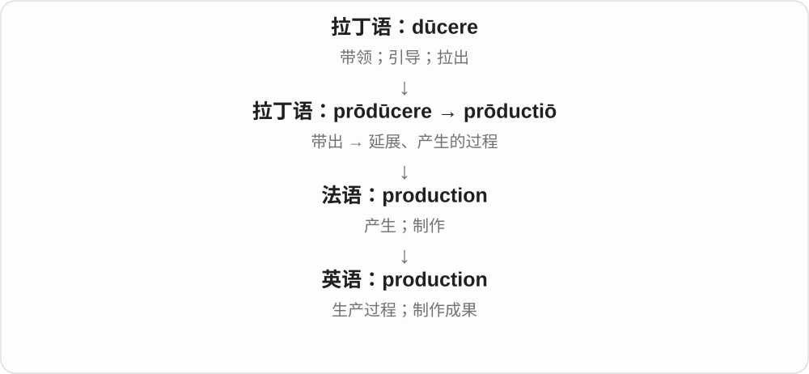

泛指生产时通常不可数；a production 可指某一部戏剧或影视制作。a stage production 就是一台具体舞台演出。

**常见搭配与例句**

increase production（增加产量）；go into production（投产）；a stage production（舞台演出）。

> The factory increased production last month.

工厂上个月提高了产量。

> We saw a new production of the play.

我们看了这部戏的一版新制作。

**别混淆**

product 是一个产物；production 可能是过程、产量或一整部制作。根据搭配判断，别统一译成“生产”。

### 2. attention — 注意力；关注；照顾

**音标**：/əˈtenʃən/

**先抓住这个画面**

attention 像把心里的镜头转向某个对象，让它进入清晰画面。

**怎么拆**

现代可联系 attend 与 -tion；历史来自拉丁语 attentiō，名词有独立借入链。

**怎么变成今天的意思**

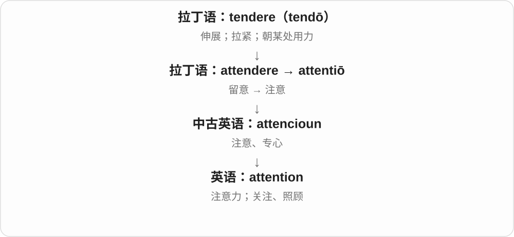

pay attention to 是把注意力放过去；need attention 可以是需要照料、处理，不只是想被看见。

**常见搭配与例句**

pay attention to；draw attention to；medical attention。

> Please pay attention to the last instruction.

请注意最后一条说明。

> The damaged roof needs immediate attention.

受损的屋顶需要马上处理。

**别混淆**

attention 是关注；intention 是打算。注意到一件事不等于打算做它。

### 3. solution — 解决办法、答案；溶液、溶体

**音标**：英、美 /səˈluːʃən/

**先抓住这个画面**

难题像一个结，解开它得到答案；物质原来的聚集状态被松开、均匀混进另一物质，得到溶液。

**怎么拆**

古法语 solucion 及拉丁语 solutio / solution- 借入中古英语 solucioun；拉丁名词来自 solvere 的分词词干。不是现代 solve 简单换尾后才第一次出现。

**怎么变成今天的意思**

**拉丁语 solvere；分词 solutus**  
松开、解开；清偿、解释

↓

**拉丁语 solutio；古法语 solucion**  
松解、清偿；解释、溶解

↓

**中古英语 solucioun → 英语 solution**  
解答、解决办法；溶液等均匀混合体系

a solution to a problem 是解决办法。化学中的 solution 以均匀混合为特点，不一定是水溶液，也有固溶体；日常最容易看到的例子是盐水。

**常见搭配与例句**

a solution to；find a solution；a salt solution。

> We need a practical solution to the storage problem.

我们需要一个切实可行的办法解决储物问题。

> The salt formed a clear solution in the water.

盐在水中形成了澄清的溶液。

**别混淆**

answer 可以是随口一句回复；solution 通常针对一个需要处理的问题。化学里 solution 是混合后的整体，solute 是其中的溶质。

### 4. description — 描述；说明

**音标**：/dɪˈskrɪpʃən/

**先抓住这个画面**

description 像用文字画的一幅画：别人没见过那个人或东西，读完你的描述，也能大致知道它是什么样。

**怎么拆**

经法语来自拉丁语 dēscrīptiō，是 dēscrībere“描写”的动作名词。script- 与 scrib- 是拉丁词形的对应。

**怎么变成今天的意思**

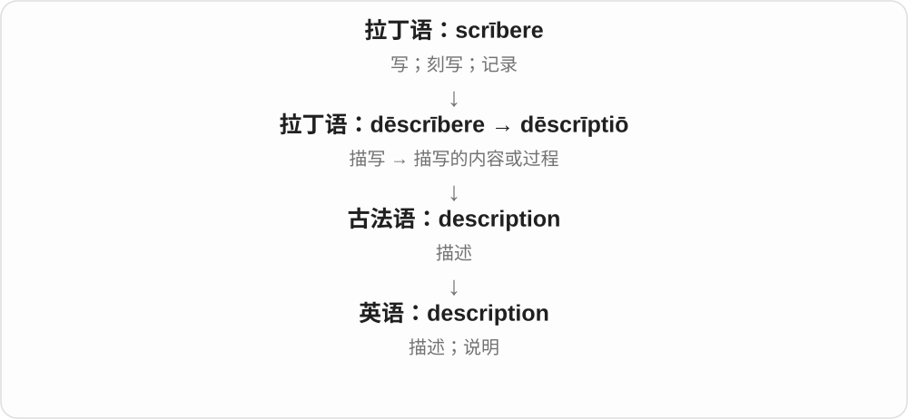

它可以写外貌，也可以说明职责、过程或情况。job description 不是工作的感想，而是说明这个岗位要做什么。

**常见搭配与例句**

a detailed description（详细描述）；a job description（职位说明）；a description of the scene（场景描写）。

> Her description helped us find the missing bag.

她的描述帮助我们找到了丢失的包。

> Read the job description before applying.

申请前先阅读职位说明。

**别混淆**

description 描述是什么样；explanation 解释为什么或怎么回事。definition 则划清概念的边界。

### 5. introduction — 介绍；引言；引入

**音标**：/ˌɪntrəˈdʌkʃən/

**先抓住这个画面**

introduction 像在门口有人领你进去：认识一个人、开始接触一门知识，或在文章开头知道接下来要讲什么。

**怎么拆**

来自拉丁语 intrōdūctiō，经法语传入。它与 introduce 对应，使用拉丁语的 duct- 词形，并非随意把英语 ce 改成 ction。

**怎么变成今天的意思**

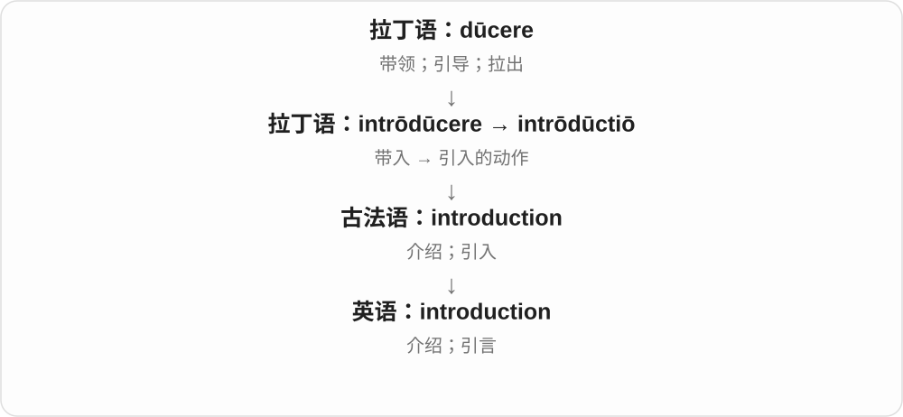

人际 introduction 帮人认识彼此；书的 introduction 把读者带进主题；新制度的 introduction 则是把制度引入现实使用。

**常见搭配与例句**

an introduction to physics（物理入门）；a brief introduction（简短介绍）；the introduction of a new system（新系统的引入）。

> The book provides a clear introduction to astronomy.

这本书清楚地介绍了天文学的入门知识。

> The introduction of the new system took several months.

引入新系统花了几个月。

**别混淆**

introduction 帮你进入主题；conclusion 在最后收束。书名 An Introduction to… 常是入门教材。

### 6. convention — 大会；惯例；约定；公约

**音标**：/kənˈvenʃən/

**先抓住这个画面**

人聚到一起，可以开大会；人达成共同做法，可以形成约定。这两条都抓住“聚到一处、达成一致”。

**怎么拆**

经法语 convention 来自拉丁语 conventiō“聚集、协议”，源于 convenīre；现代能看出与 convene 的对应关系，但名词本身是借入的。

**怎么变成今天的意思**

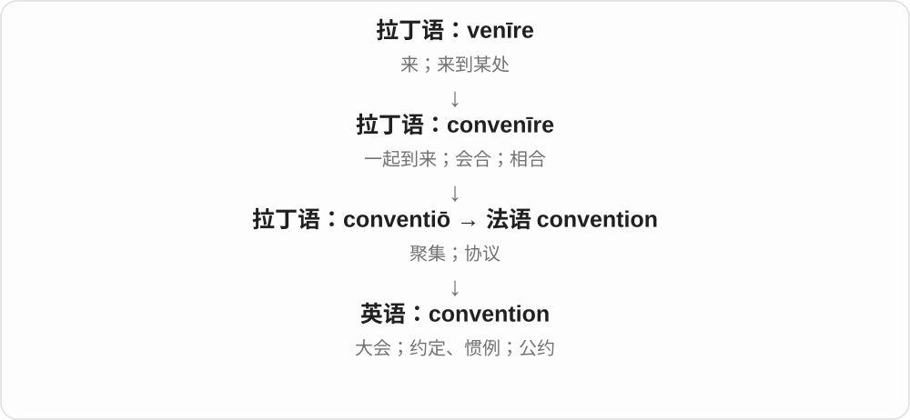

会议义保留实际聚集；惯例是群体习惯遵循的做法；公约是正式共同约定。并不是每一种 convention 都有签署的文件。

**常见搭配与例句**

attend a convention；social conventions；a naming convention；an international convention。

> Thousands of teachers attended the annual convention.

数千名教师参加了年会。

> The team agreed on a clear naming convention.

团队约定了一套清晰的命名规则。

> The ceremony follows local convention.

仪式遵循当地惯例。

**别混淆**

conference 偏围绕议题交流的会议；convention 也常是协会或群体大会。convention 作惯例时不等于法律强制规定。

### 7. reduction — 减少；降低；缩减的量

**音标**：/rɪˈdʌkʃən/

**先抓住这个画面**

reduction 是“降下来”这件事或降下来的那部分。原价一百，现在八十，少掉的二十就是价格 reduction 的体现。

**怎么拆**

来自拉丁语 reductiō，经法语传入；与 reduce 同族，使用 reduct- 词干。

**怎么变成今天的意思**

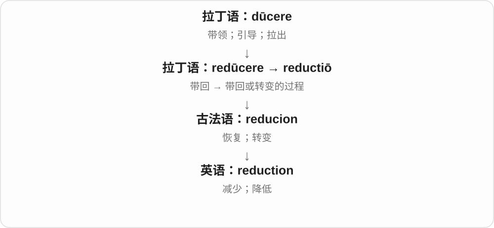

一般语境谈数量变少；化学中的 reduction“还原”是专门术语，不能机械理解为物质数量减少。

**常见搭配与例句**

a reduction in costs（成本下降）；a price reduction（降价）；a reduction of ten percent（降低百分之十）。

> The changes led to a reduction in waste.

这些变化减少了浪费。

> The store announced a ten percent reduction in prices.

商店宣布降价百分之十。

**别混淆**

reduction 表示下降，不说明必然降到零。reduction in 之后常放下降的项目；of 之后常放下降幅度。

### 8. consumption — 消费；消耗；消耗量

**音标**：/kənˈsʌmpʃən/

**先抓住这个画面**

看着油箱的油一点点减少，你看到的是 consumption；它既能说使用过程，也能说用了多少。

**怎么拆**

拉丁 cōnsūmptiō 经法语进入英语，含 sūmpt- 分词词干；不是把 consume 的拼写机械地加 tion。

**怎么变成今天的意思**

**拉丁 sūmere；过去分词 sūmptus**  
拿取；取用

↓

**拉丁 cōnsūmere → cōnsūmptiō**  
消耗 → 消耗的行为

↓

**古法语 consumpcion → 中古英语 → consumption**  
消费、消耗；消耗量

energy consumption 是能源消耗，for human consumption 是供人食用。旧文学里的 consumption 还可能指使人消瘦的肺病，尤其肺结核；不要按现代购物义硬译。

**常见搭配与例句**

fuel consumption；water consumption；fit for human consumption。

> The new lights reduced electricity consumption.

新灯具降低了耗电量。

> The packaging states that the product is not for human consumption.

包装注明该产品不供人食用。

**别混淆**

production 把产品做出来；consumption 把产品或资源投入使用。消费不一定是浪费。

### 9. intervention — 干预；介入；干预措施

**音标**：英 /ˌɪntəˈvenʃən/；美 /ˌɪntərˈvenʃən/

**先抓住这个画面**

事情正在自行发展，第三方进来改变进程：调解冲突、支持学生或处理危机，这种介入叫 intervention。

**怎么拆**

来自拉丁语 interventiō，可经法语 intervention 借入；inter-（在……之间）+ venīre（来）先组成 intervenīre。英语名词的记录早于 intervene，不能简单画成英语动词加 -tion。

**怎么变成今天的意思**

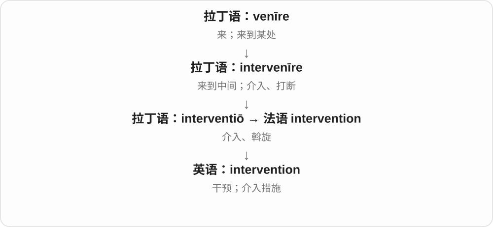

“来到中间”可以是劝架，也可以是把一项帮助放进事情的发展过程。它本身不保证干预有效或受欢迎。医疗语境里也指为改善健康而采取的措施，范围比手术广。

**常见搭配与例句**

early intervention；government intervention；an intervention in a dispute；without intervention。

> The teacher’s intervention prevented the argument from getting worse.

老师的介入使争吵没有进一步恶化。

> The report evaluates an early intervention designed to support struggling readers.

报告评估了一项帮助阅读困难学生的早期干预措施。

**别混淆**

interference 常带不受欢迎的干涉意味；intervention 比较中性，需看具体介入的目的和结果。

### 10. reception — 接待；接收；反响

**音标**：/rɪˈsepʃən/

**先抓住这个画面**

receive 是把人或信息接过来；reception 可以是怎么接待、接收得好不好，以及接到以后有什么反应。

**怎么拆**

来自拉丁语 receptiō，经法语进入英语，与 receive 同族。recept- 对应拉丁语的相关词干。

**怎么变成今天的意思**

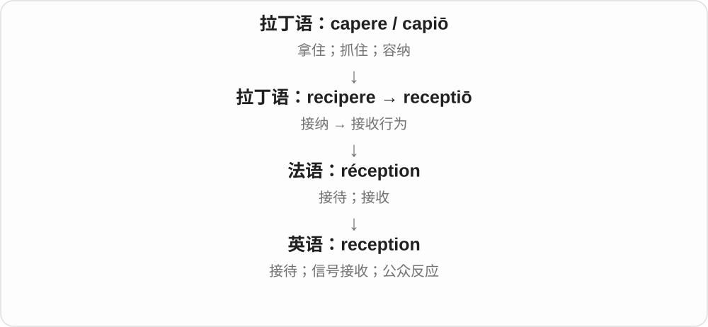

接人形成“接待、招待会”，接信号形成“接收效果”，接到作品或建议后的态度形成“反响”。这几义都能回到接收这件事。

**常见搭配与例句**

at reception（在前台）；a warm reception；poor phone reception。

> Please leave your key at reception.

请把钥匙留在前台。

> The film received a warm reception from audiences.

这部电影受到了观众的热烈欢迎。

**别混淆**

reception 是接待或接收，不是 receipt“收据”。它也能指前台区域，而 receptionist 是在那里接待的人。

### 11. prescription — 处方；药方；解决问题的办法

**音标**：/prɪˈskrɪpʃən/

**先抓住这个画面**

prescription 像事先写好的行动单：“按这些要求做。”医疗里是处方；比喻用法里是某人主张的解决办法。

**怎么拆**

经法语来自拉丁语 praescrīptiō，与 prae-（预先）+ scrībere（写）相连。

**怎么变成今天的意思**

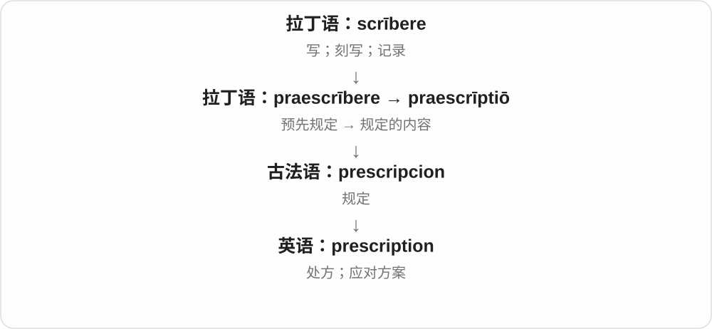

处方把应使用的药物或处理要求写明；a prescription for success 则是“成功之道”的比喻，并不表示它保证有效。

**常见搭配与例句**

write a prescription（开处方）；a prescription for…（……的处方或方案）；prescription medicine（处方药）。

> The pharmacist checked the prescription carefully.

药剂师仔细核对了处方。

> The book offers no simple prescription for happiness.

这本书没有提供获得幸福的简单公式。

**别混淆**

prescription 写的是要求怎样做；description 说的是实际是什么样。两词都含 script-，前缀决定方向。

### 12. detention — 拘留；扣留；课后留校

**音标**：/dɪˈtenʃən/

**先抓住这个画面**

detention 像别人不让你按原计划离开，把你暂时留在某个地方；学校里也可指违纪后的留校。

**怎么拆**

经法语 détention 来自拉丁语 dētentiō，与 dētinēre“扣住”同族；不是仅按英语 detain 加后缀形成的历史。

**怎么变成今天的意思**

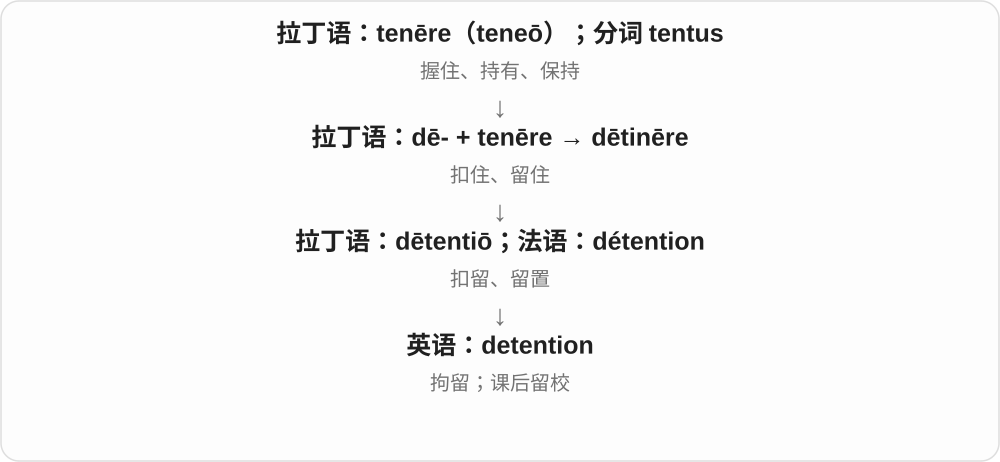

不同语境的权力和程序不同。学校 detention 与警方拘留共享留住的核心意思，但不能当成同一种处置。

**常见搭配与例句**

in detention；a detention centre；after-school detention；serve a detention。

> The report describes the conditions in the detention centre.

报告描述了拘留中心的条件。

> He received detention for repeatedly disrupting the class.

他因一再扰乱课堂而被罚课后留校。

**别混淆**

arrest 是逮捕这一行动；detention 强调被扣留的状态或一段时间，具体关系取决于语境。

### 13. junction — 交汇处；接合点

**音标**：/ˈdʒʌŋkʃən/

**先抓住这个画面**

两条路从不同方向过来，在一个点接上。那个点就是 junction。电线、管道、铁路也都有这样的接点。

**怎么拆**

来自拉丁语 iūnctiō“接合”，junct- 与 join 是同一词族的不同历史形式。

**怎么变成今天的意思**

原来的“接合”从动作转到地点：哪里接起来，哪里就是 junction。道路上的 junction 不一定是十字路口，T 字口、匝道口也可能这样叫。

**常见搭配与例句**

a road junction；a railway junction；at the junction of…；a junction box。

> Turn left at the next junction.

在下一个路口左转。

> The town grew around a railway junction.

这座城镇围绕一个铁路交汇点发展起来。

**别混淆**

junction 是实际的汇接点；juncture 在常见抽象用法里是事情发展的某个时刻。

### 14. ammunition — 弹药；供争论、批评使用的材料

**音标**：/ˌæmjəˈnɪʃən/

**先抓住这个画面**

具体是武器使用的弹药；比喻时，能拿来支持论点、反击批评的事实、证据，也能叫 ammunition。

**怎么拆**

经法语 amunition 借入，来自 la munition 被重新切分成 l’amunition。更早接拉丁 munitio 加固、防御，曾泛说军需品，后来主要限定为弹药。

**怎么变成今天的意思**

**拉丁防御、加固词族 → 法语 munition**  
防御所需物资、军需品

↓

**la munition 重新切分 → ammunition**  
名称改变、范围收窄为弹药；再有论争材料比喻

boxes of ammunition 一箱箱弹药；ammunition for an argument 支持争论的材料。通常不可数，数箱、种类时另外加相应名词。

**常见搭配与例句**

a supply of ammunition；give critics ammunition。

> The museum display includes old ammunition boxes.

博物馆展品中有旧弹药箱。

> The report gave critics fresh ammunition.

这份报告给批评者提供了新的论据。

**别混淆**

ammunition 与 weapon 不同：weapon 是武器，ammunition 是弹药等相关消耗物资。比喻中则是可用来支持、攻击某观点的材料。

### 15. ammo — 弹药；论争材料〔ammunition 的非正式缩短〕

**音标**：英 /ˈæməʊ/；美 /ˈæmoʊ/

**先抓住这个画面**

聊天或简短叙述里，把长长的 ammunition 缩成 ammo；基本意思仍是弹药，也能沿用论争材料的比喻。

**怎么拆**

ammunition 的近代口语截短形式，保留开头并形成结尾 -o 的短词。不是另一个不同物质、不同装备名称。

**怎么变成今天的意思**

**ammunition → ammo**  
把长名称截短为口语形式

↓

**ammo 的具体、比喻用法**  
弹药；可用来支撑论点、反击的材料

some ammo 一些弹药；more ammo for the debate 更多辩论材料。通常不可数，语气比 ammunition 随意。

**常见搭配与例句**

an ammo box；give someone more ammo。

> The label reads “ammo box”.

标签上写着“弹药箱”。

> The new figures gave her more ammo for the debate.

新的数据给她的辩论提供了更多论据。

**别混淆**

ammo 与 ammunition 的主要差别是长度、语体；不能因为少了字母就按普通可数物说 an ammo。

### 16. conception — 构想；观念；受孕

**音标**：/kənˈsepʃən/

**先抓住这个画面**

conception 可以是一个想法刚刚形成，也可以是你脑中已经形成的理解。谈生育时，它指受孕，不是“生孩子”整个过程。

**怎么拆**

来自拉丁语 conceptiō，经法语进入英语，与 conceive 同源。现代可把两者看成动作和名词的对应。

**怎么变成今天的意思**

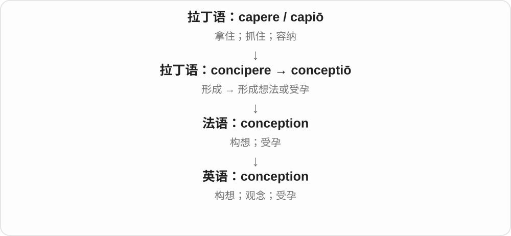

一件事被“收进头脑并形成整体”，就成了你对它的 conception；一个项目从 conception 到完成，则是从最初构想到落地。

**常见搭配与例句**

a conception of…；from conception to completion；the moment of conception。

> Her conception of success has changed over time.

她对成功的理解随着时间发生了变化。

> The project took two years from conception to completion.

这个项目从构想到完成花了两年。

**别混淆**

concept 常指一个具体概念；conception 更容易强调构想过程，或某人对一件事的整体理解。

### 17. contention — 争论；主张；争夺

**音标**：/kənˈtenʃən/

**先抓住这个画面**

contention 可以是双方在一个问题上拉扯，也可以是你拿出来坚持的那个观点。

**怎么拆**

来自拉丁 contentiō，经古法语 contencion；与 contend 平行借入。

**怎么变成今天的意思**

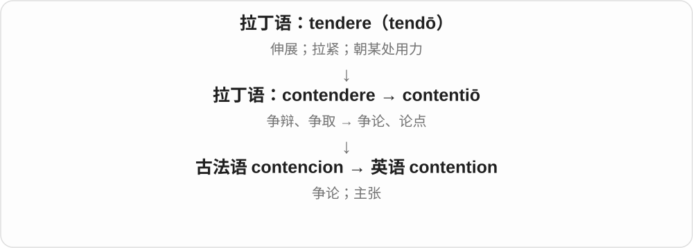

a point of contention 是争议点；her contention that… 是她提出的主张；in contention 说仍有竞争机会。

**常见搭配与例句**

a bone of contention；the contention that；in contention for。

> Cost remains the main point of contention.

费用仍是主要争议点。

> Her contention is that the rule treats applicants unfairly.

她主张这条规定对申请者不公平。

**别混淆**

contention“主张”不代表已经证明；evidence 才是支持它的证据。

### 18. induction — 入职引导；归纳；感应；诱导

**音标**：/ɪnˈdʌkʃən/

**先抓住这个画面**

induction 有几种常见场景：把新人带进工作，把观察带向一般判断，或通过某种作用引出一个反应。

**怎么拆**

经法语来自拉丁语 inductiō，与 indūcere“带入、引起”相连。用 induct- 看出它和 induce 的关系即可。

**怎么变成今天的意思**

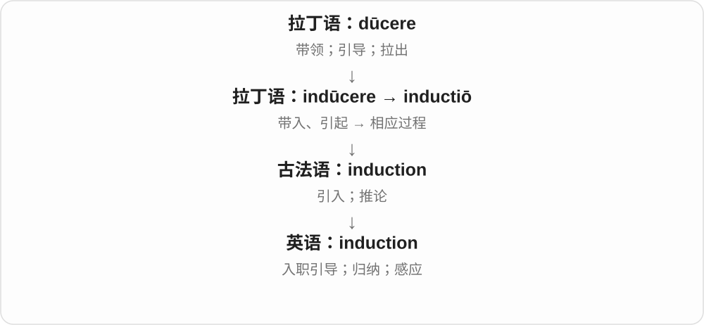

入职培训是让人进入角色；归纳是从具体观察形成较一般的判断；电磁感应是另一种专门用法。这些意思不能只背一个“引入”就代替实际理解。

**常见搭配与例句**

an induction course（入职培训课程）；inductive reasoning / induction（归纳推理）；electromagnetic induction（电磁感应）。

> All new staff attend an induction course.

所有新员工都参加入职培训。

> The class compared induction with deduction.

课堂上比较了归纳推理和演绎推理。

**别混淆**

普通经验归纳不能保证结论必然为真；数学里的 mathematical induction“数学归纳法”是严格证明方法，要另行学习。

### 19. absorption — 吸收；并入；专注、入迷

**音标**：英 /əbˈzɔːpʃən/；美 /əbˈzɔːrpʃən/；也读 /s/ 音版本

**先抓住这个画面**

把“接进来”作为一个过程来看：水进入材料、能量转给物质、信息进入理解，或注意力完全沉进一件事。

**怎么拆**

借入拉丁 absorptio、absorptionem，来自动词 absorbere 的分词词干 absorpt-。现代与 absorb 配套，但名词是自己的拉丁借入支线；b 变成 p 与分词词干相关，不是随意换字母。

**怎么变成今天的意思**

**拉丁 ab，构词中也有 abs-、a- 等形式**  
离开、从……分离、去掉

↓

**拉丁 ab- + sorbere → absorbere**  
吸吮、吞咽 → 吞下、吸收掉

↓

**拉丁分词词干 absorpt- → absorptio／absorptionem**  
吞吸这一动作

↓

**英语 absorption**  
吸收过程；并入；注意力完全投入

water absorption 是吸水；light absorption 是光能被物质吸收；absorption in work 是全神贯注工作。具体机制随领域变化，日常“吸进去”的画面只是起点。

**常见搭配与例句**

water absorption；heat absorption；the absorption of；complete absorption in。

> The test compares the water absorption of three fabrics.

测试比较了三种织物的吸水性能。

> His complete absorption in the painting made him forget the time.

他完全沉浸在那幅画中，忘了时间。

**别混淆**

adsorption 是吸附，术语重点落在表面或界面聚集；absorption 的常用物质吸收义强调被材料接纳，光学用法则涉及能量转移，不要把两词拼错。

### 20. abolish — 废除、废止

**音标**：英 /əˈbɒlɪʃ/；美 /əˈbɑːlɪʃ/

**先抓住这个画面**

一条旧规矩原来大家都得遵守，现在正式把它撤掉，不再让它继续存在，这就是 abolish。

**怎么拆**

经中古英语、法语 abolir 的 aboliss- 等形式接拉丁 abolere；末尾 -ish 属这段借入历史，不是 childish 那个表示有点像的后缀。

**怎么变成今天的意思**

**拉丁 abolere → 法语 abolir、abolition**  
消除、废止；废止行为

↓

**英语 abolish、abolition**  
废除；废除这一行为或状态

abolish a law 废除法律；abolish a system 废除制度；abolish a practice 废止惯例。

**常见搭配与例句**

abolish a law；abolish a tax。

> The new law abolished the outdated restriction.

新法律废除了那条过时的限制。

> The school decided to abolish the ranking system.

学校决定废除排名制度。

**别混淆**

abolish 通常彻底废止制度、规定等；suspend 是暂时停止，之后可能恢复。

### 21. abolition — 废除、废止；废奴

**音标**：英 /ˌæbəˈlɪʃən/；美 /ˌæbəˈlɪʃən/

**先抓住这个画面**

abolish 是把制度撤掉的动作，abolition 则把废除这件事作为名词来谈。历史文章里不带具体宾语时，常要看是否在说废奴。

**怎么拆**

经法语 abolition 接拉丁 abolitio、abolition-。与 abolish 同族，但不是把完整 abolish 后面机械拼成 abolishtion；借入的词形不同。

**怎么变成今天的意思**

**拉丁 abolere → 法语 abolir、abolition**  
消除、废止；废止行为

↓

**英语 abolish、abolition**  
废除；废除这一行为或状态

the abolition of slavery 废除奴隶制；campaign for the abolition of 为废除……而奔走。

**常见搭配与例句**

the abolition of；support abolition。

> They campaigned for the abolition of the death penalty.

他们为废除死刑而奔走。

> The chapter examines the abolition of slavery.

这一章考察奴隶制的废除。

**别混淆**

abolition 是废除本身；abolitionism 是废除某种制度、尤其奴隶制的主张或运动，不能只因都译成废奴就忽略词性。

### 22. deduction — 推断；演绎；扣除；扣除额

**音标**：/dɪˈdʌkʃən/

**先抓住这个画面**

deduction 一头是“从已有信息引出结论”，另一头是“从总数拿掉一部分”。所以它既能是推断，也能是扣款。

**怎么拆**

来自法语 déduction、拉丁语 dēductiō。它与 deduce“推断”和 deduct“扣除”共享来源，两种现代动词不能互换。

**怎么变成今天的意思**

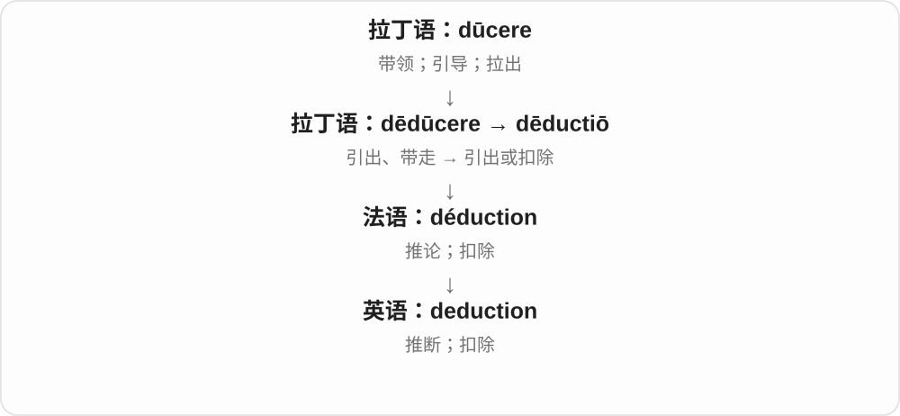

读句子时看周围：logical deduction 谈推理；a deduction from pay 谈钱。一个名词保留两条意思，不代表所有同族动词也有两条。

**常见搭配与例句**

make a deduction（作出推断）；logical deduction（逻辑演绎）；a deduction from wages（工资扣款）。

> Your deduction fits all the facts we know.

你的推断与我们已知的事实都相符。

> The receipt shows a deduction of twenty dollars.

收据显示扣除了二十美元。

**别混淆**

deduce a conclusion 是推出结论；deduct a fee 是扣掉费用。两者的名词都可用 deduction。

### 23. abduction — 绑架；外展；溯因推理

**音标**：/əbˈdʌkʃən/

**先抓住这个画面**

abduction 的字面画面是“带离”。人被强行带走，是绑架；手臂离开身体中线，是外展。

**怎么拆**

拉丁语 ab-（离开）+ dūcere（带领），形成 abdūctiō 等词形。现代与 abduct 对照记忆。

**怎么变成今天的意思**

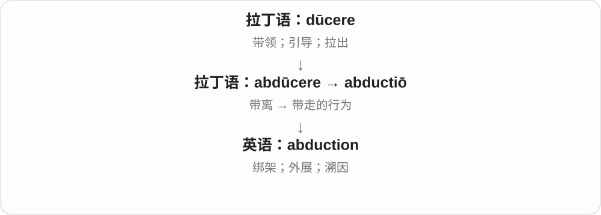

推理中的 abduction 是根据现象提出较能解释它的假设，常译“溯因推理”。这是专门术语，不能理解为结论已经得到必然证明。

**常见搭配与例句**

an abduction case（绑架案件）；arm abduction（手臂外展）；abductive reasoning / abduction（溯因推理）。

> The novel begins with an abduction.

小说以一起绑架事件开场。

> The diagram illustrates abduction of the arm.

图中展示了手臂外展。

**别混淆**

abduction 是离开身体中线；adduction 是靠近身体中线。绑架与关节动作是不同语境，不要混在一起。

### 24. seduction — 诱惑；引诱；勾引

**音标**：/sɪˈdʌkʃən/

**先抓住这个画面**

seduction 是吸引力一步步把人拉过去的过程。它也可指某种很难抵挡的魅力，如权力、奢华或成名的诱惑。

**怎么拆**

来自法语 séduction、拉丁语 sēductiō，与 seduce 同源。duct- 是对应词干，不另有“鸭子”之类的意思。

**怎么变成今天的意思**

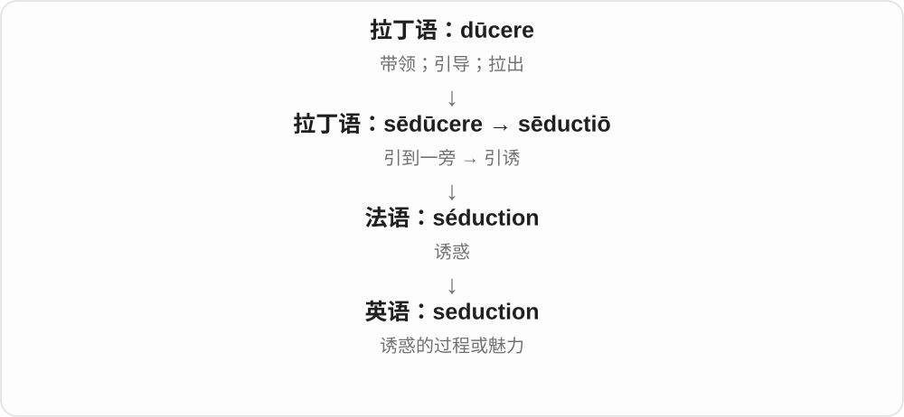

动词 seduce 说谁引诱谁；名词 seduction 把这个过程或吸引力拿出来讨论。具体是否有性意味，需要看对象和上下文。

**常见搭配与例句**

the seduction of power（权力的诱惑）；a tale of seduction（关于诱惑或勾引的故事）。

> The novel explores the seduction of fame.

这部小说探讨了名声的诱惑。

> The film tells a story of seduction and betrayal.

这部电影讲述了一个关于引诱与背叛的故事。

**别混淆**

persuasion 可通过理由说服；seduction 更突出欲望和吸引力。两者不完全相同。

### 25. subduction — 俯冲；一个板块进入另一个板块下方的过程

**音标**：/səbˈdʌkʃən/

**先抓住这个画面**

两块缓慢相向移动的板块遇到一起，其中一块斜着进入另一块下面，向地幔下降，这个过程叫 subduction。

**怎么拆**

接拉丁 subductio，与 subducere 从下方拉、移走的材料相联：sub- 下方 + ducere 引、带；duct- 是相应变化词干，再有名词尾。

**怎么变成今天的意思**

**拉丁 sub- + ducere → subducere、subductio**  
从下方拉、移走等动作材料

↓

**地质英语 subduction**  
板块在汇聚处进入另一板块下方

a subduction zone 俯冲带；plate subduction 板块俯冲。地质义不能只译成一般的减少。

**常见搭配与例句**

a subduction zone；plate subduction。

> The diagram shows subduction beneath the continent.

示意图展示了大陆下方的板块俯冲。

> Scientists study earthquakes along the subduction zone.

科学家研究这条俯冲带沿线的地震。

**别混淆**

subduction 是板块进入另一个下方；subtraction 是数学相减。二者都可能看见 sub-，动作词根却不同。

### 26. convolution — 盘曲、褶皱；曲折复杂之处；卷积

**音标**：英 /ˌkɒnvəˈluːʃən/；美 /ˌkɑːnvəˈluːʃən/

**先抓住这个画面**

普通义看一层层卷曲；数学义则是把两份信息按滑动的位置组合起来，算出新的结果。

**怎么拆**

由拉丁语 convolutus“卷在一起的”这一分词词干形成动作或状态名词。英语 convolution 的记录早于现代常用的 convolute；不能只按今天词形推历史先后。

**怎么变成今天的意思**

**拉丁语 volvere；分词 volutus**  
滚、转、卷；卷起的

↓

**拉丁语 con- + volvere → convolvere；convolutus**  
卷在一起；卷曲的

↓

**拉丁语分词词干 + 名词形式 → 英语 convolution**  
盘绕、褶曲

↓

**后来的专门用法**  
脑表面褶曲；数学卷积运算

the convolutions of a plot 是情节绕来绕去。数学卷积可直观理解为：将一个函数翻转、平移，再按重叠位置相乘并求和或积分；它不是随便把两张图叠起来。

**常见搭配与例句**

the convolutions of the brain；a convolution kernel；perform a convolution。

> I lost track of the plot’s many convolutions.

情节转折太多，我看得理不清了。

> The exercise asks us to compute the convolution of two short sequences.

这道练习要求我们计算两个短序列的卷积。

**别混淆**

convolution 是名词；convoluted 常形容复杂难懂。机器学习中的“卷积层”实现常采用互相关，名称与严格数学操作有时不完全一致。

## 这一组要分清什么

abolish 的 -ish 属借入词干历史，不是 childish 的像小孩；subduction 俯冲与 subtraction 相减分开；attention 不等于一个现代动词 atten 加后缀。

## 串起来练习

The introduction explains the production process and the reduction in waste.

引言解释了生产过程和废弃物的减少。
