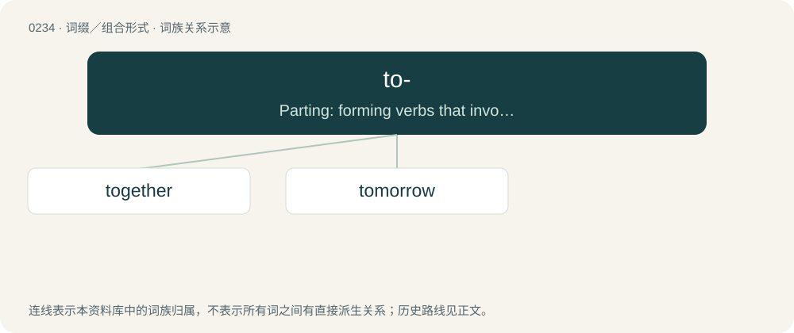

# 0260 · to- — Parting: forming verbs that involve cleaving, breaking, or sundering.

[总目录](../00_总目录_按常用程度.md)

**类型**：词缀／组合形式　｜　**来源语言**：见词源记录

## 核心含义与来源

- 核心含义：Parting: forming verbs that involve cleaving, breaking, or sundering.
- 英文含义：Parting: forming verbs that involve cleaving, breaking, or sundering.
- 词形：to-

**多个词源／构词路径**：同一拼写可能有不同来源；以下按词性和含义分别列出。

**来源记录 1**（前缀／前置成分；Parting: forming verbs that involve cleaving, breaking, or sundering.）

From Middle English to-, from Old English tō-, te- (“apart, away”), from Proto-West Germanic \*tō-, \*tuʀ-, \*twiʀ-, from Proto-Germanic \*twiz- (“apart, in two”), from Proto-Indo-European \*dwís (“two-ways, in twain”).

**来源记录 2**（前缀／前置成分；Current, the current form of the suffixed time. Forming nouns.）

From to.

## 词族图

## 单词速览（常用到不常用）

| 单词 | 音标 | 释义 |
|---|---|---|
| [together](#w-1) | 英 /tʊˈɡɛð.ə/；美 /tʊˈɡɛðɚ/ | adv. 一起, 共同, 彼此 |
| [tomorrow](#w-2) | 英 /təˈmɒɹəʊ/；美 /təˈmɑɹoʊ/ | n. 明天, 未来；adv. 明天, 未来地 |

## 逐词详解

### 1. together

**词性**：形容词　｜　**音标**：英 /tʊˈɡɛð.ə/；美 /tʊˈɡɛðɚ/

**中文释义**：adv. 一起, 共同, 彼此

**英文义项**：Coherent; well-organized.

**构词拆分**：to-₂ + gather

**词源与演化**：

From Late Middle English together, from earlier togedere, togadere, from Old English tōgædere (“together”), from Proto-West Germanic \*tōgadura, \*tegadura, from Proto-Germanic \*tō (“to”) + \*gadar (“together”), from Proto-Indo-European \*gʰedʰ- (“to unite, keep”), equivalent to to-₂ + gather. Cognate with Scots thegither (“together”), Old Frisian togadera (whence West Frisian togearre (“together”)), Dutch tegader (“together”), Middle Low German tōgāder (“together”), Middle High German zegater (“together”). Compare also Old English ætgædere (“together”), Old English ġeador (“together”). More at gather.

**用法示例／搭配（非完整句）**：

> He’s really together.

该用例对应义项：Coherent; well-organized.

### 2. tomorrow

**词性**：名词　｜　**音标**：英 /təˈmɒɹəʊ/；美 /təˈmɑɹoʊ/

**中文释义**：n. 明天, 未来；adv. 明天, 未来地

**英文义项**：The day after the present day. / A future period or time.

**构词拆分**：to- + morrow

**词源与演化**：

From Middle English tomorwe, tomorwen, from Old English tō morgne (“tomorrow”, adverb), from tō (“at, on”) + morgne (dative of morgen (“morning”)), from Proto-Germanic \*murganaz (“morning”), perhaps from Proto-Indo-European \*mergʰ- (“to blink, to twinkle”), equivalent to to- + morrow. Compare French demain, Dutch morgen, German morgen, Swedish imorgon or Danish i morgen.

**例句**：

> Live for what tomorrow has to offer, not for what yesterday has taken away.

该用例对应义项：A future period or time.
