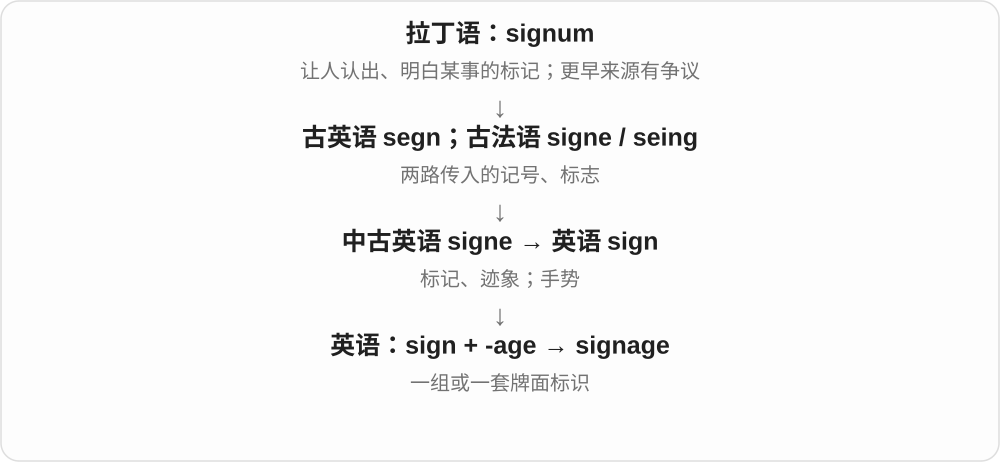
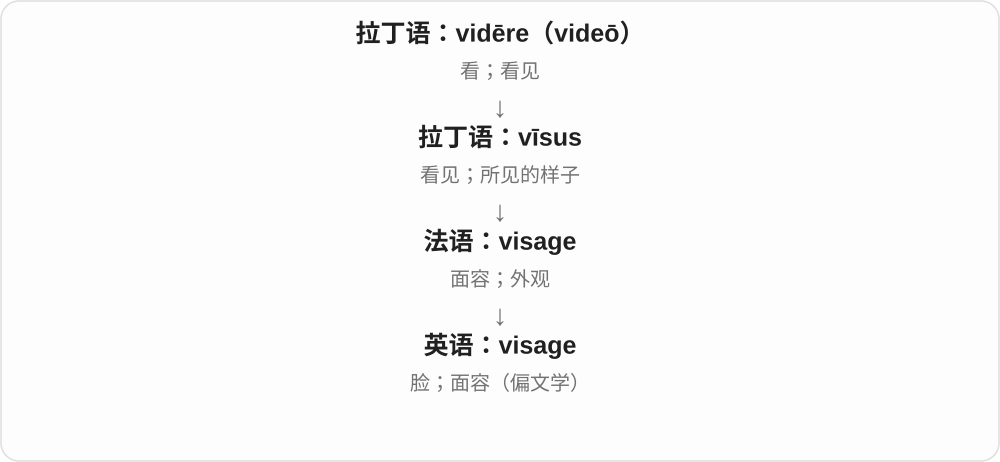

# 0287 · -age — 动作、过程、状态、集合、数量等名词

[逐词精讲目录](../00_逐词精讲目录.md) · [总目录](../00_总目录_按常用程度.md)

## 核心词根与来源

这个词尾能形成很多不同名词，先问基础材料是什么：搬运的东西、渗漏的过程、按某单位计的量。coverage 是覆盖、报道范围等，shortage 是不足，storage 是存储。后缀帮你认出名词，完整用法决定具体意思。

**-AGE：把相关过程、东西或总量作为名词来谈**

lug 费力搬 → luggage 行李；seep 渗 → seepage 渗漏；acre 英亩 → acreage 土地面积。不要把它全译成年龄。

- **费力搬运到行李整体**：lug · luggage
- **分开与裂隙**：cleave · cleavage
- **面积单位与面积**：acre · acreage
- **照管、教导**：tutor · tutelage
- **渗流与货物收放**：seep · seepage · stow · stowage
- **不同计量对象**：ampere · amperage · voltage · wattage · mileage
- **形似而需单查历史**：average
- **-age 的借词分支：小屋与揉按过程**：cottage · cottages · massage · massages · massaged · massaging
- **acre → acres：耕地名称到面积单位**：acre · acres
- **marriage → marriages：age 名词的复数**：marriage · marriages
- **average → averaged：从分摊到平均计算**：averaged
- **average 与 averaging：分摊到平均**：averaging
- **till 耕地 + -age → tillage 耕作**：till · tillage

## 词形与演化规律

接古法语、法语 -age，远接晚期拉丁 -aticum 等相关、所属材料；英语又接本源词继续构词。luggage 中 lug 的 g 双写；cleavage、amperage 等常去末尾 e，acreage 则保留 e。常见英语派生词尾读 /ɪdʒ/，个别法语借词读音不同。average 有海商用语、损失分摊的借入历史及远源争议，本页作为常见形似词单独解释，不用现代 aver + -age 硬造词源。

cottage 经旧法语小屋词与 -age 的组合借入；massage 借法语 masser + -age。massage 的词尾通常读 /ɑːʒ/，与多数英语 -age 派生词不同；masser 更早来源有争论。

古英语 aecer 的本族田地词，与拉丁田地材料是同源比较，不是借 agriculture 缩成 acre。

尾 dʒ 后复数读 iz，不把整个 ages 另当后缀。

average 有法语、意大利语海商费用、货损分摊背景，远源有争议；现代平均动词去末尾 e 再加完整 -ed，/dʒ/ 后读 /d/。

average 接法语、意大利语航海货损、附加费用的词族，更远来源不确定。现代去 e 加 -ing；与 -age 页面同族对照，不把 average 强作透明英语后缀造词。

tillage 加完整 -age，表示相应操作、过程；不把末尾拆成独立的年龄 age。

## 单词速览（按词族由简到繁）

同一基础词的相关扩展放在一起，先读基础形式，再读扩展；各组之间优先读常用的。具体词源关系见各词讲解。

| 单词 | 音标 | 核心意思 |
|---|---|---|
| [average](#w-1) | /ˈævərɪdʒ/ | 平均数；平均的；一般的；平均为 |
| [averaged](#w-74) | 英 /ˈævərɪdʒd/；美 /ˈævərɪdʒd/ | 平均为；求了平均值〔过去式、过去分词〕 |
| [averaging](#w-75) | 英、美 /ˈævərɪdʒɪŋ/ | 求平均；平均达到〔分词、动名词〕 |
| [marriage](#w-2) | /ˈmærɪdʒ/ | 婚姻；结婚；融合、结合 |
| [marriages](#w-73) | /ˈmærɪdʒɪz/ | 婚姻、婚姻关系〔复数〕；融合、结合〔比喻〕 |
| [till](#w-76) | 英、美 /tɪl/ | 耕作、翻耕；收银机、钱箱〔不同来源〕 |
| [tillage](#w-77) | 英、美 /ˈtɪlɪdʒ/ | 耕作；翻耕、整地 |
| [coverage](#w-3) | /ˈkʌvərɪdʒ/ | 覆盖范围；新闻报道；保障范围 |
| [storage](#w-4) | 英 /ˈstɔːrɪdʒ/；美 /ˈstɔːrɪdʒ/ | 储存；存储空间、容量 |
| [percentage](#w-5) | 英 /pəˈsentɪdʒ/；美 /pərˈsentɪdʒ/ | 百分比；按比例分得的一份 |
| [package](#w-6) | /ˈpækɪdʒ/ | 包裹；包装；一整套方案；把……包装 |
| [footage](#w-7) | 英 /ˈfʊtɪdʒ/；美 /ˈfʊtɪdʒ/ | 拍摄画面；影像素材；以英尺计算的量 |
| [acre](#w-59) | 英 /ˈeɪkə/；美 /ˈeɪkər/ | 英亩〔面积单位〕 |
| [acres](#w-72) | 英 /ˈeɪkəz/；美 /ˈeɪkərz/ | 英亩〔复数，土地面积单位〕 |
| [acreage](#w-31) | 英 /ˈeɪkərɪdʒ/；美 /ˈeɪkərɪdʒ/ | 以英亩计的面积；土地面积、地块 |
| [voltage](#w-8) | 英 /ˈvəʊltɪdʒ/；美 /ˈvoʊltɪdʒ/ | 电压、电势差 |
| [massage](#w-66) | 英 /ˈmæsɑːʒ/；美 /məˈsɑːʒ/ | 按摩、揉按；揉按身体；修饰、操弄〔数据等，引申〕 |
| [massages](#w-69) | 英 /ˈmæsɑːʒɪz/；美 /məˈsɑːʒɪz/ | 按摩〔复数〕；揉按、按摩〔第三人称单数〕 |
| [massaging](#w-70) | 英 /ˈmæsɑːʒɪŋ/；美 /məˈsɑːʒɪŋ/ | 正在按摩、揉按；修饰、操弄〔数据等〕；massage 的 -ing 形式 |
| [massaged](#w-71) | 英 /ˈmæsɑːʒd/；美 /məˈsɑːʒd/ | 按摩过、揉按过；修饰、调整过〔数据等〕 |
| [cottage](#w-67) | 英 /ˈkɒtɪdʒ/；美 /ˈkɑːtɪdʒ/ | 乡间小屋；小住宅 |
| [cottages](#w-68) | 英 /ˈkɒtɪdʒɪz/；美 /ˈkɑːtɪdʒɪz/ | 乡间小屋、小住宅〔cottage 的复数〕 |
| [shortage](#w-9) | 英 /ˈʃɔːtɪdʒ/；美 /ˈʃɔːrtɪdʒ/ | 短缺；供应不足 |
| [leverage](#w-10) | 英 /ˈliːvərɪdʒ/；美 /ˈlevərɪdʒ/ | 杠杆作用；影响力；借款形成的财务杠杆；利用 |
| [lug](#w-61) | /lʌɡ/ | 费力搬、拖、提；耳、凸耳等〔另有同形用法〕 |
| [luggage](#w-11) | /ˈlʌɡɪdʒ/ | 行李 |
| [drainage](#w-12) | /ˈdreɪnɪdʒ/ | 排水；排水系统、排水能力 |
| [tutor](#w-60) | 英 /ˈtjuːtə/；美 /ˈtuːtər/ | 辅导教师、导师；个别或小组辅导 |
| [salvage](#w-13) | /ˈsælvɪdʒ/ | 抢救；挽回；回收利用；获救财物 |
| [mileage](#w-14) | 英、美 /ˈmaɪlɪdʒ/ | 行驶里程；燃油里程表现；可利用价值 |
| [sewage](#w-15) | /ˈsuːɪdʒ/ | 污水、生活污水 |
| [postage](#w-16) | 英 /ˈpəʊstɪdʒ/；美 /ˈpoʊstɪdʒ/ | 邮资；邮费 |
| [underage](#w-17) | 形容词 /ˌʌndərˈeɪdʒ/；名词英 /ˈʌndərɪdʒ/、美 /ˈʌndərɪdʒ/ | 未达到规定年龄的；短缺量〔名词〕 |
| [lineage](#w-18) | 血统义 /ˈlɪniɪdʒ/；计行义 /ˈlaɪnɪdʒ/ | 家系；血统；传承；行数或按行计费〔另一用法〕 |
| [patronage](#w-19) | 英 /ˈpætrənɪdʒ/；美 /ˈpeɪtrənɪdʒ/ | 赞助、扶持；光顾；任用亲信的权力或做法 |
| [anchorage](#w-20) | 英 /ˈæŋkərɪdʒ/；美 /ˈæŋkərɪdʒ/ | 锚地；锚定、固定处；抛锚费 |
| [rampage](#w-22) | 名词常 /ˈræmpeɪdʒ/；动词也有 /ræmˈpeɪdʒ/ | 狂暴冲撞、肆虐；狂暴行动 |
| [cleave](#w-63) | /kliːv/ | 劈开、分开；也可指黏住、坚守〔不同词源〕 |
| [cleavage](#w-21) | /ˈkliːvɪdʒ/ | 分裂、裂隙；乳沟；解理〔矿物等〕 |
| [orphanage](#w-23) | 英 /ˈɔːfənɪdʒ/；美 /ˈɔːrfənɪdʒ/ | 孤儿院；照料失去父母照护儿童的机构 |
| [brokerage](#w-24) | 英 /ˈbrəʊkərɪdʒ/；美 /ˈbroʊkərɪdʒ/ | 经纪业务、经纪公司；经纪佣金 |
| [wreckage](#w-25) | /ˈrekɪdʒ/ | 残骸、毁坏后留下的碎片 |
| [outage](#w-26) | /ˈaʊtɪdʒ/ | 停电；服务中断；停止供应的一段时间 |
| [leakage](#w-27) | /ˈliːkɪdʒ/ | 泄漏；泄漏量；漏损 |
| [stoppage](#w-28) | 英 /ˈstɒpɪdʒ/；美 /ˈstɑːpɪdʒ/ | 停顿；中断；阻塞 |
| [signage](#w-29) | /ˈsaɪnɪdʒ/ | 标识牌；标识系统〔总称〕 |
| [linkage](#w-30) | /ˈlɪŋkɪdʒ/ | 联系、关联；连接机构、联动装置 |
| [stow](#w-62) | 英 /stəʊ/；美 /stoʊ/ | 放妥、收好；装载 |
| [stowage](#w-53) | 英 /ˈstəʊɪdʒ/；美 /ˈstoʊɪdʒ/ | 装载、存放；存放空间 |
| [blockage](#w-32) | 英 /ˈblɒkɪdʒ/；美 /ˈblɑːkɪdʒ/ | 堵塞；堵塞物 |
| [frontage](#w-33) | 英、美 /ˈfrʌntɪdʒ/ | 建筑正面；临街或临水地段；正面宽度 |
| [tonnage](#w-34) | /ˈtʌnɪdʒ/ | 吨数、吨位；货运量等按吨衡量的数量 |
| [breakage](#w-35) | /ˈbreɪkɪdʒ/ | 破损；破损物；破损损耗 |
| [shrinkage](#w-36) | /ˈʃrɪŋkɪdʒ/ | 收缩、缩水；收缩量；库存损耗 |
| [sewerage](#w-37) | 英 /ˈsuːərɪdʒ/；美 /ˈsuːərɪdʒ/ | 排污管网、下水道系统；排污设施 |
| [seep](#w-64) | /siːp/ | 渗入、渗出；慢慢扩散 |
| [seepage](#w-48) | /ˈsiːpɪdʒ/ | 渗漏、渗流；渗出物 |
| [visage](#w-38) | /ˈvɪzɪdʒ/ | 面容；脸 |
| [yardage](#w-39) | 英 /ˈjɑːdɪdʒ/；美 /ˈjɑːrdɪdʒ/ | 以码计的长度、用量；码数 |
| [appendage](#w-40) | 英、美 /əˈpendɪdʒ/ | 附属物；附肢；附在较大整体上的部分 |
| [tutelage](#w-41) | 英 /ˈtjuːtɪlɪdʒ/；美 /ˈtuːtəlɪdʒ/ | 指导、教导；照管、监护 |
| [haulage](#w-43) | 英 /ˈhɔːlɪdʒ/；美 /ˈhɔːlɪdʒ/ | 货物运输、货运业务；运输费 |
| [wattage](#w-44) | 英 /ˈwɒtɪdʒ/；美 /ˈwɑːtɪdʒ/ | 瓦数；以瓦表示的功率或功率需求 |
| [wastage](#w-45) | /ˈweɪstɪdʒ/ | 损耗、浪费量 |
| [slippage](#w-46) | /ˈslɪpɪdʒ/ | 滑移；下滑、偏离；进度拖延；滑点〔交易语境〕 |
| [spillage](#w-49) | /ˈspɪlɪdʒ/ | 洒漏、溢出；洒漏物 |
| [spoilage](#w-50) | /ˈspɔɪlɪdʒ/ | 变质、损坏；变质造成的损失、报废部分 |
| [overage](#w-51) | 形容词英 /ˌəʊvərˈeɪdʒ/、美 /ˌoʊvərˈeɪdʒ/；名词英 /ˈəʊvərɪdʒ/、美 /ˈoʊvərɪdʒ/ | 超龄的；超额部分〔名词〕 |
| [steerage](#w-52) | 英 /ˈstɪərɪdʒ/；美 /ˈstɪrɪdʒ/ | 〔历史〕船上廉价统舱；操舵、转向效果 |
| [ampere](#w-65) | 英 /ˈæmpeə/；美 /ˈæmpɪr/ | 安培〔电流单位〕 |
| [amperage](#w-55) | /ˈæmpərɪdʒ/ | 安培数；电流强度 |

## 逐词讲解

### 1. average — 平均数；平均的；一般的；平均为

**音标**：/ˈævərɪdʒ/

**先抓住这个画面**

把几天的总量摊到每一天，得到一个平均数；再把这个不高不低、接近一般水平的感觉用来评价人或物，就有普通、不出众的意思。

**怎么拆**

与法语 avarie、意大利语 avaria 等海商词相联，历史从费用、海损分摊走到均分、平均。更远来源有争议，不把阿拉伯语来源当定论，也不按现代 aver 断言构词。

**怎么变成今天的意思**

**法语 avarie、意大利语 avaria 等海商用语**  
海上货损、相关费用；更远源头有争议

↓

**海损分摊等用法 → 数量上的均分、平均**  
从共同分担到平均计算的意义扩展

↓

**现代 average**  
平均数、平均的；也说一般、普通

on average 平均来看；above average 高于平均；an average student 水平一般的学生；average ten calls a day 平均每天十通电话。

**常见搭配与例句**

on average；above average；an average of。

> We receive an average of twenty orders a day.

我们平均每天接到二十笔订单。

> The food was average, but the view was wonderful.

食物一般，景色却很棒。

**别混淆**

日常 average 常指算术平均数；统计语境也可能泛指集中趋势，必须看定义。平均值不保证每个对象都接近它。

### 2. averaged — 平均为；求了平均值〔过去式、过去分词〕

**音标**：英 /ˈævərɪdʒd/；美 /ˈævərɪdʒd/

**先抓住这个画面**

把几次结果合起来看，平均是多少，是 averaged；也可以说把几个数字求平均。重点是从不同数值找一个代表它们的平均量。

**怎么拆**

average 去末尾不发音 e，再加完整 -ed → averaged；/dʒ/ 后读 /d/。average 有旧海商费用、货损分摊的历史，后来到均分与数学平均，远源有争议。

**怎么变成今天的意思**

**海商费用、损失分摊的 average 历史 → 均分、平均**  
与法语 avarie、意大利语 avaria 等相关，远源不确定

↓

**average 动词 + -ed → averaged**  
去 e 加 -ed，读音末尾 /dʒd/

averaged ten a day 是平均每天十个；averaged the results 是把结果求平均。前者报告平均水平，后者说计算动作。

**常见搭配与例句**

averaged ten a day；averaged the results；averaged over several days。

> We averaged five kilometres a day during the trip.

旅行期间，我们平均每天走五公里。

> She averaged the three results.

她把三个结果求了平均。

**别混淆**

平均数不保证每一次都等于那个数。说一周每天平均走五公里，不表示每天都恰好五公里。

### 3. averaging — 求平均；平均达到〔分词、动名词〕

**音标**：英、美 /ˈævərɪdʒɪŋ/

**先抓住这个画面**

把高高低低的数放在一起，求一个总体的平均水平，是 averaging；说一段时间里平均每天达到多少，也用这个形式。

**怎么拆**

average 去末尾 e，加完整 -ing → averaging。average 的老词史接法语 avarie、意大利语 avaria 航海货损、附加费用等，更远来源不确定；分摊损失的意义后来走到平均。

**怎么变成今天的意思**

**航海货损、附加费用 → 共同分摊 → average**  
更远来源有争议，不把阿拉伯语分析当定论

↓

**分摊到平均数、平均水平；average 动词 + -ing → averaging**  
现代可以说求平均或平均达到某个数量

averaging the scores 是求分数平均值；averaging five pages a day 是平均每天五页；an averaging method 是一种求平均的方法。

**常见搭配与例句**

averaging the scores；averaging five a day；an averaging method。

> The students practised averaging three scores.

学生们练习求三个分数的平均值。

> She is averaging ten pages of writing a day.

她平均每天写十页。

**别混淆**

算术平均常用相加再除以项数来求；average 在不同语境也可能有更宽的平均水平含义。先看文本具体用哪种量。

### 4. marriage — 婚姻；结婚；融合、结合

**音标**：/ˈmærɪdʒ/

**先抓住这个画面**

把结婚、婚姻关系或两种事物的结合，作为名词来谈。

**怎么拆**

经古法语 mariage 来自 marier 结婚，英语现代可对应 marry + -age 的词族关系；历史上不是先有现代 marry 再临时拼出全部形式。

**怎么变成今天的意思**

**拉丁语 marītāre → 法语 marier → 中古英语 marien**  
结婚、使结婚；与配偶词族有关

↓

**英语 marry；相关 marriage**  
结婚；结合、融合；婚姻关系

↓

**法语 marier → mariage → 英语 marriage**  
结婚 → 婚姻、结婚及其比喻结合

a happy marriage 幸福婚姻；a marriage of old and new 新旧结合；marriage ceremony 婚礼仪式。婚姻关系与某一天举行的庆典不是同一个重点。

**常见搭配与例句**

a happy marriage；a marriage ceremony；a marriage of styles；years of marriage。

> The memoir describes forty years of marriage.

回忆录描述了四十年的婚姻生活。

> The building is a successful marriage of old and new design.

建筑成功结合了新旧设计。

**别混淆**

marriage 可说婚姻关系或制度，wedding 特别说婚礼；一场隆重 wedding 不保证后续 marriage 一定幸福。

### 5. marriages — 婚姻、婚姻关系〔复数〕；融合、结合〔比喻〕

**音标**：/ˈmærɪdʒɪz/

**先抓住这个画面**

把一段婚姻关系看成一个整体，几段或几对人的婚姻，就是 marriages。比喻里也能把两种东西的融合叫 marriage。

**怎么拆**

marriage 借古法语 mariage，接 marier 结婚、拉丁 maritare。现代可对照 marry 与 -age 认词族，但名词有独立借入历史；加复数 -s，/dʒ/ 后读 /ɪz/。

**怎么变成今天的意思**

**拉丁 maritare → 法语 marier、mariage → marriage**  
结婚 → 婚姻关系、结合

↓

**marriage + -s → marriages**  
多段婚姻；多种融合

successful marriages 幸福、美满的婚姻；arranged marriages 包办、安排的婚姻；different marriages 不同婚姻。

**常见搭配与例句**

marriages in the novel 小说里的婚姻关系；marriages of styles 风格的融合。

> The novel follows three very different marriages.

小说描写了三段很不一样的婚姻。

> Their grandparents both had long, happy marriages.

他们两边的祖辈都有长久幸福的婚姻。

**别混淆**

marriages 通常数婚姻关系，weddings 数婚礼。婚礼是仪式，婚姻是两人持续的关系，不能随意互换。

### 6. till — 耕作、翻耕；收银机、钱箱〔不同来源〕

**音标**：英、美 /tɪl/

**先抓住这个画面**

农田里把土翻松，准备种植，是 till 的耕作义。商店里说钱进了 the till，又是收银机、钱箱；两个画面要分开。

**怎么拆**

耕作动词承古英语 tilian 劳作、耕种。收银钱箱名词接中古英语 tylle 等，可能与法语隔间、容器词或旧拉、抽动作词有关，来源未定。

**怎么变成今天的意思**

**古英语 tilian 劳作、耕种 → 英语 till 动词**  
劳动逐渐集中到耕地、为种植整地

↓

**中古英语容器名称 → till 钱箱、收银机**  
这一路的远源有不同分析，不从耕地义直接推出

till the soil 是翻耕土壤；money in the till 是收银钱箱里的钱；at the till 是在收银处。先看农业还是商店场景。

**常见搭配与例句**

till the soil；till the land；at the till。

> They till a small field behind the house.

他们在屋后耕种一小块田地。

> She put the coins in the till.

她把硬币放进了收银钱箱。

**别混淆**

till 的耕作义比 grow crops 种作物更突出土地处理；cash register 是收银机的另一常见说法。till Friday 中的 till 表直到，是另外的语法用法。

### 7. tillage — 耕作；翻耕、整地

**音标**：英、美 /ˈtɪlɪdʒ/

**先抓住这个画面**

把土翻动、整理成适合种植的状态，这种操作或做法可以叫 tillage。农事讨论里，它常把注意力放在怎样处理土地。

**怎么拆**

till 耕作 + 完整 -age → tillage，中古英语已有相应形式。这里 -age 形成操作、过程名词，不是把年龄 age 接到耕地后。

**怎么变成今天的意思**

**古英语 tilian → till 耕作**  
劳动、种植、处理土地的动作词

↓

**till + -age → tillage**  
耕作的操作、过程；历史上也可说耕作过的土地

soil tillage 是土壤耕作；tillage methods 是耕作方式；reduced tillage 是减少翻耕的做法。具体效果取决于农事条件，词本身只是名称。

**常见搭配与例句**

soil tillage；tillage methods；reduced tillage。

> The course compares several methods of tillage.

这门课程比较了几种耕作方式。

> The report discusses how tillage changes the soil surface.

报告讨论了翻耕怎样改变土壤表面。

**别混淆**

agriculture 是农业的总称，tillage 范围更窄，重点在土地耕作。planting 是种下种子、苗木等动作，不能与 tillage 处处互换。

### 8. coverage — 覆盖范围；新闻报道；保障范围

**音标**：/ˈkʌvərɪdʒ/

**先抓住这个画面**

不是外面盖着什么，而是这张“覆盖网”伸到了哪里。

**怎么拆**

cover + -age 名词结尾。这个形式早期曾用于集市摊位费用，后来消失；现代用法在二十世纪初从保障范围重新发展，不能把所有古义强串成一条直线。

**怎么变成今天的意思**

**英语 cover + -age**  
由覆盖形成名词

↓

**现代 coverage**  
保障范围；进一步用于报道、信号等覆盖

mobile coverage 看哪里能收到信号；media coverage 看媒体对一件事的报道；insurance coverage 指保单提供的保障范围。把共同点记成管到哪里、覆盖多少，就比背三个互不相干的中文词容易。

**常见搭配与例句**

network coverage；live coverage；media coverage；extensive coverage。

> Mobile coverage is poor in this valley.

这个山谷里的手机信号覆盖很差。

> The channel provided live coverage of the final.

这个频道对决赛进行了现场直播。

**别混淆**

covering 多是覆盖物；coverage 多是范围、程度或报道内容。通常作不可数名词，说 extensive coverage，不说 many coverages 来表示大量报道。

### 9. storage — 储存；存储空间、容量

**音标**：英 /ˈstɔːrɪdʒ/；美 /ˈstɔːrɪdʒ/

**先抓住这个画面**

把东西存下来的过程，或能让这些东西待着的空间；衣物、粮食、数据都能谈 storage。

**怎么拆**

store 去 e + -age，形成储存、仓储及空间名词。不是 store 商店的年龄。

**怎么变成今天的意思**

**拉丁 instaurāre → 法语 estorer、estor 等 → 英语 store**  
建立、配备 → 储备物资、供应

↓

**现代 store**  
存放、储存；储备；售卖商品的商店

↓

**store + -age → storage**  
储存 → 存放过程、空间、容量

storage space 储物空间，data storage 数据存储，in storage 存放保管中；a storage unit 可说租用储物单元或某类存储单元。

**常见搭配与例句**

storage space；data storage；put in storage；storage capacity。

> The flat has very little storage space.

这套公寓储物空间很少。

> The files are kept in secure storage.

文件被妥善存放保管。

**别混淆**

storage 存储通常不可数；a store 是商店或一份储备。computer storage 长期保存数据的功能，与工作内存 memory 的用途不同，日常产品用词仍要看规格。

### 10. percentage — 百分比；按比例分得的一份

**音标**：英 /pəˈsentɪdʒ/；美 /pərˈsentɪdʒ/

**先抓住这个画面**

把“百分之多少”当成一个可以比较、询问的数。

**怎么拆**

percent + -age，英语名词；从百分比又延伸到佣金、收益中按比例取得的份额。

**怎么变成今天的意思**

**拉丁 centum**  
一百

↓

**新拉丁 per centum → 英语 per cent / percent**  
每一百份中占多少份

↓

**英语 percent + -age → percentage**  
百分比；按比例计算的一份

What percentage…? 问占多少比例。a high percentage 只说比例高，还需要知道分母是什么；get a percentage of sales 可说按销售额提成。

**常见搭配与例句**

a large percentage of；a percentage point；a percentage of sales。

> What percentage of the visitors came by train?

游客中有百分之多少是坐火车来的？

> The designer receives a percentage of each sale.

设计师从每笔销售中获得一定比例的收入。

**别混淆**

percent 跟数值很自然，如 thirty percent；percentage 适合 a small percentage、what percentage 这类名词位置。

### 11. package — 包裹；包装；一整套方案；把……包装

**音标**：/ˈpækɪdʒ/

**先抓住这个画面**

一个外包装收着东西是一件 package；把几项服务一起卖，也是一套 package。

**怎么拆**

现代可认作 pack + -age；历史形成可能受荷兰语 pakkage 或相关欧陆形式影响，不宜断言只在英语内临时造出。名词后来也作动词。

**怎么变成今天的意思**

**中古英语 pak、pakke → pack**  
包、捆；与荷兰语等日耳曼同族词有关，直接传入路径有不同分析

↓

**现代 pack**  
一包、一群；装包、挤满；压紧

↓

**pack + -age；可能有欧陆同族形式影响 → package**  
包裹、整套事物；后作包装动词

a small package 小包裹，a holiday package 套装旅游产品，a software package 软件包，package the goods 包装货物。

**常见搭配与例句**

a small package；a holiday package；a software package；package the goods。

> A package arrived for you this morning.

今天早上有个包裹寄给你。

> The hotel offers a package that includes breakfast and parking.

酒店提供包含早餐和停车的一套服务。

**别混淆**

package 是包裹或一套组合，pack 还常作装包、群体；parcel 在英式英语常指邮寄包裹，不涵盖所有方案组合义。

### 12. footage — 拍摄画面；影像素材；以英尺计算的量

**音标**：英 /ˈfʊtɪdʒ/；美 /ˈfʊtɪdʒ/

**先抓住这个画面**

旧电影胶片是一条条实物，能量出多少英尺；后来这条长度名留给了拍下来的影像。

**怎么拆**

foot 英尺 + -age。电影用法与胶片按英尺计长有关；后来数字视频不再靠一条实体胶片存储，仍沿用 footage。

**怎么变成今天的意思**

**古英语 fōt → 中古英语 fot / foot**  
脚；也有长度单位的旧用法

↓

**英语 foot，复数 feet**  
脚；底部；支撑、步行和测量相关用法

↓

**foot 英尺 + -age → footage**  
以英尺计量 → 胶片、拍摄的影像素材

archive footage 档案影像，security camera footage 监控画面，raw footage 原始拍摄素材。square footage 另外说以平方英尺计的面积。

**常见搭配与例句**

video footage；archive footage；raw footage；square footage。

> The documentary uses archive footage from the 1960s.

纪录片使用了20世纪60年代的档案影像。

> The editor reviewed hours of raw footage.

剪辑师看了数小时原始拍摄素材。

**别混淆**

footage 通常不可数，不说 three footages 表示三段视频；可说 three clips。footage 也不是拍脚的视频。

### 13. acre — 英亩〔面积单位〕

**音标**：英 /ˈeɪkə/；美 /ˈeɪkər/

**先抓住这个画面**

不是地有多长，而是地占多大一片。acre 是土地面积单位，一英亩为 4,840 平方码，约四千零五十平方米。

**怎么拆**

延续古英语 æcer 田地、耕地；原与可耕作的一片地相联，后来成为定量面积单位，与 agriculture 的拉丁田地材料有同源联系。

**怎么变成今天的意思**

**古英语 æcer**  
耕地、田地；与其他语言的田地词同源

↓

**现代 acre → acreage**  
英亩这一面积单位；以英亩计的面积、土地

an acre of land 一英亩地；acres of space 口语也可夸张说大片空间。

**常见搭配与例句**

an acre of land；ten acres。

> The farm covers two hundred acres.

这座农场占地二百英亩。

> They bought an acre of land outside the town.

他们在镇外买了一英亩土地。

**别混淆**

acre 是面积，mile 是长度；不先说明地形，不能用一英亩直接换成一段固定边长。

### 14. acres — 英亩〔复数，土地面积单位〕

**音标**：英 /ˈeɪkəz/；美 /ˈeɪkərz/

**先抓住这个画面**

一片可耕作的地，后来被固定成一个面积单位，就是 acre 的历史方向。acres 常用于说农场、林地等有多大。

**怎么拆**

acre + -s，末尾读 /z/。acre 继承古英语 aecer 田地、耕地，与 agriculture 中的拉丁田地材料有更远同源关系。

**怎么变成今天的意思**

**古英语 aecer → acre**  
田地、耕地 → 固定的土地面积单位

↓

**acre + -s → acres**  
若干英亩；也有大片土地的夸张用法

ten acres 十英亩；acres of woodland 几英亩林地；a farm of several acres 几英亩大的农场。

**常见搭配与例句**

many acres of land 多英亩土地；acres of space 大片空间，也可夸张。

> The farm covers twenty acres.

农场占地二十英亩。

> Several acres of woodland surround the house.

房子周围有几英亩林地。

**别混淆**

acres 量面积，meters 通常量长度，square meters 才是平方米。与 hectare 公顷也不是同一个单位，读数时留意名称。

### 15. acreage — 以英亩计的面积；土地面积、地块

**音标**：英 /ˈeɪkərɪdʒ/；美 /ˈeɪkərɪdʒ/

**先抓住这个画面**

acre 是单位，acreage 问的是有多少这样的面积，也可指一片土地。看农地、地产资料时常见。

**怎么拆**

acre + -age，常用拼写保留末尾 e；从面积单位形成总面积、土地的名词。

**怎么变成今天的意思**

**古英语 æcer**  
耕地、田地；与其他语言的田地词同源

↓

**现代 acre → acreage**  
英亩这一面积单位；以英亩计的面积、土地

total acreage 总面积；agricultural acreage 农业用地面积；increase the acreage 扩大土地面积。

**常见搭配与例句**

total acreage；the acreage of。

> The report lists the total acreage planted with wheat.

报告列出小麦种植总面积。

> They compared the acreage of the two farms.

他们比较了两座农场的土地面积。

**别混淆**

acreage 是面积，不是土地块数；两块地合计多少 acreage，要看每块有多大。

### 16. voltage — 电压、电势差

**音标**：英 /ˈvəʊltɪdʒ/；美 /ˈvoʊltɪdʒ/

**先抓住这个画面**

像水位差能带来流动倾向，电势差也给电路提供推动电荷的条件。voltage 是这个电压量，volt 是衡量它的单位。

**怎么拆**

volt 伏特 + -age，现代物理量名称；volt 来自科学家 Volta 的姓。不是 volume 的缩短，也不等于 current 电流。

**怎么变成今天的意思**

**科学家 Alessandro Volta 的姓 → volt**  
以人名命名电势差单位伏特

↓

**volt + -age → voltage**  
用伏特衡量的电压这一物理量

a voltage difference 电压差，supply voltage 电源电压，a voltage reading 电压读数。电势差可理解为每单位电荷对应的势能差。

**常见搭配与例句**

supply voltage；a voltage reading；voltage and current。

> The meter displayed the voltage across the battery.

仪表显示了电池两端的电压。

> The textbook distinguishes voltage from current.

教材区分了电压与电流。

**别混淆**

水位差是帮助记忆的比喻；电压用 V 衡量，电流用 A 衡量，两者是不同物理量。

### 17. massage — 按摩、揉按；揉按身体；修饰、操弄〔数据等，引申〕

**音标**：英 /ˈmæsɑːʒ/；美 /məˈsɑːʒ/

**先抓住这个画面**

用手压、揉，让某个部位得到揉按，是 massage；把数据来回调整、让呈现更好看，也会借用“揉弄”的感觉，通常含批评意味。

**怎么拆**

借法语 massage，由 masser 揉按与 -age 构成，英语后来也作动词。masser 更早来源有争论，阿拉伯语触摸词族与葡萄牙语揉面词族等都有分析；不能写成已确定的一条路线。

**怎么变成今天的意思**

**法语 masser + -age → massage 名词**  
揉按这一过程；更早来源未定

↓

**英语借入 massage，并作动词**  
按摩；后来引申为调整、操弄数据等

a shoulder massage 肩部按摩；massage the hands 揉按双手；massage the figures 修饰、操弄数字。

**常见搭配与例句**

a gentle massage；massage someone’s shoulders。

> He asked for a gentle shoulder massage.

他请人轻轻按摩一下肩膀。

> The report accused the company of massaging the figures.

报告指责那家公司修饰了数据。

**别混淆**

massage 常见词尾读 /ɑːʒ/，保留法语借词特点；message 信息、消息则通常读 /ˈmesɪdʒ/。两词拼写相近，意思和发音都不同。

### 18. massages — 按摩〔复数〕；揉按、按摩〔第三人称单数〕

**音标**：英 /ˈmæsɑːʒɪz/；美 /məˈsɑːʒɪz/

**先抓住这个画面**

一次次按摩可以数成 massages；某个人用手揉按身体，也可以用动词 massages。

**怎么拆**

massage + -s，原词末尾 /ʒ/ 后增加 /ɪz/，写成 massages。massage 是法语借词，含 masser 与 -age；英语复数和第三人称按普通规则变化。

**怎么变成今天的意思**

**法语揉按词族 → 英语 massage 名词、动词**  
揉按、按摩

↓

**massage + -s → massages**  
多次按摩；单数主语揉按

shoulder massages 肩部按摩；offers massages 提供按摩服务；massages her hands 揉按她的双手。

**常见搭配与例句**

short massages；massages his temples。

> The hotel offers short shoulder massages by appointment.

酒店提供需要预约的短时肩部按摩。

> She massages her hands while waiting for the kettle to boil.

等水壶烧开时，她揉按着自己的双手。

**别混淆**

massages 的词尾是 /ʒɪz/；messages 消息则是 /dʒɪz/。前面重音、元音也不同，按 massage 和 message 两个基本词分别认。

### 19. massaging — 正在按摩、揉按；修饰、操弄〔数据等〕；massage 的 -ing 形式

**音标**：英 /ˈmæsɑːʒɪŋ/；美 /məˈsɑːʒɪŋ/

**先抓住这个画面**

把揉按当作持续的动作，就是 massaging；用于数据时，则把调整、修饰的过程形象地说成揉弄。

**怎么拆**

massage 去掉末尾不发音 e，再加 -ing → massaging，保留 /ʒ/。词基由法语 masser + -age 的名词借入英语，再有动词和规则形式。

**怎么变成今天的意思**

**法语 massage → 英语 massage 名词、动词**  
揉按、按摩 → 另有修饰数据等引申

↓

**massage 去 e + -ing → massaging**  
进行中的揉按、调整

massaging the shoulders 揉按肩膀；massaging the figures 修饰数据；spend time massaging 花时间揉按、调整。

**常见搭配与例句**

gently massaging；accused of massaging the numbers。

> He was massaging his hands as he listened.

他一边听，一边揉按自己的双手。

> The article questions whether the team was massaging the figures.

文章质疑该团队是否在修饰数据。

**别混淆**

massaging 和 messaging 正在发信息是不同词；前者来自 massage /ɑːʒ/ 词族，后者来自 message /ɪdʒ/ 词族。先认基本词，再读扩展形式。

### 20. massaged — 按摩过、揉按过；修饰、调整过〔数据等〕

**音标**：英 /ˈmæsɑːʒd/；美 /məˈsɑːʒd/

**先抓住这个画面**

揉按这个动作已经做过，是 massaged；说数字被“揉弄过”，往往暗示为了好看而调整了呈现。

**怎么拆**

massage 末尾已有 e，加 -d → massaged。原词以 /ʒ/ 结尾，过去词尾读 /d/，不另增 /ɪd/ 音节。法语名词借入英语后，动词按规则形成过去式。

**怎么变成今天的意思**

**法语 massage → 英语名词、动词**  
揉按、按摩；数据调整的引申

↓

**massage 去 e + -ed → massaged**  
揉按过；被调整、修饰过

massaged his shoulders 按摩过他的肩膀；massaged the numbers 修饰了数字；carefully massaged wording 经过巧妙调整的措辞。

**常见搭配与例句**

gently massaged；had been massaged。

> She gently massaged his shoulders for a minute.

她轻轻按摩了他的肩膀一会儿。

> The figures had been massaged to make the results look better.

这些数字经过了修饰，好让结果看起来更好。

**别混淆**

massaged 的 /ʒd/ 连起来读；voided 则在 /d/ 后增加 /ɪd/。数据、措辞语境的 massaged 常带刻意调整的意味，并不只是在说身体动作。

### 21. cottage — 乡间小屋；小住宅

**音标**：英 /ˈkɒtɪdʒ/；美 /ˈkɑːtɪdʒ/

**先抓住这个画面**

一栋不大、可以独立住人的乡间房子，就是 cottage。早期常指简朴的小屋，今天也可以是舒适的乡间住宅、度假屋。

**怎么拆**

经古法语 cote 小屋与盎格鲁法语 -age 的组合借入，早期可能包括附属小屋的整片产权。cote 较早可能来自古诺尔斯语 kot，与古英语 cot 小屋同族；不要把现代“婴儿床”cot 的印度语来源混为一谈。

**怎么变成今天的意思**

**小屋词族 → 古法语 cote + -age → cottage**  
小屋及相关住所、附属物

↓

**英语 cottage 的用法发展**  
简朴住处 → 乡间小住宅、度假小屋

a country cottage 乡间小屋；a holiday cottage 度假小屋；cottage industry 家庭作坊式产业；cottage cheese 茅屋奶酪、一种软质凝乳奶酪。

**常见搭配与例句**

a cottage by the lake；a stone cottage。

> They rented a small cottage beside the lake.

他们在湖边租了一栋小屋。

> A narrow path led from the cottage to the garden.

一条窄路从小屋通向花园。

**别混淆**

cottage 常带小住宅、乡间住所的感觉，不一定是木屋，也不保证简陋。cabin 常让人想到较简单的木屋、舱室，两词场景有重合，来源不同。

### 22. cottages — 乡间小屋、小住宅〔cottage 的复数〕

**音标**：英 /ˈkɒtɪdʒɪz/；美 /ˈkɑːtɪdʒɪz/

**先抓住这个画面**

一排排、一栋栋不大的乡间住宅，就是 cottages；它们可以简朴，也可以是如今的度假住处。

**怎么拆**

cottage + -s，原词末尾 /dʒ/ 后增加 /ɪz/，拼写为 cottages。cottage 经法语小屋词与 -age 的组合借入，现代复数按英语规则形成。

**怎么变成今天的意思**

**法语 cote + -age → 英语 cottage**  
小屋、住所 → 乡间小住宅

↓

**cottage + -s → cottages**  
多栋小屋；发音增加 /ɪz/

stone cottages 石头小屋；holiday cottages 度假小屋；a row of cottages 一排小屋。

**常见搭配与例句**

cottages near the coast；cottages surrounded by trees。

> A row of stone cottages stood beside the village green.

村中的草地旁立着一排石头小屋。

> The old farm buildings have been turned into holiday cottages.

那些旧农场建筑已改成了度假小屋。

**别混淆**

cottages 的 /ɪz/ 是复数词尾；单数 cottage 最后 /ɪdʒ/ 属于原词。小屋可以由石、砖、木建成，具体材料要看修饰词。

### 23. shortage — 短缺；供应不足

**音标**：英 /ˈʃɔːtɪdʒ/；美 /ˈʃɔːrtɪdʒ/

**先抓住这个画面**

需要十份，手上却只有六份；少的这部分让需求无法满足。

**怎么拆**

short 不够的 + -age，构成表示不足状态的名词。

**怎么变成今天的意思**

**古英语 sċeort → 中古英语 schort / short**  
短的

↓

**英语 short**  
距离、时间短；数量不足；某些糕点酥脆

↓

**short + -age → shortage**  
不够 → 数量、供应短缺

a shortage of teachers 教师短缺；a water shortage 缺水。常关心某种人或物的供应跟不上需求。

**常见搭配与例句**

a shortage of staff；a housing shortage；a severe shortage；face a shortage。

> The restaurant closed early because of a staff shortage.

餐厅因人手不足提前关门。

> There is a shortage of affordable housing in the area.

这一地区可负担住房不足。

**别混淆**

shortage 强调供不应求；shortfall 常把实际数与目标数相比。缺一份报告不一定要说 a report shortage。

### 24. leverage — 杠杆作用；影响力；借款形成的财务杠杆；利用

**音标**：英 /ˈliːvərɪdʒ/；美 /ˈlevərɪdʒ/

**先抓住这个画面**

抓住一个有效支点，让手里有限的力量产生更大的作用。

**怎么拆**

lever + -age，先说杠杆作用，再引申到谈判影响力、资源利用和财务借力。

**怎么变成今天的意思**

**拉丁 levis → levare**  
轻 → 抬起、使负担减轻

↓

**拉丁 levator → 古法语 leveor／leveur**  
抬举者、用来抬的东西

↓

**英语 lever**  
杠杆；撬动

↓

**英语 leverage**  
杠杆作用 → 可用来影响局势的力量；财务杠杆

negotiating leverage 是你能影响谈判的筹码；leverage experience 是把已有经验用起来。金融里 leverage 涉及用借来的资金或其他方式放大敞口，收益和损失都可能放大。它不是“借钱就更赚钱”的结论。

**常见搭配与例句**

have leverage；leverage over；financial leverage；leverage existing skills。

> The deadline gave the buyer more leverage in the negotiations.

这个截止期限让买方在谈判中多了一些筹码。

> The team leveraged its previous experience to solve the problem.

团队利用以往经验解决了这个问题。

**别混淆**

advantage 是优势；leverage 强调这种优势可以怎样撬动局面。日常写作里 leverage 作动词常可直接换成 use。

### 25. lug — 费力搬、拖、提；耳、凸耳等〔另有同形用法〕

**音标**：/lʌɡ/

**先抓住这个画面**

箱子很沉，拎得胳膊发酸，还得一路带着走，lug 就把费力搬运的劲儿说出来。先抓常用动词义。

**怎么拆**

动词来自中古英语 luggen，可能与北欧语拉、拖的材料相关；同形名词另有耳、凸出部等用法，不能全由行李故事推导。

**怎么变成今天的意思**

**中古英语 luggen → lug**  
用力拖、费力搬运；较远常联系北欧语材料

↓

**lug + -age → luggage**  
旅行中需要拖带、搬运的行李整体

lug a suitcase 拖着、提着沉箱子；lug something around 到处费力带着某物。

**常见搭配与例句**

lug a heavy bag；lug equipment around。

> We lugged our suitcases up three flights of stairs.

我们吃力地把箱子提上了三层楼。

> I do not want to lug this equipment around all day.

我可不想整天拖着这些设备跑。

**别混淆**

carry 中性地说携带；lug 常暗示沉、笨重、麻烦。轻松拿着一封信通常不用 lug。

### 26. luggage — 行李

**音标**：/ˈlʌɡɪdʒ/

**先抓住这个画面**

旅行时拎着、拖着的一堆箱包，luggage 把它们合起来说成行李。它不是只指那个箱子的形状，也不是年龄。

**怎么拆**

lug 费力搬、拖 + -age；早期就是得拖带的东西，这个词尾在此把相关东西作为整体。

**怎么变成今天的意思**

**中古英语 luggen → lug**  
用力拖、费力搬运；较远常联系北欧语材料

↓

**lug + -age → luggage**  
旅行中需要拖带、搬运的行李整体

hand luggage 手提行李；a piece of luggage 一件行李；a luggage rack 行李架。通常不可数。

**常见搭配与例句**

a piece of luggage；hand luggage。

> Please keep your luggage with you.

请把行李带在身边。

> She travelled with only one small piece of luggage.

她旅行时只带了一件小行李。

**别混淆**

通常说 some luggage、two pieces of luggage，不说 two luggages。suitcase 是可数的箱子，能说 two suitcases。

### 27. drainage — 排水；排水系统、排水能力

**音标**：/ˈdreɪnɪdʒ/

**先抓住这个画面**

一块地上的水能不能顺利离开，或靠什么管网离开，都是 drainage 关心的事。它可以说过程，也可以说整套系统。

**怎么拆**

drain + -age，把排水动作联系到过程、设施等名词。-age 在这里读弱读 /ɪdʒ/，不是独立 age 年龄。

**怎么变成今天的意思**

**古英语 drēahnian → 中古英语 dreinen → drain**  
逐渐引走液体；联系变干的旧概念

↓

**实体水流 → 资源、精力的扩展**  
流走、排走；逐渐耗尽

↓

**drain + -age → drainage**  
排水过程、系统、条件

good drainage 良好排水，a drainage system 排水系统，poor soil drainage 土壤排水不良。具体强调排水能力还是设施，看搭配。

**常见搭配与例句**

good drainage；a drainage system；soil drainage。

> These plants need soil with good drainage.

这些植物需要排水良好的土壤。

> The town upgraded its drainage system.

镇上升级了排水系统。

**别混淆**

drain 是单个管道、口，也可作动词；drainage 常把整个排水过程、系统或条件作为一个概念谈。

### 28. tutor — 辅导教师、导师；个别或小组辅导

**音标**：英 /ˈtjuːtə/；美 /ˈtuːtər/

**先抓住这个画面**

有人在旁边看着你学，发现卡点再带一带，就是 tutor 的常见角色。旧义看护、保护者，后来走到照管、指导学生。

**怎么拆**

经法语 tuteur、中古英语 tutour 接拉丁 tutor 看护、保护者，来自 tueor 看护。英语名词又作辅导的动词。

**怎么变成今天的意思**

**拉丁 tueor 看护、保护 → tutor 看护者**  
经法语 tuteur、中古英语 tutour → tutor

↓

**看护学生 → 个别、小组辅导者；tutor + -ial → tutorial**  
辅导的；辅导课、教程

a private tutor 私人辅导教师，a maths tutor 数学辅导老师，tutor someone in a subject 辅导某人某科。

**常见搭配与例句**

a private tutor；tutor someone in maths。

> She works as a private tutor.

她做私人辅导教师。

> He tutors two students in maths after school.

他放学后辅导两名学生数学。

**别混淆**

teacher 范围更广；tutor 常突出个别、小组指导，但不同学校对导师职位的正式含义会有差别。

### 29. salvage — 抢救；挽回；回收利用；获救财物

**音标**：/ˈsælvɪdʒ/

**先抓住这个画面**

大局已经受损，但还想把能留下的东西尽量救出来。

**怎么拆**

经法语 salvage 接 salver 救回；名词早期有海难救助报酬义，后来发展出较广的抢救和回收义，动词由名词而来。

**怎么变成今天的意思**

**拉丁 salvus → salvare**  
安然无恙 → 使安全、救回

↓

**古法语 salver → 法语 salvage → 英语 salvage**  
保全 → 海难救助报酬等 → 抢救、回收

↓

**英语 salvage 名词 → 动词**  
救助、获救物等 → 抢救财物、挽回局面

salvage furniture from a flooded house 是从被淹房屋中抢出家具；salvage a project 是挽回已经出问题的项目。重点通常不是完全无损，而是别让剩下的价值也丢掉。

**常见搭配与例句**

salvage something from a wreck；salvage a deal；salvage operations；salvage materials。

> They salvaged several photographs from the damaged house.

他们从受损的房屋中抢救出了几张照片。

> The team tried to salvage the project by reducing its scope.

团队试着缩小项目范围，挽回这个项目。

**别混淆**

save 范围广；salvage 常暗示损失或失败已经发生，正在抢救剩余价值。它不等于保证一切恢复原样。

### 30. mileage — 行驶里程；燃油里程表现；可利用价值

**音标**：英、美 /ˈmaɪlɪdʒ/

**先抓住这个画面**

先看车已经走了多远，再延伸到一份燃油能让它走多远，或一件东西还能派多少用场。

**怎么拆**

mile + -age，形成距离总量名词；后来扩大到燃油效率和比喻性的利用价值。

**怎么变成今天的意思**

**拉丁语 mille，复数 milia**  
一千、若干个千

↓

**拉丁语 milia passuum / mille passus**  
千步的距离说法

↓

**早期日耳曼语借入 → 古英语 mil → 中古英语 mile**  
作为路程单位的名称

↓

**现代英语 mile**  
英里；现代国际英里有固定长度

↓

**英语 mile + -age → mileage**  
以英里计算的距离

↓

**燃油与比喻用法**  
单位燃油能走的路；能得到的用途或收益

a car with high mileage 常是跑了很多路的车；good gas mileage 则是省油。get mileage out of a story 是反复利用故事获得效果。

**常见搭配与例句**

low mileage；good gas mileage；get mileage out of something。

> The car is old but has low mileage.

这辆车年头久，但行驶里程不多。

> We got a lot of mileage out of the same set of teaching materials.

我们把同一套教材用出了很多价值。

> This model gets good gas mileage.

这个车型的燃油经济性很好。

**别混淆**

mileage 单独用于二手车常说累计里程；不能直接把 high mileage 译成低油耗。

### 31. sewage — 污水、生活污水

**音标**：/ˈsuːɪdʒ/

**先抓住这个画面**

sewer 是通道，sewage 是通道里要被排走、处理的污水。把管子和管中东西分开，词义就清楚了。

**怎么拆**

由 sewer 的排水词族形成，常分析为 sewer 的缩合词干或 sew 排水 + -age。现代主要命名含废物的污水，通常不可数。

**怎么变成今天的意思**

**拉丁水相关材料 → 法语 sewiere、sewere → 中古英语 sewer**  
排水通道，后来常指地下排污渠道

↓

**排水相关 sew／sewer + -age → sewage**  
需要输送、处理的污水

sewage treatment 污水处理；raw sewage 未经处理的污水；a sewage treatment plant 污水处理厂。

**常见搭配与例句**

sewage treatment；raw sewage。

> The plant treats sewage from the town.

这座处理厂处理镇上的污水。

> The report describes how sewage enters the treatment system.

报告描述污水怎样进入处理系统。

**别混淆**

sewage 是污水，sewerage 常是管网系统；wastewater 废水范围更广，具体统计边界依文本。

### 32. postage — 邮资；邮费

**音标**：英 /ˈpəʊstɪdʒ/；美 /ˈpoʊstɪdʒ/

**先抓住这个画面**

把东西寄出去要支付的费用，不是信里写了多少字。

**怎么拆**

post + -age，-age 在这里形成与服务、费用等有关的名词；不是 post“岗位”的年龄。

**怎么变成今天的意思**

**拉丁 postis → 古英语、古法语 post；另一路意大利 posta → 法语 poste**  
柱子；另有驿站、安置位置等词源

↓

**英语 post**  
柱、张贴；邮递；岗位、驻点等同形用法

↓

**post + -age → postage**  
邮递服务费用

pay the postage 支付邮资，postage included 含邮费，a postage stamp 邮票。具体费用随服务而变，词里不带固定金额。

**常见搭配与例句**

pay the postage；postage included；a postage stamp；postage costs。

> The price includes postage.

价格包含邮费。

> I forgot to check the postage before sending the parcel.

寄包裹前，我忘了查邮费。

**别混淆**

postage 是邮寄费用，stamp 邮票是传统支付、标示邮资的形式之一；有 postage 不一定手贴一张纸邮票。

### 33. underage — 未达到规定年龄的；短缺量〔名词〕

**音标**：形容词 /ˌʌndərˈeɪdʒ/；名词英 /ˈʌndərɪdʒ/、美 /ˈʌndərɪdʒ/

**先抓住这个画面**

常用义是在年龄门槛下面；另一个名词却是在说数量不够。

**怎么拆**

形容词是 under- + age“年龄”；少见名词是 under + 名词后缀 -age，属于另一种构词，不能共用年龄解释。

**怎么变成今天的意思**

**拉丁 aevum；相关的 aetās、aetāt-**  
一生、时代；年龄

↓

**通俗拉丁 \*aetāticum〔重建形式〕 → 古法语 aage / eage**  
年龄、生命阶段

↓

**中古英语及现代英语 age**  
年龄；时代；变老或熟成

↓

**英语 under- + age → underage〔形容词〕**  
年龄未到规定门槛

↓

**另一路：under + 后缀 -age → underage〔名词〕**  
短缺额；不接 age“年龄”

underage 通常相对于某项活动的年龄规定，并不处处等于同一个岁数。账目或存货中的 an underage 则是短缺额，读音也变了。

**常见搭配与例句**

underage participants；underage drinking；an inventory underage〔专业〕。

> The club checked identification to keep underage applicants out of the adult competition.

俱乐部核验身份证明，防止未达到年龄要求的报名者参加成人比赛。

> The audit revealed an underage in the cash drawer.

审计发现收银抽屉里的现金有短缺。

**别混淆**

underage 与 overage 的年龄义相对；名词 underage 与 shortage 接近，要靠语境和读音分开。

### 34. lineage — 家系；血统；传承；行数或按行计费〔另一用法〕

**音标**：血统义 /ˈlɪniɪdʒ/；计行义 /ˈlaɪnɪdʒ/

**先抓住这个画面**

把父母与子女一代代连起来，就得到一条传承线。

**怎么拆**

家系义借法语 lignage；计行义是英语 line + -age，亦写 linage。两种形成路线和读音不能混在一起。

**怎么变成今天的意思**

**拉丁 līnum → līneus → līnea**  
亚麻 → 亚麻制的 → 麻线、绳、线条

↓

**古法语 lignage / linage → 中古英语 linage → 英语 lineage**  
沿一条线传承的家系、血统

↓

**另一英语派生：line + -age → linage / lineage**  
按文字行数计量或计费

除了人，也可说物种、细胞或思想的 lineage。若出版材料谈 /ˈlaɪnɪdʒ/，通常是行数或行费。

**常见搭配与例句**

trace one’s lineage；a cell lineage；a lineage rate〔计行〕。

> She traced her lineage through records kept by the village.

她借助村里保存的记录追溯家系。

> The old publishing contract calculated payment by lineage.

那份旧出版合同按文字行数计算报酬。

**别混淆**

family 可指当下家庭；lineage 突出一代代从哪里传来。

### 35. patronage — 赞助、扶持；光顾；任用亲信的权力或做法

**音标**：英 /ˈpætrənɪdʒ/；美 /ˈpeɪtrənɪdʒ/

**先抓住这个画面**

谁在背后给资源、给机会，或者持续来消费支持。

**怎么拆**

由法语 patronage、拉丁 patronagium 一支借入；现代可看 patron + -age，但并非只在英语里加后缀。

**怎么变成今天的意思**

**拉丁 pater／patris**  
父亲

↓

**拉丁 patronus → 法语 patron**  
保护者、支持者；也有榜样、模型义

↓

**法语 patronage／拉丁 patronagium → 英语 patronage**  
保护、支持或任用权 → 赞助、光顾等

Thank you for your patronage 是感谢惠顾；artistic patronage 是对艺术的资助。political patronage 常涉及把职位或好处给支持者，可能含批评，但 patronage 本身在咖啡馆告示里并不暗示腐败。

**常见搭配与例句**

thank you for your patronage；under the patronage of；political patronage。

> The theatre survived through private patronage.

这家剧院依靠私人资助维持下来。

> The notice thanked customers for their continued patronage.

告示感谢顾客持续惠顾。

**别混淆**

patron 是提供支持的人，patronage 是支持行为、关系或权力；具体褒贬要看搭配。

### 36. anchorage — 锚地；锚定、固定处；抛锚费

**音标**：英 /ˈæŋkərɪdʒ/；美 /ˈæŋkərɪdʒ/

**先抓住这个画面**

anchor 是锚，anchorage 常是能让船停下来抛锚的水域；讨论结构时，也可以是用来牢牢固定的部位。

**怎么拆**

anchor + -age，形成地点、状态、费用等相关名词；具体是哪一种，要由航海或工程搭配判断。

**怎么变成今天的意思**

**希腊 ánkyra、拉丁 ancora**  
船锚名称

↓

**古英语 ancor → 中古英语 anker → anchor**  
固定船只的器具；现代 ch 受拉丁拼写影响

↓

**anchor + -age → anchorage**  
抛锚处、锚定状态、相关费用

a sheltered anchorage 避风锚地，a secure anchorage 可靠固定处；地名 Anchorage 另按专名识别。

**常见搭配与例句**

a sheltered anchorage；a secure anchorage。

> The bay provided a sheltered anchorage for small boats.

海湾为小船提供了避风锚地。

> The cable requires a secure anchorage.

这根缆索需要可靠的固定处。

**别混淆**

-age 在本词里不表示年龄；anchorage 与 harbour 范围有重合，但锚地突出可供抛锚停泊的水域。

### 37. rampage — 狂暴冲撞、肆虐；狂暴行动

**音标**：名词常 /ˈræmpeɪdʒ/；动词也有 /ræmˈpeɪdʒ/

**先抓住这个画面**

动物或人失去控制，到处冲撞、破坏，就是 rampage。它比简单跑来跑去多了狂暴、不受控制的劲。

**怎么拆**

经苏格兰英语相应形式，联系 ramp 的狂冲、凶猛旧义与 -age；借词史还可能有其他旧词影响。现代名词、动词重音存在变体。

**怎么变成今天的意思**

**古法语 ramper**  
爬、攀登、动物以后肢立起；更早来源有不同分析

↓

**ramp 的狂冲义 + -age 等历史形式 → rampage**  
狂暴行动、肆虐

go on a rampage 狂暴肆虐，a destructive rampage 破坏性的狂暴行动，rampage through a place 在某处横冲直撞。

**常见搭配与例句**

go on a rampage；rampage through。

> The escaped bull went on a rampage through the market.

逃脱的公牛在市场里横冲直撞。

> The storm left a trail of destruction as it rampaged across the coast.

风暴肆虐海岸，所过之处一片破坏。

**别混淆**

rampage 不只是坡道 ramp 加年龄 age；-age 是构词后缀，现代整体说狂暴行动。

### 38. cleave — 劈开、分开；也可指黏住、坚守〔不同词源〕

**音标**：/kliːv/

**先抓住这个画面**

一个 cleave 是把木头劈开；另一个 cleave to 是紧紧守着某种信念。看起来方向相反，是两条旧词在现代拼成了同样外形。

**怎么拆**

劈开义接古英语 cleofan；黏住、坚守义接古英语 clifian 等。不要编成“先分开所以更黏住”的单一路线。

**怎么变成今天的意思**

**古英语 cleofan → cleave**  
劈开、分开

↓

**古英语 clifian 等 → 同形的另一个 cleave**  
黏住、紧守；与上一行不是一条先后演变

↓

**劈开义 cleave + -age → cleavage**  
裂开、分裂或裂隙等

cleave something in two 劈成两半；cleave to a belief 坚守信念〔较正式〕。劈开义还可见 cleft、cloven 等变化形式。

**常见搭配与例句**

cleave in two；cleave to。

> The axe cleft the log in two.

斧头把木头劈成两半。

> They continued to cleave to the old traditions.

他们继续坚守旧传统。

**别混淆**

cleavage 的常用分裂、裂隙义跟劈开这支相连；cleave to 的坚守义不能直接拿来解释它。

### 39. cleavage — 分裂、裂隙；乳沟；解理〔矿物等〕

**音标**：/ˈkliːvɪdʒ/

**先抓住这个画面**

共同画面是分开后出现的界面、缝隙。社会文章可说群体分裂，地质里说矿物沿特定面裂开的性质；衣着语境则常指露出的乳沟。

**怎么拆**

劈开义 cleave 去 e 加 -age；多个领域把分开、裂隙的材料具体化，不应把所有句子都只译成身体义。

**怎么变成今天的意思**

**古英语 cleofan → cleave**  
劈开、分开

↓

**古英语 clifian 等 → 同形的另一个 cleave**  
黏住、紧守；与上一行不是一条先后演变

↓

**劈开义 cleave + -age → cleavage**  
裂开、分裂或裂隙等

social cleavage 社会分裂、群体分界；mineral cleavage 矿物解理；a low neckline revealing cleavage 低领露出乳沟。

**常见搭配与例句**

social cleavages；cleavage planes。

> The study examines political cleavages between regions.

研究考察地区之间的政治分歧与分界。

> The geology class compared the cleavage of different minerals.

地质课比较了不同矿物的解理。

**别混淆**

cleavage 不只身体词；也不是 close 亲近的变体。先识别地质、社会或衣着语境。

### 40. orphanage — 孤儿院；照料失去父母照护儿童的机构

**音标**：英 /ˈɔːfənɪdʒ/；美 /ˈɔːrfənɪdʒ/

**先抓住这个画面**

一个让孩子集中居住、接受日常照料的地方。

**怎么拆**

英语 orphan + -age；早期指“成为孤儿的处境”，后来才常指照料孤儿的机构。因此 -age 不是从一开始就等于“房子”。

**怎么变成今天的意思**

**希腊 orphanos**  
失去父母、失去依靠的

↓

**后期拉丁 orphanus → 中古英语 orphan**  
失去父母的孩子

↓

**现代英语 orphan**  
孤儿；也可说失去母兽的幼兽，或比喻失去关联、依靠的东西

↓

**英语 orphan + -age → orphanage**  
先指孤儿处境，后发展为收养照料机构名称

现代读到 in an orphanage，通常是在说机构里的生活环境。名称虽然含 orphan，现实中住在这类机构的孩子不一定都父母双亡，也可能因为其他原因缺少家庭照护；词名不能替代对个人经历的了解。

**常见搭配与例句**

grow up in an orphanage；live in an orphanage；a former orphanage。

> The memoir describes her years in an orphanage.

这本回忆录描写了她在孤儿院度过的那些年。

> The former orphanage has been converted into a community centre.

原来的孤儿院已改建为社区中心。

**别混淆**

orphan 是人，orphanage 是机构。foster care 通常指寄养照护安排，和集中居住的 orphanage 不能简单互换。

### 41. brokerage — 经纪业务、经纪公司；经纪佣金

**音标**：英 /ˈbrəʊkərɪdʒ/；美 /ˈbroʊkərɪdʒ/

**先抓住这个画面**

broker 是替交易牵线的人；brokerage 把镜头拉到整门业务、经营这门业务的公司，或为服务付的费用。

**怎么拆**

broker + -age，形成业务、机构或相关费用的名词。各义围绕经纪活动发展。

**怎么变成今天的意思**

**盎格鲁法语 brocour → broker**  
交易中间人；更早来源有不同解释

↓

**broker + -age；pawn + broker**  
经纪业务、公司或佣金；以财物作抵押的典当经营者

a brokerage firm 经纪公司，brokerage services 经纪服务，brokerage fees 经纪费用。

**常见搭配与例句**

a brokerage firm；brokerage fees。

> She joined a small brokerage firm.

她加入了一家小型经纪公司。

> The statement lists the brokerage fees separately.

账单单独列出了经纪费用。

**别混淆**

broker 多指个人、角色，也可指公司；brokerage 更常直接谈业务、机构或佣金，读搭配确定。

### 42. wreckage — 残骸、毁坏后留下的碎片

**音标**：/ˈrekɪdʒ/

**先抓住这个画面**

东西已严重损坏，现场剩下一堆破片、扭曲结构，就是 wreckage。-age 在这里把残余部分作为一整体来谈。

**怎么拆**

wreck + -age，构成集合性名词。由毁坏的东西走到事故、破坏后的残存部分，通常不可数。

**怎么变成今天的意思**

**古诺尔斯相关漂流、抛上岸词，经盎格鲁诺曼语 → 中古英语 wrek**  
海难、被冲上岸的船货等

↓

**wreck + -age → wreckage**  
毁坏后留下的残存物集合

the wreckage of a plane 飞机残骸，clear the wreckage 清理残骸，pieces of wreckage 几块残骸。

**常见搭配与例句**

aircraft wreckage；clear the wreckage；pieces of wreckage。

> Rescuers searched the wreckage.

救援人员搜查了残骸。

> Pieces of wreckage washed up on the beach.

几块残骸被冲上了海滩。

**别混淆**

a wreck 可指一艘毁船、一辆报废车；wreckage 看留下的残片整体，通常不说 several wreckages。

### 43. outage — 停电；服务中断；停止供应的一段时间

**音标**：/ˈaʊtɪdʒ/

**先抓住这个画面**

原本持续供应的东西，突然或按计划断了一阵。

**怎么拆**

out 加 -age，仿照 shortage 一类形式形成；这里 out 指供应或运行不在正常状态。

**怎么变成今天的意思**

**古英语 ūt；ūte**  
向外；在外面

↓

**中古英语 out／oute**  
两类旧形式承接、合流

↓

**英语 out**  
外出、在外；还发展出结束、显露等意思

↓

**out ＋ -age，仿 shortage**  
用名词表达供应中断的状态

↓

**英语 outage**  
停电；网络或其他服务中断

a power outage 是断电；a network outage 是网络服务中断。它可以是事故，也可以为维护而安排，所以 outage 本身不说明是谁出错或是否意外。

**常见搭配与例句**

power outage；network outage；a planned outage；an outage lasting an hour。

> The storm caused a power outage across the town.

暴风雨导致全镇停电。

> The website was unavailable during a brief network outage.

网络短暂中断期间，网站无法访问。

**别混淆**

delay 是变慢或推迟；outage 是一段时间内服务不可用，不一定只是速度下降。

### 44. leakage — 泄漏；泄漏量；漏损

**音标**：/ˈliːkɪdʒ/

**先抓住这个画面**

leak 可以指某个漏点，leakage 则常把漏出去这件事、漏损现象或漏掉的量作为整体来讨论。

**怎么拆**

leak + -age，形成过程、结果、数量相关名词；从液体泄漏扩展到电流、声音、信息等。

**怎么变成今天的意思**

**中古英语 leken → leak**  
让水流入、流出；可能承本族或荷兰、北欧相应形式

↓

**液体穿过不应有的缺口**  
扩展到信息、资源等泄漏

↓

**leak + -age → leakage**  
泄漏现象、漏损及其量

water leakage 漏水，information leakage 信息泄漏，sound leakage 漏音；通常不可数。

**常见搭配与例句**

water leakage；reduce leakage。

> The new seal reduced water leakage.

新密封件减少了漏水。

> Thicker walls helped reduce sound leakage between the rooms.

加厚的墙壁减少了房间之间的漏音。

**别混淆**

a leak 是一个漏点、一次泄漏等，leakage 更常整体说漏损；leakage 不表示负责泄密的人。

### 45. stoppage — 停顿；中断；阻塞

**音标**：英 /ˈstɒpɪdʒ/；美 /ˈstɑːpɪdʒ/

**先抓住这个画面**

原本连续的工作、比赛或流动，中间断开一段。

**怎么拆**

stop + -age，双写 p，-age 表动作、结果等名词；不是停了多少岁 age。

**怎么变成今天的意思**

**古英语 stoppian → 中古英语 stoppen**  
堵住、封闭；停止

↓

**英语 stop**  
停下；阻止；堵塞；停靠点

↓

**stop + -age → stoppage**  
停止、中断或堵塞的情况

a work stoppage 是停工，a stoppage in play 是比赛中断，stoppage time 是足球补时这一名称。不同场景不必都有人罢工。

**常见搭配与例句**

a work stoppage；a stoppage in play；stoppage time。

> A machine fault caused a brief stoppage.

机器故障导致短暂停工。

> There were several stoppages during the match.

比赛期间出现了几次中断。

**别混淆**

stop 可以是动词或某次停靠，stoppage 更突出过程被中断的情况；station 是设施地点，不是中断本身。

### 46. signage — 标识牌；标识系统〔总称〕

**音标**：/ˈsaɪnɪdʒ/

**先抓住这个画面**

signage 把一个地方所有指示牌、名称牌等看作一套系统，像车站里从入口一直带你走到站台的那些标识。

**怎么拆**

sign + -age，英语中把相关标志看作整体的构词。

**怎么变成今天的意思**

通常不可数：new signage、clear signage。一个具体的牌子一般说 a sign，不说 a signage。

**常见搭配与例句**

clear signage；directional signage；digital signage。

> The museum installed new signage near the entrance.

博物馆在入口附近安装了新标识。

> Clear signage makes the station easier to navigate.

清楚的标识让人在车站里更容易找路。

**别混淆**

signalling 是发出、传递信号的过程；signage 是标识的整体，可以是静态牌子或电子屏。

### 47. linkage — 联系、关联；连接机构、联动装置

**音标**：/ˈlɪŋkɪdʒ/

**先抓住这个画面**

不是只盯一条线，而是看几个部分怎样连起来、相互带动；机器里也可以是真实的连杆结构。

**怎么拆**

link + -age，形成连接关系或连接装置的名词，末段读 /ɪdʒ/。

**怎么变成今天的意思**

**中古英语 linke、lenke**  
链环；可能有斯堪的纳维亚来源，旧本族联系亦有讨论

↓

**现代 link**  
连接的一环 → 联系、链路、网页链接；连接动作

↓

**link + -age → linkage**  
连接关系；由连接件构成的机构

linkage between two factors 两因素的联系，a mechanical linkage 机械联动机构。遗传等学科还可能有专门定义。

**常见搭配与例句**

linkage between；a mechanical linkage；strengthen linkages。

> The study explores the linkage between transport and employment.

研究探讨交通与就业之间的联系。

> The handle operates a simple mechanical linkage.

手柄带动一个简单的机械联动机构。

**别混淆**

link 常具体一环、一条连接，linkage 侧重连接关系或结构整体；两者有重合，不只按长短判断正式程度。

### 48. stow — 放妥、收好；装载

**音标**：英 /stəʊ/；美 /stoʊ/

**先抓住这个画面**

不是随手扔在路上，而是给行李、货物找好位置，让它安稳地待在那里，这叫 stow。

**怎么拆**

与古英语 stow 地方、位置及其放置词族相联；动词强调安置、收纳，不是 slow 慢删了一个 l。

**怎么变成今天的意思**

**古英语 stow**  
地方、位置

↓

**stow 的放置、装载动词用法 → stowage**  
把东西放妥；装载、存放的安排、空间

stow luggage 把行李放妥；stow something under the seat 把东西收在座位下面；stow away 收好。

**常见搭配与例句**

stow your bag；stow under the seat。

> Please stow your bag under the seat.

请把包放在座位下面。

> The crew stowed the equipment before departure.

出发前，船员把设备收放妥当。

**别混淆**

stow 重在放妥、收起来；throw 只说扔。store 更广指存储、保存，不一定突出旅途、船运中的安置。

### 49. stowage — 装载、存放；存放空间

**音标**：英 /ˈstəʊɪdʒ/；美 /ˈstoʊɪdʒ/

**先抓住这个画面**

货怎样放进船里、行李怎样收在舱内，这种安置工作、安排或用来存放的地方，可叫 stowage。

**怎么拆**

stow + -age；从收放动作形成过程、空间等名词用法。

**怎么变成今天的意思**

**古英语 stow**  
地方、位置

↓

**stow 的放置、装载动词用法 → stowage**  
把东西放妥；装载、存放的安排、空间

cargo stowage 货物积载、装载安排；stowage space 存放空间；a stowage plan 装载图、积载计划。

**常见搭配与例句**

stowage space；cargo stowage。

> The vessel has additional stowage space below deck.

这艘船甲板下还有额外的存放空间。

> The crew reviewed the cargo stowage plan.

船员检查了货物装载计划。

**别混淆**

stowage 常见于运输、舱内收纳等专业场景；storage 是更通用的存储。两者有重叠，但词感和固定搭配不同。

### 50. blockage — 堵塞；堵塞物

**音标**：英 /ˈblɒkɪdʒ/；美 /ˈblɑːkɪdʒ/

**先抓住这个画面**

本该通畅的管道、通路里卡住了东西；既能说堵住的情况，也能指那处堵塞。

**怎么拆**

block + -age，形成结果、情况等名词。后缀不是 age 年龄，读音也不是独立 age。

**怎么变成今天的意思**

**古法语 bloc〔上接日耳曼木块词〕→ 中古英语 blok**  
木块、树桩、整块

↓

**现代 block**  
块、街区；障碍；阻挡、屏蔽等支线

↓

**block + -age → blockage**  
受阻、堵塞的状态或堵塞物

a blockage in the pipe 管道堵塞，clear a blockage 清除堵塞，a drainage blockage 排水堵塞。

**常见搭配与例句**

a blockage in；clear a blockage；a drainage blockage。

> A blockage in the pipe caused the sink to overflow.

管道堵塞导致水槽溢水。

> The plumber cleared the blockage.

水管工清除了堵塞。

**别混淆**

blockage 结果和堵塞处，blocker 执行阻挡的人、工具；blockade 则常是有组织的封锁。

### 51. frontage — 建筑正面；临街或临水地段；正面宽度

**音标**：英、美 /ˈfrʌntɪdʒ/

**先抓住这个画面**

一处建筑或土地朝着街道、水面展开的那一边。

**怎么拆**

英语 front + -age，把正面这一位置组成建筑、土地相关的名词。-age 在这里不是“年龄”，而是名词后缀。

**怎么变成今天的意思**

**拉丁语 frons，词干 front-**  
前额、正面、前部

↓

**古法语 front → 中古英语 front**  
前额 → 事物前部

↓

**现代英语 front**  
前面、正面；延伸到前线、外表与掩护

↓

**英语 front + -age → frontage**  
建筑正面、面向道路或水面的地段及其长度

a shop with a wide frontage 是门面很宽的店铺；river frontage 则看土地有多长一段贴着河。这个词关注朝外的一面或沿边地段，不是整块土地的面积。

**常见搭配与例句**

street frontage；river frontage；a glass frontage；ten metres of frontage。

> The café has a narrow frontage but a deep interior.

这家咖啡馆门面窄，里面却很深。

> The property includes thirty metres of river frontage.

这处地产有三十米长的临河地段。

**别混淆**

frontage 可以用长度描述；floor area 是楼面面积。门面宽不等于店铺内部一定很大。

### 52. tonnage — 吨数、吨位；货运量等按吨衡量的数量

**音标**：/ˈtʌnɪdʒ/

**先抓住这个画面**

把某种总量按相应规则计算，可以谈 tonnage。船舶语境尤其要先看指标：有的谈载重，有的由空间容积计算，不能都当船重。

**怎么拆**

借法语 tonnage，现代可联系 tonne／ton + -age。相关名词用于吨数、船舶容量和其他按吨计量的总量。

**怎么变成今天的意思**

**tun 大桶；古法语 tonne 等相关形式**  
从装货、装酒的桶，到桶所容纳的量

↓

**ton 与 tonne 的计量分工**  
ton 有多种吨制；tonne 明确说公吨

↓

**tonnage**  
吨数、船舶吨位、货运等总量名称

cargo tonnage 货运吨数，gross tonnage 总吨位，deadweight tonnage 载重吨位。不同限定词决定衡量对象。

**常见搭配与例句**

cargo tonnage；gross tonnage；deadweight tonnage。

> The port recorded a rise in cargo tonnage.

港口记录的货运吨数有所上升。

> The chart lists the gross tonnage of each ship.

图表列出每艘船的总吨位。

**别混淆**

gross tonnage 按船舶封闭空间容积等计算，不等于以千克直接量出的质量。不能只看中文都有吨位就当同一个数。

### 53. breakage — 破损；破损物；破损损耗

**音标**：/ˈbreɪkɪdʒ/

**先抓住这个画面**

不只说某样东西破了，还把搬运、生产中破坏掉的这一部分算成一类损耗。

**怎么拆**

break + -age，形成破损过程、结果或破损数量等名词。-age 在这里不表示人的年龄。

**怎么变成今天的意思**

**古英语 brecan → 中古英语 breken**  
打破、折断

↓

**英语 break**  
破坏完整或连续状态；中断、休息、突破等引申

↓

**break + -age → breakage**  
打破 → 破损、破损损耗

damage and breakage 损坏与破损，reduce breakage 减少破损；hair breakage 则是发丝断裂，不等于头发从根部脱落。

**常见搭配与例句**

reduce breakage；allow for breakage；hair breakage。

> Better packaging reduced breakage during transport.

改进包装减少了运输中的破损。

> The salon recommended gentler brushing to reduce hair breakage.

美发店建议梳头轻柔一些，以减少发丝断裂。

**别混淆**

breakage 常看破损现象或损耗，break 可以是一个断口、休息等；a coffee break 不能写 coffee breakage。

### 54. shrinkage — 收缩、缩水；收缩量；库存损耗

**音标**：/ˈʃrɪŋkɪdʒ/

**先抓住这个画面**

衣料从多大缩成多小，这件事和缩掉的幅度都可叫 shrinkage。商店盘点发现账上货物比实际多，少掉的库存也借“缩水”叫这个词。

**怎么拆**

shrink + -age → shrinkage，形成过程、结果或数量名词。实物尺寸收缩是基础，商业库存差损是具体领域用法。

**怎么变成今天的意思**

**古英语 scrincan → 中古英语 shrinken → shrink**  
缩回、收缩、萎缩等

↓

**shrink + -age → shrinkage**  
收缩过程、幅度；库存减少的差损

fabric shrinkage 布料缩水；allow for shrinkage 预留缩水量；inventory shrinkage 库存损耗。

**常见搭配与例句**

fabric shrinkage；allow for shrinkage；inventory shrinkage。

> The pattern allows for some shrinkage after washing.

纸样预留了洗后缩水的余量。

> The store investigated the cause of its inventory shrinkage.

商店调查了库存损耗的原因。

**别混淆**

库存 shrinkage 可能涉及失窃、损坏、记录差错等，不能只凭词直接断言全是偷盗。

### 55. sewerage — 排污管网、下水道系统；排污设施

**音标**：英 /ˈsuːərɪdʒ/；美 /ˈsuːərɪdʒ/

**先抓住这个画面**

污水要流走，得有连起来的管道、渠道和相关设施。这套基础设施就是 sewerage 的常用重点，和正在流动的 sewage 污水分开。

**怎么拆**

sewer + -age → sewerage，保留 sewer 的 r。-age 在这里形成相关系统、集合或设施名称，不能只凭与 sewage 相似就当拼写变体。

**怎么变成今天的意思**

**拉丁水相关材料 → 法语 sewiere、sewere → 中古英语 sewer**  
排水通道，后来常指地下排污渠道

↓

**sewer + -age → sewerage**  
排污管道及相关系统、设施

the sewerage system 排污系统；sewerage infrastructure 排污基础设施；sewerage services 排污服务。

**常见搭配与例句**

the sewerage system；sewerage infrastructure。

> The village needs a better sewerage system.

村里需要更完善的排污系统。

> The council invested in sewerage infrastructure.

市政部门投资建设排污基础设施。

**别混淆**

sewage 常指流体内容，sewerage 常指输送设施；个别地区用法可有重叠，但学习先抓常用区别。

### 56. seep — 渗入、渗出；慢慢扩散

**音标**：/siːp/

**先抓住这个画面**

水不是从大洞里哗啦流出来，而是顺着细缝、孔隙慢慢透出来，这叫 seep。情绪、消息慢慢扩散也可比喻用。

**怎么拆**

是 sipe 一类旧形式的变体，更早可能联系古英语 sipian 等渗、滴的材料；具体延续路线保留不确定性。

**怎么变成今天的意思**

**较早 sipe 一类形式；更早可能联系古英语 sipian**  
滴、慢慢渗出的材料

↓

**变体 seep → seepage**  
渗入、渗出；渗漏过程及渗出物

seep through the wall 从墙里渗出；seep into the soil 渗入土壤；fear seeped into his voice 恐惧渐渐透进他的声音。

**常见搭配与例句**

seep through；seep into。

> Rainwater seeped through the crack in the wall.

雨水从墙缝里渗了进来。

> Doubt began to seep into their conversation.

他们的谈话渐渐透出怀疑。

**别混淆**

seep 侧重经细缝、孔隙缓慢透过；pour 是倾倒或大量流动。

### 57. seepage — 渗漏、渗流；渗出物

**音标**：/ˈsiːpɪdʒ/

**先抓住这个画面**

seep 是一点点渗，seepage 把这个过程或渗出来的东西作为名词。修房、查漏水时容易遇到。

**怎么拆**

seep + -age；词尾在这里可指过程，也可说过程产生、渗出的物质。

**怎么变成今天的意思**

**古英语 sipian 等 → 中古英语 sipe 一类形式**  
滴、慢慢渗出的材料

↓

**变体 seep → seepage**  
渗入、渗出；渗漏过程及渗出物

water seepage 渗水；seepage through the wall 墙体渗水；signs of seepage 渗漏迹象。

**常见搭配与例句**

water seepage；prevent seepage。

> The inspection found signs of water seepage in the basement.

检查发现地下室有渗水迹象。

> A dark stain marked the area of seepage.

一块深色污痕标出了渗漏的位置。

**别混淆**

seepage 是缓慢渗过的过程，spillage 是洒漏、溢出的东西或事件；洒了一杯水通常不叫 seepage。

### 58. visage — 面容；脸

**音标**：/ˈvɪzɪdʒ/

**先抓住这个画面**

visage 常像小说镜头停在一个人的脸上，让你看见神情、气色或岁月留下的痕迹。

**怎么拆**

经法语 visage，远源是拉丁语 vīsus“外观、所见”；俗拉丁语中间形式常写作重建的 *vīsāticum。

**怎么变成今天的意思**

“看见的样子”集中到最能代表人的脸。今天比 face 更书面，常用于人物描写。

**常见搭配与例句**

a stern visage；a familiar visage；a weathered visage。

> A smile softened his stern visage.

一个微笑使他严肃的面容柔和下来。

> The portrait captures her thoughtful visage.

肖像画捕捉到了她沉思的面容。

**别混淆**

face 是日常用词；visage 带文学色彩，普通说洗脸一般不用它。

### 59. yardage — 以码计的长度、用量；码数

**音标**：英 /ˈjɑːdɪdʒ/；美 /ˈjɑːrdɪdʒ/

**先抓住这个画面**

不是问有没有院子，而是问这段距离、这块布一共有多少码。

**怎么拆**

yard 码 + -age，总量、用量相关名词；日常布料、体育场景可见。

**怎么变成今天的意思**

**另一词：古英语 ġierd → 中古英语 yerd → yard**  
杆、杖、量杆 → 码；船帆横桁也接杆义

↓

**yard + -age → yardage**  
按码计量的距离、布料数量等

fabric yardage 布料码数，total yardage 总码数，gain yardage 在场上推进取得码数。

**常见搭配与例句**

fabric yardage；total yardage；gain yardage。

> Check the required yardage before buying the fabric.

买布之前先核对所需码数。

> The team gained yardage on the next play.

下一次进攻中，球队向前推进了一段距离。

**别混淆**

yardage 接长度单位支线，不是院子总面积的唯一叫法；yardstick 标尺与它同接测量义。

### 60. appendage — 附属物；附肢；附在较大整体上的部分

**音标**：英、美 /əˈpendɪdʒ/

**先抓住这个画面**

主体旁边伸出或附着的一部分：昆虫的触角、建筑旁的小附楼，都可以从“接在主体上”理解。

**怎么拆**

英语 append + -age，形成表示所附加部分的名词。虽然常见于生物学，但不是专门只指手脚，也不是从英语 appendix 换词尾而来。

**怎么变成今天的意思**

**拉丁 pendēre；相关动词 pendere**  
悬垂；使悬挂、称量

↓

**拉丁 ad- + pendere → appendere**  
挂到某物上；附上

↓

**古法语 apendre、拉丁借入 → 英语 append**  
早期归属、依附义；现代附加义涉及后来的再借入

↓

**英语 append + -age → appendage**  
附在主体上的部分

身体 appendage 可以是附肢等外伸结构。比喻说某人被当成 an appendage，是批评其独立价值被忽视，仿佛只是别人的附带部分。

**常见搭配与例句**

a bodily appendage；an appendage to the main building；a mere appendage。

> The insect uses its long appendages to sense movement nearby.

这只昆虫用长长的附肢感知附近的动静。

> She refused to be treated as a mere appendage to her husband’s career.

她不愿被当成丈夫事业的附属品。

**别混淆**

appendix 常指书的附录或阑尾；appendage 是较宽的附属部分，二者不能在所有场景互换。

### 61. tutelage — 指导、教导；照管、监护

**音标**：英 /ˈtjuːtɪlɪdʒ/；美 /ˈtuːtəlɪdʒ/

**先抓住这个画面**

有人带着你练习、指点你怎样做，你处在他的 tutelage 之下。这个词常比普通 teaching 更带一位有经验者长期带领的感觉。

**怎么拆**

拉丁 tutela 保护、照管的材料 + -age，远接 tueri 看护。与 tutor 同族，但不是完整 tutor 直接加 lage。

**怎么变成今天的意思**

**拉丁 tueri → tutela**  
看护、保护 → 照管、监护

↓

**tutela 等材料 + -age → tutelage**  
指导、照管；受指导、保护的状态

under someone’s tutelage 在某人指导下；under the tutelage of a master 在大师指导下。

**常见搭配与例句**

under her tutelage；under the tutelage of。

> Under her tutelage, he learned to restore old paintings.

在她的指导下，他学会了修复古画。

> The young musician spent two years under the tutor’s tutelage.

这位年轻乐手接受了那位导师两年的指导。

**别混淆**

tutelage 不同于 tuition 学费、教学；两词有历史联系，但付 tuition 不等于由某个导师亲自带领。

### 62. haulage — 货物运输、货运业务；运输费

**音标**：英 /ˈhɔːlɪdʒ/；美 /ˈhɔːlɪdʒ/

**先抓住这个画面**

haul 是拉、运，haulage 常把重货运输当一项业务来说。读 road haulage，就想到卡车等公路货运这一行。

**怎么拆**

haul + -age，形成活动、业务及相关费用名词。英式商业用语里尤其常见。

**怎么变成今天的意思**

**法语 haler 与日耳曼相应拉、取词**  
拉、拖，进入中古英语 halen 等

↓

**英语 haul**  
费力拉、搬运；一趟路及取得的一批东西

↓

**haul + -age → haulage**  
运输活动、业务及其费用

road haulage 公路货运，a haulage company 货运公司，haulage costs 运输费用。

**常见搭配与例句**

road haulage；a haulage company。

> The company specialises in road haulage.

这家公司专做公路货运。

> Higher haulage costs affected the delivery budget.

较高运输费用影响了交货预算。

**别混淆**

haulage 不表示乘客本人；通常看货物、重载运输业务，旅客运输用语需另看场景。

### 63. wattage — 瓦数；以瓦表示的功率或功率需求

**音标**：英 /ˈwɒtɪdʒ/；美 /ˈwɑːtɪdʒ/

**先抓住这个画面**

问机器是多少瓦，问的就是 wattage。它把功率单位变成“这件东西的功率数值”这个名词。

**怎么拆**

watt + -age → wattage，接单位名形成量值、性能名词；这里 -age 不是年龄。

**怎么变成今天的意思**

**工程师 James Watt 的姓 → watt 功率单位**  
每秒传递一焦耳能量的功率为一瓦

↓

**watt + -age → wattage；kilo-、mega- 扩单位**  
以瓦表示的功率；千瓦、兆瓦

rated wattage 额定功率；a higher wattage 更高瓦数；the wattage of an appliance 电器的功率。

**常见搭配与例句**

rated wattage；the wattage of。

> The box lists the lamp’s rated wattage.

包装盒列出了灯的额定功率。

> The chart compares the wattage of the two devices.

图表比较了两台设备的功率。

**别混淆**

wattage 高不自动等于同类产品更亮、效率更高；亮度、效率和功率是不同描述量。

### 64. wastage — 损耗、浪费量

**音标**：/ˈweɪstɪdʒ/

**先抓住这个画面**

本来投入一百份，过程中有几份损失、没用上，把这部分作为过程损耗来谈。

**怎么拆**

waste + -age，形成过程、结果或总量相关名词，词尾 e 与后缀衔接为 wastage。

**怎么变成今天的意思**

**法语 wast、waste、waster 等 → 中古英语 wast、wasten**  
荒废、毁坏、空旷；拉丁语与日耳曼语背景交互影响

↓

**英语 waste**  
荒废、无效耗用 → 浪费；废料、废物

↓

**waste + -age → wastage**  
被浪费、损失的过程或数量

reduce wastage 减少损耗，water wastage 水的浪费，material wastage 材料损耗；通常不可数。

**常见搭配与例句**

reduce wastage；material wastage；minimize wastage。

> Better measurements reduced material wastage.

测量更准确后，材料损耗减少了。

> The report examines water wastage in the building.

报告研究了这栋楼的用水浪费情况。

**别混淆**

wastage 强调耗损情况或数量，waste 可直接指废料本身；一袋废料通常叫 a bag of waste，不常叫 a bag of wastage。

### 65. slippage — 滑移；下滑、偏离；进度拖延；滑点〔交易语境〕

**音标**：/ˈslɪpɪdʒ/

**先抓住这个画面**

原来卡在一个位置，后来向下、向后或离开目标挪了一点。可以是机器真的打滑，也可以是进度、表现没守住。

**怎么拆**

slip + -age，双写 p，形成过程、结果或偏离量名词。不同领域量的对象不同，不把所有 slippage 都当金融术语。

**怎么变成今天的意思**

**中古英语 slippen 等 → slip 动作线**  
滑、轻快地移动；更早借入或继承关系有讨论

↓

**slip + -age → slippage**  
滑移的过程、发生量；进度、表现偏离

schedule slippage 进度延误，a slippage in standards 标准下降，belt slippage 皮带打滑。交易文本中常指预期与实际成交价格等的差别，细节看定义。

**常见搭配与例句**

schedule slippage；a slippage in standards；belt slippage。

> The report warns of further schedule slippage.

报告提醒进度可能进一步延误。

> The technician checked the belt for slippage.

技术员检查皮带是否打滑。

**别混淆**

slippage 常强调从计划、原有水平或理想传动中偏离，不等于所有主动改期。后缀 -age 也不是年龄 age 在此独立作名词。

### 66. spillage — 洒漏、溢出；洒漏物

**音标**：/ˈspɪlɪdʒ/

**先抓住这个画面**

spill 可以是一洒，spillage 把洒漏这件事或流出来的那摊东西作为名词谈。报告里说 prevent spillage，就是防止东西漏到原来范围之外。

**怎么拆**

spill + -age → spillage，保留 ll。-age 在这里形成动作、结果相关名词，既可看过程，也可看洒出的物质。

**怎么变成今天的意思**

**古英语 spillan、spildan → 中古英语 spillen → spill**  
较早为毁坏、浪费等，后来液体等洒出义占常用位置

↓

**spill + -age → spillage**  
洒漏过程或洒漏物

accidental spillage 意外洒漏；clean up a spillage 清理洒漏物；prevent spillage 防止溢洒。

**常见搭配与例句**

accidental spillage；clean up a spillage。

> The lid helps prevent spillage.

盖子有助于防止洒漏。

> Staff cleaned up the spillage near the counter.

工作人员清理了柜台附近的洒漏物。

**别混淆**

spillage 与 spill 的名词义有重叠，前者常用于较正式的过程、清理说明，不必人为划成绝不重叠的两类。

### 67. spoilage — 变质、损坏；变质造成的损失、报废部分

**音标**：/ˈspɔɪlɪdʒ/

**先抓住这个画面**

一批食物逐渐坏掉，是 spoilage 这个过程；统计其中坏掉、不能用了的部分，也能用这个名词。

**怎么拆**

spoil + -age，过程、结果或集合性名词。常承食物变质、材料损坏的支线。

**怎么变成今天的意思**

**拉丁 spoliare 劫掠、剥夺 → 古法语 espoillier → spoil**  
使失去、损坏；名词战利品一支保留抢得的东西

↓

**spoil + -age → spoilage**  
变质过程；损坏的部分或损失

food spoilage 食品变质，reduce spoilage 减少变质损失，spoilage rates 变质、报废比例。

**常见搭配与例句**

food spoilage；spoilage losses。

> The warehouse recorded losses from spoilage.

仓库记录了变质造成的损失。

> The study compared food spoilage under different storage conditions.

研究比较了不同储存条件下的食品变质情况。

**别混淆**

spoilage 与 waste 废物、浪费范围不同；后者可能包含没坏却被丢弃的食物。

### 68. overage — 超龄的；超额部分〔名词〕

**音标**：形容词英 /ˌəʊvərˈeɪdʒ/、美 /ˌoʊvərˈeɪdʒ/；名词英 /ˈəʊvərɪdʒ/、美 /ˈoʊvərɪdʒ/

**先抓住这个画面**

常用形容词说年龄越过上限；名词说数量超过额度。

**怎么拆**

年龄义是 over- + age；超额名词是 over + 后缀 -age，是另一条构词路线。

**怎么变成今天的意思**

**拉丁 aevum；相关的 aetās、aetāt-**  
一生、时代；年龄

↓

**通俗拉丁 \*aetāticum〔重建形式〕 → 古法语 aage / eage**  
年龄、生命阶段

↓

**中古英语及现代英语 age**  
年龄；时代；变老或熟成

↓

**英语 over- + age → overage〔形容词〕**  
超过适用年龄；动词也可说老化、熟成过度

↓

**另一路：over + 后缀 -age → overage〔名词〕**  
超过限额的部分；不接年龄名词 age

an overage player 是超过某组年龄限制的运动员。overage charges 却是超出套餐或额度的费用，名词尾部读 /ɪdʒ/，与年龄无关。

**常见搭配与例句**

an overage player；overage charges；a data overage。

> The player was overage for the junior tournament.

这名球员超过了少年组锦标赛的年龄限制。

> The phone plan includes a fee for each data overage.

这个手机套餐对每次超额使用数据流量收费。

**别混淆**

underage 的年龄义是还没达到要求；overage 是超出适用年龄。二者另有数量名词义，要分开读。

### 69. steerage — 〔历史〕船上廉价统舱；操舵、转向效果

**音标**：英 /ˈstɪərɪdʒ/；美 /ˈstɪrɪdʒ/

**先抓住这个画面**

读旧日海上移民故事，travel in steerage 常说坐便宜、简陋的统舱。它的名字却从船上的操舵装置和相关区域而来。

**怎么拆**

steer + -age，早期指操舵装置、操舵。又称相关船舱区域，之后用于廉价舱位；名字保留，并不表示后来的统舱永远在同一个操舵位置。

**怎么变成今天的意思**

**古英语 stēoran、stȳran 等 → steer 引导方向**  
驾船掌舵，也泛指引导

↓

**steer + -age → steerage**  
操舵、操舵区域 → 廉价舱位名

travel in steerage 乘统舱；steerage passengers 统舱乘客。现代方向控制这个一般动作通常用 steering 更自然。

**常见搭配与例句**

steerage passengers；travel in steerage。

> Her grandparents crossed the Atlantic in steerage.

她的祖父母坐统舱横渡了大西洋。

> The diary describes the crowded conditions for steerage passengers.

日记记述了统舱乘客拥挤的生活条件。

**别混淆**

-age 在这里不能翻成年龄；也不能用 steerage 直接代换所有现代 steering 的搭配。

### 70. ampere — 安培〔电流单位〕

**音标**：英 /ˈæmpeə/；美 /ˈæmpɪr/

**先抓住这个画面**

描述电流有多大，用 ampere 安培来计量；单位符号 A。读设备参数里的 2 A，就会遇到它的复数 amperes 或简说 amps。

**怎么拆**

以法国物理学家安培的姓氏 Ampère 命名；不是 amp 放大器加一个表示动作的后缀。名词 amp 在电流单位语境可作它的简说。

**怎么变成今天的意思**

**法国物理学家 André-Marie Ampère 的姓氏**  
纪念人名

↓

**ampere → amperage**  
安培这一电流单位；以安培表示的电流大小

five amperes 五安培；measure current in amperes 用安培计电流。

**常见搭配与例句**

measured in amperes；an ampere of current。

> The meter displays current in amperes.

仪表以安培显示电流。

> The label gives a maximum current of two amperes.

标签注明最大电流为二安培。

**别混淆**

ampere 计电流，volt 计电压，watt 计功率；不能都因为设备参数里有数字就当成同一个单位。

### 71. amperage — 安培数；电流强度

**音标**：/ˈæmpərɪdʒ/

**先抓住这个画面**

ampere 是量电流的单位，amperage 则常问电流有多大、是多少安培。它不是电压，也不是电池能用多久。

**怎么拆**

ampere 去 e 加 -age → amperage；由单位名形成相应量值的常用名词。

**怎么变成今天的意思**

**法国物理学家 André-Marie Ampère 的姓氏**  
纪念人名

↓

**ampere → amperage**  
安培这一电流单位；以安培表示的电流大小

measure the amperage 测电流大小；a higher amperage 更大的电流。技术文档里也直接用 current。

**常见搭配与例句**

the amperage of；a higher amperage。

> The display shows both voltage and amperage.

显示屏同时显示电压和电流。

> The technician recorded the amperage during the test.

技术人员记录了测试期间的电流。

**别混淆**

amperage 电流与 voltage 电压分开；同一个词尾 -age 不代表相同物理量。

## 这一组要分清什么

luggage 通常不可数，two pieces of luggage 才是两件行李；cleave 的劈开与黏住是不同词源；acreage 说面积；amperage 说电流，不能与 voltage 混用；average 的数学义不证明其远源已无争议。

## 串起来练习

The report describes water seepage, limited storage space, and a shortage of equipment.

报告描述了渗水、存储空间有限及设备短缺的问题。
