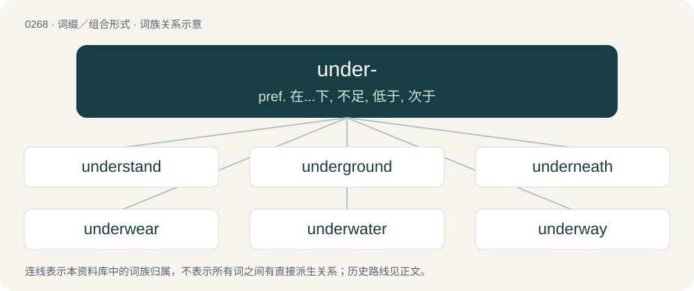

# 0299 · under- — pref. 在...下, 不足, 低于, 次于

[总目录](../00_总目录_按常用程度.md)

**类型**：词缀／组合形式　｜　**来源语言**：见词源记录

## 核心含义与来源

- 核心含义：pref. 在...下, 不足, 低于, 次于
- 英文含义：Beneath, under
- 词形：under-

**来源记录 1**（前缀／前置成分；Beneath, under）

From Middle English under-, from Old English under-, from Proto-West Germanic \*undar, from Proto-Germanic \*under, from Proto-Indo-European \*(H)n̥dʰér (“below”) and \*h₁n̥tér (“inside”). For more, see under.

## 词族图

## 单词速览（常用到不常用）

| 单词 | 音标 | 释义 |
|---|---|---|
| [understand](#w-1) | 英 /ˌʌndəˈstænd/；美 /ˌʌndɚˈstænd/ | vt. 理解, 了解, 领会, 听说, 懂；vi. 懂得, 认为 |
| [underground](#w-2) | 英 /ˌʌn.dəˈɡɹaʊnd/；美 /ˌʌn.dəɹˈɡɹaʊnd/ | n. 地下, 地铁, 地道, 秘密活动；a. 地下的, 秘密的；adv. 在地下, 秘密地 |
| [underneath](#w-3) | 英 /ˌʌndəˈniːθ/；美 /ˌʌndɚˈniθ/ | adv. 在下面；prep. 在...的下面 |
| [underwear](#w-4) | 英 /ˈʌndəwɛə/；美 /ˈʌndɚˌwɛɹ/ | n. 内衣 |
| [underwater](#w-5) | 英 /ʌndə(ɹ)ˈwɔːtə/；美 /ʌndɚˈwɔtəɹ/ | 【英文】To water or irrigate insufficiently. |
| [underway](#w-6) | 英 /ʌndəˈweɪ/；美 /ʌndəɹˈweɪ/ | a. 航行中的；进行中的；起步的 |
| [undergraduate](#w-7) | /.ʌndəˈgrædjuit/ | n. 大学本科生, 大学肄业生；a. 大学生的 |
| [undergo](#w-8) | 英 /ˌʌndəˈɡəʊ/；美 /ˌʌndɚˈɡoʊ/ | vt. 遭受, 经历, 忍受；\[法\] 经受, 经历, 忍受 |
| [undertake](#w-9) | 英 /ˌʌndəˈteɪk/；美 /ˌʌndɚˈteɪk/ | vt. 试图, 从事, 保证, 承担, 同意, 接受；\[化\] 承包; 承担 |
| [underestimate](#w-10) | 美 /ʌndɚˈɛs.tɪ.meɪt/ | n. 低估；vt. 低估, 看轻 |
| [undermine](#w-11) | 英 /ˌʌn.dəˈmaɪn/；美 /ˌʌn.dɚˈmaɪn/ | vt. 在...下面挖, 渐渐破坏, 暗地里破坏；\[法\] 暗中破坏, 以阴谋中伤伤害 |
| [underrated](#w-12) | 英 /ʌn.dəˈɹeɪ.tɪd/；美 /ʌn.dɚˈɹeɪ.təd/ | v. 对（某人或某事物）评价过低( underrate的过去式和过去分词 ) |
| [underage](#w-13) | /ˌʌndəɹˈeɪd͡ʒ/ | a. 未成年的, 未及法定年龄的；n. 缺乏, 不足 |
| [underwood](#w-14) | /ˈʌndəwud/ | n. 下木, 林下灌丛 |
| [underworld](#w-15) | 英 /ˈʌndəˌwɜːld/；美 /ˈʌndɚˌwɚld/ | n. 下层社会, 地狱, 下流社会 |
| [understatement](#w-16) | 英 /ˌʌndəˈsteɪtmənt/；美 /ˌʌndɚˈsteɪtmənt/ | n. 软弱无力的陈述, 克制的说法；\[经\] 少报 |
| [underdog](#w-17) | 英 /ˈʌndəˌdɒɡ/；美 /ˈʌndɚˌdɔɡ/ | n. 斗败了的狗, 失败者, 受害者；\[法\] 受压迫者, 在不健全的社会的受害者 |
| [underside](#w-18) | 英 /ˈʌndəˌsaɪd/；美 /ˈʌndɚˌsaɪd/ | n. 下面, 下侧, 底面 |
| [understated](#w-19) | 英 /ʌndəˈsteɪtɪd/ | a. 轻描淡写的；低调的；朴素的；不夸张的 |
| [undercut](#w-20) | /ˈʌndə(ɹ)kʌt/ | n. 底切, 牛腰部下侧嫩肉, 下口, 下旋削球；vt. 廉价出售, 底切, 雕出, 下旋削球；vi. 切除底部 |
| [underline](#w-21) | 英 /ˈʌndəˌlaɪn/；美 /ˈʌndɚˌlaɪn/ | vt. 在...下面划线, 作...的衬里, 强调；n. 下划线, 图下说明文字；\[计\] 加下划线; 下划线 |
| [underscore](#w-22) | 英 /ˈʌn.dəˌskɔː(ɹ)/；美 /ˈʌn.dɚˌskoɹ/ | vt. 划线于...下；n. (表强调的)下划线；\[计\] 底线 |
| [underpants](#w-23) | /ˈʌndə(ɹ)ˌpænts/ | n. 衬裤, 短衬裤 |
| [underprivileged](#w-24) | /ˈʌndəˈprivilidʒd/ | a. 贫困的, 下层社会的, 被剥夺了正当权利的, 权益较他人为少的；\[法\] 被剥夺基本社会权利的, 穷的 |
| [underrepresented](#w-25) | /ˈʌndə,repriˈzentid/ | a. 未被充分代表的 |
| [undersea](#w-26) | /ˈʌndəsiː/ | a. 海面下的；adv. 在海面下 |
| [underpaid](#w-27) | /,ʌndəˈpeid/ | underpay的过去式和过去分词；\[经\] 未足额支付 |
| [underweight](#w-28) | /ˈʌndəweit/ | n. 重量不足；a. 重量不足的 |
| [undersecretary](#w-29) | /ˈʌndəˈsekritəri/ | n. 次长, 副部长 |
| [underserved](#w-30) | 英 /ˌʌndəˈsɜːvd/；美 /ˌʌndɚˈsɝvd/ | a. 服务不周到的,服务水平低下的 |
| [understudy](#w-31) | 英 /ˈʌndəstʌdi/；美 /ˈʌndɚstʌdi/ | n. 预备演员, 替角；vt. 通过观察掌握某工作, 通过实习掌握某工作；vt.vi. 练习当替角 |
| [underbelly](#w-32) | 英 /ˈʌn.dəˌbɛl.i/；美 /ˈʌn.dɚˌbɛl.i/ | n. 下腹部, 薄弱部分 |
| [underfunded](#w-33) | /ˌʌndəˈfʌndɪd/ | a. 资金不足的 |
| [underlining](#w-34) | /,ʌndəˈlainiŋ/ | 【英文】A lining on the inside of a garment. |
| [underlie](#w-35) | 英 /ˌʌn.dəˈlaɪ/；美 /ˌʌn.dɚˈlaɪ/ | vt. 位于...之下, 成为...的基础 |
| [undercurrent](#w-36) | 英 /ˈʌndəkʌɹ(ə)nt/；美 /ˈʌndɚˌkʌɹənt/ | n. 暗流, 潜流, 电流不足 |
| [undergrowth](#w-37) | 美 /ˈʌndɚˌɡɹoʊθ/ | n. 下层丛林, 生于大树下的矮树, 发育不全 |
| [underpin](#w-38) | 英 /ˌʌn.dəˈpɪn/；美 /ˌʌn.dɚˈpɪn/ | vt. 从下面支承, 支撑, 支持；\[经\] 支撑 |
| [underfoot](#w-39) | 英 /ʌndəˈfʊt/；美 /ʌndɚˈfʊt/ | adv. 在脚下, 碍事地；\[经\] 少计总额 |
| [underclass](#w-40) | /ˈʌndəklæs/ | n. 低年级学生 |
| [underhill](#w-41) |  | 【英文】(of a road, track or other path) passing along the foot of a hill. |
| [undertone](#w-42) | /ˈʌndə(ɹ)təʊn/ | n. 低音, 浅色, 小声 |
| [undersized](#w-43) | /ˈʌndəˈsaizd/ | a. 小于一般尺寸的, 不够大的, 小型的；\[化\] 尺寸过小的 |
| [understaffed](#w-44) | /.ʌndəˈstæft/ | a. 人员不足的, 人手不足的 |
| [underpass](#w-45) | /ˈʌndəpɑːs/ | n. 地道 |
| [undercard](#w-46) |  | 【英文】A list of minor or supporting contests printed on the same bill as the main event (primarily fighting or racing, such as the main fight at a boxing match or wrestling, horse or car racing, etc.), occurring before or  |
| [underwrite](#w-47) | /ˈʌndəɹaɪt/ | vt. 签名于下, 给...保险；vi. 经营保险业 |
| [undercarriage](#w-48) | 英 /ˈʌndəˌkæɹɪd͡ʒ/；美 /ˈʌndɚˌkɛɹɪd͡ʒ/ | n. 底盘, 起落架 |
| [underutilized](#w-49) | /ˌʌndəˈjuːtəlaɪzd/ | a. 未充分利用的 |
| [underhanded](#w-50) | /ˈʌndəˈhændid/ | a. 人手不足的, 秘密的, 卑劣的 |
| [undersigned](#w-51) | /.ʌndəˈsaind/ | a. 下面签过名的 |
| [underemployed](#w-52) | /,ʌndərimˈplɔid/ | a. 只有部分时间被雇用的, 就业不充分的 |
| [undertow](#w-53) | /ˈʌndətəu/ | n. 回头浪 |
| [underarm](#w-54) | 美 /ˈʌndɚˌɑɹm/ | a. 腋下的 |
| [underpowered](#w-55) | /,ʌndəˈpajəd/ | a. 动力不足的, 由动力不足的发动机驱动的 |
| [underperform](#w-56) | /,ʌndəpəˈfɔːm/ | vi.表现不佳,工作不如预期(或同行)；vt.(股票等)运作差于(一般市场价格) |
| [undervalue](#w-57) | /ˌʌndə(ɹ)ˈvælju/ | vt. 低估...之价值, 低估, 看轻；\[经\] 低估, 降低...价值 |
| [underemployment](#w-58) | /,ʌndərimˈplɔimənt/ | n. 不充分就业, 部分时间被雇用, 才能和技术未充分利用 |
| [understate](#w-59) | /ʌndəˈsteɪt/ | v. 不完全地陈述, 保守地说, 有意轻描淡写 |
| [undernourished](#w-60) | /ʌndəˈnʌriʃd/ | a. 营养不足的 |
| [underlay](#w-61) | /ʌndəɹˈleɪ/ | vt. 把...置于另一物之下, 垫起, 从下面支撑；vi. (矿脉)倾斜；n. 放在下面的东西, 衬底, 支撑之物, 衬垫物 |
| [undershirt](#w-62) | /ˈʌndəʃəːt/ | n. 汗衫 |
| [understory](#w-63) | 英 /ˈʌndəstɔːɹi/；美 /ˈʌndɚˌstoɹi/ | 林下叶层 |
| [underwire](#w-64) |  | 【英文】A semicircular wire placed in a bra to support the breasts. |
| [underdevelopment](#w-65) | /,ʌndədiˈveləpmənt/ | n. 发展不充分, 不发达, 显影不足；\[医\] 显影不足; 发育不全 |
| [underfloor](#w-66) |  | \[计\] 地板下 |
| [underbrush](#w-67) | 美 /ˈʌndɚˌbɹʌʃ/ | n. 林下灌丛 |
| [underestimation](#w-68) |  | n. 低估；\[经\] 对...估价过低 |
| [underrate](#w-69) | /.ʌndəˈreit/ | vt. 低估, 对...估计过低, 看轻 |
| [understeer](#w-70) | /ˈʌndəstiə/ | n. 操纵失灵；\[法\] 转向不足, 对驾驶盘反应迟纯 |
| [underinsured](#w-71) | /,ʌndərinˈʃjəd/ | a. 保险(额)不足的 |
| [underperformance](#w-72) |  | 新股弱势 |
| [undercoat](#w-73) | 美 /ˈʌndɚˌkoʊt/ | n. 下层绒毛, 底漆, 内涂层；\[化\] 底漆 |
| [undergarment](#w-74) | 英 /ˈʌndəˌɡɑːmənt/；美 /ˈʌndɚˌɡɑɹmənt/ | n. 内衣, 衬衣 |
| [understudied](#w-75) | /ʌndəɹˈstʌdid/ | v. 练习做临时演员( understudy的过去式和过去分词 ) |
| [underachiever](#w-76) |  | n. 在学习方面未发挥潜力的学生 |
| [underpayment](#w-77) |  | n. 缴付不足；不足工资 |

## 逐词详解

### 1. understand

**词性**：动词　｜　**音标**：英 /ˌʌndəˈstænd/；美 /ˌʌndɚˈstænd/

**中文释义**：vt. 理解, 了解, 领会, 听说, 懂；vi. 懂得, 认为

**英文义项**：To know the meaning of; to parse or have parsed correctly; to comprehend. / To know the meaning of.

**构词拆分**：under- + stand

**词源与演化**：

From Middle English understanden, from Old English understandan (“to understand”), from Proto-West Germanic \*understandan (“to stand between, understand”), from Proto-Germanic \*understandaną (“to stand between, understand”), equivalent to Old English under- (“between, inter-”) + standan (“to stand”) (Modern English under- + stand). Cognate with Old Frisian understonda (“to understand, experience, learn”), Old High German understantan (“to understand”), Middle Danish understande (“to understand”). Compare also Saterland Frisian understunda, unnerstounde (“to dare, survey, measure”), Dutch onderstaan (“to undertake, presume”), German unterstehen (“to be subordinate”).

**例句**：

> I understand that company policy says I can't get a refund, but can you make an exception?

该用例对应义项：To comprehend a fact or principle; to regard or come to regard a belief as such.

### 2. underground

**词性**：形容词　｜　**音标**：英 /ˌʌn.dəˈɡɹaʊnd/；美 /ˌʌn.dəɹˈɡɹaʊnd/

**中文释义**：n. 地下, 地铁, 地道, 秘密活动；a. 地下的, 秘密的；adv. 在地下, 秘密地

**英文义项**：Below the ground; below the surface of the Earth. / Hidden, furtive, secretive.

**构词拆分**：under + ground；under- + ground

**词源与演化**：

From Middle English undergrounde (adverb), equivalent to under + ground or under- + ground. Compare Dutch ondergrond, ondergronds, German Untergrund, Danish undergrunds.

**例句**：

> There is an underground tunnel that takes you across the river.

该用例对应义项：Below the ground; below the surface of the Earth.

### 3. underneath

**词性**：形容词　｜　**音标**：英 /ˌʌndəˈniːθ/；美 /ˌʌndɚˈniθ/

**中文释义**：adv. 在下面；prep. 在...的下面

**英文义项**：Under, lower.

**构词拆分**：under- + neath

**词源与演化**：

From Middle English undernethe, undernethen, from Old English underneoþan (“underneath”), ultimately from Proto-Germanic \*underniþer. Equivalent to under- + neath.

**例句**：

> The underneath part is harder to reach.

该用例对应义项：Under, lower.

### 4. underwear

**词性**：名词　｜　**音标**：英 /ˈʌndəwɛə/；美 /ˈʌndɚˌwɛɹ/

**中文释义**：n. 内衣

**英文义项**：Clothes worn next to the skin, underneath outer clothing. / Underpants (boxers, briefs, panties, etc) and often bras.

**构词拆分**：under- + -wear

**词源与演化**：

From under- + -wear. Compare Dutch ondergoed, German Unterwäsche, Swedish underkläder.

**例句**：

> The only evidence was the traces of semen stuck to the underwear.

### 5. underwater

**词性**：动词　｜　**音标**：英 /ʌndə(ɹ)ˈwɔːtə/；美 /ʌndɚˈwɔtəɹ/

**英文义项**：To water or irrigate insufficiently.

**构词拆分**：under- + water

**词源与演化**：

From under- + water.

**例句**：

> Care must be taken not to underwater houseplants in the summer.

该用例对应义项：To water or irrigate insufficiently.

### 6. underway

**词性**：副词　｜　**音标**：英 /ʌndəˈweɪ/；美 /ʌndəɹˈweɪ/

**中文释义**：a. 航行中的；进行中的；起步的

**英文义项**：In motion, in progress; being done or carried out; on a journey.

**构词拆分**：under- + way

**词源与演化**：

Calque of Dutch onderweg (“underway”), equivalent to under- + way. Compare also German unterwegs.

**例句**：

> As discussions were underway, hundreds of anti-globalisation protesters clashed with riot police.

### 7. undergraduate

**词性**：形容词　｜　**音标**：/.ʌndəˈgrædjuit/

**中文释义**：n. 大学本科生, 大学肄业生；a. 大学生的

**英文义项**：Of, relating to, or being an undergraduate.

**构词拆分**：under- + graduate

**词源与演化**：

From under- + graduate.

**例句**：

> After completing my undergraduate studies, I embarked on a career in publishing.

该用例对应义项：Of, relating to, or being an undergraduate.

### 8. undergo

**词性**：动词　｜　**音标**：英 /ˌʌndəˈɡəʊ/；美 /ˌʌndɚˈɡoʊ/

**中文释义**：vt. 遭受, 经历, 忍受；\[法\] 经受, 经历, 忍受

**英文义项**：To experience; to pass through a phase. / To suffer or endure; bear with.

**构词拆分**：under- + go

**词源与演化**：

From Middle English undergon, from Old English undergān (“to undergo, undermine, ruin”), equivalent to under- + go. Cognate with Dutch ondergaan (“to undergo, perish, sink”), German untergehen (“to perish, sink, undergo”), Swedish undergå (“to undergo, go through”).

**例句**：

> She had to undergo surgery because of her broken leg.

该用例对应义项：To suffer or endure; bear with.

### 9. undertake

**词性**：动词　｜　**音标**：英 /ˌʌndəˈteɪk/；美 /ˌʌndɚˈteɪk/

**中文释义**：vt. 试图, 从事, 保证, 承担, 同意, 接受；\[化\] 承包; 承担

**英文义项**：To take upon oneself; to start, to embark on. / To commit oneself (to an obligation, activity etc.).

**构词拆分**：under- + take

**词源与演化**：

From Middle English undertaken; equivalent to under- + take (after undernim).

**例句**：

> It requires a very unusual mind to undertake the analysis of the obvious.

### 10. underestimate

**词性**：动词　｜　**音标**：美 /ʌndɚˈɛs.tɪ.meɪt/

**中文释义**：n. 低估；vt. 低估, 看轻

**英文义项**：To estimate too low; to perceive (someone or something) as having a lower value, quantity, worth, etc., than what he/she/it actually has. / To perceive or expect (someone or something) to be less significant or difficult than it actually is.

**构词拆分**：under- + estimate

**词源与演化**：

From under- + estimate.

**例句**：

> Don't underestimate the danger of such a raft trip on this river.

该用例对应义项：make too low an estimate of

### 11. undermine

**词性**：动词　｜　**音标**：英 /ˌʌn.dəˈmaɪn/；美 /ˌʌn.dɚˈmaɪn/

**中文释义**：vt. 在...下面挖, 渐渐破坏, 暗地里破坏；\[法\] 暗中破坏, 以阴谋中伤伤害

**英文义项**：To dig underneath (something), to make a passage for destructive or military purposes; to sap. / To weaken or work against; to hinder, sabotage.

**构词拆分**：under- + mine

**词源与演化**：

From under- + mine.

**例句**：

> Billy's cruel comments undermine the efforts of non-native speakers to communicate effectively.

### 12. underrated

**词性**：形容词　｜　**音标**：英 /ʌn.dəˈɹeɪ.tɪd/；美 /ʌn.dɚˈɹeɪ.təd/

**中文释义**：v. 对（某人或某事物）评价过低( underrate的过去式和过去分词 )

**英文义项**：Not given enough recognition for its quality.

**构词拆分**：under- + rated

**词源与演化**：

From under- + rated.

**例句**：

> Gotta say, a water pitcher is an underrated and underused option these days.

### 13. underage

**词性**：形容词　｜　**音标**：/ˌʌndəɹˈeɪd͡ʒ/

**中文释义**：a. 未成年的, 未及法定年龄的；n. 缺乏, 不足

**英文义项**：Below the legal age (usually age 18 or 21) for some activity, such as consuming alcohol or engaging in sexual intercourse. / Not yet a legal adult; still a minor.

**构词拆分**：under- + age

**词源与演化**：

From under- + age.

**例句**：

> The bar was fined for serving alcohol to an underage customer.

该用例对应义项：Below the legal age (usually age 18 or 21) for some activity, such as consuming alcohol or engaging in sexual intercourse.

### 14. underwood

**词性**：名词　｜　**音标**：/ˈʌndəwud/

**中文释义**：n. 下木, 林下灌丛

**英文义项**：Underbrush, undergrowth.

**构词拆分**：under- + wood

**词源与演化**：

From under- + wood.

**例句**：

> This is Carrie Underwood's latest album.

### 15. underworld

**词性**：名词　｜　**音标**：英 /ˈʌndəˌwɜːld/；美 /ˈʌndɚˌwɚld/

**中文释义**：n. 下层社会, 地狱, 下流社会

**英文义项**：The world of the dead, located underneath the world of the living; the afterlife. / That part of society that is engaged in crime or vice, and particularly those involved in organized crime.

**构词拆分**：under- + world

**词源与演化**：

From under- + world.

**例句**：

> In Hindu scriptures, the four-eyed dogs Śārvara and Śyāma guard the underworld's entrance.

该用例对应义项：The world of the dead, located underneath the world of the living; the afterlife.

### 16. understatement

**词性**：名词　｜　**音标**：英 /ˌʌndəˈsteɪtmənt/；美 /ˌʌndɚˈsteɪtmənt/

**中文释义**：n. 软弱无力的陈述, 克制的说法；\[经\] 少报

**英文义项**：A figure of speech whereby something is made to seem smaller or less important than it actually is, either through phrasing or lack of emphasis, often for ironic effect. / An instance of such phrasing or lack of emphasis; an incomplete statement.

**构词拆分**：under- + statement；understate + -ment

**词源与演化**：

From under- + statement or understate + -ment.

**例句**：

> Now that's an understatement.

该用例对应义项：An instance of such phrasing or lack of emphasis; an incomplete statement.

### 17. underdog

**词性**：名词　｜　**音标**：英 /ˈʌndəˌdɒɡ/；美 /ˈʌndɚˌdɔɡ/

**中文释义**：n. 斗败了的狗, 失败者, 受害者；\[法\] 受压迫者, 在不健全的社会的受害者

**英文义项**：A competitor thought unlikely to win. / Somebody at a disadvantage.

**构词拆分**：under- + dog

**词源与演化**：

From under- + dog.

**例句**：

> They were the underdogs in the basketball competition.

该用例对应义项：A competitor thought unlikely to win.

### 18. underside

**词性**：名词　｜　**音标**：英 /ˈʌndəˌsaɪd/；美 /ˈʌndɚˌsaɪd/

**中文释义**：n. 下面, 下侧, 底面

**英文义项**：The side that is below or underneath, the bottom.

**构词拆分**：under- + side

**词源与演化**：

From under- + side.

**例句**：

> A spider can produce a silky substance from tiny openings on its underside.

### 19. understated

**词性**：形容词　｜　**音标**：英 /ʌndəˈsteɪtɪd/

**中文释义**：a. 轻描淡写的；低调的；朴素的；不夸张的

**英文义项**：Restrained and unpretentious.

**构词拆分**：under- + stated

**词源与演化**：

From under- + stated.

**例句**：

> The room is pleasant and understated.

该用例对应义项：exhibiting restrained good taste

### 20. undercut

**词性**：名词　｜　**音标**：/ˈʌndə(ɹ)kʌt/

**中文释义**：n. 底切, 牛腰部下侧嫩肉, 下口, 下旋削球；vt. 廉价出售, 底切, 雕出, 下旋削球；vi. 切除底部

**英文义项**：A cut made in the lower part of something; the material so removed. / The notch cut in a tree to direct its fall when being felled.

**构词拆分**：under- + cut

**词源与演化**：

From Middle English undercutten, equivalent to under- + cut.

**例句**：

> These challenges could undercut efforts by many African countries to increase agricultural production.

### 21. underline

**词性**：动词　｜　**音标**：英 /ˈʌndəˌlaɪn/；美 /ˈʌndɚˌlaɪn/

**中文释义**：vt. 在...下面划线, 作...的衬里, 强调；n. 下划线, 图下说明文字；\[计\] 加下划线; 下划线

**英文义项**：To draw a line underneath something, especially to add emphasis. / To emphasise or stress something.

**构词拆分**：under- + line

**词源与演化**：

From under- + line.

**用法示例／搭配（非完整句）**：

> underline the important words in the text

该用例对应义项：To draw a line underneath something, especially to add emphasis.

### 22. underscore

**词性**：动词　｜　**音标**：英 /ˈʌn.dəˌskɔː(ɹ)/；美 /ˈʌn.dɚˌskoɹ/

**中文释义**：vt. 划线于...下；n. (表强调的)下划线；\[计\] 底线

**英文义项**：To underline; to mark a line beneath text. / To emphasize or draw attention to.

**构词拆分**：under- + score

**词源与演化**：

From under- + score.

**例句**：

> I wish to underscore the importance of proper formatting.

该用例对应义项：To emphasize or draw attention to.

### 23. underpants

**词性**：名词　｜　**音标**：/ˈʌndə(ɹ)ˌpænts/

**中文释义**：n. 衬裤, 短衬裤

**英文义项**：Underwear covering the genitalia and often buttocks, usually going no higher than the navel.

**构词拆分**：under- + pants

**词源与演化**：

From under- + pants.

**例句**：

> Rabinovich, you either put on some underpants or take off the cross!

### 24. underprivileged

**词性**：形容词　｜　**音标**：/ˈʌndəˈprivilidʒd/

**中文释义**：a. 贫困的, 下层社会的, 被剥夺了正当权利的, 权益较他人为少的；\[法\] 被剥夺基本社会权利的, 穷的

**英文义项**：Deprived of the opportunities and advantages of others, usually through no fault of one's own.

**构词拆分**：under- + privileged

**词源与演化**：

From under- + privileged.

**例句**：

> The underprivileged beggar was not eligible for financial aid.

### 25. underrepresented

**词性**：形容词　｜　**音标**：/ˈʌndə,repriˈzentid/

**中文释义**：a. 未被充分代表的

**英文义项**：Having less than adequate or sufficient representation.

**构词拆分**：under- + represented

**词源与演化**：

From under- + represented.

**例句**：

> Black women and women of color have long been underrepresented in elected office.

### 26. undersea

**词性**：形容词　｜　**音标**：/ˈʌndəsiː/

**中文释义**：a. 海面下的；adv. 在海面下

**英文义项**：Existing, relating to, or made for use beneath the sea, that is, beneath the sea surface, inside the sea.

**构词拆分**：under- + sea

**词源与演化**：

From under- + sea.

**例句**：

> A tsunami is a series of waves caused by earthquakes or undersea volcanic eruptions.

### 27. underpaid

**词性**：形容词　｜　**音标**：/,ʌndəˈpeid/

**中文释义**：underpay的过去式和过去分词；\[经\] 未足额支付

**英文义项**：Getting too little financial compensation for one's work.

**构词拆分**：under- + paid

**词源与演化**：

From under- + paid.

**例句**：

> I am underpaid and overworked.

该用例对应义项：Getting too little financial compensation for one's work.

### 28. underweight

**词性**：形容词　｜　**音标**：/ˈʌndəweit/

**中文释义**：n. 重量不足；a. 重量不足的

**英文义项**：Of an inappropriately or unusually low weight. / Not too heavy for an intended purpose.

**构词拆分**：under- + weight

**词源与演化**：

From under- + weight.

**例句**：

> The suitcase is just slightly underweight; I'll let it on the plane.

该用例对应义项：Not too heavy for an intended purpose.

### 29. undersecretary

**词性**：名词　｜　**音标**：/ˈʌndəˈsekritəri/

**中文释义**：n. 次长, 副部长

**英文义项**：An administrator immediately subordinate to a head of a government department or to a member of a cabinet / An assistant or deputy secretary of a government department

**构词拆分**：under- + secretary

**词源与演化**：

From under- + secretary.

### 30. underserved

**词性**：形容词　｜　**音标**：英 /ˌʌndəˈsɜːvd/；美 /ˌʌndɚˈsɝvd/

**中文释义**：a. 服务不周到的,服务水平低下的

**英文义项**：Underresourced; not having sufficient service. / Disadvantaged with regard to health services because of inability to pay, inability to access care, or other disparities for reasons of race, religion, language group or social status.

**构词拆分**：under- + served

**词源与演化**：

From under- + served.

**例句**：

> Many families who live paycheck-to-paycheck are currently underserved by the financial services industry.

该用例对应义项：Underresourced; not having sufficient service.

### 31. understudy

**词性**：动词　｜　**音标**：英 /ˈʌndəstʌdi/；美 /ˈʌndɚstʌdi/

**中文释义**：n. 预备演员, 替角；vt. 通过观察掌握某工作, 通过实习掌握某工作；vt.vi. 练习当替角

**英文义项**：To study or know a role to such an extent as to be able to replace the normal performer when required. / To act as an understudy (to someone).

**构词拆分**：under- + study

**词源与演化**：

From under- + study.

**例句**：

> She was such a big star that she wouldn't allow an understudy.

### 32. underbelly

**词性**：名词　｜　**音标**：英 /ˈʌn.dəˌbɛl.i/；美 /ˈʌn.dɚˌbɛl.i/

**中文释义**：n. 下腹部, 薄弱部分

**英文义项**：The underside of an animal. / The underside of any thing.

**构词拆分**：under- + belly

**词源与演化**：

From under- + belly.

**例句**：

> The area by the canal is the underbelly of town – not something you’d see in the guidebooks.

该用例对应义项：The side which is not normally seen, normally a dark, immoral place.

### 33. underfunded

**词性**：形容词　｜　**音标**：/ˌʌndəˈfʌndɪd/

**中文释义**：a. 资金不足的

**英文义项**：Insufficiently funded.

**构词拆分**：under- + funded

**词源与演化**：

From under- + funded.

### 34. underlining

**词性**：名词　｜　**音标**：/,ʌndəˈlainiŋ/

**英文义项**：A lining on the inside of a garment.

**构词拆分**：under- + lining

**词源与演化**：

From under- + lining.

### 35. underlie

**词性**：动词　｜　**音标**：英 /ˌʌn.dəˈlaɪ/；美 /ˌʌn.dɚˈlaɪ/

**中文释义**：vt. 位于...之下, 成为...的基础

**英文义项**：To lie in a position directly beneath something. / To lie under or beneath.

**构词拆分**：under- + lie

**词源与演化**：

From Middle English underlien, underliggen, from Old English underliċġan (“to underlie, to be subject to, give way to”), equivalent to under- + lie. Cognate with Dutch onderliggen (“to lie below, lie on the bottom of”), German unterliegen (“to lie under, be subject to, succumb”).

**例句**：

> A stratum of clay underlies the surface gravel.

该用例对应义项：To lie under or beneath.

### 36. undercurrent

**词性**：名词　｜　**音标**：英 /ˈʌndəkʌɹ(ə)nt/；美 /ˈʌndɚˌkʌɹənt/

**中文释义**：n. 暗流, 潜流, 电流不足

**英文义项**：A current of water which flows under the surface, and often in a different direction from surface currents. / A tendency of feeling or opinion that is concealed rather than exposed.

**构词拆分**：under- + current

**词源与演化**：

From under- + current.

**例句**：

> The meeting was pervaded with an undercurrent of dread, as the managers tried not to admit that firings were looming.

该用例对应义项：A tendency of feeling or opinion that is concealed rather than exposed.

### 37. undergrowth

**词性**：名词　｜　**音标**：美 /ˈʌndɚˌɡɹoʊθ/

**中文释义**：n. 下层丛林, 生于大树下的矮树, 发育不全

**英文义项**：The plants in a forest which only reach a relatively low height (such as shrubs and bushes).

**构词拆分**：under- + growth

**词源与演化**：

From under- + growth. Cognate with West Frisian ûndergroei (“undergrowth”).

**例句**：

> The forest floor was covered with dense undergrowth.

该用例对应义项：The plants in a forest which only reach a relatively low height (such as shrubs and bushes).

### 38. underpin

**词性**：动词　｜　**音标**：英 /ˌʌn.dəˈpɪn/；美 /ˌʌn.dɚˈpɪn/

**中文释义**：vt. 从下面支承, 支撑, 支持；\[经\] 支撑

**英文义项**：To support from below with props or masonry. / To give support to; to form a basis of; to corroborate.

**构词拆分**：under- + pin

**词源与演化**：

From under- + pin.

**例句**：

> You should underpin the mine roof to prevent further collapse.

该用例对应义项：To support from below with props or masonry.

### 39. underfoot

**词性**：形容词　｜　**音标**：英 /ʌndəˈfʊt/；美 /ʌndɚˈfʊt/

**中文释义**：adv. 在脚下, 碍事地；\[经\] 少计总额

**英文义项**：Situated under one's foot or feet. / In the way; placed so as to obstruct or hinder.

**构词拆分**：under- + foot

**词源与演化**：

From Middle English underfoote, underfote, equivalent to under- + foot. Cognate with Middle Dutch ondervoet (“underfoot”). Compare also Middle Low German undervôt (“pedestal, base”).

**例句**：

> I'll kill you! Knock your block off and grind you underfoot! You shithead! Die!

### 40. underclass

**词性**：名词　｜　**音标**：/ˈʌndəklæs/

**中文释义**：n. 低年级学生

**英文义项**：The poorest class of people in a given society.

**构词拆分**：under- + class

**词源与演化**：

From under- + class.

**例句**：

> Capitalism does not allow everyone to succeed; it requires an underclass.

### 41. underhill

**词性**：形容词

**英文义项**：(of a road, track or other path) passing along the foot of a hill.

**构词拆分**：under- + hill

**词源与演化**：

From under- + hill.

**例句**：

> There's an underhill lane you can walk along there.

该用例对应义项：(of a road, track or other path) passing along the foot of a hill.

### 42. undertone

**词性**：名词　｜　**音标**：/ˈʌndə(ɹ)təʊn/

**中文释义**：n. 低音, 浅色, 小声

**英文义项**：An auditory tone of low pitch or volume. / An implicit message perceived subtly alongside, but not detracting noticeably from, the explicit message conveyed in or by a book, film, speech or similar (contrast with overtone); an undercurrent.

**构词拆分**：under- + tone

**词源与演化**：

From under- + tone.

**例句**：

> His warm undertone means that he can pull of gold jewlery.

### 43. undersized

**词性**：形容词　｜　**音标**：/ˈʌndəˈsaizd/

**中文释义**：a. 小于一般尺寸的, 不够大的, 小型的；\[化\] 尺寸过小的

**英文义项**：below the usual or expected size

**构词拆分**：under- + sized

**词源与演化**：

From under- + sized.

### 44. understaffed

**词性**：形容词　｜　**音标**：/.ʌndəˈstæft/

**中文释义**：a. 人员不足的, 人手不足的

**英文义项**：having an inadequate number of workers or assistants

**构词拆分**：under- + staffed

**词源与演化**：

From under- + staffed.

**例句**：

> Overcrowded and understaffed hospitals.

该用例对应义项：inadequate in number of workers or assistants etc.

### 45. underpass

**词性**：名词　｜　**音标**：/ˈʌndəpɑːs/

**中文释义**：n. 地道

**英文义项**：A passage, especially for pedestrians, that crosses underneath a road, railroad or obstacle.

**构词拆分**：under- + pass

**词源与演化**：

From under- + pass.

**例句**：

> Tom was lying on a cardboard in an underpass, looking shabby.

### 46. undercard

**词性**：名词

**英文义项**：A list of minor or supporting contests printed on the same bill as the main event (primarily fighting or racing, such as the main fight at a boxing match or wrestling, horse or car racing, etc.), occurring before or after the main event. / The events so listed.

**构词拆分**：under- + card

**词源与演化**：

From under- + card.

**用法示例／搭配（非完整句）**：

> The eight on the turn was another undercard to her pair of nines

该用例对应义项：A card lower than another given card or pair.

### 47. underwrite

**词性**：动词　｜　**音标**：/ˈʌndəɹaɪt/

**中文释义**：vt. 签名于下, 给...保险；vi. 经营保险业

**英文义项**：To write below or under; subscribe. / To sign; to put one's name to.

**构词拆分**：By surface analysis, under- + write

**词源与演化**：

From Middle English underwriten, from Old English underwrītan (“to write at the foot of, write under, subscribe”). Compare Dutch onderschrijven (“to endorse”), German unterschreiben (“to sign; endorse”), Danish underskrive (“to sign; endorse”). By surface analysis, under- + write.

**例句**：

> Not every company can afford to underwrite such an expensive event.

### 48. undercarriage

**词性**：名词　｜　**音标**：英 /ˈʌndəˌkæɹɪd͡ʒ/；美 /ˈʌndɚˌkɛɹɪd͡ʒ/

**中文释义**：n. 底盘, 起落架

**英文义项**：The supporting structural framework of a land vehicle (such as a car, truck, van, wagon, etc). / The landing gear of an aircraft.

**构词拆分**：under- + carriage

**词源与演化**：

From under- + carriage.

### 49. underutilized

**词性**：形容词　｜　**音标**：/ˌʌndəˈjuːtəlaɪzd/

**中文释义**：a. 未充分利用的

**英文义项**：Insufficiently utilized.

**构词拆分**：under- + utilized

**词源与演化**：

From under- + utilized.

**例句**：

> Software-defined radios like cognitive radio use artificial intelligence to employ underutilized portions of the electromagnetic spectrum without human intervention.

### 50. underhanded

**词性**：形容词　｜　**音标**：/ˈʌndəˈhændid/

**中文释义**：a. 人手不足的, 秘密的, 卑劣的

**英文义项**：Done by moving the hand (and arm) from below. / Sly, dishonest, corrupt, cheating.

**构词拆分**：under- + handed

**词源与演化**：

From under- + handed.

**例句**：

> His underhanded trick backfired and he was disqualified.

该用例对应义项：Sly, dishonest, corrupt, cheating.

### 51. undersigned

**词性**：名词　｜　**音标**：/.ʌndəˈsaind/

**中文释义**：a. 下面签过名的

**英文义项**：A person, mentioned in a document, whose name and signature appears at the end.

**构词拆分**：under- + signed

**词源与演化**：

From under- + signed.

**用法示例／搭配（非完整句）**：

> we the undersigned

该用例对应义项：A person, mentioned in a document, whose name and signature appears at the end.

### 52. underemployed

**词性**：形容词　｜　**音标**：/,ʌndərimˈplɔid/

**中文释义**：a. 只有部分时间被雇用的, 就业不充分的

**英文义项**：Employed in a job that offers fewer work hours than desired.

**构词拆分**：under- + employed

**词源与演化**：

From under- + employed.

**例句**：

> I found myself underemployed when the company downgraded me from full-time to part-time.

该用例对应义项：Employed in a job that offers fewer work hours than desired.

### 53. undertow

**词性**：名词　｜　**音标**：/ˈʌndətəu/

**中文释义**：n. 回头浪

**英文义项**：A short-range flow of water returning seaward from the waves breaking on the shore. / A feeling that runs contrary to one's normal one.

**构词拆分**：under- + tow

**词源与演化**：

From under- + tow.

**例句**：

> A strong undertow may sweep a returning swimmer off their feet but it does not carry them far from the shore.

该用例对应义项：A short-range flow of water returning seaward from the waves breaking on the shore.

### 54. underarm

**词性**：名词　｜　**音标**：美 /ˈʌndɚˌɑɹm/

**中文释义**：a. 腋下的

**英文义项**：The armpit. / Old-fashioned and now outlawed style of bowling in which the arm is not swung over the shoulder.

**构词拆分**：under- + arm

**词源与演化**：

From under- + arm. The armpit sense is not old, historically speaking (1920s), and it is believed to have arisen as a euphemism in advertising.

**用法示例／搭配（非完整句）**：

> underarm deodorant

该用例对应义项：The armpit.

### 55. underpowered

**词性**：形容词　｜　**音标**：/,ʌndəˈpajəd/

**中文释义**：a. 动力不足的, 由动力不足的发动机驱动的

**英文义项**：Having insufficient power for its operation. / Not powerful enough.

**构词拆分**：under- + powered

**词源与演化**：

From under- + powered.

**例句**：

> Wizards are underpowered even though they start off with two magic spells.

该用例对应义项：Not powerful enough.

### 56. underperform

**词性**：动词　｜　**音标**：/,ʌndəpəˈfɔːm/

**中文释义**：vi.表现不佳,工作不如预期(或同行)；vt.(股票等)运作差于(一般市场价格)

**英文义项**：To underachieve; to fail to reach standards or expectations, especially with respect to a financial investment.

**构词拆分**：under- + perform

**词源与演化**：

From under- + perform.

### 57. undervalue

**词性**：动词　｜　**音标**：/ˌʌndə(ɹ)ˈvælju/

**中文释义**：vt. 低估...之价值, 低估, 看轻；\[经\] 低估, 降低...价值

**英文义项**：To underestimate, or assign too low a value to (something or someone); to have too little regard for.

**构词拆分**：under- + value

**词源与演化**：

From under- + value.

**例句**：

> Does Algeria need to undervalue its exchange rate?

### 58. underemployment

**词性**：名词　｜　**音标**：/,ʌndərimˈplɔimənt/

**中文释义**：n. 不充分就业, 部分时间被雇用, 才能和技术未充分利用

**英文义项**：The condition of being underemployed.

**构词拆分**：under- + employment

**词源与演化**：

From under- + employment.

### 59. understate

**词性**：动词　｜　**音标**：/ʌndəˈsteɪt/

**中文释义**：v. 不完全地陈述, 保守地说, 有意轻描淡写

**英文义项**：To state (something) with less completeness than needed; to minimise or downplay. / To state (something) with an intentional lack of emphasis, in order to express irony.

**构词拆分**：under- + state

**词源与演化**：

From under- + state.

**例句**：

> To call this decision a calculated bet understates the risk; it is a Hail Mary pass.

该用例对应义项：To state (something) with less completeness than needed; to minimise or downplay.

### 60. undernourished

**词性**：形容词　｜　**音标**：/ʌndəˈnʌriʃd/

**中文释义**：a. 营养不足的

**英文义项**：Provided with insufficient nourishment to sustain proper health and growth.

**构词拆分**：under- + nourished

**词源与演化**：

From under- + nourished.

**例句**：

> I found him undernourished and emaciated.

### 61. underlay

**词性**：动词　｜　**音标**：/ʌndəɹˈleɪ/

**中文释义**：vt. 把...置于另一物之下, 垫起, 从下面支撑；vi. (矿脉)倾斜；n. 放在下面的东西, 衬底, 支撑之物, 衬垫物

**英文义项**：To lay (something) underneath something else; to put under. / To provide a support for something; to raise or support by something laid under.

**构词拆分**：under- + lay

**词源与演化**：

From Middle English underleyen, from Old English underleċġan (“to underlay, prop, support”), equivalent to under- + lay. Cognate with Dutch onderleggen (“to lay or put under”), German unterlegen (“to underlay”), Swedish underlägga (“to underlay”).

**例句**：

> Underlay the boards with joists.

该用例对应义项：provide with a base, support, lining, or backing

### 62. undershirt

**词性**：名词　｜　**音标**：/ˈʌndəʃəːt/

**中文释义**：n. 汗衫

**英文义项**：An undergarment worn beneath a shirt, often collarless and sleeveless.

**构词拆分**：under- + shirt

**词源与演化**：

From under- + shirt.

**例句**：

> He put on his undershirt inside out.

### 63. understory

**词性**：名词　｜　**音标**：英 /ˈʌndəstɔːɹi/；美 /ˈʌndɚˌstoɹi/

**中文释义**：林下叶层

**英文义项**：A story of a building below the stories generally used for residence or work. / The (layer of) plants that grow in the shade of the canopy of a forest above the forest floor.

**构词拆分**：under- (prefix meaning ‘beneath, under’) + story (“a floor or level”)

**词源与演化**：

From under- (prefix meaning ‘beneath, under’) + story (“a floor or level”).

### 64. underwire

**词性**：名词

**英文义项**：A semicircular wire placed in a bra to support the breasts. / A bra that includes such wires.

**构词拆分**：under- + wire

**词源与演化**：

From under- + wire.

### 65. underdevelopment

**词性**：名词　｜　**音标**：/,ʌndədiˈveləpmənt/

**中文释义**：n. 发展不充分, 不发达, 显影不足；\[医\] 显影不足; 发育不全

**英文义项**：The condition of being underdeveloped.

**构词拆分**：under- + development

**词源与演化**：

From under- + development.

**例句**：

> How is Algeria fighting its way out of underdevelopment?

### 66. underfloor

**词性**：形容词

**中文释义**：\[计\] 地板下

**英文义项**：Located beneath the floor.

**构词拆分**：under- + floor

**词源与演化**：

From under- + floor.

**例句**：

> This photo shows underfloor heating during its installation.

### 67. underbrush

**词性**：名词　｜　**音标**：美 /ˈʌndɚˌbɹʌʃ/

**中文释义**：n. 林下灌丛

**英文义项**：The small trees and other plants that clutter the floor of a forest.

**构词拆分**：under- + brush

**词源与演化**：

From under- + brush.

**例句**：

> Fyodor heard the hyena moving through the underbrush.

### 68. underestimation

**词性**：名词

**中文释义**：n. 低估；\[经\] 对...估价过低

**英文义项**：The act of underestimating. / An underestimate.

**构词拆分**：under- + estimation

**词源与演化**：

From under- + estimation.

### 69. underrate

**词性**：动词　｜　**音标**：/.ʌndəˈreit/

**中文释义**：vt. 低估, 对...估计过低, 看轻

**英文义项**：To underestimate; to make too low a rate or estimate.

**构词拆分**：under- + rate

**词源与演化**：

From under- + rate.

**例句**：

> There is no duty we so much underrate as the duty of being happy.

### 70. understeer

**词性**：名词　｜　**音标**：/ˈʌndəstiə/

**中文释义**：n. 操纵失灵；\[法\] 转向不足, 对驾驶盘反应迟纯

**英文义项**：The condition in which the front wheels of a car fail to follow the desired curve while cornering, instead following more of a straight-line trajectory, losing a degree of traction, and so slipping off the required line.

**构词拆分**：under- + steer

**词源与演化**：

From under- + steer.

**例句**：

> FWD vehicles have the tendency to understeer.

### 71. underinsured

**词性**：形容词　｜　**音标**：/,ʌndərinˈʃjəd/

**中文释义**：a. 保险(额)不足的

**英文义项**：not having sufficient insurance to cover loss or damage / not having proper health insurance

**构词拆分**：under- + insured

**词源与演化**：

From under- + insured.

### 72. underperformance

**词性**：名词

**中文释义**：新股弱势

**英文义项**：The state or quality of underperforming

**构词拆分**：under- + performance

**词源与演化**：

From under- + performance.

**例句**：

> While celebrating girls' achievements is important, it's equally important to address the root causes of boys' underperformance.

### 73. undercoat

**词性**：名词　｜　**音标**：美 /ˈʌndɚˌkoʊt/

**中文释义**：n. 下层绒毛, 底漆, 内涂层；\[化\] 底漆

**英文义项**：A layer of short hairs underneath the longer ones of an animal's fur. / A coat of paint or other material applied onto a surface before that of a topcoat; sometimes, a coloured primer.

**构词拆分**：under- + coat

**词源与演化**：

From under- + coat.

**例句**：

> Whether you first paint this wood with primer or undercoat, when you add this topcoat, you'll end up with the same result.

### 74. undergarment

**词性**：名词　｜　**音标**：英 /ˈʌndəˌɡɑːmənt/；美 /ˈʌndɚˌɡɑɹmənt/

**中文释义**：n. 内衣, 衬衣

**英文义项**：Any garment worn underneath others, especially one worn next to the skin; an item of underwear. / Temple garments worn by the followers of the Church of Jesus Christ of Latter-day Saints.

**构词拆分**：under- + garment

**词源与演化**：

From under- + garment.

**例句**：

> Santiago wanted to sleep with no undergarment.

### 75. understudied

**词性**：形容词　｜　**音标**：/ʌndəɹˈstʌdid/

**中文释义**：v. 练习做临时演员( understudy的过去式和过去分词 )

**英文义项**：Insufficiently studied.

**构词拆分**：under- + studied

**词源与演化**：

From under- + studied.

### 76. underachiever

**词性**：名词

**中文释义**：n. 在学习方面未发挥潜力的学生

**英文义项**：One who underachieves, i.e. performs less well than expected.

**构词拆分**：underachieve + -er；under- + achiever

**词源与演化**：

From underachieve + -er or under- + achiever.

**例句**：

> Tom has been an underachiever all his life.

### 77. underpayment

**词性**：名词

**中文释义**：n. 缴付不足；不足工资

**英文义项**：An insufficient payment / The act of making such a payment

**构词拆分**：under- + payment

**词源与演化**：

From under- + payment.
