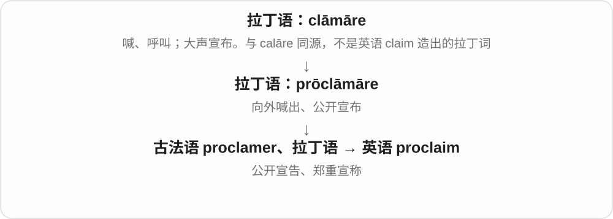

# 0304 · pro- — 向前；提前；代替、代表

[逐词精讲目录](../00_逐词精讲目录.md) · [总目录](../00_总目录_按常用程度.md)

## 核心词根与来源

本页以拉丁 pro- 为主，先抓“在前、向前”的空间画面，再看它怎样走向提前安排、代表或代替。它的含义随历史组合而变，不能见到 pro- 就一律翻成专业或赞成。

**PRO = FORWARD**

朝前推一步：可以把船往前推，也可以把准备提前做；若把任务推到明天，却成了拖延。

- **朝前推进**：propel、propulsion、propeller、propellant、proceed、progress、project、promote
- **把事情先放到前面**：provide、proclaim、provoke
- **代替与往后推迟**：pronoun、procrastinate、procrastination、procrastinator
- **promote → promoting：往前推动**：promote · promoting · promotion
- **promote → promoted：向前推，得到提升**：promote · promoted · promoting
- **proceed → proceeded：继续进行**：proceed · proceeded
- **procrastinate：总把事情推到明天**：procrastinate · procrastinates · procrastinated · procrastinating · procrastination · procrastinator · procrastinators

## 词形与演化规律

pro- 在 propel 中是向前，在 provide 的历史拆解中是预先，在 pronoun 中是代替。希腊语也有同源的 pro-，但每个英语词的借入路线要分别看；这里不把二者混成同一直接来源。

拉丁 pro- 与 movere、promot- 材料，英语去 e 加 ing。

拉丁 pro 与 movere 到 promot- 词干，英语过去式在 t 后读 id。

不是 precede 先于，拼写与重音区分。

拉丁 pro 向前与 crastinus 明天的组成 procrastinare；英语动词可能由较早名词逆构，也可能接拉丁分词。学习先看动词，不表示英语历史上动词必先于名词。

## 单词速览（按词族由简到繁）

同一基础词的相关扩展放在一起，先读基础形式，再读扩展；各组之间优先读常用的。具体词源关系见各词讲解。

| 单词 | 音标 | 核心意思 |
|---|---|---|
| [project](#w-1) | 名词：英 /ˈprɒdʒekt/，美 /ˈprɑːdʒekt/；动词 /prəˈdʒekt/ | 项目；计划；投射；预计；突出 |
| [provide](#w-2) | /prəˈvaɪd/ | 提供；供养；作出规定 |
| [progress](#w-3) | 名词：英 /ˈprəʊɡres/、美 /ˈprɑːɡres/；动词 /prəˈɡres/ | 进展；进步；向前发展 |
| [promote](#w-4) | 英 /prəˈməʊt/；美 /prəˈmoʊt/ | 促进；推广；晋升 |
| [promotion](#w-16) | 英 /prəˈməʊʃən/；美 /prəˈmoʊʃən/ | 晋升；推广；促销活动 |
| [promoting](#w-17) | 英 /prəˈməʊtɪŋ/；美 /prəˈmoʊtɪŋ/ | 推广、促进；晋升、提升〔现在分词、动名词〕 |
| [promoted](#w-18) | 英 /prəˈməʊtɪd/；美 /prəˈmoʊtɪd/ | 提拔、推广、促进了〔过去式、过去分词〕 |
| [proceed](#w-5) | /prəˈsiːd/ | 继续；接着做；前往 |
| [proceeded](#w-19) | /prəˈsiːdɪd/ | 继续进行了、接着做了；前往了〔过去式、过去分词〕 |
| [provoke](#w-6) | 英 /prəˈvəʊk/；美 /prəˈvoʊk/ | 激起；惹怒；挑衅 |
| [propulsion](#w-7) | /prəˈpʌlʃən/ | 推进；推进力；推进系统 |
| [propel](#w-11) | /prəˈpel/ | 推进；驱动；推动发展 |
| [propeller](#w-8) | 英 /prəˈpelə/；美 /prəˈpelər/ | 螺旋桨；推进器 |
| [propellant](#w-13) | /prəˈpelənt/ | 推进剂；喷射剂；推进的 |
| [proclaim](#w-9) | 英 /prəʊˈkleɪm/；美 /proʊˈkleɪm/ | 公开宣布；郑重宣称；明显表明 |
| [pronoun](#w-10) | 英 /ˈprəʊnaʊn/；美 /ˈproʊnaʊn/ | 代词 |
| [procrastinate](#w-14) | 英 /prəʊˈkræstɪneɪt/；美 /proʊˈkræstəneɪt/ | 拖延；迟迟不做 |
| [procrastination](#w-12) | 英 /prəˌkræstɪˈneɪʃən/；美 /proʊˌkræstəˈneɪʃən/ | 拖延；拖着不做的行为 |
| [procrastinating](#w-20) | 英 /prəˈkræstɪneɪtɪŋ/；美 /proʊˈkræstəneɪtɪŋ/ | 正在拖延；拖着该做的事 |
| [procrastinated](#w-21) | 英 /prəˈkræstɪneɪtɪd/；美 /proʊˈkræstəneɪtɪd/ | 拖延了；把该做的事拖后了 |
| [procrastinator](#w-15) | 英 /prəʊˈkræstɪneɪtə/；美 /proʊˈkræstəneɪtər/ | 爱拖延的人 |
| [procrastinators](#w-22) | 英 /prəˈkræstɪneɪtəz/；美 /proʊˈkræstəneɪtɚz/ | 爱拖延的人〔复数〕 |
| [procrastinates](#w-23) | 英 /prəˈkræstɪneɪts/；美 /proʊˈkræstəneɪts/ | 拖着该做的事〔第三人称单数〕 |

## 逐词讲解

### 1. project — 项目；计划；投射；预计；突出

**音标**：名词：英 /ˈprɒdʒekt/，美 /ˈprɑːdʒekt/；动词 /prəˈdʒekt/

**先抓住这个画面**

把想法先放到未来，就是规划；把光投到屏幕上，就是投影。

**怎么拆**

来自拉丁语 proicere“向前投”。名词经中世纪拉丁语 proiectum“提出的方案”，动词联系后期拉丁语 projectare；两条借入支线相关。

**怎么变成今天的意思**

**拉丁语：iacere；分词 iactus**  
投掷、抛出

↓

**拉丁语：pro- + iacere → proicere / proiect-**  
向前投、伸出

↓

**名词：proiectum；动词：projectare → 英语 project**  
方案、项目；向前投、规划、投射

名词重音在前，动词在后。project sales 是预计销量；project confidence 是向外表现出自信。

**常见搭配与例句**

a research project；project an image；project future costs。

> The students completed a project on local history.

学生们完成了一个地方史研究项目。

> The device projects the image onto a wall.

设备把图像投到墙上。

> The report projects a rise in demand next year.

报告预计明年需求会上升。

**别混淆**

plan 侧重打算和安排；project 作名词常是一项有目标、需开展的工作。

### 2. provide — 提供；供养；作出规定

**音标**：/prəˈvaɪd/

**先抓住这个画面**

provide 先想“看见别人将要需要什么，然后把东西备好”。今天重点落在把所需东西提供出来。

**怎么拆**

拉丁语 prō-（向前）+ vidēre（看），组成 prōvidēre；英语借入整词。

**怎么变成今天的意思**

从提前看、预作安排，走向供应和照顾需要。provide for 还可指供养；文件 provide that 表示规定。

**常见搭配与例句**

provide someone with something；provide something for someone；provide for a family。

> The library provides students with quiet study spaces.

图书馆为学生提供安静的自习空间。

> He works hard to provide for his family.

他努力工作来养家。

**别混淆**

offer 是提出愿意给；provide 通常说实际提供或具备供应能力。provided that 作“只要”时整体理解。

### 3. progress — 进展；进步；向前发展

**音标**：名词：英 /ˈprəʊɡres/、美 /ˈprɑːɡres/；动词 /prəˈɡres/

**先抓住这个画面**

从现在这一步，继续走到下一步。

**怎么拆**

拉丁 pro-“向前” + gradī → progredī；名词 progressus 经法语进入英语，英语动词由名词转用。

**怎么变成今天的意思**

**拉丁 gradus；gradī / gradior**  
一步、台阶、等级；走、迈步

↓

**拉丁 progredī → progressus → 古法语 progres**  
向前走 → 前进

↓

**中古英语 progresse → 英语 progress**  
进展；随后转作动词

make progress 是有进展，in progress 是正在进行。疾病也能 progress，表示病情发展，不能一见这个词就译成好转。

**常见搭配与例句**

make progress；work in progress；progress from A to B。

> We have made progress on the repair.

维修工作有了进展。

> As the meeting progressed, the disagreement became clearer.

随着会议推进，分歧变得更清楚了。

**别混淆**

improvement 明确说变好；progress 也可以只是过程向后续阶段推进。

### 4. promote — 促进；推广；晋升

**音标**：英 /prəˈməʊt/；美 /prəˈmoʊt/

**先抓住这个画面**

promote 像从后面推一把，让人往更高职位走，让产品被更多人看见，让某种发展向前。

**怎么拆**

pro-（向前）+ movēre，形成 prōmovēre；英语采用 prōmōt- 词干。

**怎么变成今天的意思**

核心是推进，但推进的对象不同：员工是晋升，商品是推广，合作则是促进。

**常见搭配与例句**

promote to manager；promote a product；promote cooperation。

> She was promoted to team leader.

她被提升为团队负责人。

> The campaign promotes reading among children.

这项活动促进儿童阅读。

**别混淆**

promote 不等于只打广告；政策促进学习、方法促进理解也可用。

### 5. promotion — 晋升；推广；促销活动

**音标**：英 /prəˈməʊʃən/；美 /prəˈmoʊʃən/

**先抓住这个画面**

promotion 是一次“往前推”的安排：把员工往上提，或把商品推到顾客面前。

**怎么拆**

来自拉丁语 prōmōtiō，经法语传入；与 promote 对应，但有独立的名词历史。

**怎么变成今天的意思**

工作语境多指升职，商业语境多指宣传推广，也可具体指一次促销。

**常见搭配与例句**

get a promotion；sales promotion；the promotion of learning。

> He received a promotion after three years.

工作三年后，他获得了晋升。

> The store is running a summer promotion.

商店正在举办夏季促销活动。

**别混淆**

promotion 可能包含打折，但不等于 discount；不降价的宣传也可算 promotion。

### 6. promoting — 推广、促进；晋升、提升〔现在分词、动名词〕

**音标**：英 /prəˈməʊtɪŋ/；美 /prəˈmoʊtɪŋ/

**先抓住这个画面**

把一件事往前推，让它更容易发生、让更多人知道；或把一个人往职位的前面推。promoting 把这几个方向放在进行中的动作里。

**怎么拆**

promote 去不发音 e 加 -ing。历史接拉丁 pro- 向前 + movere 移动，相关词干 promot- 进入英语。

**怎么变成今天的意思**

**拉丁 pro- 与 movere → promot- → promote**  
往前推动 → 促进、推广、提升

↓

**promote 去 e 加 -ing → promoting**  
正在推进；或推广、促进这一活动

promoting a new book 推广一本新书；promoting cooperation 促进合作；promoting an employee 提拔员工。

**常见搭配与例句**

a campaign promoting reading 一项推广阅读的活动；promoting someone to manager 把某人提拔为经理。

> The library is promoting reading through a series of free events.

图书馆正通过一系列免费活动推广阅读。

> The manager is promoting an experienced colleague to team leader.

经理正把一位有经验的同事提拔为组长。

**别混淆**

promoting a product 是推广产品；promoting a person 可指提拔人。宣传、促进、晋升都从向前推扩展，实际宾语决定是哪种推。

### 7. promoted — 提拔、推广、促进了〔过去式、过去分词〕

**音标**：英 /prəˈməʊtɪd/；美 /prəˈmoʊtɪd/

**先抓住这个画面**

把人往职位前面推，把产品往公众面前推，把事情往更容易发生的方向推，都是 promoted 的常见分支。

**怎么拆**

promote + -d，/t/ 后读 /ɪd/。promote 接拉丁 pro- 向前与 movere 移动形成的 promovere、promot- 材料。

**怎么变成今天的意思**

**拉丁 promovere、promot- → promote**  
向前推动 → 提升、促进、推广

↓

**promote 去 e + -ed → promoted**  
提升、推广等动作已发生

promoted to manager 提拔为经理；promoted the book 推广了书；promoted cooperation 促进合作。

**常见搭配与例句**

was promoted 得到晋升；widely promoted 广泛宣传。

> She was promoted to team leader.

她被提拔为组长。

> The event promoted local music and crafts.

活动推广了本地音乐与手工艺。

**别混淆**

promoted a person 常是提拔，promoted a product 常是推广。promotion 也是这两条用法的对应名词，不能只背成升职。

### 8. proceed — 继续；接着做；前往

**音标**：/prəˈsiːd/

**先抓住这个画面**

脚步或事情已经有了方向，接着往前走。

**怎么拆**

拉丁 prō-“向前” + cēdere；经法语及拉丁借入，成为中古英语 proceden。

**怎么变成今天的意思**

**拉丁 cēdere；分词词干 cess-**  
走、离开；让步、让出

↓

**拉丁 prō- + cēdere → prōcēdere**  
朝前走、推进

↓

**古法语 proceder 及拉丁词 → 中古英语 proceden → 英语 proceed**  
继续向前、接着做

proceed with a plan 是继续执行计划；proceed to do 是接着做下一件事。广播中 proceed to Gate 4 就是前往四号登机口。

**常见搭配与例句**

proceed with；proceed to；proceed cautiously。

> After a short break, we proceeded with the discussion.

短暂休息后，我们继续讨论。

> Passengers should proceed to Gate Four.

旅客请前往四号登机口。

**别混淆**

precede 是在前，proceed 是向前继续。先后顺序和继续动作要分开。

### 9. proceeded — 继续进行了、接着做了；前往了〔过去式、过去分词〕

**音标**：/prəˈsiːdɪd/

**先抓住这个画面**

前面已有一步，接着往下一步走，是 proceeded。可以真的往前走，也可以把讨论、工作往下推进。

**怎么拆**

proceed 经法语及拉丁借入，拉丁 procedere 为 pro- 向前 + cedere 走。现代加完整 -ed，/d/ 后读 /ɪd/；词干 ee 保留。

**怎么变成今天的意思**

**拉丁 pro- + cedere → procedere → proceed**  
朝前走 → 继续进行

↓

**proceed + -ed → proceeded**  
已经接着做、继续前往

proceeded with the plan 继续执行计划；proceeded to explain 接着解释；proceeded to the hall 前往大厅。

**常见搭配与例句**

proceeded slowly 缓慢推进；proceeded as planned 按计划进行。

> She thanked the audience and proceeded to explain the plan.

她感谢了听众，接着解释计划。

> The work proceeded slowly but steadily.

工作缓慢而稳步地推进。

**别混淆**

proceeded to do 常说接下来做了什么；proceeded with something 常说把已有事情继续下去。preceded 则是先于，不是这个继续向前的词。

### 10. provoke — 激起；惹怒；挑衅

**音标**：英 /prəˈvəʊk/；美 /prəˈvoʊk/

**先抓住这个画面**

像伸手拨了一下紧绷的弦，让反应发生：可以把人惹火，也可以让一个问题激起讨论。

**怎么拆**

经古法语 provoker／provochier，亦有直接拉丁借入路线，接 provocare；pro- 向前、向外，加 vocare 呼唤。

**怎么变成今天的意思**

**拉丁 vocare**  
呼唤、叫来、称呼；与 vox“声音”同族

↓

**拉丁 pro- 向前、向外 + vocare → provocare**  
叫出来挑战；激起反应

↓

**古法语 provoker、provochier／直接借入 → 中古英语 provoken → provoke**  
激起、刺激；惹怒、挑衅

provoke anger 是激起愤怒，provoke debate 是引发讨论。后者未必不好；词的共同核心是把某种反应激发出来，而不是一律“故意惹人生气”。

**常见搭配与例句**

provoke a reaction；provoke debate；provoke someone into arguing。

> The question provoked a lively discussion.

这个问题引发了热烈讨论。

> He refused to be provoked into an argument.

他不肯因受挑衅就与人争吵。

**别混淆**

evoke 常唤起感受、记忆；provoke 更常让人想到较强的反应或行动。cause 最宽泛，不强调刺激。

### 11. propulsion — 推进；推进力；推进系统

**音标**：/prəˈpʌlʃən/

**先抓住这个画面**

船、车或航天器怎样持续向前走？提供这股推动作用的过程或系统，就是 propulsion。

**怎么拆**

中世纪拉丁 propulsiō，接拉丁 prōpellere 的分词词干 prōpuls-；与 propel 是历史同族。

**怎么变成今天的意思**

**拉丁 pellere；过去分词 pulsus**  
推、驱赶、击打

↓

**拉丁 prōpellere → prōpuls-；中世纪拉丁 propulsiō**  
向前推 → 推进

↓

**英语 propulsion**  
推进作用、推进方式或系统

强调让物体运动的作用，通常用于技术说明；不要求一定通过螺旋桨，喷气等也能提供推进。

**常见搭配与例句**

electric propulsion；a propulsion system；jet propulsion。

> The boat uses electric propulsion.

这艘船采用电力推进。

> The engineers tested the spacecraft’s propulsion system.

工程师测试了航天器的推进系统。

**别混淆**

propeller 是具体旋转装置；propulsion 是推进过程或系统，范围更大。

### 12. propel — 推进；驱动；推动发展

**音标**：/prəˈpel/

**先抓住这个画面**

给某物一股向前的力，船向前走，事业也可能因此跃进。

**怎么拆**

拉丁 pro- 向前 + pellere 推 → prōpellere，借入英语。

**怎么变成今天的意思**

**拉丁 pellere；过去分词 pulsus**  
推、驱赶、击打

↓

**拉丁 pro- + pellere → prōpellere**  
向前推

↓

**中古英语 propellen → 英语 propel**  
推动；使前进

可说发动机 propel a boat，也可说成功 propelled someone to fame。比 push 更正式，常强调提供运动或发展的动力。

**常见搭配与例句**

propel forward；propel to success；be propelled by。

> The motor propels the small boat through the water.

马达驱动小船在水中前进。

> The discovery propelled her research in a new direction.

这项发现推动她的研究转向新的方向。

**别混淆**

repel 把东西推回去；propel 把东西向前推动，前缀改变了方向。

### 13. propeller — 螺旋桨；推进器

**音标**：英 /prəˈpelə/；美 /prəˈpelər/

**先抓住这个画面**

叶片转动，把空气或水往一个方向推，反作用让船或飞机往前走。

**怎么拆**

propel + -er；双写 l 后加表示施动者、装置的 -er。

**怎么变成今天的意思**

**拉丁 pellere；过去分词 pulsus**  
推、驱赶、击打

↓

**拉丁 pro- + pellere → prōpellere**  
向前推

↓

**中古英语 propellen → 英语 propel**  
推动；使前进

↓

**英语 propel + -er → propeller**  
推动 → 提供推动作用的装置

最常见是飞机或船的螺旋桨。它由发动机等带动，不能简单当作 engine“发动机”的同义词。

**常见搭配与例句**

a ship’s propeller；propeller blades；a propeller aircraft。

> The boat’s propeller was damaged by a rope.

船的螺旋桨被绳索损坏了。

> The aircraft has a large propeller at the front.

这架飞机前部有一副大螺旋桨。

**别混淆**

engine 产生或转换动力；propeller 通过旋转叶片把动力转化为对流体的推动。

### 14. propellant — 推进剂；喷射剂；推进的

**音标**：/prəˈpelənt/

**先抓住这个画面**

这里不是转动的机械，而是为推出东西或推动载具提供作用的材料。

**怎么拆**

propel + -ant，词族接拉丁 prōpellere；-ant 表示具有作用的，也可名词化指材料。

**怎么变成今天的意思**

**拉丁 pellere；过去分词 pulsus**  
推、驱赶、击打

↓

**拉丁 pro- + pellere → prōpellere**  
向前推

↓

**中古英语 propellen → 英语 propel**  
推动；使前进

↓

**英语 propel + -ant → propellant**  
推进 → 起推进作用的；推进剂

火箭语境可包括燃料、氧化剂等推进介质；喷雾罐里则是帮助内容物喷出的气体。不能一律缩成“燃料”。

**常见搭配与例句**

rocket propellant；aerosol propellant；propellant tanks。

> The diagram shows the rocket’s propellant tanks.

图示标出了火箭的推进剂贮箱。

> The aerosol uses a compressed gas as its propellant.

这罐喷雾用压缩气体作喷射剂。

**别混淆**

propeller 是螺旋桨装置；propellant 通常是推进材料，一个是机械，一个是所用介质。

### 15. proclaim — 公开宣布；郑重宣称；明显表明

**音标**：英 /prəʊˈkleɪm/；美 /proʊˈkleɪm/

**先抓住这个画面**

把消息朝公众放出来，让大家都知道，常带正式或强烈的姿态。

**怎么拆**

拉丁语 prō-“向前、向外” + clāmāre → prōclāmāre，经法语或直接由拉丁语进入英语；拼写受 claim 影响。

**怎么变成今天的意思**

可以由政府正式宣布，也可形容个人高调表达观点；某种外观也能 proclaim wealth“明显显出财富”。不表示说出来就必然真实。

**常见搭配与例句**

proclaim independence；proclaim that…；proclaim someone the winner。

> The judges proclaimed her the winner.

评委宣布她为获胜者。

> The sign proudly proclaims that the bakery uses local flour.

招牌醒目而自豪地宣称，这家面包店使用本地面粉。

**别混淆**

announce 是一般宣布；proclaim 通常更公开、正式，或带高调强调。

### 16. pronoun — 代词

**音标**：英 /ˈprəʊnaʊn/；美 /ˈproʊnaʊn/

**先抓住这个画面**

用 I、you、she、it 等词指人或物，不必每次重复完整名称。

**怎么拆**

来自法语 pronom／pronon 与拉丁 pronomen，pro-“代替”+ nomen“名词”；英语形式受 noun 影响。现代可联系 pro- + noun，但历史并非只有英语内拼接。

**怎么变成今天的意思**

**拉丁 pro- + nomen → pronomen**  
代替名词的词

↓

**法语 pronom 等 → 英语 pronoun**  
形式受 noun 影响 → 代词

Maya arrived. She sat down. 中的 she 指向 Maya，省去重复名字。I、you 也可直接指说话者和听者，不一定在前文有一个名词等着替换。因此“代替名词”是入门画面，不是所有代词用法的完整定义。

**常见搭配与例句**

a personal pronoun；a reflexive pronoun；a relative pronoun；use the pronoun。

> The pronoun it refers to the old bridge in the previous sentence.

代词 it 指的是前一句中的那座旧桥。

> Rewrite the sentence so that each pronoun has a clear reference.

改写这个句子，让每个代词的指向都清楚。

**别混淆**

noun 常给事物一个名称，pronoun 常依赖说话场景或上下文来指称。代词指向不明，会让读者不知道谁做了什么。

### 17. procrastinate — 拖延；迟迟不做

**音标**：英 /prəʊˈkræstɪneɪt/；美 /proʊˈkræstəneɪt/

**先抓住这个画面**

今天能开始，却把任务推到“明天”；明天来了，又想再推一天。

**怎么拆**

核心来自拉丁 pro- 向前 + crastinus 明天的。英语动词可解释为从 procrastination 逆构，或取拉丁 procrastinatus 分词形式；不是把 pro- 翻成赞成就完事。

**怎么变成今天的意思**

**拉丁 pro- + crastinus（来自 cras）**  
向前 + 属于明天的（明天）

↓

**拉丁 procrastinare**  
把事往明天推

↓

**英语 procrastinate**  
经拉丁形式或由先有名词逆构 → 拖延

常不接宾语：Stop procrastinating.；也可说 procrastinate on a task。它往往含有本该做却拖着的意思，不只是因为列车晚点等外界原因造成延迟。

**常见搭配与例句**

stop procrastinating；procrastinate on；tend to procrastinate。

> I tend to procrastinate when I do not know where to start.

不知道从哪里开始时，我就容易拖延。

> Stop procrastinating and write the first sentence.

别再拖了，先写出第一句话。

**别混淆**

postpone 可以是合理地重新安排日期；procrastinate 更容易表示不愿面对或一直迟迟不动手。但一个词不能直接诊断拖延原因。

### 18. procrastination — 拖延；拖着不做的行为

**音标**：英 /prəˌkræstɪˈneɪʃən/；美 /proʊˌkræstəˈneɪʃən/

**先抓住这个画面**

任务没有往前走，截止日期却在往前走。

**怎么拆**

经法语 procrastination 或直接来自拉丁 procrastinatio，把事情日复一日往后推的动作名词；英语名词记录早于现在常见的动词形式。

**怎么变成今天的意思**

**拉丁 pro- + crastinus（来自 cras）**  
向前 + 属于明天的（明天）

↓

**拉丁 procrastinare**  
把事往明天推

↓

**拉丁 procrastinatio → 法语／英语 procrastination**  
反复推迟的行为

通常不可数：a habit of procrastination 是拖延的习惯。中文口语常说“拖延症”，但英文这个普通名词本身不是某种疾病诊断的名称。

**常见搭配与例句**

avoid procrastination；a habit of procrastination；procrastination over a decision。

> A clear first step helped me reduce procrastination.

把第一步想清楚，帮我减少了拖延。

> After weeks of procrastination, he finally sent the application.

拖了好几个星期后，他终于提交了申请。

**别混淆**

procrastination 讲拖延行为；procrastinator 讲有这种习惯的人。不要把词尾 -ation 当成能证明英语动词一定先出现的证据。

### 19. procrastinating — 正在拖延；拖着该做的事

**音标**：英 /prəˈkræstɪneɪtɪŋ/；美 /proʊˈkræstəneɪtɪŋ/

**先抓住这个画面**

一边知道报告该写，一边不断整理无关紧要的东西，是 procrastinating。人可能很忙，但重要任务始终没动。

**怎么拆**

procrastinate 去 e 加 -ing；-ate 中的 /t/ 保留，和过去式的 /ɪd/ 区分。

**怎么变成今天的意思**

**拉丁 pro 向前 + crastinus 明天的 → procrastinare**  
把事情往明天推；cras 就是明天

↓

**英语先已有 procrastination；procrastinate 可能逆构或接拉丁分词**  
现代指拖着该做的事，不只一般改期

↓

**procrastinate + -ing → procrastinating**  
拖着行动的过程

stop procrastinating 停止拖延；procrastinating over a task。

**常见搭配与例句**

keep procrastinating 一直拖；a way of procrastinating。

> I was tidying my desk as a way of procrastinating.

我用整理桌子的方式拖着不做正事。

> Stop procrastinating and write the first sentence.

别拖了，先把第一句话写出来。

**别混淆**

being busy 是忙，procrastinating 是重要任务被拖着；两者可以同时发生，不是非忙即闲。

### 20. procrastinated — 拖延了；把该做的事拖后了

**音标**：英 /prəˈkræstɪneɪtɪd/；美 /proʊˈkræstəneɪtɪd/

**先抓住这个画面**

本来早就可以开始，却一直拖到后来，回头说 procrastinated。这里往往带本来不该拖这么久的感觉。

**怎么拆**

procrastinate 去 e 加完整 -ed；基础末音 /t/ 后读 /ɪd/，新增一个音节。

**怎么变成今天的意思**

**拉丁 pro 向前 + crastinus 明天的 → procrastinare**  
把事情往明天推；cras 就是明天

↓

**英语先已有 procrastination；procrastinate 可能逆构或接拉丁分词**  
现代指拖着该做的事，不只一般改期

↓

**procrastinate + -ed → procrastinated**  
过去曾拖着不做

procrastinated for weeks 拖延了几周；had procrastinated too long。

**常见搭配与例句**

procrastinated over the application；procrastinated until Friday。

> I procrastinated for weeks before starting the application.

开始填申请前，我拖了好几个星期。

> We procrastinated until the choice became much harder.

我们一直拖着，结果选择变得更难了。

**别混淆**

procrastinated 不等于计划后来才做；任务本来排在周五做，并不自动构成拖延。

### 21. procrastinator — 爱拖延的人

**音标**：英 /prəʊˈkræstɪneɪtə/；美 /proʊˈkræstəneɪtər/

**先抓住这个画面**

不是任务自己被挪走，而是那个人总说“等一会儿再做”。

**怎么拆**

procrastinate + -or，构成人的名词；英语用拉丁式的施事者词尾形成。

**怎么变成今天的意思**

**拉丁 pro- + crastinus（来自 cras）**  
向前 + 属于明天的（明天）

↓

**拉丁 procrastinare**  
把事往明天推

↓

**英语 procrastinate + -or → procrastinator**  
拖延 → 常拖延的人

可以自嘲 I am a terrible procrastinator，也可以客观描述习惯。称呼别人时语气可能带批评，不必把一次延迟就上升成这个人的固定性格。

**常见搭配与例句**

a habitual procrastinator；a chronic procrastinator；a terrible procrastinator。

> I am a procrastinator when it comes to sorting old papers.

一说到整理旧文件，我就爱拖。

> Even a habitual procrastinator can finish a small task today.

即使是经常拖延的人，今天也可以先完成一件小任务。

**别混淆**

procrastinator 不是 slow worker 的简单同义词：工作做得慢，与迟迟不肯开始或推进，是两回事。

### 22. procrastinators — 爱拖延的人〔复数〕

**音标**：英 /prəˈkræstɪneɪtəz/；美 /proʊˈkræstəneɪtɚz/

**先抓住这个画面**

都说马上开始，却总要等到最后一刻的一群人，可以叫 procrastinators。它描述行动习惯，不表示这些人一定没有能力。

**怎么拆**

procrastinator + -s，读 /z/；基础人称名词用拉丁式 -or 构成，对应做出拖延动作的人。

**怎么变成今天的意思**

**拉丁 pro 向前 + crastinus 明天的 → procrastinare**  
把事情往明天推；cras 就是明天

↓

**英语先已有 procrastination；procrastinate 可能逆构或接拉丁分词**  
现代指拖着该做的事，不只一般改期

↓

**procrastinate → procrastinator → procrastinators**  
拖延，到拖延者，再到多人

chronic procrastinators 长期爱拖延的人；tips for procrastinators。

**常见搭配与例句**

a group of procrastinators；help procrastinators get started。

> Many procrastinators find starting harder than continuing.

很多爱拖延的人觉得开始比继续更难。

> The workshop gives procrastinators a small task to finish first.

工作坊先让爱拖延的人完成一个小任务。

**别混淆**

procrastinators 常常有意愿却迟迟不行动，beginners 是新手；熟手也会拖，新手也可立刻开始。

### 23. procrastinates — 拖着该做的事〔第三人称单数〕

**音标**：英 /prəˈkræstɪneɪts/；美 /proʊˈkræstəneɪts/

**先抓住这个画面**

事情知道要做，却总说等会儿、明天再说，是 procrastinates。拖延的是行动，不一定因为不知道怎么做。

**怎么拆**

procrastinate + -s，/t/ 后读 /s/；拉丁语内部可看到向前与明天的材料，英语这一层只是三单。

**怎么变成今天的意思**

**拉丁 pro 向前 + crastinus 明天的 → procrastinare**  
把事情往明天推；cras 就是明天

↓

**英语先已有 procrastination；procrastinate 可能逆构或接拉丁分词**  
现代指拖着该做的事，不只一般改期

↓

**procrastinate + -s → procrastinates**  
他或她把该做的事拖后

procrastinates over paperwork 拖着不做文书工作；procrastinates until the deadline。

**常见搭配与例句**

often procrastinates；procrastinates instead of starting。

> He procrastinates until the deadline is only hours away.

他总要拖到截止前只剩几个小时。

> She procrastinates over paperwork but finishes practical tasks quickly.

她做文书工作爱拖延，动手的任务却完成得很快。

**别混淆**

postpones 可是有安排地改期，procrastinates 通常是在拖着该做的事，常带自我批评。

## 这一组要分清什么

procrastinate 的“向前”是在时间线上把事情往未来推，并非积极推进工作。pro 作为专业人士的简称另有 professional 的缩略背景，不要倒灌进所有古典词。

## 串起来练习

The plan will not progress if we keep procrastinating.

如果我们一直拖延，计划就不会有进展。
