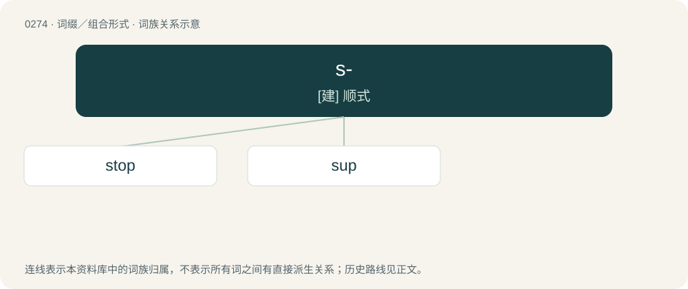

# 0305 · s- — \[建\] 顺式

[总目录](../00_总目录_按常用程度.md)

**类型**：词缀／组合形式　｜　**来源语言**：见词源记录

## 核心含义与来源

- 核心含义：\[建\] 顺式
- 英文含义：Subatomic particles with a spin (quantum angular momentum) of 0, predicted by supersymmetry; the bosonic equivalent of known fermions.
- 词形：s-

**多个词源／构词路径**：同一拼写可能有不同来源；以下按词性和含义分别列出。

**来源记录 1**（前缀／前置成分；Subatomic particles with a spin (quantum angular momentum) of 0, predicted by supersymmetry; the bosonic equivalent of known fermions.）

Abbreviation of scalar (“particle with spin 0”).

**来源记录 2**（前缀／前置成分；secondary form）

Abbreviation of sec- (“secondary”).

**来源记录 3**（前缀／前置成分；Super.）

Abbreviation of super.

## 词族图

## 单词速览（常用到不常用）

| 单词 | 音标 | 释义 |
|---|---|---|
| [stop](#w-1) | 英 /stɒp/；/stɑp/ | 【英文】The squark that is the superpartner of a top quark. |
| [sup](#w-2) | /sʌp/ | n. 一口；vt. 啜, 呷；vi. 啜饮, 进晚餐 |

## 逐词详解

### 1. stop

**词性**：名词　｜　**音标**：英 /stɒp/；/stɑp/

**英文义项**：The squark that is the superpartner of a top quark.

**构词拆分**：From s- + top.

**词源与演化**：

From s- + top.

### 2. sup

**词性**：形容词　｜　**音标**：/sʌp/

**中文释义**：n. 一口；vt. 啜, 呷；vi. 啜饮, 进晚餐

**英文义项**：Being or relating to the squark that is the superpartner of an up quark.

**构词拆分**：s- + up

**词源与演化**：

From s- + up.

**例句**：

> When you sup with the Devil, use a long spoon.
