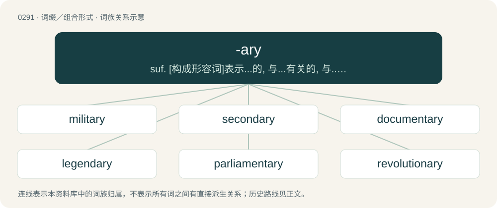

# 0327 · -ary — suf. \[构成形容词\]表示...的, 与...有关的, 与...有联系的, 属于...的：auxiliary, elementary; \[构成名词\]表示：与...有关的人,从事...的人：missionary; 与...有关之物：dictionary; ...的处所,...的地方：granary,aviary; \[拉丁语-aris\]\[构成名词和形容词\]表示

[总目录](../00_总目录_按常用程度.md)

**类型**：词缀／组合形式　｜　**来源语言**：见词源记录

## 核心含义与来源

- 核心含义：suf. \[构成形容词\]表示...的, 与...有关的, 与...有联系的, 属于...的：auxiliary, elementary; \[构成名词\]表示：与...有关的人,从事...的人：missionary; 与...有关之物：dictionary; ...的处所,...的地方：granary,aviary; \[拉丁语-aris\]\[构成名词和形容词\]表示：像...(的), 同类(的)：military
- 英文含义：Of or pertaining to. Adjectival suffix appended to various words, often nouns, to produce an adjective form. Often added to words of Latin origin, but used with other words also.
- 词形：-ary

**来源记录 1**（后缀／后置成分；Of or pertaining to. Adjectival suffix appended to various words, often nouns, to produce an adjective form. Often added to words of Latin origin, but used with other words also.）

Inherited from Middle English -arie, a back-formation from Latin and French-borrowed adjectives ending respectively in -ārius and -aire (more rarely from Latin adjectives in -āris: see exemplary and lapidary). Doublet of -ar, -eer, -ier, and -yer; see also the related -arian.

## 词族图

## 单词速览（常用到不常用）

| 单词 | 音标 | 释义 |
|---|---|---|
| [military](#w-1) | 英 /ˈmɪlɪt(ə)ɹi/；美 /ˈmɪlɪtɛɹi/ | n. 军队；a. 军事的, 军人的, 适于战争的 |
| [secondary](#w-2) | 英 /ˈsɛkənd(ə)ɹɪ/；美 /ˈsɛkənˌdɛɹi/ | a. 中级的, 中等的, 次要的, 第二的, 从属的, 辅助的；\[化\] 仲(指CH-3...CH(CH-3)-型支链烃基或指二元胺及R-2CHOH型的醇); 第二 |
| [documentary](#w-3) | 英 /ˌdɒk.jʊˈmɛn.tɹi/；美 /ˌdɑ.kjəˈmɛn.tə.ɹi/ | n. 记录片；a. 文件的 |
| [legendary](#w-4) | 英 /ˈlɛd͡ʒ.ən.dɹi/；美 /ˈlɛd͡ʒ.ənˌdɛɹ.i/ | a. 传说的, 传奇中说的, 传奇般的, 传说中的, 著名的 |
| [parliamentary](#w-5) | 英 /ˌpɑːləˈmɛnt(ə)ɹi/；美 /ˌpɑɹləˈmɛnt(ə)ɹi/ | a. 国会的, 议会的, 议会制度的 |
| [revolutionary](#w-6) | 英 /ˌɹɛvəˈluːʃənɹi/；美 /ˌɹɛvəˈluʃənɛɹi/ | n. 革命者, 革命党人；a. 革命的, 革命性的 |
| [boundary](#w-7) | 英 /ˈbaʊndɹi/；美 /ˈbaʊndɹi/ | n. 边界, 分界线；\[计\] 边界 |
| [missionary](#w-8) | 英 /ˈmɪʃ.ən(ə).ɹɪ/；美 /ˈmɪʃ.əˌnɛɹ.ɪ/ | n. 传教士, 负有任务者, 工作人员；a. 传教的, 传教士的 |
| [evolutionary](#w-9) | 英 /ˌiː.vəˈl(j)uː.ʃən.ɹi/；美 /ˌiː.vəˈluː.ʃən.ɛɹ.i/ | a. 展开的, 进化论的, 进化的, 发展的；\[计\] 进化的, 改良的, 发展的 |
| [imaginary](#w-10) | 英 /ɪˈmæd͡ʒɪnəɹi/；美 /ɪˈmæd͡ʒɪˌn(ɛ)ɹi/ | a. 想像的, 虚构的, 假想的 |
| [scenery](#w-11) | /ˈsiːnəɹi/ | n. 风景, 景色, 舞台布景 |
| [honorary](#w-12) | 美 /ˈɑn.əˌɹɛɹ.i/ | a. 荣誉的, 无报酬的, 道义上的；\[法\] 名誉的, 荣誉的 |
| [complementary](#w-13) | 英 /ˌkɒmplɪˈmɛnt(ə)ɹi/；美 /ˌkɑmplɪˈmɛnt(ə)ɹi/ | a. 补充的, 补足的；\[经\] 补足的, 补充的 |
| [planetary](#w-14) | 英 /ˈplænɪtəri/；美 /ˈplænɪˌtɛəri/ | a. 行星的, 流浪的, 迁移不定的, 地球上的, 现世的 |
| [visionary](#w-15) | 英 /ˈvɪʒn̩(ə)ɹi/；美 /ˈvɪʒəˌnɛɹi/ | a. 幻像的, 幻想的, 梦想的；n. 有眼力的人, 空想家, 梦想者 |
| [sanitary](#w-16) | 英 /ˈsænɪt(ə)ɹi/；美 /ˈsænɪˌtɛɹi/ | a. 卫生的；n. 公共厕所 |
| [supplementary](#w-17) | /.sʌpliˈmentəri/ | a. 补足的, 补充的, 追加的；\[经\] 追加的, 补充的, 增补的 |
| [complimentary](#w-18) | 英 /ˌkɒmplɪˈmɛnt(ə)ɹi/；美 /ˌkɑmplɪˈmɛnt(ə)ɹi/ | a. 问候的, 称赞的, 夸奖的 |
| [discretionary](#w-19) | 英 /dɪˈskɹɛʃən(ə)ɹi/；美 /dɪsˈkɹɛʃəˌnɛɹi/ | \[计\] 选择的 |
| [reactionary](#w-20) | 英 /ɹiˈækʃən(ə)ɹi/；美 /ɹiˈæk.ʃəˌnɛɚ.i/ | n. 反动分子；a. 反动的, 反动主义的, 反对改革的 |
| [rudimentary](#w-21) | 美 /ˌɹuːdɪˈmɛntəɹi/ | a. 基本的, 起码的, 初步的, 发展不完全的, 残留的, 退化的；\[医\] 原基的, 未成熟的; 残遗的, 已退化的 |
| [budgetary](#w-22) | 英 /ˈbʌd͡ʒ.ɪ.tə.ɹi/；美 /ˈbʌd͡ʒ.əˌtɛɹ.i/ | a. 预算的；\[法\] 预算的 |
| [sedimentary](#w-23) | /ˌsɛd.əˈmɛn.tə.ɹi/ | a. 沉渣的, 沉淀物的, 由沉淀物所生成的；\[医\] 沉淀的, 沉积的, 沉降的 |
| [unitary](#w-24) | 英 /ˈjuːnɪt(ə)ɹi/ | a. 单位的, 单一的, 归一的, 整体的；\[化\] 幺正; 幺正的 |
| [precautionary](#w-25) | /priˈkɒːʃənəri/ | a. 预先警戒的, 预防的, 留心的 |
| [inflationary](#w-26) | /inˈfleiʃənəri/ | a. 通货膨胀的, 通货膨胀倾向的 |
| [expeditionary](#w-27) | /.ekspiˈdiʃənəri/ | a. 远征的, 考察的, 探险的 |
| [fragmentary](#w-28) | /ˈfræ^məntəri/ | a. 碎片的, 碎屑的, 片断的, 断片的, 碎块的, 不完全的, 不连续的, 不完整的 |
| [probationary](#w-29) | /prəjˈbeiʃənəri/ | a. 试用的, 预备期的, 见习的, 缓刑中的；\[法\] 试用的, 见习的, 缓刑的 |
| [exclusionary](#w-30) | /ɪkˈskluːʒənri/ | a. &lt;正&gt;排斥（性）的, 排除在外的 |
| [salivary](#w-31) | 英 /səˈlaɪvəɹi/；美 /ˈsælɪˌvɛɹi/ | a. 唾液的, 分泌唾液的；\[医\] 涎的, 唾液的 |
| [evidentiary](#w-32) | 英 /ˌɛvɪˈdɛnʃəɹi/；美 /ˌɛvɪˈdɛnʃiˌɛɹi/ | a. 证据的, 根据证据的 |
| [granary](#w-33) | 英 /ˈɡɹan(ə)ɹi/；美 /ˈɡɹænəɹi/ | n. 谷仓, 谷物仓, 主要来源, 主要贮藏所 |
| [maxillary](#w-34) | 英 /makˈsɪl.ə.ɹi/；美 /ˈmæk.səˌlɛɹ.i/ | a. 颌的, 上颌骨的；n. 上颌骨 |
| [deflationary](#w-35) | 英 /dɪˈfleɪ.ʃən.ɹi/；美 /dəˈfleɪ.ʃənˌɛɹ.i/ | a. 通货紧缩的；\[经\] 紧缩(通货)的 |
| [diversionary](#w-36) | /d(a)ɪˈvɝʒəˌnɛɹi/ | a. 转换注意力的, 牵制的 |
| [antiquary](#w-37) | 英 /ˈæntɪkw(ə)ɹi/；美 /ˈæntɪˌkwɛɹi/ | n. 古文物收藏家, 古董商 |
| [expansionary](#w-38) | /ikˈspænʃənəri/ | a. 扩张性的, 发展性的, 展开性的 |
| [ciliary](#w-39) | 英 /ˈsɪl.i.ə.ɹi/；美 /ˈsɪl.iˌɛɹ.i/ | a. 眼睫毛的, 纤毛的, 纤毛状的；\[医\] 睫状的, 睫的 |
| [papillary](#w-40) | /pəˈpiləri/ | a. 乳头的, 乳突的；\[医\] 乳头的, 乳头状的 |
| [supernumerary](#w-41) | 英 /ˌsuːpəˈnjuːm(ə)ɹ(ə)ɹi/；美 /ˌsupɚˈn(j)uməˌɹɛɹi/ | a. 额外的, 多余的；n. 跑龙套的角色, 杂工, 临时演员, 多余的人/物, 冗员 |
| [cometary](#w-42) | 英 /ˈkɒm.ɪ.t(ə).ri/；美 /ˈkɑ.məˌtɛ.ri/ | a. 彗星的, 彗星似的 |
| [concessionary](#w-43) | 美 /kənˈsɛʃəˌnɛɹi/ | a. 让步的, 特许的；n. 特许权获得者 |
| [alimentary](#w-44) | /ˌælɪˈmɛnt(ə)ɹi/ | a. 饮食的, 供养的；\[化\] 营养的 |
| [legionary](#w-45) | 英 /ˈliːdʒənəɹi/；美 /ˈlidʒəˌnɛɹi/ | a. 军团的, 军队的；n. 军团士兵 |
| [illusionary](#w-46) | /iˈljuːʒənəri/ | a. (=illusional)错觉的, 幻影的 |

## 逐词详解

### 1. military

**词性**：形容词　｜　**音标**：英 /ˈmɪlɪt(ə)ɹi/；美 /ˈmɪlɪtɛɹi/

**中文释义**：n. 军队；a. 军事的, 军人的, 适于战争的

**英文义项**：Characteristic of members of the armed forces. / Relating to armed forces such as the army, marines, navy and air force (often as distinguished from civilians or police forces).

**词源与演化**：

From Middle English militari, from Old French militaire, from Latin mīlitāris, from mīles (“soldier”) + -āris (whence -ary). Doublet of militaire.

**例句**：

> If you join a military force, you may end up killing people.

该用例对应义项：Relating to armed forces such as the army, marines, navy and air force (often as distinguished from civilians or police forces).

### 2. secondary

**词性**：形容词　｜　**音标**：英 /ˈsɛkənd(ə)ɹɪ/；美 /ˈsɛkənˌdɛɹi/

**中文释义**：a. 中级的, 中等的, 次要的, 第二的, 从属的, 辅助的；\[化\] 仲(指CH-3...CH(CH-3)-型支链烃基或指二元胺及R-2CHOH型的醇); 第二

**英文义项**：Next in order to the first or primary; of second place in origin, rank, etc. / Originating from a deputy or delegated person or body.

**构词拆分**：second + -ary

**词源与演化**：

From Middle English secundarie, from Latin secundārius (“of the second class or quality”), from secundus (whence the English second) + -ārius (whence the English suffix -ary), equivalent to second + -ary; compare the French secondaire, the Italian secondario, the Occitan secundari, the Portuguese secundario, and the Spanish secundario.

**例句**：

> Yellow is a secondary light color, though a primary CMYK color.

该用例对应义项：Formed by mixing primary colors.

### 3. documentary

**词性**：形容词　｜　**音标**：英 /ˌdɒk.jʊˈmɛn.tɹi/；美 /ˌdɑ.kjəˈmɛn.tə.ɹi/

**中文释义**：n. 记录片；a. 文件的

**英文义项**：Of, related to, or based on documents. / Which serves to document (record or illustrate) a subject.

**构词拆分**：document + -ary

**词源与演化**：

From French adjective and (hence) noun documentaire, from document, from Latin documentum. Equivalent to document + -ary.

**用法示例／搭配（非完整句）**：

> a documentary film

该用例对应义项：Presented objectively without the insertion of fictional matter.

### 4. legendary

**词性**：形容词　｜　**音标**：英 /ˈlɛd͡ʒ.ən.dɹi/；美 /ˈlɛd͡ʒ.ənˌdɛɹ.i/

**中文释义**：a. 传说的, 传奇中说的, 传奇般的, 传说中的, 著名的

**英文义项**：Of or pertaining to a legend or to legends. / Appearing (solely) in legends.

**构词拆分**：legend + -ary

**词源与演化**：

From legend + -ary; from Medieval Latin legendārius. Earlier it was a noun meaning "a collection of legends" (1510s) (Medieval Latin legendārium, Old French legendier), from Latin legenda. In English, both the noun and the adjective first appeared in the 16th century.

**例句**：

> The legendary exploits of the arctic trailblazers.

该用例对应义项：so celebrated as to having taken on the nature of a legend

### 5. parliamentary

**词性**：形容词　｜　**音标**：英 /ˌpɑːləˈmɛnt(ə)ɹi/；美 /ˌpɑɹləˈmɛnt(ə)ɹi/

**中文释义**：a. 国会的, 议会的, 议会制度的

**英文义项**：Of, relating to, or enacted by a parliament. / Having the supreme executive and legislative power resting with a cabinet of ministers chosen from, and responsible to a parliament.

**构词拆分**：parliament + -ary

**词源与演化**：

From parliament + -ary.

**例句**：

> Parliamentary procedures are sometimes slow.

该用例对应义项：Of, relating to, or enacted by a parliament.

### 6. revolutionary

**词性**：形容词　｜　**音标**：英 /ˌɹɛvəˈluːʃənɹi/；美 /ˌɹɛvəˈluʃənɛɹi/

**中文释义**：n. 革命者, 革命党人；a. 革命的, 革命性的

**英文义项**：Of or pertaining to a revolution in government; tending to, or promoting, revolution / Of or pertaining to something that portends of great change; overthrowing a standing mindset

**构词拆分**：revolution + -ary

**词源与演化**：

Compare French révolutionnaire; equivalent to revolution + -ary.

**用法示例／搭配（非完整句）**：

> a revolutionary new tool

该用例对应义项：Of or pertaining to something that portends of great change; overthrowing a standing mindset

### 7. boundary

**词性**：名词　｜　**音标**：英 /ˈbaʊndɹi/；美 /ˈbaʊndɹi/

**中文释义**：n. 边界, 分界线；\[计\] 边界

**英文义项**：The dividing line or location between two areas. / The bounds, confines, or limits between immaterial things (such as one’s comfort zone, privacy, or professional sphere and the realm beyond).

**构词拆分**：bound + -ary

**词源与演化**：

From bound + -ary. Semantically displaced native Old English mearc (“boundary, limit”) whence Modern English mark.

**例句**：

> Travis hit a boundary to seal the match on the last ball of the over.

该用例对应义项：An event whereby the ball is struck and either touches or passes over a boundary (with or without bouncing), usually resulting in an award of 4 (four) or 6 (six) runs respectively for the batting team.

### 8. missionary

**词性**：名词　｜　**音标**：英 /ˈmɪʃ.ən(ə).ɹɪ/；美 /ˈmɪʃ.əˌnɛɹ.ɪ/

**中文释义**：n. 传教士, 负有任务者, 工作人员；a. 传教的, 传教士的

**英文义项**：One who is sent on a mission. / A person who travels attempting to spread a religion or creed (Particularly used in context of Christianity).

**构词拆分**：mission + -ary

**词源与演化**：

From mission + -ary.

**例句**：

> A missionary was just trying to convert me to his religion.

该用例对应义项：A person who travels attempting to spread a religion or creed (Particularly used in context of Christianity).

### 9. evolutionary

**词性**：形容词　｜　**音标**：英 /ˌiː.vəˈl(j)uː.ʃən.ɹi/；美 /ˌiː.vəˈluː.ʃən.ɛɹ.i/

**中文释义**：a. 展开的, 进化论的, 进化的, 发展的；\[计\] 进化的, 改良的, 发展的

**英文义项**：Of or relating to the biological theory of evolution. / Having formal similarities to the biological theory of evolution.

**构词拆分**：evolution + -ary

**词源与演化**：

From evolution + -ary.

**例句**：

> The evolutionary history of marine mammals includes land-dwelling ancestors.

该用例对应义项：Of or relating to the biological theory of evolution.

### 10. imaginary

**词性**：形容词　｜　**音标**：英 /ɪˈmæd͡ʒɪnəɹi/；美 /ɪˈmæd͡ʒɪˌn(ɛ)ɹi/

**中文释义**：a. 想像的, 虚构的, 假想的

**英文义项**：Existing only in the imagination. / Relating or belonging to the imagination.

**构词拆分**：imagine + -ary

**词源与演化**：

From Middle English ymaginarie, ymagynary, from Latin imāginārius (“relating to images, fancied”), from imāgō, equivalent to imagine + -ary. The mathematical sense derives from René Descartes's use (of the French imaginaire) in 1637, La Geometrie, to ridicule the notion of regarding non-real roots of polynomials as numbers. Although Descartes' usage was derogatory, the designation stuck even after the concept gained acceptance in the 18th century.

**用法示例／搭配（非完整句）**：

> Unicorns are imaginary.

该用例对应义项：Existing only in the imagination.

### 11. scenery

**词性**：名词　｜　**音标**：/ˈsiːnəɹi/

**中文释义**：n. 风景, 景色, 舞台布景

**英文义项**：View, natural features, landscape. / Stage backdrops, property and other items on a stage that give the impression of the location of the scene.

**构词拆分**：scene + -ary；scene + -ery

**词源与演化**：

Earlier scenary, from scene + -ary, but now remodelled as scene + -ery.

**例句**：

> They worked all night painting the scenery.

该用例对应义项：the painted structures of a stage set that are intended to suggest a particular locale

### 12. honorary

**词性**：形容词　｜　**音标**：美 /ˈɑn.əˌɹɛɹ.i/

**中文释义**：a. 荣誉的, 无报酬的, 道义上的；\[法\] 名誉的, 荣誉的

**英文义项**：Given as an honor, with no duties attached, and without payment. / Voluntary.

**构词拆分**：honor + -ary

**词源与演化**：

From honor + -ary, modelled after French honoraire, from Latin honōrārius.

**例句**：

> I consider you an honorary member of our family because you've been with us for so long.

该用例对应义项：Unofficial; practically. Describes the holder of an unofficial position or title that is assigned as a special honor rather than by normal channels.

### 13. complementary

**词性**：形容词　｜　**音标**：英 /ˌkɒmplɪˈmɛnt(ə)ɹi/；美 /ˌkɑmplɪˈmɛnt(ə)ɹi/

**中文释义**：a. 补充的, 补足的；\[经\] 补足的, 补充的

**英文义项**：Acting as a complement; making up a whole with something else. / Of the specific pairings of the bases in DNA and RNA.

**构词拆分**：complement + -ary

**词源与演化**：

From complement + -ary. Piecewise doublet of complimentary.

**例句**：

> I'll provide you with some complementary notes to help you study.

该用例对应义项：Acting as a complement; making up a whole with something else.

### 14. planetary

**词性**：形容词　｜　**音标**：英 /ˈplænɪtəri/；美 /ˈplænɪˌtɛəri/

**中文释义**：a. 行星的, 流浪的, 迁移不定的, 地球上的, 现世的

**英文义项**：Of, or relating to planets, or the orbital motion of planets. / Of, or relating to the Earth; terrestrial.

**构词拆分**：planet + -ary

**词源与演化**：

From planet + -ary.

**用法示例／搭配（非完整句）**：

> a planetary mixer

该用例对应义项：Epicyclic.

### 15. visionary

**词性**：形容词　｜　**音标**：英 /ˈvɪʒn̩(ə)ɹi/；美 /ˈvɪʒəˌnɛɹi/

**中文释义**：a. 幻像的, 幻想的, 梦想的；n. 有眼力的人, 空想家, 梦想者

**英文义项**：Having vision or foresight. / Imaginary or illusory.

**构词拆分**：vision + -ary

**词源与演化**：

From vision + -ary.

**用法示例／搭配（非完整句）**：

> a visionary scheme or project

该用例对应义项：Idealistic or utopian.

### 16. sanitary

**词性**：形容词　｜　**音标**：英 /ˈsænɪt(ə)ɹi/；美 /ˈsænɪˌtɛɹi/

**中文释义**：a. 卫生的；n. 公共厕所

**英文义项**：Of or relating to health. / Clean and free from pathogens; hygienic.

**构词拆分**：sanity + -ary

**词源与演化**：

19th century, borrowed from French sanitaire, formed from Latin sanitas (“health”). Analysable as sanity + -ary.

**例句**：

> Sanitary conditions for preparing food.

该用例对应义项：free from filth and pathogens

### 17. supplementary

**词性**：形容词　｜　**音标**：/.sʌpliˈmentəri/

**中文释义**：a. 补足的, 补充的, 追加的；\[经\] 追加的, 补充的, 增补的

**英文义项**：Additional; added to supply what is wanted.

**构词拆分**：supplement + -ary

**词源与演化**：

From supplement + -ary; compare French supplémentaire.

**例句**：

> Supplementary information includes adverbs and things that function as adverbs.

### 18. complimentary

**词性**：形容词　｜　**音标**：英 /ˌkɒmplɪˈmɛnt(ə)ɹi/；美 /ˌkɑmplɪˈmɛnt(ə)ɹi/

**中文释义**：a. 问候的, 称赞的, 夸奖的

**英文义项**：In the nature of a compliment. / Free; provided at no charge.

**构词拆分**：compliment (noun) + -ary

**词源与演化**：

From compliment (noun) + -ary. Piecewise doublet of complementary.

**用法示例／搭配（非完整句）**：

> a complimentary remark

该用例对应义项：In the nature of a compliment.

### 19. discretionary

**词性**：形容词　｜　**音标**：英 /dɪˈskɹɛʃən(ə)ɹi/；美 /dɪsˈkɹɛʃəˌnɛɹi/

**中文释义**：\[计\] 选择的

**英文义项**：Available at one's discretion; able to be used as one chooses; left to or regulated by one's own discretion or judgment.

**构词拆分**：discretion + -ary (“pertaining to”)

**词源与演化**：

From discretion + -ary (“pertaining to”). Compare French discrétionnaire.

**用法示例／搭配（非完整句）**：

> discretionary income

该用例对应义项：Available at one's discretion; able to be used as one chooses; left to or regulated by one's own discretion or judgment.

### 20. reactionary

**词性**：形容词　｜　**音标**：英 /ɹiˈækʃən(ə)ɹi/；美 /ɹiˈæk.ʃəˌnɛɚ.i/

**中文释义**：n. 反动分子；a. 反动的, 反动主义的, 反对改革的

**英文义项**：Extremely conservative; opposing revolution (such as the French Revolution); favoring a return to a "golden age" of the past. / Of, pertaining to, participating in, or inducing a chemical reaction.

**构词拆分**：reaction + -ary

**词源与演化**：

Borrowed from French réactionnaire, equivalent to reaction + -ary. Used in the time of the French revolution to refer to a person opposing the revolution; as in favoring a reaction against the revolution.

**例句**：

> He claims to be a centrist, but he talks like a reactionary.

### 21. rudimentary

**词性**：形容词　｜　**音标**：美 /ˌɹuːdɪˈmɛntəɹi/

**中文释义**：a. 基本的, 起码的, 初步的, 发展不完全的, 残留的, 退化的；\[医\] 原基的, 未成熟的; 残遗的, 已退化的

**英文义项**：Of or relating to one or more rudiments; of the nature of an early stage. / Basic; minimal; with less than, or only the minimum, necessary.

**构词拆分**：rudiment + -ary；rudiment + -ary (adjectival suffix)

**词源与演化**：

From rudiment + -ary (adjectival suffix), perhaps after New Latin rudīmentārius, from Classical Latin rudīmentum (“first attempt; beginning”) + -ārius (adjectival suffix). Compare French rudimentaire.

**例句**：

> His grasp of rudimentary English allowed him at least to do the shopping.

该用例对应义项：Basic; minimal; with less than, or only the minimum, necessary.

### 22. budgetary

**词性**：形容词　｜　**音标**：英 /ˈbʌd͡ʒ.ɪ.tə.ɹi/；美 /ˈbʌd͡ʒ.əˌtɛɹ.i/

**中文释义**：a. 预算的；\[法\] 预算的

**英文义项**：Of or pertaining to a budget.

**构词拆分**：budget + -ary

**词源与演化**：

From budget + -ary.

### 23. sedimentary

**词性**：形容词　｜　**音标**：/ˌsɛd.əˈmɛn.tə.ɹi/

**中文释义**：a. 沉渣的, 沉淀物的, 由沉淀物所生成的；\[医\] 沉淀的, 沉积的, 沉降的

**英文义项**：Made by the deposition and compression of small particles.

**构词拆分**：sediment + -ary

**词源与演化**：

From sediment + -ary.

**例句**：

> Shale rock is a sedimentary rock made up of clay, compacted together by pressure.

### 24. unitary

**词性**：形容词　｜　**音标**：英 /ˈjuːnɪt(ə)ɹi/

**中文释义**：a. 单位的, 单一的, 归一的, 整体的；\[化\] 幺正; 幺正的

**英文义项**：Having the quality of oneness. / That concentrates power in a single body, rather than sharing it with more local bodies.

**构词拆分**：unit + -ary

**词源与演化**：

From unit + -ary.

**用法示例／搭配（非完整句）**：

> a unitary authority

该用例对应义项：That concentrates power in a single body, rather than sharing it with more local bodies.

### 25. precautionary

**词性**：形容词　｜　**音标**：/priˈkɒːʃənəri/

**中文释义**：a. 预先警戒的, 预防的, 留心的

**英文义项**：Of, pertaining to, or serving as a precaution.

**构词拆分**：precaution + -ary

**词源与演化**：

From precaution + -ary.

**例句**：

> The port cities were quarantined as a precautionary measure, though no cases of the disease had been found.

该用例对应义项：Of, pertaining to, or serving as a precaution.

### 26. inflationary

**词性**：形容词　｜　**音标**：/inˈfleiʃənəri/

**中文释义**：a. 通货膨胀的, 通货膨胀倾向的

**英文义项**：Causing or liable to cause inflation. / Of or relating to inflation.

**构词拆分**：inflation + -ary

**词源与演化**：

From inflation + -ary.

**例句**：

> The rapid influx of precious metals from the new mines had an inflationary effect on the specie based economy.

该用例对应义项：Causing or liable to cause inflation.

### 27. expeditionary

**词性**：形容词　｜　**音标**：/.ekspiˈdiʃənəri/

**中文释义**：a. 远征的, 考察的, 探险的

**英文义项**：Of or pertaining to an expedition. / Intended for military operations abroad.

**构词拆分**：expedition + -ary

**词源与演化**：

From expedition + -ary.

**例句**：

> The French expeditionary force in Indochina.

该用例对应义项：(used of military forces) designed for military operations abroad

### 28. fragmentary

**词性**：形容词　｜　**音标**：/ˈfræ^məntəri/

**中文释义**：a. 碎片的, 碎屑的, 片断的, 断片的, 碎块的, 不完全的, 不连续的, 不完整的

**英文义项**：Consisting of fragments; disconnected; scattered. / Composed of the fragments of other rocks.

**构词拆分**：fragment + -ary

**词源与演化**：

From fragment + -ary.

**例句**：

> Fragmentary evidence suggests that he died in a foreign country.

该用例对应义项：Consisting of fragments; disconnected; scattered.

### 29. probationary

**词性**：形容词　｜　**音标**：/prəjˈbeiʃənəri/

**中文释义**：a. 试用的, 预备期的, 见习的, 缓刑中的；\[法\] 试用的, 见习的, 缓刑的

**英文义项**：Of, pertaining to, or subject to probation

**构词拆分**：probation + -ary

**词源与演化**：

From probation + -ary.

**例句**：

> How long does the probationary period last?

### 30. exclusionary

**词性**：形容词　｜　**音标**：/ɪkˈskluːʒənri/

**中文释义**：a. &lt;正&gt;排斥（性）的, 排除在外的

**英文义项**：Acting to exclude something

**构词拆分**：exclusion + -ary

**词源与演化**：

From exclusion + -ary.

**例句**：

> Social groups are often exclusionary.

该用例对应义项：Acting to exclude something

### 31. salivary

**词性**：形容词　｜　**音标**：英 /səˈlaɪvəɹi/；美 /ˈsælɪˌvɛɹi/

**中文释义**：a. 唾液的, 分泌唾液的；\[医\] 涎的, 唾液的

**英文义项**：Relating to saliva.

**构词拆分**：saliva + -ary

**词源与演化**：

From saliva + -ary.

**例句**：

> The parasympathetic nerves of a developing salivary gland innervate the salivary gland epithelium which is essential for organogenesis.

### 32. evidentiary

**词性**：形容词　｜　**音标**：英 /ˌɛvɪˈdɛnʃəɹi/；美 /ˌɛvɪˈdɛnʃiˌɛɹi/

**中文释义**：a. 证据的, 根据证据的

**英文义项**：Of or pertaining to evidence.

**构词拆分**：Latin ēvidentia + -ary

**词源与演化**：

From Latin ēvidentia + -ary.

**例句**：

> Evidentiary investigations are common in legal proceedings.

该用例对应义项：Of or pertaining to evidence.

### 33. granary

**词性**：名词　｜　**音标**：英 /ˈɡɹan(ə)ɹi/；美 /ˈɡɹænəɹi/

**中文释义**：n. 谷仓, 谷物仓, 主要来源, 主要贮藏所

**英文义项**：A storage facility for grain or sometimes animal feed. / A fertile, grain-growing region.

**构词拆分**：grain + -ary

**词源与演化**：

Borrowed from Latin grānārium (16th century). Equivalent to grain + -ary. Doublet of garner.

**例句**：

> Tom lives down the road from a defunct granary.

### 34. maxillary

**词性**：形容词　｜　**音标**：英 /makˈsɪl.ə.ɹi/；美 /ˈmæk.səˌlɛɹ.i/

**中文释义**：a. 颌的, 上颌骨的；n. 上颌骨

**英文义项**：Of or relating to the jaw or jawbone. / Of or pertaining to the maxillae of an arthropod.

**构词拆分**：maxilla + -ary

**词源与演化**：

Borrowed from Latin māxillāris (“of or belonging to the jaw”), from māxilla (“the jawbone, jaw”) + -āris (“-ar, -ary”, adjectival suffix); equivalent to maxilla + -ary.

### 35. deflationary

**词性**：形容词　｜　**音标**：英 /dɪˈfleɪ.ʃən.ɹi/；美 /dəˈfleɪ.ʃənˌɛɹ.i/

**中文释义**：a. 通货紧缩的；\[经\] 紧缩(通货)的

**英文义项**：Associated with or tending to cause deflation. / Belonging or relating to a family of theories claiming that assertions that predicate truth of a statement do not attribute a property called truth to such a statement.

**构词拆分**：deflation + -ary

**词源与演化**：

From deflation + -ary.

### 36. diversionary

**词性**：形容词　｜　**音标**：/d(a)ɪˈvɝʒəˌnɛɹi/

**中文释义**：a. 转换注意力的, 牵制的

**英文义项**：That serves as a diversion.

**构词拆分**：diversion + -ary

**词源与演化**：

From diversion + -ary.

**例句**：

> Her strange behaviour was just a diversionary tactic.

### 37. antiquary

**词性**：名词　｜　**音标**：英 /ˈæntɪkw(ə)ɹi/；美 /ˈæntɪˌkwɛɹi/

**中文释义**：n. 古文物收藏家, 古董商

**英文义项**：A person who is knowledgeable of, or who collects antiques (especially one holding an official position); an antiquarian. / An aficionado or student of antiquities, ancient artifacts, historic sites, ancient writings, or relics of the past.

**构词拆分**：antique + -ary

**词源与演化**：

From Latin antīquārius (“pertaining to antiquity, one fond of or employed in antiquities”), from antīquus (“ancient”) + -ārius; equivalent to antique + -ary.

### 38. expansionary

**词性**：形容词　｜　**音标**：/ikˈspænʃənəri/

**中文释义**：a. 扩张性的, 发展性的, 展开性的

**英文义项**：That promotes or exhibits expansion.

**构词拆分**：expansion + -ary

**词源与演化**：

From expansion + -ary.

### 39. ciliary

**词性**：形容词　｜　**音标**：英 /ˈsɪl.i.ə.ɹi/；美 /ˈsɪl.iˌɛɹ.i/

**中文释义**：a. 眼睫毛的, 纤毛的, 纤毛状的；\[医\] 睫状的, 睫的

**英文义项**：Of, pertaining to or involving cilia. / Of or pertaining to the eyelashes.

**构词拆分**：cilium + -ary

**词源与演化**：

From cilium + -ary.

**用法示例／搭配（非完整句）**：

> ciliary movement

该用例对应义项：Of, pertaining to or involving cilia.

### 40. papillary

**词性**：形容词　｜　**音标**：/pəˈpiləri/

**中文释义**：a. 乳头的, 乳突的；\[医\] 乳头的, 乳头状的

**英文义项**：Having the properties or appearance of a papilla (nipple).

**构词拆分**：papilla + -ary

**词源与演化**：

From papilla + -ary.

### 41. supernumerary

**词性**：名词　｜　**音标**：英 /ˌsuːpəˈnjuːm(ə)ɹ(ə)ɹi/；美 /ˌsupɚˈn(j)uməˌɹɛɹi/

**中文释义**：a. 额外的, 多余的；n. 跑龙套的角色, 杂工, 临时演员, 多余的人/物, 冗员

**英文义项**：A person who works in a group, association, or public office without forming part of the regular staff (the numerary). / An extra or walk-on, often non-speaking, in a film or play; a spear carrier.

**构词拆分**：super- + numeral + -ary

**词源与演化**：

From Late Latin supernumerarius (“extra soldier added to a legion; supernumerary”), from super (“above; beyond”) + numerus (“number; collection, quantity”) + -ārius (suffix forming adjectives from nouns or numerals). The word is analysable as super- + numeral + -ary.

**例句**：

> The judge was a supernumerary, helping the regular judges whenever there was a surplus amount of work.

该用例对应义项：A person who works in a group, association, or public office without forming part of the regular staff (the numerary).

### 42. cometary

**词性**：形容词　｜　**音标**：英 /ˈkɒm.ɪ.t(ə).ri/；美 /ˈkɑ.məˌtɛ.ri/

**中文释义**：a. 彗星的, 彗星似的

**英文义项**：relating to comets

**构词拆分**：comet + -ary

**词源与演化**：

From comet + -ary.

### 43. concessionary

**词性**：名词　｜　**音标**：美 /kənˈsɛʃəˌnɛɹi/

**中文释义**：a. 让步的, 特许的；n. 特许权获得者

**英文义项**：one who owns a concession or a franchise

**构词拆分**：concession + -ary

**词源与演化**：

From concession + -ary.

**例句**：

> I'd like to buy two concessionary tickets.

### 44. alimentary

**词性**：形容词　｜　**音标**：/ˌælɪˈmɛnt(ə)ɹi/

**中文释义**：a. 饮食的, 供养的；\[化\] 营养的

**英文义项**：Of, or relating to food, nutrition or digestion. / Nourishing; nutritious.

**构词拆分**：aliment + -ary

**词源与演化**：

From aliment (“food”) + -ary.

**例句**：

> When she had the stomach flu, she would get nauseous anytime anything hit her alimentary canal.

### 45. legionary

**词性**：名词　｜　**音标**：英 /ˈliːdʒənəɹi/；美 /ˈlidʒəˌnɛɹi/

**中文释义**：a. 军团的, 军队的；n. 军团士兵

**英文义项**：A soldier belonging to a legion; a professional soldier of the ancient Roman army. / A person who is neither a citizen nor colonial/imperial subject of the state whose military they join.

**构词拆分**：legion + -ary

**词源与演化**：

From legion + -ary. From Latin legiōnārius. Doublet of legionnaire.

### 46. illusionary

**词性**：形容词　｜　**音标**：/iˈljuːʒənəri/

**中文释义**：a. (=illusional)错觉的, 幻影的

**英文义项**：Illusory; pertaining to an illusion, or of the nature of an illusion.

**构词拆分**：illusion + -ary

**词源与演化**：

From illusion + -ary.

**例句**：

> What if we all are brains in vats and every sensory perception is illusionary?
