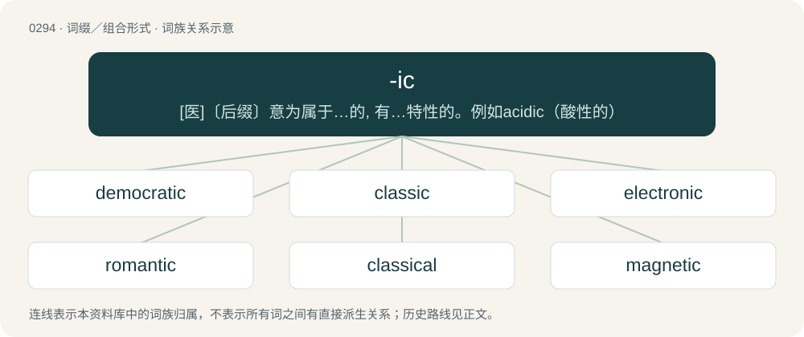

# 0329 · -ic — \[医\]〔后缀〕意为属于…的, 有…特性的。例如acidic（酸性的）

[总目录](../00_总目录_按常用程度.md)

**类型**：词缀／组合形式　｜　**来源语言**：见词源记录

## 核心含义与来源

- 核心含义：\[医\]〔后缀〕意为属于…的, 有…特性的。例如acidic（酸性的）
- 英文含义：Used to form adjectives from nouns with the meaning “of or pertaining to”.
- 词形：-ic

**来源记录 1**（后缀／后置成分；Used to form adjectives from nouns with the meaning “of or pertaining to”.）

From Middle English -ik, from Old French -ique, from Latin -icus, from Proto-Indo-European \*-kos, \*-ḱos, formed with the i-stem suffix \*-i- and the adjectival suffix \*-kos, \*-ḱos. Compare Ancient Greek -ικός (-ikós), Sanskrit -इक (-ika) and Old Church Slavonic -ъкъ (-ŭkŭ). Doublet of -y; compare also -ac. Proto-Indo-European \*-kos on noun stems carried the meaning 'characteristic of, like, typical, pertaining to', and on adjectival stems it acted emphatically.

## 词族图

## 单词速览（常用到不常用）

| 单词 | 音标 | 释义 |
|---|---|---|
| [democratic](#w-1) | 英 /ˌdɛməˈkɹætɪk/；美 /ˌdɛməˈkɹætɪk/ | a. 民主的；\[法\] 民主的, 民主政体的, 平民的 |
| [classic](#w-2) | 英 /ˈklæsɪk/ | n. 古典作品, 杰作, 大艺术家；a. 第一流的, 最优秀的, 古典的 |
| [electronic](#w-3) | 英 /ˌɛl.ɛkˈtɹɒn.ɪk/；美 /ɪˌlɛkˈtɹɑ.nɪk/ | a. 电子的；\[计\] 电子工业协会接口 |
| [romantic](#w-4) | 英 /ɹə(ʊ)ˈmæntɪk/；美 /ɹoʊˈmæn(t)ɪk/ | a. 浪漫的, 风流的, 传奇性的, 夸大的, 空想的, 浪漫派的 |
| [classical](#w-5) | 英 /ˈklæs.ɪ.k(ə)l/ | a. 古典的, 正统派的, 经典的；\[医\] 古典的; 标准的, 典型的 |
| [magnetic](#w-6) | 英 /mæɡˈnɛtɪk/ | a. 有磁性的, 有吸引力的, 催眠术的；\[医\] 磁\[性\]的 |
| [realistic](#w-7) | /ˌɹɪəˈlɪs.tɪk/ | a. 现实的, 逼真的, 现实主义的, 实在论的 |
| [athletic](#w-8) | 英 /æθˈlɛt.ɪk/ | a. 运动的 |
| [atomic](#w-9) | 英 /əˈtɒm.ɪk/；美 /əˈtɑː.mɪk/ | a. 原子的, 原子能的；\[医\] 原子的 |
| [synthetic](#w-10) | /sɪnˈθɛtɪk/ | n. 合成物质；a. 综合(性)的, 人造的, 合成的 |
| [sonic](#w-11) | 英 /ˈsɒnɪk/；美 /ˈsɑnɪk/ | a. 音波的, 音速的, 声音的；\[电\] 音波 |
| [demographic](#w-12) | 英 /ˌdɛm.əˈɡɹæf.ɪk/ | a. 人口统计的；\[法\] 人口统计的, 人口学的 |
| [alcoholic](#w-13) | 英 /ˌæl.kəˈhɒl.ɪk/；美 /ˌæl.kəˈhɔ.lɪk/ | n. 酒鬼, 酒精中毒者；a. 酒精的 |
| [optimistic](#w-14) | 英 /ˌɒptɪˈmɪstɪk/；美 /ˌɑptɪˈmɪstɪk/ | a. 乐观的, 乐观主义的, 乐天的 |
| [psychiatric](#w-15) | /ˌsaɪ.kiˈæt.ɹɪk/ | a. 精神病学的, 医精神病的；\[医\] 精神病学的 |
| [symbolic](#w-16) | /simˈbɒlik/ | a. 象征的, 符号的；\[电\] 符号化 |
| [atmospheric](#w-17) | 英 /ˌætməsˈfɛɹɪk/；/ˌætməsˈfɪɹɪk/ | a. 大气的；\[医\] 大气的; 大气压的 |
| [metallic](#w-18) | 英 /mɪˈtæl.ɪk/；美 /məˈtæl.ɪk/ | a. 金属的, 含金属的, 产生金属的；\[经\] 金属的 |
| [ironic](#w-19) | 英 /aɪˈɹɒn.ɪk/；美 /aɪˈɹɑ.nɪk/ | a. 冷嘲的, 挖苦的, 反话的, 讽刺的, 令人啼笑皆非的, 出乎意料的 |
| [patriotic](#w-20) | 英 /pæt.ɹiˈɒ.tɪk/；美 /peɪ.tɹiˈɑ.tɪk/ | a. 爱国的, 有爱国心的；\[法\] 爱国的, 有爱国心的 |
| [allergic](#w-21) | 英 /əˈlɜː.dʒɪk/；美 /əˈlɝ.d͡ʒɪk/ | a. 对...过敏的, 极反感的；\[医\] 变应性的 |
| [photographic](#w-22) | 英 /ˌfəʊtəˈɡɹæfɪk/ | a. 照相的, 摄影用的, 详细记录的, 逼真的, 酷似的 |
| [forensic](#w-23) | /fəˈɹɛn.zɪk/ | a. 辩论的, 法院的, 关于法庭的；n. 辩论练习 |
| [systemic](#w-24) | 英 /sɪˈstɛm.ɪk/；美 /sɪˈstɛm.ɪk/ | a. 系统的, 体系的, 全身的；\[医\] 系统的, 全身的 |
| [cubic](#w-25) | 英 /ˈkjuː.bɪk/；美 /ˈkju.bɪk/ | a. 立方体的, 立方的；\[机\] 立方的, 立方体的 |
| [linguistic](#w-26) | 英 /lɪŋˈɡwɪstɪk/ | a. 语言的, 语言学的；\[计\] 语言的, 语言学的 |
| [volcanic](#w-27) | 英 /vɒlˈkænɪk/；美 /vɔlˈkænɪk/ | a. 火山的, 猛烈的；n. 火山岩 |
| [lyric](#w-28) | 英 /ˈlɪɹɪk/ | n. 抒情诗, 歌词；a. 抒情的 |
| [titanic](#w-29) | 英 /taɪˈtænɪk/ | 【英文】Of or relating to titanium, especially tetravalent titanium. |
| [electromagnetic](#w-30) | 美 /ɪˌlɛk.tɹoʊ.mæɡˈnɛ.tɪk/ | a. 电磁的, 由电磁石产生的；\[电\] 电磁的 |
| [majestic](#w-31) | /məˈd͡ʒɛstɪk/ | a. 宏伟的, 庄严的 |
| [robotic](#w-32) | 英 /ɹəʊˈbɒt.ɪk/；美 /ɹoʊˈbɑtɪk/ | a. 自动的；机器人的, 像机器人的 |
| [seismic](#w-33) | /ˈsaɪzmɪk/ | a. 地震的 |
| [ballistic](#w-34) | /bəˈlɪs.tɪk/ | a. 弹道的；\[医\] 射击的, 冲击的 |
| [diabetic](#w-35) | 英 /daɪəˈbɛtɪk/；美 /ˌdaɪəˈbɛtɪk/ | a. 糖尿病的；n. 糖尿病患者 |
| [nostalgic](#w-36) | /nɒsˈtældʒik/ | a. 乡愁的, 怀旧的；\[医\] 怀乡病的 |
| [centric](#w-37) | /ˈsɛntɹɪk/ | a. 中心的, 中央的；\[医\] 中心的, 中枢的 |
| [acrylic](#w-38) | 英 /əˈkɹɪl.ɪk/ | a. 丙烯酸的；\[医\] 丙烯酸的 |
| [bureaucratic](#w-39) | 英 /ˌbjʊəɹəˈkɹætɪk/；美 /ˌbjʊɹəˈkɹætɪk/ | a. 官僚的；\[经\] 机僚化的 |
| [rhythmic](#w-40) | /ˈɹɪð.mɪk/ | a. 有韵律的, 有节奏的 |
| [tonic](#w-41) | 英 /ˈtɒnɪk/；美 /ˈtɑ.nɪk/ | 【英文】Pertaining to or based upon the first note of a diatonic scale. |
| [comedic](#w-42) | 英 /kəˈmiː.dɪk/ | a. 喜剧的 |
| [endemic](#w-43) | 英 /ɛnˈdɛm.ɪk/ | n. 地方病；a. 某地(或某些人中)流行的, 地方的 |
| [microscopic](#w-44) | 英 /ˌmaɪ.kɹəˈskɒp.ɪk/；美 /ˌmaɪ.kɹəˈskɑ.pɪk/ | a. 显微镜的, 用显微镜可见的, 微观的, (非正式)极微小的, 细微的；\[计\] 微观的 |
| [idiotic](#w-45) | 英 /ˌɪdiˈɒtɪk/；美 /ˌɪdiˈɑtɪk/ | a. 白痴的, 愚蠢的, 呆头呆脑的 |
| [acidic](#w-46) | 英 /əˈsɪd.ɪk/ | a. 成酸的, 尖刻的, 酸性的；\[机\] 酸性 |
| [psychedelic](#w-47) | 英 /ˈsaɪ.kəˌdɛl.ɪk/ | a. 引起幻觉的, 荧光的；n. 迷幻剂 |
| [demonic](#w-48) | 英 /dɪˈmɒnɪk/ | a. 恶魔的, 有魔力的 |
| [manic](#w-49) | 美 /ˈmeə̯nɪk/；/ˈmænɪk/ | a. 躁狂的；n. 躁狂者 |
| [satanic](#w-50) | 英 /seɪˈtænɪk/ | 【英文】Evil, fiendish, devilish or diabolical. |
| [journalistic](#w-51) | /ˌd͡ʒɜː(ɹ)nəˈlɪstɪk/ | a. 新闻业的, 新闻工作者的, 报刊特有的, 新闻工作的 |
| [parasitic](#w-52) | 英 /ˌpæɹ.əˈsɪt.ɪk/；美 /ˌpɛɹ.əˈsɪt.ɪk/ | a. 寄生的, 由寄生虫引起的；\[计\] 寄生的 |
| [geologic](#w-53) | 英 /ˌdʒiː.əˈlɒdʒ.ɪk/；美 /ˌd͡ʒi.əˈlɑdʒ.ɪk/ | a. 地质的, 地质学的 |
| [pessimistic](#w-54) | /ˌpɛ.səˈmɪs.tɪk/ | a. 悲观的, 厌世的, 悲观主义的 |
| [narcissistic](#w-55) | 英 /ˌnɑː.sɪˈsɪs.tɪk/；美 /ˌnɑɹ.sɪˈsɪs.tɪk/ | a. 自我陶醉的, 自恋的；\[医\] 自爱欲的 |
| [ionic](#w-56) | /aɪˈɒnɪk/ | a. 离子的, 爱奥尼亚的, 爱奥尼亚韵律的, 爱奥尼亚式的；n. 爱奥尼亚方言 |
| [panoramic](#w-57) | /ˌpænəˈɹæmɪk/ | a. 全景的 |
| [septic](#w-58) | 英 /ˈsɛp.tɪk/ | 【英文】A mathematical object (function, curve, surface, etc.) of degree seven. |
| [symmetric](#w-59) | 英 /sɪˈmɛt.ɹɪk/ | a. 对称的, 均匀的, 匀称的；\[计\] 对称的 |
| [climatic](#w-60) | /klaɪˈmæt.ɪk/ | a. 气候的 |
| [aerobic](#w-61) | 英 /ɛəˈɹəʊ.bɪk/；美 /ɛəˈɹoʊ.bɪk/ | a. 需氧的, 需氧菌产生的, 增氧健身法的；\[医\] 需氧的 |
| [algebraic](#w-62) | 英 /ˌæl.d͡ʒɪˈbɹeɪ.ɪk/ | a. 代数的, 代数学的 |
| [germanic](#w-63) | 英 /d͡ʒɜːˈmæn.ɪk/；美 /d͡ʒɝˈmæn.ɪk/ | 【英文】Of or containing germanium. |
| [prophetic](#w-64) | /pɹəˈfɛtɪk/ | a. 预言的, 先知的, 预示的 |
| [pornographic](#w-65) | /ˌpɔː(ɹ)nəˈɡɹæfɪk/ | a. 淫秽作品的, 色情的；\[法\] 色情画的, 色情文字的 |
| [sadistic](#w-66) | /səˈdɪstɪk/ | a. 虐待狂的, 残酷成性的 |
| [hyperbolic](#w-67) | 美 /ˌhaɪ.pɚˈbɔl.ɪk/ | a. 双曲线的, 夸张法的；\[计\] 双曲线的 |
| [idealistic](#w-68) | /ˌaɪ.di.əˈlɪ.stɪk/ | a. 理想主义的, 唯心论的, 唯心主义的, 唯心主义者的 |
| [masonic](#w-69) | 英 /məˈsɒnɪk/；美 /məˈsɑnɪk/ | a. 共济会会员的 |
| [angelic](#w-70) | /ænˈd͡ʒɛlɪk/ | a. 天使的, 天使般的 |
| [nomadic](#w-71) | 英 /nəʊˈmæd.ɪk/；美 /noʊˈmæd.ɪk/ | a. 游牧的, 游牧生活的, 流浪的；\[医\] 游动的, 无定的, 游离的 |
| [schizophrenic](#w-72) | /ˌskɪtsəˈfɹɛnɪk/ | a. 精神分裂症的；\[医\] 精神分裂症的, 精神分裂症患者 |
| [genomic](#w-73) | /dʒiːˈŋəʊmɪk/ | 染色体组的 |
| [conical](#w-74) | 英 /ˈkɒn.ɪ.kəl/；美 /ˈkɑ.nɪ.kəl/ | a. 圆锥形的, 圆锥的；\[计\] 圆锥的 |
| [aortic](#w-75) | 美 /eɪˈɔɹ.tɪk/ | a. 主动脉的；\[医\] 主动脉的 |
| [opportunistic](#w-76) | 英 /ˌɒp.əˌtjuːˈnɪs.tɪk/；美 /ˌɑ.pɚˌt(j)uːˈnɪs.tɪk/ | a. 机会主义的, 投机取巧的 |
| [pubic](#w-77) | /ˈpjuːbɪk/ | a. 阴部的, 耻骨的；\[医\] 耻骨的 |
| [anesthetic](#w-78) | /ˌænəsˈθɛtɪk/ | n. 麻醉剂, 麻药；a. 麻醉的 |
| [idyllic](#w-79) | 英 /ɪˈdɪlɪk/；美 /aɪˈdɪlɪk/ | a. 田园诗的, 牧歌的, 悠闲的 |
| [nationalistic](#w-80) | /.næʃənəˈlistik/ | a. 国家主义的 |
| [antagonistic](#w-81) | 英 /ænˌtæɡ.əˈnɪs.tɪk/；美 /ænˌtæɡ.əˈnɪs.tɪk/ | a. 对抗的, 敌对的；\[化\] 拮抗药 |
| [mythic](#w-82) | /ˈmɪθɪk/ | a. 神话的, 存在于神话中的, 神话式的, 不真实的, 虚构的, 幻想出来的 |
| [episodic](#w-83) | 英 /ˌɛp.ɪˈsɒd.ɪk/；美 /ˌɛp.ɪˈsɑ.dɪk/ | a. 插曲似的 |
| [monolithic](#w-84) | 英 /ˌmɒn.əˈlɪθ.ɪk/；美 /ˌmɑ.nəˈlɪθ.ɪk/ | a. 独石的, 完全统一的, 整体的；\[化\] 整体(铸,烧结)的; 龟甲网衬里; 单片; 单块 |
| [biometric](#w-85) | 美 /ˌbaɪ.oʊˈmɛt.ɹɪk/ | 计量生物学 |
| [ethnographic](#w-86) | /ˌeθnəˈɡræfɪk/ | a. 人种志的 |
| [caloric](#w-87) | /kəˈlɒɹɪk/ | a. 热的, 热量的, (热)卡的；\[医\] 热的 |
| [misogynistic](#w-88) | 英 /ˈmɪs.ɒdʒ.ən.ɪst.ɪk/ | 歧视女性的；厌恶女人的 |
| [anaerobic](#w-89) | 美 /ˌænəˈɹoʊbɪk/ | a. 厌氧的, 在缺氧情况下生活的；\[化\] 厌氧的 |
| [altruistic](#w-90) | 英 /ˌæl.tɹuˈɪs.tɪk/；美 /ˌæl.tɹuˈɪs.tɪk/ | a. 利他的, 无私心的 |
| [nitric](#w-91) | /ˈnaɪtɹɪk/ | a. 氮的, 含氮的, 硝石的 |
| [idiosyncratic](#w-92) | 英 /ˌɪd.i.əʊ.sɪŋˈkɹæt.ɪk/；美 /ˌɪd.i.oʊ.sɪŋˈkɹæt.ɪk/ | a. 特质的, 异质的, 特殊的；\[医\] 特\[异反\]应性的, 特异体质的 |
| [deterministic](#w-93) | 英 /dɪˌtɜː.mɪˈnɪs.tɪk/；美 /dɪˌtɝ.mɪˈnɪs.tɪk/ | a. 决定论的, 命运注定论的 |
| [naturalistic](#w-94) | /.nætʃərəˈlistik/ | 【英文】Of or relating to philosophical or methodological naturalism. |
| [operatic](#w-95) | 英 /ˌɒp.əˈɹæt.ɪk/；美 /ˌɑ.pɚˈæt.ɪk/ | a. 歌剧的, 歌剧风格的 |
| [chromatic](#w-96) | 英 /kɹəˈmæt.ɪk/；美 /kɹəˈmæt.ɪk/ | 【英文】Relating to chromatin (a complex of DNA, RNA, and proteins within the cell nucleus out of which chromosomes condense during cell division). |
| [relativistic](#w-97) | 英 /ˈɹɛl.ə.təˌvɪst.ɪk/ | a. 相对论的；\[化\] 相对论性(的) |
| [autocratic](#w-98) | 英 /ˌɔːtəˈkɹætɪk/；美 /ˌɑtoʊˈkɹætɪk/ | a. 独裁的, 专制的 |
| [messianic](#w-99) | /ˌmɛsaɪˈænɪk/ | 【英文】Of, relating to, or resembling a messiah or the Messiah. |
| [taxonomic](#w-100) | /ˌtæksəˈnɒmɪk/ | a. 分类学的, 分类的；\[计\] 分类的 |
| [hydrophobic](#w-101) | 英 /haɪdɹəˈfəʊbɪk/；美 /haɪdɹəˈfoʊbɪk/ | a. 恐水病的, 狂犬病的, 患恐水病的；\[医\] 狂犬病的, 疏水的 |
| [humanistic](#w-102) | /ˌhjuːməˈnɪ.stɪk/ | a. 人本主义的, 人道主义的；\[法\] 人道主义的, 人文主义的, 人本主义的 |
| [climactic](#w-103) | /ˌklaɪˈmæk.tɪk/ | a. 顶点的, 高潮的 |
| [claustrophobic](#w-104) | /,klɔːstrəˈfəjbik/ | a. (患)幽闭恐怖症的,导致幽闭恐怖症的 |
| [euphoric](#w-105) | 英 /juːˈfɒɹɪk/；美 /juˈfɔɹɪk/ | a. 欣快症的, 欣快的；\[医\] 精神愉快的, 欣快的 |
| [symphonic](#w-106) | /sɪmˈfɒnɪk/ | a. 交响乐的, 交响性的, 和声的 |
| [oceanographic](#w-107) | 美 /ˌoʊʃənəˈɡɹæfɪk/ | a. 海洋学 |
| [acrobatic](#w-108) | /ˌækɹəˈbætɪk/ | a. 杂技演员的, 杂技的 |
| [hemorrhagic](#w-109) | /ˌhɛməˈrædʒɪk/ | a. 出血；\[医\] 出血的 |
| [moronic](#w-110) | 英 /mɔːˈɹɒnɪk/；美 /mɔɹˈɑnɪk/ | a. 低能的, 迟钝的 |
| [telepathic](#w-111) | /ˌtɛlɪˈpæθɪk/ | a. 传心术的 |
| [algorithmic](#w-112) | 英 /ˌælɡəˈɹɪðmɪk/ | \[计\] 算法的 |
| [anabolic](#w-113) | 英 /ˌænəˈbɒlɪk/；美 /ˌænəˈbɑlɪk/ | a. 合成代谢的；\[医\] 组成代谢的, 同化的 |
| [anemic](#w-114) | /əˈniː.mɪk/ | a. 贫血的, 患贫血症的, 无活力的；\[医\] 贫血的 |
| [gallic](#w-115) | /ˈgælik/ | a. 瘿的, 镓的 |
| [sulfuric](#w-116) | 英 /sʌlˈfjʊəɹɪk/；美 /sʌlˈfjuɹɪk/ | a. 硫磺的；含多量硫磺的；含（六价）硫的 |
| [balsamic](#w-117) | /ˌbɔːlˈsæmɪk/ | a. 香膏质的, 如香油的, 镇静的；\[医\] 香脂性的, 香脂的 |
| [dendritic](#w-118) | 英 /dɛndˈɹɪtɪk/ | a. 树枝状的；\[医\] 树状的 |
| [eukaryotic](#w-119) | /uːkeəriˈːɒtɪk/ | a. 真核状态的 |
| [formulaic](#w-120) | 美 /ˌfɔɹmjəˈleɪ.ɪk/ | a. (根据)公式的,用俗套话堆砌成的,刻板的 |
| [individualistic](#w-121) | /ˌɪn.dɪˌvɪ.dʒu.əˈlɪ.stɪk/ | a. 个人主义的, 独特的 |
| [anorexic](#w-122) | 美 /ænəˈɹɛksɪk/ | a. 患神经性厌食症的; 食欲缺乏的; 厌食的; 简洁的；n. 患厌食症的人 |
| [autonomic](#w-123) | 英 /ˌɔː.təˈnɒm.ɪk/；美 /ˌɔt.əˈnɑm.ɪk/ | a. 自治的, 自主的；\[医\] 自主的 |
| [cryptographic](#w-124) | /kriptəˈgræfik/ | a. 关于暗号的, 用密码写的 |
| [ergonomic](#w-125) | /,\\\\ː^əjˈnɔmik/ | a. 人类环境改造学的 |
| [italic](#w-126) | 英 /ɪˈtælɪk/；美 /ɪˈtælɪk/ | a. 斜体的；n. 斜体字, 斜体；\[计\] 斜体 |
| [cytoplasmic](#w-127) | 英 /saɪtə(ʊ)ˈplazmɪk/ | a. 细胞质的；\[医\] \[细\]胞质的, \[细\]胞浆的 |
| [systolic](#w-128) | /siˈstɒlik/ | a. 心脏收缩的；\[医\] 收缩\[期\]的 |
| [rabbinic](#w-129) | /ɹəˈbɪnɪk/ | \[法\] 犹太教法学博士的, 犹太法学博士的教义 |
| [citric](#w-130) | /ˈsɪtɹɪk/ | a. 柠檬的, 取自柠檬的 |
| [meteoric](#w-131) | /ˌmiːtiˈɒɹɪk/ | a. 流星的, 疾速的, 大气的 |
| [anachronistic](#w-132) | /əˌnæk.ɹəˈnɪs.tɪk/ | a. 时代错误的 |
| [asymptotic](#w-133) | 英 /ˌæsɪm(p)ˈtɒtɪk/；美 /ˌæsəm(p)ˈtɑtɪk/ | \[计\] 渐近的；\[医\] 渐近线的 |
| [bibliographic](#w-134) | /.bibliəˈgræfik/ | a. 书目有关的, 书目的 |
| [dialectic](#w-135) | /ˌdaɪəˈlɛktɪk/ | 【英文】Dialectal (of or relating to a dialect). |
| [analgesic](#w-136) | 英 /ˌæn.l̩ˈd͡ʒiː.zɪk/ | a. 止痛的, 痛觉缺失的；n. 止痛剂 |
| [logarithmic](#w-137) | 英 /ˌlɒɡəˈɹɪðmɪk/ | a. 对数的；\[计\] 对数 |
| [phenotypic](#w-138) | 英 /fiːnə(ʊ)ˈtɪpɪk/ | \[医\] 表型的, 显型的 |
| [tantric](#w-139) | 美 /ˈtæntɹɪk/ | a. 与佛教（或印度教）中某一动作相关的 |
| [benthic](#w-140) | /ˈbɛnθɪk/ | \[医\] 海底的, 海底生物的 |
| [cataclysmic](#w-141) | /ˌkætəˈklɪzmɪk/ | a. 洪水的, 灾变的, 政治和社会大变动的 |
| [metamorphic](#w-142) | /ˌmɛt.əˈmɔɹ.fɪk/ | a. 变化的, 变性的, 变态的；\[医\] 变态的 |
| [ectopic](#w-143) | /ekˈtɔpik/ | a. 异位的；\[医\] 异位的 |
| [hydrographic](#w-144) | /.haidrəˈgræfik/ | a. 水文的, 水道测量数的 |
| [isotopic](#w-145) | /,aisəuˈtɔpik/ | a. 同位素的；\[医\] 同位的 |
| [pedantic](#w-146) | /pəˈdæn.tɪk/ | a. 卖弄学问的, 学究式的, 假装学者的 |
| [phallic](#w-147) | /ˈfælɪk/ | a. 阴茎的, 生殖器的, 阳物崇拜的；\[医\] 阴茎的 |
| [polymeric](#w-148) | 英 /ˌpɒlɪˈmɛɹɪk/；美 /ˌpɑliˈmɛɹɪk/ | a. 聚合的, 聚合体的；\[医\] 聚合的 |
| [myopic](#w-149) | 英 /maɪˈɒpɪk/；美 /maɪˈoʊpɪk/ | a. \[眼科\]近视的；目光短浅的 |
| [bombastic](#w-150) | 英 /bɒmˈbæs.tɪk/；美 /bɑmˈbæs.tɪk/ | a. 夸大的, 夸夸其谈的 |
| [karmic](#w-151) | 美 /ˈkɑɹmɪk/ | n. 命运, 因果报应 |
| [militaristic](#w-152) | 美 /ˌmɪl.ə.təˈɹɪs.tɪk/ | a. 军国主义的 |
| [capitalistic](#w-153) | /.kæpitəˈlistik/ | a. 资本主义的, 资本家的 |
| [bubonic](#w-154) | /bjuːˈbɒnɪk/ | \[医\] 腹股沟淋巴结炎的 |
| [hallucinogenic](#w-155) | 英 /həˌluːsɪnəˈdʒɛnɪk/；美 /həˌlusɪnəˈd͡ʒɛnɪk/ | \[医\] 引起幻觉的 |
| [biologic](#w-156) | 英 /bʌɪəˈlɒdʒɪk/ | a. 生物的, 生物学的；\[医\] 生物学的 |
| [empathic](#w-157) | /ɛmˈpæθɪk/ | a. 感情移入的；\[医\] 移情的, 神入的 |
| [laparoscopic](#w-158) |  | \[医\]腹腔镜检查的 |
| [stratospheric](#w-159) | 英 /ˌstɹætəˈsfɛɹɪk/；美 /ˌstɹætəˈsfɛɹɪk/ | a. 同温层的 |
| [eucharistic](#w-160) | /,juːkəˈristik/ | a. 圣餐的, 圣体的 |
| [hedonistic](#w-161) | 英 /ˈhɛdənɪstɪk/；美 /hidəˈnɪstɪk/ | a. 快乐主义者的, 快乐论的, 快乐主义的 |
| [hegemonic](#w-162) | 英 /hɛɡ.ɪˈmɒn.ɪk/；美 /ˌhɛd͡ʒ.ɪˈmɑ.nɪk/ | a. 支配的, 霸权的 |
| [photonic](#w-163) | /,foʊˈtɑnɪk/ | a. photon的形容词形式 |
| [despotic](#w-164) | 英 /disˈpɒt.ɪk/；美 /dɛsˈpɑt.ɪk/ | a. 专制的, 专横的, 暴虐的；\[法\] 专制的, 专横的 |
| [salicylic](#w-165) | /sælɪˈsɪlɪk/ | a. 得自水杨酸的, 水杨酸的；\[医\] 水杨酰的, 水杨酸基的 |
| [vitriolic](#w-166) | 英 /vɪtɹɪˈɒlɪk/；美 /ˌvɪt.riˈɑ.lɪk/ | a. 硫酸的, 像硫酸的, 语言刻薄的 |
| [encyclopedic](#w-167) | 美 /ensaiːkloˈpʰiːdək/ | a. 如百科辞典的, 百科全书式的 |
| [phenolic](#w-168) | 英 /fɪˈnɒlɪk/；美 /fɪˈnɑlɪk/ | a. 酚的, 石炭酸的, 酚醛树脂的；\[医\] 酚的 |
| [anarchic](#w-169) | 英 /əˈnɑː.kɪk/；美 /əˈnɑɹ.kɪk/ | a. 无政府的, 无政府主义的, 无规律的；\[医\] 反常的 |
| [axiomatic](#w-170) | /ˌæk.si.əˈmæt.ɪk/ | a. 自明的 |
| [phobic](#w-171) | 英 /ˈfəʊbɪk/；美 /ˈfoʊbɪk/ | a. 病态性恐惧的, 憎恶的；\[医\] 恐怖的 |
| [nihilistic](#w-172) | 英 /ˈnaɪ.(h)ɪl.ɪs.tɪk/ | a. 虚无主义的, 无政府主义的 |
| [radiometric](#w-173) | /ˌreɪdiəʊˈmetrɪk/ | a. 辐射度的, 放射性测量的 |
| [atheistic](#w-174) | /.eiθiˈistik/ | a. 无神论的, 无神论者的 |
| [electrolytic](#w-175) | 美 /ɨˌlɛk.tɹɵˈlɪ.tɪk/ | a. 电解的, 电解质的；\[医\] 电解的 |
| [hypodermic](#w-176) | 英 /ˌhaɪpəˈdɜːmɪk/；美 /ˌhaɪpəˈdɝmɪk/ | a. 皮下的, 真皮的；n. 皮下注射, 皮下注射器 |
| [phosphoric](#w-177) | /fɔsˈfɔrik/ | a. 磷的, 含磷的；\[化\] 磷的; 五价磷的 |
| [prostatic](#w-178) |  | \[医\] 前列腺的 |
| [heraldic](#w-179) | /heˈrældik/ | a. 纹章学的, 纹章的, 传令官的 |
| [theocratic](#w-180) | /.θiːəˈkrætik/ | a. 神权政治的 |
| [basaltic](#w-181) | /bəˈsɒːltik/ | a. 玄武岩的 |
| [cartographic](#w-182) | 英 /ˌkɑː.təʊˈɡɹæf.ɪk/；美 /ˌkɑɹ.təˈɡɹæf.ɪk/ | \[计\] 制图的 |
| [glycemic](#w-183) | /ɡlɪˈsemɪk/ | a. 血糖的 |
| [diastolic](#w-184) | 英 /daɪəˈstɒlɪk/ | a. 心脏舒张的；\[医\] 舒张的 |
| [evangelistic](#w-185) | /ɪˌvænd͡ʒəˈlɪstɪk/ | a. 福音书作者的, 福音传道者的 |
| [impressionistic](#w-186) | /ɪmˌpɹɛ.ʃəˈnɪ.stɪk/ | a. 印象主义的, 印象派的, 仅凭印象的 |
| [orthodontic](#w-187) |  | \[医\] 牙正常的 |
| [aliphatic](#w-188) | /ælɪˈfætɪk/ | a. 脂肪族的；\[化\] 脂族的; 脂肪族的 |
| [hydrologic](#w-189) |  | a. 水文的 |
| [philosophic](#w-190) | 英 /ˌfɪləˈsɒfɪk/；美 /ˌfɪləˈsɑfɪk/ | a. 哲学家的, 哲学的, 镇静的, 逆来顺受的, 安之若素的, 达观的, 富于哲理性的 |
| [phonemic](#w-191) | 英 /fəˈniː.mɪk/；美 /fəˈni.mɪk/ | a. 音位的；音素的 |
| [radiographic](#w-192) | /.reidiəuˈgræfik/ | a. 射线照相术的；\[医\] 放射照相的 |
| [touristic](#w-193) | 英 /tʊəˈɹɪstɪk/；美 /tʊɹˈɪstɪk/ | a. 观光的, 旅游者的 |
| [trigonometric](#w-194) | 英 /ˌtɹɪɡənəˈmɛtɹɪk/ | a. 三角法的, 三角学的 |
| [colonic](#w-195) | 英 /kəˈlɒn.ɪk/；美 /kəˈlɔn.ɪk/ | a. 结肠的；\[医\] 结肠的 |
| [polyphonic](#w-196) | 英 /ˌpɒlɪˈfɒnɪk/ | a. 多音的, 有多种声音的 |
| [cyclonic](#w-197) | /saɪˈklɒnɪk/ | a. 气旋的, 飓风的 |
| [endoplasmic](#w-198) | /ˌendəˈplazmɪk/ | 内质的 |
| [hypoxic](#w-199) | /haɪˈpɒksɪk/ | \[医\]含氧量低的 |
| [pathologic](#w-200) | /,pæθəˈlɔdʒik/ | a. 病理学的, 由疾病引起的, (非正式)不合理的, 仅由想象引起的, 不理智的；\[医\] 病理的 |
| [carbonic](#w-201) | /kɑɹˈbɒnɪk/ | a. 碳的, 由碳得到的；\[医\] 碳的 |
| [runic](#w-202) | /ˈɹuːnɪk/ | a. 如尼文字的 |
| [shamanic](#w-203) | /ʃəˈmænɪk/ | a. 萨满教僧的 |
| [cationic](#w-204) |  | \[医\] 阳离子的, 阴向离子的 |
| [amyotrophic](#w-205) |  | \[医\] 肌萎缩的 |
| [humic](#w-206) | /ˈhjuːmik/ | a. 腐殖的 |
| [iconoclastic](#w-207) | /aɪˌkɒ.nəˈklæ.stɪk/ | a. 反对偶象崇拜的, 打破旧习的 |
| [typographic](#w-208) | /.taipəˈgræfik/ | a. 印刷的, 排字上的 |
| [atopic](#w-209) | /eɪˈtɒpɪk/ | \[医\] 异位的; 特\[异反\]应性的 |
| [magmatic](#w-210) | 英 /maɡˈmatɪk/ | 岩浆的 |
| [quixotic](#w-211) | 英 /kwɪkˈsɒtɪk/；美 /kwɪkˈsɑtɪk/ | a. 堂吉诃德式的, 愚侠的, 狂热而侠义的, 理想而不实际的, 充满幻想的 |
| [arthroscopic](#w-212) |  | 关节镜 |
| [hypertrophic](#w-213) | 英 /hʌɪpəˈtɹɒfɪk/ | a. 肥大的, 过度膨胀的, 肥厚的；\[医\] 肥大的 |
| [kaleidoscopic](#w-214) | 英 /kəˌlaɪdəˈskɒpɪk/；美 /kəˌlaɪdəˈskɑːpɪk/ | a. 万花筒似的, 千变万化的 |
| [lymphocytic](#w-215) | /,limfəjˈsitik/ | \[医\] 淋巴细胞的 |
| [socialistic](#w-216) | /.səuʃəˈlistik/ | a. 社会主义的 |
| [anionic](#w-217) | 美 /ˌæ.naɪˈɑ.nɪk/ | a. \[化\]阴离子的,带负电荷的离子的 |
| [cellulosic](#w-218) | /,seljʊˈləʊsɪk/ | a. 有纤维质的 |
| [imperialistic](#w-219) | 英 /ɪmˌpɪəɹi.əlˈɪstɪk/；美 /ɪmˌpɪɹi.əˈlɪstɪk/ | a. 帝国主义的, 拥护帝国主义的 |
| [chauvinistic](#w-220) | /.ʃəuviˈnistik/ | a. 本民族(或本性别)第一主义的, 沙文主义的 |
| [orthographic](#w-221) | 英 /ˌɔːθəˈɡɹæfɪk/；美 /ˌɔːɹθəˈɡɹæfɪk/ | \[计\] 正射的 |
| [vampiric](#w-222) | /væmˈpɪɹɪk/ | a. （似）吸血鬼的 |
| [yogic](#w-223) |  | a. 瑜伽的 |
| [crystallographic](#w-224) |  | \[建\] 结晶(学)的 |
| [histrionic](#w-225) | 英 /hɪstɹiːˈɒnɪk/；美 /ˌhɪs.triˈɑ.nɪk/ | a. 演员的, 演剧的, 矫揉造作的；n. 演员, 演剧, 戏剧性 |
| [lithographic](#w-226) | /ˌlɪ.θəʊˈɡɹæ.fɪk/ | a. 平版印刷的, 石版的；\[化\] 平版的; 平版印刷的; 石印的 |
| [cytosolic](#w-227) | /ˈsaɪtəzəlɪk/ | \[医\]细胞溶质的 |
| [fatalistic](#w-228) | /.feitəˈlistik/ | a. 宿命论的 |
| [anoxic](#w-229) | /ˌæˈnɑːk.sɪk/ | a. 缺氧(症) |
| [gynecologic](#w-230) | /,^ainikəˈlɔdʒik,,dʒai-/ | a. 妇科学；\[医\] 妇科学的 |
| [prokaryotic](#w-231) | /prəj,kæriˈɔtik/ | a. \[生\]原核的 |
| [shambolic](#w-232) | 英 /ʃamˈbɒlɪk/；美 /(ˌ)ʃæmˈbɑlɪk/ | a. 大混乱的 |
| [telegraphic](#w-233) | /.teliˈgræfik/ | a. 电报发送的, 电报的, 简短的；\[经\] 电送的, 电报的 |
| [philatelic](#w-234) | /fɪləˈtɛlɪk/ | a. 集邮的, 集邮癖的, 有集邮价值的 |
| [filmic](#w-235) | /ˈfɪlmɪk/ | a. 电影的 |
| [formic](#w-236) | /ˈfɔː(ɹ)mɪk/ | a. 蚁的, 甲酸的, 蚁酸的；\[医\] 蚁的 |
| [hemispheric](#w-237) | /ˈhemɪˌsfɪrɪk/ | 半球形的 |
| [lithic](#w-238) | /ˈlɪθɪk/ | a. 石的, 结石的；\[医\] 石的, 锂的 |
| [lymphoblastic](#w-239) | /,limfəjˈblæstik/ | \[医\] 成淋巴细胞的 |
| [megalithic](#w-240) | 英 /ˌmɛɡəˈlɪθɪk/ | a. 巨石的 |
| [nicotinic](#w-241) | /,nikəˈtinik/ | a. 烟硷, 尼古丁；\[医\] 烟硷的; 烟硷样的 |
| [hypoglycemic](#w-242) | /ˌhaɪpəʊɡlaɪˈsiːmɪk/ | \[医\] 低血糖的 |
| [metaphoric](#w-243) |  | 隐喻的 |
| [planktonic](#w-244) | 英 /plaŋkˈtɒnɪk/；美 /plæŋkˈtɑnɪk/ | \[医\] 浮游生物的 |
| [radiologic](#w-245) | /,reidiəuˈlɔdʒik/ | a. 辐射学, 放射学；\[医\] 放射学的 |
| [chivalric](#w-246) | 英 /ʃɪˈvalrɪk/；美 /ʃəˈvalɹɪk/ | a. 骑士的 |
| [choreographic](#w-247) | /.kɒriəˈgræfik/ | a. 舞蹈艺术的, 舞台舞蹈的 |
| [folkloric](#w-248) | /fəukˈlɔːrik/ | a. 民间传说的；民俗的 |
| [lackadaisical](#w-249) | /ˌlækəˈdeɪzɪkəl/ | a. 懒洋洋的, 愁闷的, 伤感的 |
| [terroristic](#w-250) | /.terəˈristik/ | a. 恐怖主义的；\[法\] 恐怖行为的, 恐怖主义的 |
| [voltaic](#w-251) | 英 /vɒlˈteɪ.ɪk/；美 /vɑlˈteɪ.ɪk/ | a. 电流的；\[医\] 伏打电的, \[直\]流电的 |
| [androgenic](#w-252) |  | \[医\] 生男性征的, 产生雄性征的 |
| [anthemic](#w-253) | /ænˈθɛm.ɪk/ | 欢乐的；激发热情的 |
| [antigenic](#w-254) |  | a. 抗原；\[医\] 抗原的 |
| [bulimic](#w-255) | /bəˈlɪmɪk/ | \[医\] 善饥的, 食欲过盛的 |
| [epidemiologic](#w-256) |  | a. 流行病学 |
| [hedonic](#w-257) | /ˈhiːdənɪk/ | a. 快乐的, 快乐论的；n. 快乐论 |
| [chimeric](#w-258) | 英 /kɪˈmɛɹɪk/ | a. 妄想的, 荒诞不经的 |
| [cinematographic](#w-259) | /ˌsɪ.nə.mæ.təˈɡɹæ.fɪk/ | a. 电影制片术的 |
| [egoistic](#w-260) | 英 /ˌiː.ɡəʊˈɪs.tɪk/；美 /ˌi.ɡoʊˈɪs.tɪk/ | a. 自我中心的, 自私自利的 |
| [glycolic](#w-261) |  | a. 糖酵解(作用) |
| [granitic](#w-262) | /græˈnitik/ | a. 花岗石的, 由花岗岩形成的 |
| [misanthropic](#w-263) | 英 /ˌmɪsənˈθɹɒpɪk/；美 /ˌmɪsənˈθɹɑpɪk/ | a. 厌恶人类的, 不愿与人来往的 |
| [telephonic](#w-264) | /.teliˈfɒnik/ | a. 电话的, 用电话传送的 |
| [cultic](#w-265) |  | a. cult的变形 |
| [mesenteric](#w-266) | /,mesənˈterik/ | a. 肠系膜；\[医\] 肠系膜的 |
| [oleic](#w-267) | 英 /əʊˈliː.ɪk/；美 /oʊˈli.ɪk/ | a. 油的, 含于油中的；\[医\] 油的 |
| [totemic](#w-268) | /təʊˈtɛmɪk/ | a. 图腾的 |
| [virtuosic](#w-269) | /,vɜːtʃʊˈɒsɪk/ | a. 艺术名家的, 艺术品收藏家的; 乐器演奏能手的 |
| [diasporic](#w-270) |  | 【英文】Of, pertaining to, or containing diaspore |
| [dyadic](#w-271) | 美 /daɪˈæ.dɪk/ | \[计\] 二元的, 二进制的 |
| [iconographic](#w-272) | /ai.kɔnəˈɡræfik/ | a. 图像材料的；肖像学的；肖像的；图示法的象征 |
| [meritocratic](#w-273) | /ˌmerɪtəˈkrætɪk/ | a. 精英管理的；贤能统治的 |
| [monotonic](#w-274) | 英 /ˌmɒnəˈtɒnɪk/；美 /ˌmɑnəˈtɑnɪk/ | a. 单调的 |
| [gyroscopic](#w-275) | 英 /ˌd͡ʒaɪ.ɹəˈskɒp.ɪk/；美 /ˌd͡ʒaɪ.ɹəˈskɑp.ɪk/ | a. 陀螺仪的 |
| [histologic](#w-276) |  | a. 组织学 |
| [steric](#w-277) | /ˈstɛɹɪk/ | a. 空间的, 位的；\[医\] 空间的; 立体的; 立体化学的 |
| [ionospheric](#w-278) | /ai,ɔnəˈsferik/ | a. \[地物\] 电离层的（离子层的） |
| [monomeric](#w-279) | /,mɔnəˈmerik/ | 单节显性的 |
| [arachidonic](#w-280) | 英 /əˌɹak.ɪˈdɒn.ɪk/；美 /əˌɹæ.kəˈdɑ.nɪk/ | a. 花生四烯酸 |
| [agronomic](#w-281) | /.ægrəˈnɒmik/ | a. 农艺学的, 农学的 |
| [anamorphic](#w-282) | 英 /ˌænəˈmɔːfɪk/；美 /ˌænəˈmɔɹfɪk/ | \[计\] 畸形的 |
| [physiographic](#w-283) | /.fiziəˈɡræfik/ | a. 地形学的, 地文学的 |
| [estrogenic](#w-284) | /,estrəˈdʒenik/ | \[医\] 动情的, 雌激素的 |
| [etheric](#w-285) | 英 /iˈθɛɹ.ɪk/ | 醚的 |
| [elastomeric](#w-286) | /ɪˌlæstəˈmerɪk/ | a. 弹性体的, 人造橡胶的 |
| [tympanic](#w-287) | /tɪmˈpæn.ɪk/ | a. 鼓似的, 鼓膜的, 鼓室的；\[医\] 鼓室的; 鼓膜的 |
| [allergenic](#w-288) | 美 /ˌæ.ləɹˈd͡ʒɛ.nɪk/ | a. 变应原的；\[医\] 变应原的 |
| [muscarinic](#w-289) |  | \[医\] 毒蕈硷的 |
| [auric](#w-290) | /ˈɒːrik/ | a. 金的；\[医\] 金的 |
| [sophomoric](#w-291) | 英 /sɒfəˈmɒɹɪk/；美 /sɑf(ə)ˈmɑɹɪk/ | a. 二年级学生的, 一知半解的, 幼稚而自大的 |
| [communistic](#w-292) | /.kɒmjuˈnistik/ | a. 共产主义的, 共产主义者的 |
| [microeconomic](#w-293) | /ˈmaɪkrəʊˌɪkəˈnɒmɪk/ | n. 个体经济, 微观经济 |
| [pharaonic](#w-294) | 英 /ˌfɛəɹeɪˈɒnɪk/；美 /ˌfɛɹeɪˈɑnɪk/ | a. （古埃及王）法老的; 像法老的; 暴君（般）的 |
| [bardic](#w-295) | 英 /ˈbɑː(ɹ)d.ɪk/；美 /ˈbɑɹ.dɪk/ | a. 吟游诗人的 |
| [chorionic](#w-296) | /,kəuriˈɔnik/ | \[医\] 绒\[毛\]膜的 |
| [entropic](#w-297) | /enˈtrəʊpɪk/ | a. 熵的 |
| [fascistic](#w-298) | /fæˈʃɪ.stɪk/ | a. (=fascist)法西斯主义的, 法西斯党的 |
| [tropospheric](#w-299) | /trɔpəuˈsferik, -ˈsfiər-/ | \[气\]对流层的 |
| [anthropometric](#w-300) | 美 /ˌænθɹəpəˈmɛtɹɪk/；/ˌænθɹəpəˈmɛtɹɪk/ | a. 人体测量的 |
| [cytogenetic](#w-301) | /ˌsaɪtoʊd͡ʒəˈnɛtɪk/ | a. \[生\]细胞发生的, 细胞生成的 |
| [dialogic](#w-302) | 英 /ˌdaɪ.əˈlɒd͡ʒɪk/；美 /ˌdaɪ.əˈlɑd͡ʒɪk/ | a. 对话的, 问答体的 |
| [fibrotic](#w-303) |  | a. 纤维变性, 纤维化；\[医\] 纤维变性的 |
| [orogenic](#w-304) | 英 /ɒɹə(ʊ)ˈdʒɛnɪk/ | 切向压缩力的 |
| [racemic](#w-305) | /ɹəˈsiːmɪk/ | a. 外消旋的；\[医\] 总状花的, \[外\]消旋的 |
| [urologic](#w-306) | /,juərəuˈlɔdʒik/ | a. 泌尿学的；\[医\] 泌尿科学的 |
| [allelic](#w-307) | /əˈliːlɪk/ | a. \[遗传学\]等位基因的 |
| [anarchistic](#w-308) | 英 /ˌanəˈkɪstɪk/；美 /ˌænəɹˈkɪstɪk/ | a. 无政府主义的 |
| [aspartic](#w-309) | 英 /æsˈpɑːtik/；美 /æsˈpɑɹtɪk/ | a. 天冬氨酸的 |
| [plutonic](#w-310) | 英 /pluːˈtɒnɪk/；美 /pluˈtɑnɪk/ | 【英文】Containing plutonium in a higher oxidation state. |
| [prosodic](#w-311) | 英 /pɹəˈzɒdɪk/；美 /pɹəˈzɑdɪk/ | a. 诗体学的, 韵律学的 |
| [sadomasochistic](#w-312) | 美 /ˌseɪdəʊmæsəˈkɪstɪk/ | \[医\]施虐受虐狂的 |
| [podiatric](#w-313) |  | \[医\]（手）足医的 |
| [propagandistic](#w-314) | 英 /pɹɒpəɡanˈdɪstɪk/ | a. 宣传的, 宣传家的 |

## 逐词详解

### 1. democratic

**词性**：形容词　｜　**音标**：英 /ˌdɛməˈkɹætɪk/；美 /ˌdɛməˈkɹætɪk/

**中文释义**：a. 民主的；\[法\] 民主的, 民主政体的, 平民的

**英文义项**：Pertaining to democracy; constructed upon or in line with the principle of government chosen by the people. / Exhibiting social equality; egalitarian.

**构词拆分**：democrat + -ic

**词源与演化**：

From Middle French democratique (“pertaining to democracy, democratic”) (modern French démocratique), and its etymon Late Latin democraticus (“pertaining to democracy, democratic; democrat”), from Ancient Greek δημοκρᾰτῐκός (dēmokrătĭkós, “of or for democracy; favouring or suited for democracy”), from δημοκρᾰτῐ́ᾱ (dēmokrătĭ́ā, “democracy”) + -ῐκός (-ĭkós, suffix with the sense ‘of or pertaining’ to forming adjectives). Δημοκρᾰτῐ́ᾱ (Dēmokrătĭ́ā) is derived from δῆμος (dêmos, “the common people; free citizens, sovereign people; popular assembly; popular government, democracy”) (ultimately from Proto-Indo-European \*deh₂- (“to divide; to share”)) + -κρᾰτῐ́ᾱ (-krătĭ́ā, suffix meaning ‘government; rule’) (from κρᾰ́τος (krắtos, “might, strength; dominion, power”) (ultimately from Proto-Indo-European \*kret- (“insight, intelligence; strength”)) + -ῐ́ᾱ (-ĭ́ā, suffix forming feminine abstract nouns)). By surface analysis, demo- + -cratic or democrat + -ic.

**例句**：

> The United States is a democratic country, as the citizens are allowed to choose leaders to represent their interests.

该用例对应义项：Pertaining to democracy; constructed upon or in line with the principle of government chosen by the people.

### 2. classic

**词性**：形容词　｜　**音标**：英 /ˈklæsɪk/

**中文释义**：n. 古典作品, 杰作, 大艺术家；a. 第一流的, 最优秀的, 古典的

**英文义项**：Of or relating to the first class or rank, especially in literature or art. / Exemplary of a particular style; defining a class or category; typical; archetypical; epitomic.

**构词拆分**：By surface analysis, class + -ic

**词源与演化**：

From French classique, from Latin classic(us) (“relating to the classes of Roman citizenry, especially the highest”), from classis. By surface analysis, class + -ic. Piecewise doublet of classy.

**例句**：

> It was classic—the way she slipped on a banana peel while she was telling us all to be careful!

该用例对应义项：Humorously ironic or apposite.

### 3. electronic

**词性**：形容词　｜　**音标**：英 /ˌɛl.ɛkˈtɹɒn.ɪk/；美 /ɪˌlɛkˈtɹɑ.nɪk/

**中文释义**：a. 电子的；\[计\] 电子工业协会接口

**英文义项**：Of or pertaining to an electron or electrons. / Operating on the physical behavior of electrons, especially in semiconductors.

**构词拆分**：electron + -ic

**词源与演化**：

From electron + -ic.

**用法示例／搭配（非完整句）**：

> electronic signature

该用例对应义项：Denoting a method analogous to the named non-electronic object or practice

### 4. romantic

**词性**：形容词　｜　**音标**：英 /ɹə(ʊ)ˈmæntɪk/；美 /ɹoʊˈmæn(t)ɪk/

**中文释义**：a. 浪漫的, 风流的, 传奇性的, 夸大的, 空想的, 浪漫派的

**英文义项**：Fantastic, unrealistic (of an idea etc.); fanciful, sentimental, impractical (of a person). / Having the qualities of romance (in the sense of something appealing deeply to the imagination); invoking on a powerfully sentimental idea of life; evocative, atmospheric.

**构词拆分**：romaunt + -ic；romant + -ic

**词源与演化**：

From romant + -ic, or borrowed from Late Latin romanticus (“(of a poem) having qualities of a romance”). Compare French romantique, which is borrowed from English. Also compare Spanish romántico, Portuguese romântico, Italian romantico, Dutch romantisch, and German romantisch and Romantiker (“a composer of Romantic music”), all of which are borrowed from English or French.

**例句**：

> Mary sighed, knowing her ideals were far too romantic to work in reality.

该用例对应义项：Fantastic, unrealistic (of an idea etc.); fanciful, sentimental, impractical (of a person).

### 5. classical

**词性**：形容词　｜　**音标**：英 /ˈklæs.ɪ.k(ə)l/

**中文释义**：a. 古典的, 正统派的, 经典的；\[医\] 古典的; 标准的, 典型的

**英文义项**：Of or relating to the first class or rank, especially in literature or art. / Of or pertaining to established principles in a discipline.

**构词拆分**：classic + -al + class + -ical + class + -ic + -al；classic + -al；class + -ic + -al

**词源与演化**：

See classic § Etymology for history. By surface analysis, class + -ical or classic + -al or class + -ic + -al

**用法示例／搭配（非完整句）**：

> classical dance

该用例对应义项：Conforming to the best authority in literature and art; chaste; pure; refined

### 6. magnetic

**词性**：形容词　｜　**音标**：英 /mæɡˈnɛtɪk/

**中文释义**：a. 有磁性的, 有吸引力的, 催眠术的；\[医\] 磁\[性\]的

**英文义项**：Of, relating to, operating by, or caused by magnetism. / Having the properties of a magnet, especially the ability to draw or pull.

**构词拆分**：magnet + -ic

**词源与演化**：

From magnet + -ic.

**例句**：

> He has a magnetic personality.

该用例对应义项：Having an extraordinary ability to attract: attractive, alluring, persuasive

### 7. realistic

**词性**：形容词　｜　**音标**：/ˌɹɪəˈlɪs.tɪk/

**中文释义**：a. 现实的, 逼真的, 现实主义的, 实在论的

**英文义项**：Expressed or represented as being accurate, practicable, or not idealistic. / Relating to the representation of objects, actions or conditions as they actually are or were.

**构词拆分**：realist + -ic

**词源与演化**：

From realist + -ic.

**例句**：

> A realistic novel about the Victorian poor.

该用例对应义项：Relating to the representation of objects, actions or conditions as they actually are or were.

### 8. athletic

**词性**：形容词　｜　**音标**：英 /æθˈlɛt.ɪk/

**中文释义**：a. 运动的

**英文义项**：Having to do with athletes. / Physically active.

**构词拆分**：athlete + -ic

**词源与演化**：

Borrowed from Middle French athletique and Latin āthlēticus, from Ancient Greek ἀθλητικός (athlētikós, “relating to an athlete”), from ἀθλητής (athlētḗs, “athlete”): equivalent to athlete + -ic. For more, see athlete. The Super Mario sense is effectively a reborrowing of Japanese アスレチック (asurechikku, “obstacle course”), originally borrowed from English athletic; this sense was itself originally a clipping of the genericized wasei eigo trademark フィールドアスレチック (fīrudo asurechikku, “Field Athletic”).

**例句**：

> The center fielder made an athletic play to snatch the ball from over the fence.

该用例对应义项：An attribute of a motion or play which requires fine physical ability.

### 9. atomic

**词性**：形容词　｜　**音标**：英 /əˈtɒm.ɪk/；美 /əˈtɑː.mɪk/

**中文释义**：a. 原子的, 原子能的；\[医\] 原子的

**英文义项**：Of or relating to atoms; composed of atoms; monatomic. / Employing or relating to nuclear energy or processes.

**构词拆分**：atom + -ic

**词源与演化**：

From atom + -ic.

**例句**：

> In order to avoid race conditions, this operation has to be atomic.

该用例对应义项：Guaranteed to complete either fully or not at all while waiting in a pause, and running synchronously when called by multiple asynchronous threads.

### 10. synthetic

**词性**：形容词　｜　**音标**：/sɪnˈθɛtɪk/

**中文释义**：n. 合成物质；a. 综合(性)的, 人造的, 合成的

**英文义项**：Of, or relating to synthesis. / Produced by synthesis instead of being isolated from a natural source (but may be identical to a product so obtained).

**构词拆分**：synthesis + -ic

**词源与演化**：

From French synthétique, from Ancient Greek συνθετικός (sunthetikós); Equivalent to synthesis + -ic (suffix formation of -tic).

**例句**：

> `all men are arrogant' is a synthetic proposition.

该用例对应义项：of a proposition whose truth value is determined by observation or facts

### 11. sonic

**词性**：形容词　｜　**音标**：英 /ˈsɒnɪk/；美 /ˈsɑnɪk/

**中文释义**：a. 音波的, 音速的, 声音的；\[电\] 音波

**英文义项**：Of or relating to sound. / Having a speed approaching that of the speed of sound in air.

**词源与演化**：

From Latin sonus + English -ic.

**用法示例／搭配（非完整句）**：

> a sonic extravagance

该用例对应义项：Of or relating to sound.

### 12. demographic

**词性**：形容词　｜　**音标**：英 /ˌdɛm.əˈɡɹæf.ɪk/

**中文释义**：a. 人口统计的；\[法\] 人口统计的, 人口学的

**英文义项**：Of or pertaining to demography.

**构词拆分**：demography + -ic

**词源与演化**：

From demography + -ic.

**例句**：

> Among the industrialised nations, only Japan has an older demographic than Italy.

### 13. alcoholic

**词性**：形容词　｜　**音标**：英 /ˌæl.kəˈhɒl.ɪk/；美 /ˌæl.kəˈhɔ.lɪk/

**中文释义**：n. 酒鬼, 酒精中毒者；a. 酒精的

**英文义项**：Of or pertaining to alcohol. / Having more than a trace amount of alcohol in its contents.

**构词拆分**：alcohol + -ic

**词源与演化**：

First attested 1891, from alcohol + -ic.

**例句**：

> The oysters were sour, and excessively alcoholic.

该用例对应义项：Having more than a trace amount of alcohol in its contents.

### 14. optimistic

**词性**：形容词　｜　**音标**：英 /ˌɒptɪˈmɪstɪk/；美 /ˌɑptɪˈmɪstɪk/

**中文释义**：a. 乐观的, 乐观主义的, 乐天的

**英文义项**：Expecting the best in all possible ways. / Allowing other processes to perform transactions on the same data at the same time, and checking for conflicts only when changes need to be written back.

**构词拆分**：optimist + -ic

**词源与演化**：

From optimist + -ic.

**用法示例／搭配（非完整句）**：

> took an optimistic view

该用例对应义项：Expecting the best in all possible ways.

### 15. psychiatric

**词性**：形容词　｜　**音标**：/ˌsaɪ.kiˈæt.ɹɪk/

**中文释义**：a. 精神病学的, 医精神病的；\[医\] 精神病学的

**英文义项**：Of, or relating to, psychiatry.

**构词拆分**：psychiatry + -ic；psych- + -iatric

**词源与演化**：

From psychiatry + -ic or psych- + -iatric.

**例句**：

> Excessive use of the Internet is not a medical or psychiatric issue.

### 16. symbolic

**词性**：形容词　｜　**音标**：/simˈbɒlik/

**中文释义**：a. 象征的, 符号的；\[电\] 符号化

**英文义项**：Pertaining to a symbol. / Implicitly representing or referring to another thing.

**构词拆分**：symbol + -ic

**词源与演化**：

From French symbolique or directly from Latin symbolicus, from Ancient Greek συμβολικός (sumbolikós, “of or belonging to a symbol”), equivalent to symbol + -ic.

**用法示例／搭配（非完整句）**：

> a symbolic gesture

该用例对应义项：Implicitly representing or referring to another thing.

### 17. atmospheric

**词性**：形容词　｜　**音标**：英 /ˌætməsˈfɛɹɪk/；/ˌætməsˈfɪɹɪk/

**中文释义**：a. 大气的；\[医\] 大气的; 大气压的

**英文义项**：Of, relating to, produced by, or coming from the atmosphere. / Translucent or hazy.

**构词拆分**：atmosphere + -ic

**词源与演化**：

From atmospher(e) + -ic.

**用法示例／搭配（非完整句）**：

> a dark atmospheric thriller

该用例对应义项：Evoking a particular emotional or aesthetic quality.

### 18. metallic

**词性**：形容词　｜　**音标**：英 /mɪˈtæl.ɪk/；美 /məˈtæl.ɪk/

**中文释义**：a. 金属的, 含金属的, 产生金属的；\[经\] 金属的

**英文义项**：Of, relating to, or characteristic of metal. / Made of or containing metal.

**构词拆分**：metal + -ic

**词源与演化**：

From Latin metallicus, from metallum (“metal”), from Ancient Greek μέταλλον (métallon). Equivalent to metal + -ic.

**例句**：

> The strange metallic note of the meadow lark, suggesting the clash of vibrant blades.

该用例对应义项：containing or made of or resembling or characteristic of a metal

### 19. ironic

**词性**：形容词　｜　**音标**：英 /aɪˈɹɒn.ɪk/；美 /aɪˈɹɑ.nɪk/

**中文释义**：a. 冷嘲的, 挖苦的, 反话的, 讽刺的, 令人啼笑皆非的, 出乎意料的

**英文义项**：Characterized by or constituting (any kind of) irony. / Odd or coincidental; strange.

**构词拆分**：irony + -ic

**词源与演化**：

Borrowed from Late Latin īrōnicus, from Ancient Greek εἰρωνικός (eirōnikós). Compare Middle French, ironique, equivalent to irony + -ic.

**例句**：

> It's ironic that we are eating a sandwich in Sandwich, Massachusetts.

该用例对应义项：Odd or coincidental; strange.

### 20. patriotic

**词性**：形容词　｜　**音标**：英 /pæt.ɹiˈɒ.tɪk/；美 /peɪ.tɹiˈɑ.tɪk/

**中文释义**：a. 爱国的, 有爱国心的；\[法\] 爱国的, 有爱国心的

**英文义项**：Inspired by or showing patriotism; done out of love of one's country; zealously and unselfishly devoted to the service of one's country

**构词拆分**：patriot + -ic

**词源与演化**：

From French patriotique, from Late Latin patriōticus, from Ancient Greek πατριωτικός (patriōtikós), from πατριώτης (patriṓtēs), equivalent to patriot + -ic.

**用法示例／搭配（非完整句）**：

> a patriotic statesman

该用例对应义项：Inspired by or showing patriotism; done out of love of one's country; zealously and unselfishly devoted to the service of one's country

### 21. allergic

**词性**：形容词　｜　**音标**：英 /əˈlɜː.dʒɪk/；美 /əˈlɝ.d͡ʒɪk/

**中文释义**：a. 对...过敏的, 极反感的；\[医\] 变应性的

**英文义项**：Of or pertaining to allergy. / Having an allergy.

**构词拆分**：allergy + -ic

**词源与演化**：

From allergy + -ic.

**例句**：

> I'm allergic to homework.

该用例对应义项：Highly averse.

### 22. photographic

**词性**：形容词　｜　**音标**：英 /ˌfəʊtəˈɡɹæfɪk/

**中文释义**：a. 照相的, 摄影用的, 详细记录的, 逼真的, 酷似的

**英文义项**：Pertaining to photographs or photography. / Synonym of accurate.

**构词拆分**：photo- + -graphic + photograph + -ic；photo- + -graphic；photograph + -ic

**词源与演化**：

From photo- + -graphic or photograph + -ic.

**例句**：

> This shop stocks all the latest photographic equipment.

该用例对应义项：Pertaining to photographs or photography.

### 23. forensic

**词性**：形容词　｜　**音标**：/fəˈɹɛn.zɪk/

**中文释义**：a. 辩论的, 法院的, 关于法庭的；n. 辩论练习

**英文义项**：Relating to the use of science and technology in the investigation and establishment of facts or evidence in a court of law. / Relating to, or appropriate for, courts of law; suitable or adapted to legal argumentation.

**词源与演化**：

From Latin forēnsis (“of the forum, public”) + -ic, from forum (“forum, marketplace”).

**用法示例／搭配（非完整句）**：

> a forensic learning disability

该用例对应义项：Relating to forms of disability associated with criminal risk.

### 24. systemic

**词性**：形容词　｜　**音标**：英 /sɪˈstɛm.ɪk/；美 /sɪˈstɛm.ɪk/

**中文释义**：a. 系统的, 体系的, 全身的；\[医\] 系统的, 全身的

**英文义项**：Embedded within and spread throughout and affecting a whole system, group, body, economy, market, or society. / Pertaining to an entire organism.

**构词拆分**：system + -ic

**词源与演化**：

From system + -ic. Doublet of systematic.

**例句**：

> Systemic violence kills just as surely as interpersonal violence does.

### 25. cubic

**词性**：形容词　｜　**音标**：英 /ˈkjuː.bɪk/；美 /ˈkju.bɪk/

**中文释义**：a. 立方体的, 立方的；\[机\] 立方的, 立方体的

**英文义项**：Used in the names of units of volume formed by multiplying a unit of length by itself twice. / Relating to polynomials of the form ax³+bx²+cx+d.

**构词拆分**：cube + -ic

**词源与演化**：

From Middle French cubique, equivalent to cube + -ic.

**用法示例／搭配（非完整句）**：

> cubic cleavage

该用例对应义项：Having three equal axes and all angles 90°.

### 26. linguistic

**词性**：形容词　｜　**音标**：英 /lɪŋˈɡwɪstɪk/

**中文释义**：a. 语言的, 语言学的；\[计\] 语言的, 语言学的

**英文义项**：Of or relating to language. / Of or relating to linguistics.

**构词拆分**：linguist + -ic

**词源与演化**：

Borrowed from German linguistisch, equivalent to linguist + -ic. Compare linguistics. Ultimately from Latin lingua (“tongue, language”). Attested in English since 1825.

**例句**：

> My life had no linguistic meaning... until the day I met Saeb.

### 27. volcanic

**词性**：形容词　｜　**音标**：英 /vɒlˈkænɪk/；美 /vɔlˈkænɪk/

**中文释义**：a. 火山的, 猛烈的；n. 火山岩

**英文义项**：Of or pertaining to a volcano or volcanoes. / Produced by a volcano, or, more generally, by igneous agencies.

**构词拆分**：volcan(o) + -ic

**词源与演化**：

From French volcanique, from volcan (“volcano”); and/or directly from volcan(o) + -ic.

**用法示例／搭配（非完整句）**：

> volcanic activity

该用例对应义项：Of or pertaining to a volcano or volcanoes.

### 28. lyric

**词性**：名词　｜　**音标**：英 /ˈlɪɹɪk/

**中文释义**：n. 抒情诗, 歌词；a. 抒情的

**英文义项**：A lyric poem. / The words of a song or other vocal music.

**构词拆分**：lyre + -ic

**词源与演化**：

From French lyrique, or its source, Latin lyricus, from Ancient Greek λυρικός (lurikós), from λύρα (lúra, “lyre”). Its English equivalent would be lyre + -ic. The original Greek sense of "lyric poetry"—"poetry accompanied by the lyre" i.e. "words set to music"—eventually led to its use as "lyrics", first attested in Stainer and Barrett's 1876 Dictionary of Musical Terms. Stainer and Barrett used the word as a singular substantive: "Lyric, poetry or blank verse intended to be set to music and sung". By the 1930s, the present use of the plurale tantum "lyrics" had begun; it has been standard since the 1950s for many writers. The singular form "lyric" is still used to mean the complete words to a song by authorities such as Alec Wilder, Robert Gottlieb, and Stephen Sondheim. However, the singular form is also commonly used to refer to a specific line (or phrase) within a song's lyrics.

**例句**：

> The lyrics were written by the composer.

该用例对应义项：The words of a song or other vocal music.

### 29. titanic

**词性**：形容词　｜　**音标**：英 /taɪˈtænɪk/

**英文义项**：Of or relating to titanium, especially tetravalent titanium. / Of a mineral, especially iron ore: containing titanium, or from which titanium may be extracted.

**构词拆分**：titan(ium) + -ic (suffix meaning ‘of or pertaining to’ forming adjectives from nouns)

**词源与演化**：

From titan(ium) + -ic (suffix meaning ‘of or pertaining to’ forming adjectives from nouns), in the case of sense 1 (“of or relating to titanium”) modelled after French titanique.

### 30. electromagnetic

**词性**：形容词　｜　**音标**：美 /ɪˌlɛk.tɹoʊ.mæɡˈnɛ.tɪk/

**中文释义**：a. 电磁的, 由电磁石产生的；\[电\] 电磁的

**英文义项**：Relating to electromagnetism.

**构词拆分**：electro- + magnetic；electromagnet + -ic

**词源与演化**：

From electro- + magnetic or electromagnet + -ic.

**例句**：

> Sound needs matter to propagate through. However, cosmic noise and electromagnetic waves don't.

### 31. majestic

**词性**：形容词　｜　**音标**：/məˈd͡ʒɛstɪk/

**中文释义**：a. 宏伟的, 庄严的

**英文义项**：Having qualities of splendor or royalty.

**构词拆分**：majesty + -ic

**词源与演化**：

From majesty + -ic, 1600s.

**例句**：

> The gymnast performed a majestic vault.

该用例对应义项：Having qualities of splendor or royalty.

### 32. robotic

**词性**：形容词　｜　**音标**：英 /ɹəʊˈbɒt.ɪk/；美 /ɹoʊˈbɑtɪk/

**中文释义**：a. 自动的；机器人的, 像机器人的

**英文义项**：Of, relating to, or resembling a robot; mechanical, lacking emotion or personality, etc.

**构词拆分**：robot + -ic

**词源与演化**：

From robot + -ic. Coined by American science fiction author Isaac Asimov in 1941 in his short story Liar!.

**例句**：

> Among our robotic devices is a vacuum cleaner.

该用例对应义项：of or relating to mechanical robots

### 33. seismic

**词性**：形容词　｜　**音标**：/ˈsaɪzmɪk/

**中文释义**：a. 地震的

**英文义项**：Related to, or caused by an earthquake or other vibration of the Earth. / Subject to earthquakes.

**构词拆分**：seismo- + -ic

**词源与演化**：

Based on Ancient Greek σεισμός (seismós, “shaking, earthquake”) + -ic, equivalent to seismo- + -ic.

**用法示例／搭配（非完整句）**：

> seismic activity

该用例对应义项：Related to, or caused by an earthquake or other vibration of the Earth.

### 34. ballistic

**词性**：形容词　｜　**音标**：/bəˈlɪs.tɪk/

**中文释义**：a. 弹道的；\[医\] 射击的, 冲击的

**英文义项**：Of or relating to ballistics. / Of or relating to projectiles moving under their own momentum, aerodynamic drag, gravity, and sometimes rocket power, without significant lift.

**词源与演化**：

From Latin ballista (“a military siege engine for throwing stones”) + -ic.

**例句**：

> When he heard him lie about it, he went ballistic.

该用例对应义项：Very angry.

### 35. diabetic

**词性**：形容词　｜　**音标**：英 /daɪəˈbɛtɪk/；美 /ˌdaɪəˈbɛtɪk/

**中文释义**：a. 糖尿病的；n. 糖尿病患者

**英文义项**：Of or pertaining to diabetes, especially diabetes mellitus. / Having diabetes, especially diabetes mellitus.

**构词拆分**：diabetes + -ic

**词源与演化**：

From diabetes + -ic. Doublet of diabatic.

**例句**：

> He turned diabetic in his thirties.

该用例对应义项：Having diabetes, especially diabetes mellitus.

### 36. nostalgic

**词性**：形容词　｜　**音标**：/nɒsˈtældʒik/

**中文释义**：a. 乡愁的, 怀旧的；\[医\] 怀乡病的

**英文义项**：Of, having, or relating to nostalgia.

**构词拆分**：nostalgia + -ic

**词源与演化**：

From nostalgia + -ic.

**例句**：

> Even now when I see a terakoya play, I feel somewhat nostalgic.

### 37. centric

**词性**：形容词　｜　**音标**：/ˈsɛntɹɪk/

**中文释义**：a. 中心的, 中央的；\[医\] 中心的, 中枢的

**英文义项**：Being in the centre; central. / Pertaining to a nerve centre.

**构词拆分**：centre + -ic

**词源与演化**：

From Ancient Greek κεντρικός (kentrikós), equivalent to centre + -ic.

### 38. acrylic

**词性**：名词　｜　**音标**：英 /əˈkɹɪl.ɪk/

**中文释义**：a. 丙烯酸的；\[医\] 丙烯酸的

**英文义项**：An acrylic resin. / A paint containing an acrylic resin.

**构词拆分**：acryl + -ic

**词源与演化**：

From acryl + -ic, from acrolein, from Latin acer (“sharp”) + olere (“to smell”).

**例句**：

> When it comes to painting, I prefer using acrylics as my medium.

该用例对应义项：A paint containing an acrylic resin.

### 39. bureaucratic

**词性**：形容词　｜　**音标**：英 /ˌbjʊəɹəˈkɹætɪk/；美 /ˌbjʊɹəˈkɹætɪk/

**中文释义**：a. 官僚的；\[经\] 机僚化的

**英文义项**：Of or pertaining to bureaucracy or the actions of bureaucrats.

**构词拆分**：bureaucrat + -ic；bureau + -cratic

**词源与演化**：

Borrowed from French bureaucratique, from bureaucrate (“bureaucrat”) or bureaucratie (“bureaucracy”) + -ique (“-ic”), equivalent to bureaucrat + -ic or bureau + -cratic.

**例句**：

> His bureaucratic behavior annoyed his colleagues.

该用例对应义项：of or relating to or resembling a bureaucrat or bureaucracy

### 40. rhythmic

**词性**：形容词　｜　**音标**：/ˈɹɪð.mɪk/

**中文释义**：a. 有韵律的, 有节奏的

**英文义项**：Of or relating to rhythm. / Characterized by rhythm.

**构词拆分**：rhythm + -ic

**词源与演化**：

From Ancient Greek ῥυθμικός (rhuthmikós), from ῥυθμός (rhuthmós, “measured flow or movement, symmetry, rhythm”) + -ικός (-ikós, suffix forming adjectives), equivalent to rhythm + -ic.

**例句**：

> Gustavo's footsteps echoed through the silent woods, creating a rhythmic melody.

### 41. tonic

**词性**：形容词　｜　**音标**：英 /ˈtɒnɪk/；美 /ˈtɑ.nɪk/

**英文义项**：Pertaining to or based upon the first note of a diatonic scale. / Pertaining to the accent or stress in a word or in speech.

**构词拆分**：tone + -ic

**词源与演化**：

From tone + -ic.

### 42. comedic

**词性**：形容词　｜　**音标**：英 /kəˈmiː.dɪk/

**中文释义**：a. 喜剧的

**英文义项**：Relating to comedy.

**构词拆分**：comedy + -ic

**词源与演化**：

From comedy + -ic.

**用法示例／搭配（非完整句）**：

> It was done for comedic purposes

该用例对应义项：Relating to comedy.

### 43. endemic

**词性**：形容词　｜　**音标**：英 /ɛnˈdɛm.ɪk/

**中文释义**：n. 地方病；a. 某地(或某些人中)流行的, 地方的

**英文义项**：Native to a particular area or culture; originating where it occurs. / Peculiar to a particular area or region; not found in other places.

**词源与演化**：

From Ancient Greek ἐν (en, “in”) + δῆμος (dêmos, “people”) + -ic. Possibly via Ancient Greek ἔνδημος (éndēmos, “among one's people, at home, native”) and/or French endémique. By surface analysis, en- + demic.

**例句**：

> The endemic religion of Easter Island arrived with the Polynesian settlers.

该用例对应义项：Native to a particular area or culture; originating where it occurs.

### 44. microscopic

**词性**：形容词　｜　**音标**：英 /ˌmaɪ.kɹəˈskɒp.ɪk/；美 /ˌmaɪ.kɹəˈskɑ.pɪk/

**中文释义**：a. 显微镜的, 用显微镜可见的, 微观的, (非正式)极微小的, 细微的；\[计\] 微观的

**英文义项**：Of, or relating to microscopes or microscopy; microscopal / So small that it can only be seen with the aid of a microscope.

**构词拆分**：microscope + -ic

**词源与演化**：

From microscope + -ic.

**例句**：

> The police carried out a microscopic search of the crime scene.

该用例对应义项：Carried out with great attention to detail.

### 45. idiotic

**词性**：形容词　｜　**音标**：英 /ˌɪdiˈɒtɪk/；美 /ˌɪdiˈɑtɪk/

**中文释义**：a. 白痴的, 愚蠢的, 呆头呆脑的

**英文义项**：Pertaining to or resembling an idiot; characterised with behaviour resembling idiocy. / Having the quality of idiocy; very foolish

**构词拆分**：idiot + -ic

**词源与演化**：

From idiot + -ic.

**例句**：

> Please don't come to me with any more of your idiotic ideas.

### 46. acidic

**词性**：形容词　｜　**音标**：英 /əˈsɪd.ɪk/

**中文释义**：a. 成酸的, 尖刻的, 酸性的；\[机\] 酸性

**英文义项**：Of or relating to acid; having the character of an acid. / Having a pH less than 7, or being sour, or having the strength to neutralize alkalis, or turning a litmus paper red.

**构词拆分**：acid + -ic

**词源与演化**：

From acid + -ic. Doublet of acidy.

**用法示例／搭配（非完整句）**：

> an acidic solution

该用例对应义项：Of or relating to acid; having the character of an acid.

### 47. psychedelic

**词性**：形容词　｜　**音标**：英 /ˈsaɪ.kəˌdɛl.ɪk/

**中文释义**：a. 引起幻觉的, 荧光的；n. 迷幻剂

**英文义项**：Of, containing, generating, or reminiscent of drug-induced altered awareness, distortions of perception, hallucinations, etc. / Of graphics, etc.: having abstract shapes, bright colours, etc., reminiscent of drug-induced distortions of perception or hallucinations.

**词源与演化**：

From Ancient Greek ψυχή (psukhḗ, “mind, soul”) + δῆλος (dêlos, “manifest, visible”) + English -ic (prefix forming adjectives with the sense ‘of or pertaining to’), coined by the English psychiatrist Humphry Osmond (1917–2004) in a 1956 letter to Aldous Huxley.

**例句**：

> Psychedelic drugs like psilocybin and mescaline.

该用例对应义项：producing distorted sensory perceptions and feelings or altered states of awareness or sometimes states resembling psychosis

### 48. demonic

**词性**：形容词　｜　**音标**：英 /dɪˈmɒnɪk/

**中文释义**：a. 恶魔的, 有魔力的

**英文义项**：Pertaining to demons or evil spirits; demoniac. / Pertaining to daemons in ancient Greek thought; concerning supernatural ‘genius’.

**构词拆分**：demon + -ic

**词源与演化**：

From Latin daemonicus, from Ancient Greek δαιμονικός (daimonikós, “possessed by a demon, sent by a demon”), from δαίμων (daímōn), equivalent to demon + -ic. Doublet of daimonic.

**例句**：

> Once he had grasped the controls, he unleashed a demonic laugh that made his hostages shudder.

该用例对应义项：Pertaining to demons or evil spirits; demoniac.

### 49. manic

**词性**：形容词　｜　**音标**：美 /ˈmeə̯nɪk/；/ˈmænɪk/

**中文释义**：a. 躁狂的；n. 躁狂者

**英文义项**：Characterized by mania or craziness; wicked. / Suffering from mania (the state of an abnormally elevated or irritable mood, arousal, and/or energy levels).

**构词拆分**：mania + -ic

**词源与演化**：

From mania + -ic; Ancient Greek μανικός (manikós). Compare maniac.

**例句**：

> Outbursts of drunken violence and manic activity and creativity.

该用例对应义项：affected with or marked by frenzy or mania uncontrolled by reason

### 50. satanic

**词性**：形容词　｜　**音标**：英 /seɪˈtænɪk/

**英文义项**：Evil, fiendish, devilish or diabolical. / Of or pertaining to any form of Satanism.

**构词拆分**：satan + -ic

**词源与演化**：

From satan + -ic.

**例句**：

> Can Abrahamic religious leaders call other religions "satanic" without being in jail?

该用例对应义项：Evil, fiendish, devilish or diabolical.

### 51. journalistic

**词性**：形容词　｜　**音标**：/ˌd͡ʒɜː(ɹ)nəˈlɪstɪk/

**中文释义**：a. 新闻业的, 新闻工作者的, 报刊特有的, 新闻工作的

**英文义项**：Related to journalism or journalists.

**构词拆分**：journal + -istic (“adjective”)；journalist + -ic (“adjective”)

**词源与演化**：

From journal + -istic (“adjective”). Also parsed directly as journalist + -ic (“adjective”), also used in sense of related journalism (having to do with journalism).

**例句**：

> Substituting "\[expletive\]" for swear words in an article's text is a journalistic practice of sensibility.

该用例对应义项：Related to journalism or journalists.

### 52. parasitic

**词性**：形容词　｜　**音标**：英 /ˌpæɹ.əˈsɪt.ɪk/；美 /ˌpɛɹ.əˈsɪt.ɪk/

**中文释义**：a. 寄生的, 由寄生虫引起的；\[计\] 寄生的

**英文义项**：Of or pertaining to a biological or symbolic parasite. / Drawing upon another organism for sustenance.

**构词拆分**：parasite + -ic

**词源与演化**：

From parasite + -ic.

**例句**：

> A wealthy class parasitic upon the labor of the masses.

该用例对应义项：of plants or persons; having the nature or habits of a parasite or leech; living off another

### 53. geologic

**词性**：形容词　｜　**音标**：英 /ˌdʒiː.əˈlɒdʒ.ɪk/；美 /ˌd͡ʒi.əˈlɑdʒ.ɪk/

**中文释义**：a. 地质的, 地质学的

**英文义项**：Of, or relating to geology or a geologic time scale.

**构词拆分**：geology + -ic

**词源与演化**：

From geology + -ic, perhaps after French géologique.

**例句**：

> Scientists say a new geologic epoch has begun whereby humans are causing major damage to global water systems.

### 54. pessimistic

**词性**：形容词　｜　**音标**：/ˌpɛ.səˈmɪs.tɪk/

**中文释义**：a. 悲观的, 厌世的, 悲观主义的

**英文义项**：Marked by pessimism and little hopefulness; expecting the worst. / Pertaining to the worst-case scenario.

**构词拆分**：pessimist + -ic

**词源与演化**：

From pessimist + -ic.

**用法示例／搭配（非完整句）**：

> a pessimistic view of the future

该用例对应义项：Marked by pessimism and little hopefulness; expecting the worst.

### 55. narcissistic

**词性**：形容词　｜　**音标**：英 /ˌnɑː.sɪˈsɪs.tɪk/；美 /ˌnɑɹ.sɪˈsɪs.tɪk/

**中文释义**：a. 自我陶醉的, 自恋的；\[医\] 自爱欲的

**英文义项**：Of or pertaining to the nature of narcissism. / Having an inflated idea of one's own importance.

**构词拆分**：narcissist + -ic

**词源与演化**：

From narcissist + -ic.

**例句**：

> Narcissistic individuals tend to exploit and manipulate others to achieve their goals.

### 56. ionic

**词性**：形容词　｜　**音标**：/aɪˈɒnɪk/

**中文释义**：a. 离子的, 爱奥尼亚的, 爱奥尼亚韵律的, 爱奥尼亚式的；n. 爱奥尼亚方言

**英文义项**：of, relating to, or containing ions

**构词拆分**：ion + -ic

**词源与演化**：

From ion + -ic.

**例句**：

> Mercuric nitrate is an ionic compound.

### 57. panoramic

**词性**：形容词　｜　**音标**：/ˌpænəˈɹæmɪk/

**中文释义**：a. 全景的

**英文义项**：Of or pertaining to a panorama; with a wide view.

**构词拆分**：panorama + -ic

**词源与演化**：

From panorama + -ic.

**例句**：

> A restaurant with a panoramic view is located inside the tower.

### 58. septic

**词性**：名词　｜　**音标**：英 /ˈsɛp.tɪk/

**英文义项**：A mathematical object (function, curve, surface, etc.) of degree seven.

**词源与演化**：

From Latin septem (“seven”) + -ic.

### 59. symmetric

**词性**：形容词　｜　**音标**：英 /sɪˈmɛt.ɹɪk/

**中文释义**：a. 对称的, 均匀的, 匀称的；\[计\] 对称的

**英文义项**：Synonym of symmetrical / Of a relation R on a set S, such that xRy if and only if yRx for all members x and y of S (that is, if the relation holds between any element and a second, it also holds between the second and the first).

**构词拆分**：symmetry + -ic

**词源与演化**：

From symmetry + -ic, from Latin symmetria, from Ancient Greek συμμετρία (summetría).

**例句**：

> "Is a sibling of" is a symmetric relation.

该用例对应义项：Of a relation R on a set S, such that xRy if and only if yRx for all members x and y of S (that is, if the relation holds between any element and a second, it also holds between the second and the first).

### 60. climatic

**词性**：形容词　｜　**音标**：/klaɪˈmæt.ɪk/

**中文释义**：a. 气候的

**英文义项**：Of, relating to, or influenced by climate.

**构词拆分**：climate + -ic

**词源与演化**：

From climate + -ic.

**例句**：

> Global climatic changes may have been responsible for the extinction of the dinosaurs.

### 61. aerobic

**词性**：形容词　｜　**音标**：英 /ɛəˈɹəʊ.bɪk/；美 /ɛəˈɹoʊ.bɪk/

**中文释义**：a. 需氧的, 需氧菌产生的, 增氧健身法的；\[医\] 需氧的

**英文义项**：Living or occurring only in the presence of oxygen e.g. aerobic bacteria. / Of exercise, performed while maintaining a sufficient supply of oxygen to meet bodily energy needs.

**词源与演化**：

From French aérobie, coined in 1863 by Louis Pasteur, from Ancient Greek ἀήρ (aḗr, “air”) + βίος (bíos, “life”) + -ic.

**例句**：

> The bacteria require an aerobic environment to grow.

该用例对应义项：Living or occurring only in the presence of oxygen e.g. aerobic bacteria.

### 62. algebraic

**词性**：形容词　｜　**音标**：英 /ˌæl.d͡ʒɪˈbɹeɪ.ɪk/

**中文释义**：a. 代数的, 代数学的

**英文义项**：Of, or relating to, algebra. / Containing only numbers, letters, and arithmetic operators.

**构词拆分**：algebra + -ic

**词源与演化**：

Partly from algebra + -ic and partly from French algébraïque.

**例句**：

> The trigonometric functions satisfy a wide array of notable algebraic identities.

### 63. germanic

**词性**：形容词　｜　**音标**：英 /d͡ʒɜːˈmæn.ɪk/；美 /d͡ʒɝˈmæn.ɪk/

**英文义项**：Of or containing germanium. / Containing germanium with a valence of 4.

**构词拆分**：germanium + -ic

**词源与演化**：

From germanium + -ic.

**例句**：

> Ancient Germanic tribes used medicinal herbs in their attempts to cure diseases.

### 64. prophetic

**词性**：形容词　｜　**音标**：/pɹəˈfɛtɪk/

**中文释义**：a. 预言的, 先知的, 预示的

**英文义项**：Having the ability to prophesize; prescient. / Of, or relating to a prophecy or a prophet.

**构词拆分**：prophet + -ic

**词源与演化**：

Borrowed from Middle French prophétique, from Latin prophēticus, from Ancient Greek προφητικός (prophētikós), equivalent to prophet + -ic.

**例句**：

> Words that proved prophetic.

该用例对应义项：foretelling events as if by supernatural intervention

### 65. pornographic

**词性**：形容词　｜　**音标**：/ˌpɔː(ɹ)nəˈɡɹæfɪk/

**中文释义**：a. 淫秽作品的, 色情的；\[法\] 色情画的, 色情文字的

**英文义项**：Containing an explicit depiction of sexual activity.

**构词拆分**：pornography + -ic

**词源与演化**：

From pornography + -ic.

**例句**：

> There is also a tendency to call "L'Auberge Espagnole" a pornographic film.

### 66. sadistic

**词性**：形容词　｜　**音标**：/səˈdɪstɪk/

**中文释义**：a. 虐待狂的, 残酷成性的

**英文义项**：Delighting in or feeling pleasure from the pain or humiliation of others. / Of behaviour which takes pleasure in the pain or humiliation of others.

**构词拆分**：sadist + -ic

**词源与演化**：

From sadist + -ic.

**例句**：

> The man with the machete had a sadistic smile on his face.

### 67. hyperbolic

**词性**：形容词　｜　**音标**：美 /ˌhaɪ.pɚˈbɔl.ɪk/

**中文释义**：a. 双曲线的, 夸张法的；\[计\] 双曲线的

**英文义项**：Of or relating to hyperbole. / Using hyperbole: exaggerated.

**构词拆分**：By surface analysis, hyperbol(e) + -ic

**词源与演化**：

From Latin hyperbolic(us), from Ancient Greek ὑπερβολικός (huperbolikós). First attested in the 15th century. By surface analysis, hyperbol(e) + -ic.

### 68. idealistic

**词性**：形容词　｜　**音标**：/ˌaɪ.di.əˈlɪ.stɪk/

**中文释义**：a. 理想主义的, 唯心论的, 唯心主义的, 唯心主义者的

**英文义项**：Of or pertaining to an idealist or to idealism.

**构词拆分**：idealist + -ic；ideal + -istic

**词源与演化**：

From idealist + -ic or ideal + -istic.

**例句**：

> Outsiders tend to scoff at Esperanto as an idealistic waste of time.

### 69. masonic

**词性**：形容词　｜　**音标**：英 /məˈsɒnɪk/；美 /məˈsɑnɪk/

**中文释义**：a. 共济会会员的

**英文义项**：Of or pertaining to stonemasons or masonry. / Of or pertaining to freemasonry.

**构词拆分**：mason + -ic

**词源与演化**：

From mason + -ic.

**例句**：

> A collar may come in many varieties, from button-down to clerical, and Mandarin to Masonic, but it is never a lapel.

### 70. angelic

**词性**：形容词　｜　**音标**：/ænˈd͡ʒɛlɪk/

**中文释义**：a. 天使的, 天使般的

**英文义项**：Belonging to, or proceeding from, angels; resembling, characteristic of, or partaking of the nature of, an angel. / Very sweet-natured, well-behaved, or beautiful.

**构词拆分**：angel + -ic

**词源与演化**：

From Middle English angelik, aungillik, aungellike, (also angellich, aungellich &gt; English angelly), from Old English anġelīċ, engellīċ, englelīċ, coalescing with Old French angélique, from Latin angelicus, from Ancient Greek ἀγγελικός (angelikós, “of or for a messenger”), from ἄγγελος (ángelos, “angel”). Equivalent to angel + -ic. Doublet of angelique (“plant of the genus Angelica”) and angélique (“plucked bowl lute”).

**例句**：

> The baby’s face looked so peaceful and angelic in sleep.

该用例对应义项：Very sweet-natured, well-behaved, or beautiful.

### 71. nomadic

**词性**：形容词　｜　**音标**：英 /nəʊˈmæd.ɪk/；美 /noʊˈmæd.ɪk/

**中文释义**：a. 游牧的, 游牧生活的, 流浪的；\[医\] 游动的, 无定的, 游离的

**英文义项**：Of or related to itinerant herdsmen. / Of or related to any habitually wandering person or animal.

**构词拆分**：nomad (“a member of a society or class of herdsmen”) + -ic (forming adjectives)

**词源与演化**：

From Ancient Greek νομαδικός (nomadikós), equivalent to nomad (“a member of a society or class of herdsmen”) + -ic (forming adjectives).

**例句**：

> The Tuaregs are Berber nomadic tribes that live in the Sahara Desert.

### 72. schizophrenic

**词性**：形容词　｜　**音标**：/ˌskɪtsəˈfɹɛnɪk/

**中文释义**：a. 精神分裂症的；\[医\] 精神分裂症的, 精神分裂症患者

**英文义项**：Of or relating to schizophrenia. / Afflicted with schizophrenia; having difficulty with perception of reality.

**构词拆分**：schizophrenia + -ic

**词源与演化**：

From schizophrenia + -ic.

**例句**：

> Tom told me that he thought that Mary was schizophrenic.

### 73. genomic

**词性**：形容词　｜　**音标**：/dʒiːˈŋəʊmɪk/

**中文释义**：染色体组的

**英文义项**：Of or pertaining to a genome.

**构词拆分**：genome + -ic

**词源与演化**：

From genome + -ic.

**例句**：

> Scientists discover genomic exchange between a vampire-like parasitic plant and its host.

### 74. conical

**词性**：形容词　｜　**音标**：英 /ˈkɒn.ɪ.kəl/；美 /ˈkɑ.nɪ.kəl/

**中文释义**：a. 圆锥形的, 圆锥的；\[计\] 圆锥的

**英文义项**：Of or relating to a cone or cones. / Shaped like a cone.

**构词拆分**：conic + -al + cone + -ic + -al

**词源与演化**：

From conic + -al.

**例句**：

> I'm afraid you'll need more than a conical hat to be a real wizard.

### 75. aortic

**词性**：形容词　｜　**音标**：美 /eɪˈɔɹ.tɪk/

**中文释义**：a. 主动脉的；\[医\] 主动脉的

**英文义项**：Of or pertaining to the aorta or the aortic valve.

**构词拆分**：aorta + -ic

**词源与演化**：

From aorta + -ic. By surface analysis, aort- + -ic.

**例句**：

> Tom suffered an aortic dissection and passed away.

### 76. opportunistic

**词性**：形容词　｜　**音标**：英 /ˌɒp.əˌtjuːˈnɪs.tɪk/；美 /ˌɑ.pɚˌt(j)uːˈnɪs.tɪk/

**中文释义**：a. 机会主义的, 投机取巧的

**英文义项**：Taking advantage of situations that arise. / Taking advantage of situations to advance one's own interests without regard for moral principles.

**构词拆分**：opportunist + -ic

**词源与演化**：

From opportunist + -ic.

**例句**：

> The danger now isn't so much from the AIDS virus itself as from opportunistic infections.

该用例对应义项：Taking advantage of situations that arise.

### 77. pubic

**词性**：形容词　｜　**音标**：/ˈpjuːbɪk/

**中文释义**：a. 阴部的, 耻骨的；\[医\] 耻骨的

**英文义项**：Of, or relating to the area of the body adjacent to the pubis or the pubes.

**构词拆分**：pubis + -ic

**词源与演化**：

From pubis + -ic.

**例句**：

> Would it bother you if your boyfriend had pubic hair?

### 78. anesthetic

**词性**：形容词　｜　**音标**：/ˌænəsˈθɛtɪk/

**中文释义**：n. 麻醉剂, 麻药；a. 麻醉的

**英文义项**：Causing anesthesia; reducing pain sensitivity. / Insensate: unable to feel, or unconscious.

**构词拆分**：an- + esthetic

**词源与演化**：

From an- + esthetic, or Latinized form of Ancient Greek ἀναίσθητος (anaísthētos, “insensible”) + -ic, from ἀν- (an-, “un-”) + αἰσθητικός (aisthētikós, “perceptible”).

**例句**：

> They administered the anesthetic a few minutes ago but Tom hasn't gone under yet.

### 79. idyllic

**词性**：形容词　｜　**音标**：英 /ɪˈdɪlɪk/；美 /aɪˈdɪlɪk/

**中文释义**：a. 田园诗的, 牧歌的, 悠闲的

**英文义项**：Of or pertaining to idylls. / Extremely happy, peaceful, or picturesque.

**构词拆分**：idyll + -ic

**词源与演化**：

From idyll + -ic.

**例句**：

> The novel Heidi evokes a romantic and idyllic image of Switzerland.

### 80. nationalistic

**词性**：形容词　｜　**音标**：/.næʃənəˈlistik/

**中文释义**：a. 国家主义的

**英文义项**：Of, relating to, or advocating nationalism.

**构词拆分**：nationalist + -ic

**词源与演化**：

From nationalist + -ic.

**例句**：

> Algeria is nationalistic about the way it leads its economy.

### 81. antagonistic

**词性**：形容词　｜　**音标**：英 /ænˌtæɡ.əˈnɪs.tɪk/；美 /ænˌtæɡ.əˈnɪs.tɪk/

**中文释义**：a. 对抗的, 敌对的；\[化\] 拮抗药

**英文义项**：Contending or acting against. / Relating to an antagonist.

**构词拆分**：antagonist + -ic

**词源与演化**：

From antagonist + -ic.

**例句**：

> Buddhists seem less antagonistic towards science than are Christians.

### 82. mythic

**词性**：形容词　｜　**音标**：/ˈmɪθɪk/

**中文释义**：a. 神话的, 存在于神话中的, 神话式的, 不真实的, 虚构的, 幻想出来的

**英文义项**：Mythical; existing in myth. / Very rare.

**构词拆分**：myth + -ic

**词源与演化**：

1660s; from Latin mȳthicus or Ancient Greek μυθικός (muthikós); equivalent to myth + -ic.

**例句**：

> A novel of almost mythic consequence.

该用例对应义项：relating to or having the nature of myth

### 83. episodic

**词性**：形容词　｜　**音标**：英 /ˌɛp.ɪˈsɒd.ɪk/；美 /ˌɛp.ɪˈsɑ.dɪk/

**中文释义**：a. 插曲似的

**英文义项**：Relating to an episode. / Sporadic, happening infrequently and irregularly.

**构词拆分**：episode + -ic

**词源与演化**：

From episode + -ic. Compare French épisodique.

**例句**：

> Fortunately, my episodic bouts of dizziness didn't prevent me from climbing Chichen Itzá.

该用例对应义项：Sporadic, happening infrequently and irregularly.

### 84. monolithic

**词性**：形容词　｜　**音标**：英 /ˌmɒn.əˈlɪθ.ɪk/；美 /ˌmɑ.nəˈlɪθ.ɪk/

**中文释义**：a. 独石的, 完全统一的, 整体的；\[化\] 整体(铸,烧结)的; 龟甲网衬里; 单片; 单块

**英文义项**：Of or resembling a monolith. / Consisting of a single piece of homogeneous material as opposed to a composite material or an assembly of multiple parts.

**构词拆分**：By surface analysis, monolith + -ic

**词源与演化**：

From French monolithique. By surface analysis, monolith + -ic.

**例句**：

> Mainstream culture is hardly the monolithic block that its caricaturization often implies.

该用例对应义项：Having a massive, unchanging structure that does not permit individual variation.

### 85. biometric

**词性**：形容词　｜　**音标**：美 /ˌbaɪ.oʊˈmɛt.ɹɪk/

**中文释义**：计量生物学

**英文义项**：Of, relating to, or using biometrics. / Of or relating to biometry.

**构词拆分**：bio- + -metric；biometry + -ic

**词源与演化**：

From bio- + -metric, or biometry + -ic.

**例句**：

> Soon, the airport will implement the first biometric access systems in the country.

### 86. ethnographic

**词性**：形容词　｜　**音标**：/ˌeθnəˈɡræfɪk/

**中文释义**：a. 人种志的

**英文义项**：Relating to ethnography.

**构词拆分**：ethnography + -ic

**词源与演化**：

From ethnography + -ic.

### 87. caloric

**词性**：形容词　｜　**音标**：/kəˈlɒɹɪk/

**中文释义**：a. 热的, 热量的, (热)卡的；\[医\] 热的

**英文义项**：Relating to calories. / Containing calories.

**构词拆分**：calorie + -ic

**词源与演化**：

From calorie + -ic. From French calorique, coined by French chemist Antoine Lavoisier, from Latin calor (“heat”).

**例句**：

> Milk is a caloric beverage.

该用例对应义项：Containing calories.

### 88. misogynistic

**词性**：形容词　｜　**音标**：英 /ˈmɪs.ɒdʒ.ən.ɪst.ɪk/

**中文释义**：歧视女性的；厌恶女人的

**英文义项**：Of, relating to, or exhibiting misogyny.

**构词拆分**：misogynist + -ic

**词源与演化**：

From misogynist + -ic.

**例句**：

> Regardless of your personal misogynistic hatred of the defendant, she did not break any laws.

### 89. anaerobic

**词性**：形容词　｜　**音标**：美 /ˌænəˈɹoʊbɪk/

**中文释义**：a. 厌氧的, 在缺氧情况下生活的；\[化\] 厌氧的

**英文义项**：Without oxygen; especially of an environment or organism. / Of exercise, involving glycolysis (the conversion of glucose to adenosine triphosphate) rather than using oxygen to supply bodily energy needs.

**构词拆分**：-ic + an- + aerobic

**词源与演化**：

From French anaérobie, from Ancient Greek ἀν- (an-, “not”) + ἀήρ (aḗr, “air”) + βίος (bíos, “life”) + -ic. By surface analysis, an- + aerobic.

**例句**：

> Clostridioides difficile is an example of anaerobic bacteria.

### 90. altruistic

**词性**：形容词　｜　**音标**：英 /ˌæl.tɹuˈɪs.tɪk/；美 /ˌæl.tɹuˈɪs.tɪk/

**中文释义**：a. 利他的, 无私心的

**英文义项**：Regardful of others; beneficent; unselfish

**构词拆分**：altruist + -ic

**词源与演化**：

From altruist + -ic. See altruism.

**例句**：

> His helping the old woman with her shopping was deemed highly altruistic by everyone, especially since her home was a mile away.

该用例对应义项：Regardful of others; beneficent; unselfish

### 91. nitric

**词性**：形容词　｜　**音标**：/ˈnaɪtɹɪk/

**中文释义**：a. 氮的, 含氮的, 硝石的

**英文义项**：Of, pertaining to, or containing, nitrogen.

**构词拆分**：nitro- + -ic

**词源与演化**：

From nitro- + -ic, compare French nitrique.

**例句**：

> In these flasks are various acids: vinegar, sulfuric acid, nitric acid, and others.

### 92. idiosyncratic

**词性**：形容词　｜　**音标**：英 /ˌɪd.i.əʊ.sɪŋˈkɹæt.ɪk/；美 /ˌɪd.i.oʊ.sɪŋˈkɹæt.ɪk/

**中文释义**：a. 特质的, 异质的, 特殊的；\[医\] 特\[异反\]应性的, 特异体质的

**英文义项**：Peculiar to a specific individual; eccentric.

**构词拆分**：idiosyncrasy + -ic

**词源与演化**：

From idiosyncrasy + -ic. By surface analysis, idio- + syn- + -cratic.

**例句**：

> We all have our own idiosyncratic gestures.

该用例对应义项：peculiar to the individual

### 93. deterministic

**词性**：形容词　｜　**音标**：英 /dɪˌtɜː.mɪˈnɪs.tɪk/；美 /dɪˌtɝ.mɪˈnɪs.tɪk/

**中文释义**：a. 决定论的, 命运注定论的

**英文义项**：Of, or relating to determinism. / Having at most one instruction associated with any given internal state.

**构词拆分**：determinist + -ic

**词源与演化**：

From determinist + -ic.

**例句**：

> Many of its behaviors can be explained from a deterministic perspective.

### 94. naturalistic

**词性**：形容词　｜　**音标**：/.nætʃərəˈlistik/

**英文义项**：Of or relating to philosophical or methodological naturalism.

**构词拆分**：naturalist + -ic

**词源与演化**：

From naturalist + -ic.

### 95. operatic

**词性**：形容词　｜　**音标**：英 /ˌɒp.əˈɹæt.ɪk/；美 /ˌɑ.pɚˈæt.ɪk/

**中文释义**：a. 歌剧的, 歌剧风格的

**英文义项**：Of, related to, or typical of opera.

**构词拆分**：opera + -ic

**词源与演化**：

From opera + -ic, probably influenced by dramatic.

**例句**：

> The politician's address was so flamboyant as to be operatic.

该用例对应义项：Of, related to, or typical of opera.

### 96. chromatic

**词性**：形容词　｜　**音标**：英 /kɹəˈmæt.ɪk/；美 /kɹəˈmæt.ɪk/

**英文义项**：Relating to chromatin (a complex of DNA, RNA, and proteins within the cell nucleus out of which chromosomes condense during cell division).

**构词拆分**：chromatin + -ic (suffix meaning ‘of or pertaining to’ forming adjectives from nouns)

**词源与演化**：

From chromatin + -ic (suffix meaning ‘of or pertaining to’ forming adjectives from nouns).

### 97. relativistic

**词性**：形容词　｜　**音标**：英 /ˈɹɛl.ə.təˌvɪst.ɪk/

**中文释义**：a. 相对论的；\[化\] 相对论性(的)

**英文义项**：Of or relating to relativity. / At or near the speed of light.

**构词拆分**：relativist + -ic；relative + -istic

**词源与演化**：

From relativist + -ic or relative + -istic.

**例句**：

> Relativistic increase in mass.

该用例对应义项：relating or subject to the special or the general theory of relativity

### 98. autocratic

**词性**：形容词　｜　**音标**：英 /ˌɔːtəˈkɹætɪk/；美 /ˌɑtoʊˈkɹætɪk/

**中文释义**：a. 独裁的, 专制的

**英文义项**：Of or pertaining to autocracy or to an autocrat; absolute; holding independent and arbitrary powers of government. / Of or pertaining to the manner of an autocrat.

**构词拆分**：autocrat + -ic；auto- + -cratic

**词源与演化**：

From autocrat + -ic, equivalent to auto- + -cratic.

**例句**：

> Despite his lack of actual authority, his autocratic demeanour annoyed many of his colleagues.

该用例对应义项：Of or pertaining to the manner of an autocrat.

### 99. messianic

**词性**：形容词　｜　**音标**：/ˌmɛsaɪˈænɪk/

**英文义项**：Of, relating to, or resembling a messiah or the Messiah. / Of, relating to, or resembling messianism.

**构词拆分**：Messiah + -n- + -ic

**词源与演化**：

From Messiah + -n- + -ic.

**例句**：

> I do not opine that Hinduism is like a messianic complex.

### 100. taxonomic

**词性**：形容词　｜　**音标**：/ˌtæksəˈnɒmɪk/

**中文释义**：a. 分类学的, 分类的；\[计\] 分类的

**英文义项**：Of or relating to taxonomy.

**构词拆分**：taxonomy + -ic

**词源与演化**：

From taxonomy + -ic, after French taxonomique.

**例句**：

> We use a system called the 'Linnaean Taxonomic' to class organisms into groups.

### 101. hydrophobic

**词性**：形容词　｜　**音标**：英 /haɪdɹəˈfəʊbɪk/；美 /haɪdɹəˈfoʊbɪk/

**中文释义**：a. 恐水病的, 狂犬病的, 患恐水病的；\[医\] 狂犬病的, 疏水的

**英文义项**：Of, or having, hydrophobia (rabies); rabid.

**构词拆分**：hydrophobia + -ic

**词源与演化**：

From hydrophobia + -ic.

**例句**：

> Alfred is a mad inventor whose project is to create hydrophobic water!

### 102. humanistic

**词性**：形容词　｜　**音标**：/ˌhjuːməˈnɪ.stɪk/

**中文释义**：a. 人本主义的, 人道主义的；\[法\] 人道主义的, 人文主义的, 人本主义的

**英文义项**：Of or pertaining to humanism.

**构词拆分**：humanist + -ic

**词源与演化**：

From humanist + -ic.

**例句**：

> The humanistic revival of learning.

该用例对应义项：of or pertaining to Renaissance humanism

### 103. climactic

**词性**：形容词　｜　**音标**：/ˌklaɪˈmæk.tɪk/

**中文释义**：a. 顶点的, 高潮的

**英文义项**：Of, pertaining to, or constituting a climax; reaching a decisive moment or point of greatest excitement.

**构词拆分**：climax + -ic

**词源与演化**：

From climax + -ic on analogy of syntactic.

**例句**：

> The race ended in a climactic, neck-and-neck scramble for the finish line.

该用例对应义项：Of, pertaining to, or constituting a climax; reaching a decisive moment or point of greatest excitement.

### 104. claustrophobic

**词性**：形容词　｜　**音标**：/,klɔːstrəˈfəjbik/

**中文释义**：a. (患)幽闭恐怖症的,导致幽闭恐怖症的

**英文义项**：Suffering from claustrophobia; being scared of being enclosed in a confined space. / Cramped and confined, so as to induce claustrophobia.

**构词拆分**：claustrophobia + -ic

**词源与演化**：

From claustrophobia + -ic.

**例句**：

> You don't seem to be as claustrophobic as Tom seems to be.

### 105. euphoric

**词性**：形容词　｜　**音标**：英 /juːˈfɒɹɪk/；美 /juˈfɔɹɪk/

**中文释义**：a. 欣快症的, 欣快的；\[医\] 精神愉快的, 欣快的

**英文义项**：Feeling great well-being or elation or intense happiness; characterized by euphoria. / Productive of euphoria, causing great joy.

**构词拆分**：euphoria + -ic

**词源与演化**：

From euphoria + -ic.

**例句**：

> In this moment, I am euphoric.

该用例对应义项：Feeling great well-being or elation or intense happiness; characterized by euphoria.

### 106. symphonic

**词性**：形容词　｜　**音标**：/sɪmˈfɒnɪk/

**中文释义**：a. 交响乐的, 交响性的, 和声的

**英文义项**：Characteristic of a symphony.

**构词拆分**：symphony + -ic

**词源与演化**：

From symphony + -ic.

**例句**：

> The band incorporated symphonic elements into their rock music.

该用例对应义项：Characteristic of a symphony.

### 107. oceanographic

**词性**：形容词　｜　**音标**：美 /ˌoʊʃənəˈɡɹæfɪk/

**中文释义**：a. 海洋学

**英文义项**：relating to oceanography, the science of oceans

**构词拆分**：oceanography + -ic

**词源与演化**：

From oceanography + -ic.

**例句**：

> Their lab is still analyzing the data from the last oceanographic survey.

该用例对应义项：relating to oceanography, the science of oceans

### 108. acrobatic

**词性**：形容词　｜　**音标**：/ˌækɹəˈbætɪk/

**中文释义**：a. 杂技演员的, 杂技的

**英文义项**：Of or pertaining to an acrobat. / vigorously active

**构词拆分**：acrobat + -ic

**词源与演化**：

From acrobat + -ic.

**例句**：

> It's dangerous to perform this acrobatic act without a safety net.

### 109. hemorrhagic

**词性**：形容词　｜　**音标**：/ˌhɛməˈrædʒɪk/

**中文释义**：a. 出血；\[医\] 出血的

**英文义项**：Of, relating to, or producing hemorrhage.

**构词拆分**：hemorrhage + -ic

**词源与演化**：

From hemorrhage + -ic.

### 110. moronic

**词性**：形容词　｜　**音标**：英 /mɔːˈɹɒnɪk/；美 /mɔɹˈɑnɪk/

**中文释义**：a. 低能的, 迟钝的

**英文义项**：Having a mental age of between seven and twelve years. / Behaving in the manner of a moron; idiotic; stupid.

**构词拆分**：moron + -ic

**词源与演化**：

From moron + -ic.

**用法示例／搭配（非完整句）**：

> moronic behavior

该用例对应义项：Behaving in the manner of a moron; idiotic; stupid.

### 111. telepathic

**词性**：形容词　｜　**音标**：/ˌtɛlɪˈpæθɪk/

**中文释义**：a. 传心术的

**英文义项**：Of, relating to, or using telepathy.

**构词拆分**：telepathy + -ic

**词源与演化**：

From telepathy + -ic.

**例句**：

> Sentient beings throughout the Galactic Empire could send telepathic messages across vast distances.

### 112. algorithmic

**词性**：形容词　｜　**音标**：英 /ˌælɡəˈɹɪðmɪk/

**中文释义**：\[计\] 算法的

**英文义项**：Of, relating to, or being an algorithm.

**构词拆分**：algorithm + -ic

**词源与演化**：

From algorithm + -ic.

**例句**：

> Our consciousness must exist prior to our algorithmic computer capacity.

### 113. anabolic

**词性**：形容词　｜　**音标**：英 /ˌænəˈbɒlɪk/；美 /ˌænəˈbɑlɪk/

**中文释义**：a. 合成代谢的；\[医\] 组成代谢的, 同化的

**英文义项**：Of or relating to anabolism.

**词源与演化**：

From Ancient Greek ἀνα- (ana-, “up”) + βάλλω (bállō, “I throw”) + -ic.

**例句**：

> Tom was prescribed a type of anabolic steroid by his doctor.

### 114. anemic

**词性**：形容词　｜　**音标**：/əˈniː.mɪk/

**中文释义**：a. 贫血的, 患贫血症的, 无活力的；\[医\] 贫血的

**英文义项**：Of, pertaining to, or suffering from anemia. / Weak; listless; lacking power, vigor, vitality, or colorfulness.

**构词拆分**：anemia + -ic

**词源与演化**：

From anemia + -ic.

**例句**：

> An anemic attempt to hit the baseball.

该用例对应义项：lacking vigor or energy

### 115. gallic

**词性**：形容词　｜　**音标**：/ˈgælik/

**中文释义**：a. 瘿的, 镓的

**英文义项**：Of, pertaining to, or derived from galls. / Of or pertaining to gallic acid or its derivatives.

**构词拆分**：gall + -ic

**词源与演化**：

From gall + -ic.

**例句**：

> The German eagle was defeated by the Gallic rooster.

### 116. sulfuric

**词性**：形容词　｜　**音标**：英 /sʌlˈfjʊəɹɪk/；美 /sʌlˈfjuɹɪk/

**中文释义**：a. 硫磺的；含多量硫磺的；含（六价）硫的

**英文义项**：Of, or relating to sulfur, especially in its higher oxidation state

**构词拆分**：sulfur + -ic

**词源与演化**：

From French sulfurique. See sulfur + -ic.

**例句**：

> Sulfuric acid was already known to medieval alchemists as oil of vitriol.

### 117. balsamic

**词性**：形容词　｜　**音标**：/ˌbɔːlˈsæmɪk/

**中文释义**：a. 香膏质的, 如香油的, 镇静的；\[医\] 香脂性的, 香脂的

**英文义项**：Producing balsam. / Having the health-giving properties of balsam; soothing, restorative.

**构词拆分**：balsam + -ic

**词源与演化**：

From balsam + -ic and French balsamique. Doublet of balsamico and piecewise doublet of balmy.

**例句**：

> The tanginess of the balsamic vinegar in Benedito's salad is a great touch.

### 118. dendritic

**词性**：形容词　｜　**音标**：英 /dɛndˈɹɪtɪk/

**中文释义**：a. 树枝状的；\[医\] 树状的

**英文义项**：Having a branching structure similar to a tree. / Of, pertaining to or possessing dendrites.

**构词拆分**：dendrite + -ic

**词源与演化**：

From dendrite + -ic, from Ancient Greek δενδρίτης (dendrítēs, “of or pertaining to a tree”).

**例句**：

> The system of rivers in a drainage basin has a dendritic configuration.

该用例对应义项：Having a branching structure similar to a tree.

### 119. eukaryotic

**词性**：形容词　｜　**音标**：/uːkeəriˈːɒtɪk/

**中文释义**：a. 真核状态的

**英文义项**：Having complex cells in which the genetic material is organized into membrane-bound nuclei. / Of or pertaining to a eukaryote.

**构词拆分**：eukaryote + -ic

**词源与演化**：

From eukaryote + -ic.

**例句**：

> While the genome of a eukaryotic cell is nuclear, the ribosomes are cytosolic.

### 120. formulaic

**词性**：形容词　｜　**音标**：美 /ˌfɔɹmjəˈleɪ.ɪk/

**中文释义**：a. (根据)公式的,用俗套话堆砌成的,刻板的

**英文义项**：Conventionalized. / Imitative; unoriginal; trite.

**构词拆分**：formula + -ic

**词源与演化**：

From formula + -ic.

**例句**：

> That TV series has become awfully formulaic in the last couple of seasons.

该用例对应义项：Imitative; unoriginal; trite.

### 121. individualistic

**词性**：形容词　｜　**音标**：/ˌɪn.dɪˌvɪ.dʒu.əˈlɪ.stɪk/

**中文释义**：a. 个人主义的, 独特的

**英文义项**：More interested in individual people than in society as a whole. / Interested in oneself rather than others; egocentric.

**构词拆分**：individualist + -ic；individual + -istic

**词源与演化**：

From individualist + -ic or individual + -istic.

**例句**：

> The artist has an individualistic style of painting.

### 122. anorexic

**词性**：名词　｜　**音标**：美 /ænəˈɹɛksɪk/

**中文释义**：a. 患神经性厌食症的; 食欲缺乏的; 厌食的; 简洁的；n. 患厌食症的人

**英文义项**：Somebody suffering from anorexia nervosa. / A medicine which suppresses appetite.

**构词拆分**：anorexia + -ic

**词源与演化**：

From anorexia + -ic.

**例句**：

> The hospital strictly monitored the advertising materials the bulimics and anorexics were allowed to see.

该用例对应义项：Somebody suffering from anorexia nervosa.

### 123. autonomic

**词性**：形容词　｜　**音标**：英 /ˌɔː.təˈnɒm.ɪk/；美 /ˌɔt.əˈnɑm.ɪk/

**中文释义**：a. 自治的, 自主的；\[医\] 自主的

**英文义项**：Acting or occurring involuntarily, without conscious control. / Pertaining to the autonomic nervous system.

**构词拆分**：autonomy + -ic

**词源与演化**：

From autonomy + -ic.

### 124. cryptographic

**词性**：形容词　｜　**音标**：/kriptəˈgræfik/

**中文释义**：a. 关于暗号的, 用密码写的

**英文义项**：Relating to cryptography.

**构词拆分**：cryptography + -ic

**词源与演化**：

From cryptography + -ic.

**例句**：

> The cryptographic community includes both cryptographers (those who make codes) and cryptanalysts (those who break codes).

该用例对应义项：Relating to cryptography.

### 125. ergonomic

**词性**：形容词　｜　**音标**：/,\\\\ː^əjˈnɔmik/

**中文释义**：a. 人类环境改造学的

**英文义项**：Of or relating to the science of ergonomics. / Designed for comfort or to minimize fatigue.

**构词拆分**：ergo- + -nomy + -ic

**词源与演化**：

Dated 1950 C.E.; ergo- + -nomy + -ic, from Ancient Greek: ἔργον (érgon, “work”) and νόμος (nómos, “distribution”).

**例句**：

> The instrument panel has a very ergonomic layout.

### 126. italic

**词性**：形容词　｜　**音标**：英 /ɪˈtælɪk/；美 /ɪˈtælɪk/

**中文释义**：a. 斜体的；n. 斜体字, 斜体；\[计\] 斜体

**英文义项**：Designed to resemble a handwriting style developed in Italy in the 16th century. / Having letters that slant or lean to the right; oblique.

**构词拆分**：Italy + -ic

**词源与演化**：

Named after the nation of Italy, as it was first used by an Italian printer, Aldo Manuzio, around 1500. Literally Italy + -ic.

**例句**：

> The text was impossible to read: every other word was underlined or in a bold or italic font.

该用例对应义项：Having letters that slant or lean to the right; oblique.

### 127. cytoplasmic

**词性**：形容词　｜　**音标**：英 /saɪtə(ʊ)ˈplazmɪk/

**中文释义**：a. 细胞质的；\[医\] \[细\]胞质的, \[细\]胞浆的

**英文义项**：Of or pertaining to cytoplasm.

**构词拆分**：cytoplasm + -ic

**词源与演化**：

From cytoplasm + -ic.

### 128. systolic

**词性**：形容词　｜　**音标**：/siˈstɒlik/

**中文释义**：a. 心脏收缩的；\[医\] 收缩\[期\]的

**英文义项**：Pertaining to a systole or heart contraction / Relating to a systolic array

**构词拆分**：systole + -ic

**词源与演化**：

From systole + -ic.

**用法示例／搭配（非完整句）**：

> a systolic compiler

该用例对应义项：Relating to a systolic array

### 129. rabbinic

**词性**：形容词　｜　**音标**：/ɹəˈbɪnɪk/

**中文释义**：\[法\] 犹太教法学博士的, 犹太法学博士的教义

**英文义项**：Relating to rabbis. / Formulated or enacted by rabbis.

**构词拆分**：rabbi + -n- + -ic

**词源与演化**：

From rabbi + -n- + -ic.

**例句**：

> Yoni was hired as the shul's cantor, but he has a very rabbinic attitude.

该用例对应义项：Relating to rabbis.

### 130. citric

**词性**：形容词　｜　**音标**：/ˈsɪtɹɪk/

**中文释义**：a. 柠檬的, 取自柠檬的

**英文义项**：Of, pertaining to, or derived from, citrus fruit.

**构词拆分**：citrus + -ic

**词源与演化**：

From citrus + -ic.

**例句**：

> If you're worried about your socks smelling, dipping them in citric acid solution might do the trick.

### 131. meteoric

**词性**：形容词　｜　**音标**：/ˌmiːtiˈɒɹɪk/

**中文释义**：a. 流星的, 疾速的, 大气的

**英文义项**：Of, pertaining to, or originating from a meteor. / Like a meteor in speed, brilliance, or ephemeralness.

**构词拆分**：meteor + -ic

**词源与演化**：

From meteor + -ic.

**例句**：

> Her meteoric rise to power was followed by a slow, lackluster career at the top.

该用例对应义项：Like a meteor in speed, brilliance, or ephemeralness.

### 132. anachronistic

**词性**：形容词　｜　**音标**：/əˌnæk.ɹəˈnɪs.tɪk/

**中文释义**：a. 时代错误的

**英文义项**：Erroneous in date; containing an anachronism; in a wrong time; not applicable to or not appropriate for the time.

**构词拆分**：anachronism + -ic

**词源与演化**：

From anachronism + -ic.

**例句**：

> If you know where to look in the movie, you can spot an anachronistic wrist watch on one of the Roman soldiers.

该用例对应义项：Erroneous in date; containing an anachronism; in a wrong time; not applicable to or not appropriate for the time.

### 133. asymptotic

**词性**：形容词　｜　**音标**：英 /ˌæsɪm(p)ˈtɒtɪk/；美 /ˌæsəm(p)ˈtɑtɪk/

**中文释义**：\[计\] 渐近的；\[医\] 渐近线的

**英文义项**：Pertaining to values or properties approached at infinity. / Coming into consideration as a variable tends to a limit, usually infinity.

**构词拆分**：asymptote + -ic

**词源与演化**：

From asymptote + -ic.

### 134. bibliographic

**词性**：形容词　｜　**音标**：/.bibliəˈgræfik/

**中文释义**：a. 书目有关的, 书目的

**英文义项**：Of or pertaining to bibliography.

**构词拆分**：bibliography + -ic

**词源与演化**：

From bibliography + -ic.

### 135. dialectic

**词性**：形容词　｜　**音标**：/ˌdaɪəˈlɛktɪk/

**英文义项**：Dialectal (of or relating to a dialect).

**构词拆分**：dialect + -ic

**词源与演化**：

From dialect + -ic.

### 136. analgesic

**词性**：名词　｜　**音标**：英 /ˌæn.l̩ˈd͡ʒiː.zɪk/

**中文释义**：a. 止痛的, 痛觉缺失的；n. 止痛剂

**英文义项**：Any medicine, such as aspirin, that reduces pain, especially without inducing a loss of other sensation. (Contrast anesthetic.)

**构词拆分**：analgesia (“absence of pain”) + -ic

**词源与演化**：

From analgesia (“absence of pain”) + -ic, from New Latin, from Ancient Greek ἀν- (an-, “without”) + ἄλγησις (álgēsis, “sense of pain”), from ἄλγος (álgos, “pain”). Compare -algia.

**例句**：

> I'm going to give you an injection of an analgesic.

### 137. logarithmic

**词性**：形容词　｜　**音标**：英 /ˌlɒɡəˈɹɪðmɪk/

**中文释义**：a. 对数的；\[计\] 对数

**英文义项**：Of or relating to logarithms.

**构词拆分**：logarithm + -ic

**词源与演化**：

From logarithm + -ic.

**例句**：

> Can someone explain to me what a logarithmic factor is, please?

### 138. phenotypic

**词性**：形容词　｜　**音标**：英 /fiːnə(ʊ)ˈtɪpɪk/

**中文释义**：\[医\] 表型的, 显型的

**英文义项**：Of, or relating to a phenotype.

**构词拆分**：phenotype + -ic

**词源与演化**：

From phenotype + -ic.

**例句**：

> Biological sex is generally subdivided into genotypic sex, phenotypic sex, and hormonal sex.

### 139. tantric

**词性**：形容词　｜　**音标**：美 /ˈtæntɹɪk/

**中文释义**：a. 与佛教（或印度教）中某一动作相关的

**英文义项**：Related to Vajrayana Buddhism. / Related to any of several branches of yoga or esoteric traditions rooted in India.

**构词拆分**：tantra + -ic

**词源与演化**：

From tantra + -ic; pronunciation influenced by Sanskrit तान्त्रिक (tāntrika).

### 140. benthic

**词性**：形容词　｜　**音标**：/ˈbɛnθɪk/

**中文释义**：\[医\] 海底的, 海底生物的

**英文义项**：Pertaining to the benthos; living on the seafloor, as opposed to floating in the ocean.

**构词拆分**：benthos + -ic

**词源与演化**：

From benthos + -ic. By surface analysis, benth- + -ic.

**例句**：

> The oceanic ecosystem includes the pelagic zone, the benthic zone, and the abyssal zone.

### 141. cataclysmic

**词性**：形容词　｜　**音标**：/ˌkætəˈklɪzmɪk/

**中文释义**：a. 洪水的, 灾变的, 政治和社会大变动的

**英文义项**：Of or pertaining to a cataclysm; causing great destruction or upheaval; catastrophic.

**构词拆分**：cataclysm + -ic

**词源与演化**：

From cataclysm + -ic.

**例句**：

> It is believed that a cataclysmic impact caused the extinction of the dinosaurs.

该用例对应义项：Of or pertaining to a cataclysm; causing great destruction or upheaval; catastrophic.

### 142. metamorphic

**词性**：形容词　｜　**音标**：/ˌmɛt.əˈmɔɹ.fɪk/

**中文释义**：a. 变化的, 变性的, 变态的；\[医\] 变态的

**英文义项**：Characterised by or exhibiting a change in form or character. / Pertaining to metamorphism; having been structurally altered as a result of, or resulting from, exposure to intense heat and/or pressure (at the contact zone between colliding plates, for example).

**构词拆分**：metamorphosis + -ic

**词源与演化**：

From metamorphosis + -ic.

**例句**：

> Marble is a metamorphic rock that takes a high polish.

该用例对应义项：of or relating to metamorphosis (especially of rocks)

### 143. ectopic

**词性**：形容词　｜　**音标**：/ekˈtɔpik/

**中文释义**：a. 异位的；\[医\] 异位的

**英文义项**：Relating to ectopia. / Being out of place; having an abnormal position.

**构词拆分**：ectopia + -ic

**词源与演化**：

From ectopia + -ic.

**例句**：

> An ectopic pregnancy is dangerous and potentially fatal for the mother.

### 144. hydrographic

**词性**：形容词　｜　**音标**：/.haidrəˈgræfik/

**中文释义**：a. 水文的, 水道测量数的

**英文义项**：Of or pertaining to hydrography.

**构词拆分**：hydrography + -ic

**词源与演化**：

From hydrography + -ic.

### 145. isotopic

**词性**：形容词　｜　**音标**：/,aisəuˈtɔpik/

**中文释义**：a. 同位素的；\[医\] 同位的

**英文义项**：Of or pertaining to isotopes.

**构词拆分**：isotope + -ic

**词源与演化**：

From isotope + -ic.

### 146. pedantic

**词性**：形容词　｜　**音标**：/pəˈdæn.tɪk/

**中文释义**：a. 卖弄学问的, 学究式的, 假装学者的

**英文义项**：Being overly concerned with formal rules and trivial points of learning, like a pedant. / Tending to show off one’s knowledge, often in a tiresome manner.

**构词拆分**：pedant + -ic

**词源与演化**：

From pedant + -ic.

**例句**：

> Tom doesn't know the difference between meticulous and pedantic.

### 147. phallic

**词性**：形容词　｜　**音标**：/ˈfælɪk/

**中文释义**：a. 阴茎的, 生殖器的, 阳物崇拜的；\[医\] 阴茎的

**英文义项**：Relating to, or characteristic of the penis. / Shaped like an erect human penis.

**构词拆分**：phallus + -ic

**词源与演化**：

From phallus (“penis”) + -ic.

**例句**：

> My mother has a very phallic salt shaker.

该用例对应义项：Shaped like an erect human penis.

### 148. polymeric

**词性**：形容词　｜　**音标**：英 /ˌpɒlɪˈmɛɹɪk/；美 /ˌpɑliˈmɛɹɪk/

**中文释义**：a. 聚合的, 聚合体的；\[医\] 聚合的

**英文义项**：Of, relating to, or consisting of a polymer. Examples of such compounds include polyurethane foams, PVC foams, and styrofoam.

**构词拆分**：polymer + -ic

**词源与演化**：

From polymer + -ic.

### 149. myopic

**词性**：形容词　｜　**音标**：英 /maɪˈɒpɪk/；美 /maɪˈoʊpɪk/

**中文释义**：a. \[眼科\]近视的；目光短浅的

**英文义项**：Near-sighted; unable to see distant objects unaided. / Shortsighted; improvident.

**构词拆分**：myopia + -ic

**词源与演化**：

From myopia + -ic.

**例句**：

> Corrective lenses compensate for the excessive positive diopters of the myopic eye.

该用例对应义项：Near-sighted; unable to see distant objects unaided.

### 150. bombastic

**词性**：形容词　｜　**音标**：英 /bɒmˈbæs.tɪk/；美 /bɑmˈbæs.tɪk/

**中文释义**：a. 夸大的, 夸夸其谈的

**英文义项**：showy in speech and given to using flowery or elaborate terms; grandiloquent; pompous / High‐sounding but with little meaning.

**构词拆分**：bombast (“padding, stuffing”) + -ic

**词源与演化**：

From bombast (“padding, stuffing”) + -ic, 18th century. Sense evolution possibly influenced by unrelated bomb and bombard; see also bombard phrase.

**例句**：

> I don't usually like bombastic music.

### 151. karmic

**词性**：形容词　｜　**音标**：美 /ˈkɑɹmɪk/

**中文释义**：n. 命运, 因果报应

**英文义项**：Of or pertaining to karma.

**构词拆分**：karma + -ic

**词源与演化**：

From karma + -ic.

**例句**：

> I will defeat my adversaries with karmic forces.

### 152. militaristic

**词性**：形容词　｜　**音标**：美 /ˌmɪl.ə.təˈɹɪs.tɪk/

**中文释义**：a. 军国主义的

**英文义项**：Using the power of the military. / Related to the use of the military.

**构词拆分**：militarist + -ic；military + -istic

**词源与演化**：

From militarist + -ic or military + -istic.

**例句**：

> Trump wanted to shape the US into a white supremacist and militaristic society.

### 153. capitalistic

**词性**：形容词　｜　**音标**：/.kæpitəˈlistik/

**中文释义**：a. 资本主义的, 资本家的

**英文义项**：Of or pertaining to capitalism or to capitalists. / Organised on a capitalist basis.

**构词拆分**：capitalist + -ic

**词源与演化**：

From capitalist + -ic, probably after German kapitalistisch. Derived from Proto-Indo-European \*káput (“head”), ultimately from Proto-Indo-European \*kap-.

**例句**：

> Capitalistic methods and incentives.

该用例对应义项：of or relating to capitalism or capitalists

### 154. bubonic

**词性**：形容词　｜　**音标**：/bjuːˈbɒnɪk/

**中文释义**：\[医\] 腹股沟淋巴结炎的

**英文义项**：Of or pertaining to buboes.

**词源与演化**：

From Latin būbō (stem būbōn-) + English -ic.

**例句**：

> The bubonic plague has a case-fatality ratio of 30%-100% if left untreated.

### 155. hallucinogenic

**词性**：形容词　｜　**音标**：英 /həˌluːsɪnəˈdʒɛnɪk/；美 /həˌlusɪnəˈd͡ʒɛnɪk/

**中文释义**：\[医\] 引起幻觉的

**英文义项**：producing hallucinations

**构词拆分**：hallucinogen + -ic

**词源与演化**：

From hallucinogen + -ic.

**例句**：

> After eating some hallucinogenic mushrooms, he said he saw a lot of pretty colors.

该用例对应义项：producing hallucinations

### 156. biologic

**词性**：形容词　｜　**音标**：英 /bʌɪəˈlɒdʒɪk/

**中文释义**：a. 生物的, 生物学的；\[医\] 生物学的

**英文义项**：Biological; pertaining to biology or to a living organism.

**构词拆分**：biology + -ic

**词源与演化**：

From biology + -ic.

### 157. empathic

**词性**：形容词　｜　**音标**：/ɛmˈpæθɪk/

**中文释义**：a. 感情移入的；\[医\] 移情的, 神入的

**英文义项**：Showing or expressing empathy. / Doing so through psychological talent or training.

**构词拆分**：empathy + -ic

**词源与演化**：

From empathy + -ic.

**例句**：

> Be fair to people: not everyone can be empathic, like Cathy is. Her gift is rare.

该用例对应义项：Doing so through psychological talent or training.

### 158. laparoscopic

**词性**：形容词

**中文释义**：\[医\]腹腔镜检查的

**英文义项**：Of, relating to, or using laparoscopy or a laparoscope.

**构词拆分**：laparoscope + -ic

**词源与演化**：

From laparoscope + -ic.

**例句**：

> Open-heart surgery is giving way to laparoscopic intervention.

### 159. stratospheric

**词性**：形容词　｜　**音标**：英 /ˌstɹætəˈsfɛɹɪk/；美 /ˌstɹætəˈsfɛɹɪk/

**中文释义**：a. 同温层的

**英文义项**：Of, relating to, or occurring in the stratosphere (“the region of the uppermost atmosphere”). / Unusually or unreasonably high; astronomical.

**构词拆分**：stratosphere + -ic (suffix meaning ‘of or pertaining to’ forming adjectives from nouns)

**词源与演化**：

From stratosphere + -ic (suffix meaning ‘of or pertaining to’ forming adjectives from nouns).

**例句**：

> The hotel charged stratospheric prices for a simple cooked breakfast.

该用例对应义项：Unusually or unreasonably high; astronomical.

### 160. eucharistic

**词性**：形容词　｜　**音标**：/,juːkəˈristik/

**中文释义**：a. 圣餐的, 圣体的

**英文义项**：Of or relating to the Eucharist.

**构词拆分**：Eucharist + -ic

**词源与演化**：

From Eucharist + -ic.

### 161. hedonistic

**词性**：形容词　｜　**音标**：英 /ˈhɛdənɪstɪk/；美 /hidəˈnɪstɪk/

**中文释义**：a. 快乐主义者的, 快乐论的, 快乐主义的

**英文义项**：Devoted to pleasure.

**构词拆分**：hedonist + -ic

**词源与演化**：

From hedonist + -ic.

**例句**：

> Lives of unending hedonistic delight.

该用例对应义项：devoted to pleasure

### 162. hegemonic

**词性**：形容词　｜　**音标**：英 /hɛɡ.ɪˈmɒn.ɪk/；美 /ˌhɛd͡ʒ.ɪˈmɑ.nɪk/

**中文释义**：a. 支配的, 霸权的

**英文义项**：Of or pertaining to hegemony.

**构词拆分**：hegemony + -ic

**词源与演化**：

From hegemony + -ic.

**例句**：

> Admittedly, models of hegemonic order cannot provide an explanation for all observed successful bargaining strategies.

### 163. photonic

**词性**：形容词　｜　**音标**：/,foʊˈtɑnɪk/

**中文释义**：a. photon的形容词形式

**英文义项**：of, or relating to photons or to photonics

**构词拆分**：photon + -ic

**词源与演化**：

From photon + -ic.

### 164. despotic

**词性**：形容词　｜　**音标**：英 /disˈpɒt.ɪk/；美 /dɛsˈpɑt.ɪk/

**中文释义**：a. 专制的, 专横的, 暴虐的；\[法\] 专制的, 专横的

**英文义项**：Of or pertaining to a despot or tyrant. / Acting or ruling as a despot, tyrannical.

**构词拆分**：despot + -ic

**词源与演化**：

From Ancient Greek δεσποτικός (despotikós) via French despotique, equivalent to despot + -ic.

**例句**：

> The despotic king dissolved the parliament, and took personal control of the country.

该用例对应义项：Acting or ruling as a despot, tyrannical.

### 165. salicylic

**词性**：形容词　｜　**音标**：/sælɪˈsɪlɪk/

**中文释义**：a. 得自水杨酸的, 水杨酸的；\[医\] 水杨酰的, 水杨酸基的

**英文义项**：Derived from salicin.

**构词拆分**：salicyl + -ic

**词源与演化**：

From salicyl + -ic, from Latin salix (“willow tree”).

**例句**：

> Salicylates come from salicylic acid and its derivatives.

### 166. vitriolic

**词性**：形容词　｜　**音标**：英 /vɪtɹɪˈɒlɪk/；美 /ˌvɪt.riˈɑ.lɪk/

**中文释义**：a. 硫酸的, 像硫酸的, 语言刻薄的

**英文义项**：Of or pertaining to vitriol; derived from or resembling vitriol. / Bitterly scathing, caustic.

**构词拆分**：vitriol + -ic

**词源与演化**：

From vitriol + -ic; or from French vitriolique (cognate with Italian vetriolico, Portuguese vitriolico, Spanish vitriólico).

**用法示例／搭配（非完整句）**：

> vitriolic criticism

该用例对应义项：Bitterly scathing, caustic.

### 167. encyclopedic

**词性**：形容词　｜　**音标**：美 /ensaiːkloˈpʰiːdək/

**中文释义**：a. 如百科辞典的, 百科全书式的

**英文义项**：Of or relating to the characteristics of an encyclopedia; concerning all subjects, having comprehensive information or knowledge. / Relating to or containing descriptive information rather than only linguistic or lexical information; about facts and concepts, and not only a word or term; including proper names, biographical and geographical information and illustrations.

**构词拆分**：encyclopedia + -ic

**词源与演化**：

From encyclopedia + -ic. First attested in 1824.

**例句**：

> Tom has an encyclopedic knowledge of the X-Men.

### 168. phenolic

**词性**：形容词　｜　**音标**：英 /fɪˈnɒlɪk/；美 /fɪˈnɑlɪk/

**中文释义**：a. 酚的, 石炭酸的, 酚醛树脂的；\[医\] 酚的

**英文义项**：Of, relating to, or derived from a phenol.

**构词拆分**：phenol + -ic

**词源与演化**：

From phenol + -ic.

### 169. anarchic

**词性**：形容词　｜　**音标**：英 /əˈnɑː.kɪk/；美 /əˈnɑɹ.kɪk/

**中文释义**：a. 无政府的, 无政府主义的, 无规律的；\[医\] 反常的

**英文义项**：Relating to, supporting, or likely to cause anarchy. / Chaotic, without law or order.

**构词拆分**：anarchy + -ic

**词源与演化**：

From anarchy + -ic.

**例句**：

> The system is economically inefficient and politically anarchic.

该用例对应义项：without law or control

### 170. axiomatic

**词性**：形容词　｜　**音标**：/ˌæk.si.əˈmæt.ɪk/

**中文释义**：a. 自明的

**英文义项**：Self-evident or unquestionable. / Relating to or containing axioms.

**构词拆分**：axiom + -atic

**词源与演化**：

From Ancient Greek ἀξιωμᾰτικός (axiōmătikós, “employing logical propositions”), from ἀξίωμα (axíōma, “self-evident principle”) + -ικός (-ikós, “of or pertaining to, -ic”), equivalent to axiom + -atic.

**例句**：

> You think it's axiomatic, but I think we need to prove it.

### 171. phobic

**词性**：形容词　｜　**音标**：英 /ˈfəʊbɪk/；美 /ˈfoʊbɪk/

**中文释义**：a. 病态性恐惧的, 憎恶的；\[医\] 恐怖的

**英文义项**：Relating to a phobia. / Experiencing or expressing phobia (strong fear and/or dislike).

**构词拆分**：phobia + -ic

**词源与演化**：

From phobia + -ic, see -phobic.

**例句**：

> Anything can become a phobic stimulus.

该用例对应义项：Relating to a phobia.

### 172. nihilistic

**词性**：形容词　｜　**音标**：英 /ˈnaɪ.(h)ɪl.ɪs.tɪk/

**中文释义**：a. 虚无主义的, 无政府主义的

**英文义项**：Of or relating to nihilism.

**构词拆分**：nihilist + -ic

**词源与演化**：

From nihilist + -ic.

### 173. radiometric

**词性**：形容词　｜　**音标**：/ˌreɪdiəʊˈmetrɪk/

**中文释义**：a. 辐射度的, 放射性测量的

**英文义项**：Referring to the science of radiometry.

**构词拆分**：radiometry + -ic

**词源与演化**：

From radiometry + -ic.

### 174. atheistic

**词性**：形容词　｜　**音标**：/.eiθiˈistik/

**中文释义**：a. 无神论的, 无神论者的

**英文义项**：Of or relating to atheists or atheism.

**构词拆分**：atheist + -ic

**词源与演化**：

From atheist + -ic.

**例句**：

> Public religious worship was not allowed under the atheistic communist state.

### 175. electrolytic

**词性**：形容词　｜　**音标**：美 /ɨˌlɛk.tɹɵˈlɪ.tɪk/

**中文释义**：a. 电解的, 电解质的；\[医\] 电解的

**英文义项**：Relating to electrolysis / Relating to electrolytes

**构词拆分**：electrolyte + -ic

**词源与演化**：

From electrolyte + -ic.

**例句**：

> An electrolytic cell is a type of electrochemical cell in which the flow of electric energy from an external source enables a redox reaction.

### 176. hypodermic

**词性**：形容词　｜　**音标**：英 /ˌhaɪpəˈdɜːmɪk/；美 /ˌhaɪpəˈdɝmɪk/

**中文释义**：a. 皮下的, 真皮的；n. 皮下注射, 皮下注射器

**英文义项**：Of, or relating to the hypodermis, the layer beneath the dermis.

**构词拆分**：hypodermis + -ic

**词源与演化**：

From hypoderm + -ic.

**例句**：

> The detective found a used hypodermic needle at the crime scene.

### 177. phosphoric

**词性**：形容词　｜　**音标**：/fɔsˈfɔrik/

**中文释义**：a. 磷的, 含磷的；\[化\] 磷的; 五价磷的

**英文义项**：Pertaining to the element phosphorus; containing phosphorus, especially in its higher valency (5). / Pertaining to a phosphor; phosphorescent.

**构词拆分**：phosphor + -ic

**词源与演化**：

From phosphor + -ic.

**例句**：

> I think phosphoric acid has the same color and consistency as coconut oil.

### 178. prostatic

**词性**：形容词

**中文释义**：\[医\] 前列腺的

**英文义项**：Relating to the prostate gland.

**构词拆分**：prostate + -ic

**词源与演化**：

From prostate + -ic.

### 179. heraldic

**词性**：形容词　｜　**音标**：/heˈrældik/

**中文释义**：a. 纹章学的, 纹章的, 传令官的

**英文义项**：Of, or relating to heraldry or heralds.

**构词拆分**：herald + -ic

**词源与演化**：

From herald + -ic; probably modelled on French héraldique.

**例句**：

> Tudor pennons were highly decorated with slogans and heraldic motifs.

### 180. theocratic

**词性**：形容词　｜　**音标**：/.θiːəˈkrætik/

**中文释义**：a. 神权政治的

**英文义项**：Pertaining to theocracy. / Conforming to God-rule, by Christian behavior.

**构词拆分**：theocrat + -ic；theo- + -cratic

**词源与演化**：

From theocrat + -ic or theo- + -cratic.

**例句**：

> The U.S. Supreme Court is a tyranny of the extreme theocratic fascist minority.

### 181. basaltic

**词性**：形容词　｜　**音标**：/bəˈsɒːltik/

**中文释义**：a. 玄武岩的

**英文义项**：Of or pertaining to basalt.

**构词拆分**：basalt + -ic

**词源与演化**：

From basalt + -ic.

**例句**：

> Basaltic magma is fluid.

该用例对应义项：of or relating to or containing basalt

### 182. cartographic

**词性**：形容词　｜　**音标**：英 /ˌkɑː.təʊˈɡɹæf.ɪk/；美 /ˌkɑɹ.təˈɡɹæf.ɪk/

**中文释义**：\[计\] 制图的

**英文义项**：Of or pertaining to the making of maps.

**构词拆分**：cartography + -ic

**词源与演化**：

From cartography + -ic.

### 183. glycemic

**词性**：形容词　｜　**音标**：/ɡlɪˈsemɪk/

**中文释义**：a. 血糖的

**英文义项**：Of, pertaining to or suffering from glycemia.

**构词拆分**：glycemia + -ic

**词源与演化**：

From glycemia + -ic.

### 184. diastolic

**词性**：形容词　｜　**音标**：英 /daɪəˈstɒlɪk/

**中文释义**：a. 心脏舒张的；\[医\] 舒张的

**英文义项**：Pertaining to a diastole.

**构词拆分**：diastole + -ic

**词源与演化**：

From diastole + -ic.

### 185. evangelistic

**词性**：形容词　｜　**音标**：/ɪˌvænd͡ʒəˈlɪstɪk/

**中文释义**：a. 福音书作者的, 福音传道者的

**英文义项**：Pertaining to evangelism or evangelists; spreading the gospel. / Pertaining to the Evangelical school.

**构词拆分**：evangelist + -ic

**词源与演化**：

From evangelist + -ic.

**例句**：

> I was pretty evangelistic about the merits of working in a small team.

该用例对应义项：Characterised by enthusiasm and a desire to communicate belief.

### 186. impressionistic

**词性**：形容词　｜　**音标**：/ɪmˌpɹɛ.ʃəˈnɪ.stɪk/

**中文释义**：a. 印象主义的, 印象派的, 仅凭印象的

**英文义项**：Pertaining to or characterized by impressionism. / Based on subjective reactions or feelings; not systematically researched or arrived at.

**构词拆分**：impressionist + -ic + impression + -istic

**词源与演化**：

From impressionist + -ic, or from impression + -istic.

**例句**：

> A surprisingly impressionistic review bearing marks of hasty composition.

该用例对应义项：of or relating to or based on an impression rather than on facts or reasoning

### 187. orthodontic

**词性**：形容词

**中文释义**：\[医\] 牙正常的

**英文义项**：Of, or relating to the dental speciality of orthodontics.

**构词拆分**：orthodontia + -ic；ortho- + -odont + -ic

**词源与演化**：

From orthodontia + -ic, equivalent to ortho- + -odont + -ic.

### 188. aliphatic

**词性**：形容词　｜　**音标**：/ælɪˈfætɪk/

**中文释义**：a. 脂肪族的；\[化\] 脂族的; 脂肪族的

**英文义项**：Of a class of organic compounds in which the carbon atoms are arranged in an open chain.

**词源与演化**：

From oblique stem of Ancient Greek ἄλειφαρ (áleiphar, “oil, ointment”) + -ic.

### 189. hydrologic

**词性**：形容词

**中文释义**：a. 水文的

**英文义项**：Of or pertaining to hydrology.

**构词拆分**：hydrology + -ic

**词源与演化**：

From hydrology + -ic.

### 190. philosophic

**词性**：形容词　｜　**音标**：英 /ˌfɪləˈsɒfɪk/；美 /ˌfɪləˈsɑfɪk/

**中文释义**：a. 哲学家的, 哲学的, 镇静的, 逆来顺受的, 安之若素的, 达观的, 富于哲理性的

**英文义项**：Synonym of philosophical.

**构词拆分**：philosophy + -ic

**词源与演化**：

From Middle English philosophik, phylosophyk, from Old French filosofique and Latin philosophicus; equivalent to philosophy + -ic.

**例句**：

> In all philosophic theory there is an ultimate which is actual in virtue of its accidents.

### 191. phonemic

**词性**：形容词　｜　**音标**：英 /fəˈniː.mɪk/；美 /fəˈni.mɪk/

**中文释义**：a. 音位的；音素的

**英文义项**：Relating to phonemes. / Relating to a difference between sounds that can change the meaning of words in a language.

**构词拆分**：phoneme + -ic

**词源与演化**：

From phoneme + -ic.

**例句**：

> We've finished our phonemic analysis and we're ready to move on to morphology.

该用例对应义项：Relating to phonemes.

### 192. radiographic

**词性**：形容词　｜　**音标**：/.reidiəuˈgræfik/

**中文释义**：a. 射线照相术的；\[医\] 放射照相的

**英文义项**：Of or pertaining to radiography.

**构词拆分**：radiography + -ic

**词源与演化**：

From radiography + -ic.

### 193. touristic

**词性**：形容词　｜　**音标**：英 /tʊəˈɹɪstɪk/；美 /tʊɹˈɪstɪk/

**中文释义**：a. 观光的, 旅游者的

**英文义项**：Catering to tourists; touristy. / Typical of tourists.

**构词拆分**：tourist + -ic

**词源与演化**：

From tourist + -ic, popularized by its similarity to Romance words like French touristique and Spanish turístico.

**例句**：

> Marioupol is no touristic destination, it’s a worldwide crime scene!

### 194. trigonometric

**词性**：形容词　｜　**音标**：英 /ˌtɹɪɡənəˈmɛtɹɪk/

**中文释义**：a. 三角法的, 三角学的

**英文义项**：of, relating to, or constructed using trigonometry

**构词拆分**：trigonometry + -ic

**词源与演化**：

From trigonometr(y) + -ic.

**例句**：

> I think that for many people learning the trigonometric functions is meaningless.

### 195. colonic

**词性**：形容词　｜　**音标**：英 /kəˈlɒn.ɪk/；美 /kəˈlɔn.ɪk/

**中文释义**：a. 结肠的；\[医\] 结肠的

**英文义项**：Of, relating to, affecting, or within the colon.

**构词拆分**：colon + -ic

**词源与演化**：

From colon + -ic.

**例句**：

> Does colonic irrigation have any health benefits and is it available on the NHS?

### 196. polyphonic

**词性**：形容词　｜　**音标**：英 /ˌpɒlɪˈfɒnɪk/

**中文释义**：a. 多音的, 有多种声音的

**英文义项**：Of or relating to polyphony. / Having two or more independent but harmonic melodies.

**词源与演化**：

Originally from Ancient Greek πολύφωνος (polúphōnos) + -ic. In later use from poly- + -phonic.

**用法示例／搭配（非完整句）**：

> a polyphonic ringtone

该用例对应义项：Of or relating to polyphony.

### 197. cyclonic

**词性**：形容词　｜　**音标**：/saɪˈklɒnɪk/

**中文释义**：a. 气旋的, 飓风的

**英文义项**：Of, pertaining to, or resembling a cyclone. / Rotating in the same direction as the Earth i.e. anticlockwise in the Northern Hemisphere and clockwise in the Southern Hemisphere.

**构词拆分**：cyclone + -ic

**词源与演化**：

From cyclone + -ic.

### 198. endoplasmic

**词性**：形容词　｜　**音标**：/ˌendəˈplazmɪk/

**中文释义**：内质的

**英文义项**：Of or relating to endoplasm.

**构词拆分**：endoplasm + -ic

**词源与演化**：

From endoplasm + -ic.

**例句**：

> The smooth endoplasmic reticulum is the organelle responsible for lipid synthesis.

### 199. hypoxic

**词性**：形容词　｜　**音标**：/haɪˈpɒksɪk/

**中文释义**：\[医\]含氧量低的

**英文义项**：Of, pertaining to, or suffering from hypoxia. / Describing a breathing gas mixture that contains less than 21% oxygen.

**构词拆分**：hypoxia + -ic；hyp- + ox- + -ic

**词源与演化**：

From hypoxia + -ic or hyp- + ox- + -ic.

**例句**：

> Rarely, nitrox mixtures are intentionally hypoxic, under special conditions.

该用例对应义项：Describing a breathing gas mixture that contains less than 21% oxygen.

### 200. pathologic

**词性**：形容词　｜　**音标**：/,pæθəˈlɔdʒik/

**中文释义**：a. 病理学的, 由疾病引起的, (非正式)不合理的, 仅由想象引起的, 不理智的；\[医\] 病理的

**英文义项**：Caused by or related to disease, pathology.

**构词拆分**：pathology + -ic

**词源与演化**：

From Ancient Greek παθολογικός (pathologikós), corresponding to pathology + -ic.

### 201. carbonic

**词性**：形容词　｜　**音标**：/kɑɹˈbɒnɪk/

**中文释义**：a. 碳的, 由碳得到的；\[医\] 碳的

**英文义项**：Of or relating to carbon.

**构词拆分**：carbon + -ic

**词源与演化**：

From carbon + -ic.

**例句**：

> Carbonic acid is a product of many chemical reactions.

### 202. runic

**词性**：形容词　｜　**音标**：/ˈɹuːnɪk/

**中文释义**：a. 如尼文字的

**英文义项**：Of, pertaining to, or written using runes. / Of a song or verse, mystically or obscurely expressed.

**构词拆分**：rune + -ic

**词源与演化**：

From rune + -ic.

### 203. shamanic

**词性**：形容词　｜　**音标**：/ʃəˈmænɪk/

**中文释义**：a. 萨满教僧的

**英文义项**：Of or relating to a shaman or to shamanism.

**构词拆分**：shaman + -ic

**词源与演化**：

From shaman + -ic.

### 204. cationic

**词性**：形容词

**中文释义**：\[医\] 阳离子的, 阴向离子的

**英文义项**：of, relating to, or being a cation

**构词拆分**：cation + -ic

**词源与演化**：

From cation + -ic.

### 205. amyotrophic

**词性**：形容词

**中文释义**：\[医\] 肌萎缩的

**英文义项**：Characterized by amyotrophy (atrophy of the muscles).

**构词拆分**：amyotrophy + -ic

**词源与演化**：

From amyotrophy + -ic.

**例句**：

> Dr. Hawking was diagnosed with amyotrophic lateral sclerosis while at Oxford.

### 206. humic

**词性**：形容词　｜　**音标**：/ˈhjuːmik/

**中文释义**：a. 腐殖的

**英文义项**：Of or relating to humus (the natural substance, not the food).

**构词拆分**：humus + -ic

**词源与演化**：

From humus + -ic.

### 207. iconoclastic

**词性**：形容词　｜　**音标**：/aɪˌkɒ.nəˈklæ.stɪk/

**中文释义**：a. 反对偶象崇拜的, 打破旧习的

**英文义项**：Characterized by attack on established and accepted beliefs, customs, or institutions; of or pertaining to iconoclasm.

**构词拆分**：iconoclast + -ic

**词源与演化**：

From iconoclast + -ic.

**例句**：

> Many of Thomas Hardy's works were considered iconoclastic in his day.

该用例对应义项：Characterized by attack on established and accepted beliefs, customs, or institutions; of or pertaining to iconoclasm.

### 208. typographic

**词性**：形容词　｜　**音标**：/.taipəˈgræfik/

**中文释义**：a. 印刷的, 排字上的

**英文义项**：Relating to typography

**构词拆分**：typography + -ic

**词源与演化**：

From typography + -ic.

### 209. atopic

**词性**：形容词　｜　**音标**：/eɪˈtɒpɪk/

**中文释义**：\[医\] 异位的; 特\[异反\]应性的

**英文义项**：Pertaining to or suffering from atopy.

**构词拆分**：atopy + -ic

**词源与演化**：

From atopy + -ic.

**例句**：

> Atopic dermatitis has been increasing on babies recently.

### 210. magmatic

**词性**：形容词　｜　**音标**：英 /maɡˈmatɪk/

**中文释义**：岩浆的

**英文义项**：Pertaining to magma or magmatism.

**词源与演化**：

From (the stem of) Latin magma + -ic, from Ancient Greek μάγμα (mágma, “thick unguent”), from μαγίς (magís, “kneaded mass”).

### 211. quixotic

**词性**：形容词　｜　**音标**：英 /kwɪkˈsɒtɪk/；美 /kwɪkˈsɑtɪk/

**中文释义**：a. 堂吉诃德式的, 愚侠的, 狂热而侠义的, 理想而不实际的, 充满幻想的

**英文义项**：Resembling or characteristic of the Spanish chivalric hero Don Quixote; possessed with or resulting from the desire to do noble and romantic deeds, without thought of realism and practicality. / Overly optimistic and moralistic.

**词源与演化**：

Derived from Spanish Quixote, the surname of Don Quixote, the title character in the novel by Miguel de Cervantes, + -ic.

**例句**：

> As quixotic as a restoration of medieval knighthood.

该用例对应义项：not sensible about practical matters; idealistic and unrealistic

### 212. arthroscopic

**词性**：形容词

**中文释义**：关节镜

**英文义项**：Of or pertaining to arthroscopy.

**构词拆分**：arthroscopy + -ic

**词源与演化**：

From arthroscopy + -ic.

### 213. hypertrophic

**词性**：形容词　｜　**音标**：英 /hʌɪpəˈtɹɒfɪk/

**中文释义**：a. 肥大的, 过度膨胀的, 肥厚的；\[医\] 肥大的

**英文义项**：Of, pertaining to, or exhibiting hypertrophy. / Raised but not to the extent of a keloid. Hypertrophic scars stay within the original area of a wound, while keloids extend beyond.

**构词拆分**：hypertrophy + -ic

**词源与演化**：

From hypertroph(y) + -ic.

### 214. kaleidoscopic

**词性**：形容词　｜　**音标**：英 /kəˌlaɪdəˈskɒpɪk/；美 /kəˌlaɪdəˈskɑːpɪk/

**中文释义**：a. 万花筒似的, 千变万化的

**英文义项**：Of, relating to, or produced by a kaleidoscope. / Brightly coloured and continuously changing in pattern, as if in a kaleidoscope.

**构词拆分**：kaleidoscope + -ic

**词源与演化**：

From kaleidoscope + -ic.

**例句**：

> Kaleidoscopic prints saturate my blank mind, creating vital memories and burning thoughts.

### 215. lymphocytic

**词性**：形容词　｜　**音标**：/,limfəjˈsitik/

**中文释义**：\[医\] 淋巴细胞的

**英文义项**：Of, or pertaining to lymphocytes.

**构词拆分**：lymphocyte + -ic

**词源与演化**：

From lymphocyte + -ic.

### 216. socialistic

**词性**：形容词　｜　**音标**：/.səuʃəˈlistik/

**中文释义**：a. 社会主义的

**英文义项**：Of or relating to socialism. / Having socialist tendencies.

**构词拆分**：socialist + -ic

**词源与演化**：

From socialist + -ic.

### 217. anionic

**词性**：形容词　｜　**音标**：美 /ˌæ.naɪˈɑ.nɪk/

**中文释义**：a. \[化\]阴离子的,带负电荷的离子的

**英文义项**：Of or pertaining to an anion.

**构词拆分**：anion + -ic

**词源与演化**：

From anion + -ic.

### 218. cellulosic

**词性**：形容词　｜　**音标**：/,seljʊˈləʊsɪk/

**中文释义**：a. 有纤维质的

**英文义项**：Of, pertaining to, or derived from cellulose.

**构词拆分**：cellulose + -ic

**词源与演化**：

From cellulose + -ic.

### 219. imperialistic

**词性**：形容词　｜　**音标**：英 /ɪmˌpɪəɹi.əlˈɪstɪk/；美 /ɪmˌpɪɹi.əˈlɪstɪk/

**中文释义**：a. 帝国主义的, 拥护帝国主义的

**英文义项**：Of or pertaining to imperialism or imperialists; favoring imperialism.

**构词拆分**：imperialist + -ic；imperial + -istic

**词源与演化**：

From imperialist + -ic or imperial + -istic.

**例句**：

> Europe wants its imperialistic borders to be south of the Sahara.

### 220. chauvinistic

**词性**：形容词　｜　**音标**：/.ʃəuviˈnistik/

**中文释义**：a. 本民族(或本性别)第一主义的, 沙文主义的

**英文义项**：Of or pertaining to chauvinism or chauvinists.

**构词拆分**：chauvinist + -ic

**词源与演化**：

From chauvinist + -ic.

**例句**：

> Richard Dawkins is more racist, sexist, and chauvinistic than many religious people.

### 221. orthographic

**词性**：形容词　｜　**音标**：英 /ˌɔːθəˈɡɹæfɪk/；美 /ˌɔːɹθəˈɡɹæfɪk/

**中文释义**：\[计\] 正射的

**英文义项**：Of a projection used in maps, architecture etc., in which the rays are parallel. / Of, or relating to, orthography.

**构词拆分**：ortho- + -graph + -ic

**词源与演化**：

From ortho- + -graph + -ic. Compare French orthographique, Latin orthographus, Ancient Greek ὀρθογράφος (orthográphos).

**例句**：

> The orthographic neighbourhood effect makes it easier to recognize similar words.

### 222. vampiric

**词性**：形容词　｜　**音标**：/væmˈpɪɹɪk/

**中文释义**：a. （似）吸血鬼的

**英文义项**：Having the traits of a vampire.

**构词拆分**：vampire + -ic

**词源与演化**：

From vampire + -ic.

### 223. yogic

**词性**：形容词

**中文释义**：a. 瑜伽的

**英文义项**：Of or pertaining to yoga.

**构词拆分**：yoga + -ic

**词源与演化**：

From yoga + -ic.

### 224. crystallographic

**词性**：形容词

**中文释义**：\[建\] 结晶(学)的

**英文义项**：Of or pertaining to crystallography

**构词拆分**：crystallography + -ic

**词源与演化**：

From crystallography + -ic.

### 225. histrionic

**词性**：形容词　｜　**音标**：英 /hɪstɹiːˈɒnɪk/；美 /ˌhɪs.triˈɑ.nɪk/

**中文释义**：a. 演员的, 演剧的, 矫揉造作的；n. 演员, 演剧, 戏剧性

**英文义项**：Of or relating to actors or acting. / Excessively dramatic or emotional, especially with the intention to draw attention.

**构词拆分**：By surface analysis, histrion + -ic

**词源与演化**：

Borrowed from Late Latin histriōnicus (“pertaining to acting; scurrilous, shameful; wretched”), from Latin histriōnicus (“pertaining to acting and the theatre”), from histriō (“actor, player”) + -icus (suffix meaning ‘of or pertaining to’). By surface analysis, histrion + -ic.

**例句**：

> No need to get all histrionic. You're not on a soap opera.

### 226. lithographic

**词性**：形容词　｜　**音标**：/ˌlɪ.θəʊˈɡɹæ.fɪk/

**中文释义**：a. 平版印刷的, 石版的；\[化\] 平版的; 平版印刷的; 石印的

**英文义项**：Related to the method of lithography.

**构词拆分**：lithograph + -ic

**词源与演化**：

From lithograph + -ic.

### 227. cytosolic

**词性**：形容词　｜　**音标**：/ˈsaɪtəzəlɪk/

**中文释义**：\[医\]细胞溶质的

**英文义项**：Of or pertaining to the cytosol.

**构词拆分**：cytosol + -ic

**词源与演化**：

From cytosol + -ic.

**例句**：

> While the genome of a eukaryotic cell is nuclear, the ribosomes are cytosolic.

### 228. fatalistic

**词性**：形容词　｜　**音标**：/.feitəˈlistik/

**中文释义**：a. 宿命论的

**英文义项**：Of or pertaining to fatalism. / Submissive to fate.

**构词拆分**：fatalist + -ic

**词源与演化**：

From fatalist + -ic.

### 229. anoxic

**词性**：形容词　｜　**音标**：/ˌæˈnɑːk.sɪk/

**中文释义**：a. 缺氧(症)

**英文义项**：Suffering from a reduced supply of oxygen. / Lacking oxygen.

**构词拆分**：an- + oxygen + -ic

**词源与演化**：

From an- + oxygen + -ic.

### 230. gynecologic

**词性**：形容词　｜　**音标**：/,^ainikəˈlɔdʒik,,dʒai-/

**中文释义**：a. 妇科学；\[医\] 妇科学的

**英文义项**：gynecological

**构词拆分**：gynecology + -ic

**词源与演化**：

From gynecology + -ic.

### 231. prokaryotic

**词性**：形容词　｜　**音标**：/prəj,kæriˈɔtik/

**中文释义**：a. \[生\]原核的

**英文义项**：Of or having the characteristics of prokaryotes, especially bacteria. / Of cells, lacking a nucleus.

**构词拆分**：prokaryote + -ic

**词源与演化**：

From prokaryote + -ic.

**例句**：

> Ribosomes, whose function is protein synthesis, are abundant structures in prokaryotic cells.

### 232. shambolic

**词性**：形容词　｜　**音标**：英 /ʃamˈbɒlɪk/；美 /(ˌ)ʃæmˈbɑlɪk/

**中文释义**：a. 大混乱的

**英文义项**：Chaotic, disorganised or mismanaged.

**构词拆分**：shambles + -o- + -ic (adjective)

**词源与演化**：

Possibly from shambles + -o- + -ic (adjective), in which the interconsonantal -o- avoids the /mbl/ consonant cluster. Possibly influenced by symbolic. Alternatively, possibly a blend of shambles + symbolic.

**例句**：

> It's a shambolic system.

该用例对应义项：(British slang) disorderly or chaotic

### 233. telegraphic

**词性**：形容词　｜　**音标**：/.teliˈgræfik/

**中文释义**：a. 电报发送的, 电报的, 简短的；\[经\] 电送的, 电报的

**英文义项**：Of, or relating to the telegraph. / Brief or concise, especially resembling a telegram with clipped syntax.

**构词拆分**：telegraph + -ic

**词源与演化**：

From telegraph + -ic.

**例句**：

> Telegraphic economy of words.

该用例对应义项：having the style of a telegram with many short words left out

### 234. philatelic

**词性**：形容词　｜　**音标**：/fɪləˈtɛlɪk/

**中文释义**：a. 集邮的, 集邮癖的, 有集邮价值的

**英文义项**：Of or relating to philately or of interest to philatelists.

**构词拆分**：philately + -ic

**词源与演化**：

From philately + -ic.

**例句**：

> Jane was a member of the Philatelic Society.

该用例对应义项：Of or relating to philately or of interest to philatelists.

### 235. filmic

**词性**：形容词　｜　**音标**：/ˈfɪlmɪk/

**中文释义**：a. 电影的

**英文义项**：Of or relating to movies; cinematic.

**构词拆分**：film + -ic

**词源与演化**：

From film + -ic. Doublet of filmy.

### 236. formic

**词性**：形容词　｜　**音标**：/ˈfɔː(ɹ)mɪk/

**中文释义**：a. 蚁的, 甲酸的, 蚁酸的；\[医\] 蚁的

**英文义项**：Of or pertaining to ants. / Of, pertaining to or derived from formic acid (or from methane).

**词源与演化**：

Formed from the root of Latin formīca (“ant”) + -ic.

### 237. hemispheric

**词性**：形容词　｜　**音标**：/ˈhemɪˌsfɪrɪk/

**中文释义**：半球形的

**英文义项**：Pertaining to or operating throughout a hemisphere. / Having the shape of half a sphere.

**构词拆分**：hemisphere + -ic

**词源与演化**：

From hemisphere + -ic.

### 238. lithic

**词性**：形容词　｜　**音标**：/ˈlɪθɪk/

**中文释义**：a. 石的, 结石的；\[医\] 石的, 锂的

**英文义项**：Relating to stone. / Relating to rock.

**构词拆分**：lith- + -ic

**词源与演化**：

From lith- + -ic.

**用法示例／搭配（非完整句）**：

> lithic architecture

该用例对应义项：Relating to stone.

### 239. lymphoblastic

**词性**：形容词　｜　**音标**：/,limfəjˈblæstik/

**中文释义**：\[医\] 成淋巴细胞的

**英文义项**：Of or pertaining to a lymphoblast.

**构词拆分**：lymphoblast + -ic

**词源与演化**：

From lymphoblast + -ic.

**例句**：

> He died from acute lymphoblastic leukemia.

### 240. megalithic

**词性**：形容词　｜　**音标**：英 /ˌmɛɡəˈlɪθɪk/

**中文释义**：a. 巨石的

**英文义项**：Of or pertaining to megaliths, to the people who made them, or to the period when they were made.

**构词拆分**：mega- (prefix meaning ‘very large, great’) + -lith (suffix meaning ‘stone’) + -ic (suffix meaning ‘of or pertaining to’, forming adjectives from nouns)；megalith + -ic

**词源与演化**：

From mega- (prefix meaning ‘very large, great’) + -lith (suffix meaning ‘stone’) + -ic (suffix meaning ‘of or pertaining to’, forming adjectives from nouns), probably modelled after monolithic; according to the Oxford English Dictionary the word is first attested earlier than megalith. It is analysable as megalith + -ic.

**例句**：

> Megalithic monuments like Stonehenge.

该用例对应义项：of or relating to megaliths or the people who erected megaliths

### 241. nicotinic

**词性**：形容词　｜　**音标**：/,nikəˈtinik/

**中文释义**：a. 烟硷, 尼古丁；\[医\] 烟硷的; 烟硷样的

**英文义项**：Of or pertaining to nicotine or its derivatives. / Of or pertaining to nicotinic acid, also called niacin.

**构词拆分**：nicotine + -ic

**词源与演化**：

From nicotine + -ic.

**例句**：

> Niacin, also known as nicotinic acid, is a vitamin.

### 242. hypoglycemic

**词性**：形容词　｜　**音标**：/ˌhaɪpəʊɡlaɪˈsiːmɪk/

**中文释义**：\[医\] 低血糖的

**英文义项**：Suffering from hypoglycemia. / Causing hypoglycemia.

**构词拆分**：hypoglycemia + -ic

**词源与演化**：

From hypoglycemia + -ic.

**例句**：

> Sami was in a hypoglycemic coma.

### 243. metaphoric

**词性**：形容词

**中文释义**：隐喻的

**英文义项**：Synonym of metaphorical.

**构词拆分**：metaphor + -ic

**词源与演化**：

From metaphor + -ic.

### 244. planktonic

**词性**：形容词　｜　**音标**：英 /plaŋkˈtɒnɪk/；美 /plæŋkˈtɑnɪk/

**中文释义**：\[医\] 浮游生物的

**英文义项**：Of or pertaining to plankton. / Floating in the open sea rather than living on the seafloor.

**构词拆分**：plankton + -ic

**词源与演化**：

From plankton + -ic, after German planktonisch. From Ancient Greek πλαγκτόν (planktón, “drifting”), neuter nominative of πλαγκτός (planktós), from πλάζομαι (plázomai, “to wander, drift”), from πλάζω (plázō, “to cause to wander, drive astray”).

### 245. radiologic

**词性**：形容词　｜　**音标**：/,reidiəuˈlɔdʒik/

**中文释义**：a. 辐射学, 放射学；\[医\] 放射学的

**英文义项**：Of or pertaining to radiology.

**构词拆分**：radiology + -ic

**词源与演化**：

From radiology + -ic.

### 246. chivalric

**词性**：形容词　｜　**音标**：英 /ʃɪˈvalrɪk/；美 /ʃəˈvalɹɪk/

**中文释义**：a. 骑士的

**英文义项**：of, or relating to chivalry / gallant and respectful, especially to women

**构词拆分**：chivalry + -ic

**词源与演化**：

From chivalry + -ic.

### 247. choreographic

**词性**：形容词　｜　**音标**：/.kɒriəˈgræfik/

**中文释义**：a. 舞蹈艺术的, 舞台舞蹈的

**英文义项**：Of or pertaining to choreography. / Balletic.

**构词拆分**：choreography + -ic；choreo- + -graphic

**词源与演化**：

From choreography + -ic or choreo- + -graphic.

### 248. folkloric

**词性**：形容词　｜　**音标**：/fəukˈlɔːrik/

**中文释义**：a. 民间传说的；民俗的

**英文义项**：Of, pertaining to, or having the character of folklore.

**构词拆分**：folklore + -ic

**词源与演化**：

From folklore + -ic.

**例句**：

> Mary is studying her region's folkloric songs.

### 249. lackadaisical

**词性**：形容词　｜　**音标**：/ˌlækəˈdeɪzɪkəl/

**中文释义**：a. 懒洋洋的, 愁闷的, 伤感的

**英文义项**：Showing no interest, vigor, determination, or enthusiasm. / Lazy; slothful; indolent.

**构词拆分**：lackadaisy + -ic + -al

**词源与演化**：

From the archaic expression lackadaisy + -ic + -al.

**用法示例／搭配（非完整句）**：

> the lackadaisical look on his face

该用例对应义项：Showing no interest, vigor, determination, or enthusiasm.

### 250. terroristic

**词性**：形容词　｜　**音标**：/.terəˈristik/

**中文释义**：a. 恐怖主义的；\[法\] 恐怖行为的, 恐怖主义的

**英文义项**：Of or pertaining to a terrorist, terrorism, or terror.

**构词拆分**：terrorist + -ic；terror + -istic

**词源与演化**：

From terrorist + -ic or terror + -istic.

### 251. voltaic

**词性**：形容词　｜　**音标**：英 /vɒlˈteɪ.ɪk/；美 /vɑlˈteɪ.ɪk/

**中文释义**：a. 电流的；\[医\] 伏打电的, \[直\]流电的

**英文义项**：Of, relating to, or producing electricity. / reminiscent of the action of electricity: thrilling, shocking, dramatic.

**构词拆分**：Volta + -ic

**词源与演化**：

From Volta + -ic. Named after Italian chemist and physicist Alessandro Volta.

**例句**：

> A voltaic (or galvanic) couple.

该用例对应义项：pertaining to or producing electric current by chemical action

### 252. androgenic

**词性**：形容词

**中文释义**：\[医\] 生男性征的, 产生雄性征的

**英文义项**：Of, relating to, or being an androgen.

**构词拆分**：androgen + -ic

**词源与演化**：

From androgen + -ic.

### 253. anthemic

**词性**：形容词　｜　**音标**：/ænˈθɛm.ɪk/

**中文释义**：欢乐的；激发热情的

**英文义项**：Suggestive of an anthem; rousing.

**构词拆分**：anthem + -ic

**词源与演化**：

From anthem + -ic.

### 254. antigenic

**词性**：形容词

**中文释义**：a. 抗原；\[医\] 抗原的

**英文义项**：Of or relating to an antigen.

**构词拆分**：antigen + -ic

**词源与演化**：

From antigen + -ic.

### 255. bulimic

**词性**：形容词　｜　**音标**：/bəˈlɪmɪk/

**中文释义**：\[医\] 善饥的, 食欲过盛的

**英文义项**：Suffering from bulimia nervosa. / Of, or relating to, bulimia nervosa.

**构词拆分**：bulimia + -ic

**词源与演化**：

From bulimia + -ic.

**例句**：

> The woman had displayed a number of bulimic symptoms, prompting her family to stage an intervention.

该用例对应义项：Of, or relating to, bulimia nervosa.

### 256. epidemiologic

**词性**：形容词

**中文释义**：a. 流行病学

**英文义项**：Of or pertaining to epidemiology.

**构词拆分**：epidemiology + -ic

**词源与演化**：

From epidemiology + -ic.

### 257. hedonic

**词性**：形容词　｜　**音标**：/ˈhiːdənɪk/

**中文释义**：a. 快乐的, 快乐论的；n. 快乐论

**英文义项**：Of or relating to pleasure / Pursuing pleasure in a devoted manner

**词源与演化**：

From Ancient Greek ἡδονικός (hēdonikós, “pleasant”), equivalent to Ancient Greek ἡδονή (hēdonḗ, “pleasure”) + -ic.

### 258. chimeric

**词性**：形容词　｜　**音标**：英 /kɪˈmɛɹɪk/

**中文释义**：a. 妄想的, 荒诞不经的

**英文义项**：Like a chimera. / Imaginary, fanciful.

**构词拆分**：chimera + -ic

**词源与演化**：

From chimera + -ic.

**例句**：

> His Utopia is not as chimeric commonwealth but a practical improvement on what already exists.

该用例对应义项：being or relating to or like a chimera

### 259. cinematographic

**词性**：形容词　｜　**音标**：/ˌsɪ.nə.mæ.təˈɡɹæ.fɪk/

**中文释义**：a. 电影制片术的

**英文义项**：of or pertaining to cinematography

**构词拆分**：cinematograph + -ic

**词源与演化**：

From cinematograph + -ic.

### 260. egoistic

**词性**：形容词　｜　**音标**：英 /ˌiː.ɡəʊˈɪs.tɪk/；美 /ˌi.ɡoʊˈɪs.tɪk/

**中文释义**：a. 自我中心的, 自私自利的

**英文义项**：Egoistical.

**构词拆分**：egoist + -ic

**词源与演化**：

From egoist + -ic.

**例句**：

> Children are completely egoistic; they feel their needs intensely and strive ruthlessly to satisfy them.

### 261. glycolic

**词性**：形容词

**中文释义**：a. 糖酵解(作用)

**英文义项**：Of or pertaining to glycolic acid or its derivatives

**构词拆分**：glycol + -ic

**词源与演化**：

From glycol + -ic.

### 262. granitic

**词性**：形容词　｜　**音标**：/græˈnitik/

**中文释义**：a. 花岗石的, 由花岗岩形成的

**英文义项**：Of, pertaining to, or containing granite.

**构词拆分**：granite + -ic

**词源与演化**：

From granite + -ic.

### 263. misanthropic

**词性**：形容词　｜　**音标**：英 /ˌmɪsənˈθɹɒpɪk/；美 /ˌmɪsənˈθɹɑpɪk/

**中文释义**：a. 厌恶人类的, 不愿与人来往的

**英文义项**：Having a negative view of mankind. This may express itself as, e.g., distrust, dislike, hate, or contempt.

**构词拆分**：misanthrope + -ic

**词源与演化**：

From misanthrope + -ic.

**例句**：

> Someone who is misanthropic dislikes people and avoids social situations.

### 264. telephonic

**词性**：形容词　｜　**音标**：/.teliˈfɒnik/

**中文释义**：a. 电话的, 用电话传送的

**英文义项**：Of, pertaining to, or transmitted by telephony.

**构词拆分**：telephone + -ic

**词源与演化**：

From telephone + -ic.

### 265. cultic

**词性**：形容词

**中文释义**：a. cult的变形

**英文义项**：ritual, relating to cult (religious ritual) / cultish, cultlike, relating to (the methods of) cults (type of sect)

**构词拆分**：cult + -ic

**词源与演化**：

From cult + -ic.

### 266. mesenteric

**词性**：形容词　｜　**音标**：/,mesənˈterik/

**中文释义**：a. 肠系膜；\[医\] 肠系膜的

**英文义项**：Relating to the mesentery.

**构词拆分**：mesentery + -ic

**词源与演化**：

From mesentery + -ic.

### 267. oleic

**词性**：形容词　｜　**音标**：英 /əʊˈliː.ɪk/；美 /oʊˈli.ɪk/

**中文释义**：a. 油的, 含于油中的；\[医\] 油的

**英文义项**：Of or pertaining to oil, especially to vegetable oil. / Of or pertaining to oleic acid or its derivatives.

**词源与演化**：

From Latin oleum (“oil”) + English -ic.

### 268. totemic

**词性**：形容词　｜　**音标**：/təʊˈtɛmɪk/

**中文释义**：a. 图腾的

**英文义项**：Serving as, or relating to, a totem.

**构词拆分**：totem + -ic

**词源与演化**：

From totem + -ic.

**例句**：

> Many Brexit supporters saw regaining control of the country’s sovereign waters as totemic.

### 269. virtuosic

**词性**：形容词　｜　**音标**：/,vɜːtʃʊˈɒsɪk/

**中文释义**：a. 艺术名家的, 艺术品收藏家的; 乐器演奏能手的

**英文义项**：requiring a high level of technical skill. / impressive and sometimes flamboyant.

**构词拆分**：virtuoso + -ic

**词源与演化**：

From virtuoso + -ic.

**例句**：

> This piece is a virtuosic display of the composer's mastery of counterpoint and orchestration.

### 270. diasporic

**词性**：形容词

**英文义项**：Of, pertaining to, or containing diaspore

**构词拆分**：diaspore + -ic

**词源与演化**：

From diaspore + -ic.

### 271. dyadic

**词性**：形容词　｜　**音标**：美 /daɪˈæ.dɪk/

**中文释义**：\[计\] 二元的, 二进制的

**英文义项**：having an arity of two (taking two arguments or operands) / binary

**构词拆分**：dyad + -ic

**词源与演化**：

From dyad + -ic. The mathematics sense was coined by American scientist Josiah Willard Gibbs in 1884 in the second half of his book Elements of Vector Analysis.

### 272. iconographic

**词性**：形容词　｜　**音标**：/ai.kɔnəˈɡræfik/

**中文释义**：a. 图像材料的；肖像学的；肖像的；图示法的象征

**英文义项**：Of or pertaining to iconography. / Of or pertaining to a secular person or topic that has attained cult status.

**构词拆分**：icono- + -graphic；iconography + -ic

**词源与演化**：

From icono- + -graphic or iconography + -ic.

### 273. meritocratic

**词性**：形容词　｜　**音标**：/ˌmerɪtəˈkrætɪk/

**中文释义**：a. 精英管理的；贤能统治的

**英文义项**：Pertaining to a meritocracy.

**构词拆分**：merit + -o- + -cratic；meritocrat + -ic

**词源与演化**：

From merit + -o- + -cratic or meritocrat + -ic.

### 274. monotonic

**词性**：形容词　｜　**音标**：英 /ˌmɒnəˈtɒnɪk/；美 /ˌmɑnəˈtɑnɪk/

**中文释义**：a. 单调的

**英文义项**：Of or using the Greek system of diacritics which discards the breathings and employs a single accent to indicate stress. It replaced polytonic system in 1982. / Of a function: that either never decreases or never increases as its independent variable increases.

**构词拆分**：monotone + -ic

**词源与演化**：

From Ancient Greek μονότονος (monótonos, “monotone”) + -ικός (-ikós, “-ic”), equivalent to monotone + -ic.

### 275. gyroscopic

**词性**：形容词　｜　**音标**：英 /ˌd͡ʒaɪ.ɹəˈskɒp.ɪk/；美 /ˌd͡ʒaɪ.ɹəˈskɑp.ɪk/

**中文释义**：a. 陀螺仪的

**英文义项**：Pertaining to, by means of, or in the manner of a gyroscope.

**构词拆分**：gyroscope + -ic

**词源与演化**：

From gyroscope + -ic.

### 276. histologic

**词性**：形容词

**中文释义**：a. 组织学

**英文义项**：Of or pertaining to histology.

**构词拆分**：histology + -ic

**词源与演化**：

From histology + -ic.

**例句**：

> The histologic assay showed that the sample contained cancerous cells.

### 277. steric

**词性**：形容词　｜　**音标**：/ˈstɛɹɪk/

**中文释义**：a. 空间的, 位的；\[医\] 空间的; 立体的; 立体化学的

**英文义项**：Relating to or involving the arrangement of atoms in space. / of the repulsion of atoms due to closeness or arrangement

**构词拆分**：ster(eo)- (“3D”) + -ic

**词源与演化**：

From ster(eo)- (“3D”) + -ic.

### 278. ionospheric

**词性**：形容词　｜　**音标**：/ai,ɔnəˈsferik/

**中文释义**：a. \[地物\] 电离层的（离子层的）

**英文义项**：Of or pertaining to the ionosphere.

**构词拆分**：ionosphere + -ic

**词源与演化**：

From ionosphere + -ic.

### 279. monomeric

**词性**：形容词　｜　**音标**：/,mɔnəˈmerik/

**中文释义**：单节显性的

**英文义项**：Of or pertaining to a monomer. / Describing a protein that has a single polypeptide chain.

**构词拆分**：monomer + -ic

**词源与演化**：

From monomer + -ic.

### 280. arachidonic

**词性**：形容词　｜　**音标**：英 /əˌɹak.ɪˈdɒn.ɪk/；美 /əˌɹæ.kəˈdɑ.nɪk/

**中文释义**：a. 花生四烯酸

**英文义项**：Of or pertaining to arachidonic acid or its derivatives.

**构词拆分**：New Latin arachis (“peanut”) + -one + -ic

**词源与演化**：

Formed irregularly from arachidic, from New Latin arachis (“peanut”) + -one + -ic

### 281. agronomic

**词性**：形容词　｜　**音标**：/.ægrəˈnɒmik/

**中文释义**：a. 农艺学的, 农学的

**英文义项**：Of or pertaining to agronomy.

**构词拆分**：agronomy + -ic

**词源与演化**：

From agronomy + -ic.

### 282. anamorphic

**词性**：形容词　｜　**音标**：英 /ˌænəˈmɔːfɪk/；美 /ˌænəˈmɔɹfɪk/

**中文释义**：\[计\] 畸形的

**英文义项**：Producing various optically distorted images. / Of or relating to the anamorph, an asexual stage in the development of certain fungi.

**构词拆分**：anamorph + -ic

**词源与演化**：

From anamorph + -ic.

**用法示例／搭配（非完整句）**：

> an anamorphic lens

该用例对应义项：Producing various optically distorted images.

### 283. physiographic

**词性**：形容词　｜　**音标**：/.fiziəˈɡræfik/

**中文释义**：a. 地形学的, 地文学的

**英文义项**：Of or pertaining to physiography

**构词拆分**：physiography + -ic

**词源与演化**：

From physiography + -ic.

### 284. estrogenic

**词性**：形容词　｜　**音标**：/,estrəˈdʒenik/

**中文释义**：\[医\] 动情的, 雌激素的

**英文义项**：Of, relating to, or acting like estrogen. / Causing estrus.

**构词拆分**：estrogen + -ic

**词源与演化**：

From estrogen + -ic.

### 285. etheric

**词性**：形容词　｜　**音标**：英 /iˈθɛɹ.ɪk/

**中文释义**：醚的

**英文义项**：Of or pertaining to the ether (all-pervading medium); composed of ether; inhabiting the ether.

**构词拆分**：ether + -ic

**词源与演化**：

From ether + -ic.

### 286. elastomeric

**词性**：形容词　｜　**音标**：/ɪˌlæstəˈmerɪk/

**中文释义**：a. 弹性体的, 人造橡胶的

**英文义项**：Relating to or composed of elastomers.

**构词拆分**：elastomer + -ic

**词源与演化**：

From elastomer + -ic.

### 287. tympanic

**词性**：形容词　｜　**音标**：/tɪmˈpæn.ɪk/

**中文释义**：a. 鼓似的, 鼓膜的, 鼓室的；\[医\] 鼓室的; 鼓膜的

**英文义项**：Of, relating to, or resembling a drum. / Relating to the tympanum, eardrum or middle ear.

**构词拆分**：tympanum + -ic

**词源与演化**：

From tympanum + -ic.

### 288. allergenic

**词性**：形容词　｜　**音标**：美 /ˌæ.ləɹˈd͡ʒɛ.nɪk/

**中文释义**：a. 变应原的；\[医\] 变应原的

**英文义项**：Of or pertaining to an allergen. / Having the effect of an allergen.

**构词拆分**：allergen + -ic

**词源与演化**：

From allergen + -ic.

### 289. muscarinic

**词性**：形容词

**中文释义**：\[医\] 毒蕈硷的

**英文义项**：Of or pertaining to muscarinic acetylcholine receptors, usually with regard to agonism or antagonism (blocking) of receptor activity. / Of or pertaining to muscarine.

**构词拆分**：muscarine + -ic

**词源与演化**：

From muscarine + -ic.

### 290. auric

**词性**：形容词　｜　**音标**：/ˈɒːrik/

**中文释义**：a. 金的；\[医\] 金的

**英文义项**：Of or pertaining to trivalent gold.

**构词拆分**：Latin aurum + -ic

**词源与演化**：

From Latin aurum + -ic.

### 291. sophomoric

**词性**：形容词　｜　**音标**：英 /sɒfəˈmɒɹɪk/；美 /sɑf(ə)ˈmɑɹɪk/

**中文释义**：a. 二年级学生的, 一知半解的, 幼稚而自大的

**英文义项**：Of, relating to, or characteristic of a sophomore. / Conceited and overconfident of knowledge but poorly informed and immature.

**构词拆分**：sophomore + -ic

**词源与演化**：

From sophomore + -ic.

**用法示例／搭配（非完整句）**：

> sophomoric affectation

该用例对应义项：Pretentious; inflated in style or manner.

### 292. communistic

**词性**：形容词　｜　**音标**：/.kɒmjuˈnistik/

**中文释义**：a. 共产主义的, 共产主义者的

**英文义项**：Characteristic of communism. / Living or having their nests in common.

**构词拆分**：communist + -ic

**词源与演化**：

From communist + -ic.

**用法示例／搭配（非完整句）**：

> communistic birds

该用例对应义项：Living or having their nests in common.

### 293. microeconomic

**词性**：形容词　｜　**音标**：/ˈmaɪkrəʊˌɪkəˈnɒmɪk/

**中文释义**：n. 个体经济, 微观经济

**英文义项**：Of, or relating to, microeconomics. / Of, or relating to, a microeconomy.

**构词拆分**：micro- + economic；microeconomy + -ic

**词源与演化**：

From micro- + economic or microeconomy + -ic.

### 294. pharaonic

**词性**：形容词　｜　**音标**：英 /ˌfɛəɹeɪˈɒnɪk/；美 /ˌfɛɹeɪˈɑnɪk/

**中文释义**：a. （古埃及王）法老的; 像法老的; 暴君（般）的

**英文义项**：Of or pertaining to a pharaoh. / Impressively large or luxurious.

**词源与演化**：

From Latin Pharaōn- (stem of Pharaō (“Pharaoh”)) + -ic, originally modelled on German pharaonisch.

**例句**：

> During the 22nd dynasty, pharaonic priests would hide coffins if they feared robbery and looting.

### 295. bardic

**词性**：形容词　｜　**音标**：英 /ˈbɑː(ɹ)d.ɪk/；美 /ˈbɑɹ.dɪk/

**中文释义**：a. 吟游诗人的

**英文义项**：Of or pertaining to bards.

**构词拆分**：bard + -ic

**词源与演化**：

From bard + -ic.

### 296. chorionic

**词性**：形容词　｜　**音标**：/,kəuriˈɔnik/

**中文释义**：\[医\] 绒\[毛\]膜的

**英文义项**：Of or pertaining to the chorion.

**构词拆分**：chorion + -ic

**词源与演化**：

From chorion + -ic.

**例句**：

> A chorionic villus is a minute vascular projection on the fetal chorion.

该用例对应义项：of or relating to a chorion

### 297. entropic

**词性**：形容词　｜　**音标**：/enˈtrəʊpɪk/

**中文释义**：a. 熵的

**英文义项**：Of, pertaining to, or as a consequence of entropy.

**构词拆分**：entropy + -ic

**词源与演化**：

From entropy + -ic.

### 298. fascistic

**词性**：形容词　｜　**音标**：/fæˈʃɪ.stɪk/

**中文释义**：a. (=fascist)法西斯主义的, 法西斯党的

**英文义项**：Of or relating to or resembling fascism; fascistoid; fascist.

**构词拆分**：fascist + -ic

**词源与演化**：

From fascist + -ic.

### 299. tropospheric

**词性**：形容词　｜　**音标**：/trɔpəuˈsferik, -ˈsfiər-/

**中文释义**：\[气\]对流层的

**英文义项**：of, or relating to, the troposphere.

**构词拆分**：troposphere + -ic

**词源与演化**：

From troposphere + -ic.

### 300. anthropometric

**词性**：形容词　｜　**音标**：美 /ˌænθɹəpəˈmɛtɹɪk/；/ˌænθɹəpəˈmɛtɹɪk/

**中文释义**：a. 人体测量的

**英文义项**：of, or relating to anthropometry

**构词拆分**：anthropometry + -ic

**词源与演化**：

From anthropometry + -ic.

### 301. cytogenetic

**词性**：形容词　｜　**音标**：/ˌsaɪtoʊd͡ʒəˈnɛtɪk/

**中文释义**：a. \[生\]细胞发生的, 细胞生成的

**英文义项**：Of or pertaining to the origin and development of cells. / Of or pertaining to cytogenetics.

**构词拆分**：cytogenesis + -ic；cyto- + genetic

**词源与演化**：

From cytogenesis + -ic (compare genetic § Etymology) = cyto- + genetic.

### 302. dialogic

**词性**：形容词　｜　**音标**：英 /ˌdaɪ.əˈlɒd͡ʒɪk/；美 /ˌdaɪ.əˈlɑd͡ʒɪk/

**中文释义**：a. 对话的, 问答体的

**英文义项**：Of or relating to dialogue. / written in dialogue.

**构词拆分**：dialog + -ic

**词源与演化**：

From Ancient Greek διαλογικός (dialogikós, “related to a dialogue”), from διάλογος (diálogos, “conversation, discourse, dialogue”), equivalent to dialog + -ic.

**例句**：

> Intertextuality is concerned with dialogic literature.

该用例对应义项：Of or relating to dialogism.

### 303. fibrotic

**词性**：形容词

**中文释义**：a. 纤维变性, 纤维化；\[医\] 纤维变性的

**英文义项**：Of, pertaining to, or exhibiting fibrosis.

**构词拆分**：fibrosis + -ic

**词源与演化**：

From fibrosis + -ic.

**用法示例／搭配（非完整句）**：

> a highly fibrotic lesion

该用例对应义项：Of, pertaining to, or exhibiting fibrosis.

### 304. orogenic

**词性**：形容词　｜　**音标**：英 /ɒɹə(ʊ)ˈdʒɛnɪk/

**中文释义**：切向压缩力的

**英文义项**：Concerned with orogeny; pertaining to the creation of mountains.

**构词拆分**：orogeny + -ic

**词源与演化**：

From orogeny + -ic.

### 305. racemic

**词性**：形容词　｜　**音标**：/ɹəˈsiːmɪk/

**中文释义**：a. 外消旋的；\[医\] 总状花的, \[外\]消旋的

**英文义项**：Containing equal amounts of dextrorotatory (+) and levorotatory (−) stereoisomers and therefore not optically active.

**构词拆分**：raceme + -ic

**词源与演化**：

From French racémique, from Latin racēmus (“cluster or bunch of grapes”) + -ique or from raceme + -ic. The name came from racemic acid, which was isolated from grapes.

### 306. urologic

**词性**：形容词　｜　**音标**：/,juərəuˈlɔdʒik/

**中文释义**：a. 泌尿学的；\[医\] 泌尿科学的

**英文义项**：Of or pertaining to urology.

**构词拆分**：urology + -ic

**词源与演化**：

From urology + -ic.

### 307. allelic

**词性**：形容词　｜　**音标**：/əˈliːlɪk/

**中文释义**：a. \[遗传学\]等位基因的

**英文义项**：Of or pertaining to alleles. / Of or pertaining to alleles of the same gene.

**构词拆分**：allele + -ic

**词源与演化**：

From allele + -ic.

### 308. anarchistic

**词性**：形容词　｜　**音标**：英 /ˌanəˈkɪstɪk/；美 /ˌænəɹˈkɪstɪk/

**中文释义**：a. 无政府主义的

**英文义项**：Of or relating to anarchism or anarchy. / Anarchic; chaotic or free-spirited.

**构词拆分**：anarchist + -ic

**词源与演化**：

From anarchist + -ic.

### 309. aspartic

**词性**：形容词　｜　**音标**：英 /æsˈpɑːtik/；美 /æsˈpɑɹtɪk/

**中文释义**：a. 天冬氨酸的

**英文义项**：Of or pertaining to aspartic acid or its derivatives

**词源与演化**：

Formed irregularly from asparagine, possibly an arbitrary formation; see -ic.

### 310. plutonic

**词性**：形容词　｜　**音标**：英 /pluːˈtɒnɪk/；美 /pluˈtɑnɪk/

**英文义项**：Containing plutonium in a higher oxidation state.

**词源与演化**：

From pluton(ium) + -ic.

### 311. prosodic

**词性**：形容词　｜　**音标**：英 /pɹəˈzɒdɪk/；美 /pɹəˈzɑdɪk/

**中文释义**：a. 诗体学的, 韵律学的

**英文义项**：Of, or relating to, prosody.

**构词拆分**：prosody + -ic + -ic

**词源与演化**：

From prosody or its etymon Classical Latin prosōdia + -ic, probably after French prosodique, New Latin prosōdicus.

### 312. sadomasochistic

**词性**：形容词　｜　**音标**：美 /ˌseɪdəʊmæsəˈkɪstɪk/

**中文释义**：\[医\]施虐受虐狂的

**英文义项**：Of, or relating to, sadomasochism or sadomasochists.

**构词拆分**：sadomasochist + -ic

**词源与演化**：

From sadomasochist + -ic.

**例句**：

> The Cenobites are hellish creatures that dwell within a dimension known as Hell, ruled by the sadomasochistic entity known as Leviathan.

### 313. podiatric

**词性**：形容词

**中文释义**：\[医\]（手）足医的

**英文义项**：Of or pertaining to podiatry, the medical specialty concerned with the foot

**构词拆分**：podiatry + -ic；pod- + -iatric

**词源与演化**：

From podiatry + -ic or pod- + -iatric.

### 314. propagandistic

**词性**：形容词　｜　**音标**：英 /pɹɒpəɡanˈdɪstɪk/

**中文释义**：a. 宣传的, 宣传家的

**英文义项**：Having the characteristics of propaganda; spreading propaganda.

**构词拆分**：propagandist + -ic；propaganda + -istic

**词源与演化**：

From propagandist + -ic or propaganda + -istic.

**例句**：

> The propagandistic radio station disseminated lies and half-truths about how great America was.
