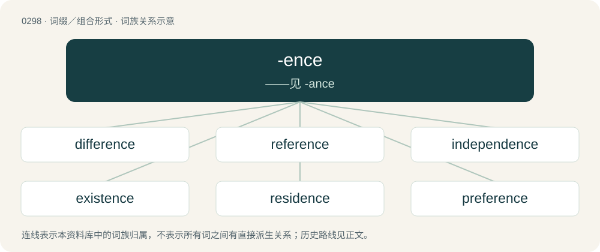

# 0336 · -ence — ——见 -ance

[总目录](../00_总目录_按常用程度.md)

**类型**：词缀／组合形式　｜　**来源语言**：见词源记录

## 核心含义与来源

- 核心含义：——见 -ance
- 英文含义：Same as -ance; having the state or condition of.
- 词形：-ence

**来源记录 1**（后缀／后置成分；Same as -ance; having the state or condition of.）

From Middle English -ence, from Old French -ence, from Latin -entia. Compare Old English -ende, -endu (“-ing, -ence”).

## 词族图

## 单词速览（常用到不常用）

| 单词 | 音标 | 释义 |
|---|---|---|
| [difference](#w-1) | 英 /ˈdɪf.(ə.)ɹəns/；美 /ˈdɪf.(ə.)ɹəns/ | n. 不同, 差异；\[计\] 差分 |
| [reference](#w-2) | 英 /ˈɹɛf.(ə.)ɹəns/ | n. 参考, 索引, 参照；vt. 给...加上参考资料；vt. 引用 |
| [independence](#w-3) | /ˌɪn.dɪˈpɛn.dəns/ | n. 独立, 自立, 自主；\[医\] 自主性, 独立性 |
| [existence](#w-4) | 美 /ɛɡˈzɪs.təns/ | n. 存在, 生存；\[法\] 存在, 存在状态, 实体 |
| [residence](#w-5) | /ˈɹɛz.ɪ.dəns/ | n. 住宅, 居留, 驻扎, 居住期间；\[医\] 住房 |
| [preference](#w-6) | /ˈpɹɛf(ə)ɹ(ə)ns/ | n. 偏爱, 优先, 喜爱物；\[计\] 首选项 |
| [interference](#w-7) | 英 /ˌɪntə(ɹ)ˈfɪəɹəns/；美 /ˌɪntəɹˈfɪɹɪns/ | n. 冲突, 干涉；\[计\] 干扰 |
| [coincidence](#w-8) | 英 /kəʊˈɪnsɪdəns/；美 /koʊˈɪnsɪdəns/ | n. 巧合, 同时发生；\[电\] 符合计数器 |
| [occurrence](#w-9) | 英 /əˈkʌɹ.əns/；美 /əˈkɜɹ.əns/ | n. 发生, 事件, 出现；\[医\] 发生 |
| [dependence](#w-10) | 英 /dɪˈpɛndəns/ | n. 依赖, 依存, 信赖；\[医\] 依赖(如对药物的依赖,即瘾或癖), 从属, 偏利共生 |
| [resilience](#w-11) | 英 /ɹɪˈzɪl.ɪ.əns/；美 /ɹɪˈzɪl.jəns/ | n. 弹回, 有弹力, 恢复力；\[化\] 回弹; 弹性; 弹回性; 回能; 弹能 |
| [convergence](#w-12) | 英 /kənˈvɜːd͡ʒəns/；美 /kənˈvɝd͡ʒəns/ | n. 集中, 收敛；\[计\] 收敛, 会聚 |
| [insistence](#w-13) | /ɪnˈsɪs.təns/ | n. 坚持, 坚决主张 |
| [precedence](#w-14) | /ˈpɹɛsɪd(ə)ns/ | n. 优先, 居先；\[计\] 先后次序; 优先规定 |
| [resurgence](#w-15) | /riˈsəːdʒəns/ | n. 再起, 复活, 再现 |
| [inference](#w-16) | 英 /ˈɪn.fə.ɹəns/；美 /ˈɪn.fɚ.əns/ | n. 推论；\[法\] 推论, 推理, 推断 |
| [recurrence](#w-17) | 美 /rəˈkɝ.əns/ | n. 再现, 再发生, 反复, 循环；\[医\] 复发, 再发 |
| [abstinence](#w-18) | /ˈæb.stɪ.nəns/ | n. 节制, 禁欲, 戒酒；\[医\] 节制, 禁戒(如禁酒,节欲) |
| [subsistence](#w-19) | /səbˈsɪstəns/ | n. 生存, 生活；\[医\] 生存 |
| [deterrence](#w-20) | 英 /dɪˈtɛɹəns/；美 /dɪˈtɝɹəns/ | n. 威慑, 威慑力量；\[法\] 威慑力量, 制止物 |
| [deference](#w-21) | 英 /ˈdɛfəɹəns/；美 /ˈdɛ.fɚ.əns/ | n. 顺从, 尊重 |
| [transcendence](#w-22) | /tɹæn(t)ˈsɛndəns/ | n. 超越, 卓越, 卓绝 |
| [ambivalence](#w-23) | /æmˈbɪvələns/ | n. 矛盾情绪；\[医\] 矛盾情绪(两种情感互相冲突) |
| [condolence](#w-24) | 美 /kənˈdoʊləns/ | n. 哀悼, 吊唁 |
| [pestilence](#w-25) | 美 /ˈpɛstələn(t)s/；/ˈpɛstələn(t)s/ | n. 瘟疫, 散布毒害的事物, 罪恶；\[医\] 疫病, 疫病流行 |
| [subsidence](#w-26) | /ˈsʌbsɪdəns/ | n. 沉淀, 下沉, 陷没 |
| [senescence](#w-27) | /sɪˈnɛ.səns/ | n. 老朽, 衰老；\[医\] 衰老, 变老 |
| [salience](#w-28) | 英 /ˈseɪ.li.əns/ | n. 显著, 卓越, 突出, 突起, 特征 |
| [subservience](#w-29) | /səbˈs\\\\ːviəns/ | n. 辅助性, 从属性, 有帮助, 有用, 奉承, 奴性, 谄媚 |
| [penitence](#w-30) | /ˈpenitəns/ | n. 后悔, 忏悔, 改过；\[法\] 悔罪, 悔过, 忏悔 |
| [abhorrence](#w-31) | 英 /əbˈhɒɹ.n̩(t)s/；美 /æbˈhɔɹ.n̩(t)s/ | n. 厌恶, 痛恨 |
| [transience](#w-32) | /ˈtrænziəns/ | n. 顷刻, 无常, 短暂 |
| [belligerence](#w-33) | /biˈlidʒərəns/ | n. 交战, 好战性, 斗争性 |

## 逐词详解

### 1. difference

**词性**：名词　｜　**音标**：英 /ˈdɪf.(ə.)ɹəns/；美 /ˈdɪf.(ə.)ɹəns/

**中文释义**：n. 不同, 差异；\[计\] 差分

**英文义项**：The quality of being different. / A characteristic of something that makes it different from something else.

**构词拆分**：differ + -ence

**词源与演化**：

From Middle English difference, from Old French difference, from Latin differentia (“difference”), from differēns (“different”), present participle of differre. Doublet of differentia. Morphologically differ + -ence.

**例句**：

> We have our little differences, but we are firm friends.

该用例对应义项：A disagreement or argument.

### 2. reference

**词性**：名词　｜　**音标**：英 /ˈɹɛf.(ə.)ɹəns/

**中文释义**：n. 参考, 索引, 参照；vt. 给...加上参考资料；vt. 引用

**英文义项**：A measurement one can compare (some other measurement) to. / Information about a person, provided by someone (a referee) with whom they are well acquainted.

**构词拆分**：refer + -ence

**词源与演化**：

From Middle French référence, from Medieval Latin referentia, nominative neuter plural of referēns, present participle of referō (“return, reply”, literally “carry back”). Morphologically refer + -ence.

**用法示例／搭配（非完整句）**：

> Reference Dictionary of Linguistics

该用例对应义项：A reference work.

### 3. independence

**词性**：名词　｜　**音标**：/ˌɪn.dɪˈpɛn.dəns/

**中文释义**：n. 独立, 自立, 自主；\[医\] 自主性, 独立性

**英文义项**：The quality or state of being independent; lack of dependence; the state of not being reliant on, or controlled by, others. / The state of having sufficient means for a comfortable livelihood.

**构词拆分**：in- + de- + pend + -ence；in- + dependence

**词源与演化**：

From French indépendance. Analyzable as in- + de- + pend + -ence or in- + dependence.

**例句**：

> In 1947, India gained independence from the British Empire.

该用例对应义项：The quality or state of being independent; lack of dependence; the state of not being reliant on, or controlled by, others.

### 4. existence

**词性**：名词　｜　**音标**：美 /ɛɡˈzɪs.təns/

**中文释义**：n. 存在, 生存；\[法\] 存在, 存在状态, 实体

**英文义项**：The state of being, existing, or occurring; beinghood. / Empirical reality; the substance of the physical universe. (Dictionary of Philosophy; 1968)

**构词拆分**：exist + -ence

**词源与演化**：

From Middle English existence, from Old French existence, from Late Latin existentia (“existence”), from existēns, from existō, exsistō (“I am, I exist”), from ex (“out”) + sistere (“to set, place”) (related to stare (“to stand, to be stood”)), ultimately from Proto-Indo-European \*stísteh₂ti, from the root \*steh₂- (“stand”). Cognate with Spanish existencia, French existence, German Existenz. Displaced native Old English understandennes (literally, "understanden-ness"). Morphologically exist + -ence.

**例句**：

> In order to destroy evil, we must first acknowledge its existence.

该用例对应义项：The state of being, existing, or occurring; beinghood.

### 5. residence

**词性**：名词　｜　**音标**：/ˈɹɛz.ɪ.dəns/

**中文释义**：n. 住宅, 居留, 驻扎, 居住期间；\[医\] 住房

**英文义项**：The place where one lives (resides); one's home. / A building or portion thereof used as a home, such as a house or an apartment therein.

**构词拆分**：reside + -ence

**词源与演化**：

Inherited from Middle English residence, from Old French residence, from Medieval Latin residentia, from residēns, present participle of resideō, equivalent to reside + -ence. Doublet of residencia.

**例句**：

> He refused to live in the governor's residence.

该用例对应义项：the official house or establishment of an important person (as a sovereign or president)

### 6. preference

**词性**：名词　｜　**音标**：/ˈpɹɛf(ə)ɹ(ə)ns/

**中文释义**：n. 偏爱, 优先, 喜爱物；\[计\] 首选项

**英文义项**：The selection of one thing or person over others (with the main adposition being "for" in relation to the thing or person, but possibly also "of") / The option to so select, and the one selected.

**构词拆分**：prefer + -ence

**词源与演化**：

From Middle French preference, from Medieval Latin preferentia. Doublet of preferans. Morphologically prefer + -ence. Compare typologically Russian предвзя́тость (predvzjátostʹ) (&lt;&lt; взять (vzjatʹ), a suppletive of брать (bratʹ), which is cognate with Latin ferō).

**例句**：

> Can I keep my preferences when I upgrade to the new version of this application?

该用例对应义项：The option to so select, and the one selected.

### 7. interference

**词性**：名词　｜　**音标**：英 /ˌɪntə(ɹ)ˈfɪəɹəns/；美 /ˌɪntəɹˈfɪɹɪns/

**中文释义**：n. 冲突, 干涉；\[计\] 干扰

**英文义项**：The act of interfering with something, or something that interferes. / The illegal obstruction of an opponent in some ball games.

**构词拆分**：interfere + -ence

**词源与演化**：

From interfere + -ence. The sense in physics was likely introduced by English polymath Thomas Young, which he used as early as 1801 in a paper in the Philosophical Transactions of the Royal Society.

**例句**：

> They were glued to the TV, as the referee called out a fifteen yard penalty for interference.

该用例对应义项：The illegal obstruction of an opponent in some ball games.

### 8. coincidence

**词性**：名词　｜　**音标**：英 /kəʊˈɪnsɪdəns/；美 /koʊˈɪnsɪdəns/

**中文释义**：n. 巧合, 同时发生；\[电\] 符合计数器

**英文义项**：The property of being coincident, occurring at the same time or place. / The appearance of a meaningful connection between events when there is none.

**构词拆分**：By surface analysis, coincide + -ence

**词源与演化**：

From Middle French coincidence (French coïncidence). By surface analysis, coincide + -ence.

**例句**：

> It is sheer coincidence that the cartoon resembles the local politician.

该用例对应义项：The appearance of a meaningful connection between events when there is none.

### 9. occurrence

**词性**：名词　｜　**音标**：英 /əˈkʌɹ.əns/；美 /əˈkɜɹ.əns/

**中文释义**：n. 发生, 事件, 出现；\[医\] 发生

**英文义项**：An actual instance when a situation occurs; an event or happening. / The lexical aspect (aktionsart) of verbs or predicates that change in or over time.

**构词拆分**：occur + -ence

**词源与演化**：

From Middle French occurrence, from Medieval Latin occurrentia. Morphologically occur + -ence.

**例句**：

> A disease of frequent occurrence.

该用例对应义项：an instance of something occurring

### 10. dependence

**词性**：名词　｜　**音标**：英 /dɪˈpɛndəns/

**中文释义**：n. 依赖, 依存, 信赖；\[医\] 依赖(如对药物的依赖,即瘾或癖), 从属, 偏利共生

**英文义项**：The state of being dependent, of relying upon another. / An irresistible physical or psychological need, especially for a chemical substance.

**构词拆分**：depend + -ence

**词源与演化**：

From Middle French dépendance. Morphologically depend + -ence.

**例句**：

> He had a deep dependence on her for guidance.

该用例对应义项：The state of being dependent, of relying upon another.

### 11. resilience

**词性**：名词　｜　**音标**：英 /ɹɪˈzɪl.ɪ.əns/；美 /ɹɪˈzɪl.jəns/

**中文释义**：n. 弹回, 有弹力, 恢复力；\[化\] 回弹; 弹性; 弹回性; 回能; 弹能

**英文义项**：The mental ability to recover quickly from depression, illness or misfortune. / The physical property of material that can resume its shape after being stretched or deformed; elasticity.

**词源与演化**：

From Latin resiliō (“to spring back”) + English -ence.

**例句**：

> It’s the trials that teach us resilience, not just the good times.

### 12. convergence

**词性**：名词　｜　**音标**：英 /kənˈvɜːd͡ʒəns/；美 /kənˈvɝd͡ʒəns/

**中文释义**：n. 集中, 收敛；\[计\] 收敛, 会聚

**英文义项**：The act of moving toward union or uniformity. / A meeting place.

**构词拆分**：converge + -ence

**词源与演化**：

From converge + -ence (after Latin convergentia).

**用法示例／搭配（非完整句）**：

> We built a homestead at the convergence of two rivers

该用例对应义项：A meeting place.

### 13. insistence

**词性**：名词　｜　**音标**：/ɪnˈsɪs.təns/

**中文释义**：n. 坚持, 坚决主张

**英文义项**：The state of being insistent. / An urgent demand.

**构词拆分**：insist + -ence

**词源与演化**：

From Middle English insistence, derived from Old French insister (“to insist”). Compare Middle French insistance. Morphologically insist + -ence.

**例句**：

> The insistence of their hunger.

该用例对应义项：the state of demanding notice or attention

### 14. precedence

**词性**：名词　｜　**音标**：/ˈpɹɛsɪd(ə)ns/

**中文释义**：n. 优先, 居先；\[计\] 先后次序; 优先规定

**英文义项**：The state of preceding in importance or priority. / Precedent.

**构词拆分**：precede + -ence

**词源与演化**：

From Middle French précédence (“the state of preceding, anteriority”). Morphologically precede + -ence.

**例句**：

> Family takes precedence over work, in an emergency.

该用例对应义项：The state of preceding in importance or priority.

### 15. resurgence

**词性**：名词　｜　**音标**：/riˈsəːdʒəns/

**中文释义**：n. 再起, 复活, 再现

**英文义项**：An instance of something resurging; a renewal of vigor or vitality.

**构词拆分**：resurge + -ence

**词源与演化**：

From resurge + -ence.

**例句**：

> We see a resurgence of the wildlife.

### 16. inference

**词性**：名词　｜　**音标**：英 /ˈɪn.fə.ɹəns/；美 /ˈɪn.fɚ.əns/

**中文释义**：n. 推论；\[法\] 推论, 推理, 推断

**英文义项**：The act or process of inferring by deduction or induction. / That which is inferred; a truth or proposition drawn from another which is admitted or supposed to be true; a conclusion; a deduction.

**构词拆分**：infer + -ence

**词源与演化**：

From Latin inferentia. Morphologically infer + -ence.

**例句**：

> Type inference has three outputs whereas checking only has two.

### 17. recurrence

**词性**：名词　｜　**音标**：美 /rəˈkɝ.əns/

**中文释义**：n. 再现, 再发生, 反复, 循环；\[医\] 复发, 再发

**英文义项**：Return or reversion to a certain state. / The instance of recurring; frequent occurrence.

**构词拆分**：recurrent + -ence

**词源与演化**：

From recurrent + -ence, cognate with Latin recurrentia, from recurrēns (“returning back, recurring”), form of recurrō (“to return, to recur”) (English recur).

**例句**：

> The chances of recurrence vary from patient to patient.

### 18. abstinence

**词性**：名词　｜　**音标**：/ˈæb.stɪ.nəns/

**中文释义**：n. 节制, 禁欲, 戒酒；\[医\] 节制, 禁戒(如禁酒,节欲)

**英文义项**：The act or practice of abstaining, refraining from indulging a desire or appetite. / Specifically, the practice of abstaining from intoxicating/alcoholic beverages; total abstinence; teetotalism).

**构词拆分**：abstain + -ence

**词源与演化**：

From Middle English abstinence, from Old French abstinence, from Latin abstinentia, from abstinēns, present participle of abstineō (“to withhold”). Equivalent to abstain + -ence.

**例句**：

> Abstinence is the only 100% guaranteed contraception.

该用例对应义项：Specifically, the practice of abstaining from sexual intercourse, either permanently or until marriage.

### 19. subsistence

**词性**：名词　｜　**音标**：/səbˈsɪstəns/

**中文释义**：n. 生存, 生活；\[医\] 生存

**英文义项**：Real being; existence. / The act of maintaining oneself at a minimum level.

**构词拆分**：subsist + -ence

**词源与演化**：

From Middle English subsistence; partly from Middle French subsistence (modern French subsistance) and partly from its etymon Late Latin subsistentia (“substance, reality, in Medieval Latin also stability”), from Latin subsistēns, present participle of subsistere (“to continue, subsist”). Perhaps also partly from subsist + -ence.

**用法示例／搭配（非完整句）**：

> the subsistence of qualities in bodies

该用例对应义项：Inherency.

### 20. deterrence

**词性**：名词　｜　**音标**：英 /dɪˈtɛɹəns/；美 /dɪˈtɝɹəns/

**中文释义**：n. 威慑, 威慑力量；\[法\] 威慑力量, 制止物

**英文义项**：The act of deterring, or the state of being deterred. / An action taken by states or alliances of nations against equally powerful alliances to prevent hostile action.

**词源与演化**：

From the stem of deterrent + -ence.

**例句**：

> Strict penalties act as a deterrence against theft.

该用例对应义项：The act of deterring, or the state of being deterred.

### 21. deference

**词性**：名词　｜　**音标**：英 /ˈdɛfəɹəns/；美 /ˈdɛ.fɚ.əns/

**中文释义**：n. 顺从, 尊重

**英文义项**：Great respect. / The willingness to carry out the wishes of others.

**构词拆分**：defer + -ence

**词源与演化**：

From French déférence. Morphologically defer + -ence.

**例句**：

> By tidying his room, he showed deference to his mother.

该用例对应义项：The willingness to carry out the wishes of others.

### 22. transcendence

**词性**：名词　｜　**音标**：/tɹæn(t)ˈsɛndəns/

**中文释义**：n. 超越, 卓越, 卓绝

**英文义项**：The act of surpassing usual limits. / The state of being beyond the range of normal perception.

**构词拆分**：From transcend + -ence.

**词源与演化**：

From transcend + -ence.

**例句**：

> Divine transcendence is now rejected, and a philosophy of immanence takes its place.

### 23. ambivalence

**词性**：名词　｜　**音标**：/æmˈbɪvələns/

**中文释义**：n. 矛盾情绪；\[医\] 矛盾情绪(两种情感互相冲突)

**英文义项**：The coexistence of opposing attitudes or feelings (such as love and hate) towards a person, object or idea. / A state of uncertainty or indecisiveness.

**构词拆分**：ambi- + valence

**词源与演化**：

Borrowed from German Ambivalenz (“simultaneous conflicting feelings”), from Latin ambi- (“both”) and valentia (“strength”), from the verb valere (“to be strong”) (see valiant); spelled on the model of French-origin words ending in -ence. The German term was coined by Swiss psychiatrist Eugen Bleuler in 1910; by 1929, it had taken on a broader literary and general sense. Equivalent to ambi- + valence.

**例句**：

> Spenser's sarcastic and joking remarks are often misinterpreted as signs of ambivalence and often taken too seriously.

### 24. condolence

**词性**：名词　｜　**音标**：美 /kənˈdoʊləns/

**中文释义**：n. 哀悼, 吊唁

**英文义项**：Comfort, support or sympathy. / An expression of comfort, support, or sympathy offered to the family and friends of somebody who has died.

**构词拆分**：condole + -ence

**词源与演化**：

From condole + -ence, or from Middle French condoléance, or formed from the root of Latin condoleō (“to sympathize”), from con- (“together, with”) and doleō (“to hurt, suffer, have pain”).

**例句**：

> There was not much to do after the accident but offer what condolence I could.

该用例对应义项：Comfort, support or sympathy.

### 25. pestilence

**词性**：名词　｜　**音标**：美 /ˈpɛstələn(t)s/；/ˈpɛstələn(t)s/

**中文释义**：n. 瘟疫, 散布毒害的事物, 罪恶；\[医\] 疫病, 疫病流行

**英文义项**：Any epidemic disease that is highly contagious, infectious, virulent and devastating.

**构词拆分**：pestilent + -ence

**词源与演化**：

From Middle English, from Old French, from Latin pestilentia (“plague”), from pestilens (“infected, unwholesome, noxious”); equivalent to pestilent + -ence.

**例句**：

> Many squandered their money on charms and amulets, thinking that would ward off the pestilence.

### 26. subsidence

**词性**：名词　｜　**音标**：/ˈsʌbsɪdəns/

**中文释义**：n. 沉淀, 下沉, 陷没

**英文义项**：The process of becoming less active or severe. / A sinking of something to a lower level, especially of part of the surface of the Earth due to underground excavation, seismic activity or underground or ground water depletion, or the rocks in a geological basin, due to continued deposition from above.

**构词拆分**：subside + -ence

**词源与演化**：

Latin subsidens, subsidentis, present participle of subsidere. Equivalent to subside + -ence.

### 27. senescence

**词性**：名词　｜　**音标**：/sɪˈnɛ.səns/

**中文释义**：n. 老朽, 衰老；\[医\] 衰老, 变老

**英文义项**：The state or process of ageing, especially in humans; old age. / Ceasing to divide by mitosis because of shortening of telomeres or excessive DNA damage.

**构词拆分**：From senescent + -ence.

**词源与演化**：

From senescent + -ence.

**例句**：

> Senescence is the last stage of life.

### 28. salience

**词性**：名词　｜　**音标**：英 /ˈseɪ.li.əns/

**中文释义**：n. 显著, 卓越, 突出, 突起, 特征

**英文义项**：The condition of being salient. / A highlight; perceptual prominence, or likelihood of being noticed.

**词源与演化**：

From Latin saliēns, salientis (whence -ence), from saliō.

### 29. subservience

**词性**：名词　｜　**音标**：/səbˈs\\\\ːviəns/

**中文释义**：n. 辅助性, 从属性, 有帮助, 有用, 奉承, 奴性, 谄媚

**英文义项**：The state of being subservient.

**构词拆分**：subservi(ent) + -ence

**词源与演化**：

From subservi(ent) + -ence.

**例句**：

> All his actions were in subservience to the general plan.

该用例对应义项：the condition of being something that is useful in reaching an end or carrying out a plan

### 30. penitence

**词性**：名词　｜　**音标**：/ˈpenitəns/

**中文释义**：n. 后悔, 忏悔, 改过；\[法\] 悔罪, 悔过, 忏悔

**英文义项**：The condition of being penitent; a feeling of regret or remorse for doing wrong or sinning.

**构词拆分**：penitent + -ence

**词源与演化**：

First attested circa 13th century, from Middle English penitence, from Old French penitence, from Latin paenitentia (“repentance, penitence”), from paenitēns (“penitent”), present active participle of paeniteō (“regret, repent”). Equivalent to penitent + -ence. Doublet of penance.

**例句**：

> They demand public penitence from me.

### 31. abhorrence

**词性**：名词　｜　**音标**：英 /əbˈhɒɹ.n̩(t)s/；美 /æbˈhɔɹ.n̩(t)s/

**中文释义**：n. 厌恶, 痛恨

**英文义项**：Extreme aversion or detestation; the feeling of utter dislike or loathing; a visceral revulsion toward something repugnant. / A person or thing that is loathsome; a detested thing.

**构词拆分**：From abhorrent + -ence.

**词源与演化**：

From abhorrent + -ence.

**例句**：

> He said both men agreed they share an "abhorrence and distaste" for war.

### 32. transience

**词性**：名词　｜　**音标**：/ˈtrænziəns/

**中文释义**：n. 顷刻, 无常, 短暂

**英文义项**：The quality of being transient, temporary, brief or fleeting. / An impermanence that suggests the inevitability of ending or dying.

**构词拆分**：From transient + -ence.

**词源与演化**：

From transient + -ence.

**例句**：

> I never cease to be amazed at the transience of our mortal life.

### 33. belligerence

**词性**：名词　｜　**音标**：/biˈlidʒərəns/

**中文释义**：n. 交战, 好战性, 斗争性

**英文义项**：The state of being belligerent; aggressive inclination to war or violence. / A feeling of aggression and hostility, characterized by an urge for confrontation and provocation.

**构词拆分**：belligerent + -ence

**词源与演化**：

From belligerent + -ence.
