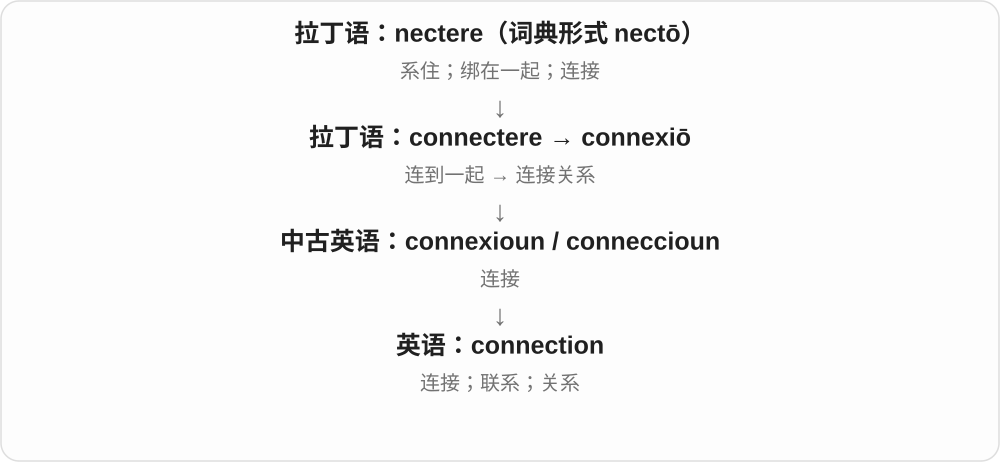
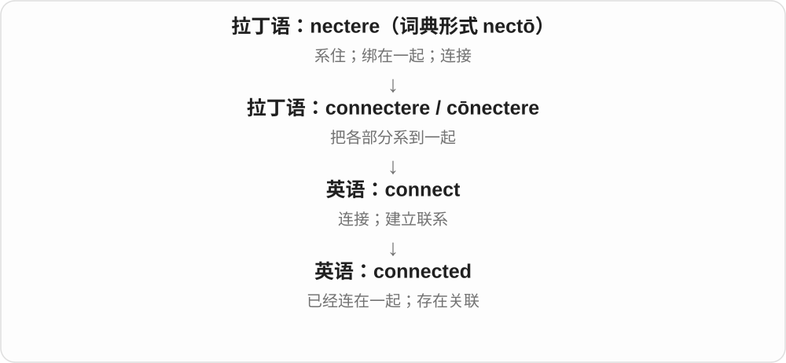
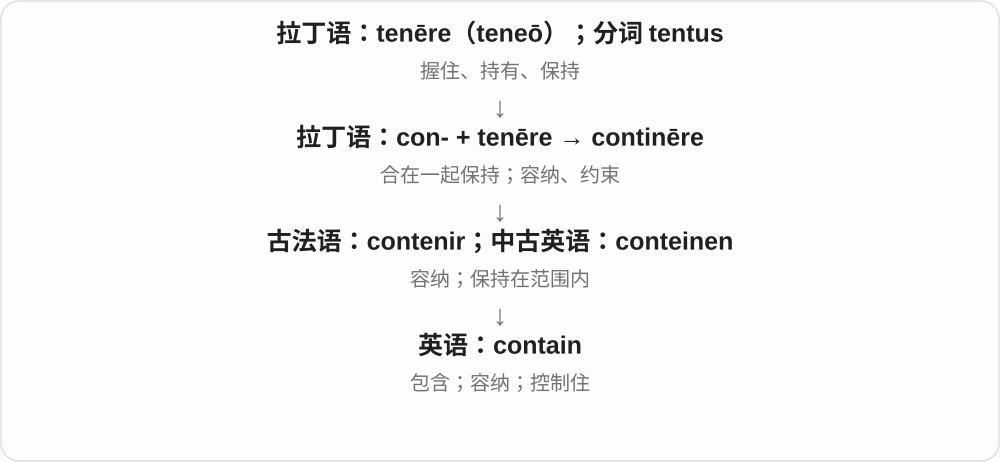
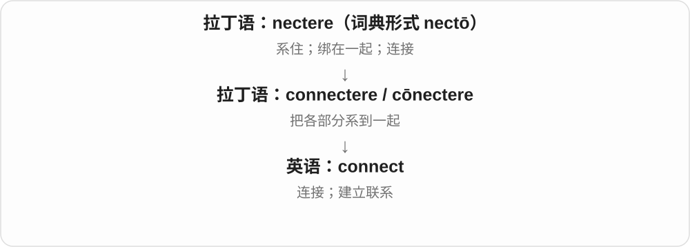
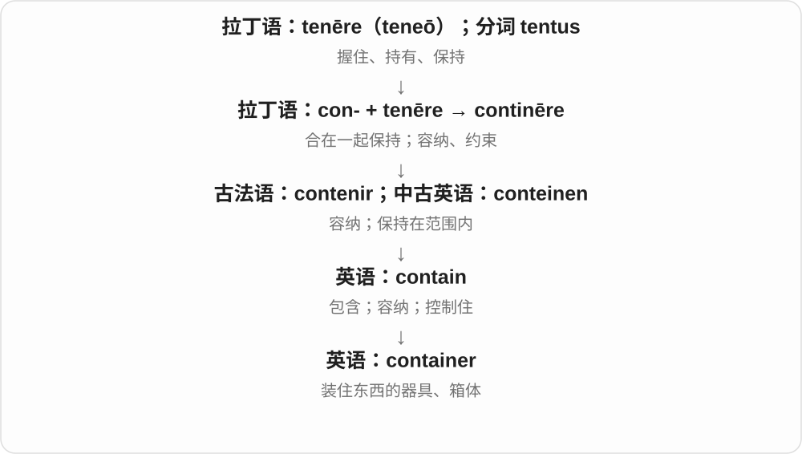
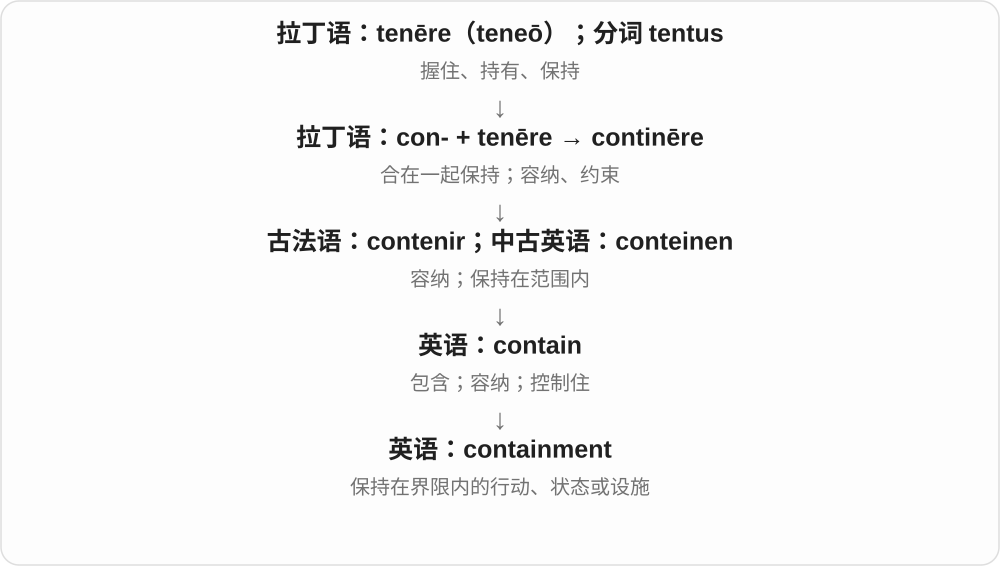
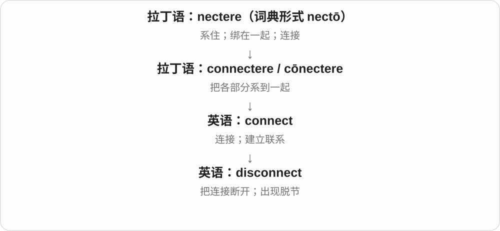
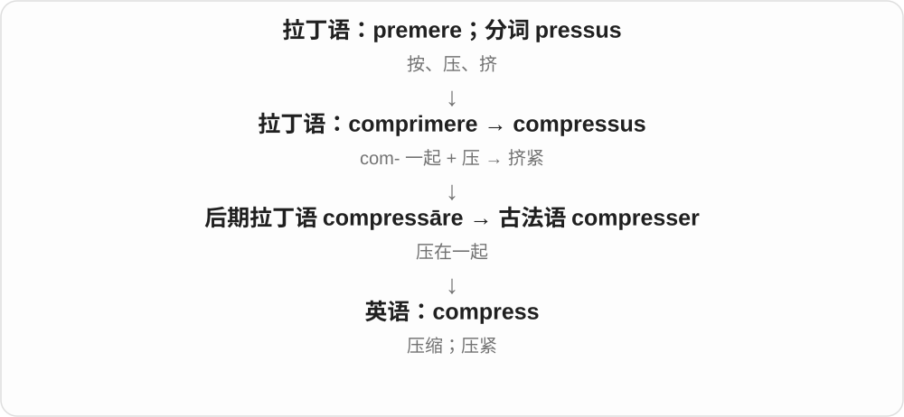
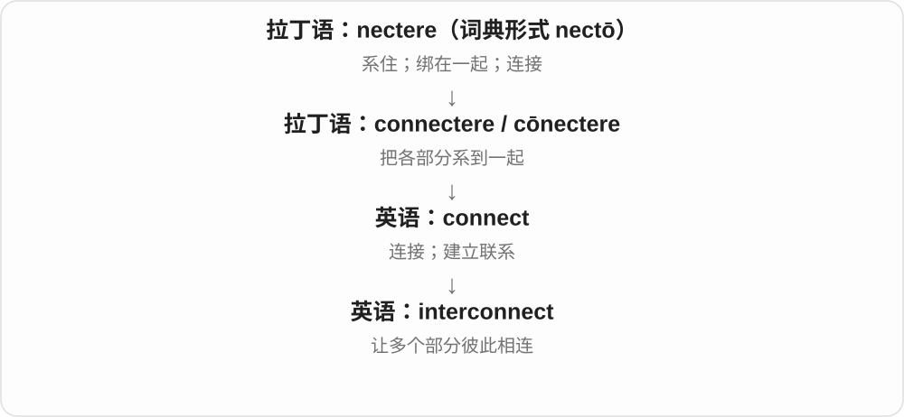

# 0374 · con-, co-, col-, com-, cor- — 一起、共同；有时加强动作

[逐词精讲目录](../00_逐词精讲目录.md) · [总目录](../00_总目录_按常用程度.md)

## 核心词根与来源

这一组本质上是拉丁前缀 com-/con-，与表示“和、同”的 cum 相连。英语中的许多词是整个拉丁词或法语词借入，前缀已和后面的词干一起变化；现代英语也会用 co- 继续造词。

**把几份东西带到同一个过程里：connect 接在一起，contribute 各添一份，collide 撞到一起，connote 连联想也一起带出来。**

几条线汇到一处：可以接通、凑出成果，也可以相撞；“一起”并不保证结果是合作或好事。

- **把联系接起来**：connect, connection, connected, connector, disconnect, reconnect, interconnect
- **装在一起、压在一起**：contain, container, containment, compress
- **贡献与咨询**：contribute, contributor, consult, consultation, consultancy
- **构成与重新组成**：constitution, constitutional, reconstitution
- **碰撞与聚结**：collide, collider, coagulate
- **附带含义**：connote, connotation
- **加强动作：逐渐啃蚀**：corrode

## 词形与演化规律

con- 是常见形式；在 l 前常同化为 col-，在 r 前为 cor-，在 b、p、m 前常见 com-，co- 则常用于元音前及现代英语构词。它既能表示一起，也会只加强动作，如 corrode；不能每词都生硬译成共同。

## 单词速览（常用到不常用）

| 单词 | 音标 | 核心意思 |
|---|---|---|
| [connection](#w-1) | /kəˈnekʃən/ | 连接；关系；衔接；人脉 |
| [connected](#w-2) | /kəˈnektɪd/ | 相连的；相关的；有人脉的 |
| [constitution](#w-3) | 英 /ˌkɒnstɪˈtjuːʃən/；美 /ˌkɑːnstɪˈtuːʃən/ | 宪法；组成、构造；体质 |
| [contain](#w-4) | /kənˈteɪn/ | 容纳；包含；控制住 |
| [connect](#w-5) | /kəˈnekt/ | 连接；联系起来；产生共鸣 |
| [contribute](#w-6) | /kənˈtrɪbjuːt/ | 贡献；捐助；投稿；成为促成因素 |
| [constitutional](#w-7) | 英 /ˌkɒnstɪˈtjuːʃənəl/；美 /ˌkɑːnstəˈtuːʃənəl/ | 宪法的；合宪的；体质上的；保健散步〔名词〕 |
| [container](#w-8) | 英 /kənˈteɪnə/；美 /kənˈteɪnər/ | 容器；集装箱 |
| [consultation](#w-9) | 英 /ˌkɒnsəlˈteɪʃən/；美 /ˌkɑːnsəlˈteɪʃən/ | 咨询；磋商；征求意见；咨询会面 |
| [consult](#w-10) | 动词 /kənˈsʌlt/；名词另读英 /ˈkɒnsʌlt/、美 /ˈkɑːnsʌlt/ | 请教；商议；查阅；一次咨询〔名词，尤美式〕 |
| [contributor](#w-11) | 英 /kənˈtrɪbjətə/；美 /kənˈtrɪbjətər/ | 贡献者；捐助者；撰稿人；促成因素 |
| [connector](#w-12) | 英 /kəˈnektə/；美 /kəˈnektər/ | 连接器；接头；起连接作用的东西 |
| [containment](#w-13) | /kənˈteɪnmənt/ | 控制；遏制；围堵；容纳设施 |
| [consultancy](#w-14) | /kənˈsʌltənsi/ | 咨询业务；顾问服务；咨询公司 |
| [disconnect](#w-15) | 动词 /ˌdɪskəˈnekt/；名词 /ˈdɪskənekt/ | 断开；脱离；脱节 |
| [collide](#w-16) | /kəˈlaɪd/ | 相撞；碰撞；冲突 |
| [reconnect](#w-17) | /ˌriːkəˈnekt/ | 重新连接；恢复联系 |
| [compress](#w-18) | 动词：英、美 /kəmˈpres/；名词：英 /ˈkɒmpres/、美 /ˈkɑːmpres/ | 压缩；挤紧；压敷布 |
| [connotation](#w-19) | 英 /ˌkɒnəˈteɪʃən/；美 /ˌkɑːnəˈteɪʃən/ | 附带含义；联想义；感情色彩 |
| [collider](#w-20) | 英 /kəˈlaɪdə/；美 /kəˈlaɪdər/ | 对撞机；碰撞体〔游戏开发〕 |
| [interconnect](#w-21) | 英 /ˌɪntəkəˈnekt/；美 /ˌɪntərkəˈnekt/ | 互相连接；使相互联系 |
| [corrode](#w-22) | 英 /kəˈrəʊd/；美 /kəˈroʊd/ | 腐蚀；侵蚀；逐渐损害 |
| [reconstitution](#w-23) | 英 /ˌriːkɒnstɪˈtjuːʃən/；美 /ˌriːˌkɑːnstəˈtuːʃən/ | 重组；重新建立；复原，复水 |
| [connote](#w-24) | 英 /kəˈnəʊt/；美 /kəˈnoʊt/ | 带有……的意味；使人联想到 |
| [coagulate](#w-25) | 动词：英 /kəʊˈæɡjʊleɪt/，美 /koʊˈæɡjəleɪt/；名词词尾读 /lət/ | 凝结；使凝固；凝块〔名词〕 |

## 逐词讲解

### 1. connection — 连接；关系；衔接；人脉

**音标**：/kəˈnekʃən/

**先抓住这个画面**

connection 是接上之后形成的那条线或关系：网络连通、两件事有关、车次接得上，都可以这样说。

**怎么拆**

来自拉丁语 connexiō，经中古英语传入；现代 connection 的拼写使 connect + -ion 的关系更明显。

**怎么变成今天的意思**

联系可以是物理的，也可以是因果、社交和交通上的。connections 还常指认识的人，因为这些关系能提供信息或机会。

**常见搭配与例句**

an internet connection；a connection between…；miss a connection；have connections；in connection with… 。

> We lost our internet connection during the meeting.

开会时，我们的网络连接断了。

> Is there a connection between these two problems?

这两个问题之间有联系吗？

**别混淆**

connection 只说明有某种联系，不自动证明因果。两件事同时发生，也需要进一步解释它们怎样有关。

### 2. connected — 相连的；相关的；有人脉的

**音标**：/kəˈnektɪd/

**先抓住这个画面**

connected 表示线已经接上了：设备能通，事情有关，人与人之间也可以保持联系。

**怎么拆**

connect + -ed，既是过去分词，也可作形容词。

**怎么变成今天的意思**

它描述连接形成后的状态。一个 connected person 在特定语境可指认识重要人物，但仅说人际关系好时要看上下文。

**常见搭配与例句**

be connected to…；be connected with…；stay connected；closely connected events。

> The two rooms are connected by a narrow corridor.

这两个房间由一条狭窄走廊相连。

> These decisions are closely connected.

这些决定彼此密切相关。

**别混淆**

connected 是连着的；connective 是起连接作用的。connected devices 是相连设备，connective tissue 是帮助连接和支持的组织。

### 3. constitution — 宪法；组成、构造；体质

**音标**：英 /ˌkɒnstɪˈtjuːʃən/；美 /ˌkɑːnstɪˈtuːʃən/

**先抓住这个画面**

把一个整体“怎样组织起来”写成基本安排：国家有宪法，身体有自身的体质，材料也有其构成。

**怎么拆**

来自拉丁语 cōnstitūtiō，经古法语进入；和 constitute 对应，但不是最初在英语里简单加 -ion 造出的。

**怎么变成今天的意思**

规则规定国家怎样构成和运作，身体的构成体现为体质。三个义项都围绕“一个整体的基本组织方式”。

**常见搭配与例句**

a written constitution；a strong constitution；the constitution of a substance。

> The constitution sets out the main powers of government.

宪法规定了政府的主要权力。

> She has a strong constitution and rarely misses a day of work.

她体质好，很少因身体原因缺勤。

**别混淆**

constitution 是基本组织或基本法；institution 是机构或制度。the constitution 常按语境特指某部宪法。

### 4. contain — 容纳；包含；控制住

**音标**：/kənˈteɪn/

**先抓住这个画面**

contain 像盒子把东西留在里面；再抽象一点，就是把情绪、火势或问题限制在某个范围内。

**怎么拆**

con-（一起）+ tenēre（保持）在拉丁语中形成 continēre，经古法语 contenir 进入英语。

**怎么变成今天的意思**

既可以描述内部有什么，也可以强调“不让它跑出去”。contain excitement 是努力控制兴奋。

**常见搭配与例句**

contain water；contain information；contain a fire；contain one’s excitement。

> This bottle contains enough water for the walk.

这只瓶子装着足够这次步行喝的水。

> She could hardly contain her excitement.

她几乎控制不住自己的兴奋。

**别混淆**

include 强调作为组成部分；contain 常强调内部有某物或把扩散控制住，二者部分重叠。

### 5. connect — 连接；联系起来；产生共鸣

**音标**：/kəˈnekt/

**先抓住这个画面**

connect 像在两个点之间接上一条线：插上电缆，关联两件事，或跟一个人建立谈得来的关系。

**怎么拆**

con-（一起）+ nectere（绑、连接），形成拉丁语 connectere。不是 con + next“下一个”。

**怎么变成今天的意思**

原本的系在一起扩展到设备、交通、思想和人际关系。connect with someone 有时表示彼此理解，不必真的有一条线。

**常见搭配与例句**

connect A to B；connect A with B；connect to the internet；connect with an audience。

> Connect the monitor to the laptop with this cable.

用这根线把显示器连到笔记本电脑上。

> Her stories helped her connect with the audience.

她讲的故事帮助她与观众产生了共鸣。

**别混淆**

connect 是建立联系；attach 常强调把一物附在另一物上。connect 两个网络不必把它们合成一个整体。

### 6. contribute — 贡献；捐助；投稿；成为促成因素

**音标**：/kənˈtrɪbjuːt/

**先抓住这个画面**

大家往共同的成果里各添一份，你添进去的钱、时间、想法或作用，就是 contribute 的重点。

**怎么拆**

拉丁 con- 一起 + tribuere 分给、付出，组成 contribuere；英语接其分词 contributus。不是 con + 英语 tribute 的临时拼接。

**怎么变成今天的意思**

**拉丁 con- + tribuere → contribuere，分词 contributus**  
共同 + 分给、付出 → 汇集、贡献

↓

**拉丁 contributus → 英语 contribute**  
贡献、提供一份；引申为促成

contribute something to something 说贡献了什么；contribute to something 只说起了作用。后者可接坏结果：因素推了一把，不代表值得表扬。

**常见搭配与例句**

contribute money to a fund；contribute to a delay；contribute an article。

> Everyone contributed an idea to the discussion.

每个人都给讨论贡献了一个想法。

> Poor communication contributed to the delay.

沟通不畅是造成延期的因素之一。

**别混淆**

donate 通常明确捐钱物；contribute 可提供观点、文章，也可表示增加问题发生的可能。

### 7. constitutional — 宪法的；合宪的；体质上的；保健散步〔名词〕

**音标**：英 /ˌkɒnstɪˈtjuːʃənəl/；美 /ˌkɑːnstəˈtuːʃənəl/

**先抓住这个画面**

一个整体最基本的构成方式：放在国家是宪法，放在人身上则是体质。

**怎么拆**

英语 constitution + -al；名词 a constitutional 是 constitutional walk / exercise 的省略，不是另一部宪法。

**怎么变成今天的意思**

**拉丁 con- + statuere → constituere → constitutio**  
设立、安排 → 构成、制度

↓

**古法语 constitucion → 中古英语 constitucioun → constitution**  
安排、规则；后来指宪法、构成、体质

↓

**英语 constitution + -al → constitutional**  
与基本构成、体质有关；后来用于宪法

↓

**constitutional walk → a constitutional**  
有益健康的散步 → 保健散步

a constitutional question 是宪法问题；The law is constitutional 则说它符合宪法。早期体质义还留在 constitutional weakness 和散步名词中。

**常见搭配与例句**

constitutional reform；constitutional rights；take a morning constitutional。

> The court considered whether the rule was constitutional.

法院审查了这项规则是否符合宪法。

> He took his morning constitutional before breakfast.

早饭前，他照例出去散步锻炼。

**别混淆**

legal 是法律允许的；constitutional 更具体问是否符合宪法。关于宪法的争论可以是 constitutional debate，却不表示争论各方都合宪。

### 8. container — 容器；集装箱

**音标**：英 /kənˈteɪnə/；美 /kənˈteɪnər/

**先抓住这个画面**

container 像给东西一个能待住的外壳：饭盒、罐子是容器，运输货物的大箱子是集装箱。

**怎么拆**

contain + -er，表示用来容纳的东西。

**怎么变成今天的意思**

它按功能命名，不限定材料和形状。计算机容器借用了把应用及环境打包隔开的意象，具体机制另外学习。

**常见搭配与例句**

a plastic container；an airtight container；a shipping container。

> Store the biscuits in an airtight container.

把饼干放在密封容器中。

> The ship carried hundreds of steel containers.

船上载着数百个钢制集装箱。

**别混淆**

package 更强调包装好的一件物品或包裹；container 强调装东西的载体。

### 9. consultation — 咨询；磋商；征求意见；咨询会面

**音标**：英 /ˌkɒnsəlˈteɪʃən/；美 /ˌkɑːnsəlˈteɪʃən/

**先抓住这个画面**

把问题拿出来，让有经验的人或受影响的人参与判断；也能指为此专门安排的一次会面。

**怎么拆**

拉丁 consultatio 来自 consultare，经中古法语 consultation 借入。现代可看作 consult 对应的过程名词，历史上不是英语动词才加 -ation 生出的。

**怎么变成今天的意思**

**拉丁 consulere → consultare**  
商议、考虑 → 征求意见、商量

↓

**拉丁 consultatio → 中古法语 consultation**  
商议、考虑

↓

**英语 consultation**  
咨询过程、磋商或一次咨询会面

a consultation 常指一次专业会面；public consultation 则是一段公开征求意见的过程。意见被听取，不等于所有意见都会被接受。

**常见搭配与例句**

in consultation with；a public consultation；a consultation with a specialist。

> The design was revised after consultation with residents.

征求居民意见后，设计作了修改。

> She booked a consultation to discuss the options.

她预约了一次咨询，讨论有哪些选择。

**别混淆**

consultation 重在征求意见；negotiation 重在协商条件并争取达成协议。

### 10. consult — 请教；商议；查阅；一次咨询〔名词，尤美式〕

**音标**：动词 /kənˈsʌlt/；名词另读英 /ˈkɒnsʌlt/、美 /ˈkɑːnsʌlt/

**先抓住这个画面**

自己还不够确定，就把人或资料请进判断过程：问专家、和同事商量、翻手册，都可以 consult。

**怎么拆**

借法语 consulter，接拉丁 consultare，是 consulere“商议、考虑”的反复或加强形式。consulere 更早常解释为召集商量，但不把未确定的远源当成现成英语拆分。

**怎么变成今天的意思**

**拉丁 consulere → consultare**  
商议、考虑 → 征求意见、商量

↓

**法语 consulter → 英语 consult**  
请教、商议；查阅

↓

**英语 consult〔名词用法〕**  
一次咨询，尤其专业会面

consult a person 是向某人请教；consult with a person 强调和对方商量；consult a source 是查资料。通常不说 consult to someone。

**常见搭配与例句**

consult an expert；consult with colleagues；consult the manual。

> Please consult the manual before changing these settings.

更改这些设置前，请查阅手册。

> The manager consulted with the team about the new schedule.

经理就新时间表和团队进行了商量。

**别混淆**

ask 可以只问一条消息；consult 往往为了获得意见或依据，再作判断。

### 11. contributor — 贡献者；捐助者；撰稿人；促成因素

**音标**：英 /kənˈtrɪbjətə/；美 /kənˈtrɪbjətər/

**先抓住这个画面**

不是独自做成全部，而是为整体添了其中一份的人或因素。

**怎么拆**

盎格鲁法语 contributour 接拉丁 contribut- 词干和表人的词尾，进入中古英语。现代虽能认出 contribute + -or，名词有自己的法语借入路线。

**怎么变成今天的意思**

**拉丁 con- + tribuere → contribuere，分词 contributus**  
共同 + 分给、付出 → 汇集、贡献

↓

**盎格鲁法语 contributour → 中古英语 contributour**  
缴纳一份税款或费用的人

↓

**英语 contributor**  
贡献者、捐助者、撰稿人；也指促成因素

a contributor to a magazine 是给杂志写稿的人，未必是正式雇员。a contributor to a problem 是问题的成因之一，名词也不保证褒义。

**常见搭配与例句**

a regular contributor；a major contributor to…。

> She is a regular contributor to the local magazine.

她经常给当地杂志撰稿。

> Late deliveries were a major contributor to the project’s problems.

交货延迟是项目出现问题的一大原因。

**别混淆**

author 强调写成作品；contributor 强调为共同刊物、项目或结果提供一部分。

### 12. connector — 连接器；接头；起连接作用的东西

**音标**：英 /kəˈnektə/；美 /kəˈnektər/

**先抓住这个画面**

connector 像电缆末端的接头：靠它，两边才真正接得上。

**怎么拆**

connect + -or；-or 在这里常指执行连接作用的器件，也可以说起连接作用的人或成分。

**怎么变成今天的意思**

connection 是连接关系，connector 是让连接发生的具体东西。语言、网络等领域也可以借用这个角色。

**常见搭配与例句**

a cable connector；a power connector；a loose connector；a sentence connector。

> A loose connector caused the screen to flicker.

一个松动的接头导致屏幕闪烁。

> Check that the connector fits before plugging it in.

插入前先确认接头是否匹配。

**别混淆**

connector 不一定是整根 cable“电缆”。电缆末端的接口部件才常叫 connector。

### 13. containment — 控制；遏制；围堵；容纳设施

**音标**：/kənˈteɪnmənt/

**先抓住这个画面**

containment 像给溢出的东西加一道边界，目标是让它别继续向外扩散。

**怎么拆**

contain + -ment。

**怎么变成今天的意思**

可以是实际围住泄漏物，也可以是阻止问题扩大。政治中的遏制也借用这个方向，但具体政策另有历史。

**常见搭配与例句**

spill containment；containment measures；a containment system。

> The team set up barriers for spill containment.

团队设置了围挡来控制泄漏物扩散。

> The first goal was containment of the problem.

最初的目标是控制问题，不让它扩大。

**别混淆**

elimination 是消除；containment 是控制在范围内，东西可能仍然存在。

### 14. consultancy — 咨询业务；顾问服务；咨询公司

**音标**：/kənˈsʌltənsi/

**先抓住这个画面**

把替别人分析问题、提供建议当作一种专业服务；也可以指经营这种服务的机构。

**怎么拆**

英语 consultant 的 -ant 换成 -ancy，或分析为 consult + -ancy；都是现代英语中的性质、业务名词构成。

**怎么变成今天的意思**

**拉丁 consulere → consultare**  
商议、考虑 → 征求意见、商量

↓

**法语 consulter → 英语 consult → consultant**  
请教 → 提供专业意见的人

↓

**英语 consultancy**  
顾问工作、咨询服务或咨询机构

做咨询业务用不可数 consultancy；一家机构可说 a consultancy。它卖的主要是知识和建议，未必替客户执行每一步。

**常见搭配与例句**

management consultancy；provide consultancy；a small consultancy。

> After leaving the company, she moved into consultancy.

离开公司后，她转行从事咨询工作。

> A local consultancy helped us assess the proposal.

一家当地咨询公司帮我们评估了这份提案。

**别混淆**

consultation 是一次咨询或咨询过程；consultancy 更常指这一行的业务、服务或公司。

### 15. disconnect — 断开；脱离；脱节

**音标**：动词 /ˌdɪskəˈnekt/；名词 /ˈdɪskənekt/

**先抓住这个画面**

disconnect 是把刚才接着的线断开。名词说 a disconnect 时，也可以形容两边根本没对上。

**怎么拆**

dis-（分开、取消）+ connect，是英语内部的前缀构词。

**怎么变成今天的意思**

设备可以被拔掉，人也可以暂时脱离信息和工作。a disconnect between words and actions 则说话与行动之间接不上。

**常见搭配与例句**

disconnect A from B；disconnect the power；a disconnect between…；disconnect from work。

> Disconnect the printer from the computer before moving it.

移动打印机前，先断开它与电脑的连接。

> There is a disconnect between the policy and everyday practice.

这项政策与日常实际做法存在脱节。

**别混淆**

disconnect 强调切断联系；turn off 强调停止运行。设备关机后，电源线可能仍然连接着。

### 16. collide — 相撞；碰撞；冲突

**音标**：/kəˈlaɪd/

**先抓住这个画面**

两条原本各自前进的路，在同一个地方撞到一起；事情、利益或观念也能这样相冲。

**怎么拆**

拉丁 con- 在 l 前变 col-，加 laedere“撞击、损伤”，形成 collidere。-lide 是历史变形，不能单独当英语的“盖子” lid。

**怎么变成今天的意思**

**拉丁 con- + laedere → collidere**  
一起 + 撞击、损伤 → 碰撞

↓

**英语 collide**  
撞上；发生冲突

常说 collide with。物体可以发生真实撞击，interests 或 ambitions 则是抽象冲突。这个动词通常不直接接被撞的对象作宾语。

**常见搭配与例句**

collide with a barrier；colliding interests。

> The two bicycles collided at the corner.

两辆自行车在拐角处撞到了一起。

> Her ambition collided with the limits of the small budget.

她的雄心与有限预算发生了冲突。

**别混淆**

meet 只说相遇；collide 突出撞击或冲突，未必只是和平碰面。

### 17. reconnect — 重新连接；恢复联系

**音标**：/ˌriːkəˈnekt/

**先抓住这个画面**

reconnect 是把断掉的线重新接上：重连网络，或跟很久没见的人重新聊起来。

**怎么拆**

re-（再次）+ connect。现代英语直接加前缀形成。

**怎么变成今天的意思**

它预设曾经有过某种联系，后来丢失或减弱。reconnect with old friends 往往也包含恢复感情，而不仅是重新加联系方式。

**常见搭配与例句**

reconnect to the network；reconnect a cable；reconnect with friends；reconnect with nature。

> The laptop reconnected to the network automatically.

笔记本电脑自动重新连上了网络。

> The reunion gave us a chance to reconnect with old classmates.

这次聚会让我们有机会与老同学恢复联系。

**别混淆**

connect 可以第一次建立联系；reconnect 常说恢复或重建已有联系。reconnect 不保证恢复到原先同样亲密的程度。

### 18. compress — 压缩；挤紧；压敷布

**音标**：动词：英、美 /kəmˈpres/；名词：英 /ˈkɒmpres/、美 /ˈkɑːmpres/

**先抓住这个画面**

把松散的空间挤小：行李压紧，文字缩短，文件也换成占空间更少的表示。

**怎么拆**

拉丁语 com- 一起 + premere → comprimere；后经 compressus、compressāre、法语 compresser 等形式进入英语。

**怎么变成今天的意思**

compress a file 是压缩文件；compress a report into two pages 是把报告缩至两页。名词 a cold compress 指冷敷用的布或敷垫，重音在前。

**常见搭配与例句**

compress into；compress data；a cold compress。

> The software can compress the images without changing their dimensions.

软件可以压缩这些图片的数据，而不改变像素尺寸。

> She compressed a long explanation into three sentences.

她把一大段解释浓缩成了三句话。

**别混淆**

compress 强调变得紧凑、体积或篇幅减小；suppress 强调把表现或发展压住。

### 19. connotation — 附带含义；联想义；感情色彩

**音标**：英 /ˌkɒnəˈteɪʃən/；美 /ˌkɑːnəˈteɪʃən/

**先抓住这个画面**

一个词说出主要意思时，顺手带进来的那种感觉：同样说节省，thrifty 往往让人赞许，stingy 则让人想到小气。

**怎么拆**

中世纪拉丁 connotatio 来自 connotare“附带标示”；英语名词独立借入，并非较晚出现的英语 connote 加 -ation 才造出。

**怎么变成今天的意思**

**拉丁 con- + notare → 中世纪拉丁 connotare**  
一起 + 标记 → 附带表示另一层意思

↓

**中世纪拉丁 connotatio → 英语 connotation**  
随主要意思带出的含义

positive / negative connotations 常说褒贬联想，但 connotation 也能是文化、场景或风格联想。逻辑学里还可说一个概念包含的属性，不只感情色彩。

**常见搭配与例句**

a negative connotation；carry connotations of luxury。

> The word “cheap” can have a negative connotation.

cheap 这个词有时带有不太好的意味。

> The name carries connotations of tradition and craftsmanship.

这个名字让人联想到传统和手工技艺。

**别混淆**

denotation 关注词指什么；connotation 关注它还让人想到什么。联想会随语境和群体变化。

### 20. collider — 对撞机；碰撞体〔游戏开发〕

**音标**：英 /kəˈlaɪdə/；美 /kəˈlaɪdər/

**先抓住这个画面**

物理里是专门让粒子迎面相撞的装置；游戏里是给物体规定“碰到哪里算撞上”的形状。

**怎么拆**

collide + -er，去末尾 e 再接词尾；英语构成的工具名词，各技术领域进一步采用。

**怎么变成今天的意思**

**拉丁 con- + laedere → collidere**  
一起 + 撞击、损伤 → 碰撞

↓

**英语 collide**  
撞上；发生冲突

↓

**英语 collide + -er → collider**  
让碰撞发生的装置；表示碰撞范围的组件

particle collider 中两束粒子相向运动并发生碰撞；游戏的 collider 则通常看不见，只负责界定碰撞范围，不必和画面中的外形完全相同。

**常见搭配与例句**

a particle collider；a box collider；add a collider to an object。

> The collider brings two particle beams into collision.

这台对撞机让两束粒子发生碰撞。

> The developer added a simple box collider to the crate.

开发者给木箱加了一个简单的盒形碰撞体。

**别混淆**

accelerator 是加速器的大类；collider 是让粒子束相撞的一类。游戏里的 collider 是碰撞组件，不是研究粒子的机器。

### 21. interconnect — 互相连接；使相互联系

**音标**：英 /ˌɪntəkəˈnekt/；美 /ˌɪntərkəˈnekt/

**先抓住这个画面**

interconnect 像把几个原本独立的点接成网络，让它们之间能来回传递或相互影响。

**怎么拆**

inter-（彼此之间）+ connect。

**怎么变成今天的意思**

与 connect 相比，inter- 把注意力放到多个部分之间的关系上。道路、设备、产业和问题都可以互相连接。

**常见搭配与例句**

interconnect systems；interconnect with…；interconnecting roads；interconnect several networks。

> The new bridge interconnects the two road networks.

新桥把两套道路网络连接起来。

> These systems must interconnect without losing data.

这些系统必须能够互联，同时避免数据丢失。

**别混淆**

interconnect 不一定是把多个东西融成一个；各部分可以仍然独立，只是多了相互通行的路径。

### 22. corrode — 腐蚀；侵蚀；逐渐损害

**音标**：英 /kəˈrəʊd/；美 /kəˈroʊd/

**先抓住这个画面**

像被一点点啃掉：金属表面慢慢受损，信任或信心也能在反复伤害下逐渐消失。

**怎么拆**

拉丁 con- 在 r 前同化为 cor-，这里加强语气；rodere 是啃咬。corrodere 经法语 corroder，或直接进入中古英语 corroden。

**怎么变成今天的意思**

**拉丁 con- + rodere → corrodere**  
加强 + 啃咬 → 逐步啃蚀

↓

**法语 corroder／直接拉丁借入 → 中古英语 corroden**  
腐蚀

↓

**英语 corrode**  
腐蚀；比喻逐渐损害

可说 Salt corrodes metal，也可说 The metal corrodes。抽象用法常让损害显得缓慢、持续，不是一下子彻底破坏。

**常见搭配与例句**

corrode metal；corrode trust；corrode over time。

> Salt water can corrode the metal fittings.

盐水会腐蚀这些金属配件。

> Repeated broken promises corroded their trust.

一次次失信逐渐消磨了他们的信任。

**别混淆**

rust 特指生锈，尤其铁的锈蚀；corrode 范围更广，还能用于信任等抽象对象。

### 23. reconstitution — 重组；重新建立；复原，复水

**音标**：英 /ˌriːkɒnstɪˈtjuːʃən/；美 /ˌriːˌkɑːnstəˈtuːʃən/

**先抓住这个画面**

把分散、改变或干燥后的东西重新组成可用的整体：机构可重组，干燥食品可加水复原。

**怎么拆**

re- 再次 + constitution“构成、建立”；也可按 reconstitute 对应的过程名词来理解。这里 constitution 不只取“宪法”一义。

**怎么变成今天的意思**

**拉丁 con- + statuere → constituere → constitutio**  
设立、安排 → 构成、制度

↓

**古法语 constitucion → 中古英语 constitucioun → constitution**  
安排、规则；后来指宪法、构成、体质

↓

**英语 re- + constitution → reconstitution**  
重新构成、恢复组成

食品和制剂语境中的 reconstitution 常指补回适当液体；组织语境中则是重新组成成员或机构。不是一看见 constitution 就译成重新制定宪法。

**常见搭配与例句**

reconstitution of the committee；reconstitution of dried food。

> The agreement provided for the reconstitution of the committee.

协议规定重新组建该委员会。

> The label explains the reconstitution of the dried soup.

标签说明了如何给干汤料加水复原。

**别混淆**

reconstruction 常强调重建结构；reconstitution 更突出重新组成或恢复可用状态。

### 24. connote — 带有……的意味；使人联想到

**音标**：英 /kəˈnəʊt/；美 /kəˈnoʊt/

**先抓住这个画面**

说出的字面意思旁边，还跟着一层联想：home 能指住处，也常让人想到归属感。

**怎么拆**

借中世纪拉丁 connotare，con- 一起 + notare 标记。现代可用“附带标出来”记忆，但不是 con + 英语 note 的原始拼法。

**怎么变成今天的意思**

**拉丁 con- + notare → 中世纪拉丁 connotare**  
一起 + 标记 → 附带表示另一层意思

↓

**中世纪拉丁 connotare → 英语 connote**  
附带表示；带有联想或意味

通常以词、名称、风格等作主语：A word connotes something。不是读者做一个刻意猜测的动作，而是表达本身能带出关联。

**常见搭配与例句**

connote comfort；connote authority；the ideas a term connotes。

> For many readers, “home” connotes warmth and belonging.

对许多读者来说，home 让人想到温暖和归属感。

> The dark colours connote seriousness in this design.

在这个设计里，深色调传达出严肃的意味。

**别混淆**

denote 指称主要对象或意思；connote 带出附加联想。联想不一定是每个人都共享的。

### 25. coagulate — 凝结；使凝固；凝块〔名词〕

**音标**：动词：英 /kəʊˈæɡjʊleɪt/，美 /koʊˈæɡjəleɪt/；名词词尾读 /lət/

**先抓住这个画面**

原本能流动、分散着的成分聚到一起，变稠或形成团块；做奶酪时的凝乳就是容易看到的例子。

**怎么拆**

拉丁 co- 一起 + agere 驱动 → cogere 聚集；接 coagulum“凝乳剂”形成 coagulare，分词 coagulatus 进入中古英语。不是 co + 一个英语 agulate。

**怎么变成今天的意思**

**拉丁 co- + agere → cogere → coagulum**  
驱到一起、聚集 → 凝乳剂

↓

**拉丁 coagulare / coagulatus → 中古英语 coagulat、coagulaten**  
使凝结；已凝结的

↓

**英语 coagulate〔动词〕；新拉丁 coagulatum → 英语 coagulate〔名词〕**  
凝结、使凝结；凝块

可自己凝结，也可用某物使其凝结。常见于蛋白质、乳液或血液的讨论；不等于所有液体降温结冰。名词较专业，指形成的凝块。

**常见搭配与例句**

milk coagulates；coagulate proteins；a coagulate。

> Heat caused the egg white to coagulate.

加热使蛋清凝固了。

> The milk coagulated into soft curds.

牛奶凝结成了柔软的凝乳块。

**别混淆**

freeze 重点是冻结；coagulate 重点是成分聚结成稠状或团块，升温也可能使蛋白质凝结。

## 这一组要分清什么

consultation 是征求意见的过程，consultancy 是咨询业务或机构；connotation 是附带联想，connection 是联系。quondam“从前的”接拉丁 quom/cum“何时”而非 cum“和”，因此不列为本前缀的后代。

## 串起来练习

把三句话连起来读：We consulted the team. Everyone contributed an idea. Their ideas connected into a workable plan. 我们征求了团队意见，大家各出一个点子，最后连成可行方案。
