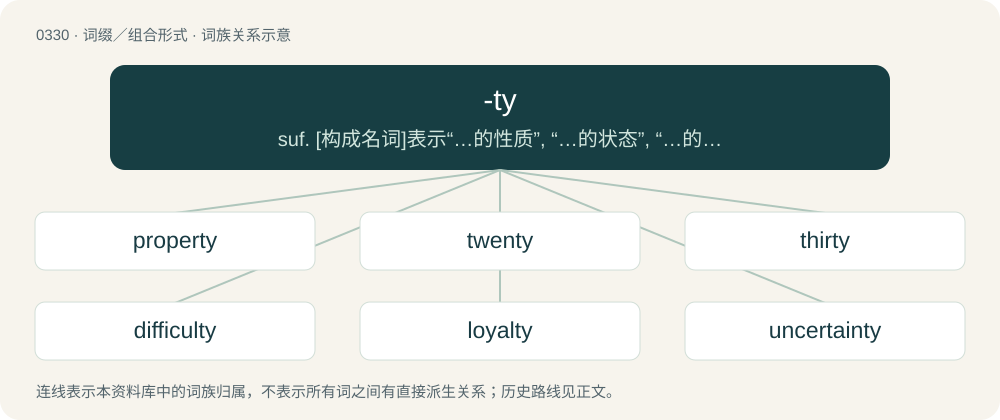

# 0377 · -ty — suf. \[构成名词\]表示“…的性质”, “…的状态”, “…的情况”：unity , enmity; 表示“十”,“十个”：twenty, thirty

[总目录](../00_总目录_按常用程度.md)

**类型**：词缀／组合形式　｜　**来源语言**：见词源记录

## 核心含义与来源

- 核心含义：suf. \[构成名词\]表示“…的性质”, “…的状态”, “…的情况”：unity , enmity; 表示“十”,“十个”：twenty, thirty
- 英文含义：A nonproductive suffix indicating single-digit integer multiples of ten.
- 词形：-ty

**来源记录 1**（后缀／后置成分；A nonproductive suffix indicating single-digit integer multiples of ten.）

From Middle English -ty, from Old English -tiġ (“-ty”), from Proto-Germanic \*tigiwiz, plural of \*teguz (“group of ten”), from Proto-Indo-European \*deḱ-, \*déḱm̥ (“ten”). Cognate with Scots -ty (“-ty”), West Frisian -tich (“-ty”), Dutch -tig (“-ty”), German -zig (“-ty”), Gothic 𐍄𐌹𐌲𐌿𐍃 (tigus, “group of ten, decade”). Related to ten.

## 词族图

## 单词速览（常用到不常用）

| 单词 | 音标 | 释义 |
|---|---|---|
| [property](#w-1) | 英 /ˈpɹɒp.ə.ti/；美 /ˈpɹɑ.pɚ.ti/ | n. 财产, 所有权, 性质, 属性；\[计\] 属性 |
| [twenty](#w-2) | 英 /ˈtwɛnti/；美 /ˈtwɛnti/ \[-ɛɾ̃i\] | num. 二十, 二十个 |
| [thirty](#w-3) | 英 /ˈθɜːti/；美 /ˈθɝti/ | num. 三十, 三十个 |
| [difficulty](#w-4) | /ˈdɪfɪkəlti/ | n. 困难, 难点 |
| [loyalty](#w-5) | /ˈlɔɪəlti/ | n. 忠贞, 忠诚, 忠实；\[法\] 忠诚, 忠心 |
| [uncertainty](#w-6) | 英 /ʌnˈsɜːtənti/；美 /ʌnˈsɝtənti/ | n. 不确定, 不可靠, 不确定的事物；\[化\] 不确定度 |
| [sixty](#w-7) | 英 /ˈsɪksti/；美 /ˈsɪksti/ | num. 六十, 六十个 |
| [sovereignty](#w-8) | 英 /ˈsɒvɹənti/；美 /ˈsɑv(ə)ɹənti/ | n. 主权, 独立国；\[法\] 主权, 主权国家, 统治权 |
| [royalty](#w-9) | 英 /ˈɹɔɪəlti/ | n. 皇室, 王族成员, 王权, 特权阶层, 庄严；\[经\] 特许权, 使用费, 使用税 |
| [seventy](#w-10) | 美 /ˈsɛv.ən.di/；/ˈsɛv.ən.ti/ | num. 七十, 七十个 |
| [eighty](#w-11) | /ˈeɪ.ti/ | num. 八十, 八十个 |
| [ninety](#w-12) | 英 /ˈnaɪn.ti/；美 /ˈnaɪn.di/ | num. 九十, 九十个 |
| [admiralty](#w-13) | /ˈæd.mɪ.ɹəl.ti/ | 【英文】The office or jurisdiction of an admiral. |
| [parity](#w-14) | 英 /ˈpæɹɪti/；/ˈpæɹɪti/ | n. 同等, 同位, 平价, 奇偶性；\[计\] 奇偶性 |
| [subtlety](#w-15) | 英 /ˈsʌt(ə)lti/ | n. 微妙, 精明 |
| [surety](#w-16) | 美 /ˈʃʊɹəti/；/ˈʃɔːɹɪti/ | n. 保证人, 保证, 担保；\[法\] 保证人, 担保人, 保证 |
| [fealty](#w-17) | /ˈfiː.əlti/ | n. 忠诚, 忠贞, 忠实 |
| [suzerainty](#w-18) | /ˈs(j)uz(ə)ɹənti/ | n. 宗主权, 封建主的地位；\[法\] 宗主权, 宗主地位, 保护 |

## 逐词详解

### 1. property

**词性**：名词　｜　**音标**：英 /ˈpɹɒp.ə.ti/；美 /ˈpɹɑ.pɚ.ti/

**中文释义**：n. 财产, 所有权, 性质, 属性；\[计\] 属性

**英文义项**：Something that is owned. / A piece of real estate, such as a parcel of land.

**构词拆分**：proper + -ty

**词源与演化**：

From Middle English propertee, properte, propirte, proprete, borrowed from Anglo-Norman and Old French propreté, proprieté (“propriety, fitness, property”), from Latin proprietās (“a peculiarity, one's peculiar nature or quality, right or fact of possession, property”), from proprius (“special, particular, one's own”). Equivalent to proper + -ty. Doublet of propriety.

**例句**：

> Costumes and scenery are distinguished from property properly speaking.

该用例对应义项：A prop, an object used in a dramatic production.

### 2. twenty

**词性**：名词　｜　**音标**：英 /ˈtwɛnti/；美 /ˈtwɛnti/ \[-ɛɾ̃i\]

**中文释义**：num. 二十, 二十个

**英文义项**：The numbers twenty (20) to twenty-nine (29). / A banknote with a denomination of 20.

**构词拆分**：two + -ty；twain + -ty

**词源与演化**：

From Middle English twenty, twenti, from Old English twēntiġ (“twenty”, literally “two tens”), from Proto-Germanic \*twaintigiwiz, \*twai tigiwiz, an old compound of \*twain- (“two”) + \*-tigaz (“group of ten”), equivalent to two + -ty, or twain + -ty. Cognate with Scots twenty, tuenty (“twenty”), West Frisian tweintich (“twenty”), Dutch twintig (“twenty”), German zwanzig (“twenty”), Danish tyve.

**例句**：

> The waiter’s face lit up when I gave him a twenty.

该用例对应义项：A banknote with a denomination of 20.

### 3. thirty

**词性**：名词　｜　**音标**：英 /ˈθɜːti/；美 /ˈθɝti/

**中文释义**：num. 三十, 三十个

**英文义项**：A rack of thirty beers. / A commercial lasting 30 seconds.

**构词拆分**：three + -ty

**词源与演化**：

From Middle English thirty, metathetic alternant of thritty, from Old English þrītiġ, þrittiġ (“thirty”), from Proto-Germanic \*þrīz tigiwiz (“thirty”, literally “three tens”), equivalent to three + -ty. Cognate with Scots therty, tretty (“thirty”), West Frisian tritich (“thirty”), Dutch dertig (“thirty”), German dreißig (“thirty”).

**例句**：

> It takes us thirty minutes to walk from here to the station.

### 4. difficulty

**词性**：名词　｜　**音标**：/ˈdɪfɪkəlti/

**中文释义**：n. 困难, 难点

**英文义项**：The state of being difficult, or hard to do. / An obstacle that hinders achievement of a goal.

**构词拆分**：dis- + facile + -ty；difficult + -y

**词源与演化**：

From Middle English difficulte, from Middle French and Anglo-Norman difficulte and their etymon Latin difficultas, from difficul, older form of difficilis (“hard to do, difficult”), from dis- + facilis (“easy”); see difficile and difficult. Equivalent to dis- + facile + -ty. Also analysable as difficult + -y, though the adjective is historically a backformation from the noun.

**例句**：

> My mom is old and has a lot of difficulty (in) remembering all her grandchildren's names.

该用例对应义项：The state of being difficult, or hard to do.

### 5. loyalty

**词性**：名词　｜　**音标**：/ˈlɔɪəlti/

**中文释义**：n. 忠贞, 忠诚, 忠实；\[法\] 忠诚, 忠心

**英文义项**：The state of being loyal; fidelity. / Faithfulness or devotion to some person, cause or nation.

**构词拆分**：loyal + -ty

**词源与演化**：

From Middle English loialte, borrowed from Old French loialte, loiauté (Modern loyauté) from loial + -té, equivalent to loyal + -ty.

**例句**：

> He showed loyalty to his local football club after successive relegations.

该用例对应义项：Faithfulness or devotion to some person, cause or nation.

### 6. uncertainty

**词性**：名词　｜　**音标**：英 /ʌnˈsɜːtənti/；美 /ʌnˈsɝtənti/

**中文释义**：n. 不确定, 不可靠, 不确定的事物；\[化\] 不确定度

**英文义项**：Doubt; the condition of being uncertain or without conviction. / Something uncertain or ambiguous.

**构词拆分**：un- + certainty；uncertain + -ty

**词源与演化**：

From Middle English uncerteynte; equivalent to un- + certainty or uncertain + -ty.

**例句**：

> Some uncertainties remain; an especially salient uncertainty is the timing of their return trip.

该用例对应义项：Something uncertain or ambiguous.

### 7. sixty

**词性**：名词　｜　**音标**：英 /ˈsɪksti/；美 /ˈsɪksti/

**中文释义**：num. 六十, 六十个

**英文义项**：A commercial lasting 60 seconds.

**构词拆分**：six + -ty

**词源与演化**：

Inherited from Middle English sixty, sexty, Old English sixtiġ, from Proto-Germanic \*sehs tigiwiz (“sixty”), equivalent to six + -ty. Cognate with Scots sexty, saxty (“sixty”), Saterland Frisian säkstich (“sixty”), West Frisian sechstich (“sixty”), Dutch zestig (“sixty”), German Low German sesstig (“sixty”), German sechzig (“sixty”), Swedish sextio (“sixty”), Norwegian seksti (“sixty”), Icelandic sextíu (“sixty”). Compare also Sanskrit षष्टि (ṣaṣṭi).

**例句**：

> All our blood passes through our kidneys about sixty times a day.

### 8. sovereignty

**词性**：名词　｜　**音标**：英 /ˈsɒvɹənti/；美 /ˈsɑv(ə)ɹənti/

**中文释义**：n. 主权, 独立国；\[法\] 主权, 主权国家, 统治权

**英文义项**：Of a ruler (especially a monarch): supreme authority or dominion over something. / Of a nation or other polity: the state of being able to control resources, make laws independently, and otherwise govern itself without the coercion or concurrence of other polities.

**构词拆分**：sovereign + -ty (suffix forming abstract nouns from adjectives)

**词源与演化**：

From Late Middle English sovereynte, souvereynte \[and other forms\], from Anglo-Norman sovereyneté, soverentee, and Old French soveraineté, souveraineté (modern French souveraineté), from soverain + -té (suffix forming nouns, often denoting a property or quality). Soverain is derived from Vulgar Latin \*superānus (“chief; sovereign”), from Latin super (“above; on top of”) (ultimately from Proto-Indo-European \*upér (“above, over”)) + -ānus (“suffix meaning ‘of or pertaining to’, usually denoting a relationship of origin, position, or possession”)). The English word is analysable as sovereign + -ty (suffix forming abstract nouns from adjectives).

**例句**：

> The European Union has not officially recognized Morocco's sovereignty over Western Sahara.

### 9. royalty

**词性**：名词　｜　**音标**：英 /ˈɹɔɪəlti/

**中文释义**：n. 皇室, 王族成员, 王权, 特权阶层, 庄严；\[经\] 特许权, 使用费, 使用税

**英文义项**：The rank, status, power or authority of a monarch. / People of royal rank, plus their families, treated as a group.

**构词拆分**：royal + -ty

**词源与演化**：

From Middle English royaltee, roialtee, royalte, from Old French roialté, roiauté, realté (compare earlier Old French realted (“realm, kingdom”)), from Vulgar Latin \*rēgālitās, from Latin rēgālis, equivalent to royal + -ty. Doublet of regality.

**例句**：

> The wedding was attended by royalty.

该用例对应义项：royal persons collectively

### 10. seventy

**词性**：数词　｜　**音标**：美 /ˈsɛv.ən.di/；/ˈsɛv.ən.ti/

**中文释义**：num. 七十, 七十个

**英文义项**：The cardinal number occurring after sixty-nine and before seventy-one, represented in Roman numerals as LXX and in Arabic numerals as 70.

**构词拆分**：seven + -ty

**词源与演化**：

From Middle English seventy, sevynty, from Old English hundseofontiġ, from Proto-Germanic \*sebuntēhundą (“seventy”), equivalent to seven + -ty. Cognate with Scots seiventy (“seventy”), Saterland Frisian soogentich (“seventy”), West Frisian santich (“seventy”), Dutch zeventig (“seventy”), German Low German söventig (“seventy”), German siebzig (“seventy”), Swedish sjuttio (“seventy”), Norwegian sytti (“seventy”), Icelandic sjötíu (“seventy”).

**例句**：

> Seventy or eighty years is the normal span of a man's life.

### 11. eighty

**词性**：数词　｜　**音标**：/ˈeɪ.ti/

**中文释义**：num. 八十, 八十个

**英文义项**：The cardinal number occurring after seventy-nine and before eighty-one, represented in Roman numerals as LXXX and in Arabic numerals as 80.

**构词拆分**：eight + -ty

**词源与演化**：

Inherited from Middle English eightety, eiȝti, eiȝtety, from Old English hundeahtatiġ, from Proto-Germanic \*ahtōutēhundą (“eighty”), equivalent to eight + -ty. Cognate with Scots hechty, auchty (“eighty”), Saterland Frisian tachentich (“eighty”), West Frisian tachtich (“eighty”), Dutch tachtig (“eighty”), Low German tachentig (“eighty”), German achtzig (“eighty”), Swedish åttio (“eighty”), Norwegian åtti (“eighty”), Icelandic áttatíu (“eighty”).

**例句**：

> Seventy or eighty years is the normal span of a man's life.

### 12. ninety

**词性**：数词　｜　**音标**：英 /ˈnaɪn.ti/；美 /ˈnaɪn.di/

**中文释义**：num. 九十, 九十个

**英文义项**：The cardinal number occurring after eighty-nine and before ninety-one, represented in Roman numerals as XC and in Arabic numerals as 90.

**构词拆分**：nine + -ty

**词源与演化**：

From Middle English nynty, nynety, from Old English hundniġontiġ, from Proto-Germanic \*newuntēhundą (“ninety”), equivalent to nine + -ty. Cognate with Scots nynty, nynety (“ninety”), Saterland Frisian njuugentich (“ninety”), West Frisian njoggentich (“ninety”), Dutch negentig (“ninety”), German Low German negentig (“ninety”), German neunzig (“ninety”), Swedish nittio (“ninety”), Norwegian Bokmål nitti (“ninety”), Norwegian Nynorsk nitti (“ninety”), Icelandic níutíu (“ninety”).

**例句**：

> Clyde Tombaugh died at the age of ninety on January 17, 1997.

### 13. admiralty

**词性**：名词　｜　**音标**：/ˈæd.mɪ.ɹəl.ti/

**英文义项**：The office or jurisdiction of an admiral. / The department or officers having authority over naval affairs generally.

**构词拆分**：admiral + -ty

**词源与演化**：

From French amirauté, for an older amiralté (“office of admiral”), from Late Latin admīrālitās. See admiral. Analyzable as admiral + -ty.

**例句**：

> His plan was approved by the Admiralty in April 1915.

### 14. parity

**词性**：名词　｜　**音标**：英 /ˈpæɹɪti/；/ˈpæɹɪti/

**中文释义**：n. 同等, 同位, 平价, 奇偶性；\[计\] 奇偶性

**英文义项**：Equality; comparability of strength or intensity. / A set with the property of having all of its elements belonging to one of two disjoint subsets, especially a set of integers split in subsets of even and odd elements.

**构词拆分**：pari- + -ty

**词源与演化**：

From Middle French parité, from Late Latin paritās, from Latin pār (“equal”). Equivalent to pari- + -ty.

**例句**：

> Parity is often used to check the integrity of transmitted data.

该用例对应义项：(mathematics) a relation between a pair of integers: if both integers are odd or both are even they have the same parity; if one is odd and the other is even they have different parity

### 15. subtlety

**词性**：名词　｜　**音标**：英 /ˈsʌt(ə)lti/

**中文释义**：n. 微妙, 精明

**英文义项**：The quality of being scarcely noticeable or difficult to discern. (of things) / The quality of being done in a clever way that is not obvious or not direct; the quality of being carefully thought out. (of things)

**构词拆分**：subtle + -ty

**词源与演化**：

From Middle English sotilte, from Old French sutilté, inherited from Latin subtīlitās, from subtīlis (“subtle”). Equivalent to subtle + -ty. Doublet of subtility.

**例句**：

> With all his usual subtlety, he quietly fixed the problem before anyone else noticed it.

该用例对应义项：The quality of being able to achieve one's aims through clever, delicate or indirect methods. (of people)

### 16. surety

**词性**：名词　｜　**音标**：美 /ˈʃʊɹəti/；/ˈʃɔːɹɪti/

**中文释义**：n. 保证人, 保证, 担保；\[法\] 保证人, 担保人, 保证

**英文义项**：Certainty. / That which makes sure; that which confirms; ground of confidence or security.

**构词拆分**：sure + -ty

**词源与演化**：

From Middle English surete, attested since the early 1300s in the sense "guarantee, promise, pledge, assurance", from Anglo-Norman seurté/Old French seurté with the same meaning (whence modern French sûreté), from Latin sēcūritās. Equivalent to sure + -ty. The senses "security, safety, stability" and "certainty" are attested since the late 1300s. "One who undertakes to pay if another does not" is from the early 1400s. Doublet of security.

### 17. fealty

**词性**：名词　｜　**音标**：/ˈfiː.əlti/

**中文释义**：n. 忠诚, 忠贞, 忠实

**英文义项**：Fidelity to one's lord or master; the feudal obligation by which the tenant or vassal was bound to be faithful to his lord.

**构词拆分**：feal + -ty

**词源与演化**：

Inherited from Middle English feaute, feute, from Anglo-Norman fëauté, fëuté, from Latin fidēlitās (“faithfulness”; “homage, fealty” in Medieval Latin), from fidēlis (“faithful”) + -tās (noun suffix); the modern form (for expected \*feauty /ˈfjuːti/) is due to learned influence. Equivalent to obsolete feal + -ty. Doublet of fidelity.

**例句**：

> He and his father swore fealty to Edward I of England.

### 18. suzerainty

**词性**：名词　｜　**音标**：/ˈs(j)uz(ə)ɹənti/

**中文释义**：n. 宗主权, 封建主的地位；\[法\] 宗主权, 宗主地位, 保护

**英文义项**：A relation between states in which a subservient nation has its own government, but is unable to take international action independent of the superior state. / A similar relationship between other entities.

**构词拆分**：suzerain + -ty

**词源与演化**：

From Middle English suserente, from Old French suserenete, equivalent to suzerain + -ty.

**例句**：

> She was tired of living under suzerainty to her parents.

该用例对应义项：A similar relationship between other entities.
