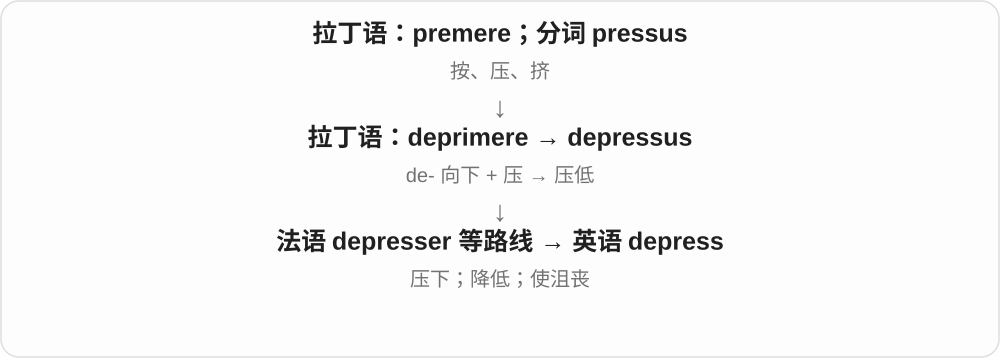
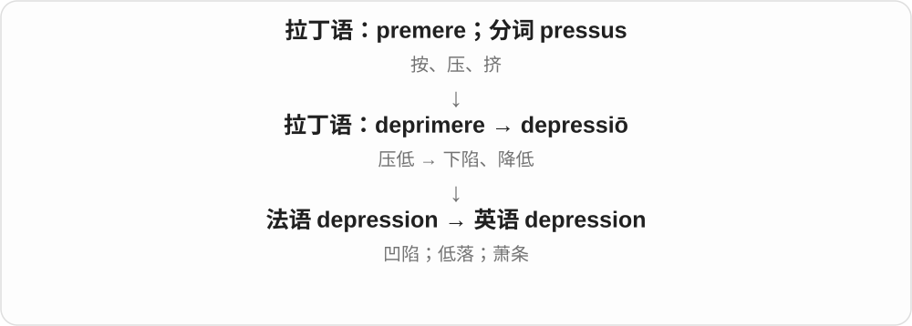
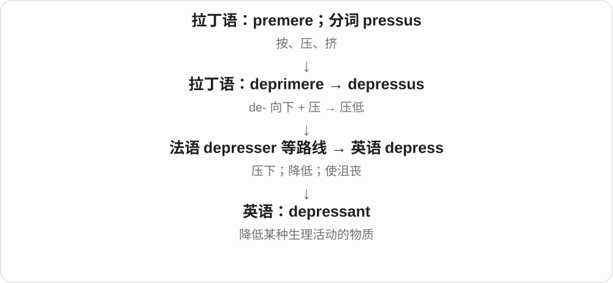
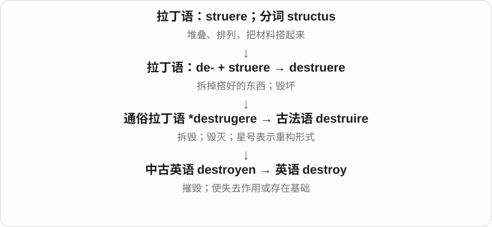
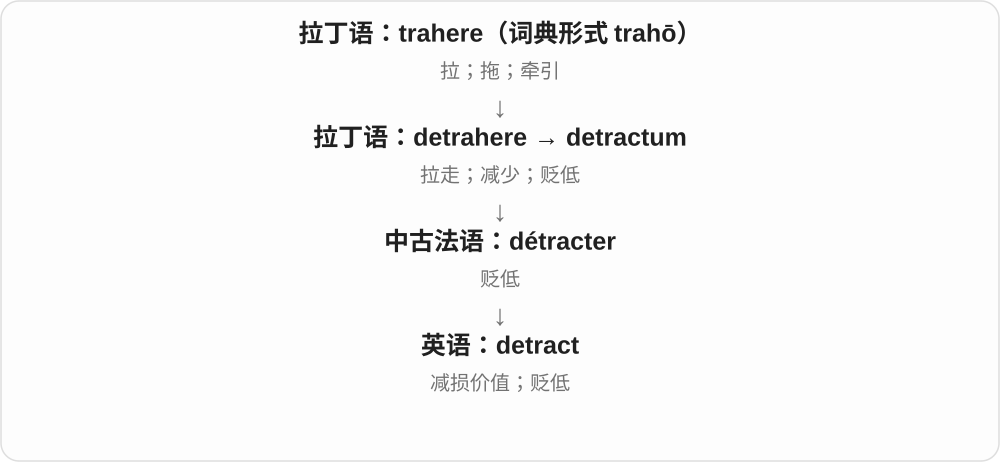

# 0416 · de- — 向下、离开、解除；有时加强动作

[逐词精讲目录](../00_逐词精讲目录.md) · [总目录](../00_总目录_按常用程度.md)

## 核心词根与来源

这是拉丁语来源的前缀，许多完整词先在拉丁语、法语中形成再进入英语。这里沿用学习目录收录前缀家族，但不把它说成可以独立表示具体事物的词根。词尾相似、前缀相同，也不意味着各词共享同一个主要词根。

**de- 像一个方向提示：向下、往外拿走、解除原状态。不过有些旧词中它只是加强动作，不能每次都翻成不。**

descend 往下走，defend 把攻击挡开，decompose 把组合拆开；declare 则把事情彻底说清楚。

- **下降、偏离与衰退**：decline, descend, descending, depression, depress, depressant
- **挡开攻击**：defend, defender, defended
- **明确说出**：declare, declaring, declarer, declaratory
- **拿走、减去、除去**：deletion, deduction, deduce, detract
- **奉献和特定用途**：dedicate
- **破坏、拆解和衰败**：destroy, decompose, decay, decaying
- **失去神圣或蒙受欺骗**：desecrate, desecration, delude
- **减损地位**：derogatory
- **心智能力变化**：dementia
- **划界和勾画**：demarcate, delineate
- **作出决定**：decide, decisive, decider

## 词形与演化规律

现代 de- 常表示去掉、逆转；旧借词还保留向下、离开和加强用法。descend 含 scand- 的 scend- 形式，declare 接 clar-，dementia 接 ment-，每支都要分别看。

## 单词速览（按词族由简到繁）

同一基础词的相关扩展放在一起，先读基础形式，再读扩展；各组之间优先读常用的。具体词源关系见各词讲解。

| 单词 | 音标 | 核心意思 |
|---|---|---|
| [decide](#w-1) | /dɪˈsaɪd/ | 决定；判定；使……成为定局 |
| [decisive](#w-11) | /dɪˈsaɪsɪv/ | 决定性的；果断的 |
| [decider](#w-22) | 英 /dɪˈsaɪdə/；美 /dɪˈsaɪdər/ | 决定者；决定胜负的比赛或因素；判定器〔计算理论〕 |
| [depress](#w-23) | 英 /dɪˈpres/；美 /dɪˈpres/ | 压下；降低；使沮丧 |
| [depression](#w-2) | 英 /dɪˈpreʃən/；美 /dɪˈpreʃən/ | 凹陷；低气压；经济萧条；抑郁 |
| [depressant](#w-26) | 英 /dɪˈpresənt/；美 /dɪˈpresənt/ | 抑制剂；降低某种活动的物质；抑制性的 |
| [destroy](#w-3) | /dɪˈstrɔɪ/ | 摧毁；毁掉；使失去作用或基础 |
| [defend](#w-4) | 英、美 /dɪˈfend/ | 保卫；辩护；防守 |
| [defender](#w-6) | 英 /dɪˈfendə/；美 /dɪˈfendər/ | 保卫者；辩护者；后卫 |
| [defended](#w-8) | 英、美 /dɪˈfendɪd/ | 保卫了；为……辩护了；受到防守的 |
| [decline](#w-5) | 英、美 /dɪˈklaɪn/ | 下降；衰退；婉拒；使词变格 |
| [declare](#w-7) | 英 /dɪˈkleə/；美 /dɪˈkler/ | 宣布；声明；申报 |
| [declaring](#w-10) | 英 /dɪˈkleərɪŋ/；美 /dɪˈklerɪŋ/ | 正在宣布；声明这一行为 |
| [declaratory](#w-29) | 英 /dɪˈklærətəri/；美 /dɪˈklerəˌtɔːri/ | 声明性的；确认性的 |
| [declarer](#w-31) | 英 /dɪˈkleərə/；美 /dɪˈklerər/ | 声明者；申报人；庄家〔桥牌〕 |
| [decay](#w-9) | /dɪˈkeɪ/ | 腐烂；衰败；衰减 |
| [decaying](#w-19) | /dɪˈkeɪɪŋ/ | 正在腐烂的；日益衰败的；正在衰减的 |
| [dementia](#w-12) | 英、美 /dɪˈmenʃə/ | 痴呆；认知功能受损的综合征 |
| [dedicate](#w-13) | 动词：英、美 /ˈdedɪkeɪt/ | 奉献；把作品献给；为专门用途拨出 |
| [descend](#w-14) | 英、美 /dɪˈsend/ | 下降；往下走；传承自 |
| [descending](#w-15) | 英、美 /dɪˈsendɪŋ/ | 下降中的；递减的 |
| [deduce](#w-21) | 英 /dɪˈdjuːs/；美 /dɪˈduːs/ | 推断；推导出 |
| [deduction](#w-16) | /dɪˈdʌkʃən/ | 推断；演绎；扣除；扣除额 |
| [derogatory](#w-17) | 英 /dɪˈrɒɡətri/；美 /dɪˈrɑːɡətɔːri/ | 贬损的；侮辱性的 |
| [deletion](#w-18) | 英、美 /dɪˈliːʃən/ | 删除；删去的内容；缺失 |
| [detract](#w-20) | /dɪˈtrækt/ | 减损；贬低 |
| [decompose](#w-24) | 英 /ˌdiːkəmˈpəʊz/；美 /ˌdiːkəmˈpoʊz/ | 分解；腐烂；拆分为组成部分 |
| [desecrate](#w-30) | 英 /ˈdesɪkreɪt/；美 /ˈdesəkreɪt/ | 亵渎；污损 |
| [desecration](#w-25) | 英 /ˌdesɪˈkreɪʃən/；美 /ˌdesəˈkreɪʃən/ | 亵渎；污损神圣之物 |
| [delineate](#w-27) | 英、美 /dɪˈlɪnieɪt/ | 勾勒；划定；明确描述 |
| [delude](#w-28) | 英、美 /dɪˈluːd/ | 蒙骗；使产生错觉 |
| [demarcate](#w-32) | 英 /ˈdiːmɑːkeɪt/；美 /ˈdiːmɑːrkeɪt/；也有后重音读法 | 划界；明确区分 |

## 逐词讲解

### 1. decide — 决定；判定；使……成为定局

**音标**：/dɪˈsaɪd/

**先抓住这个画面**

把纠缠的选项理到最后，定下“就这样办”；关键因素也能替结果一锤定音。

**怎么拆**

de- 离开 + caedere 切，拉丁 decidere 原有切断义，发展为解决争执；经古法语 decider 借入英语。

**怎么变成今天的意思**

**拉丁 caedere，分词 caesus；复合词常见 -cidere / -cisus**  
切、砍、击杀

↓

**拉丁 de- + caedere → decidere；分词 decisus**  
切断 → 了结争执、作出判断

↓

**古法语 decider → 中古英语 deciden → decide**  
决定、解决

decide to do 是决定行动；decide on 是选定；decide whether 是判断是否。The weather decided it 可说天气成了决定因素。

**常见搭配与例句**

decide to do；decide on；decide whether。

> They decided to postpone the outdoor concert.

他们决定推迟户外音乐会。

> One final question decided the winner.

最后一道题决定了胜者。

**别混淆**

consider 只是考虑，decide 则跨到了确定结果或行动的阶段。

### 2. decisive — 决定性的；果断的

**音标**：/dɪˈsaɪsɪv/

**先抓住这个画面**

事情还在摇摆时，这一下能把结果定住；说人时，则是能及时拿定主意。

**怎么拆**

中世纪拉丁 decisivus 接 decisus，英语也经法语 decisif 传入；现代对应 decide 与 -ive，但并非只能分析为英语新造。

**怎么变成今天的意思**

**拉丁 caedere，分词 caesus；复合词常见 -cidere / -cisus**  
切、砍、击杀

↓

**拉丁 de- + caedere → decidere；分词 decisus**  
切断 → 了结争执、作出判断

↓

**中世纪拉丁 decisivus；中古法语 decisif → 英语 decisive**  
能决定结果的；后来也指果断的

a decisive factor 是决定结果的因素；a decisive leader 是果断的领导。果断不自动保证判断正确。

**常见搭配与例句**

a decisive victory；a decisive factor；decisive action。

> Her experience was the decisive factor in the final choice.

她的经验是最终选择中的决定性因素。

> The team needed a decisive response to the sudden change.

团队需要果断应对突然的变化。

**别混淆**

decided 常是明确、确定的；decisive 更突出能把悬而未决的局面定下来。

### 3. decider — 决定者；决定胜负的比赛或因素；判定器〔计算理论〕

**音标**：英 /dɪˈsaɪdə/；美 /dɪˈsaɪdər/

**先抓住这个画面**

谁或什么把结果最后定下来，就把 -er 接在 decide 后面指向它。

**怎么拆**

decide + -er，去掉末尾 e 后接词尾；现代英语派生。

**怎么变成今天的意思**

**拉丁 caedere，分词 caesus；复合词常见 -cidere / -cisus**  
切、砍、击杀

↓

**拉丁 de- + caedere → decidere；分词 decisus**  
切断 → 了结争执、作出判断

↓

**古法语 decider → 中古英语 deciden → decide**  
决定、解决

↓

**英语 decide + -er → decider**  
决定 → 决定者或决胜环节

体育中 a decider 常是决胜局；计算理论中 decider 指对每个输入都停机并给出接受或拒绝的图灵机。这里不只是运行快。

**常见搭配与例句**

a title decider；the final decider；a decider for a language。

> The final set became the decider.

最后一盘成了决胜盘。

> A decider must halt on every input.

判定器必须对每个输入都停机。

**别混淆**

decision 是结果；decider 是作决定的人、定胜负的环节或特定算法模型。

### 4. depress — 压下；降低；使沮丧

**音标**：英 /dɪˈpres/；美 /dɪˈpres/

**先抓住这个画面**

原来在较高的位置，被往下按：按钮下去，价格下降，心情也像沉了下去。

**怎么拆**

拉丁语 de- 向下 + premere → deprimere、depressus，经法语等路线进入英语。

**怎么变成今天的意思**

depress a pedal 是踩下踏板；depress prices 是压低价格；depress someone 是让人情绪低落。具体对象决定含义。

**常见搭配与例句**

depress the pedal；depress demand；depress morale。

> The bad news depressed everyone in the room.

坏消息让房间里的每个人都心情低落。

> An oversupply can depress prices.

供应过多可能压低价格。

**别混淆**

depress 是使低下；oppress 常说不公正地压迫人；suppress 是把显露或发展压住。

### 5. depression — 凹陷；低气压；经济萧条；抑郁

**音标**：英 /dɪˈpreʃən/；美 /dɪˈpreʃən/

**先抓住这个画面**

把“往下沉”放到不同场景：地面低一块，经济活动低迷，情绪与生活功能也可能长期受影响。

**怎么拆**

经法语 depression 来自拉丁语 depressiō，与 deprimere 同族；名词不是在现代英语里临时拼出来的。

**怎么变成今天的意思**

a depression in the ground 是洼地；an economic depression 是严重经济萧条。医学里的 depression 是抑郁症相关用语，不能与一次普通失落直接画等号。

**常见搭配与例句**

a shallow depression；an economic depression；clinical depression。

> Rainwater collected in a shallow depression in the ground.

雨水积在地面一处浅浅的凹陷里。

> The book describes everyday life during the Great Depression.

这本书描写大萧条时期的日常生活。

**别混淆**

recession 通常指经济衰退；depression 一般表示更严重、持续更久的萧条，但没有各机构通用的唯一数值界线。

### 6. depressant — 抑制剂；降低某种活动的物质；抑制性的

**音标**：英 /dɪˈpresənt/；美 /dɪˈpresənt/

**先抓住这个画面**

把某种身体活动的“转速”往下调。这里的压低，通常不是指把人的情绪变坏。

**怎么拆**

depress 降低 + -ant 执行作用的事物。

**怎么变成今天的意思**

central nervous system depressant 指抑制中枢神经系统活动的物质。这个分类按作用说，不是“让人抑郁的药”。

**常见搭配与例句**

a nervous system depressant；depressant effects。

> The textbook describes alcohol as a central nervous system depressant.

教科书把酒精描述为一种中枢神经系统抑制物质。

> The glossary explains the term depressant in its pharmacological sense.

词汇表解释了 depressant 在药理学中的含义。

**别混淆**

depressant 与 antidepressant 不是简单的正反药物：前者强调降低神经等活动，后者按用于治疗抑郁来命名。

### 7. destroy — 摧毁；毁掉；使失去作用或基础

**音标**：/dɪˈstrɔɪ/

**先抓住这个画面**

destroy 像把搭好的房子拆到立不住：东西可能还剩碎片，但原来的整体已经没了。

**怎么拆**

拉丁 de- 撤去、拆下 + struere 建造，形成 destruere；经通俗拉丁、古法语 destruire 和中古英语 destroyen，变成今天的 destroy。

**怎么变成今天的意思**

可毁掉房屋、文件，也可毁掉信任、机会或名声。destroy confidence 通常是很强的说法，不只是让人有一点失望。

**常见搭配与例句**

destroy a building；destroy evidence；destroy confidence；destroy a reputation。

> The fire destroyed the empty warehouse.

火灾烧毁了那座空仓库。

> Repeated broken promises destroyed their trust.

一次次失信毁掉了他们之间的信任。

**别混淆**

damage 是损坏，程度可轻可重；destroy 通常意味着原有功能、整体或价值遭到根本破坏。

### 8. defend — 保卫；辩护；防守

**音标**：英、美 /dɪˈfend/

**先抓住这个画面**

把冲向人或事物的攻击挡开；攻击可以是刀剑，也可以是批评和指控。

**怎么拆**

拉丁语 de-“离开” + -fendere“击、推”形成 defendere，经古法语及拉丁语借入；现代英语没有一个单独常用的 fend 根可完全解释历史。

**怎么变成今天的意思**

**拉丁语 de-**  
离开、向下；也可加强动作或表示解除

↓

**拉丁语 de- + -fendere → defendere**  
击退、挡开 → 保护

↓

**古法语 defendre；拉丁语 → 中古英语 defenden → defend**  
抵御；为人或主张辩护

defend a city 是保卫城市；defend a decision 是提出理由维护决定；defend a title 是争取保住冠军头衔。

**常见搭配与例句**

defend against attack；defend someone from harm；defend a claim。

> The wall helped defend the town against attack.

城墙帮助城镇抵御进攻。

> She defended her decision with clear evidence.

她用清楚的证据为自己的决定辩护。

**别混淆**

protect 泛指保护；defend 常有面对攻击、挑战并作抵抗的意味。

### 9. defender — 保卫者；辩护者；后卫

**音标**：英 /dɪˈfendə/；美 /dɪˈfendər/

**先抓住这个画面**

站在受攻击的一方，帮忙挡住威胁或维护立场的人。

**怎么拆**

现代可拆 defend + -er；中古英语名称同时受到法语 defendour / defendëor 与本土 -er 构词影响。

**怎么变成今天的意思**

**拉丁语 de-**  
离开、向下；也可加强动作或表示解除

↓

**拉丁语 defendere → 法语 defendre / defendëor**  
保卫 → 保卫者

↓

**中古英语 defender / defendour；defenden + -ere**  
法语名称与英语构词交织

↓

**英语 defender**  
保卫者、立场维护者、后卫

足球 defender 通常是后卫；a defender of free speech 是积极维护言论自由的人，不一定是律师。

**常见搭配与例句**

a central defender；a defender of rights；a public defender。

> The defender blocked the shot.

后卫挡住了射门。

> She became a vocal defender of public libraries.

她成了积极发声支持公共图书馆的人。

**别混淆**

defendant 是被告；defender 是保护或辩护的人，不能按共同开头混用。

### 10. defended — 保卫了；为……辩护了；受到防守的

**音标**：英、美 /dɪˈfendɪd/

**先抓住这个画面**

表示抵抗或辩护已经发生，也能描述某地已经有人把守。

**怎么拆**

defend + -ed；词尾已有 /d/，所以 -ed 读成额外一拍 /ɪd/。

**怎么变成今天的意思**

**拉丁语 de-**  
离开、向下；也可加强动作或表示解除

↓

**拉丁语 de- + -fendere → defendere**  
击退、挡开 → 保护

↓

**古法语 defendre；拉丁语 → 中古英语 defenden → defend**  
抵御；为人或主张辩护

↓

**英语 defend + -ed → defended**  
过去发生的防卫；受到保护的状态

They defended the town 是过去动作；a heavily defended town 是防守严密的城镇。它不自动保证防守最终成功。

**常见搭配与例句**

defended the decision；a strongly defended position。

> The team defended its lead until the final whistle.

球队把领先优势保持到了终场哨响。

> The entrance was heavily defended.

入口处防守严密。

**别混淆**

defensive 是防御性的或容易戒备的；defended 则来自具体防卫动作。

### 11. decline — 下降；衰退；婉拒；使词变格

**音标**：英、美 /dɪˈklaɪn/

**先抓住这个画面**

沿着原方向转开或往下走：数量下降是一种下移，婉拒则是把邀请轻轻推开。

**怎么拆**

拉丁语 de- + clinare“倾斜”形成 declinare。一般动词、名词分别经法语 decliner、declin；语法义也有古英语直接借拉丁语的路线。

**怎么变成今天的意思**

**拉丁语 de-**  
离开、向下；也可加强动作或表示解除

↓

**拉丁语 declinare**  
偏转、弯下；改变词尾

↓

**并行传入：法语 decliner / declin；古英语 declinian〔语法义〕**  
动词与名词、语法用法有不同传入历史

↓

**英语 decline**  
下降、衰退；拒绝；变格

sales decline 是销量下降；decline an invitation 是婉拒邀请。语法里 decline a noun 是列出名词的格变化。

**常见搭配与例句**

a decline in sales；decline to comment；politely decline an offer。

> Sales declined slightly in winter.

冬季销量略有下降。

> She politely declined the invitation.

她礼貌地谢绝了邀请。

> We learned to decline Latin nouns.

我们学习了拉丁语名词变格。

**别混淆**

refuse 通常更直接；decline 较正式、委婉。下降义不必表示突然跌落。

### 12. declare — 宣布；声明；申报

**音标**：英 /dɪˈkleə/；美 /dɪˈkler/

**先抓住这个画面**

把事情正式说出来，让别人不能再把你的立场或事实当成含糊不明。

**怎么拆**

来自法语 declarer、拉丁语 declarare，clarus 是清楚的；de- 在此常解释为加强，不是把清楚拿走。

**怎么变成今天的意思**

**拉丁语 de-**  
离开、向下；也可加强动作或表示解除

↓

**拉丁语 clarus → clarare；declarare**  
清楚 → 使清楚、公开说明

↓

**古法语 declarer → 中古英语 declaren → declare**  
宣布、声明、申报

declare the meeting open 是宣布开会；declare goods 是向海关申报物品；declare that 常引出明确声明。

**常见搭配与例句**

declare an emergency；declare an interest；declare something to customs。

> The chair declared the meeting open.

主席宣布会议开始。

> Do you have any goods to declare?

你有需要申报的物品吗？

**别混淆**

say 只是说；declare 常强调公开、正式或明确表态。

### 13. declaring — 正在宣布；声明这一行为

**音标**：英 /dɪˈkleərɪŋ/；美 /dɪˈklerɪŋ/

**先抓住这个画面**

把“正式说清楚”放进正在进行或作为一项行为讨论的句子。

**怎么拆**

declare 去末尾 e 加 -ing；中古英语已有相应分词、动名词形式。

**怎么变成今天的意思**

**拉丁语 de-**  
离开、向下；也可加强动作或表示解除

↓

**拉丁语 clarus → clarare；declarare**  
清楚 → 使清楚、公开说明

↓

**古法语 declarer → 中古英语 declaren / declaring**  
宣布；宣布这一行为

↓

**现代英语 declare → declaring**  
现在分词或动名词

is declaring 描述正在宣布；before declaring 里的 declaring 是介词后面的动名词。常用来谈宣布结果、申报收入或利益。

**常见搭配与例句**

declaring an interest；before declaring victory；declaring income。

> The official is declaring the final results.

这位官员正在宣布最终结果。

> They waited for all the votes before declaring victory.

他们等所有选票统计完才宣布胜利。

**别混淆**

declared 常指已宣布；declaring 则把宣布当成过程或行为。

### 14. declaratory — 声明性的；确认性的

**音标**：英 /dɪˈklærətəri/；美 /dɪˈklerəˌtɔːri/

**先抓住这个画面**

作用在于把立场、权利或关系说清楚，而不是单凭说话就完成所有后续行动。

**怎么拆**

来自中世纪拉丁语 declaratorius，基于 declarare“说明、宣布”；现代可联系 declare 与 -atory，但形容词有独立历史。

**怎么变成今天的意思**

**拉丁语 de-**  
离开、向下；也可加强动作或表示解除

↓

**拉丁语 declarare → declarator；中世纪拉丁语 declaratorius**  
明确说明 → 作声明的

↓

**英语 declaratory**  
说明、宣布或确认性质的

declaratory policy 是公开阐明的政策。法律中的 declaratory judgment 主要确认权利或法律关系，不能简单理解成一张不具约束力的意见纸。

**常见搭配与例句**

a declaratory statement；declaratory policy；a declaratory judgment。

> The statement was declaratory and did not include an implementation plan.

这份声明旨在表明立场，没有包含实施计划。

> The court issued a declaratory judgment clarifying the parties’ rights.

法院作出确认判决，澄清了各方的权利。

**别混淆**

declarative 常用于语法、程序设计等领域；declaratory 更常用于正式声明和法律确认。

### 15. declarer — 声明者；申报人；庄家〔桥牌〕

**音标**：英 /dɪˈkleərə/；美 /dɪˈklerər/

**先抓住这个画面**

一般是作出声明的人；桥牌里则是代表叫牌成功一方执行定约的人。

**怎么拆**

declare + -er，中古英语已有相应人称名词。桥牌把一般名称专门化，不是普通赌场里所有发牌的人。

**怎么变成今天的意思**

**拉丁语 de-**  
离开、向下；也可加强动作或表示解除

↓

**拉丁语 clarus → clarare；declarare**  
清楚 → 使清楚、公开说明

↓

**中古英语 declaren / declarer → 英语 declare / declarer**  
声明 → 声明者

↓

**桥牌专业用法 declarer**  
代表一方执行定约的牌手

桥牌中 declarer 与 dummy 配合打定约；declarer 不等于 dealer，因为发牌者和执行定约者可以不是同一人。

**常见搭配与例句**

the declarer’s hand；declarer and dummy；the declarer of goods。

> The declarer studied the dummy’s cards before playing.

庄家出牌前仔细看了明手的牌。

> The form requires the declarer’s signature.

表格要求申报人签名。

**别混淆**

dealer 是发牌者；declarer 是桥牌执行定约的一方牌手。

### 16. decay — 腐烂；衰败；衰减

**音标**：/dɪˈkeɪ/

**先抓住这个画面**

不是一下子摔碎，而是原有的结构、力量或状态慢慢往下掉、慢慢坏掉，就是 decay。

**怎么拆**

经盎格鲁诺曼语 decaeir，追到拉丁语 dēcidere“落下”和通俗拉丁语 *dēcadere；de- 是向下、离开，cadere 是落下。

**怎么变成今天的意思**

木头被分解、牙齿受损、城区逐渐破败，都能用 decay。物理中还指衰变或某个量逐渐衰减；这些技术义不是说东西像食物一样腐臭。

**常见搭配与例句**

tooth decay；urban decay；radioactive decay；fall into decay。

> The wooden fence began to decay in the damp soil.

木栅栏在潮湿土壤中开始腐烂。

> The abandoned station had fallen into decay.

这座废弃车站已经破败不堪。

**别混淆**

rot 更常指有机物腐烂；decay 还可用于社会、建筑和物理过程。decide“决定”属于 caedere“切”的另一族。

### 17. decaying — 正在腐烂的；日益衰败的；正在衰减的

**音标**：/dɪˈkeɪɪŋ/

**先抓住这个画面**

decay 讲变化，decaying 把镜头定在“它正在一点点坏下去”的过程中。

**怎么拆**

decay + -ing，可作现在分词、形容词，也可把腐败过程当名词来谈。词尾 y 保留。

**怎么变成今天的意思**

decaying leaves 是正在分解的叶子；a decaying town 是逐渐衰落的城镇。它强调过程仍在发生，不能一律翻成“已经坏完了”。

**常见搭配与例句**

decaying wood；decaying buildings；a decaying industrial town；a decaying signal。

> Decaying leaves formed a soft layer on the forest floor.

正在腐烂的落叶在林地上铺成软软的一层。

> The project aims to restore the town’s decaying buildings.

这个项目旨在修复镇上日渐破败的建筑。

**别混淆**

decayed 更容易看成已经腐坏的状态；decaying 把注意力放在变化过程。dying 则更直接说走向死亡。

### 18. dementia — 痴呆；认知功能受损的综合征

**音标**：英、美 /dɪˈmenʃə/

**先抓住这个画面**

思考、记忆、判断等能力受损到影响日常生活的程度，并不只是偶尔忘了名字。

**怎么拆**

借拉丁语 dementia，来自 demens“心智失常的”，含 de-“离开、失去”与 mens / ment-“心智”。这是历史命名，不应照字面给人贴侮辱标签。

**怎么变成今天的意思**

**拉丁语 de-**  
离开、向下；也可加强动作或表示解除

↓

**拉丁语 mens / ment- → demens / dementia**  
心智 → 旧时对心智失常的称呼

↓

**英语 dementia**  
现代用于多种疾病可导致的认知障碍综合征

它不是正常衰老的必然结果，也不只指阿尔茨海默病。说 a person with dementia，能清楚表达病况而不把人等同于疾病。

**常见搭配与例句**

live with dementia；dementia care；a diagnosis of dementia。

> The centre supports people living with dementia and their families.

中心支持痴呆患者及其家属。

> The lecture explained why dementia is not the same as normal aging.

讲座解释了痴呆为何不同于正常衰老。

**别混淆**

Alzheimer’s disease 是可引起 dementia 的一种疾病；dementia 是更宽的临床概念。

### 19. dedicate — 奉献；把作品献给；为专门用途拨出

**音标**：动词：英、美 /ˈdedɪkeɪt/

**先抓住这个画面**

把时间、力量或作品明确交给某个人或目标，不再只是随便用用。

**怎么拆**

经中古英语 dedicat / dedicaten，来自拉丁语 dedicatus、dedicare“郑重宣布、奉献”，含 de- 与 dicare“宣告”。先有宗教奉献义，再扩展。

**怎么变成今天的意思**

**拉丁语 de-**  
离开、向下；也可加强动作或表示解除

↓

**拉丁语 dicare → dedicare / dedicatus**  
郑重宣布、专门奉献

↓

**中古英语 dedicat / dedicaten → 英语 dedicate**  
奉献；题献作品；专门用于

dedicate time to studying 后接名词或 -ing；dedicate a book to someone 是把书题献给某人。旧形容词 dedicate 较少见，可另读 /ˈdedɪkɪt/。

**常见搭配与例句**

dedicate one’s life to；dedicate a song to；dedicate resources to。

> She dedicated an hour each morning to learning English.

她每天早上专门拿出一小时学英语。

> The author dedicated the book to his grandmother.

作者把这本书题献给了祖母。

**别混淆**

donate 常指捐赠具体财物；dedicate 还包括长期投入和象征性的题献。

### 20. descend — 下降；往下走；传承自

**音标**：英、美 /dɪˈsend/

**先抓住这个画面**

从高处往低处走，也能把家谱上的上一代传到下一代看作向下的一条线。

**怎么拆**

拉丁语 de-“向下” + scandere“攀登”形成 descendere，经法语及拉丁语借入英语。scand- 在复合词中出现 scend- 形式。

**怎么变成今天的意思**

**拉丁语 de-**  
离开、向下；也可加强动作或表示解除

↓

**拉丁语 de- + scandere → descendere**  
朝下攀行

↓

**古法语 descendre；拉丁语 → 中古英语 descenden → descend**  
下降；由祖先传下来

descend the stairs 可直接接楼梯；be descended from 是源自某祖先。descend into chaos 则把局势变坏比成跌入混乱。

**常见搭配与例句**

descend slowly；descend from；descend into confusion。

> We descended the narrow staircase carefully.

我们小心地走下狭窄楼梯。

> The discussion descended into an argument.

讨论变成了争吵。

**别混淆**

ascend 是上升；descend 是下降。descent 是名词，不能和动词混写。

### 21. descending — 下降中的；递减的

**音标**：英、美 /dɪˈsendɪŋ/

**先抓住这个画面**

沿着往下的方向移动；排数字时，则是从大到小一路往下排。

**怎么拆**

descend + -ing，既作现在分词，也作表示方向、次序的形容词。

**怎么变成今天的意思**

**拉丁语 de-**  
离开、向下；也可加强动作或表示解除

↓

**拉丁语 de- + scandere → descendere**  
朝下攀行

↓

**古法语 descendre；拉丁语 → 中古英语 descenden → descend**  
下降；由祖先传下来

↓

**英语 descend + -ing → descending**  
向下的；按由大到小的次序

in descending order 是递减顺序，例如 9、5、1。descending stairs 也可以是正在下楼这一动作。

**常见搭配与例句**

in descending order；a descending scale；descending traffic。

> List the scores in descending order.

把分数按从高到低的顺序列出。

> The melody ends with a descending scale.

旋律以一个下行音阶结束。

**别混淆**

decreasing 说数值在减少；descending 还可说位置、音高或排序方向。

### 22. deduce — 推断；推导出

**音标**：英 /dɪˈdjuːs/；美 /dɪˈduːs/

**先抓住这个画面**

deduce 像沿着几条线索走，最后走到一个结论。不是凭空猜，而是能指出“我是根据这些信息判断的”。

**怎么拆**

拉丁语 dē-（从……、离开）+ dūcere（引导），产生“引出、推导”的意思。

**怎么变成今天的意思**

日常 deduce 常是根据迹象推断；严格逻辑演绎要求结论由前提必然推出。不要把所有日常推断都当成数学证明。

**常见搭配与例句**

deduce that…（推断……）；deduce something from evidence（从证据推断某事）。

> From the wet coats, I deduced that it was raining outside.

从湿外套我推断外面正在下雨。

> What can we deduce from these figures?

我们能从这些数字推断出什么？

**别混淆**

deduce 是推断；deduct 是扣除。guess 可以没有充分线索，deduce 则突出根据。

### 23. deduction — 推断；演绎；扣除；扣除额

**音标**：/dɪˈdʌkʃən/

**先抓住这个画面**

deduction 一头是“从已有信息引出结论”，另一头是“从总数拿掉一部分”。所以它既能是推断，也能是扣款。

**怎么拆**

来自法语 déduction、拉丁语 dēductiō。它与 deduce“推断”和 deduct“扣除”共享来源，两种现代动词不能互换。

**怎么变成今天的意思**

读句子时看周围：logical deduction 谈推理；a deduction from pay 谈钱。一个名词保留两条意思，不代表所有同族动词也有两条。

**常见搭配与例句**

make a deduction（作出推断）；logical deduction（逻辑演绎）；a deduction from wages（工资扣款）。

> Your deduction fits all the facts we know.

你的推断与我们已知的事实都相符。

> The receipt shows a deduction of twenty dollars.

收据显示扣除了二十美元。

**别混淆**

deduce a conclusion 是推出结论；deduct a fee 是扣掉费用。两者的名词都可用 deduction。

### 24. derogatory — 贬损的；侮辱性的

**音标**：英 /dɪˈrɒɡətri/；美 /dɪˈrɑːɡətɔːri/

**先抓住这个画面**

一句话不是在指出具体问题，而是在把一个人或群体的价值往下压。

**怎么拆**

来自后期拉丁语 derogatorius，基于 derogare“削减、部分废除”，含 de-“拿走”与 rogare“提议、请求”。先有削减权利、地位的意思，再指贬损声誉。

**怎么变成今天的意思**

**拉丁语 de-**  
离开、向下；也可加强动作或表示解除

↓

**拉丁语 rogare → derogare / derogatus**  
提议、请求 → 削减、减损

↓

**后期拉丁语 derogatorius → 英语 derogatory**  
减损地位 → 说话贬低、侮辱

词典标 derogatory，通常提醒这个称呼带贬低态度；即使说话者声称在开玩笑，也不能自动消除其贬损意味。

**常见搭配与例句**

a derogatory remark；a derogatory term；derogatory comments about。

> The editor removed a derogatory remark about the actor’s appearance.

编辑删去了一句贬损演员外貌的话。

> The dictionary labels the term as derogatory.

词典把这个称呼标为贬义。

**别混淆**

critical 可以是有依据的批评；derogatory 更突出贬低、损害尊严的态度。

### 25. deletion — 删除；删去的内容；缺失

**音标**：英、美 /dɪˈliːʃən/

**先抓住这个画面**

原本在一串内容中的一段，现在被拿掉了，留下的整体因此改变。

**怎么拆**

借拉丁语 deletio / deletionem，基于 delere“抹掉、消灭”。传统词源把 delere 联系 de- 与 linere“涂抹”的擦除动作；现代与 delete + -ion 对应。

**怎么变成今天的意思**

**拉丁语 de-**  
离开、向下；也可加强动作或表示解除

↓

**拉丁语 delere → deletus / deletio**  
抹去 → 擦除的行为

↓

**英语 deletion**  
删除行为或删掉的内容；遗传学中的片段缺失

可说文件、句子或 DNA 片段的删除、缺失。电脑里的 deletion 并不自动等于数据已不可恢复。

**常见搭配与例句**

accidental deletion；a deletion from the text；a gene deletion。

> The deletion of one paragraph made the argument clearer.

删掉一段文字后，论证更清楚了。

> The backup protected us against accidental deletion.

备份让我们不怕误删数据。

**别混淆**

omission 可能是一开始没写进去；deletion 常说已有内容被去除。

### 26. detract — 减损；贬低

**音标**：/dɪˈtrækt/

**先抓住这个画面**

detract 常像从一个优点上拿走一点分数：小瑕疵没有毁掉整件事，却让它没那么好。

**怎么拆**

de-（向下、离开）+ trahere 形成拉丁语 detrahere“拉走、减少”；经法语 détracter 传来。

**怎么变成今天的意思**

现代最常见 detract from：某事使总体价值或效果有所下降。早期的“拉走”不必理解成实际拿走一块物体。

**常见搭配与例句**

detract from the value；detract from the achievement；nothing to detract from… 。

> A few scratches do not detract from the table’s beauty.

几道划痕并不减损这张桌子的美。

> The delay should not detract from what the team achieved.

这次延误不应掩盖或贬低团队取得的成果。

**别混淆**

detract from 是减损价值；distract from 是转移注意力。噪声可以 distract you，也可能 detract from an otherwise enjoyable visit。

### 27. decompose — 分解；腐烂；拆分为组成部分

**音标**：英 /ˌdiːkəmˈpəʊz/；美 /ˌdiːkəmˈpoʊz/

**先抓住这个画面**

原本组合成一个整体的东西，拆回更小的成分；落叶腐解是其中一种情况。

**怎么拆**

可拆 de-“逆转、解除” + compose“组合”；来源说明既有法语 décomposer 借入，也有英语按 de- + compose 分析，二者相应。

**怎么变成今天的意思**

**拉丁语 de-**  
离开、向下；也可加强动作或表示解除

↓

**法语 composer / décomposer；英语 compose**  
组合 → 拆回组成部分

↓

**英语 decompose**  
分解整体；有机物腐解

decompose a problem into smaller tasks 是把问题拆成小任务；有机物 decomposes 则指腐解。不是所有分解都会臭或属于腐败。

**常见搭配与例句**

decompose into；decompose a matrix；decomposing leaves。

> Fallen leaves decompose and enrich the soil.

落叶分解后让土壤更肥沃。

> We decomposed the problem into three smaller tasks.

我们把问题拆成了三个较小任务。

**别混淆**

decay 常指衰败、腐坏；decompose 更清楚地强调整体分成组成部分。

### 28. desecrate — 亵渎；污损

**音标**：英 /ˈdesɪkreɪt/；美 /ˈdesəkreɪt/

**先抓住这个画面**

对人们视为神圣、庄严或值得敬重的东西，做出冒犯和破坏。

**怎么拆**

英语 de-“做相反的事” + consecrate 的词干构成。拉丁语相似的 desecrare 却能表示使神圣，不能因拼写近就说直接沿袭其词义。

**怎么变成今天的意思**

**拉丁语 de-**  
离开、向下；也可加强动作或表示解除

↓

**拉丁语 sacrare / consecrare → 英语 consecrate**  
使成为神圣的

↓

**英语 de- + consecrate 的词干 → desecrate**  
逆转神圣的地位；亵渎

对象常是 grave、temple、memorial。比普通 damage 更强调意义和尊严遭到侵犯。

**常见搭配与例句**

desecrate a grave；desecrate a sacred site。

> Vandals desecrated the memorial during the night.

破坏者夜间亵渎了那座纪念碑。

> The characters fear that the shrine will be desecrated.

人物担心那座神祠会遭到亵渎。

**别混淆**

consecrate 是使成为神圣的；desecrate 在现代英语中表示亵渎。

### 29. desecration — 亵渎；污损神圣之物

**音标**：英 /ˌdesɪˈkreɪʃən/；美 /ˌdesəˈkreɪʃən/

**先抓住这个画面**

损害的不只是物体本身，还包括人们赋予它的神圣、纪念或尊严意义。

**怎么拆**

desecrate 去末尾 e 加 -ion；来自英语表示亵渎的动词，而非直接继承一个同义拉丁名词。

**怎么变成今天的意思**

**拉丁语 de-**  
离开、向下；也可加强动作或表示解除

↓

**拉丁语 sacrare / consecrare → 英语 consecrate**  
使成为神圣的

↓

**英语 de- + consecrate 的词干 → desecrate**  
逆转神圣的地位；亵渎

↓

**英语 desecrate + -ion → desecration**  
亵渎行为或结果

破坏墓地、宗教场所或纪念物时常见这个词。其是否被认为神圣，与具体文化、信仰背景有关。

**常见搭配与例句**

the desecration of a grave；an act of desecration。

> The community condemned the desecration of the cemetery.

社区谴责了亵渎墓地的行为。

> The novel describes the desecration of an ancient shrine.

小说描述了一座古老神祠遭到亵渎的事件。

**别混淆**

damage 只说损坏；desecration 强调对神圣或受尊敬之物的冒犯。

### 30. delineate — 勾勒；划定；明确描述

**音标**：英、美 /dɪˈlɪnieɪt/

**先抓住这个画面**

先用线画出边界，再把各部分说清楚。

**怎么拆**

借拉丁 dēlīneātus，来自 dēlīneāre；de- 在这里加强，līnea 是线，不是“把线去掉”。

**怎么变成今天的意思**

**拉丁 līnum → līneus → līnea**  
亚麻 → 亚麻制的 → 麻线、绳、线条

↓

**拉丁 dē- + līneāre → dēlīneāre → dēlīneātus**  
完整画出线条、勾勒

↓

**英语 delineate**  
画出轮廓；明确描述或划定

可以划地理边界，也可以说明工作职责、人物性格等抽象轮廓。

**常见搭配与例句**

delineate a boundary；delineate responsibilities；clearly delineate。

> The map delineates the boundaries of the protected area.

地图划出了保护区的边界。

> The agreement delineates each partner’s responsibilities.

协议明确划定了各合作方的职责。

**别混淆**

describe 泛指描述；delineate 常强调清楚勾出结构、范围或差别。

### 31. delude — 蒙骗；使产生错觉

**音标**：英、美 /dɪˈluːd/

**先抓住这个画面**

让一个人相信一个不真实的局面，甚至让他自己也乐于相信。

**怎么拆**

直接联系拉丁语 deludere，de- 在这里加强动作，ludere 是玩、戏弄；从戏弄人走向欺骗。

**怎么变成今天的意思**

**拉丁语 de-**  
离开、向下；也可加强动作或表示解除

↓

**拉丁语 ludere → deludere**  
玩、戏弄 → 欺骗、蒙骗

↓

**中古英语 deluden → delude**  
使信以为真

delude yourself into thinking 常说自欺地以为。它通常包含误信，不只是对事实知道得不够多。

**常见搭配与例句**

delude yourself；delude someone into believing；be deluded about。

> Do not delude yourself into thinking the work is already finished.

别自欺地以为工作已经完成了。

> The impressive figures deluded them into expecting quick success.

漂亮的数据让他们误以为很快就会成功。

**别混淆**

deceive 泛指欺骗；delude 常突出使人持有虚假的希望或错误信念。

### 32. demarcate — 划界；明确区分

**音标**：英 /ˈdiːmɑːkeɪt/；美 /ˈdiːmɑːrkeɪt/；也有后重音读法

**先抓住这个画面**

画出一条线，让人清楚这边到哪里为止、那边从哪里开始。

**怎么拆**

从较早名词 demarcation 逆构出动词；名词经西班牙语、葡萄牙语划界表达传入，含 de- 与 marcar“作标记”，后者来自日耳曼语。

**怎么变成今天的意思**

**拉丁语 de-**  
离开、向下；也可加强动作或表示解除

↓

**西班牙语 demarcar / demarcación；葡萄牙语 demarcação**  
标明边界

↓

**英语 demarcation → 逆构 demarcate**  
先有划界名词，再形成此动词

可以用栅栏 demarcate a boundary，也可在概念上 demarcate responsibilities。拼写里 -marc- 不表示拉丁语海。

**常见搭配与例句**

demarcate a boundary；clearly demarcated areas；demarcate roles。

> A low wall demarcates the two gardens.

一堵矮墙划出了两个花园的界线。

> The agreement clearly demarcates each team’s responsibilities.

协议明确划分了每个团队的职责。

**别混淆**

separate 可以真正把东西分开；demarcate 重在标明、确定分界。

## 这一组要分清什么

de- 不总是否定：declare 不是不清楚，dedicate 不是不宣布。desecrate 的英语构词也不能套用拼写相似拉丁词的相反义。decline 的婉拒、下降、变格属于有历史联系的不同用法。

## 串起来练习

面对一条意见，可以 declare your position，再 defend it；若不接受邀请，可以 politely decline。把每个词放进动作场景，再回看 de- 在该词里起什么作用。
