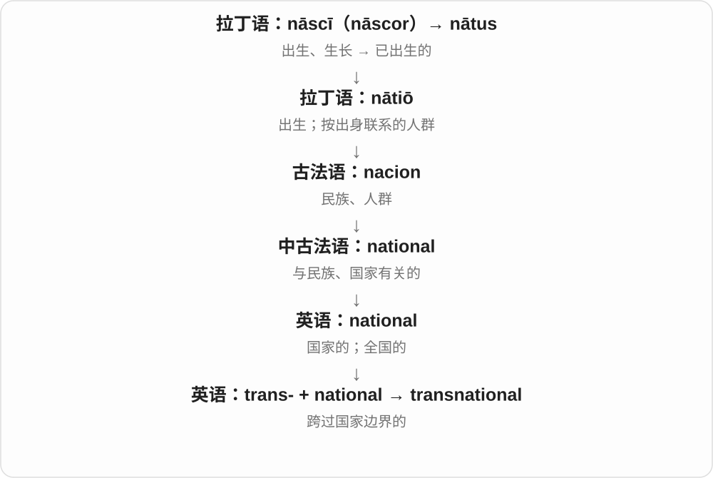

# 0417 · trans-, tra-, tran- — 穿过、越过；在另一边；跨越界限

[逐词精讲目录](../00_逐词精讲目录.md) · [总目录](../00_总目录_按常用程度.md)

## 核心词根与来源

拉丁 trans 原本可表示越过、在彼处。它随拉丁整词进入英语，也成为后来能继续造词的前缀。tradition 的 tra-、transient 的 transi-、transact 的 transact- 各有自己的历史变化，不能只把现代拼写切成看起来熟悉的英语词。

**先找出中间那道界限：海洋、皮肤、文字系统，或者一条抽象限制。trans- 告诉你，动作或关系跨过了它。**

隔着玻璃看进去是 transparent；从一个地方挪到另一个地方是 transplant；一代把故事交给下一代是 tradition。共同方向是跨过去，具体动作由后面的词干决定。

- **交给下一代与让人看透**：tradition, traditional, traditionally, transparent, transparency, transparently
- **移走、运输与跨越地理边界**：transport, transportation, transporting, transporter, transportable, transplant, transplantation, translocation, transshipment, transatlantic, transpacific, transcontinental, transnational, transboundary
- **经过而短暂、跨过限制**：transient, transience, transiently, transitory, transcend, transcendent, transcendence, transcendental, transcendentalism
- **办妥交易与拒绝妥协**：transact, transaction, transactional, intransigent, intransigence
- **现代身份、思想和媒介**：transgender, transgendered, transsexual, transphobia, transphobic, transhuman, transhumanism, transhumanist, transpersonal, transworld, transmedia, transliteration, transliterate
- **跨越生物屏障与压缩药名**：transgenic, transmembrane, transdermal, transcranial, transvaginal, tamoxifen, tretinoin

## 词形与演化规律

trans- 可在借词中缩为 tra- 等形式，如 tradere → tradition。transient 接 transire“经过”，transcend 接 scandere“攀登”，transact 接 agere“办事”。现代 transatlantic、transdermal 等则能直接按前缀与词基理解。trans- 读 /træns/ 或 /trænz/，随词和口音变化；少见词的组合读法已明确标示。

## 单词速览（按词族由简到繁）

同一基础词的相关扩展放在一起，先读基础形式，再读扩展；各组之间优先读常用的。具体词源关系见各词讲解。

| 单词 | 音标 | 核心意思 |
|---|---|---|
| [tradition](#w-4) | /trəˈdɪʃən/ | 传统；传下来的习惯、观念或做法 |
| [traditional](#w-1) | /trəˈdɪʃənəl/ | 传统的；沿袭旧有方式的 |
| [traditionally](#w-6) | /trəˈdɪʃənəli/ | 按传统；过去通常；历来 |
| [transport](#w-2) | 动词 英 /trænsˈpɔːt/、美 /trænsˈpɔːrt/；名词 英 /ˈtrænspɔːt/、美 /ˈtrænspɔːrt/ | 运输；运送；交通运输 |
| [transportation](#w-3) | 英 /ˌtrænspɔːˈteɪʃən/；美 /ˌtrænspərˈteɪʃən/ | 运输；交通运输系统或方式 |
| [transporting](#w-11) | 英 /trænsˈpɔːtɪŋ/；美 /trænsˈpɔːrtɪŋ/ | 运送；transport 的现在分词或动名词 |
| [transporter](#w-15) | 英 /trænsˈpɔːtə/；美 /trænsˈpɔːrtər/ | 运输者；运输车辆；转运体 |
| [transportable](#w-35) | 英 /trænsˈpɔːtəbəl/；美 /trænsˈpɔːrtəbəl/ | 可运输的；可迁移的 |
| [transact](#w-29) | /trænˈzækt/ | 办理、进行〔业务或交易〕 |
| [transaction](#w-5) | /trænˈzækʃən/ | 交易；一次业务处理；事务 |
| [transactional](#w-21) | /trænˈzækʃənəl/ | 交易的；事务性的；以交换利益为基础的 |
| [transparent](#w-7) | 英 /trænsˈpærənt/；美 /trænsˈperənt/，亦读 /trænz-/ | 透明的；公开易查的；一眼能看穿的 |
| [transparency](#w-9) | 英 /trænsˈpærənsi/；美 /trænsˈperənsi/ | 透明度；公开透明；透明胶片、幻灯片 |
| [transparently](#w-28) | 英 /trænsˈpærəntli/；美 /trænsˈperəntli/ | 公开透明地；显而易见地 |
| [transgender](#w-8) | 英 /trænzˈdʒendə/；美 /trænzˈdʒendər/ | 跨性别的 |
| [transgendered](#w-33) | 英 /trænzˈdʒendəd/；美 /trænzˈdʒendərd/ | 跨性别的〔较旧用语，现通常用 transgender〕 |
| [transplant](#w-10) | 动词：英 /trænsˈplɑːnt/，美 /trænsˈplænt/；名词：英 /ˈtrænsplɑːnt/，美 /ˈtrænsplænt/ | 移栽；移植；移植手术、移植物；移居者 |
| [transplantation](#w-13) | 英 /ˌtrænsplɑːnˈteɪʃən/；美 /ˌtrænsplænˈteɪʃən/ | 移植、移栽的过程；移植医学 |
| [transient](#w-12) | 英 /ˈtrænziənt/；美 /ˈtrænʃənt/，亦读 /ˈtrænziənt/ | 短暂的；来去匆匆的；瞬态、暂留者 |
| [transience](#w-43) | 英 /ˈtrænziəns/；美 /ˈtrænʃəns/，亦读 /ˈtrænziəns/ | 短暂；转瞬即逝；无常 |
| [transiently](#w-44) | 英 /ˈtrænziəntli/；美 /ˈtrænʃəntli/，亦读 /ˈtrænziəntli/ | 短暂地；暂时出现地 |
| [transatlantic](#w-14) | /ˌtrænzətˈlæntɪk/，亦读 /ˌtræns-/ | 跨大西洋的；大西洋彼岸的 |
| [transnational](#w-16) | /ˌtrænzˈnæʃənəl/ | 跨国的；超越国界联系的 |
| [transcend](#w-17) | /trænˈsend/ | 超越；越出某种界限 |
| [transcendent](#w-20) | /trænˈsendənt/ | 超凡的；超越通常界限的；超越经验或物质世界的〔哲学、神学〕 |
| [transcendental](#w-18) | /ˌtrænsenˈdentəl/ | 先验的〔哲学〕；超验主义的；超越的〔数学〕 |
| [transcendentalism](#w-51) | /ˌtrænsenˈdentəlɪzəm/ | 超验主义；先验哲学思想〔依语境〕 |
| [transcendence](#w-22) | /trænˈsendəns/ | 超越；超越性 |
| [transsexual](#w-19) | 英、美 /ˌtrænzˈsekʃuəl/ | 跨性别的〔较旧称谓〕；采用这一自我称谓的人 |
| [transgenic](#w-23) | /trænzˈdʒenɪk/ | 转基因的〔含人为导入外源基因〕 |
| [transcontinental](#w-24) | 英 /ˌtrænzkɒntɪˈnentəl/；美 /ˌtrænzkɑːntɪˈnentəl/ | 横贯大陆的；跨越大陆的 |
| [transphobia](#w-30) | 英 /trænsˈfəʊbiə/；美 /trænsˈfoʊbiə/，亦读 /trænz-/ | 对跨性别者的偏见、敌意或歧视 |
| [transphobic](#w-25) | 英 /trænsˈfəʊbɪk/；美 /trænsˈfoʊbɪk/，亦读 /trænz-/ | 歧视、敌视或排斥跨性别者的 |
| [translocation](#w-26) | 英 /ˌtrænzləʊˈkeɪʃən/；美 /ˌtrænzloʊˈkeɪʃən/ | 移位；转移；易位〔染色体〕 |
| [transitory](#w-27) | 英 /ˈtrænsɪtəri/；美 /ˈtrænsɪtɔːri/，亦读 /trænz-/ | 短暂的；不会持久的 |
| [transmembrane](#w-31) | /ˌtrænzˈmembreɪn/，亦读 /ˌtræns-/ | 跨膜的；贯穿膜的 |
| [tamoxifen](#w-32) | 英 /təˈmɒksɪfen/；美 /təˈmɑːksɪfən/ | 他莫昔芬〔药名〕 |
| [transliterate](#w-54) | /trænzˈlɪtəreɪt/ | 转写；用另一套文字表示 |
| [transliteration](#w-34) | /ˌtrænzlɪtəˈreɪʃən/ | 转写；字母系统之间的转换 |
| [intransigent](#w-37) | /ɪnˈtrænsɪdʒənt/，亦读 /ɪnˈtrænzɪdʒənt/ | 不肯妥协的；不让步的 |
| [intransigence](#w-36) | /ɪnˈtrænsɪdʒəns/ | 不妥协；拒绝让步的态度 |
| [transdermal](#w-38) | 英 /trænzˈdɜːməl/；美 /trænzˈdɜːrməl/ | 经皮的；透过皮肤的 |
| [transshipment](#w-39) | /trænsˈʃɪpmənt/ | 转运；中途换船、换运输工具 |
| [transboundary](#w-40) | 英 /ˌtrænzˈbaʊndəri/；美 /ˌtrænzˈbaʊndəri/〔按构词读法〕 | 跨越边界的；跨境的 |
| [transcranial](#w-41) | /ˌtrænzˈkreɪniəl/ | 经颅的；穿过颅骨的 |
| [transworld](#w-42) | 英 /trænzˈwɜːld/；美 /trænzˈwɜːrld/〔按构词读法〕 | 跨世界的；涉及不同可能世界的〔哲学〕 |
| [tretinoin](#w-45) | 英 /trəˈtɪnəʊɪn/；美 /trəˈtɪnoʊɪn/ | 维 A 酸；全反式维 A 酸〔药物、化合物〕 |
| [transpersonal](#w-47) | 英 /trænzˈpɜːsənəl/；美 /trænsˈpɜːrsənəl/ | 超个人的；超越通常个人自我范围的 |
| [transhuman](#w-53) | 参考读法：英、美 /trænzˈhjuːmən/〔trans- + human〕 | 超越现有人类形态或能力的；过渡性增强人 |
| [transhumanism](#w-46) | /trænzˈhjuːmənɪzəm/ | 超人类主义 |
| [transhumanist](#w-52) | /trænzˈhjuːmənɪst/ | 超人类主义者；超人类主义的 |
| [transpacific](#w-48) | /ˌtrænspəˈsɪfɪk/，亦读 /ˌtrænz-/ | 跨太平洋的；太平洋彼岸的 |
| [transmedia](#w-49) | /trænzˈmiːdiə/〔按构词读法〕 | 跨媒介的 |
| [transvaginal](#w-50) | /ˌtrænzˈvædʒɪnəl/ | 经阴道的 |

## 逐词讲解

### 1. tradition — 传统；传下来的习惯、观念或做法

**音标**：/trəˈdɪʃən/

**先抓住这个画面**

想象上一代把一件东西交给下一代：交过去的不一定是实物，也可以是节日做法、手艺和故事。

**怎么拆**

拉丁 trans- 越过 + dare 给，合成 tradere“交付”；名词 traditio 经古法语等路线成为 tradition。字母 tra- 是历史压缩后的样子。

**怎么变成今天的意思**

**拉丁 trans／trans-**  
越过、穿过；在另一边

↓

**拉丁 trans- + dare → tradere；名词 traditio**  
交到别人手上；传递

↓

**古法语 tradicion／拉丁 → 中古英语 tradicioun → tradition**  
代代相传的做法、观念与故事

a family tradition 可以小到每年生日做同一道菜；oral tradition 是靠讲述传下来的知识与故事。传统可以变化，不等于自古以来每个细节都完全相同。

**常见搭配与例句**

a family tradition；by tradition；break with tradition；oral tradition。

> Making dumplings together has become a family tradition.

一起包饺子已经成了我们家的传统。

> The village preserves its history through oral tradition.

村庄通过口述传统保存自己的历史。

**别混淆**

habit 可只是一个人的重复行为；tradition 通常强调群体或代际传承。traditional 是形容词。

### 2. traditional — 传统的；沿袭旧有方式的

**音标**：/trəˈdɪʃənəl/

**先抓住这个画面**

看到一种做法，能认出它接着前人传下来的那条线，没有把方法全部换掉。

**怎么拆**

英语 tradition + -al，表示与传统有关；不是 trade“贸易”的派生词。

**怎么变成今天的意思**

**拉丁 trans／trans-**  
越过、穿过；在另一边

↓

**拉丁 trans- + dare → tradere；名词 traditio**  
交到别人手上；传递

↓

**古法语 tradicion／拉丁 → 中古英语 tradicioun → tradition**  
代代相传的做法、观念与故事

↓

**英语 tradition + -al → traditional**  
由传统而来的；沿袭旧式做法的

traditional music 是从既有文化传统中传承的音乐；traditional methods 强调沿用的方法。它不自动表示落后或优越，褒贬取决于语境。Traditional Chinese 作为文字名称指繁体中文。

**常见搭配与例句**

traditional methods；traditional music；traditional values；Traditional Chinese。

> The workshop combines traditional weaving with modern designs.

这间作坊把传统织造工艺与现代设计结合起来。

> The menu includes several traditional dishes from the region.

菜单上有几道当地传统菜。

**别混淆**

conventional 常说大家通常采用的；traditional 更突出传承。traditional 与 modern 的对比也不一定表示二者不能结合。

### 3. traditionally — 按传统；过去通常；历来

**音标**：/trəˈdɪʃənəli/

**先抓住这个画面**

先把时间往回拉：过去这件事通常怎样做，再看现在是否还照旧。

**怎么拆**

英语 traditional + -ly，给动作或整句话加上“依传统、过去通常如此”的角度。

**怎么变成今天的意思**

**拉丁 trans／trans-**  
越过、穿过；在另一边

↓

**拉丁 trans- + dare → tradere；名词 traditio**  
交到别人手上；传递

↓

**古法语 tradicion／拉丁 → 中古英语 tradicioun → tradition**  
代代相传的做法、观念与故事

↓

**英语 tradition → traditional → traditionally**  
传统 → 传统的 → 按传统、历来

Traditionally, the festival lasts three days 是说传统安排；traditionally made cheese 强调制作方法。句首 traditionally 常为后面谈变化铺垫，并不保证今天仍然如此。

**常见搭配与例句**

traditionally made；traditionally associated with；Traditionally, …。

> Traditionally, the whole family gathers here on New Year’s Eve.

按传统，全家会在除夕聚到这里。

> The trade was traditionally taught through apprenticeships.

这门手艺过去通常通过学徒制传授。

**别混淆**

usually 描述通常情况，不特别追溯过去；traditionally 把通常情况放在传承或历史背景中。

### 4. transport — 运输；运送；交通运输

**音标**：动词 英 /trænsˈpɔːt/、美 /trænsˈpɔːrt/；名词 英 /ˈtrænspɔːt/、美 /ˈtrænspɔːrt/

**先抓住这个画面**

transport 是把人或东西从这里搬到那里，像把一箱货物带过一段距离。

**怎么拆**

拉丁语 trāns-（跨过、到另一边）+ portāre（运送），经法语进入英语。

**怎么变成今天的意思**

可以用车、船、飞机或管线等运送；重点是改变位置。文学里音乐也能 transport someone，把人的感受带到仿佛另一个世界。

**常见搭配与例句**

transport goods（运输货物）；public transport（公共交通，英式常见）；transport something from A to B（从 A 运到 B）。

> The trucks transport vegetables to the city.

这些卡车把蔬菜运往城市。

> We used public transport throughout the trip.

整个旅程中我们都使用公共交通。

**别混淆**

动词重音在后，名词重音在前。transfer 强调转移位置或归属，transport 更突出运送过程。

### 5. transportation — 运输；交通运输系统或方式

**音标**：英 /ˌtrænspɔːˈteɪʃən/；美 /ˌtrænspərˈteɪʃən/

**先抓住这个画面**

transportation 把运送人和货物这件事整体拿出来说，可以指一次运输，也可以指一座城市的交通系统。

**怎么拆**

transport + -ation，形成表示过程的名词。

**怎么变成今天的意思**

在美式英语中，public transportation 很常见；英式常用 public transport。历史语境还可能指把犯人运往殖民地的流放制度。

**常见搭配与例句**

public transportation（公共交通）；transportation costs（运输费用）；a means of transportation（交通方式）。

> The ticket includes transportation to the museum.

票价包含前往博物馆的交通费用。

> Reliable public transportation makes commuting easier.

可靠的公共交通让通勤更方便。

**别混淆**

transportation 不是特指旅游。旅游包含目的和活动，transportation 只是把人从一处送到另一处。

### 6. transporting — 运送；transport 的现在分词或动名词

**音标**：英 /trænsˈpɔːtɪŋ/；美 /trænsˈpɔːrtɪŋ/

**先抓住这个画面**

transporting 把镜头放在“正在把东西从一处送到另一处”这个动作上，也能把整个动作作为话题。

**怎么拆**

transport + -ing，是英语动词的常规变化。

**怎么变成今天的意思**

They are transporting… 说正在运送；Transporting goods is costly 把运货这件事放到主语位置。它不是一个与 transport 无关的新词根。

**常见搭配与例句**

transporting goods（运输货物）；the cost of transporting…（运送……的成本）。

> They are transporting the equipment by rail.

他们正在通过铁路运送设备。

> Transporting fresh food requires careful planning.

运输生鲜食品需要周密安排。

**别混淆**

transporting 是动作形式；transporter 是运输者或运输车辆；transportation 是较正式的运输过程名词。

### 7. transporter — 运输者；运输车辆；转运体

**音标**：英 /trænsˈpɔːtə/；美 /trænsˈpɔːrtər/

**先抓住这个画面**

transporter 是负责把东西搬过去的人、车或结构。想象一辆装着多辆汽车的大卡车，就是 car transporter。

**怎么拆**

transport + -er，表示执行运输的一方。

**怎么变成今天的意思**

同一个角色词能进入不同领域：道路上是运输车辆，生物学里可指把物质跨膜转运的蛋白。对象不同，核心都是转运。

**常见搭配与例句**

a car transporter（汽车运输车）；a heavy equipment transporter（重型设备运输车）；a membrane transporter（膜转运体）。

> The transporter carried six new cars to the dealership.

运输车把六辆新车运到经销店。

> The diagram shows a transporter moving molecules across a membrane.

图中显示一个转运体把分子运过膜。

**别混淆**

transport 是动作或运输活动；transporter 是执行它的东西。不能把交通系统整体都译成 transporter。

### 8. transportable — 可运输的；可迁移的

**音标**：英 /trænsˈpɔːtəbəl/；美 /trænsˈpɔːrtəbəl/

**先抓住这个画面**

transportable 只说“有办法运走”。一间组合式房屋能被卡车拉走，也可以是 transportable，虽然没人能把它塞进背包。

**怎么拆**

transport + -able，表示可以被运输。

**怎么变成今天的意思**

比起 portable，它常允许更大的体积和更复杂的运输方式。重点在能移动到另一个地点，不在日常携带是否轻松。

**常见搭配与例句**

a transportable unit（可运输单元）；transportable equipment（可运输设备）；a transportable building（可搬迁建筑）。

> The exhibition is packed into transportable units.

展览被装成可运输的单元。

> The laboratory was designed to be transportable by truck.

这间实验室被设计成可以用卡车运走。

**别混淆**

portable 通常暗示方便带着用；transportable 可以需要起重机、车辆或拆装。

### 9. transact — 办理、进行〔业务或交易〕

**音标**：/trænˈzækt/

**先抓住这个画面**

把一件需要双方处理的事办起来、谈妥或完成，常是生意和正式事务。

**怎么拆**

可解释为从较早的 transaction 逆构，也可接拉丁 transactus，后者是 transigere 的过去分词；transigere 来自 trans- + agere“做、推动”。不是简单借来一个英语 trans + act。

**怎么变成今天的意思**

**拉丁 trans／trans-**  
越过、穿过；在另一边

↓

**拉丁 trans- + agere → transigere**  
把事情办到底、处理妥当；达成协议

↓

**拉丁 transactus；或更早借入的英语 transaction → transact**  
通过拉丁分词借入或从名词逆构

↓

**英语 transact**  
办理业务、交易、事务

transact business 是办理商业事务，不要求每次都指现场现金买卖。transact with a firm 是与某公司做交易；这个词比 do business 正式。

**常见搭配与例句**

transact business；transact with；transact a sale。

> The company can transact business in several currencies.

这家公司可以用几种货币办理业务。

> Small suppliers increasingly transact with customers online.

小型供应商越来越多地在线上与客户交易。

**别混淆**

transaction 是一笔交易或一次事务；transact 是办理行为。transfer 则强调东西或资金从一处移到另一处。

### 10. transaction — 交易；一次业务处理；事务

**音标**：/trænˈzækʃən/

**先抓住这个画面**

transaction 像把一件来回商定的事办理完：付款、交货或系统更新合成一个处理单位。

**怎么拆**

trans-（贯穿、完成）+ agere，经拉丁语 trānsigere、trānsāctiō 及法语传入；现代可看出 trans- + action。

**怎么变成今天的意思**

商业里是交易，计算机里可把一组操作当作一个事务。后者关心这些操作作为整体怎样成功或失败。

**常见搭配与例句**

a bank transaction；complete a transaction；a database transaction。

> The bank sent a receipt for the transaction.

银行发送了这笔交易的回执。

> The database rolled back the failed transaction.

数据库回滚了失败的事务。

**别混淆**

transaction 是一次处理或交易；interaction 只是相互作用，不一定有交换或结算。

### 11. transactional — 交易的；事务性的；以交换利益为基础的

**音标**：/trænˈzækʃənəl/

**先抓住这个画面**

transactional 可以只是描述交易流程，也可以形容一种“我给你多少，你回报我多少”的关系。

**怎么拆**

transaction + -al。

**怎么变成今天的意思**

软件里的 transactional processing 是中性技术词；说 a transactional relationship 时常暗示关系缺少交换利益之外的联系。

**常见搭配与例句**

transactional data；transactional processing；a transactional relationship。

> The system stores transactional data separately.

系统单独存储交易数据。

> Their relationship had become purely transactional.

他们的关系已经变成纯粹的利益交换。

**别混淆**

transactional 不必总带贬义：交易系统是技术场景，人际评价才可能带功利意味。

### 12. transparent — 透明的；公开易查的；一眼能看穿的

**音标**：英 /trænsˈpærənt/；美 /trænsˈperənt/，亦读 /trænz-/

**先抓住这个画面**

隔着一层东西，仍能清楚看见后面；用来讲事情，就是过程和目的没有藏在黑箱里。

**怎么拆**

中世纪拉丁 transparens 是 transparere“透出来”的分词，来自 trans- + parere“显现”。整体借入英语，不是英语 parent 加 trans-。

**怎么变成今天的意思**

**拉丁 trans／trans-**  
越过、穿过；在另一边

↓

**中世纪拉丁 trans- + parere → transparere**  
从另一边显露出来；透光

↓

**中世纪拉丁 transparens／transparent- → 英语 transparent**  
透明的；后来也说信息公开、意图明显

transparent glass 让你看清后面的形状；a transparent process 让人知道事情怎样决定；a transparent excuse 却是借口太明显，一眼就能识破。计算机中 transparent to users 可指后台完成，用户无需感知操作细节。

**常见搭配与例句**

transparent glass；a transparent process；a transparent excuse；transparent to users。

> The transparent lid lets you check the food without opening the box.

透明盖子让你不用开盒就能查看食物。

> The selection process should be transparent to all applicants.

选拔过程应当向所有申请人公开清楚。

**别混淆**

translucent 是透光但未必能看清后面，磨砂玻璃可如此；opaque 是不透明。

### 13. transparency — 透明度；公开透明；透明胶片、幻灯片

**音标**：英 /trænsˈpærənsi/；美 /trænsˈperənsi/

**先抓住这个画面**

把“看不看得透”当成一种性质来衡量；材料看透的是物体，机构看透的是规则和决策。

**怎么拆**

中世纪拉丁 transparentia 借入英语；现代对应 transparent 的 -ent 换成 -ency。保留独立名词借入路线，不只按英语后缀倒推历史。

**怎么变成今天的意思**

**拉丁 trans／trans-**  
越过、穿过；在另一边

↓

**中世纪拉丁 transparere → transparens → transparentia**  
透出来 → 透明的 → 透明性质

↓

**英语 transparency**  
透明度；公开可查；可透光观看的图像胶片

a lack of transparency 常批评决定怎样作出不清楚。图像软件里透明度控制背景显露多少；老式投影设备使用的 a transparency 则是一张透明胶片，是可数名词。

**常见搭配与例句**

improve transparency；financial transparency；a transparency for a projector。

> The report calls for greater transparency in the selection process.

报告要求选拔过程更加透明。

> She placed a transparency on the overhead projector.

她把一张透明胶片放到高射投影仪上。

**别混淆**

clarity 可泛指表达或图像清晰；transparency 强调能看穿材料，或能查看事情背后的信息。

### 14. transparently — 公开透明地；显而易见地

**音标**：英 /trænsˈpærəntli/；美 /trænsˈperəntli/

**先抓住这个画面**

事情做得人人看得明白，或者意图藏得太浅，一下就露出来。

**怎么拆**

英语 transparent + -ly，沿用“看得透”的几个意思。

**怎么变成今天的意思**

**拉丁 trans／trans-**  
越过、穿过；在另一边

↓

**中世纪拉丁 trans- + parere → transparere**  
从另一边显露出来；透光

↓

**中世纪拉丁 transparens／transparent- → 英语 transparent**  
透明的；后来也说信息公开、意图明显

↓

**英语 transparent + -ly → transparently**  
以公开、易看清或显而易见的方式

operate transparently 通常是正面的公开运作；transparently false 则指明显虚假。软件 transparently handles something 可以说它在后台处理，用户不用干预，需看修饰对象。

**常见搭配与例句**

operate transparently；communicate transparently；transparently false。

> The committee promised to report its spending transparently.

委员会承诺公开、清楚地报告支出。

> His claim to know nothing was transparently false.

他声称毫不知情，显然是在说假话。

**别混淆**

openly 偏公开地做；transparently 还可强调过程可理解，或真相一眼可见。

### 15. transgender — 跨性别的

**音标**：英 /trænzˈdʒendə/；美 /trænzˈdʒendər/

**先抓住这个画面**

理解重点是一个人的性别认同，与其出生时被指定的性别不一致；不要把它想成人人都必须经历同一种身体改变。

**怎么拆**

现代英语 trans- + gender。trans- 在此保留跨越既定分类的构词背景，gender 指社会和个人认同中的性别。

**怎么变成今天的意思**

**拉丁 trans／trans-**  
越过、穿过；在另一边

↓

**现代英语 trans- + gender → transgender**  
性别认同与出生时指定性别不同的

a transgender woman 是跨性别女性，a transgender man 是跨性别男性。是否接受医疗措施不是这个词的必要条件。通常作形容词，说 transgender people；它说性别认同，不直接说明一个人喜欢哪种性别的人。

**常见搭配与例句**

a transgender person；transgender people；transgender experiences。

> The interview explores a transgender writer’s experiences at school.

访谈探讨一位跨性别作家的校园经历。

> The survey asked transgender participants how they described their own identities.

调查询问跨性别参与者如何描述自己的身份。

**别混淆**

gender identity 是性别认同，sexual orientation 是性倾向；两者分别回答“我是谁”和“我受谁吸引”。

### 16. transgendered — 跨性别的〔较旧用语，现通常用 transgender〕

**音标**：英 /trænzˈdʒendəd/；美 /trænzˈdʒendərd/

**先抓住这个画面**

这是阅读旧文章时可能遇到的形式；今天写作通常直接去掉 -ed，用 transgender 表达。

**怎么拆**

现代构词可分析为 trans- + gendered。词尾 -ed 在这里构成形容词，不宜据此断言所有人都“被改变了性别”。

**怎么变成今天的意思**

**拉丁 trans／trans-**  
越过、穿过；在另一边

↓

**现代英语 trans- + gendered → transgendered**  
跨性别的旧式表达

↓

**现代主要用法转向 transgender**  
通常使用不带 -ed 的形容词

一些旧资料写 transgendered people。现代编辑与语言指南通常推荐 transgender people，因为 -ed 容易让人误会成一个外加动作。例句采用谈论用词本身的方式，帮助识别旧文本。

**常见搭配与例句**

旧文中的 transgendered people；现代通常改用 transgender people。

> The older article uses transgendered, a term the editor would now replace with transgender.

那篇旧文章使用 transgendered，编辑如今会把它改为 transgender。

> The style guide recommends transgender instead of transgendered.

写作指南建议使用 transgender，而不用 transgendered。

**别混淆**

transgender 是现今常用形容词；transgendered 的出现不代表它是所有语境都自然的同义替换。

### 17. transplant — 移栽；移植；移植手术、移植物；移居者

**音标**：动词：英 /trænsˈplɑːnt/，美 /trænsˈplænt/；名词：英 /ˈtrænsplɑːnt/，美 /ˈtrænsplænt/

**先抓住这个画面**

把已经长着、活着的东西移到新位置，让它在那里继续发挥作用。

**怎么拆**

后期拉丁 trans- + plantare“种植”形成 transplantare，英语动词经法语或直接拉丁借入；名词后由动词转用。

**怎么变成今天的意思**

**拉丁 trans／trans-**  
越过、穿过；在另一边

↓

**后期拉丁 transplantare → 法语 transplanter／直接拉丁 → 中古英语 transplaunten**  
把植物移到别处再种

↓

**英语 transplant〔动词；后来也转为名词〕**  
移植植物 → 移植组织、器官；移居者

最直观的是把幼苗从小盆移进花园。医学里可移植器官、组织或细胞，既可能来自别人，也可能在同一人的身体不同部位之间转移。a transplant 还可轻松地说移居某地的人。

**常见搭配与例句**

transplant seedlings；a kidney transplant；transplant tissue；a recent transplant to the city。

> We transplanted the seedlings into larger pots.

我们把幼苗移栽到更大的花盆里。

> The documentary follows a patient before and after a kidney transplant.

纪录片跟踪记录一位患者肾移植前后的经历。

**别混淆**

implant 强调植入某物；transplant 强调将活体材料移到新的位置。两词会在医学场景相遇，但范围不同。

### 18. transplantation — 移植、移栽的过程；移植医学

**音标**：英 /ˌtrænsplɑːnˈteɪʃən/；美 /ˌtrænsplænˈteɪʃən/

**先抓住这个画面**

关注一整件“搬到新地方继续生长或工作”的事，包括移取、转移和在新位置建立联系。

**怎么拆**

法语 transplantation 来自 transplanter 的动作名词，远接后期拉丁 transplantare；英语借入这个名词，不能只写作英语 transplant 后面加 -ation。

**怎么变成今天的意思**

**拉丁 trans／trans-**  
越过、穿过；在另一边

↓

**后期拉丁 transplantare → 法语 transplanter → transplantation**  
移栽 → 移栽的行动

↓

**英语 transplantation**  
植物、人口的转移；后来用于活体组织移植

plant transplantation 是园艺移栽；organ transplantation 是器官移植；the field of transplantation 可指移植医学领域。长词通常更适合讨论过程、专业或一般现象。

**常见搭配与例句**

organ transplantation；tissue transplantation；the process of transplantation。

> The course introduces the history of organ transplantation.

这门课介绍器官移植的历史。

> The gardeners watered the trees carefully after transplantation.

移栽后，园丁仔细给树木浇水。

**别混淆**

a transplant 常是一次手术或移植物；transplantation 更常把整个过程、技术或学科当作话题。

### 19. transient — 短暂的；来去匆匆的；瞬态、暂留者

**音标**：英 /ˈtrænziənt/；美 /ˈtrænʃənt/，亦读 /ˈtrænziənt/

**先抓住这个画面**

像一个路过窗口的影子，确实出现了，但很快离开，不会长期停在那里。

**怎么拆**

后期拉丁 transiens／transient- 是 transire“经过”的分词形式；trans- + ire“走”。形容词借入英语，名词用法后来发展。

**怎么变成今天的意思**

**拉丁 trans／trans-**  
越过、穿过；在另一边

↓

**拉丁 trans- + ire → transire**  
走过去、经过

↓

**后期拉丁 transiens／transient- → 英语 transient**  
经过而不久留的；短暂的

a transient feeling 是短暂感受；a transient population 说居民流动性大。电路或系统的 transient response 是状态改变后一段过渡响应，不表示永远保持的稳态。

**常见搭配与例句**

a transient effect；transient symptoms；a transient population；transient response。

> The rainbow was a transient sight between two showers.

两阵雨之间的彩虹转瞬即逝。

> The engineers measured the circuit’s transient response after switching it on.

工程师测量了电路通电后的瞬态响应。

**别混淆**

temporary 只说非永久，可能持续很久；transient 常强调一晃而过、短暂存在。

### 20. transience — 短暂；转瞬即逝；无常

**音标**：英 /ˈtrænziəns/；美 /ˈtrænʃəns/，亦读 /ˈtrænziəns/

**先抓住这个画面**

关注的不是某一件短暂的东西，而是“来了又走、留不长”的共同性质。

**怎么拆**

英语 transient 改为名词 transience，-ence 表状态或性质；它接在已借入的形容词之后。

**怎么变成今天的意思**

**拉丁 trans／trans-**  
越过、穿过；在另一边

↓

**拉丁 trans- + ire → transire**  
走过去、经过

↓

**后期拉丁 transiens／transient- → 英语 transient**  
经过而不久留的；短暂的

↓

**英语 transient → transience**  
短暂的 → 短暂这一性质

the transience of fame 是名声难以长久；the transience of life 常带文学、哲思意味。物理现象也可具有 transience，但具体技术名称不一定用这个名词。

**常见搭配与例句**

the transience of life；the transience of fame；a sense of transience。

> The poem reflects on the transience of fame.

这首诗思考名声的短暂。

> The melting sculpture made visitors notice the transience of the moment.

逐渐融化的雕塑让参观者意识到这一刻转瞬即逝。

**别混淆**

transience 是性质名词，transient 是形容词或某种瞬态现象；transition 则是从一种状态变到另一种状态的过程。

### 21. transiently — 短暂地；暂时出现地

**音标**：英 /ˈtrænziəntli/；美 /ˈtrænʃəntli/，亦读 /ˈtrænziəntli/

**先抓住这个画面**

描述一个状态只亮起一小会儿，随后又消退或转变。

**怎么拆**

英语 transient + -ly，保留形容词“短暂存在”的意思，改为修饰动作或状态。

**怎么变成今天的意思**

**拉丁 trans／trans-**  
越过、穿过；在另一边

↓

**拉丁 trans- + ire → transire**  
走过去、经过

↓

**后期拉丁 transiens／transient- → 英语 transient**  
经过而不久留的；短暂的

↓

**英语 transient + -ly → transiently**  
在一段短时间内、暂时地

科学记录里 transiently increased 表示指标曾短暂升高，而不是一直维持；一般文章里也能说情绪短暂出现。重点在持续时间，不是变化快慢本身。

**常见搭配与例句**

transiently increase；transiently expressed；transiently affected。

> The signal increased transiently and then returned to its baseline.

信号短暂升高，随后恢复到基线。

> Her attention was transiently diverted by a noise outside.

外面的声音短暂地分散了她的注意力。

**别混淆**

briefly 口语和一般写作更常用；transiently 常用于较正式、科学的状态描述。

### 22. transatlantic — 跨大西洋的；大西洋彼岸的

**音标**：/ˌtrænzətˈlæntɪk/，亦读 /ˌtræns-/

**先抓住这个画面**

把大西洋当成中间那片水，两端通过航线、通信或合作连接起来。

**怎么拆**

现代英语 trans- + Atlantic“大西洋”。是利用拉丁来源前缀形成的英语词，不必虚构一个同形古拉丁单词。

**怎么变成今天的意思**

**拉丁 trans／trans-**  
越过、穿过；在另一边

↓

**英语 trans- + Atlantic → transatlantic**  
越过大西洋；大西洋两岸之间

a transatlantic flight 穿越大西洋；transatlantic cooperation 常谈欧洲与北美之间的合作。具体是哪两地，应由上下文给出，不是这个词规定了唯一两国。

**常见搭配与例句**

a transatlantic flight；transatlantic trade；a transatlantic cable。

> The aircraft was designed for long transatlantic flights.

这架飞机是为长途跨大西洋飞行设计的。

> The project strengthened transatlantic cooperation between the universities.

这个项目加强了大西洋两岸大学之间的合作。

**别混淆**

transpacific 跨太平洋；international 只说跨国，可能根本不经过海洋。

### 23. transnational — 跨国的；超越国界联系的

**音标**：/ˌtrænzˈnæʃənəl/

**先抓住这个画面**

transnational 像一条关系线穿过国界，把不同地方的人、组织或活动连在一起。

**怎么拆**

trans-（跨越）+ national。

**怎么变成今天的意思**

常用于网络、家庭、迁移、商业或文化活动，不一定是国家政府之间的正式往来。

**常见搭配与例句**

transnational networks；transnational families；transnational cooperation。

> The researchers studied transnational family networks.

研究者考察了跨国家庭网络。

> The project follows the transnational movement of ideas.

这个项目追踪思想跨越国界的传播。

**别混淆**

international 常以国家之间为单位；transnational 更突出关系跨过边界，参与者可以是个人。

### 24. transcend — 超越；越出某种界限

**音标**：/trænˈsend/

**先抓住这个画面**

眼前有一道限制，你跨过去了；它可以是语言、时代、分类，也可以是通常能达到的水平。

**怎么拆**

拉丁 trans- 越过 + scandere 攀登形成 transcendere，经法语等路线进入英语。这里的 -scend- 接“攀登”，不是 send“发送”。

**怎么变成今天的意思**

**拉丁 trans／trans-**  
越过、穿过；在另一边

↓

**拉丁 trans- + scandere → transcendere**  
攀过去、越过；超出限制

↓

**古法语 transcender／拉丁 → 中古英语 transcenden → transcend**  
跨越界限；超过通常水平

transcend language barriers 说感受或沟通跨过语言障碍；transcend a category 说它不能被一个分类完全装下。普通使用不要求有宗教或神秘含义。

**常见搭配与例句**

transcend boundaries；transcend language；transcend the ordinary。

> The story’s appeal transcends national boundaries.

这个故事的吸引力跨越了国界。

> Her work transcends the usual distinction between art and design.

她的作品超出了艺术与设计之间通常的界分。

**别混淆**

exceed 常超过一个可比较的数值、预期；transcend 更常越过限制、类别或层次。

### 25. transcendent — 超凡的；超越通常界限的；超越经验或物质世界的〔哲学、神学〕

**音标**：/trænˈsendənt/

**先抓住这个画面**

像站到平常标准之上，原来那把尺子已经不足以衡量它。

**怎么拆**

借自拉丁 transcendens／transcendent-，是 transcendere 的现在分词；现代也可对应 transcend + -ent，但历史有独立分词借入路线。

**怎么变成今天的意思**

**拉丁 trans／trans-**  
越过、穿过；在另一边

↓

**拉丁 trans- + scandere → transcendere**  
攀过去、越过；超出限制

↓

**拉丁 transcendens／transcendent- → 英语 transcendent**  
正在超越 → 超过普通界限、卓越的

a transcendent performance 是极出色的演出；神学里的 transcendent God 说神超出受造世界的限制。哲学语境要看作者怎样界定经验与超越，不能都译成“特别优秀”。

**常见搭配与例句**

transcendent beauty；a transcendent experience；a transcendent deity。

> The final movement gave the concert a moment of transcendent beauty.

最后一个乐章让音乐会呈现出一刻超凡的美。

> The theologian describes God as transcendent rather than confined to the physical world.

这位神学家把神描述为超越物质世界，而非受其限制。

**别混淆**

transcendent 常是超出某个范围；Kant 的 transcendental 特指经验与认识何以可能的条件，两者不是随手替换。

### 26. transcendental — 先验的〔哲学〕；超验主义的；超越的〔数学〕

**音标**：/ˌtrænsenˈdentəl/

**先抓住这个画面**

不同学科把“越出普通范围”发展成不同术语：哲学会追问经验怎么可能，数学会问一个数是否超出了代数方程的范围。

**怎么拆**

中世纪拉丁 transcendentalis 由 transcendens 的词干加 -alis 形成，作为学术形容词借入英语；不是所有意思都能直接从英语 transcend 加后缀猜出。

**怎么变成今天的意思**

**拉丁 trans／trans-**  
越过、穿过；在另一边

↓

**拉丁 trans- + scandere → transcendere**  
攀过去、越过；超出限制

↓

**拉丁 transcendens → 中世纪拉丁 transcendentalis → 英语 transcendental**  
超出单一范畴等学术用语；后来分化为哲学与数学专义

Kant 的先验问题问“我们能够经验世界，预先需要哪些认识条件”，不是宣称看见超自然事物。数学中超越数不是任何非零有理系数多项式的根；π、e 是例子。√2 虽是无理数，却是 x²−2 的根，因此不是超越数。

**常见搭配与例句**

transcendental philosophy；transcendental idealism；a transcendental number。

> The lecture introduces Kant’s transcendental philosophy.

讲座介绍康德的先验哲学。

> Pi is a transcendental number, whereas the square root of two is algebraic.

π 是超越数，而二的平方根是代数数。

**别混淆**

irrational 只是不能写成整数之比；transcendental 更强，不能满足上述代数方程。哲学 transcendental 与 transcendent 也要分清。

### 27. transcendentalism — 超验主义；先验哲学思想〔依语境〕

**音标**：/ˌtrænsenˈdentəlɪzəm/

**先抓住这个画面**

在美国文学史里，可以先想一群人主张亲自思考、相信内在直觉、从自然中寻找意义，而不只是照搬既有权威。

**怎么拆**

英语 transcendental + -ism。早期用于 Kant 等相关哲学，十九世纪又用于 Emerson、Thoreau 等人的美国思想与文学运动，两种背景有关联而不完全相同。

**怎么变成今天的意思**

**拉丁 trans／trans-**  
越过、穿过；在另一边

↓

**拉丁 trans- + scandere → transcendere**  
攀过去、越过；超出限制

↓

**中世纪拉丁 transcendentalis → 英语 transcendental → transcendentalism**  
先验等哲学用语 → 相应思想或学说

↓

**十九世纪美国的 Transcendentalism**  
以 Emerson 等人为核心的思想、文学与宗教文化运动

读美国文学时通常指十九世纪新英格兰的超验主义，常讨论个人判断、自然、精神经验及社会批判。它不是数学超越数的学说，也不能把各成员观点当成一套完全一致的教条。

**常见搭配与例句**

American transcendentalism；the influence of transcendentalism；Emerson and transcendentalism。

> The class explored the role of nature in American transcendentalism.

课堂探讨自然在美国超验主义中的地位。

> Her essay compares Emerson’s transcendentalism with Kant’s philosophy.

她的文章比较爱默生的超验主义与康德哲学。

**别混淆**

transcendental 是形容词；transcendentalism 命名思想传统或运动。具体指美国文学还是更广的哲学用法，要看人物和时代。

### 28. transcendence — 超越；超越性

**音标**：/trænˈsendəns/

**先抓住这个画面**

从“这件事超出了限制”转而讨论那种超出的状态、体验或性质。

**怎么拆**

与 transcendent 相应的名词；词源分析可追中世纪拉丁 transcendentia，也可按英语 transcendent + -ence 解释。两种路线不要硬合成唯一先后顺序。

**怎么变成今天的意思**

**拉丁 trans／trans-**  
越过、穿过；在另一边

↓

**拉丁 trans- + scandere → transcendere**  
攀过去、越过；超出限制

↓

**拉丁 transcendens → 中世纪拉丁 transcendentia；或英语 transcendent + -ence**  
超越这一状态或性质

↓

**英语 transcendence**  
超越、超越性；宗教与审美等领域的用语

the transcendence of boundaries 是跨越界限；religious transcendence 则可能讨论超越日常经验或物质世界的性质。文艺评论也会用它说超出日常自我感受的体验。

**常见搭配与例句**

spiritual transcendence；a sense of transcendence；the transcendence of limits。

> The critic writes about music’s capacity to create a sense of transcendence.

评论者讨论音乐让人感到超越日常的能力。

> The chapter examines the idea of divine transcendence.

这一章考察神的超越性这一观念。

**别混淆**

transcend 是行动，transcendent 是性质，transcendence 把性质或体验作为讨论对象。

### 29. transsexual — 跨性别的〔较旧称谓〕；采用这一自我称谓的人

**音标**：英、美 /ˌtrænzˈsekʃuəl/

**先抓住这个画面**

这个较早的词，常带有身体性别转变和旧医学分类的历史背景。

**怎么拆**

trans-“跨越” + sexual；英语构词受到德语 Transsexualismus 等早期性学用语影响。

**怎么变成今天的意思**

**拉丁 sexus**  
性别、雌雄类别；更早是否接“切分”词根仍有争议

↓

**近代德语 Transsexualismus 等；trans- + sexual**  
描述跨越出生时性别归类的旧性学术语

↓

**英语 transsexual**  
较早的跨性别称谓，历史上常突出身体转变

现代泛称通常用 transgender；transsexual 较旧，有些人仍用它自称。它说的是性别相关身份或经历，不是被哪种性别吸引。

**常见搭配与例句**

transsexual in historical texts；identify as transsexual。

> The archive uses the term transsexual in documents from the 1960s.

档案中的二十世纪六十年代文件使用了 transsexual 这个词。

> In the interview, she described why she identifies as transsexual.

采访中，她说明了为何用 transsexual 来自我认同。

**别混淆**

transgender 通常范围更广、日常更常用；homosexual 则涉及性取向，不能代替。

### 30. transgenic — 转基因的〔含人为导入外源基因〕

**音标**：/trænzˈdʒenɪk/

**先抓住这个画面**

把一段外来的遗传信息放进一个细胞或生物的基因组，让它成为这个基因系统的一部分。

**怎么拆**

现代英语 trans- + -genic；-genic 在这里与 gene 基因相联系，trans- 表遗传材料跨入新的生物系统。

**怎么变成今天的意思**

**拉丁 trans／trans-**  
越过、穿过；在另一边

↓

**现代生物学英语 trans- + -genic → transgenic**  
带有人为导入外源基因的

经典例子是把另一物种的基因导入实验小鼠。transgenic mouse 指这种小鼠；不是所有基因编辑都引入外源基因，因此不能把 transgenic 和所有 genetically modified 的情况完全画等号。

**常见搭配与例句**

a transgenic mouse；transgenic plants；a transgenic organism。

> The researchers used a transgenic mouse carrying a human gene.

研究人员使用了一只携带人类基因的转基因小鼠。

> The lesson distinguishes transgenic plants from plants edited without adding foreign DNA.

这节课区分转基因植物与未添加外源 DNA 的基因编辑植物。

**别混淆**

genetic 泛指遗传相关；transgenic 突出人为导入外源基因，范围更具体。

### 31. transcontinental — 横贯大陆的；跨越大陆的

**音标**：英 /ˌtrænzkɒntɪˈnentəl/；美 /ˌtrænzkɑːntɪˈnentəl/

**先抓住这个画面**

transcontinental 像铁路从一个大陆的一侧铺到另一侧，重点是横跨这整片陆地。

**怎么拆**

trans-（横越）+ continental。

**怎么变成今天的意思**

可以描述铁路、道路、航线或旅程。它不必跨越两个洲，而可能完全在同一大陆内。

**常见搭配与例句**

a transcontinental railway；a transcontinental journey；transcontinental travel。

> The railway made transcontinental travel much faster.

这条铁路让横贯大陆的旅行快了许多。

> They planned a transcontinental journey by train.

他们计划乘火车横穿大陆。

**别混淆**

intercontinental 通常是洲与洲之间；transcontinental 通常是横贯大陆。

### 32. transphobia — 对跨性别者的偏见、敌意或歧视

**音标**：英 /trænsˈfəʊbiə/；美 /trænsˈfoʊbiə/，亦读 /trænz-/

**先抓住这个画面**

不只是字面上“害怕”，也包括因为他人的跨性别身份而排斥、贬低或不公平对待。

**怎么拆**

现代英语 trans〔transgender 的简称〕+ -phobia。-phobia 远接希腊语恐惧，但在这类社会用词里范围扩展到敌意与偏见。

**怎么变成今天的意思**

**拉丁 trans／trans-**  
越过、穿过；在另一边

↓

**现代英语 trans- + gender → transgender**  
性别认同与出生时指定性别不同的

↓

**英语简称 trans + -phobia → transphobia**  
针对跨性别者的恐惧、敌意、偏见或歧视

讨论校园、职场或媒体时，transphobia 常指态度、言语和行为中的排斥。它不是仅凭这个词就给某个人诊断一种临床恐惧症。

**常见搭配与例句**

experience transphobia；challenge transphobia；transphobia in the workplace。

> The report documents experiences of transphobia in the workplace.

报告记录了职场中针对跨性别者的歧视经历。

> The workshop discussed how to recognize and challenge transphobia.

工作坊讨论了怎样识别并反对针对跨性别者的偏见和歧视。

**别混淆**

phobia 在医学中可命名恐惧症；transphobia 的普通社会用法更广。transphobic 是相应形容词。

### 33. transphobic — 歧视、敌视或排斥跨性别者的

**音标**：英 /trænsˈfəʊbɪk/；美 /trænsˈfoʊbɪk/，亦读 /trænz-/

**先抓住这个画面**

把某种言论、态度或行为标出来：它的问题在于针对他人的跨性别身份产生偏见或排斥。

**怎么拆**

现代英语 trans〔transgender〕+ -phobic，与 transphobia 相应的形容词。这里不是跨越一种叫 phobic 的东西。

**怎么变成今天的意思**

**拉丁 trans／trans-**  
越过、穿过；在另一边

↓

**现代英语 trans- + gender → transgender**  
性别认同与出生时指定性别不同的

↓

**英语 trans + -phobic → transphobic**  
表现出针对跨性别者的偏见、敌意或歧视的

transphobic comments 指带这种偏见的言论；transphobic harassment 指以跨性别身份为对象的骚扰。描述具体行为通常比只贴一个标签更能把意思说明白。

**常见搭配与例句**

transphobic comments；transphobic harassment；transphobic attitudes。

> The moderator removed comments containing transphobic insults.

版主删除了含有侮辱跨性别者内容的评论。

> The training includes examples of transphobic harassment and ways to report it.

培训列举了针对跨性别者的歧视性骚扰及其举报方式。

**别混淆**

transphobia 命名现象或偏见；transphobic 修饰体现这种偏见的人、言论或行为。

### 34. translocation — 移位；转移；易位〔染色体〕

**音标**：英 /ˌtrænzləʊˈkeɪʃən/；美 /ˌtrænzloʊˈkeɪʃən/

**先抓住这个画面**

某一部分从原来的位置转到另一处，关注的是“换地方”本身。

**怎么拆**

英语 trans- 跨过、转移 + location；各科学领域后来赋予具体含义。

**怎么变成今天的意思**

**拉丁语 locus**  
地方、位置

↓

**拉丁语 locare**  
放置、安置；也指出租

↓

**拉丁语 locatio → 英语 location**  
放置、出租 → 位置、地点

↓

**英语 trans- + location → translocation**  
从一处转到另一处

植物里可说糖等物质的转运；染色体 translocation 是片段转接到另一条染色体等位置变化，可能互换。两义不能混成“所有移动都叫基因突变”。

**常见搭配与例句**

chromosomal translocation；translocation of sugars。

> The diagram shows the translocation of sugars through the plant.

图示说明了糖在植物体内的转运。

> The test identified a chromosomal translocation.

检测发现了一处染色体易位。

**别混淆**

translation 可以是翻译或蛋白质翻译；translocation 的关键是位置转移。

### 35. transitory — 短暂的；不会持久的

**音标**：英 /ˈtrænsɪtəri/；美 /ˈtrænsɪtɔːri/，亦读 /trænz-/

**先抓住这个画面**

正在经历的一段情况，像途中经过的一站，还不是长久留下来的状态。

**怎么拆**

拉丁 transire“经过”形成 transitus，再有 transitorius；经古法语 transitoire 到英语。它和 transient 是同源旁支，并非由英语 transient 改造而来。

**怎么变成今天的意思**

**拉丁 trans／trans-**  
越过、穿过；在另一边

↓

**拉丁 transire → transitus → transitorius**  
经过 → 通过 → 可通过、会过去的

↓

**古法语 transitoire → 中古英语 transitorie → transitory**  
短暂、不能长久维持的

transitory difficulties 是会过去的困难；transitory fame 是一时名声。用这个词往往在对比眼前阶段与长期状态，有时带“别把它当永久变化”的判断。

**常见搭配与例句**

a transitory phase；transitory difficulties；a transitory effect。

> The discomfort was transitory and soon disappeared.

不适只是短暂的，很快就消失了。

> The essay contrasts transitory popularity with lasting influence.

文章对比一时的流行与持久的影响。

**别混淆**

transient 和 transitory 很接近；transient 常说短时出现的现象，transitory 常强调事情不会持续或只是过渡阶段。

### 36. transmembrane — 跨膜的；贯穿膜的

**音标**：/ˌtrænzˈmembreɪn/，亦读 /ˌtræns-/

**先抓住这个画面**

细胞膜像一道很薄的墙；某个蛋白横跨这道墙，或两侧之间存在一个差值、一个过程。

**怎么拆**

现代英语 trans- + membrane“膜”。trans- 标出膜两侧的关系，不是指把膜整体搬到别处。

**怎么变成今天的意思**

**拉丁 trans／trans-**  
越过、穿过；在另一边

↓

**生物学英语 trans- + membrane → transmembrane**  
横跨膜或发生在膜两侧之间

a transmembrane protein 的一部分贯穿脂质膜；transmembrane potential 则是膜两侧的电势差。不是凡是贴在膜上的蛋白都一定跨膜。

**常见搭配与例句**

a transmembrane protein；a transmembrane domain；transmembrane potential。

> The diagram shows a transmembrane protein crossing the lipid bilayer.

图示展示了一种贯穿脂质双层的跨膜蛋白。

> The experiment measured changes in transmembrane potential.

实验测量了跨膜电势的变化。

**别混淆**

membrane-associated 只说与膜相关或附着于膜；transmembrane 更具体地说跨越膜。

### 37. tamoxifen — 他莫昔芬〔药名〕

**音标**：英 /təˈmɒksɪfen/；美 /təˈmɑːksɪfən/

**先抓住这个画面**

这是一个压缩出来的专门药名。理解时先认出它与雌激素受体有关，不要靠把词尾硬译成普通英语猜用途。

**怎么拆**

药名构成有不同记载：Merriam-Webster 认为可能重组了 trans-、oxy 和 clomiphene；Wiktionary 分作 t(rans)、am(ine)、oxy、phen(yl)。两者都保留 trans 背景，但具体每段不可冒充唯一确定解释。

**怎么变成今天的意思**

**现代化学命名材料 trans-、oxy 等〔具体压缩分析有差异〕**  
反式构型等化学命名背景

↓

**英语药名 tamoxifen**  
他莫昔芬；选择性雌激素受体调节剂

药理上它与雌激素受体结合，在一些组织中阻断雌激素作用，在另一些组织中有类似雌激素的作用。它用于某些乳腺癌相关治疗场景，名称不等于适合所有乳腺癌，也不只涉及绝经后女性。

**常见搭配与例句**

tamoxifen therapy；tamoxifen treatment；tamoxifen citrate。

> The lecturer explained why tamoxifen can have different effects in different tissues.

讲师解释了为什么他莫昔芬在不同组织中可能产生不同作用。

> The study examined how breast cancer cells respond to tamoxifen.

研究考察了乳腺癌细胞对他莫昔芬的反应。

**别混淆**

estrogen 是雌激素；tamoxifen 是影响受体作用的药物名称。它不是单纯把体内所有雌激素清除掉。

### 38. transliterate — 转写；用另一套文字表示

**音标**：/trænzˈlɪtəreɪt/

**先抓住这个画面**

把一个名字从一种文字搬到另一种文字里，名字所指的东西并没有换。

**怎么拆**

trans-“跨到另一边” + 拉丁 littera / litera“字母” + -ate；按拉丁材料构成的英语词。

**怎么变成今天的意思**

**拉丁 trans + littera**  
跨越 + 字母、文字

↓

**英语 transliterate**  
把文字按规则转成另一套书写系统

把俄文 Москва 转写成 Moskva，处理的是字母和书写方式；把普通名词换成另一种语言中意思对应的词，则是在翻译。不同转写方案可能不同；转写也不必完全等同于按耳朵听到的发音拼写。

**常见搭配与例句**

transliterate a name；transliterate into Latin letters。

> The catalogue transliterates the authors’ names into Latin letters.

这份目录把作者姓名转写成拉丁字母。

> We transliterated the place name rather than translating its meaning.

我们对这个地名作了转写，没有翻译它的字面意思。

**别混淆**

translate 着重传达意思；transliterate 着重转换文字系统。两者可以出现在同一份译稿里，但不是同一操作。

### 39. transliteration — 转写；字母系统之间的转换

**音标**：/ˌtrænzlɪtəˈreɪʃən/

**先抓住这个画面**

把名字从一套文字的字母换到另一套，就像给同一个词换一套书写符号，通常不翻译词义。

**怎么拆**

十九世纪英语构词使用 trans-、拉丁 littera／litera“字母”和名词后缀。不能把现代英语 transliterate 必然当作这个名词更早的祖先。

**怎么变成今天的意思**

**拉丁 trans／trans-**  
越过、穿过；在另一边

↓

**拉丁 littera／litera“字母”提供词干，与 trans-、名词构件结合**  
跨文字系统处理字母

↓

**十九世纪英语 transliteration**  
用另一套字母表示原文字形式

把俄文 Москва 写作 Moskva，是一种转写；把意为“猫”的某个词译成 cat，才是在翻译意思。不同转写体系可能选不同对应符号，未必完全复制实际发音。

**常见搭配与例句**

a transliteration system；Roman transliteration；transliteration into Latin letters。

> The catalogue gives each title in the original script and in transliteration.

目录为每个标题提供原文字形和转写形式。

> Different transliteration systems may spell the same name differently.

不同转写体系可能用不同拼写表示同一个名字。

**别混淆**

translation 转换意思，transliteration 转换书写符号；transcription 常更直接记录读音，两者在实际体系中也会重叠。

### 40. intransigent — 不肯妥协的；不让步的

**音标**：/ɪnˈtrænsɪdʒənt/，亦读 /ɪnˈtrænzɪdʒənt/

**先抓住这个画面**

谈判桌两边都在移动位置，这个人却把椅子牢牢钉在原地，不愿调整立场。

**怎么拆**

经法语 intransigeant 借自西班牙语 intransigente；in- 否定，transigente 接拉丁 transigere“达成协议”。不要把整个 intrans- 误认为一种英语前缀。

**怎么变成今天的意思**

**拉丁 trans／trans-**  
越过、穿过；在另一边

↓

**拉丁 trans- + agere → transigere**  
把事情办到底、处理妥当；达成协议

↓

**拉丁 transigens → 西班牙语 transigente；加否定 in- → intransigente**  
肯妥协的 → 不肯妥协的

↓

**法语 intransigeant → 英语 intransigent**  
不让步、不肯改变立场的

an intransigent negotiator 不肯让步；an intransigent position 是拒绝调整的立场。它通常带批评意味，但具体坚持是否有理由，需要事实判断，词本身不作证明。

**常见搭配与例句**

an intransigent attitude；remain intransigent；intransigent over an issue。

> The talks stalled because both sides remained intransigent.

双方都不肯让步，谈判因此陷入停滞。

> She softened her previously intransigent position after hearing the new evidence.

听到新证据后，她软化了此前寸步不让的立场。

**别混淆**

determined 可以褒义地说坚定；intransigent 突出协商时不肯改变。

### 41. intransigence — 不妥协；拒绝让步的态度

**音标**：/ɪnˈtrænsɪdʒəns/

**先抓住这个画面**

把谈判卡住的，不一定是没有方案，也可能是各方那种“我一步也不退”的态度。

**怎么拆**

法语 intransigeance 借入英语，接 intransigeant 的名词支线；现代也可对应英语 intransigent 与 -ence 的关系。

**怎么变成今天的意思**

**拉丁 trans／trans-**  
越过、穿过；在另一边

↓

**拉丁 trans- + agere → transigere**  
把事情办到底、处理妥当；达成协议

↓

**西班牙语 intransigente → 法语 intransigeant → intransigeance**  
不肯妥协的 → 不妥协的态度

↓

**英语 intransigence**  
拒绝让步、坚持原立场的状态

complain about someone’s intransigence 是抱怨对方不肯商量；show intransigence 是表现出拒绝调整的态度。它描述协商姿态，不是协议本身。

**常见搭配与例句**

political intransigence；a display of intransigence；intransigence on an issue。

> Their intransigence prevented even a temporary agreement.

他们拒绝让步，连临时协议也未能达成。

> The mediator tried to understand the reasons behind each side’s intransigence.

调解人试图理解双方各自不肯妥协的原因。

**别混淆**

disagreement 可以有分歧但仍愿讨论；intransigence 进一步说拒绝让步或调整。

### 42. transdermal — 经皮的；透过皮肤的

**音标**：英 /trænzˈdɜːməl/；美 /trænzˈdɜːrməl/

**先抓住这个画面**

皮肤是外层屏障，物质从表面穿过去；重点在“穿过”，不只是停留在皮肤表面。

**怎么拆**

英语 trans- + dermal“皮肤的”；derm- 远接希腊 derma“皮肤”。这是现代医学构词。

**怎么变成今天的意思**

**拉丁 trans／trans-**  
越过、穿过；在另一边

↓

**英语 trans- + dermal → transdermal**  
穿过完整皮肤的；经皮递送的

transdermal patch 是让药物经皮进入身体的贴剂。topical preparation 只说明用于局部表面，可能主要在局部起作用，不能见到任何外用药就都叫 transdermal。

**常见搭配与例句**

a transdermal patch；transdermal delivery；transdermal absorption。

> The diagram explains how a transdermal patch delivers a drug through the skin.

示意图解释经皮贴剂怎样让药物透过皮肤。

> The article compares transdermal delivery with oral administration.

文章比较经皮给药与口服给药。

**别混淆**

dermal 只是皮肤相关；transdermal 明确强调通过皮肤的路径。

### 43. transshipment — 转运；中途换船、换运输工具

**音标**：/trænsˈʃɪpmənt/

**先抓住这个画面**

货物还没到终点，先在中转站卸下来，再装上下一程的运输工具。

**怎么拆**

Merriam-Webster 分析为 transship + -ment；transship 是 trans- + ship“装运”。现代也容易看成 trans- + shipment，但保留动词到动作名词的路线。

**怎么变成今天的意思**

**拉丁 trans／trans-**  
越过、穿过；在另一边

↓

**英语 trans- + ship → transship**  
把货物换装到另一运输工具

↓

**英语 transship + -ment → transshipment**  
转运的过程、业务

港口的 transshipment 可以把大船货物换到另一条航线上。词义重点是途中更换承运工具，不只是从仓库把货物发走。另一拼法 transhipment 少一个 s。

**常见搭配与例句**

a transshipment hub；transshipment cargo；a transshipment port。

> The containers waited at the port for transshipment to a smaller vessel.

这些集装箱在港口等待转装到一艘较小的船上。

> The new terminal serves as a regional transshipment hub.

新码头是区域性的货物转运枢纽。

**别混淆**

shipment 是装运或一批货；transshipment 多了中途换装、转运这个环节。

### 44. transboundary — 跨越边界的；跨境的

**音标**：英 /ˌtrænzˈbaʊndəri/；美 /ˌtrænzˈbaʊndəri/〔按构词读法〕

**先抓住这个画面**

地图上画了一条边界，河水、空气、动物或某种影响却继续往前走，不在边线上停下。

**怎么拆**

英语 trans- + boundary“边界”。形成于现代英语，常用于环境、资源和跨境合作讨论。

**怎么变成今天的意思**

**拉丁 trans／trans-**  
越过、穿过；在另一边

↓

**英语 trans- + boundary → transboundary**  
穿过或跨越边界的

transboundary pollution 是污染影响越过边界；a transboundary river 流经或涉及不止一个国家、地区。边界不必只指国界，也可能是行政或生态管理边界。

**常见搭配与例句**

transboundary pollution；transboundary waters；transboundary cooperation。

> The two regions share responsibility for transboundary air pollution.

这两个地区共同承担跨界空气污染的治理责任。

> Researchers tracked the transboundary movements of the elephants.

研究人员追踪了象群跨越边界的活动。

**别混淆**

cross-border 常在贸易、流动等一般场景使用；transboundary 在环境与资源管理文体尤其常见。

### 45. transcranial — 经颅的；穿过颅骨的

**音标**：/ˌtrænzˈkreɪniəl/

**先抓住这个画面**

颅骨是一层外壳，某种能量或检查信号穿过这层壳，到达里面或从里面带回信息。

**怎么拆**

英语 trans- + cranial“颅骨的”，cranial 经 cranium 接到希腊 kranion“颅骨”；现代医学形容词。

**怎么变成今天的意思**

**拉丁 trans／trans-**  
越过、穿过；在另一边

↓

**英语 trans- + cranial → transcranial**  
经由、穿过颅骨的

transcranial magnetic stimulation 指经颅磁刺激，线圈在头部外侧，磁脉冲穿过颅骨诱发脑内电流。transcranial Doppler ultrasound 是经颅多普勒超声。前缀说路径，不等于必须开颅。

**常见搭配与例句**

transcranial magnetic stimulation；transcranial Doppler ultrasound。

> The lecture explained the basic principle of transcranial magnetic stimulation.

讲座解释了经颅磁刺激的基本原理。

> The paper describes transcranial Doppler ultrasound as a way to study blood flow.

论文介绍用经颅多普勒超声研究血流的方法。

**别混淆**

intracranial 说在颅内的位置；transcranial 说穿过颅骨的路径。

### 46. transworld — 跨世界的；涉及不同可能世界的〔哲学〕

**音标**：英 /trænzˈwɜːld/；美 /trænzˈwɜːrld/〔按构词读法〕

**先抓住这个画面**

把“现实里是这样”和“假如当初换个选择会怎样”放到不同可能情境中，再问其中的人或物是否仍是同一个。

**怎么拆**

英语 trans- + world。哲学里 world 常是“可能世界”，不是专指从地球去另一颗星球。

**怎么变成今天的意思**

**拉丁 trans／trans-**  
越过、穿过；在另一边

↓

**英语 trans- + world → transworld**  
跨越不同世界；模态哲学中跨可能世界

transworld identity 讨论一个对象能否在不同可能世界里保持同一身份。例如“如果她选择另一份工作，她还会是同一个人吗？”不同理论会以同一对象或相似对应者来解释，答案有争论。

**常见搭配与例句**

transworld identity；transworld identification；a transworld relation。

> The philosopher uses transworld identity to discuss what might have happened to the same person.

哲学家用跨世界同一性讨论同一个人原本可能经历什么。

> The seminar compared transworld identity with counterpart theory.

研讨课比较跨世界同一性与对应者理论。

**别混淆**

worldwide 常指遍及全世界；transworld 在这类哲学文本中是跨不同可能世界。counterpart theory 则用对应者处理相关问题。

### 47. tretinoin — 维 A 酸；全反式维 A 酸〔药物、化合物〕

**音标**：英 /trəˈtɪnəʊɪn/；美 /trəˈtɪnoʊɪn/

**先抓住这个画面**

名字里挤进了 trans 与 retinoic acid 的部分字母，指向一种特定维 A 酸分子，不能当成所有维生素 A 产品的总称。

**怎么拆**

通常联系 tr(ans) + retino(ic acid) + -in；Merriam-Webster 也以“可能来自 trans- 和 retinoic acid 的组合”说明，保留药名压缩分析的不确定性。

**怎么变成今天的意思**

**化学名 all-trans retinoic acid**  
全反式维 A 酸

↓

**压缩药名 tretinoin〔可能由 trans- 与 retinoic acid 等构成〕**  
英语药名与化合物名；维 A 酸

tretinoin 是 all-trans retinoic acid，常缩写 ATRA。外用制剂可见于痤疮治疗，口服制剂也用于特定白血病治疗；不同剂型、场景不能只凭同名互换。它与 retinol 及 isotretinoin 是不同化合物。

**常见搭配与例句**

topical tretinoin；oral tretinoin；tretinoin cream；all-trans retinoic acid。

> The textbook identifies tretinoin as all-trans retinoic acid.

教材指出 tretinoin 就是全反式维 A 酸。

> The review discusses topical and oral formulations of tretinoin in separate sections.

综述在不同章节分别讨论维 A 酸的外用和口服制剂。

**别混淆**

retinol 是视黄醇；isotretinoin 是 13-顺式维 A 酸；tretinoin 是全反式维 A 酸，名字相近不等于同一种。

### 48. transpersonal — 超个人的；超越通常个人自我范围的

**音标**：英 /trænzˈpɜːsənəl/；美 /trænsˈpɜːrsənəl/

**先抓住这个画面**

描述某种体验时，人觉得关注点不再局限于日常那个“我”，而与更大的整体、自然或精神世界发生联系。

**怎么拆**

现代英语 trans- + personal“个人的”。构词表超出个人范围，在心理学等讨论中发展专门用法。

**怎么变成今天的意思**

**拉丁 trans／trans-**  
越过、穿过；在另一边

↓

**英语 trans- + personal → transpersonal**  
超出个人、自我范围的；相关心理学取向

transpersonal psychology 研究常被描述为超个人、精神性或自我超越的体验。这个名称标记研究兴趣或理论取向，本身不证明体验中的超自然解释是真的。

**常见搭配与例句**

transpersonal psychology；a transpersonal experience；a transpersonal perspective。

> The course examines how transpersonal psychology describes experiences of unity.

课程考察超个人心理学怎样描述一体感体验。

> She interpreted the experience as transpersonal rather than purely individual.

她把这次体验理解为超个人的，而非仅属于个体层面的。

**别混淆**

interpersonal 是人与人之间的；transpersonal 是超出通常个人自我范围的，两种方向不同。

### 49. transhuman — 超越现有人类形态或能力的；过渡性增强人

**音标**：参考读法：英、美 /trænzˈhjuːmən/〔trans- + human〕

**先抓住这个画面**

想象人借技术改变自己，处在现在的人类与某种未来形态之间。

**怎么拆**

trans-“超越、跨越” + human；近现代法语 trans-humain 等也参与相关思想用语。英语名词的一支还把 trans 理解为 transitional“过渡的”。

**怎么变成今天的意思**

**拉丁语 humanus，与 homo / homin- 同族**  
人的；有教养、有人情味的

↓

**古法语 humain → 英语 human / humane**  
人的，也曾包含仁慈的意思

↓

**trans- + human；法语 trans-humain 等相关形式**  
超越普通人类状态

↓

**现代英语 transhuman**  
增强或过渡中的人类形态，具体定义随作者变化

常见于未来学、科幻和超人类主义讨论；不是一个已经统一确定的生物分类，也不等于机器人。

**常见搭配与例句**

a transhuman future；transhuman abilities；a transhuman character。

> The novel imagines a transhuman society shaped by medical technology.

小说想象了一个由医疗技术塑造的超人类社会。

> The author uses transhuman for a person enhanced beyond ordinary human limits.

作者用 transhuman 指能力经增强而超出普通人类限度的人。

**别混淆**

superhuman 可泛指能力惊人；transhuman 常带技术增强与未来演化的思想背景。

### 50. transhumanism — 超人类主义

**音标**：/trænzˈhjuːmənɪzəm/

**先抓住这个画面**

把人类现有身体和认知能力看成可以继续改进的起点，思考技术是否能让人越过今天的限制。

**怎么拆**

现代英语 trans- + humanism。Julian Huxley 在 1957 年的重要论述使用了这个词；后来的运动更突出科技增强，不把这一日期硬说成已排除所有更早用例的首创日期。

**怎么变成今天的意思**

**拉丁 trans／trans-**  
越过、穿过；在另一边

↓

**现代英语 trans- + humanism → transhumanism**  
用技术等方式超越人类现有能力限制的思想

↓

**二十世纪的相关论述与后续思想运动**  
探索以科学技术增强人的能力、延长健康生命等可能性

常见讨论包括认知增强、寿命、身体能力和相应伦理。它是一种思想取向及讨论领域，不表示任何具体未来技术已经实现，也不等于科幻里某一种半人半机器形象。

**常见搭配与例句**

the philosophy of transhumanism；debates about transhumanism；human enhancement and transhumanism。

> The seminar examined the ethical questions raised by transhumanism.

研讨课考察了超人类主义提出的伦理问题。

> Her essay distinguishes transhumanism from predictions that any particular technology will succeed.

她的文章区分了超人类主义思想与对某项具体技术必定成功的预测。

**别混淆**

humanism 广义重视人的价值和能力；transhumanism 进一步把技术突破现有人类限制作为重要议题。

### 51. transhumanist — 超人类主义者；超人类主义的

**音标**：/trænzˈhjuːmənɪst/

**先抓住这个画面**

关注技术能否把人的能力向前推的人，或与这种思想有关的观点、方案。

**怎么拆**

仿 transhumanism 的思想名称，用 trans- + human + -ist 构成；现代也可按 transhuman + -ist 分析。-ist 标记信奉者或相关性质，不意味着人人支持同一套技术方案。

**怎么变成今天的意思**

**拉丁 trans／trans-**  
越过、穿过；在另一边

↓

**英语 trans- + human → transhuman；相关 transhumanism**  
越出现有人类限制的；相应思想

↓

**仿 transhumanism：英语 trans- + human + -ist → transhumanist**  
支持、研究相关主张的人；相关思想的

a transhumanist 是支持这种思想的人；transhumanist ideas 作形容词修饰思想。一个人可支持某些增强技术，同时反对另一些应用，词本身不会交代全部立场。

**常见搭配与例句**

a transhumanist thinker；transhumanist ideas；a transhumanist perspective。

> The panel included a transhumanist and a critic of human enhancement.

讨论小组包括一位超人类主义者和一位人类增强技术的批评者。

> The novel explores transhumanist ideas through the choices of its characters.

小说通过人物的选择探讨超人类主义观念。

**别混淆**

transhumanism 指思想，transhumanist 指人或相关性质；不是说这个人已经变成了另一种生物。

### 52. transpacific — 跨太平洋的；太平洋彼岸的

**音标**：/ˌtrænspəˈsɪfɪk/，亦读 /ˌtrænz-/

**先抓住这个画面**

从太平洋这一侧连到另一侧，海洋两岸在一条航线或一套关系里相遇。

**怎么拆**

现代英语 trans- + Pacific“太平洋”，不是泛指安静地穿过；这里 Pacific 是海洋名称。

**怎么变成今天的意思**

**拉丁 trans／trans-**  
越过、穿过；在另一边

↓

**英语 trans- + Pacific → transpacific**  
越过太平洋；太平洋两岸之间

transpacific shipping 是跨太平洋航运；transpacific migration 说人口越过太平洋迁移。关系可以是双向的，前缀并不规定向东还是向西。

**常见搭配与例句**

transpacific trade；a transpacific route；transpacific migration。

> The port became an important hub for transpacific shipping.

这个港口成为跨太平洋航运的重要枢纽。

> The museum examines the history of transpacific migration.

博物馆探讨跨太平洋移民的历史。

**别混淆**

transatlantic 对应大西洋；Pacific 作为普通形容词有和平的意思，但本词采用海洋名称。

### 53. transmedia — 跨媒介的

**音标**：/trænzˈmiːdiə/〔按构词读法〕

**先抓住这个画面**

一个故事世界铺在电影、游戏、漫画等不同媒介里，每一块可以贡献不同内容，让它们拼出更大的整体。

**怎么拆**

现代英语 trans- + media“媒介”。词本身可泛指跨多种媒介；transmedia storytelling 则发展为特定叙事讨论。

**怎么变成今天的意思**

**拉丁 trans／trans-**  
越过、穿过；在另一边

↓

**现代英语 trans- + media → transmedia**  
跨越媒介形式；用于跨媒介叙事等场景

在 Jenkins 的跨媒介叙事讨论中，重点不是把同一故事原封不动复制到每个渠道，而是让各媒介作出独特贡献。例如电影讲主线，漫画讲人物前史，游戏展示另一段事件。

**常见搭配与例句**

transmedia storytelling；a transmedia project；a transmedia narrative。

> The transmedia project tells the main story in a film and explores its background in a game.

这个跨媒介项目用电影讲主线，用游戏展开背景。

> Each part of the transmedia narrative adds something new to the fictional world.

这套跨媒介叙事的每一部分都为虚构世界增添新内容。

**别混淆**

multimedia 可以在一个作品里结合文字、声音和视频；transmedia storytelling 更强调叙事内容分布于不同媒介并相互补充。

### 54. transvaginal — 经阴道的

**音标**：/ˌtrænzˈvædʒɪnəl/

**先抓住这个画面**

这是标记检查或操作所经过的通道：通过阴道，而不是从腹部外面进行。

**怎么拆**

英语 trans- + vaginal“阴道的”；后者接拉丁 vagina“鞘、套”在解剖学中的应用。现代医学构词并不自带疾病含义。

**怎么变成今天的意思**

**拉丁 trans／trans-**  
越过、穿过；在另一边

↓

**英语 trans- + vaginal → transvaginal**  
经阴道这一通道进行的

transvaginal ultrasound 使用置入阴道的探头取得盆腔影像。这个词说明途径；检查目的、适用情况和结果都需由其他词说明。

**常见搭配与例句**

transvaginal ultrasound；a transvaginal approach；transvaginal imaging。

> The clinician explained what transvaginal ultrasound involves before the examination.

检查前，临床医生解释了经阴道超声的具体过程。

> The report compares transvaginal and abdominal ultrasound images.

报告比较了经阴道与经腹部超声图像。

**别混淆**

vaginal 只说与阴道有关；transvaginal 进一步指出通过阴道的途径。

## 这一组要分清什么

trans- 强调跨过，inter- 常强调之间，intra- 常强调内部。transient 的短暂与 transitory 的不持久很接近；transcendent 与哲学 transcendental 则不能混用。transliteration 转换文字，translation 转换意思。tamoxifen、tretinoin 是压缩命名，只有谨慎的来源分析，不能逐字硬猜用途。

## 串起来练习

A tradition can transcend national boundaries. 一项传统可以超越国界。tradition 是人们传下来的东西，transcend 是它越过限制的动作；两个词共同接 trans，却各自保留不同词干带来的意思。
