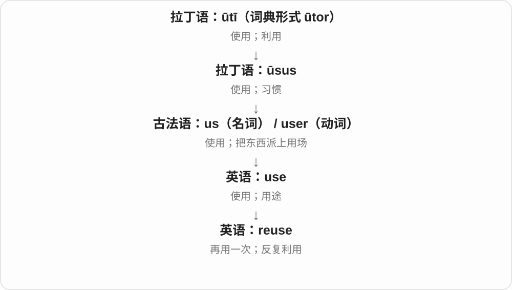

# 0426 · re-, red- — 再一次；回到原处或原状态

[逐词精讲目录](../00_逐词精讲目录.md) · [总目录](../00_总目录_按常用程度.md)

## 核心词根与来源

先把两种常见画面分开：redo、rewrite 是再做，restore、return 是恢复或回去。re- 可以接英语本族词，所以 rewrite 并不是整词来自拉丁。另一方面，老借词中的意思常已变化，不能把每个 re 开头的词都机械译成再一次。

**把一个动作再做一遍，或把偏离、损坏的东西带回原先的状态。**

拉丁 re-／red- → 古法语及英语 re-；英语自由组合 redo、rewrite、rethink、rebuild；借词路线 redigere → redact、restaurare → restore。

- **再做、再写、再使用**：redo, rewrite, reuse, reusable, reapply
- **重新考虑与重新排列**：rethink, reconsider, reconsideration, rearrange, rearrangement
- **重建、续期与更新**：rebuild, renew, renewal
- **回到原处、原状态**：restore, restoration, return, recede
- **归整文本与删隐内容**：redact, redaction, redacted
- **re- 恢复词族中的餐馆名称**：restore · restaurant · restaurants
- **re- 叫回来：撤回、废止**：repeal · repealed · repealing
- **resort → resorts：转向求助与休闲目的地**：resort · resorts
- **revenge：把伤害还回去的报复**：revenge · vengeance · vengeful
- **restore → restored：回到原有可用、完整状态**：restore · restored · restoration
- **restore 的修复、恢复与常用形式**：restore · restores · restoring
- **rehearse：再耙一遍土地怎样走到反复练习**：rehearse · rehearses · rehearsed · rehearsing · rehearsal · rehearsals
- **re-：取回、重新循迹，不只一律再做一次**：retrieve · retrieves · retrieved · retrieving · retriever · retrievers · retrieval · retrievals · retrace · retraces · retraced · retracing
- **recoil：向后缩、退，与枪械后坐**：recoil · recoils · recoiled · recoiling

## 词形与演化规律

古拉丁 red- 常见于元音前的形式，保存在 redact 等词里。现代透明组合中的 re- 常读 /riː/，如 redo；旧借词常有弱读 /rɪ/，如 restore。rewrite、rethink 的名词与动词重音还不同。

拉丁 restaurare 经法语形成 restore、restaurant 的不同借入路线。

repeal 经法语 rapeler、repeler 传入，表示撤回；与 appeal 有法语呼唤词族的联系。

法语 re- 加 sortir 出去的历史材料，不能和英语 sort 分类的词族混同。

古法语 revengier 接 re- 与 vengier；这里 re- 可能起加强作用，不能固定译成再次。

法语 restorer 接拉丁 restaurare 修复、重建，不按现代 re 加 store 解释恢复。

经法语接拉丁 restaurare，不把它拆成现代 re 加 store 商店。

古法语 re- 再 + hercier 耙地、重复，早有复述、重讲，后来成为表演前练习；不是现代 re- + hear 听。

retrieve 由法语 re- 加 trouver 找到一路借入，更远联系希腊 trop- 的分析有不确定性；retrieval 是去 e 加动作名词 -al。

经法语 reculer，接拉丁 re- 向后与 culus 后部材料，完整俗拉丁连接词形为重建；不是英语 re- 加 coil 卷绕。名词也有法语 recul 的借入背景。

## 单词速览（按词族由简到繁）

同一基础词的相关扩展放在一起，先读基础形式，再读扩展；各组之间优先读常用的。具体词源关系见各词讲解。

| 单词 | 音标 | 核心意思 |
|---|---|---|
| [return](#w-1) | 英 /rɪˈtɜːn/；美 /rɪˈtɜːrn/ | 返回；归还；回报；申报表 |
| [restore](#w-2) | 英 /rɪˈstɔː/；美 /rɪˈstɔːr/ | 恢复；修复；还原；归还 |
| [restaurant](#w-21) | 英 /ˈrestrɒnt/；美 /ˈrestərɑːnt/ | 餐馆；饭店〔供用餐的店〕 |
| [restaurants](#w-22) | 英 /ˈrestrɒnts/；美 /ˈrestərɑːnts/ | 餐馆；饭店〔restaurant 的复数〕 |
| [restored](#w-31) | 英 /rɪˈstɔːd/；美 /rɪˈstɔːrd/ | 恢复、修复、还原了〔过去式、过去分词〕 |
| [restoration](#w-3) | /ˌrestəˈreɪʃən/ | 修复；恢复；复辟 |
| [restoring](#w-32) | 英 /rɪˈstɔːrɪŋ/；美 /rɪˈstɔːrɪŋ/ | 正在恢复、修复；恢复原状的过程 |
| [restores](#w-33) | 英 /rɪˈstɔːz/；美 /rɪˈstɔːrz/ | 恢复、修复、归还〔第三人称单数〕；还原操作〔复数〕 |
| [resort](#w-26) | 英 /rɪˈzɔːt/；美 /rɪˈzɔːrt/ | 度假地；求助、诉诸〔resort to〕；最后手段等 |
| [resorts](#w-27) | 英 /rɪˈzɔːts/；美 /rɪˈzɔːrts/ | 度假地〔复数〕；诉诸、采用〔第三人称单数〕 |
| [revenge](#w-28) | /rɪˈvendʒ/ | 报复、复仇；报仇 |
| [rebuild](#w-4) | /ˌriːˈbɪld/ | 重建；重新建立；重组 |
| [repeal](#w-23) | /rɪˈpiːl/ | 废止、撤销〔法律、规定〕；废止这一行为 |
| [repealed](#w-24) | /rɪˈpiːld/ | 已经废止、撤销；repeal 的过去式和过去分词 |
| [repealing](#w-25) | /rɪˈpiːlɪŋ/ | 正在废止、撤销；废止这一行为；repeal 的 -ing 形式 |
| [renew](#w-6) | 英 /rɪˈnjuː/；美 /rɪˈnuː/ | 续期；续订；重新开始；使恢复活力 |
| [renewal](#w-5) | 英 /rɪˈnjuːəl/；美 /rɪˈnuːəl/ | 续期；续订；更新；重新焕发活力 |
| [retrieve](#w-41) | /rɪˈtriːv/ | 取回；找回；检索 |
| [retrieved](#w-40) | /rɪˈtriːvd/ | 取回、找回了；检索、调出了 |
| [retrieval](#w-42) | /rɪˈtriːvəl/ | 取回；检索 |
| [retrievals](#w-51) | /rɪˈtriːvəlz/ | 取回、找回、检索〔多次、多个过程〕 |
| [retrieving](#w-43) | /rɪˈtriːvɪŋ/ | 正在取回、找回、检索 |
| [retriever](#w-44) | 英 /rɪˈtriːvə/；美 /rɪˈtriːvər/ | 寻回犬；执行检索的人或工具 |
| [retrievers](#w-47) | /rɪˈtriːvəz/〔英〕；/rɪˈtriːvərz/〔美〕 | 寻回犬；取回者、检索装置或程序〔复数〕 |
| [retrieves](#w-46) | /rɪˈtriːvz/ | 取回、找回；检索〔第三人称单数〕 |
| [vengeance](#w-29) | /ˈvendʒəns/ | 报复；复仇 |
| [rehearse](#w-38) | 英 /rɪˈhɜːs/；美 /rɪˈhɜːrs/ | 排练、预演；反复练习、复述 |
| [rehearsal](#w-34) | 英 /rɪˈhɜːsəl/；美 /rɪˈhɜːrsəl/ | 排练、预演；一次排练 |
| [rehearsals](#w-35) | 英 /rɪˈhɜːsəlz/；美 /rɪˈhɜːrsəlz/ | 排练、预演〔复数〕 |
| [rehearsing](#w-36) | 英 /rɪˈhɜːsɪŋ/；美 /rɪˈhɜːrsɪŋ/ | 正在排练、预演、反复练习 |
| [rehearsed](#w-37) | 英 /rɪˈhɜːst/；美 /rɪˈhɜːrst/ | 排练、预练了；事先练好的 |
| [rehearses](#w-39) | 英 /rɪˈhɜːsɪz/；美 /rɪˈhɜːrsɪz/ | 排练、预演、复述〔第三人称单数〕 |
| [reconsider](#w-7) | 英 /ˌriːkənˈsɪdə/；美 /ˌriːkənˈsɪdər/ | 重新考虑；再斟酌是否改变决定 |
| [reconsideration](#w-18) | /ˌriːkənˌsɪdəˈreɪʃən/ | 重新考虑；复议；再次审视 |
| [rethink](#w-8) | 动词 /ˌriːˈθɪŋk/；名词 /ˈriːθɪŋk/ | 重新思考；重新考虑方案；一次重新审视 |
| [rewrite](#w-9) | 动词 /ˌriːˈraɪt/；名词 /ˈriːraɪt/ | 重写；改写；重写后的稿件或版本 |
| [reuse](#w-10) | 名词 /ˌriːˈjuːs/；动词 /ˌriːˈjuːz/ | 再次使用；重复利用 |
| [reusable](#w-11) | /ˌriːˈjuːzəbəl/ | 可重复使用的；可复用的 |
| [recoil](#w-52) | 动词 /rɪˈkɔɪl/；名词 /ˈriːkɔɪl/ | 突然退缩、向后弹；反感地避开；后坐力 |
| [recoiled](#w-53) | /rɪˈkɔɪld/ | 突然后退、退缩了；反感地避开了 |
| [recoils](#w-54) | 动词 /rɪˈkɔɪlz/；名词 /ˈriːkɔɪlz/ | 突然退缩、向后弹〔第三人称单数〕；后坐、反弹动作〔复数〕 |
| [recoiling](#w-55) | /rɪˈkɔɪlɪŋ/ | 正在向后弹、突然退缩；反感地避开 |
| [redo](#w-12) | /ˌriːˈduː/ | 重做；重新装修或布置；恢复刚撤销的操作 |
| [redact](#w-20) | /rɪˈdækt/ | 删去或遮去敏感内容；编纂、编辑〔较旧或专门用法〕 |
| [redacted](#w-13) | /rɪˈdæktɪd/ | 经过删隐的；敏感部分已遮去的 |
| [redaction](#w-19) | /rɪˈdækʃən/ | 删隐处理；被隐去的部分；编订 |
| [rearrange](#w-14) | /ˌriːəˈreɪndʒ/ | 重新摆放；重新安排；调整顺序或时间 |
| [rearrangement](#w-15) | /ˌriːəˈreɪndʒmənt/ | 重新安排；重新排列；调整后的布局 |
| [vengeful](#w-30) | /ˈvendʒfəl/ | 想报复的；充满复仇心的 |
| [recede](#w-16) | /rɪˈsiːd/ | 退去；后退；逐渐减弱 |
| [reapply](#w-17) | 英、美 /ˌriːəˈplaɪ/ | 重新申请；再涂、再次施用 |
| [retrace](#w-45) | /ˌriːˈtreɪs/ | 沿原路返回；重走、重描；回顾经过 |
| [retracing](#w-48) | /ˌriːˈtreɪsɪŋ/ | 正在沿原路返回、重走；回顾、重描 |
| [retraced](#w-49) | /ˌriːˈtreɪst/ | 沿原路返回了；重走、重描、回顾了 |
| [retraces](#w-50) | /ˌriːˈtreɪsɪz/ | 沿原路返回、重走、回顾〔第三人称单数〕 |

## 逐词讲解

### 1. return — 返回；归还；回报；申报表

**音标**：英 /rɪˈtɜːn/；美 /rɪˈtɜːrn/

**先抓住这个画面**

沿着关系往回走：人回原处，书回主人手里，投入之后收益回到出资者手中。

**怎么拆**

动词经古法语 retorner / retourner，并受中世纪拉丁语 retornare 影响；名词经法语 retorn 等及中世纪拉丁语 returnum 借入。现代 re- + turn 容易看懂，但名词不是单一路线的后来产物。

**怎么变成今天的意思**

**希腊语 tornos → 拉丁语 tornus / tornare**  
画圆、车削的工具 → 在车床上旋转加工

↓

**古法语 retorner / retourner；中世纪拉丁语 retornare**  
转回、返回

↓

**并行名动词：法语 retorn 等 → 英语 return**  
返回、归还；正式报送的信息及回报

return home 不用 to，return to school 要用 to；return a book 是还书。tax return 是向税务机关提交的申报资料，不是“退税”，退税通常是 tax refund。

**常见搭配与例句**

return to；return something to someone；in return；a tax return。

> Please return the book to the library by Friday.

请在周五之前把书还给图书馆。

> They returned home after midnight.

他们午夜过后才回到家。

> She filed her tax return online.

她在网上提交了纳税申报表。

**别混淆**

go back 强调回去；return 可回去也可回来，且较正式。return 的投资回报可能是负数，不保证赚钱。

### 2. restore — 恢复；修复；还原；归还

**音标**：英 /rɪˈstɔː/；美 /rɪˈstɔːr/

**先抓住这个画面**

把已经损坏、消失或偏离原样的东西，拉回原先应有的状态。

**怎么拆**

经古法语 restorer 接拉丁 restaurare 修复、重建，历史上有 re- 与 -staurare。现代不能把它理解成把物品再存进 store 商店或仓库。

**怎么变成今天的意思**

**拉丁 re- 回、再；-staurare 建立一系**  
后者不作为独立拉丁动词使用，不能照现代 store 仓储拆

↓

**拉丁 restaurare → 古法语 restorer → 中古英语 restoren → restore**  
重建、修复、归还，发展出恢复原状态的用途

restore an old painting 是修复旧画；restore confidence 是恢复信心；restore files from a backup 是从备份还原文件。核心是恢复，不保证每次都能完全复原。

**常见搭配与例句**

restore order；restore confidence；restore something to its original condition；restore from a backup。

> The team restored the painting to its former brightness.

团队修复了这幅画，使它恢复以往的鲜亮。

> I restored the missing files from yesterday’s backup.

我从昨天的备份中还原了丢失的文件。

**别混淆**

renovate 常指翻新并改善，restore 更强调找回旧有状态；数据领域的 recover 与 restore 有重叠，具体产品可能另有术语约定。

### 3. restaurant — 餐馆；饭店〔供用餐的店〕

**音标**：英 /ˈrestrɒnt/；美 /ˈrestərɑːnt/

**先抓住这个画面**

走进去坐下，点一顿饭来吃的地方，就是 restaurant。它名字背后的画面很生活化：吃点东西，让体力恢复。

**怎么拆**

借法语 restaurant，原是 restaurer 恢复、补养的现在分词用作名词，曾指恢复体力的食物，后指供应餐食的店。较早接拉丁 restaurāre，与英语 restore 同族；法语 -ant 不应直接当成英语把 restore 改成餐馆的现造规则。

**怎么变成今天的意思**

**拉丁 restaurāre → 法语 restaurer**  
修复、恢复 → 使体力恢复

↓

**法语 restaurant：分词名词化**  
补养的食物 → 供应餐食的店

↓

**英语借入 restaurant**  
餐馆

a small restaurant 小餐馆；eat at a restaurant 在餐馆吃饭；book a table at a restaurant 订餐桌；a restaurant menu 餐馆菜单。

**常见搭配与例句**

a family restaurant；a restaurant near the station。

> We found a small restaurant beside the river.

我们在河边找到一家小餐馆。

> Could you book a table at the restaurant for six o’clock?

你能在那家餐馆订一张六点的餐桌吗？

**别混淆**

中文饭店可以指吃饭处，也可能指旅馆；restaurant 指供餐用餐的店，hotel 指住宿的酒店。cafe 常以咖啡、简餐为主，具体经营内容会重合。

### 4. restaurants — 餐馆；饭店〔restaurant 的复数〕

**音标**：英 /ˈrestrɒnts/；美 /ˈrestərɑːnts/

**先抓住这个画面**

一条街上、一个城市里的一家家吃饭的店，就是 restaurants。

**怎么拆**

restaurant + -s，/t/ 后读 /s/，结尾形成 /nts/。restaurant 是法语借词，背后有恢复体力、补养食物到餐馆的意义变化；复数按英语常见规则加 s。

**怎么变成今天的意思**

**法语恢复、补养词族 → restaurant → 英语 restaurant**  
补养食物 → 餐馆

↓

**restaurant + -s → restaurants**  
多家餐馆

local restaurants 当地餐馆；seafood restaurants 海鲜餐馆；restaurants within walking distance 步行可达的餐馆。

**常见搭配与例句**

several restaurants nearby；restaurants along the waterfront。

> Several restaurants on this street stay open late.

这条街上有几家餐馆营业到很晚。

> The guide lists restaurants within walking distance of the station.

指南列出了车站附近步行可达的餐馆。

**别混淆**

restaurants 是店铺的可数复数，food 通常说食物。restaurant 里的 au 延续借词拼写，学习时按完整单词记，不按字母分别猜音。

### 5. restored — 恢复、修复、还原了〔过去式、过去分词〕

**音标**：英 /rɪˈstɔːd/；美 /rɪˈstɔːrd/

**先抓住这个画面**

原来能用、完整或在位的状态被打断，现在把它带回来，就是 restored。可以修复建筑，也可以恢复服务、信心、文件。

**怎么拆**

restore + -d，结尾读 /d/。restore 经古法语 restorer 接拉丁 restaurare 修复、重建，不是现代 re- 再加 store 存储。

**怎么变成今天的意思**

**拉丁 restaurare → 古法语 restorer → restore**  
重建、修复 → 带回原有状态

↓

**restore 去 e + -ed → restored**  
恢复、修复已发生；也可描述修复后的对象

restored a building 修复建筑；restored the file 还原文件；restored confidence 恢复信心。

**常见搭配与例句**

fully restored 完全修复；services were restored 服务恢复了。

> The old theatre was carefully restored.

旧剧院得到了细致修复。

> We restored the missing file from a backup.

我们从备份中还原了丢失的文件。

**别混淆**

restored 不要求做成全新的样子，常强调带回原有功能、面貌、状态。stored 只是存放，和恢复动作不同。

### 6. restoration — 修复；恢复；复辟

**音标**：/ˌrestəˈreɪʃən/

**先抓住这个画面**

把恢复原状的工作当成一个过程来谈，从修古画到恢复供电都可以用。

**怎么拆**

接古法语 restoration、晚期拉丁 restauratio 一系，英语拼形也受 restore 影响。虽能与 restore 对照，但名词有独立借入路线，不只由英语动词加 -ation。

**怎么变成今天的意思**

**拉丁 restaurare 修复 → 晚期拉丁 restauratio**  
同族的动作名词

↓

**古法语及拉丁名词支线 → 英语 restoration**  
恢复、修复；英语词形也受 restore 影响

the restoration of power 是恢复供电，building restoration 是建筑修复。英国历史里的 the Restoration 特指君主制复辟时期，是这个普通名词的一项专门用法。

**常见搭配与例句**

the restoration of services；restoration work；undergo restoration。

> Restoration of the damaged ceiling took six months.

修复受损天花板花了六个月。

> Residents welcomed the restoration of the water supply.

居民欢迎供水恢复。

**别混淆**

restoration 强调恢复，conservation 常强调保存、减缓损坏；艺术和建筑项目可能同时包含二者。

### 7. restoring — 正在恢复、修复；恢复原状的过程

**音标**：英 /rɪˈstɔːrɪŋ/；美 /rɪˈstɔːrɪŋ/

**先抓住这个画面**

损坏、消失的状态正在被找回，是 restoring；可修画、修楼，也可恢复秩序、还原文件。

**怎么拆**

restore 去 e 加 -ing → restoring。r 在英式里也因后接元音而读出来；词源接法语、拉丁语修复词。

**怎么变成今天的意思**

**拉丁 restaurare → 古法语 restorer → restore**  
修复、恢复、重建

↓

**restore + -ing → restoring〔去 e〕**  
正在恢复、修复的过程

restoring a painting 修复画作；restoring confidence 恢复信心。

**常见搭配与例句**

restoring files 还原文件；restoring the building 修复建筑。

> The team is restoring a wooden bridge.

团队正在修复一座木桥。

> Restoring the files took most of the afternoon.

还原文件花了大半个下午。

**别混淆**

restoring the files 说恢复内容；restarting the computer 说重新启动机器，动作对象和目的不同。

### 8. restores — 恢复、修复、归还〔第三人称单数〕；还原操作〔复数〕

**音标**：英 /rɪˈstɔːz/；美 /rɪˈstɔːrz/

**先抓住这个画面**

把受损的东西修回去，把原来的秩序、状态找回来，是 restores；先抓回到原先状态的方向。

**怎么拆**

restore + -s，读 /z/。restore 经古法语 restorer 接拉丁 restaurare 修复、重建，不是现代 store 仓储义前加 re。

**怎么变成今天的意思**

**拉丁 restaurare → 法语 restorer → restore**  
重建、修复、恢复

↓

**restore + -s → restores**  
它修复、恢复；多次还原操作

restores old paintings 修复旧画；restores confidence 恢复信心。

**常见搭配与例句**

restores a file 还原文件；restores order 恢复秩序。

> The workshop restores old furniture.

这家工坊修复旧家具。

> The program restores the file from a backup.

程序从备份中还原文件。

**别混淆**

restore 着重恢复原有状态；renovate 往往包含翻新、改善，不一定追求旧样。

### 9. resort — 度假地；求助、诉诸〔resort to〕；最后手段等

**音标**：英 /rɪˈzɔːt/；美 /rɪˈzɔːrt/

**先抓住这个画面**

遇到需要时，人会转向一个可用的地方、办法，是 resort 的理解线索；它既能说可以去休闲的地点，也保留转向某种手段的用途。

**怎么拆**

古法语 resort 资源、帮助与 resortir 相连，较早 re- 再 + sortir 出去；英语名词、动词各有借入与发展。这里的 sortir 与现代 sort 分类词族不同。

**怎么变成今天的意思**

**古法语 resort、resortir → 英语 resort**  
再次出去、转向 → 可求助的对象、办法

↓

**英语后续用途**  
度假休闲目的地；resort to 转向某种手段

a seaside resort 海滨度假地；resort to... 诉诸、采用……；as a last resort 作为最后手段。

**常见搭配与例句**

stay at a resort；resort to drawing a diagram。

> They stayed at a quiet seaside resort.

他们住在一个安静的海滨度假地。

> We used the spare room as a last resort.

实在没有别的办法时，我们用了备用房间。

**别混淆**

resort to 后接名词或 -ing，如 resort to using a map，常是在其他办法不够时改用这一步。a resort 作地点名词时则按度假地、休闲场所理解。

### 10. resorts — 度假地〔复数〕；诉诸、采用〔第三人称单数〕

**音标**：英 /rɪˈzɔːts/；美 /rɪˈzɔːrts/

**先抓住这个画面**

供人去休闲的一处处地点，是 resorts；一个人转向某种办法，也会写 resorts to。两种场景都能接到去、转向的理解线索。

**怎么拆**

resort + -s，/t/ 后读 /s/。底词经古法语 resort、resortir 的求助、资源与出去相关用法借入，re- 在法语历史里是再；现代地点和动词用途分开读。

**怎么变成今天的意思**

**古法语 resort、resortir → resort**  
转向、求助；后来休闲目的地义

↓

**resort + -s → resorts**  
多个度假地；单数主语采用某手段

ski resorts 滑雪度假地；beach resorts 海滨度假地；resorts to a diagram 改用图示说明。

**常见搭配与例句**

resorts along the coast；resorts to writing the steps down。

> The coast has several small beach resorts.

这段海岸有几个小型海滨度假地。

> She resorts to drawing when words are not enough.

语言说不清时，她就改用画图说明。

**别混淆**

resorts 作地点复数不必接 to；resorts to doing 则是动词，to 是介词。这个读音、词源与把东西重新分类的表达要分清。

### 11. revenge — 报复、复仇；报仇

**音标**：/rɪˈvendʒ/

**先抓住这个画面**

别人让我吃了亏，我要让对方也吃亏：这个把伤害还回去的念头，是 revenge 的核心。体育报道也会借它说输过以后赢回来、雪耻。

**怎么拆**

古法语 revengier 等 = re- + vengier 报仇，后者接拉丁 vindicare 主张权利、惩罚、报仇。这里 re- 可能只是加强动作。英语名词又接法语 revenge 等形式，不能把今天名词简单当英语动词新加尾。

**怎么变成今天的意思**

**拉丁 vindicare → 古法语 vengier、revengier**  
主张、惩罚、讨还 → 报仇

↓

**法语相关形式 → 英语 revenge**  
报复动作 → 报复的念头、行为；比赛中雪耻

take revenge on someone for something：因为某事报复某人。on 接对象，for 接缘由；get revenge 也常见。

**常见搭配与例句**

seek revenge 寻求报复；a story of revenge 复仇故事；get revenge for an earlier defeat 为先前的失利雪耻。

> The novel follows a character who is consumed by a desire for revenge.

小说写了一个满心只想复仇的人。

> The team got revenge for its earlier defeat with a clear win.

这支队伍以一场明显的胜利，为先前的失利雪了耻。

**别混淆**

revenge 通常把焦点放在还击、报复；avenge 常把受害者或要讨还的伤害放进宾语。这是常见视角差别，词本身不能证明报复就合理。

### 12. rebuild — 重建；重新建立；重组

**音标**：/ˌriːˈbɪld/

**先抓住这个画面**

房子坏了再建起来，信任受损也得一点点重新搭起来。

**怎么拆**

英语 re- 再次 + build 建造。过去式、分词 rebuilt，读 /ˌriːˈbɪlt/；不是规则加 -ed。

**怎么变成今天的意思**

**re- 再次；英语 build 建造**  
外来前缀与英语本族动词组合

↓

**英语 rebuild**  
重建实体，也比喻恢复组织、生活和信任

rebuild a bridge 是重建桥梁；rebuild trust 是重新建立信任。它常暗示原来的结构已受损、散掉或不足，需要重新组织起来。

**常见搭配与例句**

rebuild a house；rebuild trust；rebuild someone’s life。

> The community helped rebuild the bridge after the flood.

洪水过后，社区帮助重建了桥梁。

> It took months to rebuild trust within the team.

团队内部花了好几个月才重建信任。

**别混淆**

repair 偏修好坏掉的部分；rebuild 往往动得更大，也可能保留部分旧材料，并不一定全部拆光。

### 13. repeal — 废止、撤销〔法律、规定〕；废止这一行为

**音标**：/rɪˈpiːl/

**先抓住这个画面**

原来发布、施行的规则，现在正式收回、使它不再有效，就是 repeal。“叫回来”是它历史上很直观的画面。

**怎么拆**

经盎格鲁法语 repeler、古法语 rapeler 的叫回来、撤回义借入；较早含 re- 回与 apeler 呼唤，后者和 appeal 同族。这是较早法语内部的组合，经借入成为英语 repeal。

**怎么变成今天的意思**

**法语 re- 回 + apeler 呼唤 → rapeler／repeler**  
叫回来、撤回

↓

**英语 repeal 动词、名词**  
废止、撤销；废止行为

repeal a law 废止法律；repeal a regulation 撤销规定；the repeal of an old law 一部旧法的废止。

**常见搭配与例句**

call for repeal；vote to repeal the rule。

> The council voted to repeal the old regulation.

议会投票决定废止那项旧规定。

> The book explains the repeal of the law and its effects.

这本书解释了该法的废止及其影响。

**别混淆**

repeal 强调正式使已有法律、规则失效；appeal 在法律语境多说请求复核决定。repel /rɪˈpel/ 则是排斥、击退，拼写、元音和词义都要分开。

### 14. repealed — 已经废止、撤销；repeal 的过去式和过去分词

**音标**：/rɪˈpiːld/

**先抓住这个画面**

一项原本有效的法律、规则，后来被正式收回、不再施行，就可以说 was repealed。

**怎么拆**

repeal + -ed，/l/ 后过去词尾读 /d/。repeal 经法语的叫回来、撤回词族传入；repealed 按英语规则形成过去形式。

**怎么变成今天的意思**

**法语叫回来、撤回词族 → repeal**  
撤回规定、废止

↓

**repeal + -ed → repealed**  
已经撤销、废止；被废止的

was repealed 被废止；a repealed law 已废止的法律；has been repealed 已经被废止。

**常见搭配与例句**

later repealed；repealed by a new act。

> The old rule was repealed after the review.

复审后，那项旧规则被废止了。

> The article compares the repealed law with the new one.

文章比较了已废止的旧法和新法。

**别混淆**

was repealed 常以规则、法律为主语，说它被正式废止；revised 只说修订，并不必然表示整项废止。过去分词 repealed 也能放在名词前。

### 15. repealing — 正在废止、撤销；废止这一行为；repeal 的 -ing 形式

**音标**：/rɪˈpiːlɪŋ/

**先抓住这个画面**

把正式收回一项法律、规定当作正在做的事，或作为讨论中的一种行动，就是 repealing。

**怎么拆**

repeal + -ing，直接加，保留 l。较早的 re- 回与法语 apeler 呼唤构成叫回来、撤回的词族，借入英语后形成规则 -ing 形式。

**怎么变成今天的意思**

**法语撤回词族 → 英语 repeal**  
叫回来 → 废止已有规定

↓

**repeal + -ing → repealing**  
废止的动作；正在撤销

repealing the law 废止这部法律；consider repealing 考虑废止；a bill repealing the rule 废止该规定的法案。

**常见搭配与例句**

debate repealing a regulation；the effects of repealing the law。

> The committee discussed repealing the outdated rule.

委员会讨论了废止那项过时规定的问题。

> The chapter examines the effects of repealing the law.

这一章分析了废止该法带来的影响。

**别混淆**

repealing 在 consider、discuss、介词后可表示废止这件事；is repealing 交代进行中的动作。replacing 是以另一个东西替换，repealing 强调使旧规定失效。

### 16. renew — 续期；续订；重新开始；使恢复活力

**音标**：英 /rɪˈnjuː/；美 /rɪˈnuː/

**先抓住这个画面**

旧的快到期，就让它继续有效；原本弱下来的劲头，也可以重新起来。

**怎么拆**

中古英语 re- + newen 使更新，接本族 new 词族，并可能类推拉丁 renovare。是外来前缀和英语本族材料的组合，不是拉丁整词直接变短。

**怎么变成今天的意思**

**拉丁来源 re-；中古英语 newen 使更新**  
外来前缀与日耳曼本族动词组合

↓

**中古英语 renewen → 英语 renew**  
使恢复新鲜、继续有效；可能受拉丁 renovare 类推影响

renew a passport 是换发或延续护照的有效使用资格；renew a subscription 是续订。renew interest 是让兴趣重新起来，不一定换一个全新的对象。

**常见搭配与例句**

renew a subscription；renew a lease；renew efforts；renew interest in something。

> I renewed my library membership online.

我在网上续办了图书馆会员资格。

> The discovery renewed her interest in the project.

这项发现重新激起了她对项目的兴趣。

**别混淆**

replace 是用另一件替换；renew 常保留同一关系、服务或目标，使它继续或恢复。

### 17. renewal — 续期；续订；更新；重新焕发活力

**音标**：英 /rɪˈnjuːəl/；美 /rɪˈnuːəl/

**先抓住这个画面**

从快到期、陈旧或低落，走到还能继续、重新有劲的那个过程。

**怎么拆**

英语 renew + 名词后缀 -al。这里 -al 造名词，不能一见这个后缀就断定是形容词。

**怎么变成今天的意思**

**拉丁来源 re-；中古英语 newen 使更新**  
外来前缀与日耳曼本族动词组合

↓

**中古英语 renewen → 英语 renew**  
使恢复新鲜、继续有效；可能受拉丁 renovare 类推影响

↓

**英语 renew + -al → renewal**  
使重新有效或恢复活力的过程

subscription renewal 是续订，a renewal notice 是续费提醒；urban renewal 是城市更新。更新可能涉及整修和改建，不单是把期限往后移。

**常见搭配与例句**

membership renewal；a renewal fee；urban renewal；a sense of renewal。

> The membership renewal notice arrived by email.

会员续期通知通过电子邮件发来了。

> The town’s renewal plan includes repairing old public buildings.

小镇的更新计划包括修缮旧公共建筑。

**别混淆**

renewal 是更新过程，renewable 是能够更新或再生的形容词；两者在句子里的位置不同。

### 18. retrieve — 取回；找回；检索

**音标**：/rɪˈtriːv/

**先抓住这个画面**

东西放在别处、丢在别处或存进系统，现在把它找出来拿回来。

**怎么拆**

古法语 re- 再 + trover 找到；联系希腊 trop- 的更远路线只是一种解释。

**怎么变成今天的意思**

**古法语 trover／trouver**  
找到；其更远来源有争议

↓

**古法语 re- 再 + trover → retrover／retreuver**  
再次找到

↓

**中古英语 retreven → 英语 retrieve**  
找回、取回；后来也指检索信息

retrieve your bag 是取回包；retrieve a file 是从存储位置取出文件或数据。原先可以说猎犬找回猎物，后来对象变成记忆或计算机信息，核心仍是找出来、拿回来。

**常见搭配与例句**

retrieve data；retrieve a file；retrieve information；retrieve something from somewhere。

> She went back to retrieve the bag she had left behind.

她回去取落下的包。

> The system retrieves the requested records from the database.

系统从数据库中检索出所需记录。

**别混淆**

find 强调找到；retrieve 常多一层取回或调出的动作。把存着的数据读出来，不一定是在修复损坏数据。

### 19. retrieved — 取回、找回了；检索、调出了

**音标**：/rɪˈtriːvd/

**先抓住这个画面**

东西落下了，后来去拿回来；资料存在系统里，后来调出来，这种已发生的取回动作叫 retrieved。

**怎么拆**

retrieve 去不发音 e，加完整 -ed，词尾读 /d/；/vd/ 连着发，不增 /ɪd/。

**怎么变成今天的意思**

**古法语 re- 再 + trouver、retreuver 等找到材料 → retrieve**  
早期英语用于再次找到、发现，包含狗寻找猎物的场景

↓

**找回 → 取回物品、唤回记忆、获取存储信息**  
更远联系希腊 trop- 的路线是一种分析，不作唯一确定起点

↓

**retrieve → retrieved**  
过去重新得到实物，或取出存储内容

retrieved the keys 找回钥匙；retrieved the document 调出文件；retrieved from a database 从数据库检索得来。

**常见搭配与例句**

retrieved the bag；successfully retrieved 成功取回。

> I retrieved my bag from the luggage room.

我从行李寄存室取回了包。

> She retrieved an old email to check the date.

她调出一封旧邮件，核对日期。

**别混淆**

retrieved 不自动等于修复损坏；从备份取回一份完好的文件可以说 retrieved，修好损坏的文件另需说明。

### 20. retrieval — 取回；检索

**音标**：/rɪˈtriːvəl/

**先抓住这个画面**

把“去找出并拿回”这整件事当成一个过程。

**怎么拆**

retrieve + 名词词尾 -al，去掉末尾 e；不是表示形容词的所有 -al 都适用。

**怎么变成今天的意思**

**古法语 trover／trouver**  
找到；其更远来源有争议

↓

**古法语 re- 再 + trover → retrover／retreuver**  
再次找到

↓

**中古英语 retreven → 英语 retrieve**  
找回、取回；后来也指检索信息

↓

**retrieve + -al → retrieval**  
取回或检索的过程

information retrieval 是信息检索：从大量资料中找出相关内容。retrieval of personal belongings 是取回个人物品，词不只用于电脑。

**常见搭配与例句**

information retrieval；data retrieval；the retrieval of records；a retrieval system。

> The archive was redesigned to make document retrieval easier.

档案库经过重新整理，方便检索文件。

> The team arranged the retrieval of the equipment from the island.

团队安排从岛上取回设备。

**别混淆**

retrieval 是从已有存储或位置中取得；generation 是产生内容。实际系统可同时做两者，但这两个词指不同动作。

### 21. retrievals — 取回、找回、检索〔多次、多个过程〕

**音标**：/rɪˈtriːvəlz/

**先抓住这个画面**

不是讨论一般的检索能力，而是数一笔、一笔实际发生的取回操作，比如一天调取了多少次记录，就可以用 retrievals。

**怎么拆**

retrieve 去 e 加动作名词 -al → retrieval，再加复数 -s；名词后缀 -al 在这里指过程，不是形容词的“与……有关”。

**怎么变成今天的意思**

**古法语 re- 再 + trouver、retreuver 等找到材料 → retrieve**  
早期英语用于再次找到、发现，包含狗寻找猎物的场景

↓

**找回 → 取回物品、唤回记忆、获取存储信息**  
更远联系希腊 trop- 的路线是一种分析，不作唯一确定起点

↓

**retrieve → retrieval → retrievals**  
取回过程名词，再数作多次检索、取回

successful retrievals 成功取回、检索的次数；document retrievals 文档调取操作。一般说信息检索领域时多用 information retrieval 单数形式。

**常见搭配与例句**

repeated retrievals；count the retrievals。

> The log records how many document retrievals were completed.

日志记录了完成多少次文档调取。

> Repeated retrievals of the same file slowed the system.

反复调取同一个文件拖慢了系统。

**别混淆**

retrieval 常作过程总称，retrievals 把具体操作一项项数出来；不是所有不可数用法都需要加 s。

### 22. retrieving — 正在取回、找回、检索

**音标**：/rɪˈtriːvɪŋ/

**先抓住这个画面**

东西还没回到手里，人正在去拿；结果还没显示，程序正在调数据，这个过程叫 retrieving。

**怎么拆**

retrieve 去 e 加 -ing；保留 /v/，不把整个尾部误读成不发音。

**怎么变成今天的意思**

**古法语 re- 再 + trouver、retreuver 等找到材料 → retrieve**  
早期英语用于再次找到、发现，包含狗寻找猎物的场景

↓

**找回 → 取回物品、唤回记忆、获取存储信息**  
更远联系希腊 trop- 的路线是一种分析，不作唯一确定起点

↓

**retrieve → retrieving**  
取回实物或调出信息的过程

retrieving the ball 正在捡回球；retrieving data 正在检索数据；retrieving a memory 唤回记忆。

**常见搭配与例句**

a message saying retrieving files；help with retrieving lost items。

> The dog is retrieving the stick from the water.

狗正在水里把木棍叼回来。

> The screen says it is retrieving the saved files.

屏幕显示正在调取已保存的文件。

**别混淆**

retrieving 是取回过程；retrieval 是这个动作、过程的名词。动词句和过程名称各用自己的形式。

### 23. retriever — 寻回犬；执行检索的人或工具

**音标**：英 /rɪˈtriːvə/；美 /rɪˈtriːvər/

**先抓住这个画面**

名字直接来自它的工作：把东西找出来、带回来。

**怎么拆**

retrieve + -er，表示执行动作的对象；犬种名称由寻回猎物的用途发展。

**怎么变成今天的意思**

**古法语 trover／trouver**  
找到；其更远来源有争议

↓

**古法语 re- 再 + trover → retrover／retreuver**  
再次找到

↓

**中古英语 retreven → 英语 retrieve**  
找回、取回；后来也指检索信息

↓

**retrieve + -er → retriever**  
取回者 → 寻回犬；检索工具

a golden retriever 是金毛寻回犬；技术文章里的 retriever 则可能是检索相关文档的组件。看到工具名称别先联想到狗，仍然抓“找回东西”的功能。

**常见搭配与例句**

a golden retriever；a Labrador retriever；a document retriever。

> Their golden retriever loves carrying toys back to them.

他们的金毛寻回犬很喜欢把玩具叼回给主人。

> The document retriever selects passages relevant to the query.

文档检索组件会挑出与查询相关的段落。

**别混淆**

retriever 命名行动者或工具，retrieval 命名过程。犬种名称反映历史用途，不是在保证每只狗都经过训练。

### 24. retrievers — 寻回犬；取回者、检索装置或程序〔复数〕

**音标**：/rɪˈtriːvəz/〔英〕；/rɪˈtriːvərz/〔美〕

**先抓住这个画面**

猎物落在远处，训练过的狗去找回来；现代大家熟悉的寻回犬就叫 retrievers。工作角色同样能扩到取回信息的程序。

**怎么拆**

retrieve 去 e 加完整 -er → retriever，再加 -s；不要只写成加 -r，虽然最后拼写看起来只多了 r。

**怎么变成今天的意思**

**古法语 re- 再 + trouver、retreuver 等找到材料 → retrieve**  
早期英语用于再次找到、发现，包含狗寻找猎物的场景

↓

**找回 → 取回物品、唤回记忆、获取存储信息**  
更远联系希腊 trop- 的路线是一种分析，不作唯一确定起点

↓

**retrieve → retriever → retrievers**  
把取回动作变成行动者，常指训练取回物品的犬，再作复数

golden retrievers 金毛寻回犬；Labrador retrievers 拉布拉多寻回犬；data retrievers 信息检索工具，需看语境。

**常见搭配与例句**

trained retrievers；retrievers bringing back the ball。

> Two golden retrievers were playing beside the lake.

两只金毛寻回犬在湖边玩。

> The trainer teaches retrievers to bring objects back gently.

训练员教寻回犬轻轻地把物品叼回来。

**别混淆**

retrievers 是角色或犬类名词，retrieves 才是动词三单；retrievals 则是多次取回或检索过程。

### 25. retrieves — 取回、找回；检索〔第三人称单数〕

**音标**：/rɪˈtriːvz/

**先抓住这个画面**

球扔出去，狗找到后带回；文件存在库里，程序把它调出来，都可以用 retrieves：目标是把要的东西重新拿到手。

**怎么拆**

retrieve + -s，/v/ 后词尾读 /z/；e 不发音，声音落在 /triːv/。基础词经法语的再、找到材料借入。

**怎么变成今天的意思**

**古法语 re- 再 + trouver、retreuver 等找到材料 → retrieve**  
早期英语用于再次找到、发现，包含狗寻找猎物的场景

↓

**找回 → 取回物品、唤回记忆、获取存储信息**  
更远联系希腊 trop- 的路线是一种分析，不作唯一确定起点

↓

**retrieve + -s → retrieves**  
它、他、她取回实物或调出存储信息

retrieves the ball 把球捡回；retrieves a file 调出文件；retrieves information 检索信息。

**常见搭配与例句**

retrieves the latest record；retrieves luggage from storage。

> The dog retrieves the ball and drops it at my feet.

狗把球捡回来，放在我脚边。

> The program retrieves the latest record from the database.

程序从数据库中调出最新记录。

**别混淆**

searches 查找，可以还没找到；retrieves 通常把取回、调出的结果带出来，两个动作在系统里也可前后相接。

### 26. vengeance — 报复；复仇

**音标**：/ˈvendʒəns/

**先抓住这个画面**

不是只想把损失补回来，而是觉得受了伤害，非要让对方也付出代价，这种报复就是 vengeance。

**怎么拆**

经盎格鲁诺曼语、古法语 vengeance 接 vengier 报复；与旧动词 venge 和 -ance 材料相联，不是 revenge 去 re 再任意加尾。

**怎么变成今天的意思**

**拉丁 vindicare → 古法语 vengier**  
报复、惩处；相关意义材料

↓

**法语 vengeance → 英语 vengeance；旧动词 venge + -ful → vengeful**  
报复；一心想报复的

seek vengeance 寻求报复；take vengeance on someone 向某人报复；with a vengeance 可表示猛烈地、变本加厉地。

**常见搭配与例句**

seek vengeance；with a vengeance。

> She refused to let a desire for vengeance control her life.

她不愿让复仇欲控制自己的人生。

> The rain returned with a vengeance.

雨又猛烈地下了起来。

**别混淆**

vengeance 突出报复，justice 突出公正；一个人把报复叫正义，不代表两词本来就同义。

### 27. rehearse — 排练、预演；反复练习、复述

**音标**：英 /rɪˈhɜːs/；美 /rɪˈhɜːrs/

**先抓住这个画面**

正式上场前，把要说、要做的内容一遍遍走过。像土地再耙一遍，熟悉的路线再过一次，就是这个词的老画面。

**怎么拆**

借法语相关形式：re- 再 + hercier 耙地、反复经过，后者接 herse 耙。不是 re- + hear 听，虽然排练常要听声音。

**怎么变成今天的意思**

**古法语 re- 再 + hercier 耙地、反复经过 → rehercier**  
再耙一遍土地的画面，已有重复、复述用途

↓

**法语相关形式 → 中古英语 rehearse**  
先有重讲、复述等义，后来发展为演出前练习

rehearse a play 排练戏剧，rehearse a speech 预练讲话；不局限于舞台音乐。

**常见搭配与例句**

rehearse the scene 排练这一场；rehearse for the concert 为音乐会排练。

> We need to rehearse the final scene again.

我们需要再排一次最后一场。

> I rehearse the opening of my speech at home.

我在家预练讲话的开头。

**别混淆**

practise 范围更广，rehearse 常为具体演出、讲话、行动先完整或分段走一遍。

### 28. rehearsal — 排练、预演；一次排练

**音标**：英 /rɪˈhɜːsəl/；美 /rɪˈhɜːrsəl/

**先抓住这个画面**

把准备上场的内容先做一遍，这项活动、这一次练习叫 rehearsal。星期三的那一场排练，就能说 a rehearsal。

**怎么拆**

现代对应 rehearse 去 e 加完整 -al，这里的 -al 形成动作名词；历史也有借古法语相应名词的分析，不是所有 -al 都作形容词。

**怎么变成今天的意思**

**古法语 re- 再 + hercier 耙地、反复经过 → rehercier**  
再耙一遍土地的画面，已有重复、复述用途

↓

**法语相关形式 → 中古英语 rehearse**  
先有重讲、复述等义，后来发展为演出前练习

↓

**rehearse + 名词后缀 -al；也有法语名词来源分析**  
重复、复述的活动，后用于演出前的排练

in rehearsal 是正在排练阶段；a dress rehearsal 常指按正式演出要求进行的彩排。

**常见搭配与例句**

a final rehearsal 最后一次排练；rehearsal time 排练时间。

> The rehearsal starts at six.

排练六点开始。

> The play is still in rehearsal.

这部戏仍在排练阶段。

**别混淆**

rehearse 是做排练的动作，rehearsal 是活动名称；rehearsal 里的 hear 字母不说明来自 hear 听。

### 29. rehearsals — 排练、预演〔复数〕

**音标**：英 /rɪˈhɜːsəlz/；美 /rɪˈhɜːrsəlz/

**先抓住这个画面**

一次排练是 a rehearsal，几次排练就是 rehearsals。它把一段准备工作分成一次次具体活动来数。

**怎么拆**

rehearsal + -s，末尾读 /z/；名词 -al 在复数前保留，不回到动词 rehearse 去变化。

**怎么变成今天的意思**

**古法语 re- 再 + hercier 耙地、反复经过 → rehercier**  
再耙一遍土地的画面，已有重复、复述用途

↓

**法语相关形式 → 中古英语 rehearse**  
先有重讲、复述等义，后来发展为演出前练习

↓

**rehearse + 名词后缀 -al；也有法语名词来源分析**  
重复、复述的活动，后用于演出前的排练

↓

**rehearsal + -s → rehearsals**  
多次排练活动

weekly rehearsals 每周的排练，several rehearsals 几次排练；都以活动次数为关注点。

**常见搭配与例句**

attend rehearsals 参加排练；cancel rehearsals 取消排练。

> We have three rehearsals before the concert.

音乐会前我们有三次排练。

> The evening rehearsals take place in the main hall.

晚间排练在大厅举行。

**别混淆**

rehearses 是动词说某人排练，rehearsals 是名词说几次排练；两者不能只按词尾都有 s 混用。

### 30. rehearsing — 正在排练、预演、反复练习

**音标**：英 /rɪˈhɜːsɪŋ/；美 /rɪˈhɜːrsɪŋ/

**先抓住这个画面**

正式表演还没开始，演员正在一遍遍走台词、动作，就是 rehearsing。也可以在脑中先走一遍要说的话。

**怎么拆**

rehearse 去末尾 e，加完整 -ing，基础词中的 /s/ 保留。

**怎么变成今天的意思**

**古法语 re- 再 + hercier 耙地、反复经过 → rehercier**  
再耙一遍土地的画面，已有重复、复述用途

↓

**法语相关形式 → 中古英语 rehearse**  
先有重讲、复述等义，后来发展为演出前练习

↓

**rehearse + -ing → rehearsing〔去 e〕**  
排练、预练正在进行

rehearsing for a show 为演出排练；rehearsing a conversation in your head 在脑中预演谈话。

**常见搭配与例句**

rehearsing the scene 正在排练这一场；rehearsing the speech 预练讲话。

> The actors are rehearsing the final scene.

演员们正在排练最后一场。

> I kept rehearsing what I would say in my head.

我一直在脑中预演自己要说的话。

**别混淆**

rehearsing 是具体排练动作，rehearsal 可作为一次排练活动的名称；后者能直接说 a rehearsal。

### 31. rehearsed — 排练、预练了；事先练好的

**音标**：英 /rɪˈhɜːst/；美 /rɪˈhɜːrst/

**先抓住这个画面**

刚才已经练过，叫 rehearsed；一段回答太顺太熟，也可让人觉得像事先练好的。

**怎么拆**

rehearse 去词末 e，加完整 -ed，/s/ 后读 /t/。动作的过去形式也能描述预练后的状态。

**怎么变成今天的意思**

**古法语 re- 再 + hercier 耙地、反复经过 → rehercier**  
再耙一遍土地的画面，已有重复、复述用途

↓

**法语相关形式 → 中古英语 rehearse**  
先有重讲、复述等义，后来发展为演出前练习

↓

**rehearse + -ed → rehearsed〔去 e〕**  
过去排练；事先练好的

a well-rehearsed performance 是排练充分的演出；a rehearsed answer 常暗示回答准备过、未必自然。

**常见搭配与例句**

rehearsed the dance 排练了舞蹈；a rehearsed response 事先练好的回应。

> We rehearsed the dance twice before lunch.

午饭前我们把舞蹈排练了两遍。

> His answer sounded rehearsed.

他的回答听起来像是事先练好的。

**别混淆**

prepared 是准备过的，rehearsed 更容易让人想到把实际话语、动作先练了几遍。

### 32. rehearses — 排练、预演、复述〔第三人称单数〕

**音标**：英 /rɪˈhɜːsɪz/；美 /rɪˈhɜːrsɪz/

**先抓住这个画面**

说她每天先把舞台上的动作走一遍，或者乐队每周一起练，用 rehearse 的单数主语形式 rehearses。

**怎么拆**

rehearse + -s，原词尾 e 保留，/s/ 后另读 /ɪz/；基础词的“再过一遍”接古法语耙地、重复词族。

**怎么变成今天的意思**

**古法语 re- 再 + hercier 耙地、反复经过 → rehercier**  
再耙一遍土地的画面，已有重复、复述用途

↓

**法语相关形式 → 中古英语 rehearse**  
先有重讲、复述等义，后来发展为演出前练习

↓

**rehearse + -s → rehearses**  
他、她或单数团体排练、复述

the band rehearses 说把乐队作为单数整体；she rehearses her lines 是她练台词。

**常见搭配与例句**

rehearses every week 每周排练；rehearses the scene 排练这一场。

> The band rehearses every Thursday.

乐队每周四排练。

> She rehearses her lines on the way to work.

她上班路上练台词。

**别混淆**

rehearses 的 s 是 /s/，末尾新增 -s 成 /ɪz/；它不像 hears 那样把中间辅音读 /z/。

### 33. reconsider — 重新考虑；再斟酌是否改变决定

**音标**：英 /ˌriːkənˈsɪdə/；美 /ˌriːkənˈsɪdər/

**先抓住这个画面**

原先点了头或摇了头，现在愿意把理由再看一遍。

**怎么拆**

来源包括法语 reconsidérer，也可能部分由英语 re- + consider 自行构成。现代这两部分透明可认，但不能把借词路线全部省掉。

**怎么变成今天的意思**

**re- 再次；consider 考虑**  
重新审视已有想法或决定

↓

**法语 reconsidérer 与英语 re- + consider → reconsider**  
既有法语借入解释，也有英语自行组合的路线

reconsider a decision 是重新考虑一个决定；Please reconsider 是请对方再想想。它表达重审的意愿或过程，不表示已经答应改变结果。

**常见搭配与例句**

reconsider a proposal；reconsider doing something；ask someone to reconsider。

> The new evidence made the committee reconsider its decision.

新证据使委员会重新考虑了原来的决定。

> She asked him to reconsider leaving the team.

她请他重新考虑离开团队这件事。

**别混淆**

change your mind 是已经改变主意；reconsider 只说明重新思量，最终也可能坚持原决定。

### 34. reconsideration — 重新考虑；复议；再次审视

**音标**：/ˌriːkənˌsɪdəˈreɪʃən/

**先抓住这个画面**

把再想一次作为一个正式步骤，给原先的结论一次重新评估的机会。

**怎么拆**

英语 reconsider + -ation 形成动作名词。与动词共享重新审视的意思，名词重音移到 -ation。

**怎么变成今天的意思**

**re- 再次；consider 考虑**  
重新审视已有想法或决定

↓

**法语 reconsidérer 与英语 re- + consider → reconsider**  
既有法语借入解释，也有英语自行组合的路线

↓

**英语 reconsider → reconsideration**  
重新考虑的行为或过程

after reconsideration 是重新考虑后；a request for reconsideration 是要求再审视的请求。是否属于某种正式法律程序，要由具体制度决定。

**常见搭配与例句**

careful reconsideration；a request for reconsideration；under reconsideration。

> After careful reconsideration, we kept the original design.

经过认真重新考虑，我们保留了原设计。

> She submitted a request for reconsideration of the funding decision.

她提出申请，请对方重新考虑资助决定。

**别混淆**

reconsideration 不等于 reversal 撤回或推翻；复议可以得出与原来相同的结论。

### 35. rethink — 重新思考；重新考虑方案；一次重新审视

**音标**：动词 /ˌriːˈθɪŋk/；名词 /ˈriːθɪŋk/

**先抓住这个画面**

先把原来的方案放回桌上，看看是不是从思路开始就需要调整。

**怎么拆**

英语 re- 再次 + think 思考；先有动词，后来也作名词。过去式和分词都是 rethought，继承 think 的变化。

**怎么变成今天的意思**

**re- 再次；英语 think 思考**  
在英语里组合成重新想一遍

↓

**英语 rethink 动词；另有同形名词**  
重新审视某事；一次方案重想

rethink the strategy 常暗示要重新检查基本做法；a rethink of the plan 是对计划的重新考虑。它不保证最终一定换掉方案。

**常见搭配与例句**

rethink an approach；rethink our priorities；a major rethink。

> The delays forced us to rethink the schedule.

这些延误迫使我们重新考虑日程安排。

> The survey led to a rethink of the service.

这项调查促使人们重新审视这项服务的做法。

**别混淆**

reconsider 常针对一个决定要不要改，rethink 更容易涉及整套方法；二者也有重叠。

### 36. rewrite — 重写；改写；重写后的稿件或版本

**音标**：动词 /ˌriːˈraɪt/；名词 /ˈriːraɪt/

**先抓住这个画面**

保留想表达的内容，却换一套写法，让文章、代码或规则变成新版本。

**怎么拆**

re- 回、再次 + write。英语早期也有书面答复义，后来常指重新写；名词用法较晚。不是从拉丁语借来一个现成的整词。

**怎么变成今天的意思**

**re- 回、再次；英语 write 写**  
两组材料在英语中组合

↓

**英语动词 rewrite → 较晚的名词 rewrite**  
从写回、再写到改写；一次重写或新稿

rewrite a paragraph 是改写一段，a complete rewrite 是彻底重写。过去式 rewrote、分词 rewritten；动词重音靠后，名词通常在前。

**常见搭配与例句**

rewrite the introduction；rewrite the rules；a major rewrite。

> Please rewrite the opening paragraph in simpler language.

请用更简单的语言改写开头一段。

> The editor asked for a complete rewrite.

编辑要求彻底重写一遍。

**别混淆**

proofread 主要查校错误；rewrite 往往更大幅改变表达或结构。rewrite history 还可指重新解释历史，有时带歪曲之意。

### 37. reuse — 再次使用；重复利用

**音标**：名词 /ˌriːˈjuːs/；动词 /ˌriːˈjuːz/

**先抓住这个画面**

reuse 是把已经用过的东西再拿来用：玻璃瓶洗净后装米，不用先把它变成另一种原材料。

**怎么拆**

re-（再）+ use。名词保留 /s/，动词保留 /z/。

**怎么变成今天的意思**

前缀只改变使用的次数，不要求第二次用途和第一次相同。旧纸箱继续装货，或改成猫窝，都可以是 reuse。

**常见搭配与例句**

reuse a container；reuse code；for reuse；the reuse of materials。

> We reuse glass jars to store rice and beans.

我们把用过的玻璃罐再拿来装米和豆子。

> The boxes were collected for reuse.

这些箱子被收集起来，以便再次使用。

**别混淆**

reuse 是让现成的东西继续派用场；recycle 通常涉及回收处理，让材料重新进入生产或使用循环。

### 38. reusable — 可重复使用的；可复用的

**音标**：/ˌriːˈjuːzəbəl/

**先抓住这个画面**

用过一次还有下一次，不必完成这次任务就丢掉或重新制作。

**怎么拆**

reuse 再使用 + -able 能够；去末尾 e 再接后缀。reuse 本身是 re- + use，不要求物品回到完全未使用的状态。

**怎么变成今天的意思**

**re- 再次；英语 use 使用**  
形成 reuse 再利用的动词

↓

**reuse + -able → reusable**  
能够再用，也用于代码或内容的复用

a reusable bottle 是可反复使用的瓶子；reusable code 是其他地方还能调用的代码。还可以说 make something reusable，让某个成品便于再次使用。

**常见搭配与例句**

a reusable container；reusable packaging；reusable code。

> She carries a reusable bottle to work.

她上班随身带一个可重复使用的水瓶。

> We put the common logic into a reusable function.

我们把通用逻辑放进一个可复用的函数。

**别混淆**

recyclable 是可回收处理成材料，reusable 是可再次使用；同一物品可能两者都符合，也可能只符合其中之一。

### 39. recoil — 突然退缩、向后弹；反感地避开；后坐力

**音标**：动词 /rɪˈkɔɪl/；名词 /ˈriːkɔɪl/

**先抓住这个画面**

手碰到烫物，一下往回缩，是 recoil；听到让人反感的提议，心理上也像往后退。枪械发射向后顶的 recoil 是同族的后坐用法。

**怎么拆**

经法语 reculer，接拉丁 re- 向后 + culus 后部，完整俗拉丁连接词形 *reculare 为重建。名词还接法语 recul；不是英语 re- 加 coil 卷绕。

**怎么变成今天的意思**

**拉丁 re- 向后 + culus 后部；重建 \*reculare → 法语 reculer**  
往后走、退让，不是把现代英语 coil 卷起来

↓

**法语动词 reculer、名词 recul → 英语 recoil**  
后退、缩回；后来枪械发射时向后跳的后坐用法发展

recoil from the heat 遇热向后缩；recoil at the suggestion 对提议反感地退避；feel the recoil 感到后坐力。

**常见搭配与例句**

recoil in horror 惊恐地后退；recoil from violence 对暴力反感。

> She began to recoil from the intense heat.

她开始躲避那股强热，向后退。

> The rifle’s recoil pushed against his shoulder.

步枪的后坐力顶在他的肩上。

**别混淆**

recoil from a proposal 是本能反感、想避开，carefully reject a proposal 可以是审慎否决；结果可能同为不接受，反应方式不同。

### 40. recoiled — 突然后退、退缩了；反感地避开了

**音标**：/rɪˈkɔɪld/

**先抓住这个画面**

看见、碰到不愿接近的东西，身体一下退回去，或心里强烈排斥，就是 recoiled。

**怎么拆**

recoil + 完整 -ed，读 /d/；动词重音在后，末尾 /l/ 与 /d/ 连读。

**怎么变成今天的意思**

**拉丁 re- 向后 + culus 后部；重建 \*reculare → 法语 reculer**  
往后走、退让，不是把现代英语 coil 卷起来

↓

**法语动词 reculer、名词 recul → 英语 recoil**  
后退、缩回；后来枪械发射时向后跳的后坐用法发展

↓

**recoil + -ed → recoiled**  
过去向后缩、反弹，或对某事产生排斥

recoiled from the touch 因接触而缩回；recoiled in horror 惊恐地退后。

**常见搭配与例句**

recoiled at the suggestion；recoiled from the heat。

> She recoiled when the cold hand touched her arm.

冰冷的手碰到她的胳膊时，她猛地缩了回去。

> He recoiled at the suggestion that they should cheat.

听到他们该作弊的提议，他本能地反感。

**别混淆**

recoiled 强调突然退回、本能抗拒，stepped back 可以只是平静地后退一步；不要把所有退步都加上惊恐。

### 41. recoils — 突然退缩、向后弹〔第三人称单数〕；后坐、反弹动作〔复数〕

**音标**：动词 /rɪˈkɔɪlz/；名词 /ˈriːkɔɪlz/

**先抓住这个画面**

碰到不愿接受的东西，他本能地往回退，是 he recoils；一件器械每次动作向后跳，也可描述为 recoils。

**怎么拆**

recoil + -s，读 /z/；动词三单、名词复数同形，但常见重音分开：动作动词重后，名词常重前。

**怎么变成今天的意思**

**拉丁 re- 向后 + culus 后部；重建 \*reculare → 法语 reculer**  
往后走、退让，不是把现代英语 coil 卷起来

↓

**法语动词 reculer、名词 recul → 英语 recoil**  
后退、缩回；后来枪械发射时向后跳的后坐用法发展

↓

**recoil + -s → recoils**  
他或它向后缩、反弹；多个后坐动作

recoils from the idea 一想到就反感；recoils in disgust 厌恶地退缩。

**常见搭配与例句**

the weapon recoils 器械向后坐动；recoils at the sight 看见便往后缩。

> He recoils from the idea of deceiving his friends.

一想到要欺骗朋友，他就本能地反感。

> The rifle recoils each time it is fired.

步枪每次发射都会向后坐动。

**别混淆**

recoils from the idea 不只是不理解，还带本能的排斥；is puzzled by the idea 则主要说想不明白。

### 42. recoiling — 正在向后弹、突然退缩；反感地避开

**音标**：/rɪˈkɔɪlɪŋ/

**先抓住这个画面**

受到刺激后向后缩的动作正发生，是 recoiling；叙事里也可写人一边听一边本能地想避开某个想法。

**怎么拆**

recoil + -ing；动词规则变化，承法语后退材料，不因后接 -ing 就改接英语 coil 卷绕。

**怎么变成今天的意思**

**拉丁 re- 向后 + culus 后部；重建 \*reculare → 法语 reculer**  
往后走、退让，不是把现代英语 coil 卷起来

↓

**法语动词 reculer、名词 recul → 英语 recoil**  
后退、缩回；后来枪械发射时向后跳的后坐用法发展

↓

**recoil + -ing → recoiling**  
后退、反弹或心理排斥的过程

recoiling from the heat 正躲避强热；recoiling in disgust 正厌恶地缩开。

**常见搭配与例句**

a recoiling mechanism 向后坐动的机构；recoiling at the thought。

> He found himself recoiling from the proposed plan.

他发现自己正本能地排斥那个提议。

> The startled child stepped back, recoiling from the sudden touch.

孩子被突然的触碰吓了一跳，退了一步、缩开身体。

**别混淆**

recoiling from 写退避，reaching towards 写接近；看介词方向能把身体、心理动作都读清楚。

### 43. redo — 重做；重新装修或布置；恢复刚撤销的操作

**音标**：/ˌriːˈduː/

**先抓住这个画面**

已经做过一次，现在再做一遍，通常因为要改进或刚才做错了。

**怎么拆**

英语 re- 再次 + do 做；这是真正在英语里组合的词。过去式 redid，过去分词 redone，继承 do 的变化。

**怎么变成今天的意思**

**re- 再次；英语 do 做**  
外来前缀与日耳曼本族动词组合

↓

**英语 redo**  
重做；后来也用于重新装修、布置

redo the calculation 是重算；redo the kitchen 可指重装厨房。软件按钮 Redo 常把刚 Undo 撤销的操作恢复，并不一定把整个任务从头再做。

**常见搭配与例句**

redo the work；redo a room；Undo and Redo。

> I had to redo the calculation after finding a missing number.

发现漏了一个数字后，我不得不重新计算。

> They are redoing the kitchen this summer.

他们今年夏天要重新装修厨房。

**别混淆**

repeat 只说重复，redo 常暗示重做以替换上一版。重做不必每一步完全一样。

### 44. redact — 删去或遮去敏感内容；编纂、编辑〔较旧或专门用法〕

**音标**：/rɪˈdækt/

**先抓住这个画面**

公开文件前，把不应公开的姓名、号码或段落盖住，其他内容仍让人看见。

**怎么拆**

拉丁 red- 回 + agere 带动、做 → redigere 归整 → redactus，再进入英语。早期是把内容整理成形，现代常说隐去文字；不能拆成 re- 再次 + act 表演。

**怎么变成今天的意思**

**拉丁 red- 回、再次；agere 带动、做**  
两部分共同形成 redigere，收拢、归整等意思

↓

**拉丁 redigere → redactus → 中古英语 redacten → redact**  
使形成一定形式、编纂；现代常用于隐去敏感文字

redact a document 通常指处理其中的敏感信息；redact the names 则直接把被隐去的对象作宾语。某些文本研究里仍指编订，需看上下文。

**常见搭配与例句**

redact personal information；redact a report；names redacted from a document。

> The office redacted phone numbers before releasing the report.

办公室在公开报告前隐去了电话号码。

> Several names were redacted from the published emails.

公布的邮件里有几个姓名被遮去了。

**别混淆**

edit 是广泛修改，redact 在现代公开文件中更常指删隐敏感部分；它不一定是改写整段文字。

### 45. redacted — 经过删隐的；敏感部分已遮去的

**音标**：/rɪˈdæktɪd/

**先抓住这个画面**

你拿到的是处理后的版本，一些位置已经看不到原文。

**怎么拆**

redact + -ed，既是过去式或分词，也可作形容词修饰文件。末尾 -ed 在 /t/ 后读 /ɪd/。

**怎么变成今天的意思**

**拉丁 red- 回、再次；agere 带动、做**  
两部分共同形成 redigere，收拢、归整等意思

↓

**拉丁 redigere → redactus → 中古英语 redacten → redact**  
使形成一定形式、编纂；现代常用于隐去敏感文字

↓

**英语 redact + -ed → redacted**  
已经完成删隐处理，或具有这种处理后的状态

a redacted copy 是删隐版副本；heavily redacted 说明删隐很多。a redacted name 通常意味着姓名被隐藏，不是姓名本身被改成新名字。

**常见搭配与例句**

a redacted version；a heavily redacted report；redacted emails。

> The journalist received a heavily redacted copy of the memo.

记者收到了一份删隐很多内容的备忘录副本。

> We compared the redacted version with the original file.

我们把删隐版本与原始文件作了对照。

**别混淆**

redacted 不等于 confidential：保密文件可能完全不公开，删隐版本则可能正是为了公开。

### 46. redaction — 删隐处理；被隐去的部分；编订

**音标**：/rɪˈdækʃən/

**先抓住这个画面**

把一份文件变成可公开版本的那道处理，也可以指页面上一处处被遮掉的内容。

**怎么拆**

编辑义接法语 rédaction，远接拉丁 redigere 的分词词干；另有早期退回义。现代可与 redact 配对，但名词有自己的借入史，不只是在英语动词后加 -ion。

**怎么变成今天的意思**

**拉丁 red- 回；agere 带动 → redigere／redact-**  
整理、归整的词族

↓

**法语 rédaction → 英语 redaction**  
编订、编订后的版本；现代也指删隐处理与被隐去处

after redaction 是经过删隐后；a report with many redactions 是有很多遮盖或删去部分的报告。文本学里的 redaction 可能谈编订过程，并不一定与保密有关。

**常见搭配与例句**

the redaction of personal data；heavy redaction；a page with several redactions。

> The report was released after the redaction of personal details.

隐去个人信息后，报告得以公开。

> The black rectangles show where redactions were made.

黑色方块显示了哪些地方经过遮盖处理。

**别混淆**

deletion 泛指删除；redaction 常特别关乎公开版本的处理，或文学文献的编辑成形。

### 47. rearrange — 重新摆放；重新安排；调整顺序或时间

**音标**：/ˌriːəˈreɪndʒ/

**先抓住这个画面**

桌上的东西还是那些，换一换位置；日程里的事还是那些，重新排一排。

**怎么拆**

英语 re- 再次 + arrange 安排、排列；不是 rear 后面加一个不存在的 -range 词块。

**怎么变成今天的意思**

**re- 再次；英语 arrange 排列、安排**  
两个已有材料组合

↓

**英语 rearrange**  
改变原有顺序、布局或安排

rearrange the furniture 是换家具的位置；rearrange a meeting 可以是改约时间。它说重新组织，不一定新增或删掉内容。

**常见搭配与例句**

rearrange the furniture；rearrange the order；rearrange a meeting。

> We rearranged the chairs so everyone could see the screen.

我们重新摆了椅子，让每个人都能看见屏幕。

> Can we rearrange the meeting for Thursday?

我们能把会议改到星期四吗？

**别混淆**

replace 是替换东西，rearrange 主要是改安排；两种动作可能一起发生，但意思不同。

### 48. rearrangement — 重新安排；重新排列；调整后的布局

**音标**：/ˌriːəˈreɪndʒmənt/

**先抓住这个画面**

把位置和顺序重新排好这件事，或排出来的新样子。

**怎么拆**

现代可按 rearrange + -ment 理解，也能分析为 re- + arrangement；两种分析都围绕重新安排，不必虚构一个唯一的构词时刻。

**怎么变成今天的意思**

**英语 re-、arrange／arrangement**  
再一次安排的构词材料

↓

**rearrange + -ment／re- + arrangement → rearrangement**  
重新安排的过程、结果或具体调整

a rearrangement of the room 可以是房间布局调整；a rearrangement of the timetable 是日程重排。可数时常是一项具体变动，作为过程则可不可数。

**常见搭配与例句**

a rearrangement of the furniture；some minor rearrangements；a structural rearrangement。

> A simple rearrangement of the desks created more space.

把桌子简单重新摆放，就腾出了更多空间。

> The timetable required several minor rearrangements.

时间表需要作几处小调整。

**别混淆**

arrangement 说安排本身，rearrangement 明确已有一个安排在前；不是所有新安排都需要这个 re-。

### 49. vengeful — 想报复的；充满复仇心的

**音标**：/ˈvendʒfəl/

**先抓住这个画面**

心里一直记着对方怎样伤过自己，想着有机会一定还回去，这就是 vengeful。

**怎么拆**

旧动词 venge 报复 + -ful；venge 如今少单独用，但材料还在 vengeance、vengeful 中。

**怎么变成今天的意思**

**拉丁 vindicare → 古法语 vengier**  
报复、惩处；相关意义材料

↓

**法语 vengeance → 英语 vengeance；旧动词 venge + -ful → vengeful**  
报复；一心想报复的

a vengeful person 怀有报复心的人；a vengeful response 带报复意味的回应。

**常见搭配与例句**

vengeful thoughts；a vengeful act。

> The story follows a vengeful ruler who trusts no one.

故事讲一个满心报复、谁也不信的统治者。

> She resisted the urge to send a vengeful message.

她忍住了发报复性消息的冲动。

**别混淆**

vengeful 强调报复欲；angry 只是生气，生气的人未必想报复。

### 50. recede — 退去；后退；逐渐减弱

**音标**：/rɪˈsiːd/

**先抓住这个画面**

原来靠近眼前的边缘，慢慢往后撤。

**怎么拆**

拉丁 re-“向后” + cēdere；经中古法语 receder 及拉丁词进入中古英语 receden。

**怎么变成今天的意思**

**拉丁 cēdere；分词词干 cess-**  
走、离开；让步、让出

↓

**拉丁 re- + cēdere → recēdere**  
往后走、退去

↓

**中古法语 receder／拉丁 recēdere → 中古英语 receden → 英语 recede**  
向后退；潮水、声音、记忆等渐远

潮水退去是最直观的画面。发际线后移、远去的脚步声、渐淡的恐惧，也都可用。recede 通常是不及物动词。

**常见搭配与例句**

the tide recedes；a receding hairline；recede into the distance。

> The floodwater began to recede overnight.

洪水在夜间开始退去。

> The sound of the train receded into the distance.

火车声渐渐消失在远处。

**别混淆**

retreat 常有主动撤退的意味；recede 也能描述自然退去和逐渐减弱。

### 51. reapply — 重新申请；再涂、再次施用

**音标**：英、美 /ˌriːəˈplaɪ/

**先抓住这个画面**

再做一次 apply：申请没成再申请，涂层磨掉再涂一遍。

**怎么拆**

英语 re-“再” + apply；不是另一个古代拉丁语借词。

**怎么变成今天的意思**

**拉丁语 plicare**  
折叠、使相接；与编织、弯曲一组词有更早联系

↓

**拉丁语 ad- + plicare → applicare**  
使贴到一起、连接；把力量用于某事

↓

**古法语 applier / aploier → 中古英语 aplien → apply**  
贴上、运用；后来也指申请

↓

**英语 re- + apply → reapply**  
再次申请或施用

reapply for a position 与 reapply a coating 的宾语结构不同：申请对象前常用 for，直接涂的东西直接作宾语。

**常见搭配与例句**

reapply for；reapply next year；reapply a coating。

> Applicants who were unsuccessful may reapply next year.

未成功的申请人明年可以重新申请。

> The conservator reapplied a thin protective coating.

修复人员重新涂了一层薄薄的保护层。

**别混淆**

renew 常指延续原有效期；reapply 说重新提出申请或重新施用，不保证获准。

### 52. retrace — 沿原路返回；重走、重描；回顾经过

**音标**：/ˌriːˈtreɪs/

**先抓住这个画面**

东西丢了，先想自己走过哪儿，再沿刚才的路返回去找，这叫 retrace your steps。也能在脑里把事情经过重新走一遍。

**怎么拆**

经法语 retracer 等借入，内部可对应 re- 再、回 + trace 沿线描、循迹；现代构词关系清楚，不把借入史略成英语当场拼造。

**怎么变成今天的意思**

**拉丁 trahere 拉、拖 → tractus 等路线、拖出材料**  
经法语 tracier、trace 等进入英语；早期描线、追随义的具体发展并非全都清楚

↓

**沿线描、循迹找 → 描摹、追查、追溯**  
trace 的名词痕迹、微量义与动词用法并存，不只一种词性

↓

**法语 re- + tracer 等 → 英语 retrace**  
英语早期已有追溯源头义，后来也说沿原路返回；现代还能回顾经过

retrace your steps 沿原路返回；retrace the route 重走路线；retrace the events 回顾事情经过。

**常见搭配与例句**

retrace the outline 重新描轮廓；retrace the journey 重走旅程。

> We had to retrace our steps to find the missing keys.

我们得沿原路返回，找丢失的钥匙。

> The book helps readers retrace the events of that evening.

这本书帮助读者回顾那天晚上的事情经过。

**别混淆**

return 只说回来，retrace your steps 还明确沿先前经过的那段路返回，常用于寻找遗失物。

### 53. retracing — 正在沿原路返回、重走；回顾、重描

**音标**：/ˌriːˈtreɪsɪŋ/

**先抓住这个画面**

人正一步步走回刚才经过的地方，或正顺着记忆梳理事情的前后，这段过程叫 retracing。

**怎么拆**

retrace 去 e 加 -ing；re- 作用于 trace，外层 -ing 再把整个动作变成进行形式或过程名词。

**怎么变成今天的意思**

**拉丁 trahere 拉、拖 → tractus 等路线、拖出材料**  
经法语 tracier、trace 等进入英语；早期描线、追随义的具体发展并非全都清楚

↓

**沿线描、循迹找 → 描摹、追查、追溯**  
trace 的名词痕迹、微量义与动词用法并存，不只一种词性

↓

**法语 re- + tracer 等 → 英语 retrace**  
英语早期已有追溯源头义，后来也说沿原路返回；现代还能回顾经过

↓

**retrace → retracing**  
沿先前路线、经过重新追寻的过程

retracing our steps 沿原路返回；retracing the history 回顾历史；retracing a line 重新描线。

**常见搭配与例句**

spend the morning retracing a route；retracing a family’s journey。

> We spent the morning retracing the route of our first walk.

我们上午重走了第一次散步的路线。

> She was retracing the events in her mind.

她正在脑海里回顾事情经过。

**别混淆**

retracing 通常指已有一条路线、经过可循；exploring 可以面对还不熟悉、未确定的地方。

### 54. retraced — 沿原路返回了；重走、重描、回顾了

**音标**：/ˌriːˈtreɪst/

**先抓住这个画面**

找不到东西，沿刚才的脚步倒回去，再把经过查一遍；完成于过去时，就是 retraced。

**怎么拆**

retrace 去 e 加完整 -ed，/s/ 后词尾读 /t/；/st/ 作为结尾，不读成 /sɪd/。

**怎么变成今天的意思**

**拉丁 trahere 拉、拖 → tractus 等路线、拖出材料**  
经法语 tracier、trace 等进入英语；早期描线、追随义的具体发展并非全都清楚

↓

**沿线描、循迹找 → 描摹、追查、追溯**  
trace 的名词痕迹、微量义与动词用法并存，不只一种词性

↓

**法语 re- + tracer 等 → 英语 retrace**  
英语早期已有追溯源头义，后来也说沿原路返回；现代还能回顾经过

↓

**retrace → retraced**  
过去重新循原来的路径、线条或经过

retraced our steps 沿原路返回了；retraced the outline 重新描轮廓；retraced the sequence 回顾顺序。

**常见搭配与例句**

retraced the route；retraced the final hours。

> We retraced our steps and found the scarf on a bench.

我们沿原路返回，在长椅上找到了围巾。

> He retraced the route with his finger on the map.

他用手指在地图上重新沿着那条路线划了一遍。

**别混淆**

retraced the route 可以真走，也可以在地图上沿线查看；具体介质由句子说明。

### 55. retraces — 沿原路返回、重走、回顾〔第三人称单数〕

**音标**：/ˌriːˈtreɪsɪz/

**先抓住这个画面**

她从刚才走过的路往回找，或一段纪录片把一位人物的经历重新梳理出来，动词都可以用 retraces。

**怎么拆**

retrace + -s，基础 /s/ 后词尾读 /ɪz/；前缀 re- 在这里保留 /riː/ 的再、回感觉。

**怎么变成今天的意思**

**拉丁 trahere 拉、拖 → tractus 等路线、拖出材料**  
经法语 tracier、trace 等进入英语；早期描线、追随义的具体发展并非全都清楚

↓

**沿线描、循迹找 → 描摹、追查、追溯**  
trace 的名词痕迹、微量义与动词用法并存，不只一种词性

↓

**法语 re- + tracer 等 → 英语 retrace**  
英语早期已有追溯源头义，后来也说沿原路返回；现代还能回顾经过

↓

**retrace + -s → retraces**  
他、她重新沿先前路线或经过追寻

retraces her steps 沿她走过的路返回；retraces a journey 重走旅程；retraces the events 回顾经过。

**常见搭配与例句**

retraces the route on a map；retraces his early career。

> She retraces her steps whenever she loses her keys.

她每次丢钥匙，都会沿走过的路返回寻找。

> The documentary retraces his first journey across the country.

这部纪录片重走了他第一次穿越该国的旅程。

**别混淆**

repeats 只说重复，retraces 通常保留路径、线条或先后经过的线索感。

## 这一组要分清什么

rethink 不保证最后改主意，renew 不等于换一件新东西，restore 也不是再存进仓库。redact 的现代删隐义要从整个词的历史和用法理解。

## 串起来练习

把一篇稿件重写、一次订阅续期、一份备份还原，分别选 rewrite、renew、restore；再解释为何不是所有三种任务都用同一个重做。
