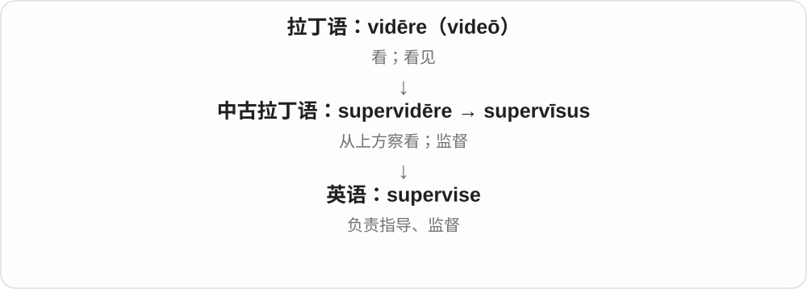
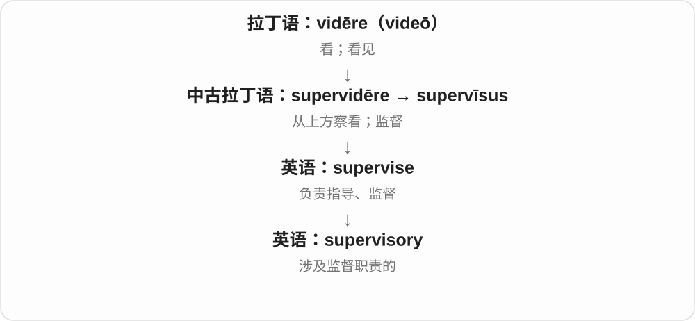
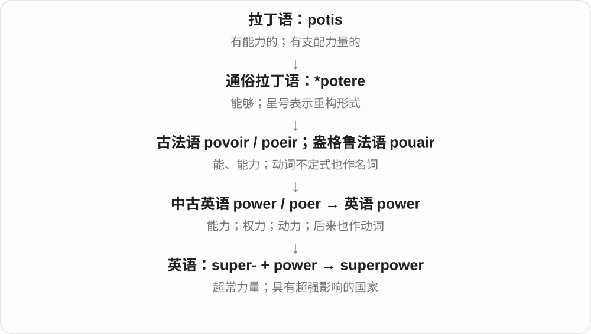
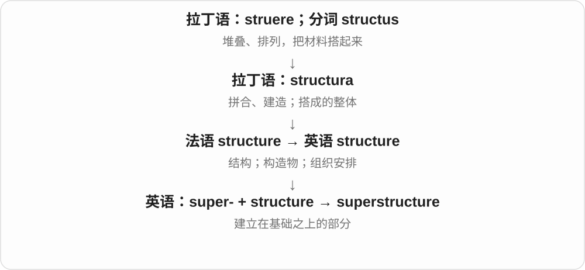
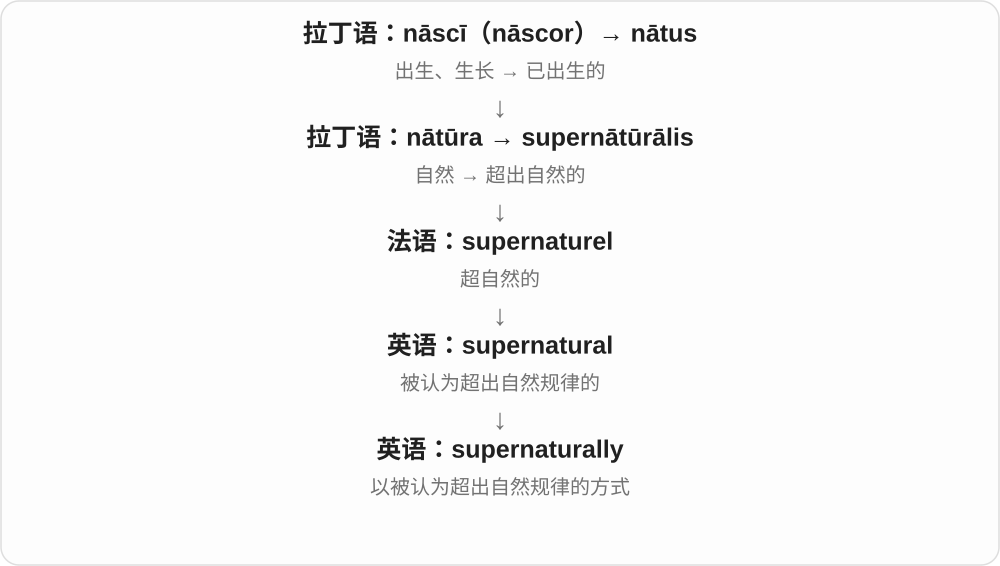

# 0430 · super- — 在上方；超过；额外；超出通常程度

[逐词精讲目录](../00_逐词精讲目录.md) · [总目录](../00_总目录_按常用程度.md)

## 核心词根与来源

拉丁 super 是在上方、越过、超过。它既随古代完整单词进入英语，也成为今天仍能造词的前缀。学这一组，先问“在什么上面、超过什么”，再看每个词的具体历史。

**先想象一条横线：东西可以放在线上方，人可以越过这条线，数量可以多出这条线。super- 的许多意思来自这几个动作。**

书放在上面是位置高；表现越过通常水平是程度高；困难能被翻过去是克服；生命越过危险仍延续就是幸存。

- **高度、等级与顶端**：superior, superiority, supreme, supremely, supremacy, summit, sovereign, sovereignty, soprano, supremum, supernal
- **越过之后仍活着**：survive, survival, survivor, survivable, survivability
- **位置、叠放与额外数量**：surplus, surname, surround, superposition, superscript, supernatant, supernumerary, superset, superfamily
- **表现超出一般水平**：superb, superbly, superlative, superman, superwoman, superhero, supergirl, superboy, supervillain, superpowered, superstar, superstardom, supermodel, superfan
- **规模、速度和动力**：supercomputer, supercomputing, superfast, supercar, superbike, supersport, supercross, supercharger, supercharge, superhighway, supermarket, superstore, supercenter, superyacht, supersize, supersized, superglue, superfine, superhot, supermax
- **有专门定义的科学用词**：supersonic, supernova, supermassive, supercell, superconducting, superconductivity, superconductor, supercritical, superoxide, superfluid, supersymmetry, supertramp
- **评价、宣传与俚语**：superfood, superdrug, superbug, superstorm, superbad, superfly, supergrass, supergroup, supercilious
- **越界、克服与其他历史支线**：superfluous, insuperable, superable, supernatural, supernaturally, superstition, supervise, supervisory, supersede, supervene, superimpose, superstructure, superpower, supermajority, superfund, superficial, superficially, superficiality

## 词形与演化规律

super- 在大量现代复合词里保留；经法语可见 sur-，如 survive、surplus、surname。superus 的比较级 superior、最高级 supremus / summus 分别连接 superior、supreme、summit；sovereign 与 soprano 也经不同语言连到这一词族。字形相似不等于现代英语直接派生。

## 单词速览（常用到不常用）

| 单词 | 音标 | 核心意思 |
|---|---|---|
| [supreme](#w-1) | /suːˈpriːm/，亦 /səˈpriːm/ | 最高的；至上的；极大的 |
| [survive](#w-2) | 英 /səˈvaɪv/；美 /sərˈvaɪv/ | 生存；幸存；继续存在；比……活得久 |
| [superior](#w-3) | 英 /suːˈpɪəriə/；美 /sʊˈpɪriər/ | 更好的；级别更高的；上方的；上级；自命不凡的 |
| [survival](#w-4) | 英 /səˈvaɪvəl/；美 /sərˈvaɪvəl/ | 生存；存续；幸存；遗留下来的事物 |
| [summit](#w-5) | /ˈsʌmɪt/ | 山顶；顶点；峰会；登顶 |
| [superman](#w-6) | 英 /ˈsuːpəmæn/；美 /ˈsuːpərmæn/ | 能力超常的人；超人；超人理念〔哲学〕 |
| [survivor](#w-7) | 英 /səˈvaɪvə/；美 /sərˈvaɪvər/ | 幸存者；经历重大困境后活下来的人；仍存留的事物 |
| [superb](#w-8) | 英 /suːˈpɜːb/；美 /suːˈpɜːrb/ | 极好的；出色的；壮丽的 |
| [sovereign](#w-9) | 英 /ˈsɒvrɪn/；美 /ˈsɑːvrən/ | 君主、最高统治者；有主权的；最高的；英镑金币 |
| [supernatural](#w-10) | 英 /ˌsuːpəˈnætʃərəl/；美 /ˌsuːpərˈnætʃərəl/ | 超自然的 |
| [surplus](#w-11) | 英 /ˈsɜːpləs/；美 /ˈsɜːrpləs/ | 剩余；盈余；过剩的 |
| [sovereignty](#w-12) | 英 /ˈsɒvrənti/；美 /ˈsɑːvrənti/ | 主权；最高统治权；自主决定权 |
| [superhero](#w-13) | 英 /ˈsuːpəˌhɪərəʊ/；美 /ˈsuːpərˌhɪroʊ/ | 超级英雄；能力非凡的英雄人物 |
| [superstar](#w-14) | 英 /ˈsuːpəstɑː/；美 /ˈsuːpərstɑːr/ | 超级明星；极杰出的人 |
| [surround](#w-15) | 英 /səˈraʊnd/；美 /sərˈraʊnd/ | 围绕；包围；环绕 |
| [supermarket](#w-16) | 英 /ˈsuːpəˌmɑːkɪt/；美 /ˈsuːpɚˌmɑːrkɪt/ | 超级市场；超市 |
| [supremacy](#w-17) | /suːˈpreməsi/ | 至高地位；支配优势；至上主义〔特定搭配〕 |
| [superiority](#w-18) | 英 /suːˌpɪəriˈɒrəti/；美 /səˌpɪriˈɔːrəti/ | 优势；较高水平；优越感 |
| [superficial](#w-19) | /ˌsuːpəˈfɪʃəl/ | 表面的；肤浅的 |
| [surname](#w-20) | 英 /ˈsɜːneɪm/；美 /ˈsɜːrneɪm/ | 姓；家族名；别号〔历史义〕 |
| [supervise](#w-21) | 英 /ˈsuːpəvaɪz/；美 /ˈsuːpərvaɪz/ | 监督；指导；负责照看 |
| [supervisory](#w-22) | 英 /ˌsuːpəˈvaɪzəri/；美 /ˌsuːpərˈvaɪzəri/ | 监督的；管理的 |
| [soprano](#w-23) | 英 /səˈprɑːnəʊ/；美 /səˈprænoʊ/ | 高音声部；女高音；高音乐器 |
| [superpower](#w-24) | 英 /ˈsuːpəˌpaʊə/；美 /ˈsuːpərˌpaʊər/ | 超级大国；超能力；特别突出的本领 |
| [superstition](#w-25) | 英 /ˌsuːpəˈstɪʃən/；美 /ˌsuːpərˈstɪʃən/ | 迷信；无根据的吉凶信念 |
| [supersonic](#w-26) | 英 /ˌsuːpəˈsɒnɪk/；美 /ˌsuːpərˈsɑːnɪk/ | 超声速的 |
| [supergirl](#w-27) | 英 /ˈsuːpəɡɜːl/；美 /ˈsuːpərɡɜːrl/ | 能力出众的女孩；女超人〔角色名〕 |
| [supernova](#w-28) | 英 /ˌsuːpəˈnəʊvə/；美 /ˌsuːpərˈnoʊvə/ | 超新星；超新星爆发 |
| [supermodel](#w-29) | 英 /ˈsuːpəmɒdl/；美 /ˈsuːpərmɑːdl/ | 超级名模 |
| [supremely](#w-30) | /suːˈpriːmli/，亦 /səˈpriːmli/ | 极其；至高地；非常出色地 |
| [superbly](#w-31) | 英 /suːˈpɜːbli/；美 /suːˈpɜːrbli/ | 极出色地；绝佳地 |
| [supercar](#w-32) | 英 /ˈsuːpəkɑː/；美 /ˈsuːpərkɑːr/ | 超级跑车；高性能豪华跑车 |
| [superfluous](#w-33) | 英 /suːˈpɜːfluəs/；美 /suːˈpɜːrfluəs/ | 多余的；不需要的 |
| [superficially](#w-34) | /ˌsuːpəˈfɪʃəli/ | 从表面看；浅浅地 |
| [superstructure](#w-35) | 英 /ˈsuːpəstrʌktʃə/；美 /ˈsuːpərstrʌktʃər/ | 上部结构；上层建筑 |
| [superlative](#w-36) | 英 /suːˈpɜːlətɪv/；美 /suːˈpɜːrlətɪv/ | 极好的；最高级的；最高级；极力赞美的话 |
| [supercomputer](#w-37) | 英 /ˌsuːpəkəmˈpjuːtə/；美 /ˈsuːpərkəmˌpjuːtər/ | 超级计算机 |
| [superconducting](#w-38) | 英 /ˌsuːpəkənˈdʌktɪŋ/；美 /ˌsuːpərkənˈdʌktɪŋ/ | 超导的 |
| [supercharger](#w-39) | 英 /ˈsuːpəˌtʃɑːdʒə/；美 /ˈsuːpərˌtʃɑːrdʒər/ | 增压器；机械增压器 |
| [superfast](#w-40) | 英 /ˌsuːpəˈfɑːst/；美 /ˌsuːpərˈfæst/ | 极快的；超高速的 |
| [supersport](#w-41) | 英 /ˈsuːpəspɔːt/；美 /ˈsuːpərspɔːrt/ | 超级运动型摩托车；相应摩托车竞赛类别 |
| [supersede](#w-42) | 英 /ˌsuːpəˈsiːd/；美 /ˌsuːpərˈsiːd/ | 取代；替代并使旧的失效 |
| [superstore](#w-43) | 英 /ˈsuːpəstɔː/；美 /ˈsuːpərstɔːr/ | 大型商店；超大型专卖店 |
| [superfund](#w-44) | /ˈsuːpəfʌnd/；美 /ˈsuːpərfʌnd/ | 大型基金；澳式退休金基金；美式特定环境治理基金名称 |
| [survivability](#w-45) | 英 /səˌvaɪvəˈbɪləti/；美 /sərˌvaɪvəˈbɪləti/ | 生存能力；抗毁生存能力；存续能力 |
| [superposition](#w-46) | 英 /ˌsuːpəpəˈzɪʃən/；美 /ˌsuːpərpəˈzɪʃən/ | 叠放；叠加；叠加态 |
| [superboy](#w-47) | 英 /ˈsuːpəbɔɪ/；美 /ˈsuːpərbɔɪ/ | 能力非凡的男孩；少年超人〔角色名〕 |
| [supercell](#w-48) | 英 /ˈsuːpəsel/；美 /ˈsuːpərsel/ | 超级单体雷暴；超晶胞 |
| [supervillain](#w-49) | 英 /ˈsuːpəˌvɪlən/；美 /ˈsuːpərˌvɪlən/ | 超级反派 |
| [superfood](#w-50) | 英 /ˈsuːpəfuːd/；美 /ˈsuːpərfuːd/ | 超级食物〔宣传或通俗说法〕 |
| [supergroup](#w-51) | 英 /ˈsuːpəɡruːp/；美 /ˈsuːpərɡruːp/ | 超级乐团；超群〔数学等〕 |
| [superconductivity](#w-52) | 英 /ˌsuːpəkɒndʌkˈtɪvəti/；美 /ˌsuːpərkɑːndʌkˈtɪvəti/ | 超导性；超导现象 |
| [supermassive](#w-53) | 英 /ˌsuːpəˈmæsɪv/；美 /ˌsuːpərˈmæsɪv/ | 质量极大的；超大质量的 |
| [superbike](#w-54) | 英 /ˈsuːpəbaɪk/；美 /ˈsuːpərbaɪk/ | 超级摩托车；高性能摩托车；超级摩托车赛事类别 |
| [superconductor](#w-55) | 英 /ˌsuːpəkənˈdʌktə/；美 /ˌsuːpərkənˈdʌktər/ | 超导体 |
| [supercritical](#w-56) | 英 /ˌsuːpəˈkrɪtɪkəl/；美 /ˌsuːpərˈkrɪtɪkəl/ | 超临界的 |
| [supermajority](#w-57) | 英 /ˌsuːpəməˈdʒɒrəti/；美 /ˌsuːpərməˈdʒɔːrəti/ | 超多数；达到较高门槛的多数票 |
| [supercharge](#w-58) | 英 /ˈsuːpətʃɑːdʒ/；美 /ˈsuːpərtʃɑːrdʒ/ | 给发动机增压；大幅增强 |
| [superhighway](#w-59) | 英 /ˌsuːpəˈhaɪweɪ/；美 /ˌsuːpərˈhaɪweɪ/ | 高速干道；信息高速公路〔比喻〕 |
| [survivable](#w-60) | 英 /səˈvaɪvəbəl/；美 /sərˈvaɪvəbəl/ | 可以生还的；有生存能力的 |
| [superoxide](#w-61) | 英 /suːpərˈɒksaɪd/；美 /suːpərˈɑːksaɪd/ | 超氧化物；超氧阴离子 |
| [superfamily](#w-62) | 英 /ˈsuːpəˌfæməli/；美 /ˈsuːpərˌfæməli/ | 总科；超家族 |
| [supermax](#w-63) | 英 /ˈsuːpəmæks/；美 /ˈsuːpərmæks/ | 最高戒备监狱；最高戒备级别的 |
| [superwoman](#w-64) | 英 /ˈsuːpəwʊmən/；美 /ˈsuːpərwʊmən/ | 女超人；能力特别强的女性 |
| [superfan](#w-65) | 英 /ˈsuːpəfæn/；美 /ˈsuːpərfæn/ | 铁杆粉丝；超级爱好者 |
| [superyacht](#w-66) | 英 /ˈsuːpəjɒt/；美 /ˈsuːpərjɑːt/ | 超级游艇；大型豪华游艇 |
| [superfly](#w-67) | 英 /ˈsuːpəflaɪ/；美 /ˈsuːpərflaɪ/ | 极酷的；派头十足的人〔俚语〕；能力特殊的苍蝇 |
| [supercomputing](#w-68) | 英 /ˌsuːpəkəmˈpjuːtɪŋ/；美 /ˈsuːpərkəmˌpjuːtɪŋ/ | 超级计算；高性能计算活动 |
| [superscript](#w-69) | 英 /ˈsuːpəskrɪpt/；美 /ˈsuːpərskrɪpt/ | 上标；写成上标的 |
| [superglue](#w-70) | 英 /ˈsuːpəɡluː/；美 /ˈsuːpərɡluː/ | 强力瞬间胶；用强力胶粘住 |
| [supersymmetry](#w-71) | 英 /ˌsuːpəˈsɪmətri/；美 /ˌsuːpərˈsɪmətri/ | 超对称〔物理学〕 |
| [superbad](#w-72) | 英 /ˌsuːpəˈbæd/；美 /ˌsuːpərˈbæd/ | 非常糟的；酷极了的〔俚语〕 |
| [superficiality](#w-73) | /ˌsuː.pə.fɪʃ.iˈæl.ɪ.ti/ | 肤浅；表面性 |
| [supernumerary](#w-74) | 英 /ˌsuːpəˈnjuːmərəri/；美 /ˌsuːpərˈnuːməˌreri/ | 额外的；超编的；额外人员；群众演员 |
| [supersize](#w-75) | 英 /ˈsuːpəsaɪz/；美 /ˈsuːpərsaɪz/ | 放大；升级为特大份；特大号的 |
| [supernatant](#w-76) | 英 /ˌsuːpəˈneɪtənt/；美 /ˌsuːpərˈneɪtənt/ | 上清液；浮在上面的；位于沉淀物上方的 |
| [superset](#w-77) | 英 /ˈsuːpəset/；美 /ˈsuːpərset/ | 超集；超级组〔健身〕 |
| [supernaturally](#w-78) | 英 /ˌsuːpəˈnætʃərəli/；美 /ˌsuːpərˈnætʃərəli/ | 以超自然方式；异乎寻常地 |
| [superfine](#w-79) | 英 /ˌsuːpəˈfaɪn/；美 /ˌsuːpərˈfaɪn/ | 极细的；优质的；极精细的 |
| [superimpose](#w-80) | 英 /ˌsuːpərɪmˈpəʊz/；美 /ˌsuːpərɪmˈpoʊz/ | 叠加；把一物覆盖在另一物上 |
| [superstorm](#w-81) | 英 /ˈsuːpəstɔːm/；美 /ˈsuːpərstɔːrm/ | 超级风暴；威力或影响极大的风暴 |
| [supercross](#w-82) | 英 /ˈsuːpəkrɒs/；美 /ˈsuːpərkrɔːs/ | 超级越野摩托车赛；场地越野摩托车赛 |
| [supersized](#w-83) | 英 /ˈsuːpəsaɪzd/；美 /ˈsuːpərsaɪzd/ | 超大号的；被显著放大的 |
| [supertramp](#w-84) | 英 /ˈsuːpətræmp/；美 /ˈsuːpərtræmp/ | 擅长远距离扩散定居的物种〔生态学〕；四处漂泊的人〔少见〕 |
| [superstardom](#w-85) | 英 /ˈsuːpəstɑːdəm/；美 /ˈsuːpərstɑːrdəm/ | 超级明星地位；巨星身份 |
| [superbug](#w-86) | 英 /ˈsuːpəbʌɡ/；美 /ˈsuːpərbʌɡ/ | 超级病菌〔通常指耐药病原体〕 |
| [supercenter](#w-87) | 英 /ˈsuːpəsentə/；美 /ˈsuːpərsentər/ | 超大型综合零售店；大型综合中心 |
| [superdrug](#w-88) | 英 /ˈsuːpədrʌɡ/；美 /ˈsuːpərdrʌɡ/ | 特效药、超级药物〔通俗夸赞〕 |
| [superpowered](#w-89) | 英 /ˈsuːpəpaʊəd/；美 /ˈsuːpərpaʊərd/ | 有超能力的；动力极强的 |
| [superfluid](#w-90) | 英 /ˈsuːpəfluːɪd/；美 /ˈsuːpərfluːɪd/ | 超流体；超流的 |
| [supergrass](#w-91) | 英 /ˈsuːpəɡrɑːs/；美 /ˈsuːpərɡræs/ | 提供重大案情的告密者、线人〔英式俚语〕 |
| [superhot](#w-92) | 英 /ˌsuːpəˈhɒt/；美 /ˌsuːpərˈhɑːt/ | 极热的；极辣的；非常热门的 |
| [supercilious](#w-93) | 英 /ˌsuːpəˈsɪliəs/；美 /ˌsuːpərˈsɪliəs/ | 傲慢的；目中无人的 |
| [insuperable](#w-94) | 英 /ɪnˈsuːpərəbəl/；美 /ɪnˈsuːpərəbəl/ | 无法克服的；难以逾越的 |
| [supernal](#w-95) | 英 /suːˈpɜːnəl/；美 /suːˈpɜːrnəl/ | 天上的；神圣的；崇高的〔文学、宗教〕 |
| [supremum](#w-96) | 英 /suːˈpriːməm/；美 /səˈpriːməm/，亦 /suːˈpriːməm/ | 上确界〔数学〕 |
| [supervene](#w-97) | 英 /ˌsuːpəˈviːn/；美 /ˌsuːpərˈviːn/ | 接着发生；额外出现；随附于 |
| [superable](#w-98) | 英 /ˈsuːpərəbəl/；美 /ˈsuːpərəbəl/ | 可以克服的〔少用〕 |

## 逐词讲解

### 1. supreme — 最高的；至上的；极大的

**音标**：/suːˈpriːm/，亦 /səˈpriːm/

**先抓住这个画面**

把位置、权力或程度推到最上端，没有更高一级可比。

**怎么拆**

拉丁 supremus 是 superus“在上面的”的最高级，经法语及拉丁直接借入。不是现代 super + 一个独立 -eme。

**怎么变成今天的意思**

**拉丁 super**  
在上方、超过、越过

↓

**拉丁 superus → 最高级 supremus**  
在上面的 → 最高的

↓

**法语 suprême／拉丁直接借入 → 英语 supreme**  
最高的；极度的

supreme authority 最高权力；supreme confidence 十足自信。Supreme Court 是法院名称里的最高法院，并不因此表示它拥有所有类型的权力。烹饪名词 supreme 另有较晚法语借入支，常指去骨禽胸肉或去膜柑橘瓣。

**常见搭配与例句**

supreme authority；of supreme importance；the Supreme Court。

> The safety of the passengers is of supreme importance.

乘客安全至关重要。

> She approached the final round with supreme confidence.

她以十足的自信迎接最后一轮。

**别混淆**

superior 是比某物更高或更好；supreme 把参照推到最高、极致。

### 2. survive — 生存；幸存；继续存在；比……活得久

**音标**：英 /səˈvaɪv/；美 /sərˈvaɪv/

**先抓住这个画面**

危险、困难或别人生命的终点过去了，自己仍在；物件和传统也可以这样挺过时间。

**怎么拆**

法语 survivre 接后期拉丁 supervivere，super- 超过 + vivere 活。sur- 是经法语变化后的形式，不是 sure“确定”。

**怎么变成今天的意思**

**拉丁 super**  
在上方、超过、越过

↓

**后期拉丁 super- + vivere → supervivere**  
超过某时点而活着；比别人活得久

↓

**古法语／盎格鲁法语 survivre → 英语 survive**  
继续活着、幸存；继续存在

survive an accident 从事故中幸存；survive on a small income 靠少量收入维生；survive someone 比某人活得久。后者不表示对方是灾难。

**常见搭配与例句**

survive a crisis；survive on；survive for years。

> The old bridge survived the flood.

这座老桥经受住了洪水。

> She survived her husband by twelve years.

她比丈夫多活了十二年。

**别混淆**

live 只是活着；survive 通常突出在某种威胁、期限或比较中仍延续。

### 3. superior — 更好的；级别更高的；上方的；上级；自命不凡的

**音标**：英 /suːˈpɪəriə/；美 /sʊˈpɪriər/

**先抓住这个画面**

先是一项东西摆得更高，再引申成质量、地位更高；若人摆出高人一等的姿态，就可能带贬义。

**怎么拆**

拉丁 superior 是 superus 的比较级，经法语 superiour 借入。不是 super 加一个表人的 -ior。

**怎么变成今天的意思**

**拉丁 super**  
在上方、超过、越过

↓

**拉丁比较级 superior → 法语 superiour → 英语 superior**  
更高的 → 等级、质量等在上；上级

通常 superior to，不说 superior than。a superior product 是更好的产品；a superior officer 是上级军官；a superior smile 则可能是自以为高明的笑。

**常见搭配与例句**

superior to；a superior officer；superior quality。

> The new material is superior to the old one in durability.

新材料在耐用性上优于旧材料。

> She reported the problem to her superior.

她向上级报告了这个问题。

**别混淆**

senior 常说资历、级别较高；superior 可比较质量、位置，也可说上级身份。

### 4. survival — 生存；存续；幸存；遗留下来的事物

**音标**：英 /səˈvaɪvəl/；美 /sərˈvaɪvəl/

**先抓住这个画面**

把“挺过之后还在”作为一种结果来谈，可以是人的生命、企业经营，也可以是传统留下的痕迹。

**怎么拆**

英语 survive + -al，行为、结果名词。不是直接借一个拉丁 survival。

**怎么变成今天的意思**

**拉丁 super**  
在上方、超过、越过

↓

**后期拉丁 super- + vivere → supervivere**  
超过某时点而活着；比别人活得久

↓

**古法语／盎格鲁法语 survivre → 英语 survive**  
继续活着、幸存；继续存在

↓

**英语 survive + -al → survival**  
继续存在 → 生存、存续

survival skills 是维持生存的技能；a survival from the past 可指昔日留下的习俗或事物。公司 survival 则是还能继续经营，不是生物生命。

**常见搭配与例句**

survival skills；a matter of survival；the survival of a tradition。

> Clean water was essential to their survival.

洁净的水对他们活下来至关重要。

> The museum documents the survival of an ancient craft.

博物馆记录了一门古老手艺的延续。

**别混淆**

survivor 是幸存者；survival 是幸存、生存这件事。

### 5. summit — 山顶；顶点；峰会；登顶

**音标**：/ˈsʌmɪt/

**先抓住这个画面**

最上面的那一点，先可指山峰，后来也用来形容最高层领导人会面。

**怎么拆**

拉丁 summum“顶端”是 summus“最高的”的中性形式；经法语 som、somet / sommet，再入英语。summus 与 super 的“上方”词族相关，不是现代 sum“总和”加 -mit。

**怎么变成今天的意思**

**拉丁 super**  
在上方、超过、越过

↓

**拉丁最高级 summus → 名词 summum**  
最高的 → 顶端

↓

**古法语 som / sum → somet / sommet → 英语 summit**  
顶点、山顶；现代发展出首脑会议义

reach the summit 登上山顶；a climate summit 是高层气候会议。动词 summit a mountain 表登顶，在登山报道里常见。

**常见搭配与例句**

reach the summit；a summit meeting；summit talks。

> They reached the summit just after sunrise.

他们在日出后不久抵达了山顶。

> The leaders met at a regional summit.

领导人在一场地区峰会上会面。

**别混淆**

peak 也可指山峰或最高点；summit 的首脑会议义更固定。

### 6. superman — 能力超常的人；超人；超人理念〔哲学〕

**音标**：英 /ˈsuːpəmæn/；美 /ˈsuːpərmæn/

**先抓住这个画面**

把一个人的能力想象成超过普通人的极限；日常也常反过来说“我不是超人”，承认做不到一切。

**怎么拆**

super- + man；哲学用法曾用于意译德语 Übermensch，后来漫画角色 Superman 强化了超能力形象。这些概念与角色不宜完全混为一个定义。

**怎么变成今天的意思**

**拉丁 super**  
在上方、超过、越过

↓

**英语构词成分 super-**  
超出一般程度；在上、额外或超过某界限

↓

**英语 super- + man → superman；并用于意译德语 Übermensch**  
超出普通人的人；后来广泛联系超能力角色

小写可泛说能力非凡的人，大写 Superman 常指特定漫画角色。哲学语境要联系作者论述，不能直接套成披斗篷的英雄。

**常见搭配与例句**

I’m not superman；a literary superman；the character Superman。

> I cannot finish all of this tonight; I am not superman.

我今晚做不完所有这些事，我又不是超人。

> The essay compares different translations of Nietzsche’s superman.

这篇文章比较了尼采超人概念的不同译法。

**别混淆**

superhero 是一类英雄人物；Superman 是其中一个特定角色名称。

### 7. survivor — 幸存者；经历重大困境后活下来的人；仍存留的事物

**音标**：英 /səˈvaɪvə/；美 /sərˈvaɪvər/

**先抓住这个画面**

把“仍然活着、仍然存在”落到具体个体上，突出他或它经过了某种考验。

**怎么拆**

英语 survive + 拉丁式表人词尾 -or。早期法律用法指比别人活得久的人，后来扩展到灾难幸存者等。

**怎么变成今天的意思**

**拉丁 super**  
在上方、超过、越过

↓

**后期拉丁 super- + vivere → supervivere**  
超过某时点而活着；比别人活得久

↓

**古法语／盎格鲁法语 survivre → 英语 survive**  
继续活着、幸存；继续存在

↓

**英语 survive + -or → survivor**  
继续活着的人；留下来的个体

a survivor of the earthquake 是地震幸存者。a cancer survivor 是经历癌症而生存的人，并不单凭这个称呼就能判断其治疗是否结束。也可说建筑是历史时期的 survivor。

**常见搭配与例句**

a survivor of；the sole survivor；a survivor of hardship。

> The rescuers spoke to three survivors of the flood.

救援人员与三名洪灾幸存者交谈。

> This cottage is a rare survivor from the medieval village.

这间小屋是那座中世纪村庄罕见的遗存。

**别混淆**

victim 强调遭受伤害，survivor 强调经历之后的生存；具体称呼应符合本人选择和上下文。

### 8. superb — 极好的；出色的；壮丽的

**音标**：英 /suːˈpɜːb/；美 /suːˈpɜːrb/

**先抓住这个画面**

好到明显高出一般水准，可以是表演、食物，也可以是让人赞叹的景色。

**怎么拆**

借拉丁 superbus“宏伟、骄傲、华丽”，接 super“在上”。后面的构件远源有不确定分析，不硬把 b 解释为一个现代词根。

**怎么变成今天的意思**

**拉丁 super**  
在上方、超过、越过

↓

**拉丁 superbus → 英语 superb**  
高傲、宏伟、华丽 → 极好的

现代通常是赞美，a superb performance 表现极佳。拉丁词和英语旧用法有高傲义，但不能因此把现代“很棒”也解释成傲慢。

**常见搭配与例句**

a superb performance；superb views；a superb example。

> The concert ended with a superb solo.

音乐会以一段出色的独奏结束。

> The room has a superb view of the harbour.

房间可以看到壮丽的港湾景色。

**别混淆**

superior 常要求或暗含比较对象；superb 可以直接强烈称赞。

### 9. sovereign — 君主、最高统治者；有主权的；最高的；英镑金币

**音标**：英 /ˈsɒvrɪn/；美 /ˈsɑːvrən/

**先抓住这个画面**

在统治或自治关系中拥有最高权力，不受另一统治者支配；作为名词也可指君主。

**怎么拆**

经古法语 soverain，追到重构通俗拉丁 *superanus“居首的”，接 super。拼写里的 reign 是后来受联想影响，不是本来由 sov + reign 拼成。

**怎么变成今天的意思**

**拉丁 super**  
在上方、超过、越过

↓

**重构通俗拉丁 \*superanus → 古法语 soverain**  
在上、居首 → 最高权力的／统治者

↓

**中古英语 sovereyn → sovereign**  
统治者；有主权的；拼写受 reign 联想影响

a sovereign state 是主权国家；a sovereign 可指君主。金币 sovereign 是另一常见名词义，因君主形象与国家铸币背景得名；不把现价写进词义。

**常见搭配与例句**

a sovereign state；sovereign authority；a gold sovereign。

> The treaty refers to the equal status of sovereign states.

条约提到了各主权国家平等的地位。

> The collection includes a nineteenth-century gold sovereign.

藏品中有一枚十九世纪的英国金币。

**别混淆**

sovereign 强调最高权力或自主地位；superior 只是相对更高，不一定至上。

### 10. supernatural — 超自然的

**音标**：英 /ˌsuːpəˈnætʃərəl/；美 /ˌsuːpərˈnætʃərəl/

**先抓住这个画面**

supernatural 在故事和信仰中，把事件归到普通自然规律以外，例如鬼魂、法力或神迹。

**怎么拆**

中古拉丁语 super-（在……之上、之外）+ nātūrālis，经法语进入英语。

**怎么变成今天的意思**

它分类的是被认为超越自然解释的事物，不是说“非常自然”。词语本身不证明相关现象存在。

**常见搭配与例句**

supernatural powers；a supernatural story；belief in the supernatural。

> The novel contains several supernatural events.

小说中有几件超自然事件。

> She enjoys stories about the supernatural.

她喜欢关于超自然现象的故事。

**别混淆**

unusual 只是不同寻常；supernatural 明确涉及被认为超出自然规律。

### 11. surplus — 剩余；盈余；过剩的

**音标**：英 /ˈsɜːpləs/；美 /ˈsɜːrpləs/

**先抓住这个画面**

需要的那一份已经够了，手里还多出一截，这截就是 surplus。

**怎么拆**

经法语 surplus，sur“在……以上”接拉丁 super，plus“更多”也来自拉丁。不是英语 surprise 的词形变化。

**怎么变成今天的意思**

**拉丁 super**  
在上方、超过、越过

↓

**法语 sur + plus → surplus**  
超过 + 更多 → 额外多出的部分

↓

**英语 surplus**  
超出需要的余量；收入超过支出的盈余

a surplus of food 食物有剩余；budget surplus 是收入超过支出的财政余额。形容词 surplus equipment 指不再需要或多出来的设备。

**常见搭配与例句**

a surplus of；surplus supplies；a budget surplus。

> The farm donated its surplus vegetables.

农场捐出了多余的蔬菜。

> The club ended the year with a small surplus.

俱乐部年终略有盈余。

**别混淆**

excess 常强调过多；surplus 可以只是可利用的剩余，不一定造成问题。

### 12. sovereignty — 主权；最高统治权；自主决定权

**音标**：英 /ˈsɒvrənti/；美 /ˈsɑːvrənti/

**先抓住这个画面**

把“谁拥有最终治理权”作为一种地位或权力来谈，通常出现在国家、政治和法律讨论中。

**怎么拆**

英语经盎格鲁法语 sovereyneté、古法语 soveraineté 借入，接 soverain。现代可分析 sovereign + -ty，历史名词却已有法语路线。

**怎么变成今天的意思**

**拉丁 super**  
在上方、超过、越过

↓

**重构 \*superanus → 古法语 soverain → soveraineté**  
居首、统治者 → 最高统治权

↓

**盎格鲁法语 sovereyneté → 中古英语 sovereynte → sovereignty**  
主权、最高权力

national sovereignty 国家主权；popular sovereignty 人民主权，讨论最高权力归属。资料或技术语境的 data sovereignty 借用自主控制的画面，具体含义随制度而定。

**常见搭配与例句**

national sovereignty；popular sovereignty；respect sovereignty。

> The debate focused on national sovereignty and international cooperation.

辩论围绕国家主权与国际合作展开。

> The chapter explains the idea of popular sovereignty.

这一章解释了人民主权的理念。

**别混淆**

independence 更广泛地说独立；sovereignty 侧重治理权、最高权力的性质。

### 13. superhero — 超级英雄；能力非凡的英雄人物

**音标**：英 /ˈsuːpəˌhɪərəʊ/；美 /ˈsuːpərˌhɪroʊ/

**先抓住这个画面**

比普通英雄更有非凡手段，可能靠超能力，也可能靠装备、训练和强烈的英雄身份。

**怎么拆**

英语 super- + hero。是现代英语复合词，不需要虚构一个古拉丁 superheros 作中间形式。

**怎么变成今天的意思**

**拉丁 super**  
在上方、超过、越过

↓

**英语构词成分 super-**  
超出一般程度；在上、额外或超过某界限

↓

**英语 super- + hero → superhero**  
非凡 + 英雄 → 超级英雄

主要用于漫画、影视，也能夸赞现实中提供重要帮助的人。没有超自然能力的角色也可能被归为 superhero。

**常见搭配与例句**

a superhero film；a superhero costume；a fictional superhero。

> The child designed a superhero who could repair damaged forests.

孩子设计了一个能修复受损森林的超级英雄。

> The film explores the ordinary life behind the superhero identity.

影片探索了超级英雄身份背后的平凡生活。

**别混淆**

hero 可以是任何英雄或故事主角；superhero 通常带特定流行文化类型。

### 14. superstar — 超级明星；极杰出的人

**音标**：英 /ˈsuːpəstɑː/；美 /ˈsuːpərstɑːr/

**先抓住这个画面**

star 已经是明星，再加 super，把名气或表现推到特别突出的程度。

**怎么拆**

英语 super- + star，star“明星”本身借用了星星耀眼的比喻。这里不必指真正的天体。

**怎么变成今天的意思**

**拉丁 super**  
在上方、超过、越过

↓

**英语构词成分 super-**  
超出一般程度；在上、额外或超过某界限

↓

**英语 super- + star〔明星义〕 → superstar**  
极出众的明星 → 巨星、顶尖人物

常用于娱乐、体育，也可夸赞工作能力极强的人。天文学专业分类里不能随意把所有巨大恒星正式叫 superstar。

**常见搭配与例句**

a pop superstar；a sports superstar；a superstar employee。

> The young singer became an international superstar.

这位年轻歌手成了国际巨星。

> She is the team’s quiet superstar, solving the hardest problems.

她是团队里低调的高手，专门解决最难的问题。

**别混淆**

celebrity 是名人；superstar 通常强调特别高的名气或成绩。

### 15. surround — 围绕；包围；环绕

**音标**：英 /səˈraʊnd/；美 /sərˈraʊnd/

**先抓住这个画面**

现代看起来像“绕一圈围住”；真实历史却从水涨起来、漫过周边走到四面包围。

**怎么拆**

后期拉丁 superundare，super 越过 + undare 起浪，接 unda 波浪；经法语进入英语。后来受到 round 的声音和意思影响，但词源不是 sur + round。

**怎么变成今天的意思**

**拉丁 super**  
在上方、超过、越过

↓

**后期拉丁 super- + undare → superundare**  
水漫过、泛滥

↓

**法语 suronder / surounder → 中古英语 surrounden**  
漫过、覆盖

↓

**英语 surround〔受 round 联想影响〕**  
从四面包围、围绕

be surrounded by trees 被树环绕；surround yourself with supportive people 让自己与支持你的人相处。新闻说 questions surround a decision，意思是围绕该决定有疑问。

**常见搭配与例句**

surrounded by；surround someone with；questions surrounding。

> Tall trees surround the house.

高大的树木环绕着房子。

> Many questions still surround the sudden cancellation.

围绕这次突然取消，仍有许多疑问。

**别混淆**

encircle 更直观地说围成圈；surround 不要求真是完美圆形。

### 16. supermarket — 超级市场；超市

**音标**：英 /ˈsuːpəˌmɑːkɪt/；美 /ˈsuːpɚˌmɑːrkɪt/

**先抓住这个画面**

把许多日常食品和用品放进一家较大的自选商店，顾客自己拿货，最后一起结账。

**怎么拆**

super- 大型、超过一般 + market，英语合成；不是“特别优秀的市场”的随意评价。

**怎么变成今天的意思**

**拉丁语 merx，属格 mercis**  
货物、商品

↓

**拉丁语 mercari**  
做买卖、交易

↓

**拉丁语 mercatus → 北部古法语 market / 古法语 marchiet**  
交易；市场

↓

**中古英语 market〔也承接晚期古英语形式〕**  
集市；买卖的范围

↓

**英语 super- + market → supermarket**  
大型食品和日用品自选商店

这个词说一种零售商店形式。它可能很大，也可能是城市里的较紧凑门店，不必按某个固定面积才配使用。

**常见搭配与例句**

a supermarket chain；the supermarket checkout。

> I stopped at the supermarket to buy milk.

我顺路去超市买了牛奶。

> The supermarket has moved its bakery near the entrance.

超市把烘焙区移到了入口附近。

**别混淆**

market 可以是露天集市或抽象市场；supermarket 通常指具体的自选商店。

### 17. supremacy — 至高地位；支配优势；至上主义〔特定搭配〕

**音标**：/suːˈpreməsi/

**先抓住这个画面**

不只是领先一点，而是占据最上层、能压过其他竞争者的地位。

**怎么拆**

常按 supreme + -acy 分析；也有联系拉丁 supremitas 的来源分析。现代可见 highest 的关系，但不宣称只有一种历史路径。

**怎么变成今天的意思**

**拉丁 super**  
在上方、超过、越过

↓

**拉丁 superus → 最高级 supremus**  
在上面的 → 最高的

↓

**法语 suprême／拉丁直接借入 → 英语 supreme**  
最高的；极度的

↓

**英语 supreme + -acy；亦有拉丁 supremitas 关联分析 → supremacy**  
最高地位、权力或支配优势

争夺某领域优势可说 fight for supremacy。white supremacy 等指群体应统治他人的种族至上观念或制度，词义是在描述这种主张，不是认可其正确。

**常见搭配与例句**

technological supremacy；a struggle for supremacy；supremacy over。

> The companies competed for supremacy in the new market.

这些公司争夺新市场的主导地位。

> The exhibition examines the harm caused by racial supremacy.

展览考察了种族至上观念造成的伤害。

**别混淆**

superiority 可是某方面更优；supremacy 通常更进一步，强调最高或压倒性的地位。

### 18. superiority — 优势；较高水平；优越感

**音标**：英 /suːˌpɪəriˈɒrəti/；美 /səˌpɪriˈɔːrəti/

**先抓住这个画面**

把“某项表现更高、更好”当作性质比较；若只在人心里，就可能是一种自认高人一等的感觉。

**怎么拆**

拉丁 superior → 中世纪 superioritas，经法语 superiorité 借入。现代对应 superior + -ity，名词不必先从英语形容词造出。

**怎么变成今天的意思**

**拉丁 super**  
在上方、超过、越过

↓

**拉丁 superior → 中世纪 superioritas → 法语 superiorité**  
更高、更好 → 优越的状态

↓

**中古英语 superiorite → superiority**  
优势；优越感

numerical superiority 是人数优势；a sense of superiority 是优越感，未必有事实依据。要问“在哪方面、比谁更优”，避免把它看成无条件判断。

**常见搭配与例句**

technical superiority；numerical superiority；a sense of superiority。

> The larger team had a clear numerical superiority.

较大的队伍有人数上的明显优势。

> His tone suggested an unwarranted sense of superiority.

他的语气透出毫无根据的优越感。

**别混淆**

supremacy 侧重最高或统治地位；superiority 只需在某个比较维度上占优。

### 19. superficial — 表面的；肤浅的

**音标**：/ˌsuːpəˈfɪʃəl/

**先抓住这个画面**

用手摸过桌面，却没有看抽屉里有什么：superficial 就是停在外层，没有深入。

**怎么拆**

super-（上方）+ faciēs（面）形成 superficies，再形成 superficialis。

**怎么变成今天的意思**

身体表层的轻微划伤可中性地说 superficial；评价理解和分析时，则常批评只看外观。

**常见搭配与例句**

a superficial scratch；superficial knowledge；a superficial resemblance。

> The scratch is superficial.

这道划痕只在表层。

> Their explanation was too superficial to be useful.

他们的解释太肤浅，帮不上忙。

**别混淆**

shallow 原指浅，也可说思想浅；superficial 更强调只碰到外表这一层。

### 20. surname — 姓；家族名；别号〔历史义〕

**音标**：英 /ˈsɜːneɪm/；美 /ˈsɜːrneɪm/

**先抓住这个画面**

在个人名字之外，再加一个能指出家族或身份的名字；现代通常说姓氏。

**怎么拆**

拉丁 supernomen / supranomen“附加名”→ 法语 surnom / surnoun；英语借入后把后半部分对应为本族 name，属于部分仿译。sur- 接 super。

**怎么变成今天的意思**

**拉丁 super**  
在上方、超过、越过

↓

**后期拉丁 super- + nomen → supernomen / supranomen**  
额外 + 名字 → 附加名

↓

**古法语 surnom / surnoun → 中古英语 surname**  
附加名；英语后部采用 name

↓

**英语 surname**  
通常指家族姓氏

表格上 surname 与 given name 对照。不同文化的姓氏位置不同，所以不能从这个词推断姓一定写在最后。

**常见搭配与例句**

surname and given name；change one’s surname；a family surname。

> Please enter your surname exactly as it appears on your passport.

请按护照上的写法填写姓氏。

> In this list, the surname is written before the given name.

这份名单把姓写在名字前面。

**别混淆**

last name 在英语习惯里常指姓，但 surname 更不依赖排列位置。

### 21. supervise — 监督；指导；负责照看

**音标**：英 /ˈsuːpəvaɪz/；美 /ˈsuːpərvaɪz/

**先抓住这个画面**

supervise 不是随便看一眼，而是对过程负有责任：留意是否正确，必要时指导或干预。

**怎么拆**

super-（在上）+ vidēre（看）在中古拉丁语形成 supervidēre；英语由其分词形式借入。

**怎么变成今天的意思**

“从上面看”发展为掌握、指导工作。位置是帮助理解的意象，现实中不必真的站在高处。

**常见搭配与例句**

supervise a team；supervise children；supervise construction。

> She supervises a team of six researchers.

她负责指导一个六人研究团队。

> An adult must supervise the children during the activity.

活动期间必须有成人照看孩子们。

**别混淆**

watch 可以只是观看；supervise 通常还包含管理或看护责任。

### 22. supervisory — 监督的；管理的

**音标**：英 /ˌsuːpəˈvaɪzəri/；美 /ˌsuːpərˈvaɪzəri/

**先抓住这个画面**

supervisory 说明岗位或任务含有看管、指导别人的责任，不只是完成自己的那一份。

**怎么拆**

supervise + -ory，变成描述监督职责的形容词。

**怎么变成今天的意思**

它经常与 role、position、responsibility 连用，把工作性质说清楚。

**常见搭配与例句**

a supervisory role；supervisory duties；supervisory experience。

> She moved into a supervisory position last year.

她去年转到了管理岗位。

> The job requires some supervisory experience.

这个职位要求有一定的管理经验。

**别混淆**

supervisory 是职责性质；supervised 是处在别人监督之下，方向相反。

### 23. soprano — 高音声部；女高音；高音乐器

**音标**：英 /səˈprɑːnəʊ/；美 /səˈprænoʊ/

**先抓住这个画面**

从“在上面的”想到合唱或乐器家族里音高较高的一部分。

**怎么拆**

借意大利语 soprano，远接重构通俗拉丁 *superanus，来自 super“上方”。它和 sovereign 同源异路，但一个走向音域，一个走向统治地位。

**怎么变成今天的意思**

**拉丁 super**  
在上方、超过、越过

↓

**重构 \*superanus → 意大利 soprano**  
在上、较高 → 高音声部

↓

**英语 soprano**  
高音声部、歌手或相应乐器

常指女高音，但合唱声部可由不同年龄、性别的歌者承担；soprano saxophone 是高音萨克斯，不是会唱女高音的人。

**常见搭配与例句**

a soprano voice；the soprano part；a soprano saxophone。

> The soprano sang the opening phrase alone.

女高音独自唱出了开头的乐句。

> He plays the soprano saxophone in a jazz ensemble.

他在一支爵士乐团演奏高音萨克斯。

**别混淆**

alto 通常是较低的声部；soprano 说相对音域，不等于只会唱某一个高音。

### 24. superpower — 超级大国；超能力；特别突出的本领

**音标**：英 /ˈsuːpəˌpaʊə/；美 /ˈsuːpərˌpaʊər/

**先抓住这个画面**

superpower 是超出一般水平的力量：国际政治里是国家实力，漫画里则可能是飞行或隐身。

**怎么拆**

super- 超级、超过 + power，英语构词；国家和虚构能力的含义要随语境分开。

**怎么变成今天的意思**

a global superpower 指具有广泛国际影响的强国。口语说 Listening is her superpower，是夸她特别善于倾听，不在宣称超自然能力。

**常见搭配与例句**

a global superpower；an economic superpower；have superpowers。

> The chapter examines rivalry between two superpowers.

这一章研究了两个超级大国之间的竞争。

> In the comic, her superpower is the ability to become invisible.

漫画里，她的超能力是隐身。

**别混淆**

superpower 在政治语境强调国家的超强综合影响；powerhouse 可用于地区、企业或个人，并不自动表示超级大国。

### 25. superstition — 迷信；无根据的吉凶信念

**音标**：英 /ˌsuːpəˈstɪʃən/；美 /ˌsuːpərˈstɪʃən/

**先抓住这个画面**

把某个数字、动作或物品与好运坏运硬连起来，却拿不出可靠根据，这类信念常叫 superstition。

**怎么拆**

经法语来自拉丁语 superstitio，形式与 super-（在上、越过）+ stāre 有关；从“站在上面、存留”到迷信的具体义变没有公认的唯一解释。

**怎么变成今天的意思**

可以记住词形中的“站”，但别编成“站在神上面所以迷信”等故事。现代用法抓住不合理的吉凶因果联想，更容易实际理解。

**常见搭配与例句**

a common superstition；out of superstition；superstition about numbers。

> She dismissed the idea that the number brings bad luck as superstition.

她认为那个数字会带来厄运的说法只是迷信。

> The book records local superstitions about the sea.

这本书记载了当地与大海有关的迷信。

**别混淆**

tradition 是传统，不必包含超自然因果；superstition 通常带说话者认为根据不足的评价。

### 26. supersonic — 超声速的

**音标**：英 /ˌsuːpəˈsɒnɪk/；美 /ˌsuːpərˈsɑːnɪk/

**先抓住这个画面**

跑得比声音在同样环境中传播还快；比较的是速度，不是声音有多尖。

**怎么拆**

super- 超过 + sonic 声音的，sonic 接拉丁 sonus 声音。英语科学构词借超出界限的 super-。

**怎么变成今天的意思**

**拉丁 super**  
在上方、超过、越过

↓

**英语构词成分 super-**  
超出一般程度；在上、额外或超过某界限

↓

**英语 super- + sonic → supersonic**  
超过声音传播速度的

速度超过当地声速，马赫数大于 1，即可称 supersonic。声速随介质和状态而变，不是宇宙各处都同一个数字。较早还有近 ultrasonic 的用法，现代应优先分清。

**常见搭配与例句**

supersonic flight；supersonic speed；a supersonic aircraft。

> The aircraft was designed for supersonic flight.

这架飞机按超声速飞行需求设计。

> The flow became supersonic as it passed through the nozzle.

气流通过喷管时变成了超声速。

**别混淆**

ultrasonic 通常说频率超过人耳听觉上限；supersonic 主要说运动速度超过声速。

### 27. supergirl — 能力出众的女孩；女超人〔角色名〕

**音标**：英 /ˈsuːpəɡɜːl/；美 /ˈsuːpərɡɜːrl/

**先抓住这个画面**

把女孩的表现夸到像有超能力；大写时也可能指一个特定漫画角色。

**怎么拆**

英语 super- + girl。现代通用组合与漫画 Supergirl 的文化形象相互影响，不把所有普通用法都限定为角色名。

**怎么变成今天的意思**

**拉丁 super**  
在上方、超过、越过

↓

**英语构词成分 super-**  
超出一般程度；在上、额外或超过某界限

↓

**英语 super- + girl → supergirl；亦见专名 Supergirl**  
非凡女孩；超能力角色

可用作夸张称赞，也可讨论对女孩“什么都得做得好”的压力。具体漫画人物用大写。

**常见搭配与例句**

a talented supergirl；the character Supergirl。

> Her friends called her a supergirl after she completed three projects in one week.

她一周完成三个项目后，朋友们称她为超能女孩。

> The story follows a supergirl who is still learning to control her powers.

故事讲的是一个仍在学习控制能力的超能女孩。

**别混淆**

superwoman 指成年女性；supergirl 通常指女孩或特定角色。

### 28. supernova — 超新星；超新星爆发

**音标**：英 /ˌsuːpəˈnəʊvə/；美 /ˌsuːpərˈnoʊvə/

**先抓住这个画面**

天空中某颗星突然亮得惊人，并非刚出生了一颗普通新星，而是发生了剧烈恒星爆发。

**怎么拆**

英语 super- + nova；nova 接拉丁“新的”，来自历史上看似出现新星的命名。super 强调其比通常新星事件更强，但超新星并非普通新星简单升级。

**怎么变成今天的意思**

**拉丁 super**  
在上方、超过、越过

↓

**英语构词成分 super-**  
超出一般程度；在上、额外或超过某界限

↓

**英语 super- + nova → supernova**  
极强的“新星”现象 → 恒星剧烈爆发这一类别

常见机制包括大质量恒星核心坍缩和白矮星热核爆发；不能把所有超新星都说成留下中子星或黑洞。复数 supernovae、supernovas 都可见。

**常见搭配与例句**

a supernova explosion；a supernova remnant；observe a supernova。

> Astronomers detected a supernova in a distant galaxy.

天文学家在一个遥远星系发现了超新星。

> The expanding cloud is the remnant of an ancient supernova.

这片扩张的云是一次古老超新星爆发的遗迹。

**别混淆**

nova 通常涉及白矮星表面爆发；supernova 是不同级别、机制更剧烈的事件，并不表示刚诞生的恒星。

### 29. supermodel — 超级名模

**音标**：英 /ˈsuːpəmɒdl/；美 /ˈsuːpərmɑːdl/

**先抓住这个画面**

模特中的明星：知名度和商业影响力已经超出一次走秀或拍摄。

**怎么拆**

super- 表示突出、超级，加 model“模特”；英语内部构词，不是某个模特本人发明的古老称号。

**怎么变成今天的意思**

**拉丁语：modus**  
尺度、分寸；方式

↓

**拉丁语 modulus → 通俗拉丁语 \*modellus**  
小尺度、标准 → 样式〔后者为重建形式〕

↓

**意大利语 modello → 法语 modelle → 英语 model**  
供参照的模型、样式

↓

**英语 model〔模特〕 + super- → supermodel**  
具有很高知名度的模特

它说的是职业地位和名气，不是“特别好的数学模型”。具体多有名没有统一考试标准。

**常见搭配与例句**

a famous supermodel；become a supermodel。

> The supermodel appeared on the cover of the magazine.

这位超级名模登上了杂志封面。

> She interviewed a former supermodel about life after fashion.

她采访了一位前超级名模，聊她离开时尚行业后的生活。

**别混淆**

model 是职业名称；supermodel 额外强调明星级知名度。

### 30. supremely — 极其；至高地；非常出色地

**音标**：/suːˈpriːmli/，亦 /səˈpriːmli/

**先抓住这个画面**

把某种程度推到很高，常用来强调镇定、自信、重要或毫不在意等状态。

**怎么拆**

supreme + -ly，英语副词派生；不是“来自最高法院地”。

**怎么变成今天的意思**

**拉丁 super**  
在上方、超过、越过

↓

**拉丁 superus → 最高级 supremus**  
在上面的 → 最高的

↓

**法语 suprême／拉丁直接借入 → 英语 supreme**  
最高的；极度的

↓

**英语 supreme + -ly → supremely**  
最高、极度 → 极其

supremely confident 自信十足，supremely indifferent 极度漠然；它只是加强程度，不保证后面的品质是好事。

**常见搭配与例句**

supremely confident；supremely important；supremely indifferent。

> She remained supremely calm during the interview.

面试时，她始终极为镇定。

> He seemed supremely indifferent to the criticism.

他似乎对批评毫不在意。

**别混淆**

superbly 常称赞完成得好；supremely 还可强化负面或中性性质。

### 31. superbly — 极出色地；绝佳地

**音标**：英 /suːˈpɜːbli/；美 /suːˈpɜːrbli/

**先抓住这个画面**

一件事做得非常到位，或一个地方布置得令人赞叹，拿这个词直接给予高度评价。

**怎么拆**

superb + -ly，英语副词。一般继承现代 superb 的赞美义，旧高傲义需另看历史语境。

**怎么变成今天的意思**

**拉丁 super**  
在上方、超过、越过

↓

**拉丁 superbus → 英语 superb**  
高傲、宏伟、华丽 → 极好的

↓

**英语 superb + -ly → superbly**  
极好的 → 极出色地

superbly acted 表演精彩，superbly equipped 配备精良。通常不能拿来只表示数量特别多。

**常见搭配与例句**

perform superbly；superbly organised；superbly equipped。

> The actors performed superbly in the final scene.

演员们在最后一场戏中表现极佳。

> The exhibition was superbly organised.

这场展览组织得非常出色。

**别混淆**

supremely 说达到极高程度；superbly 强调质量值得赞扬。

### 32. supercar — 超级跑车；高性能豪华跑车

**音标**：英 /ˈsuːpəkɑː/；美 /ˈsuːpərkɑːr/

**先抓住这个画面**

性能、设计和价格都远超普通汽车的跑车类别称呼，而不是任何跑得较快的车。

**怎么拆**

英语 super- + car。现代汽车文化中的构词，不存在一套全球统一的数字门槛能单靠单词决定归类。

**怎么变成今天的意思**

**拉丁 super**  
在上方、超过、越过

↓

**英语构词成分 super-**  
超出一般程度；在上、额外或超过某界限

↓

**英语 super- + car → supercar**  
超常性能的汽车 → 超级跑车

常见于汽车评论和展览。它暗示高性能、昂贵和稀有等特征；具体哪些车被算进去，媒体和厂商用法会不同。

**常见搭配与例句**

a supercar manufacturer；a supercar collection。

> The exhibition displayed several historic supercars.

展览展出了几辆具有历史意义的超级跑车。

> The engineer discussed the supercar’s cooling system.

工程师讨论了这辆超级跑车的冷却系统。

**别混淆**

sports car 范围更广；supercar 通常把性能与定位推到更高层级。

### 33. superfluous — 多余的；不需要的

**音标**：英 /suːˈpɜːfluəs/；美 /suːˈpɜːrfluəs/

**先抓住这个画面**

杯子已经满了，还流出来的一部分没有必要；语言里多出来的一句、配置里用不到的一项都可这样看。

**怎么拆**

拉丁 superfluus，接 superfluere“溢出”，super 过量 + fluere 流；英语词尾 -ous 与拉丁形容词路线相接。不是 super + flu“流感”。

**怎么变成今天的意思**

**拉丁 super**  
在上方、超过、越过

↓

**拉丁 super- + fluere → superfluere → superfluus**  
流过头、溢出 → 过量的

↓

**中古英语 superfluous → 现代英语 superfluous**  
超过所需；多余

superfluous detail 是删掉也不损害意思的细节。它说不需要，并不必然说有害或质量差。

**常见搭配与例句**

superfluous details；render something superfluous；remove the superfluous。

> The editor removed several superfluous sentences.

编辑删掉了几句多余的话。

> The clear diagram made a long explanation superfluous.

清晰的示意说明让长篇解释变得没有必要。

**别混淆**

surplus 是多出来的余量，还可能有用；superfluous 更直接判断这些东西没有必要。

### 34. superficially — 从表面看；浅浅地

**音标**：/ˌsuːpəˈfɪʃəli/

**先抓住这个画面**

只瞟一眼，两件东西很像；仔细看，差别很多。superficially 常提醒你：相似只停留在第一眼。

**怎么拆**

superficial + -ly，描述在表层或不深入地。

**怎么变成今天的意思**

字面可说浅层受伤，抽象可说粗略检查、表面相似。副词常为后面更深入的判断留出空间。

**常见搭配与例句**

superficially similar；examine superficially；superficially attractive。

> The two plans are superficially similar.

这两个计划表面上相似。

> He had read the report only superficially.

他只是粗略看过报告。

**别混淆**

briefly 是时间短；superficially 是深度浅，长时间谈话也可能一直很肤浅。

### 35. superstructure — 上部结构；上层建筑

**音标**：英 /ˈsuːpəstrʌktʃə/；美 /ˈsuːpərstrʌktʃər/

**先抓住这个画面**

superstructure 是在底座之上再搭起来的那一层：有下面的支撑，它才能立住。

**怎么拆**

super- 在上面 + structure；这里 super- 主要表示位置，并不是“超级厉害”。

**怎么变成今天的意思**

可指船舶主甲板之上的建筑部分，或建筑的上部结构。社会理论中的 superstructure 则借这个画面谈建立在经济基础之上的制度、观念等。

**常见搭配与例句**

a ship’s superstructure；the steel superstructure；base and superstructure。

> Workers repaired the ship’s superstructure.

工人修复了船的上层建筑。

> The steel superstructure rests on concrete supports.

钢制上部结构支承在混凝土支座上。

**别混淆**

substructure 是下部支撑；superstructure 是其上的部分。infrastructure 更常指支持社会或系统运转的一整套设施。

### 36. superlative — 极好的；最高级的；最高级；极力赞美的话

**音标**：英 /suːˈpɜːlətɪv/；美 /suːˈpɜːrlətɪv/

**先抓住这个画面**

把某项性质抬到比较组的最上方：大变成最大，好变成最好。

**怎么拆**

后期拉丁 superlativus 接 superlatus，后者为 superferre“抬到上面”的分词；经法语 superlatif 借入。-lat- 在这里接 ferre 的分词词干，不是 late“晚”。

**怎么变成今天的意思**

**拉丁 super**  
在上方、超过、越过

↓

**拉丁 super- + ferre → superferre；分词 superlatus**  
带到、抬到上方

↓

**后期拉丁 superlativus → 法语 superlatif → 英语 superlative**  
最高程度的；语法最高级；极好的

语法中 tallest、best 是最高级形式。a superlative performance 是极佳表演；speak in superlatives 表示尽用最强的赞词。

**常见搭配与例句**

the superlative form；a superlative performance；use superlatives。

> Best is the superlative form of good.

best 是 good 的最高级形式。

> The review praised her superlative performance.

评论赞扬了她极为出色的表演。

**别混淆**

comparative 是比较级，如 taller；superlative 是比较组中的最高级，如 tallest。

### 37. supercomputer — 超级计算机

**音标**：英 /ˌsuːpəkəmˈpjuːtə/；美 /ˈsuːpərkəmˌpjuːtər/

**先抓住这个画面**

把规模极大的计算分给大量处理器一起做，用于普通电脑难以完成的模拟和计算。

**怎么拆**

英语 super- + computer，超常计算能力 + 计算机。computer 早先也指进行计算的人，本词采用机器义。

**怎么变成今天的意思**

**拉丁 super**  
在上方、超过、越过

↓

**英语构词成分 super-**  
超出一般程度；在上、额外或超过某界限

↓

**英语 super- + computer → supercomputer**  
计算能力处于相应时代高端的大型计算系统

常用于天气模拟、材料研究等。是否算 supercomputer 要看时代和领域，不能给它一个永远不变的运算速度门槛。

**常见搭配与例句**

a supercomputer simulation；run on a supercomputer。

> The researchers used a supercomputer to model ocean currents.

研究人员用超级计算机模拟洋流。

> The simulation would take far longer on a laptop than on a supercomputer.

这项模拟在笔记本电脑上运行会比在超级计算机上慢得多。

**别混淆**

mainframe 侧重大量业务交易的可靠处理；supercomputer 通常突出高性能科学计算，两类目标并不相同。

### 38. superconducting — 超导的

**音标**：英 /ˌsuːpəkənˈdʌktɪŋ/；美 /ˌsuːpərkənˈdʌktɪŋ/

**先抓住这个画面**

材料进入特殊状态，直流电通过时不再像普通导体那样遇到电阻。

**怎么拆**

英语 super- + conducting；conducting 是 conduct 的分词形容词。这里 super- 命名一种物理状态，不是单纯把“导得好”再夸大一点。

**怎么变成今天的意思**

**拉丁 super**  
在上方、超过、越过

↓

**英语构词成分 super-**  
超出一般程度；在上、额外或超过某界限

↓

**英语 super- + conducting → superconducting**  
处于超导状态的；采用超导材料的

superconducting magnet 是采用超导线圈的磁体。状态需要合适的温度、电流和磁场条件，并非材料无论怎样使用都保持超导。

**常见搭配与例句**

a superconducting magnet；superconducting wire。

> The experiment uses a superconducting magnet.

这项实验使用超导磁体。

> The wire stopped being superconducting when its temperature rose too far.

温度升得过高后，这根导线不再处于超导状态。

**别混淆**

conducting 表示能导电；superconducting 指超导这一特定物理性质。

### 39. supercharger — 增压器；机械增压器

**音标**：英 /ˈsuːpəˌtʃɑːdʒə/；美 /ˈsuːpərˌtʃɑːrdʒər/

**先抓住这个画面**

给发动机的进气提前加压，让同样的气缸能装进更多空气。

**怎么拆**

英语 supercharge + -er，也可直接看 super- + charger；charge 在这里是向发动机充入气体，不是收费。

**怎么变成今天的意思**

**拉丁 super**  
在上方、超过、越过

↓

**英语构词成分 super-**  
超出一般程度；在上、额外或超过某界限

↓

**英语 supercharge + -er → supercharger**  
加压供气的装置

汽车语境通常与发动机机械驱动的进气压缩装置相连。大写 Supercharger 还可见于快速充电产品名，要由上下文判断，不能把所有出现都译成发动机增压器。

**常见搭配与例句**

a belt-driven supercharger；fit a supercharger。

> The mechanic inspected the belt that drives the supercharger.

机械师检查了驱动增压器的皮带。

> A supercharger forces additional air into the engine.

增压器把更多空气压入发动机。

**别混淆**

turbocharger 通常由废气涡轮驱动；常见汽车对比里 supercharger 则由发动机机械驱动。

### 40. superfast — 极快的；超高速的

**音标**：英 /ˌsuːpəˈfɑːst/；美 /ˌsuːpərˈfæst/

**先抓住这个画面**

快得明显超过人们通常的预期，多见于交通、网络或处理速度的宣传。

**怎么拆**

英语 super- + fast。super 在这里加强程度，不指定某个统一速度。

**怎么变成今天的意思**

**拉丁 super**  
在上方、超过、越过

↓

**英语构词成分 super-**  
超出一般程度；在上、额外或超过某界限

↓

**英语 super- + fast → superfast**  
极快的

superfast broadband 表示很快的宽带；若出现在具体政策或套餐名称中，速度标准要看该语境，不能从词本身推算。

**常见搭配与例句**

superfast broadband；a superfast train。

> The new processor makes image previews superfast.

新处理器让图像预览变得极快。

> They advertised a superfast connection for the office.

他们宣传这是一种适合办公室的超高速连接。

**别混淆**

supersonic 有声速这一明确参照；superfast 只是强烈强调快。

### 41. supersport — 超级运动型摩托车；相应摩托车竞赛类别

**音标**：英 /ˈsuːpəspɔːt/；美 /ˈsuːpərspɔːrt/

**先抓住这个画面**

把公路运动摩托车的操控和赛道表现推到突出位置，也成为赛车类别的名称。

**怎么拆**

英语 super- + sport，运动性能的强化构词；在摩托车行业形成专门用法。

**怎么变成今天的意思**

**拉丁 super**  
在上方、超过、越过

↓

**英语构词成分 super-**  
超出一般程度；在上、额外或超过某界限

↓

**英语 super- + sport → supersport**  
高性能运动型摩托车及竞赛类别

常写 supersport bike。具体赛事的排量、重量与改装限制由赛事规则决定，不能把某届规则当成单词永久定义。

**常见搭配与例句**

a supersport bike；supersport racing。

> The team entered a supersport bike in the race.

车队用一辆超级运动型摩托车参加了比赛。

> She follows supersport racing more closely than other motorcycle events.

与其他摩托车赛事相比，她更关注超级运动组比赛。

**别混淆**

superbike 也是高性能摩托车及赛事名称；两者在具体锦标赛中有各自规则，不是任意互换的标签。

### 42. supersede — 取代；替代并使旧的失效

**音标**：英 /ˌsuːpəˈsiːd/；美 /ˌsuːpərˈsiːd/

**先抓住这个画面**

supersede 的现代画面是新版本站到前台，旧版本因此不再适用；它的历史却先有“暂不做、搁下”的意思。

**怎么拆**

拉丁 super-（在上）+ sedēre（坐）→ supersedēre；经法语进入英语。词尾是 -sede，不是来自 cēdere 的 -cede。

**怎么变成今天的意思**

常用于规定、版本、技术。不要只用“坐在上面”就假装现代取代义从来没有变化，旧义到新义经历了扩展。

**常见搭配与例句**

supersede an earlier version；be superseded by；supersede a rule。

> This edition supersedes all previous versions of the guide.

这一版取代了指南的所有旧版本。

> The old system was eventually superseded by a simpler one.

旧系统最终被一个更简单的系统取代。

**别混淆**

replace 很通用；supersede 常强调更新后旧物不再有效或不再需要。

### 43. superstore — 大型商店；超大型专卖店

**音标**：英 /ˈsuːpəstɔː/；美 /ˈsuːpərstɔːr/

**先抓住这个画面**

把商店做成很大的卖场，可能什么都卖，也可能把某一类商品铺得特别全。

**怎么拆**

英语 super- + store，强调商店的规模或商品选择。

**怎么变成今天的意思**

**拉丁 super**  
在上方、超过、越过

↓

**英语构词成分 super-**  
超出一般程度；在上、额外或超过某界限

↓

**英语 super- + store → superstore**  
规模大的零售商店

a furniture superstore 可以是大型家具店，不一定卖食品。supermarket 的重点通常是食品和日用品自选零售。

**常见搭配与例句**

a furniture superstore；an out-of-town superstore。

> They bought the desk at a furniture superstore.

他们在一家大型家具卖场买了这张书桌。

> The new superstore has a large car park.

新开的大型商店配有一座大停车场。

**别混淆**

department store 按商品部门组织；superstore 主要形容体量与经营规模。

### 44. superfund — 大型基金；澳式退休金基金；美式特定环境治理基金名称

**音标**：/ˈsuːpəfʌnd/；美 /ˈsuːpərfʌnd/

**先抓住这个画面**

先看地区：澳大利亚日常的 super fund 常是退休金基金；美国大写 Superfund 则是特定环境清理制度的名称。

**怎么拆**

有两种组合：superannuation（退休金）的缩略 super + fund；或 super-（大、超出一般）+ fund。不能把两条来源混成一个。

**怎么变成今天的意思**

相同字母在不同制度环境里指向不同对象。这里学识别词义，不把一个国家的专名解释套到另一个国家。

**常见搭配与例句**

an Australian superfund；a superfund account；a Superfund site（美国专名用法）。

> She checked the balance of her Australian superfund.

她查看了自己澳大利亚退休金基金账户的余额。

> The article explains why some American cleanup locations are called Superfund sites.

这篇文章解释了为什么美国一些清理地点被称为 Superfund 场址。

**别混淆**

superfund 不必是收益“超级好”的基金，super 在澳式用法里主要是 superannuation 的缩写。

### 45. survivability — 生存能力；抗毁生存能力；存续能力

**音标**：英 /səˌvaɪvəˈbɪləti/；美 /sərˌvaɪvəˈbɪləti/

**先抓住这个画面**

面对冲击或危险时，究竟有多大本事保住生命、结构或运行功能。

**怎么拆**

英语 survive + -ability，或按 survivable 对应 -ability 名词分析；survive 的远源仍是“越过之后继续活着”。

**怎么变成今天的意思**

**拉丁 super**  
在上方、超过、越过

↓

**后期拉丁 super- + vivere → supervivere**  
超过某时点而活着；比别人活得久

↓

**古法语／盎格鲁法语 survivre → 英语 survive**  
继续活着、幸存；继续存在

↓

**英语 survive / survivable → survivability**  
可存活、可延续的能力

工程语境可说 aircraft survivability，关心受损后能否继续飞行或保护乘员；不等于只比材料有多硬。

**常见搭配与例句**

improve survivability；system survivability；survivability under stress。

> The redesign improved the vehicle’s survivability after an impact.

重新设计提高了车辆遭受撞击后的生存能力。

> The study compares the survivability of seedlings during drought.

研究比较了幼苗在干旱中的存活能力。

**别混淆**

survival 是实际生存或存续；survivability 是在条件下生存的能力。

### 46. superposition — 叠放；叠加；叠加态

**音标**：英 /ˌsuːpəpəˈzɪʃən/；美 /ˌsuːpərpəˈzɪʃən/

**先抓住这个画面**

先想象把一层放到另一层上面，再理解科学里把多个分量合在一起描述一个整体。

**怎么拆**

经法语 superposition，来自后期拉丁 superpositio，接 superponere“放在上面”；super + ponere，其分词词干 posit-。不是先有英语 position 再一定加前缀。

**怎么变成今天的意思**

**拉丁 super**  
在上方、超过、越过

↓

**拉丁 super- + ponere → superponere；分词 superpositus**  
放在上面

↓

**后期拉丁 superpositio → 法语 superposition → 英语 superposition**  
叠放；后发展出各学科的叠加概念

线性波动中可以把各分量相加。量子叠加态用状态的线性组合表达，不只是“它其实早就选好了一个结果，而我们不知道”。地层叠覆还涉及上下层的相对先后。

**常见搭配与例句**

the principle of superposition；a quantum superposition。

> The resulting wave is the superposition of two simpler waves.

合成的波是两个较简单波的叠加。

> The qubit was prepared in a superposition of two basis states.

这个量子比特被制备成两个基态的叠加态。

**别混淆**

superimposition 常指把图像等覆在另一层上；superposition 更常见于物理、数学和地质术语。

### 47. superboy — 能力非凡的男孩；少年超人〔角色名〕

**音标**：英 /ˈsuːpəbɔɪ/；美 /ˈsuːpərbɔɪ/

**先抓住这个画面**

把男孩想象成能完成普通人做不到的事情；故事里可能真有超能力，生活里常是夸张。

**怎么拆**

英语 super- + boy；大写 Superboy 也用作漫画角色名。普通组合与专名应按语境区分。

**怎么变成今天的意思**

**拉丁 super**  
在上方、超过、越过

↓

**英语构词成分 super-**  
超出一般程度；在上、额外或超过某界限

↓

**英语 super- + boy → superboy；亦见专名 Superboy**  
非凡少年；超能力少年角色

称孩子 superboy 可以是亲昵夸奖，不能据此推断他真的全能。谈特定作品时，专名往往有大写。

**常见搭配与例句**

a fictional superboy；a young superboy。

> The comic follows a superboy who hides his powers at school.

漫画讲的是一个在学校隐瞒超能力的少年。

> After his brilliant performance, his teammates jokingly called him superboy.

他表现出色后，队友开玩笑地叫他超能少年。

**别混淆**

superman 通常指成年男性形象；superboy 把少年身份放进名称。

### 48. supercell — 超级单体雷暴；超晶胞

**音标**：英 /ˈsuːpəsel/；美 /ˈsuːpərsel/

**先抓住这个画面**

天气里是带着持续旋转上升气流的雷暴单体；晶体里则是把若干基本晶胞合成一个更大的计算单元。

**怎么拆**

英语 super- + cell。cell 的“小单元”概念分别用于雷暴和晶体，两种专义在不同学科发展。

**怎么变成今天的意思**

**拉丁 super**  
在上方、超过、越过

↓

**英语构词成分 super-**  
超出一般程度；在上、额外或超过某界限

↓

**英语 super- + cell → supercell**  
特殊雷暴单体；包含多个晶胞的较大单元

气象关键是有组织的旋转上升气流，不是只看云块大不大；超级单体也不一定产生龙卷风。计算材料时，supercell 常用于容纳缺陷等结构。

**常见搭配与例句**

a supercell thunderstorm；a crystal supercell。

> Radar showed a rotating updraft within the supercell.

雷达显示这个超级单体内部有旋转上升气流。

> The calculation used a supercell large enough to contain the defect.

计算使用了足够容纳该缺陷的超晶胞。

**别混淆**

storm cell 只是雷暴单体；supercell 有更具体的动力结构。

### 49. supervillain — 超级反派

**音标**：英 /ˈsuːpəˌvɪlən/；美 /ˈsuːpərˌvɪlən/

**先抓住这个画面**

与超级英雄处在同一类故事世界，拥有非凡能力、装备或影响力的反派。

**怎么拆**

英语 super- + villain。villain 是坏人、反派，本词强化其能力和类型身份。

**怎么变成今天的意思**

**拉丁 super**  
在上方、超过、越过

↓

**英语构词成分 super-**  
超出一般程度；在上、额外或超过某界限

↓

**英语 super- + villain → supervillain**  
非凡的反派 → 超级反派

并不一定有魔法或天生超能力，先进技术和庞大资源也能构成其威胁。主要见于漫画、影视与游戏讨论。

**常见搭配与例句**

a comic-book supervillain；a supervillain’s plan。

> The supervillain controlled the city through a network of machines.

超级反派通过一个机器网络控制着城市。

> The writer gave the supervillain a believable motive.

作者为这位超级反派设计了可信的动机。

**别混淆**

villain 范围更广，普通悬疑故事中的坏人也算；supervillain 带超级英雄类型色彩。

### 50. superfood — 超级食物〔宣传或通俗说法〕

**音标**：英 /ˈsuːpəfuːd/；美 /ˈsuːpərfuːd/

**先抓住这个画面**

把某种食物的营养特点放大成明星卖点，仿佛它比其他食物更值得追捧。

**怎么拆**

英语 super- + food。它是现代宣传和饮食报道中的组合，不是一种严格统一的营养分类。

**怎么变成今天的意思**

**拉丁 super**  
在上方、超过、越过

↓

**英语构词成分 super-**  
超出一般程度；在上、额外或超过某界限

↓

**英语 super- + food → superfood**  
被强调营养或健康价值的食物

某些被这样称呼的食物确有营养，但这个标签本身不证明特殊疗效，也不替代均衡饮食。读文章时要分开看具体成分与宣传词。

**常见搭配与例句**

marketed as a superfood；a so-called superfood。

> The advertisement presents the berries as a superfood.

广告把这种浆果宣传为超级食物。

> She checked the nutrition label instead of relying on the word superfood.

她查看了营养标签，没有只相信超级食物这个称呼。

**别混淆**

nutritious 直接说有营养；superfood 通常额外带夸赞或营销色彩。

### 51. supergroup — 超级乐团；超群〔数学等〕

**音标**：英 /ˈsuːpəɡruːp/；美 /ˈsuːpərɡruːp/

**先抓住这个画面**

音乐里是已经成名的乐手再组一队；数学里则可能是包含另一个群的更大群。

**怎么拆**

英语 super- + group。音乐用程度义，包含关系的技术用法则用“在上一级”的意思；不是每个义项都指明星。

**怎么变成今天的意思**

**拉丁 super**  
在上方、超过、越过

↓

**英语构词成分 super-**  
超出一般程度；在上、额外或超过某界限

↓

**英语 super- + group → supergroup**  
明星组合；某类较高或更广的群结构

一群新人很优秀，也不因此自动是音乐报道里的 supergroup，关键常在成员此前已有名气。数学的包含义与超对称研究中的专门定义需按课题分开。

**常见搭配与例句**

form a supergroup；a rock supergroup。

> Three well-known musicians formed a new supergroup.

三位知名音乐人组成了一个新的超级乐团。

> The review compared the supergroup’s sound with the members’ earlier bands.

评论把这个超级乐团的风格与成员以前的乐队作了比较。

**别混淆**

superstar 是单个巨星；supergroup 是组合。数学 supergroup 与 subgroup 的关系是另一条语义支线。

### 52. superconductivity — 超导性；超导现象

**音标**：英 /ˌsuːpəkɒndʌkˈtɪvəti/；美 /ˌsuːpərkɑːndʌkˈtɪvəti/

**先抓住这个画面**

把电阻降为零的特殊状态作为一种物理性质来谈，而不是只说某根线导电很好。

**怎么拆**

英语 super- + conductivity；conductivity 是导电性。新术语把超导这一现象从一般导电能力中区分出来。

**怎么变成今天的意思**

**拉丁 super**  
在上方、超过、越过

↓

**英语构词成分 super-**  
超出一般程度；在上、额外或超过某界限

↓

**英语 super- + conductivity → superconductivity**  
超导性质或现象

基本特征涉及零直流电阻以及特殊磁响应。它取决于温度等条件；研究高温超导中的“高温”也不能自动理解成普通室温。

**常见搭配与例句**

observe superconductivity；the onset of superconductivity。

> The team measured the temperature at which superconductivity appeared.

团队测量了超导现象开始出现时的温度。

> A stronger magnetic field destroyed the sample’s superconductivity.

更强的磁场破坏了样品的超导状态。

**别混淆**

conductivity 是电导率等一般导电性质；superconductivity 是一种特殊物理状态。

### 53. supermassive — 质量极大的；超大质量的

**音标**：英 /ˌsuːpəˈmæsɪv/；美 /ˌsuːpərˈmæsɪv/

**先抓住这个画面**

强调东西拥有极大的质量，天文学中常用来指星系中心那一类巨大质量黑洞。

**怎么拆**

英语 super- + massive，极度 + 质量大的。massive 的重点在此是 mass 质量，不能只按外观体积理解。

**怎么变成今天的意思**

**拉丁 super**  
在上方、超过、越过

↓

**英语构词成分 super-**  
超出一般程度；在上、额外或超过某界限

↓

**英语 super- + massive → supermassive**  
质量极大；天文学中的超大质量

supermassive black hole 是固定天文学搭配。看不见黑洞表面，也可以通过周围天体运动等研究其质量。

**常见搭配与例句**

a supermassive black hole；supermassive objects。

> Astronomers studied stars orbiting a supermassive black hole.

天文学家研究了绕一颗超大质量黑洞运行的恒星。

> The model describes how a supermassive object affects the surrounding gas.

模型描述了超大质量天体如何影响周围气体。

**别混淆**

superlarge 只泛说尺寸很大；supermassive 特别强调质量。

### 54. superbike — 超级摩托车；高性能摩托车；超级摩托车赛事类别

**音标**：英 /ˈsuːpəbaɪk/；美 /ˈsuːpərbaɪk/

**先抓住这个画面**

把摩托车的动力和赛道性能推到高端，也用于特定的生产型赛车类别。

**怎么拆**

英语 super- + bike；bike 在这里通常缩自 motorbike，不是自行车。

**怎么变成今天的意思**

**拉丁 super**  
在上方、超过、越过

↓

**英语构词成分 super-**  
超出一般程度；在上、额外或超过某界限

↓

**英语 super- + bike → superbike**  
高性能摩托车及相应赛车类别

日常可泛称高性能摩托车；赛事里有具体技术规定，不能只凭外观或一个排量数字断定类别。

**常见搭配与例句**

a superbike rider；superbike racing。

> The rider tested the superbike on a closed circuit.

车手在封闭赛道上测试了这辆超级摩托车。

> She began watching superbike racing as a teenager.

她十几岁时开始看超级摩托车比赛。

**别混淆**

motorcycle 是一般摩托车；superbike 带高性能和竞赛定位。

### 55. superconductor — 超导体

**音标**：英 /ˌsuːpəkənˈdʌktə/；美 /ˌsuːpərkənˈdʌktər/

**先抓住这个画面**

在合适条件下能进入超导状态的材料；“超导”不是这块材料永远不变的表现。

**怎么拆**

英语 super- + conductor；有来源把这一术语联系到荷兰语 suprageleider 的仿译。英语构词透明，但不把术语历史硬归成完全孤立的造词。

**怎么变成今天的意思**

**拉丁 super**  
在上方、超过、越过

↓

**英语构词成分 super-**  
超出一般程度；在上、额外或超过某界限

↓

**英语 super- + conductor → superconductor〔有荷兰语 suprageleider 仿译分析〕**  
能在相应条件下表现超导的材料

a superconductor below its critical temperature 说低于其临界温度的超导体，但电流与磁场也有限制。不能把超导体误说成拒绝电流的绝缘体。

**常见搭配与例句**

a superconducting material；a high-temperature superconductor。

> The sample behaves as a superconductor only within a limited range of conditions.

样品只在有限的条件范围内表现为超导体。

> Researchers compared two types of superconductor.

研究人员比较了两类超导体。

**别混淆**

conductor 泛指能导电的材料；superconductor 是能出现超导状态的特定材料。

### 56. supercritical — 超临界的

**音标**：英 /ˌsuːpəˈkrɪtɪkəl/；美 /ˌsuːpərˈkrɪtɪkəl/

**先抓住这个画面**

跨过某个能改变系统行为的临界界线；不同学科的那条界线并不相同。

**怎么拆**

英语 super- 超过 + critical 临界的。critical 在这里取技术义，不是“批评人的”。

**怎么变成今天的意思**

**拉丁 super**  
在上方、超过、越过

↓

**英语构词成分 super-**  
超出一般程度；在上、额外或超过某界限

↓

**英语 super- + critical → supercritical**  
超过相应临界条件的

超临界流体处在临界温度和临界压力以上；核反应的超临界则指裂变中子产生超过损失、总体数量增长。不能把后一种情形只归结为“材料够重”，也不能把所有超临界都理解成事故。

**常见搭配与例句**

a supercritical fluid；supercritical carbon dioxide。

> The process uses supercritical carbon dioxide as a solvent.

这一工艺使用超临界二氧化碳作溶剂。

> The lesson distinguishes a supercritical chain reaction from a steady critical state.

这节课区分了超临界链式反应与稳定的临界状态。

**别混淆**

critical 是临界；subcritical 低于相应界线；supercritical 高于它，须先确定所说的物理量。

### 57. supermajority — 超多数；达到较高门槛的多数票

**音标**：英 /ˌsuːpəməˈdʒɒrəti/；美 /ˌsuːpərməˈdʒɔːrəti/

**先抓住这个画面**

普通过半就能通过的门槛被抬高了，例如要求三分之二同意。这种更高的多数就是 supermajority。

**怎么拆**

super- 超过 + majority 多数，是现代英语合成。super- 不是在夸票数“超级棒”，而是在说门槛更高。

**怎么变成今天的意思**

具体比例看相应规则，可以是三分之二、四分之三或其他高于简单多数的门槛。别把 supermajority 固定记成三分之二。

**常见搭配与例句**

a supermajority requirement；a two-thirds supermajority；require a supermajority。

> Changing the club’s rules requires a two-thirds supermajority.

修改俱乐部规则，需要三分之二的超多数同意。

> The proposal won a majority but fell short of the required supermajority.

提案获得了多数支持，但没达到规定的超多数门槛。

**别混淆**

51比49可能达到普通多数；若要求三分之二，51票还不够。supermajority 不是“领先第二名很多”的同义词。

### 58. supercharge — 给发动机增压；大幅增强

**音标**：英 /ˈsuːpətʃɑːdʒ/；美 /ˈsuːpərtʃɑːrdʒ/

**先抓住这个画面**

本来往气缸装一份空气，现在先把它压密；引申成给某件事加一把强劲动力。

**怎么拆**

英语 super- + charge，charge 有装入、充入的意思；现代技术义再引出增强效率等比喻。

**怎么变成今天的意思**

**拉丁 super**  
在上方、超过、越过

↓

**英语构词成分 super-**  
超出一般程度；在上、额外或超过某界限

↓

**英语 super- + charge → supercharge**  
额外充入；发动机增压 → 大幅增强

supercharge an engine 是技术用法；supercharge productivity 是把生产效率显著提高的夸张说法。它通常不表示给普通电池充满电。

**常见搭配与例句**

supercharge an engine；supercharge growth；supercharge a workflow。

> The designers chose to supercharge the engine.

设计人员选择为发动机增压。

> The new search tool could supercharge our research workflow.

新的搜索工具可能大幅提高我们的研究效率。

**别混淆**

charge 可指充电、收费、装填等；supercharge 常聚焦增压或大幅增强。

### 59. superhighway — 高速干道；信息高速公路〔比喻〕

**音标**：英 /ˌsuːpəˈhaɪweɪ/；美 /ˌsuːpərˈhaɪweɪ/

**先抓住这个画面**

把通行量大、行驶快的干道想象成一条强大的输送通路，也可借来说信息传播。

**怎么拆**

英语 super- + highway，强化道路规模和通行能力；信息义是后来的比喻延伸。

**怎么变成今天的意思**

**拉丁 super**  
在上方、超过、越过

↓

**英语构词成分 super-**  
超出一般程度；在上、额外或超过某界限

↓

**英语 super- + highway → superhighway**  
大型高速道路 → 高速传输通路的比喻

information superhighway 常见于早期互联网讨论，抓住的是信息能像车辆一样大量快速通行。道路的法律等级仍须看当地名称。

**常见搭配与例句**

an information superhighway；a multilane superhighway。

> The superhighway links several industrial cities.

这条高速干道连接了几座工业城市。

> The article describes the internet as an information superhighway.

文章把互联网描述为信息高速公路。

**别混淆**

motorway 是某些地区的正式道路类型；superhighway 多是强调规模的通用称呼或比喻。

### 60. survivable — 可以生还的；有生存能力的

**音标**：英 /səˈvaɪvəbəl/；美 /sərˈvaɪvəbəl/

**先抓住这个画面**

有两种看法：危险还留着活路，或系统本身经得住危险。

**怎么拆**

英语 survive + -able。-able 可让它表示某种遭遇“能被熬过去”，也可形容物件“能够活下来”。

**怎么变成今天的意思**

**拉丁 super**  
在上方、超过、越过

↓

**后期拉丁 super- + vivere → supervivere**  
超过某时点而活着；比别人活得久

↓

**古法语／盎格鲁法语 survivre → 英语 survive**  
继续活着、幸存；继续存在

↓

**英语 survive + -able → survivable**  
能够从中生还；能够继续存在

a survivable accident 说事故仍有生还可能；a survivable communications system 说通信系统受破坏后仍能维持功能。可生还不等于必然无伤。

**常见搭配与例句**

a survivable accident；a survivable system。

> The protective cabin helped make the crash survivable.

防护舱使这次撞击仍有生还可能。

> Engineers designed a survivable network with several backup routes.

工程师用多条备用路径设计了抗毁生存能力较强的网络。

**别混淆**

survival 是结果；survivable 只说明存在生还或存续的可能。

### 61. superoxide — 超氧化物；超氧阴离子

**音标**：英 /suːpərˈɒksaɪd/；美 /suːpərˈɑːksaɪd/

**先抓住这个画面**

两个氧原子组成的氧分子多得到一个电子，形成带一个负电荷的 O₂⁻；含这种离子的化合物也这样称呼。

**怎么拆**

英语 super- + oxide。历史命名里 super- 和含氧程度有关，现代应按确定的离子结构理解，不能只译成“氧特别多”。

**怎么变成今天的意思**

**拉丁 super**  
在上方、超过、越过

↓

**英语构词成分 super-**  
超出一般程度；在上、额外或超过某界限

↓

**英语 super- + oxide → superoxide**  
氧化物命名 → 现代主要指含 O₂⁻ 的物种

superoxide anion 指 O₂⁻，也是一种自由基。potassium superoxide 是超氧化钾。peroxide 的对应离子为 O₂²⁻，多一个负电荷，结构与性质不同。

**常见搭配与例句**

the superoxide anion；potassium superoxide；superoxide dismutase。

> The diagram shows the negative charge on the superoxide ion.

示意说明标出了超氧离子所带的负电荷。

> The article compares superoxide with peroxide.

文章比较了超氧化物与过氧化物。

**别混淆**

superoxide 与 peroxide 不是强弱程度的随意称呼，化学式中的电荷有区别。

### 62. superfamily — 总科；超家族

**音标**：英 /ˈsuːpəˌfæməli/；美 /ˈsuːpərˌfæməli/

**先抓住这个画面**

几个相关的小家族，还能往外套一个更大的圈；这个更宽的分组就是 superfamily。

**怎么拆**

super- 在上、更高层级 + family。

**怎么变成今天的意思**

生物分类中高于科、低于目；分子生物学里的 protein superfamily 指相关蛋白质家族构成的较大群。

**常见搭配与例句**

a superfamily of proteins；a biological superfamily。

> Several related families are grouped into one superfamily.

几个相关的科被归入同一个总科。

> The protein belongs to a large superfamily.

这种蛋白质属于一个很大的超家族。

**别混淆**

super- 在这里不表示“特别优秀”，而是分类范围更大。

### 63. supermax — 最高戒备监狱；最高戒备级别的

**音标**：英 /ˈsuːpəmæks/；美 /ˈsuːpərmæks/

**先抓住这个画面**

把监禁设施的戒备等级推到极高，人员活动和接触通常受到特别严格的限制。

**怎么拆**

英语 super- + max，max 是 maximum 的缩略；由 supermaximum 一类表达缩短、固定下来。

**怎么变成今天的意思**

**拉丁 super**  
在上方、超过、越过

↓

**英语构词成分 super-**  
超出一般程度；在上、额外或超过某界限

↓

**英语 supermaximum / super- + max → supermax**  
最高等级的戒备；相应监狱

可作名词 a supermax，也可作定语 a supermax prison。具体管理制度因设施与法域不同而异，单词本身不列出统一标准。

**常见搭配与例句**

a supermax prison；a supermax facility。

> The documentary examines daily life in a supermax prison.

纪录片考察了最高戒备监狱中的日常生活。

> The report discusses the design of a supermax facility.

报告讨论了一座最高戒备设施的设计。

**别混淆**

maximum-security 是最高戒备的一般表述；supermax 通常强调进一步强化的特殊设施或等级。

### 64. superwoman — 女超人；能力特别强的女性

**音标**：英 /ˈsuːpəwʊmən/；美 /ˈsuːpərwʊmən/

**先抓住这个画面**

把一个女人想象成有超出常人的能力，生活中也常用来形容仿佛什么责任都能扛住的人。

**怎么拆**

英语 super- + woman，早期已有超常女性的概念用法；后来也用作漫画角色名称，并非全部始于某个角色。

**怎么变成今天的意思**

**拉丁 super**  
在上方、超过、越过

↓

**英语构词成分 super-**  
超出一般程度；在上、额外或超过某界限

↓

**英语 super- + woman → superwoman**  
超常女性 → 女超人形象与日常夸张称呼

常见 I’m not superwoman，意思是我也有极限。这个词既能赞美，也能带出“总得全能”的压力，语气由上下文决定。

**常见搭配与例句**

feel like superwoman；I’m not superwoman。

> She reminded her team that she was not superwoman and needed help.

她提醒团队，自己不是女超人，也需要帮助。

> The novel follows a superwoman who chooses a quiet life.

小说讲的是一个选择平静生活的女超人。

**别混淆**

superhero 强调英雄角色；superwoman 在日常还可说处理许多责任的女性。

### 65. superfan — 铁杆粉丝；超级爱好者

**音标**：英 /ˈsuːpəfæn/；美 /ˈsuːpərfæn/

**先抓住这个画面**

喜欢得很投入，会追踪细节、反复欣赏，甚至深入了解一般观众不知道的背景。

**怎么拆**

英语 super- + fan；fan 在这里是爱好者，不是扇子。

**怎么变成今天的意思**

**拉丁 super**  
在上方、超过、越过

↓

**英语构词成分 super-**  
超出一般程度；在上、额外或超过某界限

↓

**英语 super- + fan → superfan**  
投入程度很高的爱好者

可以是乐队、球队、作家甚至某类食物的 superfan。强调热情，不自动等于行为越界。

**常见搭配与例句**

a football superfan；a superfan of the series。

> As a superfan of the series, she recognised every reference in the episode.

作为这部剧的铁杆粉丝，她认出了这一集中每个呼应旧情节的细节。

> The museum invited several railway superfans to the opening.

博物馆邀请了几位铁杆铁路爱好者参加开幕式。

**别混淆**

fan 是一般爱好者；superfan 强调投入程度更高。

### 66. superyacht — 超级游艇；大型豪华游艇

**音标**：英 /ˈsuːpəjɒt/；美 /ˈsuːpərjɑːt/

**先抓住这个画面**

把游艇做成带丰富生活设施的大型私人豪华船只，强调规模与奢华配置。

**怎么拆**

英语 super- + yacht，现代航海与奢侈品报道中的复合词。

**怎么变成今天的意思**

**拉丁 super**  
在上方、超过、越过

↓

**英语构词成分 super-**  
超出一般程度；在上、额外或超过某界限

↓

**英语 super- + yacht → superyacht**  
大型豪华游艇

不同媒体和行业说明对尺寸界线的用法可能不同，不宜把某个米数写成普遍不变的词义。发音中 yacht 不是按 ch 逐字拼读。

**常见搭配与例句**

a private superyacht；a superyacht marina。

> The superyacht remained anchored outside the harbour.

这艘超级游艇仍停泊在港外。

> The shipyard specialises in refitting superyachts.

这家船厂专门改装超级游艇。

**别混淆**

yacht 包括多种娱乐船艇；superyacht 通常指其中体型与配置都很突出的类别。

### 67. superfly — 极酷的；派头十足的人〔俚语〕；能力特殊的苍蝇

**音标**：英 /ˈsuːpəflaɪ/；美 /ˈsuːpərflaɪ/

**先抓住这个画面**

俚语里是酷得很有派头；昆虫义则真的在说一只具有特殊本领的苍蝇。

**怎么拆**

形容词可分析 super- + 俚语 fly“机灵、时髦”，1971 年已有记录；电影 Super Fly 的角色又强化了人物称呼。昆虫义另由 super- + fly“苍蝇”直接组成，不能把所有义项都说成电影造出。

**怎么变成今天的意思**

**拉丁 super**  
在上方、超过、越过

↓

**英语构词成分 super-**  
超出一般程度；在上、额外或超过某界限

↓

**英语 super- + fly〔俚语“机灵、时髦”〕 → superfly**  
极酷的；后来受电影角色影响的人物称呼

↓

**另一英语组合：super- + fly〔苍蝇〕 → superfly**  
具有特殊性能的苍蝇

形容词是很口语化、带文化年代色彩的称赞。旧人物名词可能牵涉影片中的炫耀派头或贩毒人物，不宜当成对任何人的普通礼貌称呼。

**常见搭配与例句**

a superfly outfit；look superfly。

> He arrived in a superfly jacket that caught everyone’s attention.

他穿着一件酷炫的夹克到场，吸引了所有人的注意。

> The article jokingly called the resistant insect a superfly.

文章开玩笑地把这种有抗药性的昆虫叫作超级苍蝇。

**别混淆**

fly 可以独立作“酷、时髦”的俚语；superfly 进一步加强，和 flying“飞行”不相同。

### 68. supercomputing — 超级计算；高性能计算活动

**音标**：英 /ˌsuːpəkəmˈpjuːtɪŋ/；美 /ˈsuːpərkəmˌpjuːtɪŋ/

**先抓住这个画面**

使用大规模高性能计算资源来解决特别费算力的问题，重点是计算工作和方法。

**怎么拆**

英语 super- + computing；也与 supercomputer 的使用领域相连。computing 是计算活动，不是某台机器。

**怎么变成今天的意思**

**拉丁 super**  
在上方、超过、越过

↓

**英语构词成分 super-**  
超出一般程度；在上、额外或超过某界限

↓

**英语 super- + computing → supercomputing**  
使用超级计算资源的计算活动

a supercomputing centre 是提供相关设备与服务的中心。它包括程序并行化、任务组织等工作，不只是买更快的电脑。

**常见搭配与例句**

a supercomputing centre；supercomputing resources。

> The project requires access to national supercomputing resources.

这个项目需要使用国家级超级计算资源。

> She studies algorithms for supercomputing applications.

她研究面向超级计算应用的算法。

**别混淆**

supercomputer 是设备；supercomputing 是活动、技术与研究领域。

### 69. superscript — 上标；写成上标的

**音标**：英 /ˈsuːpəskrɪpt/；美 /ˈsuːpərskrɪpt/

**先抓住这个画面**

把小字符抬到正文基线的上方，比如平方符号中的 2，或脚注编号。

**怎么拆**

经法语 superscript，接拉丁 superscriptus“写在上面的”，为 superscribere 的分词；super 上面 + scribere 写。现代虽看得出 super + script，历史上是借入路线。

**怎么变成今天的意思**

**拉丁 super**  
在上方、超过、越过

↓

**拉丁 super- + scribere → superscribere；分词 superscriptus**  
写在上面、外面

↓

**法语 superscript → 英语 superscript**  
早期有信封外地址等义 → 现代上标字符

x² 的 2 是 superscript，但并非所有上标都表示平方：脚注编号、离子电荷也可使用上标。作定语可说 a superscript number。

**常见搭配与例句**

a superscript number；use superscript；superscript text。

> Write the exponent as a superscript.

把指数写成上标。

> A superscript number directs the reader to a footnote.

一个上标数字引导读者查看脚注。

**别混淆**

subscript 放在较低位置，如 H₂O 的 2；superscript 在较高位置。

### 70. superglue — 强力瞬间胶；用强力胶粘住

**音标**：英 /ˈsuːpəɡluː/；美 /ˈsuːpərɡluː/

**先抓住这个画面**

少量胶很快把接触面牢牢接在一起，名称强调粘得快、粘得牢。

**怎么拆**

英语 super- + glue，和商标通用化历史有关；后来也由胶的名称转作“用这种胶粘”的动词。

**怎么变成今天的意思**

**拉丁 super**  
在上方、超过、越过

↓

**英语构词成分 super-**  
超出一般程度；在上、额外或超过某界限

↓

**英语 super- + glue；商标名称通用化 → superglue**  
强力瞬间胶 → 用该胶粘接

通常指氰基丙烯酸酯类瞬间胶；并不保证对每种材料都适用。作动词可说 superglue two pieces together。

**常见搭配与例句**

a tube of superglue；superglue pieces together。

> A small tube of superglue lay beside the broken model.

坏掉的模型旁放着一小管强力瞬间胶。

> The repairer superglued the two plastic pieces together.

修理者用强力瞬间胶把两块塑料粘在了一起。

**别混淆**

glue 是胶的统称；superglue 是其中一类快速强力粘合剂。

### 71. supersymmetry — 超对称〔物理学〕

**音标**：英 /ˌsuːpəˈsɪmətri/；美 /ˌsuːpərˈsɪmətri/

**先抓住这个画面**

把两大类粒子放进一种更广的对应关系里：一类是费米子，一类是玻色子。

**怎么拆**

super- + symmetry；现代物理学用这个名称表达扩展的对称关系，不是“图形超级对称”。

**怎么变成今天的意思**

**希腊语：syn- + metron → symmetros**  
共同；尺度 → 比例相称的

↓

**希腊语 symmetria → 拉丁语 symmetria**  
比例协调

↓

**法语及拉丁语 → 英语 symmetry**  
比例协调；对称

↓

**英语：super- + symmetry → supersymmetry**  
连接费米子与玻色子的理论对称关系

常缩写 SUSY。相关粒子物理模型会提出超伴粒子，这是理论与实验检验的问题，不能把词义讲成已发现所有伴粒子。

**常见搭配与例句**

supersymmetry models；searches for supersymmetry。

> The lecture introduced supersymmetry through the distinction between bosons and fermions.

讲座从玻色子与费米子的区别入手介绍超对称。

> The experiment tests predictions of several supersymmetry models.

这项实验检验几个超对称模型的预测。

**别混淆**

ordinary geometric symmetry 可以看形状变换；supersymmetry 是更专门的物理概念。

### 72. superbad — 非常糟的；酷极了的〔俚语〕

**音标**：英 /ˌsuːpəˈbæd/；美 /ˌsuːpərˈbæd/

**先抓住这个画面**

按普通意思是坏到极点；俚语却能把 bad 翻成厉害、够劲，成为强烈赞美。

**怎么拆**

英语 super- + bad，沿用 bad 本身可能有的俚语褒义，所以不必假设 super- 改变了好坏方向。

**怎么变成今天的意思**

**拉丁 super**  
在上方、超过、越过

↓

**英语构词成分 super-**  
超出一般程度；在上、额外或超过某界限

↓

**英语 super- + bad → superbad**  
极坏；借 bad 的俚语褒义也可指极棒

含义很依赖语气和场景。a superbad idea 可能真在批评；音乐评论或朋友玩笑中的 superbad 则可能夸赞，不宜用于正式褒奖。

**常见搭配与例句**

a superbad idea；a superbad groove〔俚语〕。

> Missing the deadline would be a superbad idea.

错过截止时间会是个极糟的主意。

> He called the band’s new groove superbad, meaning he loved it.

他说乐队的新律动酷得不得了，意思是他很喜欢。

**别混淆**

superb 通常明确赞美；superbad 可能批评也可能称赞，辨义负担更大。

### 73. superficiality — 肤浅；表面性

**音标**：/ˌsuː.pə.fɪʃ.iˈæl.ɪ.ti/

**先抓住这个画面**

讨论看似热闹，却一直没触到问题的原因，这种只在外层打转的特点就是 superficiality。

**怎么拆**

superficial + -ity，形成性质名词。

**怎么变成今天的意思**

形容词说分析肤浅，名词就能讨论它的肤浅造成什么后果。也可用复数表示表面细节，但常见中心义是缺乏深度。

**常见搭配与例句**

the superficiality of an analysis；avoid superficiality。

> The review criticised the superficiality of the argument.

评论批评了这套论证的肤浅。

> Clarity should not be confused with superficiality.

清晰易懂不该被误认为肤浅。

**别混淆**

simplicity 是简单明了；superficiality 是深度不足，讲得简单也可以很深刻。

### 74. supernumerary — 额外的；超编的；额外人员；群众演员

**音标**：英 /ˌsuːpəˈnjuːmərəri/；美 /ˌsuːpərˈnuːməˌreri/

**先抓住这个画面**

正常名额已经数够了，另外多出的那个人或那件东西，就在原定数目之外。

**怎么拆**

借后期拉丁 supernumerarius，由 super- 超过 + numerus 数目构成。现代 -ary 对应拉丁形容词结尾，不能拆成 super + 一个独立 numerary 来代替历史。

**怎么变成今天的意思**

**拉丁 super**  
在上方、超过、越过

↓

**拉丁 super- + numerus → 后期拉丁 supernumerarius**  
超过规定数目的

↓

**英语 supernumerary〔形容词，后也作名词〕**  
额外的；额外人员、群众演员

supernumerary tooth 是多生牙，数量比通常应有的多，并非一颗牙特别大。舞台上的 a supernumerary 常是群演，通常没有或只有很少台词。

**常见搭配与例句**

a supernumerary tooth；supernumerary staff；a stage supernumerary。

> The scan showed a supernumerary tooth.

扫描显示有一颗多生牙。

> She appeared as a supernumerary in the opera’s crowd scenes.

她在这部歌剧的群众场景中担任群演。

**别混淆**

superfluous 判断不需要；supernumerary 先说明超出通常或规定数量，不一定毫无用处。

### 75. supersize — 放大；升级为特大份；特大号的

**音标**：英 /ˈsuːpəsaɪz/；美 /ˈsuːpərsaɪz/

**先抓住这个画面**

把原有尺寸或分量往上加一档，最容易想到餐饮里把普通份换成大份。

**怎么拆**

英语 super- + size，作为动词让尺寸增大，也可作形容词表示特大规格。

**怎么变成今天的意思**

**拉丁 super**  
在上方、超过、越过

↓

**英语构词成分 super-**  
超出一般程度；在上、额外或超过某界限

↓

**英语 super- + size → supersize**  
做成超大尺寸、份量；特大号的

常见于餐饮和营销，也能比喻扩大项目规模。它不提供统一的毫升或重量，具体大小仍取决于产品。

**常见搭配与例句**

supersize a meal；a supersize portion。

> They decided not to supersize their drinks.

他们决定不把饮料升级成特大杯。

> The company plans to supersize the exhibition next year.

公司计划明年大幅扩大展览规模。

**别混淆**

enlarge 是较中性的放大；supersize 带显著加大、常带消费宣传色彩。

### 76. supernatant — 上清液；浮在上面的；位于沉淀物上方的

**音标**：英 /ˌsuːpəˈneɪtənt/；美 /ˌsuːpərˈneɪtənt/

**先抓住这个画面**

一杯混合液静置或离心后，固体沉到底部，上面留下的那层液体就是实验里常说的上清液。

**怎么拆**

借拉丁 supernatans 的词干 supernatant-，是 supernatare“浮在上面”的现在分词；super 上面 + natare 游、浮。现代也可按 super- + natant 理解。

**怎么变成今天的意思**

**拉丁 super**  
在上方、超过、越过

↓

**拉丁 super- + natare → supernatare；分词 supernatans**  
在上面浮着

↓

**英语 supernatant〔形容词，也作名词〕**  
浮在上面的；沉淀上方的液体

supernatant liquid 说沉淀上方的液体，名词 the supernatant 则省去 liquid。上清液不保证绝对透明、纯净或没有溶解物，名称先描述所在位置。

**常见搭配与例句**

remove the supernatant；supernatant liquid。

> The technician carefully transferred the supernatant to a clean tube.

技术员小心地把上清液转移到一支干净试管中。

> A pale supernatant remained above the dark sediment.

深色沉淀物上方留着一层浅色上清液。

**别混淆**

sediment 或 pellet 是下面沉下或离心集中的部分；supernatant 是其上方液相。

### 77. superset — 超集；超级组〔健身〕

**音标**：英 /ˈsuːpəset/；美 /ˈsuːpərset/

**先抓住这个画面**

集合里是一个把另一集合全部成员包进去的集合；训练里则把两组动作紧接着做，像合成一个更大的组。

**怎么拆**

英语 super- + set。集合义用“上一级、包含”的 super-；训练义用组合加强的意思。

**怎么变成今天的意思**

**拉丁 super**  
在上方、超过、越过

↓

**英语构词成分 super-**  
超出一般程度；在上、额外或超过某界限

↓

**英语 super- + set → superset**  
包含另一集合的集合；连续完成的训练组

数学中 A 是 B 的超集，意思是 B 的每个元素都在 A 中；A 可以等于 B，真超集才排除相等。健身的 superset 通常指两组动作之间不休息或仅短暂停顿。

**常见搭配与例句**

a superset of；a proper superset；perform a superset。

> The set of real numbers is a superset of the integers.

实数集是整数集的超集。

> She paired the two exercises in a superset.

她把这两个动作组合成一个超级组。

**别混淆**

subset 从被包含的一方说；superset 从包含者的一方说。不要把“超”误当成必须多一个元素。

### 78. supernaturally — 以超自然方式；异乎寻常地

**音标**：英 /ˌsuːpəˈnætʃərəli/；美 /ˌsuːpərˈnætʃərəli/

**先抓住这个画面**

supernaturally 像故事中力量不是靠普通肌肉或工具而来；夸张时也可说强得不可思议。

**怎么拆**

supernatural + -ly。

**怎么变成今天的意思**

用于故事设定时可以是字面超自然；形容安静、敏锐等时也可能只是夸张。

**常见搭配与例句**

supernaturally strong；supernaturally quiet；supernaturally gifted。

> The hero is supernaturally strong in the story.

故事里的英雄拥有超自然的力量。

> The house seemed supernaturally quiet at midnight.

午夜的房子静得近乎诡异。

**别混淆**

extremely 只是程度很高；supernaturally 加入不似普通自然能力的想象色彩。

### 79. superfine — 极细的；优质的；极精细的

**音标**：英 /ˌsuːpəˈfaɪn/；美 /ˌsuːpərˈfaɪn/

**先抓住这个画面**

颗粒能细到不易看清，也可以是布料等品质格外精良；fine 的不同意思在这里都能被加强。

**怎么拆**

英语 super- + fine。fine 兼有细小、精良等义，所以本词不能始终译成“非常好”。

**怎么变成今天的意思**

**拉丁 super**  
在上方、超过、越过

↓

**英语构词成分 super-**  
超出一般程度；在上、额外或超过某界限

↓

**英语 super- + fine → superfine**  
极细；极优质

superfine sugar 是细颗粒糖，superfine wool 可突出纤维细、品质好。具体商品等级仍要看行业标准和标签。

**常见搭配与例句**

superfine sugar；superfine wool；a superfine brush。

> The recipe calls for superfine sugar that dissolves quickly.

食谱要求使用容易溶解的细砂糖。

> The artist used a superfine brush for the tiny details.

画家用一支极细的画笔处理微小细节。

**别混淆**

fine 是细或优质；superfine 把程度提高。与粉状糖等类别是否相同须看产品，不能只凭字面合并。

### 80. superimpose — 叠加；把一物覆盖在另一物上

**音标**：英 /ˌsuːpərɪmˈpəʊz/；美 /ˌsuːpərɪmˈpoʊz/

**先抓住这个画面**

把一张透明图放在另一张图上，让两层同时可见。

**怎么拆**

super-“在上面” + impose，英语合成；不是把原图替换掉。

**怎么变成今天的意思**

**晚期拉丁 pausāre → 古法语 poser**  
使停下、使安放 → 放置

↓

**拉丁 pōnere 及其复合词的影响**  
相似词形和“放置”意义交汇；不是单纯直系音变

↓

**古法语 enposer / emposer → 法语 imposer → 英语 impose**  
对应拉丁 impōnere“放在上面” → 加于、强加

↓

**英语 super- + impose → superimpose**  
把一层加在另一层上

常见于照片、地图、字幕及图像比较；也可比喻把一种结构套在另一种结构上。

**常见搭配与例句**

superimpose A on B；superimpose a grid；superimposed images。

> The editor superimposed the date on the photograph.

编辑把日期叠加到照片上。

> We superimposed the old map on the new one to compare the coastlines.

我们把旧地图叠在新地图上，比较海岸线。

**别混淆**

replace 是替换；superimpose 是叠放，底层通常仍参与显示或比较。

### 81. superstorm — 超级风暴；威力或影响极大的风暴

**音标**：英 /ˈsuːpəstɔːm/；美 /ˈsuːpərstɔːrm/

**先抓住这个画面**

用一个强烈的名称提醒读者，这场风暴的规模、破坏或组合效应特别突出。

**怎么拆**

英语 super- + storm，是描述强度和影响的通俗构词。

**怎么变成今天的意思**

**拉丁 super**  
在上方、超过、越过

↓

**英语构词成分 super-**  
超出一般程度；在上、额外或超过某界限

↓

**英语 super- + storm → superstorm**  
特别强大或影响广泛的风暴

常见于新闻标题，不是放之各地皆准的正式气象等级。一次风暴可因多种因素被这样称呼，不能自动等同于某级飓风。

**常见搭配与例句**

a destructive superstorm；damage from a superstorm。

> The documentary follows the communities affected by the superstorm.

纪录片追踪了受这场超级风暴影响的社区。

> Newspapers described the unusually large system as a superstorm.

报纸把这个范围异常大的天气系统称为超级风暴。

**别混淆**

supercell 有较明确的雷暴结构含义；superstorm 通常是概括性的强烈描述。

### 82. supercross — 超级越野摩托车赛；场地越野摩托车赛

**音标**：英 /ˈsuːpəkrɒs/；美 /ˈsuːpərkrɔːs/

**先抓住这个画面**

把越野摩托车的急弯、土坡和跳跃搬进体育场内专门铺设的赛道。

**怎么拆**

super- 与 motocross 的后段结合，形成 supercross；不是 super 加“十字架”的 cross。

**怎么变成今天的意思**

**拉丁 super**  
在上方、超过、越过

↓

**英语构词成分 super-**  
超出一般程度；在上、额外或超过某界限

↓

**英语 super- + motocross 的 -cross → supercross**  
体育场人工土质赛道上的越野摩托车赛

常在体育场或大型场馆的人工赛道举行，布局密集、跳台多。练习用 supercross track 也可以在室外，不能只靠屋顶判断。

**常见搭配与例句**

a supercross track；a supercross rider。

> Workers built a supercross track inside the stadium.

工作人员在体育场内铺设了一条超级越野摩托车赛道。

> The rider practised the rhythm section before the supercross event.

车手在超级越野摩托车赛前练习了连续起伏路段。

**别混淆**

motocross 通常更强调室外较长的越野赛道；supercross 是其场地化的竞赛形式。

### 83. supersized — 超大号的；被显著放大的

**音标**：英 /ˈsuːpəsaɪzd/；美 /ˈsuːpərsaɪzd/

**先抓住这个画面**

本来已有一个正常尺寸，现在拿到的是明显大了一圈、分量更足的版本。

**怎么拆**

英语 supersize + -ed，也可按 super- + sized 分析；形容词保留“被放大／特大尺寸”的意思。

**怎么变成今天的意思**

**拉丁 super**  
在上方、超过、越过

↓

**英语构词成分 super-**  
超出一般程度；在上、额外或超过某界限

↓

**英语 supersize / super- + sized → supersized**  
被做成特大尺寸的

a supersized meal 是特大份餐食；a supersized budget 可以比喻预算变得很大。-ed 不要求每次都描述实际制造过程，也可直接说明规格。

**常见搭配与例句**

a supersized portion；a supersized version。

> The display includes a supersized model of a human cell.

展品包括一个放大的特大号人体细胞模型。

> They shared one supersized portion between them.

他们一起分着吃了一份超大份食物。

**别混淆**

supersize 常是动作或规格词；supersized 常描述已经呈现出来的尺寸。

### 84. supertramp — 擅长远距离扩散定居的物种〔生态学〕；四处漂泊的人〔少见〕

**音标**：英 /ˈsuːpətræmp/；美 /ˈsuːpərtræmp/

**先抓住这个画面**

像特别会远行的流浪者，生态学中借来形容很能到新岛屿等空缺环境先落脚的物种。

**怎么拆**

英语 super- + tramp“漂泊者”，再借作生态学名称；Diamond 在岛屿鸟类研究中使用了 supertramp strategy。乐队 Supertramp 是专名，不是生态术语的定义。

**怎么变成今天的意思**

**拉丁 super**  
在上方、超过、越过

↓

**英语构词成分 super-**  
超出一般程度；在上、额外或超过某界限

↓

**英语 super- + tramp → supertramp；生态学采用漂泊者比喻**  
强扩散、能迅速占据新环境的物种

生态学重在扩散和早期定居能力；这些物种未必在稳定、竞争强的环境里最占优势。不能只看迁徙距离长就把任何动物叫 supertramp。

**常见搭配与例句**

a supertramp species；the supertramp strategy。

> The ecologist described the bird as a supertramp species.

生态学家把这种鸟描述为善于扩散定居的物种。

> Supertramps may reach a newly formed island before less mobile species.

善于扩散的物种可能比移动能力较弱的物种更早到达新形成的岛屿。

**别混淆**

migrant 只说明迁移；supertramp 在该生态语境还涉及定居新生境的策略。

### 85. superstardom — 超级明星地位；巨星身份

**音标**：英 /ˈsuːpəstɑːdəm/；美 /ˈsuːpərstɑːrdəm/

**先抓住这个画面**

不只是一个明星，而是站到名气和公众关注的最前排，把这种地位整体称作 superstardom。

**怎么拆**

英语 superstar + -dom；也可理解 super- 强化 stardom。-dom 在这里表示身份或状态，不是实际的王国。

**怎么变成今天的意思**

**拉丁 super**  
在上方、超过、越过

↓

**英语构词成分 super-**  
超出一般程度；在上、额外或超过某界限

↓

**英语 superstar + -dom → superstardom**  
巨星 → 巨星地位、成名状态

rise to superstardom 说从普通知名度走向巨星地位。它可以伴随压力和曝光，不只表示事业成功这一面。

**常见搭配与例句**

rise to superstardom；the pressures of superstardom。

> The album launched her into international superstardom.

这张专辑让她成为国际巨星。

> He found the constant attention of superstardom exhausting.

巨星身份带来的持续关注让他感到疲惫。

**别混淆**

superstar 是人物；superstardom 是身份与成名状态。

### 86. superbug — 超级病菌〔通常指耐药病原体〕

**音标**：英 /ˈsuːpəbʌɡ/；美 /ˈsuːpərbʌɡ/

**先抓住这个画面**

原来能对付它的药物不再奏效，所以像变得更难打败的病菌；“超级”强调治疗困难。

**怎么拆**

英语 super- + bug；bug 在这里是病菌的通俗说法，不是软件故障或普通昆虫。

**怎么变成今天的意思**

**拉丁 super**  
在上方、超过、越过

↓

**英语构词成分 super-**  
超出一般程度；在上、额外或超过某界限

↓

**英语 super- + bug → superbug**  
对相关抗微生物药物产生耐药性的病菌通俗称呼

常指耐药细菌，也可宽泛指耐药微生物；不意味着它对所有现有和未来药物都无敌。产生耐药性的是微生物，不是人的身体“习惯了药”。

**常见搭配与例句**

a drug-resistant superbug；the spread of superbugs。

> The report tracks the spread of a drug-resistant superbug.

报告追踪了一种耐药超级病菌的传播。

> Researchers tested whether the new compound was active against the superbug.

研究人员测试了新化合物是否对这种超级病菌有效。

**别混淆**

pathogen 是病原体；superbug 是强调耐药问题的通俗称呼，不是严格的生物分类。

### 87. supercenter — 超大型综合零售店；大型综合中心

**音标**：英 /ˈsuːpəsentə/；美 /ˈsuːpərsentər/

**先抓住这个画面**

把多种购物区域汇到一个特别大的场所。

**怎么拆**

super-“超大、超过通常规模” + center，现代商业构词。

**怎么变成今天的意思**

**希腊 kéntron → 拉丁 centrum**  
尖点、刺；圆规固定的一点 → 圆心、中心

↓

**法语 centre → 中古英语 centre / center → 英语 center**  
中心；活动或机构的集中地点

↓

**英语 super- + center → supercenter**  
规模很大的综合中心，尤指大型综合零售店

美国零售语境中常指把食品超市与百货等结合的大店。名称强调规模和综合功能，不是一种全球统一的面积标准。

**常见搭配与例句**

a retail supercenter；a suburban supercenter。

> The supercenter sells groceries, clothing, and household goods.

这家超大型综合店销售食品、服装和家居用品。

> The town approved plans for a new supercenter.

镇上批准了新建一家大型综合零售店的计划。

**别混淆**

shopping mall 往往由许多独立商店组成；supercenter 通常是一个大型综合零售经营体。

### 88. superdrug — 特效药、超级药物〔通俗夸赞〕

**音标**：英 /ˈsuːpədrʌɡ/；美 /ˈsuːpərdrʌɡ/

**先抓住这个画面**

把一种药的效果描绘得格外强，好像一下能解决难题，常出现在新闻或营销表述中。

**怎么拆**

英语 super- + drug，表示特别有效或受到高度期待的药物；大写 Superdrug 还可能是商店品牌名。

**怎么变成今天的意思**

**拉丁 super**  
在上方、超过、越过

↓

**英语构词成分 super-**  
超出一般程度；在上、额外或超过某界限

↓

**英语 super- + drug → superdrug**  
被称赞为效果特别好的药物

不是一种具有统一标准的药学类别，也不意味着对所有疾病都有用。读到这个词，仍需分清报道的是研究结果、期待还是宣传。

**常见搭配与例句**

hailed as a superdrug；a so-called superdrug。

> The headline called the experimental treatment a superdrug.

标题把这种试验性治疗药物称为超级药物。

> The researcher avoided the label superdrug and described the results more precisely.

研究人员避开超级药物这个标签，更准确地说明了结果。

**别混淆**

drug 是中性药物名称；superdrug 额外带强烈评价，不能替代具体功效证据。

### 89. superpowered — 有超能力的；动力极强的

**音标**：英 /ˈsuːpəpaʊəd/；美 /ˈsuːpərpaʊərd/

**先抓住这个画面**

故事人物拥有普通人没有的能力，或设备被形容为有特别强的动力。

**怎么拆**

英语 super- + powered；也可理解为有 superpowers 的，-ed 构成“具备……的”。

**怎么变成今天的意思**

**拉丁 super**  
在上方、超过、越过

↓

**英语构词成分 super-**  
超出一般程度；在上、额外或超过某界限

↓

**英语 super- + powered → superpowered**  
具备超常能力或动力的

a superpowered child 可以是能控制天气的角色；设备广告里的 superpowered 则可能只是夸张，不能据词判断真实功率。

**常见搭配与例句**

a superpowered hero；superpowered abilities。

> The story begins when a superpowered child loses control of her abilities.

故事从一个有超能力的孩子失去能力控制开始。

> The game lets players build their own superpowered characters.

游戏允许玩家创建自己的超能力角色。

**别混淆**

powerful 只是强大；superpowered 在虚构作品里常明确关联超能力。

### 90. superfluid — 超流体；超流的

**音标**：英 /ˈsuːpəfluːɪd/；美 /ˈsuːpərfluːɪd/

**先抓住这个画面**

某些物质在适当低温下进入特殊量子状态，流动表现不再像普通液体那样受黏滞阻力限制。

**怎么拆**

英语 super- + fluid，fluid 是流体。这里的超流是特定物理状态，不是“流得非常快”的简称。

**怎么变成今天的意思**

**拉丁 super**  
在上方、超过、越过

↓

**英语构词成分 super-**  
超出一般程度；在上、额外或超过某界限

↓

**英语 super- + fluid → superfluid**  
处于超流态的物质；相关性质

液氦是经典研究对象。用“无黏滞流动”抓核心即可，不要推成任何温度、任何流速和装置里都能毫无限制地运动。

**常见搭配与例句**

superfluid helium；a superfluid state。

> The experiment investigated waves in superfluid helium.

实验研究了超流氦中的波。

> Cooling the sample allowed it to enter a superfluid state.

降低样品温度使其进入超流态。

**别混淆**

superconductor 主要涉及电与磁的特性；superfluid 涉及量子流体的流动性质。

### 91. supergrass — 提供重大案情的告密者、线人〔英式俚语〕

**音标**：英 /ˈsuːpəɡrɑːs/；美 /ˈsuːpərɡræs/

**先抓住这个画面**

不是零星透露一点消息，而是向警方提供大量或关键案情、牵出多名涉案人的人。

**怎么拆**

英语 super- + grass；grass 在英国俚语中可指告密者。这里没有“超级草坪”的意思。

**怎么变成今天的意思**

**拉丁 super**  
在上方、超过、越过

↓

**英语构词成分 super-**  
超出一般程度；在上、额外或超过某界限

↓

**英语俚语 grass“告密者”加 super- → supergrass**  
提供大批或重要案情的线人

常见于英国犯罪报道，语气不像 witness 那样中性。这个称呼不自动证明其证词可信，仍须看证据。

**常见搭配与例句**

a police supergrass；evidence from a supergrass。

> The documentary examines the testimony of a supergrass.

纪录片考察了一名关键线人的证词。

> The newspaper described the witness as a supergrass who had named several associates.

报纸把这名供出数位同伙的证人称为关键告密者。

**别混淆**

informer 是一般线人；supergrass 强调提供消息的规模和影响，也有鲜明俚语色彩。

### 92. superhot — 极热的；极辣的；非常热门的

**音标**：英 /ˌsuːpəˈhɒt/；美 /ˌsuːpərˈhɑːt/

**先抓住这个画面**

把 hot 的某个意思推到很高程度：可能烫、辣，也可能热门得人人谈论。

**怎么拆**

英语 super- + hot。super 加强程度，具体哪一种“热”仍由 hot 的语境决定。

**怎么变成今天的意思**

**拉丁 super**  
在上方、超过、越过

↓

**英语构词成分 super-**  
超出一般程度；在上、额外或超过某界限

↓

**英语 super- + hot → superhot**  
极热、极辣或极热门

superhot sauce 通常说辣，superhot gas 说温度，a superhot trend 说热度。不是所有用法都有统一的技术温度界限。

**常见搭配与例句**

superhot sauce；superhot gas；a superhot trend。

> Steam escaped from the superhot rocks.

蒸汽从灼热的岩石间逸出。

> The shop sells several varieties of superhot chilli sauce.

商店出售好几种极辣的辣椒酱。

**别混淆**

superheated 在热力学中可有明确条件含义；superhot 通常只是很热的程度描写。

### 93. supercilious — 傲慢的；目中无人的

**音标**：英 /ˌsuːpəˈsɪliəs/；美 /ˌsuːpərˈsɪliəs/

**先抓住这个画面**

像挑着眉、居高临下地看人：重点是觉得自己高人一等，还把这种轻视露出来。

**怎么拆**

拉丁 superciliosus 接 supercilium“眉毛；傲气”。super 指在上，后部与 cilium“眼睑”相关；cilium 和 supercilium 的先后与回构有争论，不把每一步都说成已定事实。

**怎么变成今天的意思**

**拉丁 supercilium**  
眉毛；引申为傲慢神态

↓

**拉丁 superciliosus → 英语 supercilious**  
自高自大、轻视他人的

a supercilious smile 是带轻蔑的笑。眉毛画面有助记忆，但现实里一个人不抬眉也可以态度傲慢，不能把它当成固定动作定义。

**常见搭配与例句**

a supercilious smile；a supercilious tone；a supercilious attitude。

> His supercilious tone made the new staff afraid to ask questions.

他那种居高临下的语气让新员工不敢提问。

> She dismissed the suggestion with a supercilious smile.

她带着轻蔑的笑容否定了这个建议。

**别混淆**

confident 是有自信；supercilious 还带看不起别人的贬义。

### 94. insuperable — 无法克服的；难以逾越的

**音标**：英 /ɪnˈsuːpərəbəl/；美 /ɪnˈsuːpərəbəl/

**先抓住这个画面**

前方像竖着一堵怎么也翻不过去的墙，困难或障碍把路彻底挡住。

**怎么拆**

古法语或直接拉丁 insuperabilis，in- 不 + superabilis 可越过的，接 superare“越过、克服”。不是 in + super“超级” + able。

**怎么变成今天的意思**

**拉丁 super**  
在上方、超过、越过

↓

**拉丁 superus → superare → superabilis**  
在上 → 越过、克服 → 可克服的

↓

**拉丁 in- + superabilis → insuperabilis；法语或直接借入英语 insuperable**  
无法克服的

insuperable obstacles 是无法跨越的障碍。说 seemingly insuperable 表示看来过不去，给后来找到方法留有余地。

**常见搭配与例句**

an insuperable obstacle；insuperable difficulties；seemingly insuperable。

> At first, the cost seemed an insuperable obstacle.

起初，费用似乎是一道无法逾越的障碍。

> The team found no insuperable difficulties in the proposal.

团队认为提案中没有无法克服的困难。

**别混淆**

difficult 只是难；insuperable 更强，接近在所谈条件下无法克服。

### 95. supernal — 天上的；神圣的；崇高的〔文学、宗教〕

**音标**：英 /suːˈpɜːnəl/；美 /suːˈpɜːrnəl/

**先抓住这个画面**

从“位于上方”抬高到天界、神圣境界，适合诗歌和宗教文字中的高远气氛。

**怎么拆**

古法语 supernal 或直接中世纪拉丁 supernalis，接拉丁 supernus“在上、天上的”，远接 super。不是 supernatural 随意删短。

**怎么变成今天的意思**

**拉丁 super**  
在上方、超过、越过

↓

**拉丁 supernus → 中世纪 supernalis；亦经古法语 supernal**  
在上、天界的

↓

**英语 supernal**  
天上的、神圣的；崇高的

supernal light 可指诗歌中的天界光辉。现代普通聊天里少用；想夸东西好通常不需要换成这个宗教文学词。

**常见搭配与例句**

supernal light；supernal beauty；the supernal realm。

> The poem describes a vision of supernal light.

诗歌描写了天界光辉的异象。

> The critic praised the music’s almost supernal beauty.

评论家称赞这段音乐近乎天籁般的美。

**别混淆**

supernatural 泛指超自然，也可与鬼怪相关；supernal 更保留天界、崇高的感觉。

### 96. supremum — 上确界〔数学〕

**音标**：英 /suːˈpriːməm/；美 /səˈpriːməm/，亦 /suːˈpriːməm/

**先抓住这个画面**

给一群数找天花板：不能低到让任何一个数穿出去，又要在所有合格天花板里尽量低。

**怎么拆**

借新拉丁 supremum，是拉丁 supremus“最高的”的中性形式作名词；与 supreme 同根，但英语数学术语有自己的借入路径。

**怎么变成今天的意思**

**拉丁 super**  
在上方、超过、越过

↓

**拉丁 superus → 最高级 supremus；中性 supremum**  
在上 → 最高的

↓

**新拉丁数学用语 supremum → 英语 supremum**  
最小上界；上确界

对实数集合而言，它是所有上界中最小的。0 < x < 1 的全体实数，上确界为 1，但 1 不在集合里，因此没有最大元素。复数常用 suprema。

**常见搭配与例句**

the supremum of a set；a finite supremum；least upper bound。

> The supremum of the interval from zero to one, excluding both endpoints, is one.

不含两个端点的零到一区间，上确界是一。

> This set has a supremum but no maximum.

这个集合有上确界，但没有最大元素。

**别混淆**

maximum 必须是集合里的元素；supremum 可以在集合之外。若最大元素存在，它就是上确界。

### 97. supervene — 接着发生；额外出现；随附于

**音标**：英 /ˌsuːpəˈviːn/；美 /ˌsuːpərˈviːn/

**先抓住这个画面**

原来的情况还在进行，另一件事又压了上来、改变局面，正式英语可说它 supervenes。

**怎么拆**

来自拉丁语 supervenīre：super-（在上面、另外）+ venīre（来），就是另外来到、随后发生。

**怎么变成今天的意思**

普通用法常带突然后来又发生之意。哲学里的 supervene on 是专门关系：底层情况完全一样，上层性质就不能不同；上层若有变化，底层必有某种变化。这里不是说时间上先后发生，也不直接等于因果关系。

**常见搭配与例句**

unless something supervenes；complications supervene；A supervenes on B。

> The work continued until unexpected difficulties supervened.

工作一直在推进，直到意想不到的困难接连出现。

> In this model, the image’s pattern supervenes on the arrangement of its pixels.

在这个模型里，图像的图案随附于像素的排列：像素排列完全一样，图案就不会不同。

**别混淆**

intervene 强调进入现有进程并影响它；supervene 强调另外发生、叠加上来。哲学用法须单独理解，不能仅靠“随后”猜。

### 98. superable — 可以克服的〔少用〕

**音标**：英 /ˈsuːpərəbəl/；美 /ˈsuːpərəbəl/

**先抓住这个画面**

眼前障碍虽然挡路，但还能翻过去、处理掉，事情并没有彻底无解。

**怎么拆**

通常接拉丁 superabilis，来自 superare“越过、克服”；英语较早已有 insuperable，也有认为 superable 受到去掉 in- 的回构影响。

**怎么变成今天的意思**

**拉丁 super**  
在上方、超过、越过

↓

**拉丁 superare → superabilis**  
越过、克服 → 可以克服的

↓

**英语 superable〔亦可能受较早 insuperable 的回构影响〕**  
可以克服的

现代远不如 insuperable 常见；读到 superable difficulties 就想成仍有办法解决的困难。日常常用 surmountable 或 can be overcome。

**常见搭配与例句**

superable difficulties；a superable obstacle。

> The committee regarded the practical difficulties as superable.

委员会认为这些实际困难是可以克服的。

> The essay distinguishes superable barriers from absolute limits.

文章区分了可以克服的障碍与无法突破的极限。

**别混淆**

insuperable 在 superable 前加否定概念，但英语中的出现顺序不能据字面反推为先短后长。

## 这一组要分清什么

supersonic 超过声速，superfast 只说非常快；supercell 描述特定雷暴结构，superstorm 是概括性强烈称呼。superior 是比较高，supreme 是最高。superfluous 强调不需要，surplus 只是多出的余量。surround 的历史有水漫过的意思，不能从现代 round 直接倒推；supercilious 的眉毛意象也要与日常动作分开。

## 串起来练习

The superior design survived the test, but the team removed several superfluous features. 更好的设计通过了考验，团队却删掉了几项多余功能。三个词分别谈比较优势、经受考验和超过需要，不是同一种“超级”。
