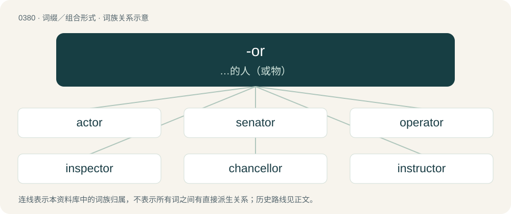

# 0441 · -or — …的人（或物）

[总目录](../00_总目录_按常用程度.md)

**类型**：词缀／组合形式　｜　**来源语言**：见词源记录

## 核心含义与来源

- 核心含义：…的人（或物）
- 英文含义：Creates an agent noun, often from a verb, indicating a person or object (often machines or parts of them) that do the verb or part of speech with which they are formed.
- 词形：-or

**多个词源／构词路径**：同一拼写可能有不同来源；以下按词性和含义分别列出。

**来源记录 1**（后缀／后置成分；Creates an agent noun, often from a verb, indicating a person or object (often machines or parts of them) that do the verb or part of speech with which they are formed.）

From Middle English -our, from Old French -eor, from Latin -ātor; reinforced by Old French -or and its source, Latin -tor, -tōrem.

**来源记录 2**（后缀／后置成分；Used to form nouns of quality, state, or condition.）

From Latin -or.

## 词族图

## 单词速览（常用到不常用）

| 单词 | 音标 | 释义 |
|---|---|---|
| [actor](#w-1) | 英 /ˈæk.təː/；美 /ˈæk.tɚ/ | n. 男演员, 行动者；\[医\] 作用物, 反应物 |
| [senator](#w-2) | 英 /ˈsɛn.ə.tə/；美 /ˈsɛn.ə.tɚ/ | n. 参议员, (某些大学的)理事；\[法\] 参议员, 上议员 |
| [operator](#w-3) | 英 /ˈɒpəˌɹeɪtə/；美 /ˈɑpəˌɹeɪtɚ/ | n. 操作员, 行家, 经纪人, 算子, 运算符；\[计\] 运算符 |
| [inspector](#w-4) | 英 /ɪnˈspɛk.təː/；美 /ɪnˈspɛk.tɚ/ | n. 检查员, 巡视员；\[化\] 检查员 |
| [chancellor](#w-5) | 英 /ˈtʃɑːnsələ/；美 /ˈt͡ʃænsələ/ | n. 大臣, 总理, 首相, 大使馆/领事馆的一等秘书, 司法官, 大学校长 |
| [instructor](#w-6) | 美 /ɪnˈstɹʌktɚ/ | n. 教员, 讲师；\[法\] 指导者, 教员, 讲师 |
| [advisor](#w-7) | 英 /ædˈvaɪ.zə(ɹ)/；美 /ædˈvaɪ.zɚ/ | n. 顾问, 劝告者, 指导教师 |
| [survivor](#w-8) | 英 /səˈvaɪvə/；美 /sɚˈvaɪvɚ/ | n. 生还者, 幸存者；\[法\] 生还者, 生存者, 辛存者 |
| [investor](#w-9) | 英 /ɪnˈvɛs.tə(ɹ)/；美 /ɪnˈvɛs.tɚ/ | n. 投资者；\[经\] 投资者 |
| [elevator](#w-10) | 英 /ˈɛləˌveɪtə/；美 /ˈɛləˌveɪtɚ/ | n. 电梯, 升降机；\[化\] 提升机 |
| [generator](#w-11) | /ˈdʒɛnəɹeɪtə(ɹ)/ | n. 产生器, 发电机, 生产者；\[计\] 发生器 |
| [coordinator](#w-12) | /kəuˈɒːdineitə/ | n. 协调者, 同等的人或物；\[化\] 协调器 |
| [processor](#w-13) | 英 /ˈpɹəʊˌsɛsə(ɹ)/；美 /ˈpɹɑˌsɛsɚ/ | n. 信息处理机, 加工者, 处理者；\[计\] 处理器 |
| [investigator](#w-14) | 英 /ɪnˈvɛs.tɪˌɡeɪ̯.təː/；/ɪnˈvɛs.tɪˌɡeɪ̯.tɚ/ | n. 调查者, 审查者；\[法\] 审查员, 侦查员, 调查员 |
| [reactor](#w-15) | 英 /ɹiːˈæktə/；美 /ɹiˈæktɚ/ | n. 反应者, 反应器, 反应堆, 电抗器；\[化\] 反应釜; 反应锅 |
| [narrator](#w-16) | 英 /nəˈɹeɪ.tə/；美 /ˈnæˌɹeɪ.təɹ/ | n. 讲述者, 叙述者；\[法\] 陈述者, 叙述者 |
| [sailor](#w-17) | 英 /ˈseɪ.lə/；美 /ˈseɪ.lɚ/ | n. 水手, 船员, 海员；\[法\] 水手, 船员, 海员 |
| [contributor](#w-18) | 英 /kənˈtɹɪb.jə.tə/；美 /kənˈtɹɪb.jə.tɚ/ | n. 贡献者, 捐助者, 赠送者, 投稿者；\[法\] 捐助人, 捐赠人, 投搞人 |
| [detector](#w-19) | 英 /dɪˈtɛktə(ɹ)/ | n. 发现者, 检验器, 检波器；\[计\] 检波器; 检测器 |
| [solicitor](#w-20) | 英 /səˈlɪsɪtə/；美 /səˈlɪsɪtɚ/ | n. (英)律师, 初级律师, (美)法务官, (美)掮客, 游说者, (美)募捐者；\[经\] 募损者, 律师 |
| [translator](#w-21) | 英 /ˈtɹanzleɪtə/；美 /ˈtɹænzleɪtɚ/ | n. 翻译者；\[计\] 翻译程序; 翻译器 |
| [distributor](#w-22) | /disˈtribjutə/ | n. 分发者, 分布者, 散布者, 分配者, 销售者, 分配器, 配电盘, 自动拆版机；\[计\] 分配器 |
| [regulator](#w-23) | 英 /ˈɹɛɡ.jʊ.leɪ.tə/；美 /ˈɹɛɡ.ju.leɪ.tɚ/ | n. 调整者, 校准者, 校准器, 调整器, 标准钟；\[化\] 调节剂; 调节器 |
| [simulator](#w-24) | 英 /ˈsɪmjʊˌleɪtə(ɹ)/；美 /ˈsɪmjəˌleɪtɚ/ | n. 模拟器, 假装者；\[计\] 模拟器 |
| [calculator](#w-25) | 美 /kæl.kjə.leɪ.tɚ/；/ˈkæl.kjə.leɪ.tə(ɹ)/ | n. 计算者, 计算器；\[计\] 计算器 |
| [spectator](#w-26) | 英 /spɛkˈteɪtə/；美 /ˈspɛkteɪtɚ/ | n. 观众, 目击者, 旁观者 |
| [connector](#w-27) | 美 /kəˈnɛktɚ/ | n. 连结者, 联系者, 连结物；\[计\] 连接口 |
| [illustrator](#w-28) | 美 /ˈɪləˌstɹeɪtəɹ/ | n. 插画家, 图解者, 说明者 |
| [accelerator](#w-29) | 美 /əkˈsɛl.əˌɹeɪ.tɚ/ | n. 加速剂, 加速器, 油门；\[化\] 加速器; 早强剂; 促进剂; 硫化促进剂 |
| [projector](#w-30) | 英 /pɹəˈd͡ʒɛktə/；美 /pɹəˈd͡ʒɛktɚ/ | n. 计划人, 发起人, 规划人, 放映机, 映画器, 幻灯机, 幻灯, 探照灯, 发射器；\[计\] 投影仪 |
| [compressor](#w-31) | /kəmˈpɹɛ.sə(ɹ)/ | n. 压缩物, 压缩机, 压肌；\[化\] 压缩机 |
| [inhibitor](#w-32) | 美 /ɪnˈhɪbɪtɚ/ | n. 禁止者, 抑制人, 抑制物, 抑制因素, 抑制剂, 阻化剂；\[计\] 禁止器, 抑制剂 |
| [radiator](#w-33) | 英 /ˈrædɪeɪ̯tə/；美 /ˈɹej.di(j)ˌej.tɚ/ | n. 暖气装置, 散热器, 辐射体；\[化\] 散热器 |
| [sculptor](#w-34) | 美 /ˈskʌlptɚ/ | n. 雕刻家 |
| [proprietor](#w-35) | /pɹəˈpɹaɪətɚ/ | n. 所有者；\[经\] 所有人, 资本主, 业主 |
| [conveyor](#w-36) | 英 /kənˈveɪə/；美 /kənˈveɪɚ/ | n. 搬运者, 传达者, 转让财产者, 输送机, 输送设备；\[计\] 传送机, 传送带 |
| [terminator](#w-37) | 英 /ˈtɜː.mɪ.neɪ.tə/；美 /ˈtɝ.mɪˌneɪ.tɚ/ | n. 终结者, 明暗界限；\[计\] 终结器 |
| [realtor](#w-38) | 美 /ˈɹi(ə)l.təɹ/ | n. 房地产经纪人；\[法\] 房地产经纪人 |
| [castor](#w-39) | 英 /ˈkɑːs.tə/；美 /ˈkæs.tɚ/ | 【英文】A pivoting roller attached to the bottom of furniture to allow it to be moved. |
| [capacitor](#w-40) | 英 /kəˈpæ.sɪ.tə/；美 /kəˈpæ.sə.tɚ/ | n. 电容器；\[化\] 电容器 |
| [selector](#w-41) | /sɪˈlɛktə(ɹ)/ | n. 选择者, 选择器；\[计\] 选择器 |
| [incubator](#w-42) | 英 /ˈɪn.kjuːˌbeɪ.tə(ɹ)/ | n. 孵卵器, 细菌培养器, 早产儿保育器；\[化\] 恒温箱; 孵化箱 |
| [negotiator](#w-43) | 英 /nɪˈɡəʊ.ʃi.eɪ.tə/；美 /nɪˈɡoʊ.ʃi.eɪ.tɚ/ | n. 磋商者, 交涉者, 议定者；\[经\] 谈判者, 交易者, 协商者 |
| [predictor](#w-44) | 英 /pɹɪˈdɪk.tə/；美 /pɹɪˈdɪk.tɚ/ | n. 预言者；\[计\] 预示变量; 预测程序 |
| [debtor](#w-45) | 英 /ˈdɛt.ə/；美 /ˈdɛt.ɚ/ | n. 债务人, 借主, 借方；\[法\] 负债者, 债务人, 借方 |
| [tensor](#w-46) | 英 /ˈtɛn.sə/；美 /ˈtɛn.sɚ/ | n. 张肌, 张量；\[化\] 张量 |
| [innovator](#w-47) | /ˈɪnəˌveɪtəɹ/ | n. 改革者, 创新者 |
| [resistor](#w-48) | 英 /ɹɪˈzɪstə/；美 /ɹɪˈzɪstɚ/ | n. 电阻器；\[化\] 电阻器 |
| [reflector](#w-49) | 英 /ɹɪˈflɛktə(ɹ)/ | n. 反射镜, 反射物；\[医\] 反光镜, 反射器 |
| [ventilator](#w-50) | /ˈvɛntɪleɪtə/ | n. 通风设备, 送风机, 换气扇；\[医\] 通风机 |
| [communicator](#w-51) | 英 /kəˈmjuːnɪkeɪtə/；美 /kəˈmjunɪkeɪtɚ/ | n. 传播者, 通信装置, 列车内通话装置 |
| [elector](#w-52) | 英 /ɪˈlɛktə/；美 /ɪˈlɛktɚ/ | n. 有选举权的人, 选举人；\[法\] 有选举权者, 合格选举人 |
| [oscillator](#w-53) | /ˈɒsileitə/ | n. 动摇的人, 摆动物, 振动器；\[化\] 振动式输送机 |
| [decorator](#w-54) | 英 /ˈdɛkəˌɹeɪtə(ɹ)/；美 /ˈdɛkəˌɹeɪtɚ/ | n. 装饰家, 裱糊工, 室内外墙壁油漆工, 制景人员 |
| [suppressor](#w-55) | /səˈpresə/ | n. 抑制器, 消除器, 抑制栅极；\[计\] 抑制器 |
| [animator](#w-56) | /ˈænɪˌmeɪtə(ɹ)/ | n. 赋与生气者, 鼓舞者, 漫画制作者 |
| [demonstrator](#w-57) | 英 /ˈdɛmənstɹeɪtə(ɹ)/ | n. 论证者, 证明者, 指示者, 示威者；\[医\] 示教者 |
| [facilitator](#w-58) | /fəˈsiliteitə/ | n. 服务商；促进者 |
| [motivator](#w-59) | 英 /ˈməʊ.təˌveɪ.tə/；美 /ˈmoʊ.təˌveɪ.təɹ/ | n. 激起行为(或行动)的人(或事物),促进因素, 激发因素 |
| [originator](#w-60) | 英 /əˈɹɪd͡ʒɪneɪtə/；美 /əˈɹɪd͡ʒɪneɪtɚ/ | n. 创始人, 发明者, 起源, 起因, 来源；\[计\] 源发站, 始发站, 始发者 |
| [injector](#w-61) | 美 /ɪnˈd͡ʒɛktɚ/ | n. 注射者, 注射器, 注水器；\[化\] 注射器; 喷射器 |
| [interceptor](#w-62) | /ˈɪn.təɹˌsɛp.təɹ/ | n. 阻止的人, 妨碍者, 拦截战斗机；\[法\] 窃听器, 截取者, 障碍物 |
| [manipulator](#w-63) | /məˈnɪpjʊleɪtə(ɹ)/ | n. 操作者, 机械手；\[化\] 机械手 |
| [alternator](#w-64) | /ˈɒːltəneitə/ | n. 交流发电机；\[化\] 交流发电机 |
| [carburetor](#w-65) | 英 /ˈkɑːb(j)əˌɹɛtə/；美 /ˈkɑɹb(j)əˌɹeɪtɚ/ | \[化\] 增碳器; 汽化器; 化油器 |
| [resonator](#w-66) | /ˈrezəneitə/ | n. 共鸣器, 共鸣体, 共振器；\[化\] 共振腔; 共振器; 共振电子排布 |
| [guarantor](#w-67) | 英 /ˈɡæɹəntə(ɹ)/ | n. 保证人；\[经\] 保证人, 担保人 |
| [activator](#w-68) | /ˈæktiveitə/ | n. 活化剂, 催化剂, 触媒剂；\[化\] 助催化剂; 活化剂; 激活剂; 激活剂发光材料 |
| [actuator](#w-69) | 英 /ˈæk.tjuː.eɪ.tə(ɹ)/；美 /ˈæk.t͡ʃu.eɪ.tɚ/ | n. 开动者, 激励者, 致动器；\[计\] 传动装置, 驱动器, 激励器 |
| [aggregator](#w-70) | 英 /ˈæɡɹɪˌɡeɪtə/；美 /ˈæɡɹɪˌɡeɪtɚ/ | n. 聚合器, 整合者; 汇集者, 聚合 |
| [estimator](#w-71) | 英 /ˈɛs.tɪˌmeɪ.tə/；美 /ˈɛs.təˌmeɪ.tɚ/ | n. 估计者；\[化\] 估计器; 估计量 |
| [incinerator](#w-72) | /inˈsinəreitə/ | n. 焚烧装置, 焚烧炉, 焚尸炉；\[化\] 焚烧炉; 焚化炉; 煅烧炉 |
| [insulator](#w-73) | /ˈɪn.s(j)ə.leɪ.tə(ɹ)/ | n. 绝缘体, 从事绝缘工作的工人；\[化\] 绝缘体; 绝缘器; 绝缘子; 隔离剂 |
| [oppressor](#w-74) | /əˈpresə/ | n. 压迫者, 压制者；\[法\] 压迫者, 压制者, 强迫者 |
| [impersonator](#w-75) |  | n. 演员；模拟艺人 |
| [modulator](#w-76) | /ˈmɒdjuleitə/ | n. 调节人, 调光器, 调制器；\[医\] 调制器, 调幅器 |
| [accumulator](#w-77) | 美 /əˈkjum.jəˌleɪ.tɚ/ | n. 积聚者, 蓄能器, 蓄电池；\[计\] 累加器 |
| [excavator](#w-78) | 英 /ˈɛkskəˌveɪtə/；美 /ˈɛkskəˌveɪtɚ/ | n. 开凿者, 开凿机, 挖土机；\[医\] 挖器, 剜器 |
| [respirator](#w-79) | /ˈrespəreitə/ | n. 口罩, 防毒面具, 人工呼吸装置；\[化\] 防尘面罩; 防毒面罩 |
| [defibrillator](#w-80) | 英 /diːˈfɪbɹɪˌleɪtə(ɹ)/ | \[医\] 去纤颤器, 除纤颤器 |
| [rotator](#w-81) | /ˈrəuteitə/ | n. 旋转的人, 旋转装置, 回旋肌；\[医\] 回旋肌 |
| [prospector](#w-82) | 英 /pɹəˈspɛktə/；美 /ˈpɹɑsˌpɛktɚ/ | n. 勘探者, 采矿者 |
| [agitator](#w-83) | 英 /ˈædʒɪteɪtə/；美 /ˈædʒɪteɪtɚ/ | n. 煽动者；\[化\] 搅拌器; 搅拌机; 搅抖装置 |
| [applicator](#w-84) | /ˈæplikeitə/ | \[医\] 声极(超声治疗用); 敷料器, 涂药器 |
| [detonator](#w-85) | 英 /ˈdɛt.ə.neɪ.tə(ɹ)/ | n. 雷管, 炸药；\[化\] 雷管 |
| [integrator](#w-86) | /ˈintigreitə/ | n. 综合之人, 积分电路, 积分器；\[医\] 积分仪, 求积仪, 精神分裂症测验器 |
| [objector](#w-87) | 美 /əbˈd͡ʒɛktɚ/ | n. 反对者, 提出异议的人；\[法\] 反对者, 表示异议者 |
| [deflector](#w-88) | 英 /dɪˈflɛktə(ɹ)/ | n. 导向装置, 致偏仪；\[化\] 导流板; 弧形导流器; 偏流板; 偏转板 |
| [liquidator](#w-89) | /ˈlikwideitə/ | n. 清算人；\[经\] 清算人 |
| [evaporator](#w-90) | 美 /ɪˈvæp.ə.ɹeɪt.ɚ/ | n. 蒸发器；\[化\] 蒸发器; 蒸发设备 |
| [adjudicator](#w-91) | 英 /əˈd͡ʒuː.dɪ.keɪ.tə/；美 /əˈd͡ʒu.dɪˌkeɪ.tɚ/ | n. 评判员；\[法\] 审判者, 判决者, 裁定者 |
| [ejector](#w-92) | /ɪˈd͡ʒɛktɚ/ | n. 驱逐者, 排出器, 放出器；\[化\] 喷射泵; 喷射器 |
| [refractor](#w-93) | /ɹɪˈfɹæktə(ɹ)/ | n. 折射器, 折射望远镜；\[化\] 折射器 |
| [corrector](#w-94) | /kəˈrektə/ | n. 修正者, 校正者, 校对者；\[化\] 修正器 |
| [eliminator](#w-95) | /iˈlimineitə/ | n. 排除者, 消除器；\[计\] 消除器, 抑制器, 限制器 |
| [illuminator](#w-96) | /iˈljuːmineitə/ | n. 启发者, 反射镜, 集光镜 |
| [stressor](#w-97) | /ˈstresə/ | \[医\] 紧张性刺激; 应激物 |
| [convenor](#w-98) |  | \[法\] 召集人 |
| [licensor](#w-99) | /ˈlaɪsənsəɹ/ | \[经\] 许可者, 认可者 |
| [litigator](#w-100) | /ˈlɪtɪgeɪtə/ | n. 诉讼律师 |
| [pollinator](#w-101) | /ˈpɒlɪˌneɪtə(ɹ)/ | n. 传粉者, 传粉媒介, 传粉昆虫; 授花粉器 |
| [replicator](#w-102) | 英 /ˈɹɛplɪkeɪtə/；美 /ˈɹɛplɪkeɪtɚ/ | \[计\] 重复符；\[化\] 复制基因 |
| [concentrator](#w-103) | /ˈkɒnsəntreitə/ | n. 集中者, 浓缩器, 选矿机；\[计\] 集线器, 集中器 |
| [adductor](#w-104) | 英 /əˈdʌktə/；美 /əˈdʌktəɹ/ | n. 内收肌；\[医\] 收肌, 内收肌 |
| [fabricator](#w-105) | /ˈfæbrikeitə/ | n. 制作者, 假造者, 杜撰者；\[化\] 金属加工厂 |
| [cultivator](#w-106) | /ˈkʌltiveitə/ | n. 耕者, 栽培者, 耕田机；\[医\] 孵卵器 |
| [franchisor](#w-107) | /,fræntʃaiˈzɔː(r)/ | n. 授予特许者 |
| [compensator](#w-108) | /ˈkɒmpenseitə/ | n. 赔偿者, 自耦变压器, 补偿物；\[化\] 补偿器; 补偿剂; 张力调节器; 松紧调节辊 |
| [destructor](#w-109) | /diˈstrʌktə/ | n. (导弹等的)自炸装置, 垃圾焚毁炉；\[化\] 焚烧炉 |
| [inheritor](#w-110) | /inˈheritə(r)/ | n. 继承人, 后继者；\[法\] 遗产继承人, 继承人 |
| [erector](#w-111) | /iˈrektə/ | n. 树立者, 竖立肌, 安装器, 安装者, 装配者, 建立者；\[化\] 安装工 |
| [retractor](#w-112) | 英 /ɹɪˈtɹæktə/；美 /ɹɪˈtɹæktɚ/ | n. 食言的人, 牵拉肌, 牵开器；\[医\] 牵开器, 缩肌 |
| [annihilator](#w-113) | /əˈnaiəleitə/ | n. 歼灭者；\[计\] 消除器 |
| [differentiator](#w-114) | 英 /dɪf.əˈɹɛn.ʃi.eɪ.tə/；美 /ˌdɪf.əˈɹɛn.ʃi.eɪ.tɚ/ | \[计\] 微分电路; 微分器 |
| [imitator](#w-115) | /ˈimi,teitə/ | n. 模仿者, 临摹者, 仿造者, 伪造者；\[计\] 模拟, 模拟程序, 模拟器 |
| [infiltrator](#w-116) | /ˈɪnfɪltɹeɪtə/ | n. 渗入者 |
| [authenticator](#w-117) |  | \[计\] 鉴别符, 鉴别码 |
| [circulator](#w-118) | /ˈsəːkjuleitə/ | n. 传布者, 循环器, 循环小数；\[化\] 循环机; 循环压缩机 |
| [designator](#w-119) | /ˈdezigneitə/ | n. 指示者, 指定者；\[计\] 指示符; 命名符 |
| [depositor](#w-120) | /diˈpɒzitə/ | n. 存放者, 存款人；\[经\] 存款人, 储户, 委托人 |
| [orchestrator](#w-121) |  | \[医\]管弦乐演奏家 |
| [iterator](#w-122) |  | \[计\] 迭代器, 迭代程序 |
| [masturbator](#w-123) |  | n. 手淫者 |
| [vindicator](#w-124) | /ˈvɪndɪˌkeɪ̯tə/ | n. 辩护者, 维护者, 辩明者；\[法\] 辩护者, 证明者, 维护者 |
| [attenuator](#w-125) | /əˈtenjjeitə(r)/ | n. 衰减器；\[化\] 衰减器; 弱化子 |
| [procrastinator](#w-126) | /prəjˈkræstineitə(r)/ | n. 拖延者, 因循者 |
| [bettor](#w-127) | 英 /ˈbɛtə/；美 /ˈbɛtɚ/ | n. 打赌者；\[法\] 赌徒, 打赌者 |
| [isolator](#w-128) | /ˈaisəleitə/ | n. 隔离者(物), 隔音装置；\[计\] 隔离器 |
| [protractor](#w-129) | /pɹəˈtɹæktə(ɹ)/ | n. 拖延者, 分度器, 牵引肌, 钳取器；\[医\] 取钳器 |
| [restrictor](#w-130) | /risˈtriktə/ | \[计\] 限定器 |
| [penetrator](#w-131) | /ˈpenitreitə/ | n. 穿入者, 侵入者, 渗透者；\[化\] 过烧; 过烧焊 |

## 逐词详解

### 1. actor

**词性**：名词　｜　**音标**：英 /ˈæk.təː/；美 /ˈæk.tɚ/

**中文释义**：n. 男演员, 行动者；\[医\] 作用物, 反应物

**英文义项**：Someone who institutes a legal suit; a plaintiff or complainant. / Someone acting on behalf of someone else; a guardian.

**构词拆分**：act + -or

**词源与演化**：

Inherited from Middle English actour, from Anglo-Norman actor, Middle French actor, and their source, Latin āctor (“doer”), from agō (“to do”). Equivalent to act + -or. Cognate with Ancient Greek ἄκτωρ (áktōr, “leader”), from ἄγω (ágō, “lead, carry, convey, bring”).

**例句**：

> He's a principal actor in this affair.

该用例对应义项：a person who acts and gets things done

### 2. senator

**词性**：名词　｜　**音标**：英 /ˈsɛn.ə.tə/；美 /ˈsɛn.ə.tɚ/

**中文释义**：n. 参议员, (某些大学的)理事；\[法\] 参议员, 上议员

**英文义项**：A member, normally elected, in the house or chamber of a legislature called a senate, as, for instance, the legislatures of the United States and Canada. / A member of any legislative body or parliament, particularly the British Parliament.

**构词拆分**：senate + -or

**词源与演化**：

From Latin senātor, ultimately from senex (“old”), equivalent to senate + -or.

**例句**：

> My first deed as Senator is designating you as the official jester.

### 3. operator

**词性**：名词　｜　**音标**：英 /ˈɒpəˌɹeɪtə/；美 /ˈɑpəˌɹeɪtɚ/

**中文释义**：n. 操作员, 行家, 经纪人, 算子, 运算符；\[计\] 运算符

**英文义项**：A person or organisation that operates a device, system, service, etc. / A telecommunications facilitator whose job is to connect or otherwise assist callers.

**构词拆分**：operate + -or

**词源与演化**：

Borrowed from Latin operātor, from operor (“work, labour”). Equivalent to operate + -or.

**例句**：

> I kept getting "number unobtainable", so I called the operator to find out what was going on.

该用例对应义项：A telecommunications facilitator whose job is to connect or otherwise assist callers.

### 4. inspector

**词性**：名词　｜　**音标**：英 /ɪnˈspɛk.təː/；美 /ɪnˈspɛk.tɚ/

**中文释义**：n. 检查员, 巡视员；\[化\] 检查员

**英文义项**：A person employed to inspect something. / A police officer ranking below superintendent.

**构词拆分**：inspect + -or

**词源与演化**：

Borrowed from Latin īnspector, from īnspiciō, equivalent to inspect + -or.

**例句**：

> The general inspector of the national police oversees regional or central directorates.

### 5. chancellor

**词性**：名词　｜　**音标**：英 /ˈtʃɑːnsələ/；美 /ˈt͡ʃænsələ/

**中文释义**：n. 大臣, 总理, 首相, 大使馆/领事馆的一等秘书, 司法官, 大学校长

**英文义项**：A senior secretary or official with administrative or legal duties, sometimes in charge of some area of government such as finance or justice. / The head of the government in some German-speaking countries.

**构词拆分**：chancel + -or

**词源与演化**：

From Anglo-Norman or Middle English chaunceler, chanceler, canceler (“chief administrative or executive officer of a ruler; chancellor, secretary; private secretary, scribe; Lord Chancellor of England; officer of the ruler's exchequer; a high administrative or executive officer (for example, a deputy or representative of a bishop; the head of a university)”), from Old French cancelier, chancelier (“chancellor”), from Late Latin cancellārius (“secretary; doorkeeper, porter; usher of a court of law stationed at the bars separating the public from the judges”), from Latin cancellī (plural of cancellus (“grate; bars, barrier; railings”), diminutive of cancer (“grid; barrier”), from Proto-Italic \*karkros (“enclosure”), ultimately from Proto-Indo-European \*(s)ker- (“to bend, turn”)) + -ārius (suffix forming nouns denoting an agent of use). Equivalent to chancel + -or. Piecewise doublet of canceler. The word was present as Late Old English canceler, cancheler, from Norman cancheler, but was displaced in the 13th century by the Old French and Anglo-Norman forms mentioned above.

**用法示例／搭配（非完整句）**：

> Chancellor of the Duchy of Lancaster

该用例对应义项：A senior secretary or official with administrative or legal duties, sometimes in charge of some area of government such as finance or justice.

### 6. instructor

**词性**：名词　｜　**音标**：美 /ɪnˈstɹʌktɚ/

**中文释义**：n. 教员, 讲师；\[法\] 指导者, 教员, 讲师

**英文义项**：One who instructs; a teacher.

**构词拆分**：instruct + -or

**词源与演化**：

From Latin instructor, equivalent to instruct + -or.

**例句**：

> I cannot understand the Arabic Level 5 instructor. He speaks too fast!

### 7. advisor

**词性**：名词　｜　**音标**：英 /ædˈvaɪ.zə(ɹ)/；美 /ædˈvaɪ.zɚ/

**中文释义**：n. 顾问, 劝告者, 指导教师

**英文义项**：One who offers advice. / A xiangqi piece that is moved one point diagonally and confined within the palace.

**构词拆分**：advise + -or

**词源与演化**：

From advise + -or.

**例句**：

> I know Tom is a financial advisor. Maybe he can help us.

### 8. survivor

**词性**：名词　｜　**音标**：英 /səˈvaɪvə/；美 /sɚˈvaɪvɚ/

**中文释义**：n. 生还者, 幸存者；\[法\] 生还者, 生存者, 辛存者

**英文义项**：One who survives, especially one who survives a traumatic experience. / A person who is able to endure hardship.

**构词拆分**：survive + -or

**词源与演化**：

From survive + -or.

**例句**：

> She was from a large family and had many friends, so the funeral was crowded with mourning survivors.

该用例对应义项：One who knew a specific decedent.

### 9. investor

**词性**：名词　｜　**音标**：英 /ɪnˈvɛs.tə(ɹ)/；美 /ɪnˈvɛs.tɚ/

**中文释义**：n. 投资者；\[经\] 投资者

**英文义项**：A person who invests money in order to make a profit.

**构词拆分**：invest + -or

**词源与演化**：

From invest + -or.

**例句**：

> Ziri burst in and said he had found an investor for his business.

### 10. elevator

**词性**：动词　｜　**音标**：英 /ˈɛləˌveɪtə/；美 /ˈɛləˌveɪtɚ/

**中文释义**：n. 电梯, 升降机；\[化\] 提升机

**英文义项**：To move in an elevator.

**构词拆分**：elevate + -or

**词源与演化**：

From elevate + -or.

**例句**：

> He elevatored up to the third floor.

该用例对应义项：To move in an elevator.

### 11. generator

**词性**：名词　｜　**音标**：/ˈdʒɛnəɹeɪtə(ɹ)/

**中文释义**：n. 产生器, 发电机, 生产者；\[计\] 发生器

**英文义项**：An apparatus in which vapour or gas is formed from a liquid or solid by means of heat or chemical process, as a steam boiler, gas retort etc. / The principal sound or sounds by which others are produced; the fundamental note or root of the common chord; -- see also generating tone.

**构词拆分**：generate + -or

**词源与演化**：

From Latin, from past participle of genero (“beget, father”), equivalent to generate + -or.

**例句**：

> On my way home, the car battery died since the generator broke.

### 12. coordinator

**词性**：名词　｜　**音标**：/kəuˈɒːdineitə/

**中文释义**：n. 协调者, 同等的人或物；\[化\] 协调器

**英文义项**：An assistant coach responsible for a particular facet of the game, such as defense. / A member of a lexical class of words that joins two or more items (such as words, phrases, or clauses) of equal syntactic importance.

**构词拆分**：From coordinate + -or.

**词源与演化**：

From coordinate + -or.

**例句**：

> Tom told the academic coordinator all of his worries about the program.

### 13. processor

**词性**：名词　｜　**音标**：英 /ˈpɹəʊˌsɛsə(ɹ)/；美 /ˈpɹɑˌsɛsɚ/

**中文释义**：n. 信息处理机, 加工者, 处理者；\[计\] 处理器

**英文义项**：A person or institution who processes things (foods, photos, applications, etc.). / A device which processes, which changes something (a computer processor, food processor, etc.).

**构词拆分**：process + -or

**词源与演化**：

Recorded since 1909, from process + -or.

**例句**：

> This computer has two processors, but only one keyboard.

该用例对应义项：A microprocessor.

### 14. investigator

**词性**：名词　｜　**音标**：英 /ɪnˈvɛs.tɪˌɡeɪ̯.təː/；/ɪnˈvɛs.tɪˌɡeɪ̯.tɚ/

**中文释义**：n. 调查者, 审查者；\[法\] 审查员, 侦查员, 调查员

**英文义项**：One who investigates.

**构词拆分**：investigate + -or

**词源与演化**：

Attested in the mid‐16th century; from Latin investigator, from investigare, equivalent to investigate + -or.

**例句**：

> I think the person I saw in the alley is a private investigator.

### 15. reactor

**词性**：名词　｜　**音标**：英 /ɹiːˈæktə/；美 /ɹiˈæktɚ/

**中文释义**：n. 反应者, 反应器, 反应堆, 电抗器；\[化\] 反应釜; 反应锅

**英文义项**：A person who responds to a suggestion, stimulation or other influence. / A structure used to contain chemical or other reactions.

**构词拆分**：react + -or

**词源与演化**：

From react + -or.

**例句**：

> Red sky in morning; global warming. Red sky at night, reactor's alight.

### 16. narrator

**词性**：名词　｜　**音标**：英 /nəˈɹeɪ.tə/；美 /ˈnæˌɹeɪ.təɹ/

**中文释义**：n. 讲述者, 叙述者；\[法\] 陈述者, 叙述者

**英文义项**：One who narrates or tells stories. / The person or the "voice" whose viewpoint is used in telling a story.

**构词拆分**：narrate + -or

**词源与演化**：

From narrate + -or, from Latin narrātor. By surface analysis, Latin narr- + -ate + -or.

**例句**：

> Morgan Freeman was the narrator of March of the Penguins.

该用例对应义项：The person providing the voice-over in a documentary.

### 17. sailor

**词性**：名词　｜　**音标**：英 /ˈseɪ.lə/；美 /ˈseɪ.lɚ/

**中文释义**：n. 水手, 船员, 海员；\[法\] 水手, 船员, 海员

**英文义项**：A person who sails; one whose occupation is sailing or navigating ships or other waterborne craft. / In particular, a member of the crew of a (civilian or military) vessel, as opposed to a captain, admiral, etc.; a mariner; a common seaman.

**构词拆分**：sail + -or

**词源与演化**：

Alteration of earlier sailer, from Middle English sailer, sayler, saylere, equivalent to sail + -or. Cognate with German Segler (“sailor”). Eclipsed non-native Middle English marinel, marynell (“sailor”) borrowed from Old French marinel (“sailor”). See mariner.

**例句**：

> He's a talented sailor and has spent many years at sea.

该用例对应义项：A person who sails; one whose occupation is sailing or navigating ships or other waterborne craft.

### 18. contributor

**词性**：名词　｜　**音标**：英 /kənˈtɹɪb.jə.tə/；美 /kənˈtɹɪb.jə.tɚ/

**中文释义**：n. 贡献者, 捐助者, 赠送者, 投稿者；\[法\] 捐助人, 捐赠人, 投搞人

**英文义项**：A benefactor; someone who donates to charity or some cause. / A person who backs, supports or champions a cause, activity or institution.

**构词拆分**：contribute + -or

**词源与演化**：

From Anglo-Norman contributour (from Latin contribuō); equivalent to contribute + -or.

**例句**：

> I am a longstanding financial contributor to Amnesty International.

该用例对应义项：A benefactor; someone who donates to charity or some cause.

### 19. detector

**词性**：名词　｜　**音标**：英 /dɪˈtɛktə(ɹ)/

**中文释义**：n. 发现者, 检验器, 检波器；\[计\] 检波器; 检测器

**英文义项**：A device capable of registering a specific substance or physical phenomenon, and that optionally sounds an alarm or triggers a warning. / An indicator showing the depth of the water in a boiler.

**构词拆分**：detect + -or (agent noun forming suffix)

**词源与演化**：

Borrowed from Latin dētēctor. Equals detect + -or (agent noun forming suffix).

**例句**：

> Smoke detectors are mandatory in public buildings.

该用例对应义项：A device capable of registering a specific substance or physical phenomenon, and that optionally sounds an alarm or triggers a warning.

### 20. solicitor

**词性**：名词　｜　**音标**：英 /səˈlɪsɪtə/；美 /səˈlɪsɪtɚ/

**中文释义**：n. (英)律师, 初级律师, (美)法务官, (美)掮客, 游说者, (美)募捐者；\[经\] 募损者, 律师

**英文义项**：A lawyer offering most legal services to clients apart from representation in court, for which the lawyer typically solicits and instructs a barrister instead, although rights of audience vary by jurisdiction. / A lawyer now performing both the role of a traditional solicitor and that of a barrister.

**构词拆分**：By surface analysis, solicit + -or

**词源与演化**：

From Middle French soliciteur. By surface analysis, solicit + -or.

**例句**：

> Did you see the sign that says 'No Solicitors'?

该用例对应义项：A door-to-door salesperson, a person soliciting sales by visiting others' houses.

### 21. translator

**词性**：名词　｜　**音标**：英 /ˈtɹanzleɪtə/；美 /ˈtɹænzleɪtɚ/

**中文释义**：n. 翻译者；\[计\] 翻译程序; 翻译器

**英文义项**：A person or thing that translates various forms of text. / Synonym of interpreter, a person or thing that immediately interprets direct speech.

**构词拆分**：translate + -or

**词源与演化**：

Directly from Latin trānslātor and French translator, and also from Middle English translatour, from Old French translatour, translateur, etc., from Latin trānslātor, from trānslātus (“carried across”) + -or (“-er: forming agent nouns”), from trānsferō (“carry across”), from trans (“across”) + ferō (“bear, carry”), q.v. Equivalent to translate + -or.

**例句**：

> Mark my words: I will become the greatest translator in the world!

### 22. distributor

**词性**：名词　｜　**音标**：/disˈtribjutə/

**中文释义**：n. 分发者, 分布者, 散布者, 分配者, 销售者, 分配器, 配电盘, 自动拆版机；\[计\] 分配器

**英文义项**：One who or that which distributes. / A device that distributes electric current, especially to the spark plugs in an internal combustion engine.

**构词拆分**：distribute + -or

**词源与演化**：

From distribute + -or.

**例句**：

> There must be a distributor who has those parts in stock.

### 23. regulator

**词性**：名词　｜　**音标**：英 /ˈɹɛɡ.jʊ.leɪ.tə/；美 /ˈɹɛɡ.ju.leɪ.tɚ/

**中文释义**：n. 调整者, 校准者, 校准器, 调整器, 标准钟；\[化\] 调节剂; 调节器

**英文义项**：A device that controls or limits something. / A person or group that sets standards of practice, especially regulatory law as sanctioned by statutory law.

**构词拆分**：From regulate + -or.

**词源与演化**：

From regulate + -or.

**例句**：

> The case was referred to the media regulator.

### 24. simulator

**词性**：名词　｜　**音标**：英 /ˈsɪmjʊˌleɪtə(ɹ)/；美 /ˈsɪmjəˌleɪtɚ/

**中文释义**：n. 模拟器, 假装者；\[计\] 模拟器

**英文义项**：One who simulates or feigns. / A machine or system that simulates an environment (such as an aircraft cockpit), often for training purposes.

**构词拆分**：simulate + -or

**词源与演化**：

From simulate + -or.

**用法示例／搭配（非完整句）**：

> a pinball simulator

该用例对应义项：A game that attempts to reproduce an experience realistically.

### 25. calculator

**词性**：名词　｜　**音标**：美 /kæl.kjə.leɪ.tɚ/；/ˈkæl.kjə.leɪ.tə(ɹ)/

**中文释义**：n. 计算者, 计算器；\[计\] 计算器

**英文义项**：A mechanical or electronic device that performs mathematical calculations; (now usually) an electronic one specifically. / A person who calculates (in the sense of scheming).

**构词拆分**：calculate + -or

**例句**：

> I told him to hand me a calculator and he jokingly placed an adding machine at my side.

该用例对应义项：A mechanical or electronic device that performs mathematical calculations; (now usually) an electronic one specifically.

### 26. spectator

**词性**：名词　｜　**音标**：英 /spɛkˈteɪtə/；美 /ˈspɛkteɪtɚ/

**中文释义**：n. 观众, 目击者, 旁观者

**英文义项**：One who watches an event; especially, an event held outdoors. / One who observes, sees, or views something; an observer.

**构词拆分**：spectate + -or

**词源与演化**：

Borrowed from Latin spectātor, from frequentative verb spectō (“watch”), from speciō (“look at”). Equivalent to spectate + -or. Doublet of speculator.

**例句**：

> A spectator near the finish line cheered for every runner.

终点线旁的一位观众为每名跑步选手欢呼。

### 27. connector

**词性**：名词　｜　**音标**：美 /kəˈnɛktɚ/

**中文释义**：n. 连结者, 联系者, 连结物；\[计\] 连接口

**英文义项**：One who connects; a networker. / A device (or, more precisely, a mating pair of devices, often a plug and a socket) for connecting together two wires, cables, or hoses, allowing electricity or fluid to flow but also allowing easy disconnection and reconnection when necessary.

**构词拆分**：connect + -or

**词源与演化**：

From connect + -or.

**例句**：

> He didn't have the right connector between the amplifier and the speakers.

该用例对应义项：an instrumentality that connects

### 28. illustrator

**词性**：名词　｜　**音标**：美 /ˈɪləˌstɹeɪtəɹ/

**中文释义**：n. 插画家, 图解者, 说明者

**英文义项**：a person who draws pictures (especially illustrations in books or magazines)

**构词拆分**：illustrate + -or

**词源与演化**：

From illustrate + -or.

**例句**：

> Mary is one of the best illustrators of children's books in the country.

该用例对应义项：a person who draws pictures (especially illustrations in books or magazines)

### 29. accelerator

**词性**：名词　｜　**音标**：美 /əkˈsɛl.əˌɹeɪ.tɚ/

**中文释义**：n. 加速剂, 加速器, 油门；\[化\] 加速器; 早强剂; 促进剂; 硫化促进剂

**英文义项**：One who, or that which, accelerates. / A device for causing acceleration.

**构词拆分**：accelerate + -or

**例句**：

> The Second World War is said to have been a great accelerator for many scientific findings.

该用例对应义项：One who, or that which, accelerates.

### 30. projector

**词性**：名词　｜　**音标**：英 /pɹəˈd͡ʒɛktə/；美 /pɹəˈd͡ʒɛktɚ/

**中文释义**：n. 计划人, 发起人, 规划人, 放映机, 映画器, 幻灯机, 幻灯, 探照灯, 发射器；\[计\] 投影仪

**英文义项**：Someone who devises or suggests a project; a proposer or planner of something. / An optical device that projects a beam of light, especially one used to project an image (or moving images) onto a screen.

**构词拆分**：project + -or

**词源与演化**：

Partly from Latin projector (“person who throws away”); partly directly from project + -or.

**用法示例／搭配（非完整句）**：

> a depth charge projector

该用例对应义项：That which projects or launches something.

### 31. compressor

**词性**：名词　｜　**音标**：/kəmˈpɹɛ.sə(ɹ)/

**中文释义**：n. 压缩物, 压缩机, 压肌；\[化\] 压缩机

**英文义项**：A device that produces pressure, such as a gas compressor that produces pressurized gas. / An instrument for compressing an artery (especially the femoral artery) or other part.

**构词拆分**：compress + -or

**词源与演化**：

From compress + -or, or from New Latin compressor.

**例句**：

> The air compressor went off in the garage and startled me.

### 32. inhibitor

**词性**：名词　｜　**音标**：美 /ɪnˈhɪbɪtɚ/

**中文释义**：n. 禁止者, 抑制人, 抑制物, 抑制因素, 抑制剂, 阻化剂；\[计\] 禁止器, 抑制剂

**英文义项**：One who, or that which, inhibits. / Any substance capable of stopping or slowing a specific chemical reaction.

**构词拆分**：inhibit + -or

**词源与演化**：

From inhibit + -or.

**例句**：

> I found daily meditation to be a useful inhibitor of negative thoughts.

该用例对应义项：One who, or that which, inhibits.

### 33. radiator

**词性**：名词　｜　**音标**：英 /ˈrædɪeɪ̯tə/；美 /ˈɹej.di(j)ˌej.tɚ/

**中文释义**：n. 暖气装置, 散热器, 辐射体；\[化\] 散热器

**英文义项**：Anything which radiates or emits rays. / A device that lowers engine coolant temperature by conducting heat to the air, through metal fins.

**构词拆分**：radiate + -or

**词源与演化**：

From radiate + -or. Doublet of radiatori.

**例句**：

> The radiator kept the apartment warm during winter.

该用例对应义项：A finned metal fixture that carries hot water or steam in order to heat a room.

### 34. sculptor

**词性**：名词　｜　**音标**：美 /ˈskʌlptɚ/

**中文释义**：n. 雕刻家

**英文义项**：A person who sculpts; an artist who produces sculpture.

**构词拆分**：sculpt + -or

**词源与演化**：

Borrowed from Latin sculptor, equivalent to sculpt + -or.

**例句**：

> Google commemorated the African Turkish sculptor Kuzgun Acar with a Doodle.

### 35. proprietor

**词性**：名词　｜　**音标**：/pɹəˈpɹaɪətɚ/

**中文释义**：n. 所有者；\[经\] 所有人, 资本主, 业主

**英文义项**：An owner. / A sole owner of an unincorporated business, also called a sole proprietor.

**构词拆分**：proprietary + -or

**词源与演化**：

Probably from proprietary + -or.

**例句**：

> From 10 September 1621 till 12 June 1632, Sir William Alexander, styled Earl of Stirling and Viscount of Canada, was proprietor of the Scottish colony Nova Scotia.

该用例对应义项：One or more persons to whom a colonial territory is assigned, like a fief, including its administration.

### 36. conveyor

**词性**：名词　｜　**音标**：英 /kənˈveɪə/；美 /kənˈveɪɚ/

**中文释义**：n. 搬运者, 传达者, 转让财产者, 输送机, 输送设备；\[计\] 传送机, 传送带

**英文义项**：A person that conveys, transports or delivers. / Anything that conveys, transports or delivers.

**构词拆分**：From convey + -or.

**词源与演化**：

From convey + -or.

**例句**：

> Words are a conveyor of meaning.

该用例对应义项：Anything that conveys, transports or delivers.

### 37. terminator

**词性**：名词　｜　**音标**：英 /ˈtɜː.mɪ.neɪ.tə/；美 /ˈtɝ.mɪˌneɪ.tɚ/

**中文释义**：n. 终结者, 明暗界限；\[计\] 终结器

**英文义项**：Someone who terminates or ends something, especially (in later use) an assassin or exterminator. / A text character or string that serves to mark the end of a document or transmission.

**构词拆分**：terminate + -or

**词源与演化**：

\* Partly from post-classical Latin terminator (5th century), from Latin terminō; partly from terminate + -or. \* (android that kills humans): After the 1984 film The Terminator.

**例句**：

> Ziri began walking towards his daughter and her boyfriend like a Terminator.

### 38. realtor

**词性**：名词　｜　**音标**：美 /ˈɹi(ə)l.təɹ/

**中文释义**：n. 房地产经纪人；\[法\] 房地产经纪人

**英文义项**：A person or business that sells or leases out real estate, acting as an agent for the property owner.

**构词拆分**：realt(y) + -or

**词源与演化**：

From real (in real estate) and -or. Coined by Charles N. Chadbourn in 1916, on the model of Latin agent nouns ending in -tor (such as actor, creator), to refer to real-estate professionals who are members of the National Association of Realtors, a trade association in the United States. Equivalent to realt(y) + -or.

**例句**：

> The 67-year-old realtor sees definite advantages to living in a space owned by someone else.

### 39. castor

**词性**：名词　｜　**音标**：英 /ˈkɑːs.tə/；美 /ˈkæs.tɚ/

**英文义项**：A pivoting roller attached to the bottom of furniture to allow it to be moved. / A container with a perforated cap for sprinkling its contents, especially salt, pepper, etc.

**构词拆分**：cast + -or

**词源与演化**：

Alternative spelling of caster, via cast + -or (the Latinate varient of -er).

### 40. capacitor

**词性**：名词　｜　**音标**：英 /kəˈpæ.sɪ.tə/；美 /kəˈpæ.sə.tɚ/

**中文释义**：n. 电容器；\[化\] 电容器

**英文义项**：An electronic component capable of storing electrical energy in an electric field; especially one consisting of two conductors separated by a dielectric.

**构词拆分**：capacity + -or

**词源与演化**：

From capacity + -or. Capacitor replaced the term condenser (coined by Alessandro Volta in 1782) to disambiguate it from steam condenser. The coiner is unknown but the change was recommended in 1926 by British Standard Glossary of Terms in Electrical Engineering.

**例句**：

> How does one calculate the capacitance of a capacitor?

### 41. selector

**词性**：名词　｜　**音标**：/sɪˈlɛktə(ɹ)/

**中文释义**：n. 选择者, 选择器；\[计\] 选择器

**英文义项**：Someone or something which selects or chooses. / An administrator responsible for selecting which players will play for a side.

**构词拆分**：select + -or

**词源与演化**：

From select + -or.

### 42. incubator

**词性**：名词　｜　**音标**：英 /ˈɪn.kjuːˌbeɪ.tə(ɹ)/

**中文释义**：n. 孵卵器, 细菌培养器, 早产儿保育器；\[化\] 恒温箱; 孵化箱

**英文义项**：Any apparatus used to maintain environmental conditions suitable for a reaction. / An apparatus used to maintain environmental conditions suitable for a newborn baby.

**构词拆分**：From incubate + -or.

**词源与演化**：

From incubate + -or.

**例句**：

> Sami got me pregnant but I don't want to be his human incubator.

### 43. negotiator

**词性**：名词　｜　**音标**：英 /nɪˈɡəʊ.ʃi.eɪ.tə/；美 /nɪˈɡoʊ.ʃi.eɪ.tɚ/

**中文释义**：n. 磋商者, 交涉者, 议定者；\[经\] 谈判者, 交易者, 协商者

**英文义项**：One who negotiates. / A diplomat, moderator.

**构词拆分**：negotiate + -or

**词源与演化**：

Borrowed from Latin negōtiātor (“merchant, banker”), equivalent to negotiate + -or.

**例句**：

> Carlos is a skilled negotiator and my go-to colleague for contract discussions.

### 44. predictor

**词性**：名词　｜　**音标**：英 /pɹɪˈdɪk.tə/；美 /pɹɪˈdɪk.tɚ/

**中文释义**：n. 预言者；\[计\] 预示变量; 预测程序

**英文义项**：Something that anticipates, predicts, or foretells. / A predictor variable.

**构词拆分**：predict + -or

**词源与演化**：

From predict + -or.

**例句**：

> The predictor in the traffic-light control circuit tries to figure out how fast to change the lights.

该用例对应义项：Something that anticipates, predicts, or foretells.

### 45. debtor

**词性**：名词　｜　**音标**：英 /ˈdɛt.ə/；美 /ˈdɛt.ɚ/

**中文释义**：n. 债务人, 借主, 借方；\[法\] 负债者, 债务人, 借方

**英文义项**：A person or firm that owes money; one in debt; one who owes a debt. / One who owes another anything, or is under obligation, arising from express agreement, implication of law, or principles of natural justice, to pay money or to fulfill some other obligation; in bankruptcy or similar proceedings, the person who is the subject of the proceeding.

**构词拆分**：debt + -or

**词源与演化**：

From Middle English dettour, from Old French detour, from Latin debitor, equivalent to debt + -or. Doublet of debitor. Displaced native Old English \*sċola.

**例句**：

> The debtor agreed to repay the loan within six months.

该用例对应义项：A person or firm that owes money; one in debt; one who owes a debt.

### 46. tensor

**词性**：名词　｜　**音标**：英 /ˈtɛn.sə/；美 /ˈtɛn.sɚ/

**中文释义**：n. 张肌, 张量；\[化\] 张量

**英文义项**：A muscle that tightens or stretches a part, or renders it tense. / A mathematical object that describes linear relations on scalars, vectors, matrices and other algebraic objects, and is represented as a multidimensional array.

**构词拆分**：tense + -or

**词源与演化**：

Borrowed from New Latin tensor (“that which stretches”), equivalent to tense + -or. Anatomical sense from 1704. Introduced in the 1840s by William Rowan Hamilton as an algebraic quantity unrelated to the modern notion of tensor. The contemporary mathematical meaning was introduced (as German Tensor) by Woldemar Voigt (1898) and adopted in English from 1915 (in the context of general relativity), obscuring the earlier Hamiltonian sense. The mathematical object is so named because an early application of tensors was the study of materials stretching under tension. (See, for example, Cauchy stress tensor on Wikipedia.Wikipedia )

**例句**：

> In a spacetime, the Riemann curvature tensor has 256 components, but fortunately they don't all have to be directly calculated thanks to some symmetries.

### 47. innovator

**词性**：名词　｜　**音标**：/ˈɪnəˌveɪtəɹ/

**中文释义**：n. 改革者, 创新者

**英文义项**：Someone who innovates; a creator of new ideas. / An early adopter.

**构词拆分**：innovate + -or

**词源与演化**：

From Late Latin innovātor, from innovō; equivalent to innovate + -or.

**例句**：

> Tom is the best innovator at our company.

### 48. resistor

**词性**：名词　｜　**音标**：英 /ɹɪˈzɪstə/；美 /ɹɪˈzɪstɚ/

**中文释义**：n. 电阻器；\[化\] 电阻器

**英文义项**：One who resists, especially a person who fights against an occupying army. / An electric component that transmits current in direct proportion to the voltage across it.

**构词拆分**：resist + -or

**词源与演化**：

From resist + -or.

**例句**：

> Tom is drawing the schematic for a resistor.

### 49. reflector

**词性**：名词　｜　**音标**：英 /ɹɪˈflɛktə(ɹ)/

**中文释义**：n. 反射镜, 反射物；\[医\] 反光镜, 反射器

**英文义项**：Something which reflects heat, light or sound, especially something having a reflecting surface. / A reflecting telescope.

**构词拆分**：From reflect + -or.

**词源与演化**：

From reflect + -or.

**例句**：

> The shit he smeared on the reflector ruined it with its smell.

### 50. ventilator

**词性**：名词　｜　**音标**：/ˈvɛntɪleɪtə/

**中文释义**：n. 通风设备, 送风机, 换气扇；\[医\] 通风机

**英文义项**：A device that circulates fresh air and expels stale or noxious air. / A machine that moves breathable air into and out of the lungs of a patient who is unable to breathe sufficiently.

**构词拆分**：ventilate + -or

**词源与演化**：

From ventilate + -or; cf. Latin ventilator.

**例句**：

> The patient in room 203 is on a ventilator to assist with breathing.

### 51. communicator

**词性**：名词　｜　**音标**：英 /kəˈmjuːnɪkeɪtə/；美 /kəˈmjunɪkeɪtɚ/

**中文释义**：n. 传播者, 通信装置, 列车内通话装置

**英文义项**：Someone who, or something that communicates. / Any of several electronic devices that allow people with various disabilities to communicate via displays or artificial speech.

**构词拆分**：communicate + -or

**词源与演化**：

From communicate + -or, after Latin commūnicātor (“partner, sharer, participant”); compare Middle French communicateur (“sharer, participant”).

**例句**：

> We'll let Nick give the presentation next week: he's a good communicator.

该用例对应义项：Someone who, or something that communicates.

### 52. elector

**词性**：名词　｜　**音标**：英 /ɪˈlɛktə/；美 /ɪˈlɛktɚ/

**中文释义**：n. 有选举权的人, 选举人；\[法\] 有选举权者, 合格选举人

**英文义项**：A person eligible to vote in an election; a member of an electorate, a voter. / A person eligible to vote to elect a Member of Parliament.

**构词拆分**：elect + -or

**词源与演化**：

From Middle English electour (“one with a right to vote in electing some office, elector”), borrowed from Late Latin ēlēctor (“chooser, selector; voter, elector”), from Latin ēligere (“to elect”) + -tor (suffix forming masculine agent nouns), equivalent to elect + -or. Ēligere is the present active infinitive of ēligō (“to extract, pluck or root out; (figurative) to choose, elect, pick out”), from ē- (variant of ex- (prefix meaning ‘away; out’)) + legō (“to appoint, choose, select”) (from Proto-Italic \*legō (“to gather, collect”), ultimately from Proto-Indo-European \*leǵ- (“to collect, gather”)).

### 53. oscillator

**词性**：名词　｜　**音标**：/ˈɒsileitə/

**中文释义**：n. 动摇的人, 摆动物, 振动器；\[化\] 振动式输送机

**英文义项**：A tuned electronic circuit used to generate a continuous output waveform. / An instrument for measuring rigidity by the torsional oscillations of a weighted wire.

**构词拆分**：From oscillate + -or.

**词源与演化**：

From oscillate + -or.

**例句**：

> Its payload is practically symbolic: a 100-kilogram satellite with a projected one-year life span containing an experimental oscillator that emits ultra short laser pulses.

### 54. decorator

**词性**：名词　｜　**音标**：英 /ˈdɛkəˌɹeɪtə(ɹ)/；美 /ˈdɛkəˌɹeɪtɚ/

**中文释义**：n. 装饰家, 裱糊工, 室内外墙壁油漆工, 制景人员

**英文义项**：Someone who decorates. / Painter and wallpaperer of buildings.

**构词拆分**：From decorate + -or.

**词源与演化**：

From decorate + -or.

**例句**：

> The decorator's coming at 9 a.m. tomorrow to repaper the living room.

### 55. suppressor

**词性**：名词　｜　**音标**：/səˈpresə/

**中文释义**：n. 抑制器, 消除器, 抑制栅极；\[计\] 抑制器

**英文义项**：A device which suppresses something, especially an electronic or mechanical device. / A device added to the barrel of a firearm which reduces the noise and flash generated by firing the weapon.

**构词拆分**：suppress + -or

**词源与演化**：

From suppress + -or.

### 56. animator

**词性**：名词　｜　**音标**：/ˈænɪˌmeɪtə(ɹ)/

**中文释义**：n. 赋与生气者, 鼓舞者, 漫画制作者

**英文义项**：One who creates an animation or cartoon; a cartoonist. / One who animates something; one who brings something to life or the appearance of life.

**构词拆分**：By surface analysis, animate + -or

**词源与演化**：

From Latin animātor. By surface analysis, animate + -or. Piecewise doublet of animateur.

**例句**：

> In recent years, animators using computer rendering have largely superseded artists working by hand.

该用例对应义项：One who creates an animation or cartoon; a cartoonist.

### 57. demonstrator

**词性**：名词　｜　**音标**：英 /ˈdɛmənstɹeɪtə(ɹ)/

**中文释义**：n. 论证者, 证明者, 指示者, 示威者；\[医\] 示教者

**英文义项**：One who demonstrates anything, or proves beyond doubt. / The forefinger.

**构词拆分**：demonstrate + -or

**词源与演化**：

From demonstrate + -or.

**例句**：

> The demonstrator convinced him to buy the expensive appliance.

### 58. facilitator

**词性**：名词　｜　**音标**：/fəˈsiliteitə/

**中文释义**：n. 服务商；促进者

**英文义项**：Something that facilitates / A person who helps a group to have an effective dialog without taking any side of the argument, especially in order to reach a consensus.

**构词拆分**：From facilitate + -or.

**词源与演化**：

From facilitate + -or.

### 59. motivator

**词性**：名词　｜　**音标**：英 /ˈməʊ.təˌveɪ.tə/；美 /ˈmoʊ.təˌveɪ.təɹ/

**中文释义**：n. 激起行为(或行动)的人(或事物),促进因素, 激发因素

**英文义项**：One who inspires or motivates someone; one who drives someone to act.

**构词拆分**：motivate + -or

**词源与演化**：

From motivate + -or.

**例句**：

> A religion that uses fear as a motivator is not a good religion.

### 60. originator

**词性**：名词　｜　**音标**：英 /əˈɹɪd͡ʒɪneɪtə/；美 /əˈɹɪd͡ʒɪneɪtɚ/

**中文释义**：n. 创始人, 发明者, 起源, 起因, 来源；\[计\] 源发站, 始发站, 始发者

**英文义项**：Someone who originates, creates or founds something.

**构词拆分**：originate + -or

**词源与演化**：

From originate + -or.

### 61. injector

**词性**：名词　｜　**音标**：美 /ɪnˈd͡ʒɛktɚ/

**中文释义**：n. 注射者, 注射器, 注水器；\[化\] 注射器; 喷射器

**英文义项**：One who injects (himself or herself with) psychoactive drugs. / An apparatus by which a stream of water is forced into a steam boiler.

**构词拆分**：From inject + -or.

**词源与演化**：

From inject + -or.

**例句**：

> Tom carries an epinephrine injector at all times.

### 62. interceptor

**词性**：名词　｜　**音标**：/ˈɪn.təɹˌsɛp.təɹ/

**中文释义**：n. 阻止的人, 妨碍者, 拦截战斗机；\[法\] 窃听器, 截取者, 障碍物

**英文义项**：Anyone or anything that intercepts something else. / A combat aircraft designed to intercept and destroy enemy aircraft before they can attack.

**构词拆分**：intercept + -or

**词源与演化**：

From intercept + -or.

### 63. manipulator

**词性**：名词　｜　**音标**：/məˈnɪpjʊleɪtə(ɹ)/

**中文释义**：n. 操作者, 机械手；\[化\] 机械手

**英文义项**：A device which can be used to move, arrange or operate something. / A puppeteer, especially one controlling marionettes.

**构词拆分**：From manipulate + -or.

**词源与演化**：

From manipulate + -or.

**例句**：

> Yanni was in the clutches of Skura, a master manipulator.

### 64. alternator

**词性**：名词　｜　**音标**：/ˈɒːltəneitə/

**中文释义**：n. 交流发电机；\[化\] 交流发电机

**英文义项**：An electric generator which produces alternating current through mechanical means.

**构词拆分**：alternate + -or

**词源与演化**：

From alternate + -or.

**例句**：

> We need to replace the alternator.

### 65. carburetor

**词性**：名词　｜　**音标**：英 /ˈkɑːb(j)əˌɹɛtə/；美 /ˈkɑɹb(j)əˌɹeɪtɚ/

**中文释义**：\[化\] 增碳器; 汽化器; 化油器

**英文义项**：A device in an internal combustion engine where fuel is vaporized and mixed with air prior to ignition. / A water pipe or bong; a device or contrivance for mixing air with burning cannabis or cocaine.

**构词拆分**：carburet (“enrich an illuminating gas with carbon-rich fuel”) + -or

**词源与演化**：

Attested from 1862, from carburet (“enrich an illuminating gas with carbon-rich fuel”) + -or. The motor vehicle sense is attested since 1896

**例句**：

> The carburetor wasn't the problem. You needed a new fuel pump.

### 66. resonator

**词性**：名词　｜　**音标**：/ˈrezəneitə/

**中文释义**：n. 共鸣器, 共鸣体, 共振器；\[化\] 共振腔; 共振器; 共振电子排布

**英文义项**：Any object or system that resonates / A hollow cavity whose dimensions are selected so as to resonate at a specific frequency

**构词拆分**：resonate + -or

**词源与演化**：

From resonate + -or.

### 67. guarantor

**词性**：名词　｜　**音标**：英 /ˈɡæɹəntə(ɹ)/

**中文释义**：n. 保证人；\[经\] 保证人, 担保人

**英文义项**：A person, company, or organization that provides a guarantee.

**构词拆分**：&gt; + -or；guarant(ee) + -or

**词源与演化**：

From guarant(ee) + -or.

**例句**：

> Tom went guarantor for his son's car loan.

### 68. activator

**词性**：名词　｜　**音标**：/ˈæktiveitə/

**中文释义**：n. 活化剂, 催化剂, 触媒剂；\[化\] 助催化剂; 活化剂; 激活剂; 激活剂发光材料

**英文义项**：One who, or that which, activates. / Something that activates a catalyst

**构词拆分**：activate + -or

**词源与演化**：

From activate + -or.

**例句**：

> There are several effective anti-clotting agents that doctors can use to clear these clogged blood vessels, including one called tissue plasminogen activator, or tPA.

### 69. actuator

**词性**：名词　｜　**音标**：英 /ˈæk.tjuː.eɪ.tə(ɹ)/；美 /ˈæk.t͡ʃu.eɪ.tɚ/

**中文释义**：n. 开动者, 激励者, 致动器；\[计\] 传动装置, 驱动器, 激励器

**英文义项**：Something that actuates something else. / A usually electric device that causes a mechanical device (i.e., a mechanism) to be switched on or off. For example; an electric motor that opens and closes a valve.

**构词拆分**：actuate + -or

**词源与演化**：

From actuate + -or. First attested in 1652.

**例句**：

> The mind is the actuator of the body.

该用例对应义项：Something that actuates something else.

### 70. aggregator

**词性**：名词　｜　**音标**：英 /ˈæɡɹɪˌɡeɪtə/；美 /ˈæɡɹɪˌɡeɪtɚ/

**中文释义**：n. 聚合器, 整合者; 汇集者, 聚合

**英文义项**：Someone or something which aggregates. / An online feed reader used to keep track of updates to blogs, etc.

**构词拆分**：aggregate + -or

**词源与演化**：

From aggregate + -or.

### 71. estimator

**词性**：名词　｜　**音标**：英 /ˈɛs.tɪˌmeɪ.tə/；美 /ˈɛs.təˌmeɪ.tɚ/

**中文释义**：n. 估计者；\[化\] 估计器; 估计量

**英文义项**：A person who estimates, especially one who estimates costs / A function of a random sample of a population used to estimate some parameter of the whole population

**构词拆分**：estimate + -or

**词源与演化**：

From Latin aestimātor; equivalent to estimate + -or.

### 72. incinerator

**词性**：名词　｜　**音标**：/inˈsinəreitə/

**中文释义**：n. 焚烧装置, 焚烧炉, 焚尸炉；\[化\] 焚烧炉; 焚化炉; 煅烧炉

**英文义项**：A furnace that burns refuse.

**构词拆分**：From incinerate + -or.

**词源与演化**：

From incinerate + -or.

**例句**：

> I plan to dump the garbage into the incinerator.

### 73. insulator

**词性**：名词　｜　**音标**：/ˈɪn.s(j)ə.leɪ.tə(ɹ)/

**中文释义**：n. 绝缘体, 从事绝缘工作的工人；\[化\] 绝缘体; 绝缘器; 绝缘子; 隔离剂

**英文义项**：A substance that does not transmit heat (thermal insulator), sound (acoustic insulator) or electricity (electrical insulator). / A non-conductive structure, coating or device that does not transmit sound, heat or electricity (see image)

**构词拆分**：insulate + -or

**词源与演化**：

From insulate + -or.

**例句**：

> To isolate electrical wires from the pylons supporting them, one often uses glass insulators.

该用例对应义项：A non-conductive structure, coating or device that does not transmit sound, heat or electricity (see image)

### 74. oppressor

**词性**：名词　｜　**音标**：/əˈpresə/

**中文释义**：n. 压迫者, 压制者；\[法\] 压迫者, 压制者, 强迫者

**英文义项**：Someone who oppresses another or others.

**构词拆分**：oppress + -or

**词源与演化**：

From Middle English oppressour, from Old French opressor and Latin oppressor; equivalent to oppress + -or.

**例句**：

> Power, wrongly used, defeats the oppressor as well as the oppressed.

### 75. impersonator

**词性**：名词

**中文释义**：n. 演员；模拟艺人

**英文义项**：One who fraudulently impersonates another person. / An entertainer whose act is based upon performing impressions of others.

**构词拆分**：impersonate + -or

**词源与演化**：

From impersonate + -or.

**例句**：

> Ryan Chen is a gifted Chinese Trump impersonator.

### 76. modulator

**词性**：名词　｜　**音标**：/ˈmɒdjuleitə/

**中文释义**：n. 调节人, 调光器, 调制器；\[医\] 调制器, 调幅器

**英文义项**：A person who modulates. / A device or thing that modulates.

**构词拆分**：modulate + -or

**词源与演化**：

From modulate + -or.

### 77. accumulator

**词性**：名词　｜　**音标**：美 /əˈkjum.jəˌleɪ.tɚ/

**中文释义**：n. 积聚者, 蓄能器, 蓄电池；\[计\] 累加器

**英文义项**：One who, or that which, accumulates. / A wet-cell storage battery.

**构词拆分**：accumulate + -or

**词源与演化**：

From Latin accumulātor, agent noun of accumulō (“pile up”), accumulate + -or.

**例句**：

> Looks like it's time to recharge the accumulator again.

该用例对应义项：A wet-cell storage battery.

### 78. excavator

**词性**：名词　｜　**音标**：英 /ˈɛkskəˌveɪtə/；美 /ˈɛkskəˌveɪtɚ/

**中文释义**：n. 开凿者, 开凿机, 挖土机；\[医\] 挖器, 剜器

**英文义项**：A person who excavates. / A vehicle, often on tracks, used to dig ditches etc.

**构词拆分**：From excavate + -or.

**词源与演化**：

From excavate + -or.

**用法示例／搭配（非完整句）**：

> the excavators of an ancient Egyptian tomb

该用例对应义项：A person who excavates.

### 79. respirator

**词性**：名词　｜　**音标**：/ˈrespəreitə/

**中文释义**：n. 口罩, 防毒面具, 人工呼吸装置；\[化\] 防尘面罩; 防毒面罩

**英文义项**：A device to assist breathing. / A face mask with an integrated filter or filters to keep out harmful dusts, fumes, and mists.

**构词拆分**：From respirate + -or.

**词源与演化**：

From respirate + -or.

**例句**：

> Any N95 respirator is designed to filter out 95 percent of particles 0.3 microns or larger.

该用例对应义项：A face mask with an integrated filter or filters to keep out harmful dusts, fumes, and mists.

### 80. defibrillator

**词性**：名词　｜　**音标**：英 /diːˈfɪbɹɪˌleɪtə(ɹ)/

**中文释义**：\[医\] 去纤颤器, 除纤颤器

**英文义项**：An electronic device used internally or externally that delivers a controlled electric shock to a patient to correct ventricular fibrillation, a lack of coordination of the contraction of muscle tissue of the large chambers of the heart.

**构词拆分**：defibrillate + -or

**词源与演化**：

From defibrillate + -or.

**例句**：

> Tom was revived with the use of a defibrillator.

### 81. rotator

**词性**：名词　｜　**音标**：/ˈrəuteitə/

**中文释义**：n. 旋转的人, 旋转装置, 回旋肌；\[医\] 回旋肌

**英文义项**：One who or that which rotates. / A muscle by which a joint can be rotated.

**构词拆分**：From rotate + -or.

**词源与演化**：

From rotate + -or.

**例句**：

> What kind of pain reliever should I take for this rotator cuff injury while I'm waiting for my consultation with the orthopedic surgeon?

### 82. prospector

**词性**：名词　｜　**音标**：英 /pɹəˈspɛktə/；美 /ˈpɹɑsˌpɛktɚ/

**中文释义**：n. 勘探者, 采矿者

**英文义项**：A person who explores or prospects an area in search of mineral deposits, such as gold.

**构词拆分**：From prospect + -or.

**词源与演化**：

From prospect + -or.

**例句**：

> I know that Tom's grandfather was a gold prospector.

### 83. agitator

**词性**：名词　｜　**音标**：英 /ˈædʒɪteɪtə/；美 /ˈædʒɪteɪtɚ/

**中文释义**：n. 煽动者；\[化\] 搅拌器; 搅拌机; 搅抖装置

**英文义项**：One who agitates; one who stirs up or excites others, for example political reformers. / An implement for shaking or mixing.

**构词拆分**：agitate + -or

**词源与演化**：

From agitate + -or.

**例句**：

> Tom needs to call someone to repair the agitator on the washing machine.

### 84. applicator

**词性**：名词　｜　**音标**：/ˈæplikeitə/

**中文释义**：\[医\] 声极(超声治疗用); 敷料器, 涂药器

**英文义项**：A tool or device used to apply a fluid or semi-fluid substance to a surface. / A tubular device to insert a tampon into the vagina.

**词源与演化**：

From application + -or.

### 85. detonator

**词性**：名词　｜　**音标**：英 /ˈdɛt.ə.neɪ.tə(ɹ)/

**中文释义**：n. 雷管, 炸药；\[化\] 雷管

**英文义项**：A device used to detonate an explosive device etc. / A small explosive device attached to the railhead to provide an audible warning when a train passes over it.

**构词拆分**：detonate + -or

**词源与演化**：

From detonate + -or.

**例句**：

> Rodrigo pushed the detonator, expecting the tank to explode.

### 86. integrator

**词性**：名词　｜　**音标**：/ˈintigreitə/

**中文释义**：n. 综合之人, 积分电路, 积分器；\[医\] 积分仪, 求积仪, 精神分裂症测验器

**英文义项**：A person who, or a device which, integrates. / A device that calculates definite integrals.

**构词拆分**：From integrate + -or.

**词源与演化**：

From integrate + -or.

### 87. objector

**词性**：名词　｜　**音标**：美 /əbˈd͡ʒɛktɚ/

**中文释义**：n. 反对者, 提出异议的人；\[法\] 反对者, 表示异议者

**英文义项**：A person who objects to something.

**构词拆分**：object + -or

**词源与演化**：

Partly from Latin obiector and partly from object + -or.

**例句**：

> I know that Tom was a conscientious objector.

### 88. deflector

**词性**：名词　｜　**音标**：英 /dɪˈflɛktə(ɹ)/

**中文释义**：n. 导向装置, 致偏仪；\[化\] 导流板; 弧形导流器; 偏流板; 偏转板

**英文义项**：Something which deflects something else, especially a stream of fluid or particles. / A diaphragm in a lamp, stove, etc. by which the flame and gases are brought together to improve combustion.

**构词拆分**：From deflect + -or.

**词源与演化**：

From deflect + -or.

### 89. liquidator

**词性**：名词　｜　**音标**：/ˈlikwideitə/

**中文释义**：n. 清算人；\[经\] 清算人

**英文义项**：One who liquidates. / One supporting the political policy of liquidationism; a liquidationist.

**构词拆分**：From liquidate + -or.

**词源与演化**：

From liquidate + -or.

### 90. evaporator

**词性**：名词　｜　**音标**：美 /ɪˈvæp.ə.ɹeɪt.ɚ/

**中文释义**：n. 蒸发器；\[化\] 蒸发器; 蒸发设备

**英文义项**：A piece of equipment used to evaporate the solvent from a solution. / The part of a refrigerator that absorbs heat by evaporating a refrigerant.

**构词拆分**：From evaporate + -or.

**词源与演化**：

From evaporate + -or.

### 91. adjudicator

**词性**：名词　｜　**音标**：英 /əˈd͡ʒuː.dɪ.keɪ.tə/；美 /əˈd͡ʒu.dɪˌkeɪ.tɚ/

**中文释义**：n. 评判员；\[法\] 审判者, 判决者, 裁定者

**英文义项**：One who adjudicates.

**构词拆分**：adjudicate + -or

**词源与演化**：

From adjudicate + -or.

### 92. ejector

**词性**：名词　｜　**音标**：/ɪˈd͡ʒɛktɚ/

**中文释义**：n. 驱逐者, 排出器, 放出器；\[化\] 喷射泵; 喷射器

**英文义项**：One who, or that which, ejects or dispossesses. / A jet jump for lifting water or withdrawing air from a space.

**构词拆分**：From eject + -or.

**词源与演化**：

From eject + -or.

**例句**：

> The ESA researchers used the compressed air ejector to shoot 20 nets traveling at different speeds toward the satellite model over a two-day period.

### 93. refractor

**词性**：名词　｜　**音标**：/ɹɪˈfɹæktə(ɹ)/

**中文释义**：n. 折射器, 折射望远镜；\[化\] 折射器

**英文义项**：A refracting telescope. / anything which refracts light, heat or sound

**构词拆分**：From refract + -or.

**词源与演化**：

From refract + -or.

### 94. corrector

**词性**：名词　｜　**音标**：/kəˈrektə/

**中文释义**：n. 修正者, 校正者, 校对者；\[化\] 修正器

**英文义项**：One who corrects.

**构词拆分**：correct + -or

**词源与演化**：

From Middle English corrector, correctour, equivalent to correct + -or.

**例句**：

> Fred Bloggs is the biggest corrector on Tatoeba.

### 95. eliminator

**词性**：名词　｜　**音标**：/iˈlimineitə/

**中文释义**：n. 排除者, 消除器；\[计\] 消除器, 抑制器, 限制器

**英文义项**：One who, or that which, eliminates.

**构词拆分**：From eliminate + -or.

**词源与演化**：

From eliminate + -or.

### 96. illuminator

**词性**：名词　｜　**音标**：/iˈljuːmineitə/

**中文释义**：n. 启发者, 反射镜, 集光镜

**英文义项**：One who illuminates; an explainer. / An artist who adds illustrations and decorations to illuminated manuscriptsᵂ.

**构词拆分**：illuminate + -or

**词源与演化**：

From illuminate + -or.

### 97. stressor

**词性**：名词　｜　**音标**：/ˈstresə/

**中文释义**：\[医\] 紧张性刺激; 应激物

**英文义项**：An environmental condition or influence that stresses (i.e. causes stress for) an organism.

**构词拆分**：stress + -or

**词源与演化**：

From stress + -or.

### 98. convenor

**词性**：名词

**中文释义**：\[法\] 召集人

**英文义项**：One who assembles people for an official or public purpose. / A lecturer who takes on the mantle of managing a specific course.

**构词拆分**：From convene + -or.

**词源与演化**：

From convene + -or.

**例句**：

> I am the Communications Convenor at my church.

### 99. licensor

**词性**：名词　｜　**音标**：/ˈlaɪsənsəɹ/

**中文释义**：\[经\] 许可者, 认可者

**英文义项**：A party that grants a license to another.

**构词拆分**：license + -or

**词源与演化**：

From license + -or.

### 100. litigator

**词性**：名词　｜　**音标**：/ˈlɪtɪgeɪtə/

**中文释义**：n. 诉讼律师

**英文义项**：A person employed to litigate, a lawyer skilled in arguing in court.

**构词拆分**：litigate + -or

**词源与演化**：

From litigate + -or.

### 101. pollinator

**词性**：名词　｜　**音标**：/ˈpɒlɪˌneɪtə(ɹ)/

**中文释义**：n. 传粉者, 传粉媒介, 传粉昆虫; 授花粉器

**英文义项**：the agent that pollinates a plant; often an insect / the plant that is the source of pollen for cross-pollination

**构词拆分**：From pollinate + -or.

**词源与演化**：

From pollinate + -or.

### 102. replicator

**词性**：名词　｜　**音标**：英 /ˈɹɛplɪkeɪtə/；美 /ˈɹɛplɪkeɪtɚ/

**中文释义**：\[计\] 重复符；\[化\] 复制基因

**英文义项**：Something capable of self-replication, like a gene or meme. / A technological device that replicates physical objects.

**构词拆分**：From replicate + -or.

**词源与演化**：

From replicate + -or.

### 103. concentrator

**词性**：名词　｜　**音标**：/ˈkɒnsəntreitə/

**中文释义**：n. 集中者, 浓缩器, 选矿机；\[计\] 集线器, 集中器

**英文义项**：One who concentrates. / A hub.

**构词拆分**：From concentrate + -or.

**词源与演化**：

From concentrate + -or.

### 104. adductor

**词性**：名词　｜　**音标**：英 /əˈdʌktə/；美 /əˈdʌktəɹ/

**中文释义**：n. 内收肌；\[医\] 收肌, 内收肌

**英文义项**：A muscle which draws a limb or part of the body toward the middle line of the body, or closes extended parts of the body—opposed to abductor.

**构词拆分**：adduct + -or

**词源与演化**：

From Latin adduco. Equivalent to adduct + -or.

**例句**：

> The adductor of the eye turns the eye toward the nose.

该用例对应义项：A muscle which draws a limb or part of the body toward the middle line of the body, or closes extended parts of the body—opposed to abductor.

### 105. fabricator

**词性**：名词　｜　**音标**：/ˈfæbrikeitə/

**中文释义**：n. 制作者, 假造者, 杜撰者；\[化\] 金属加工厂

**英文义项**：A person who fabricates or manufactures something; a manufacturer / A person who makes a fabrication of something; a counterfeiter or falsifier

**构词拆分**：From fabricate + -or.

**词源与演化**：

From fabricate + -or.

### 106. cultivator

**词性**：名词　｜　**音标**：/ˈkʌltiveitə/

**中文释义**：n. 耕者, 栽培者, 耕田机；\[医\] 孵卵器

**英文义项**：Any of several devices used to loosen or stir the soil, either to remove weeds or to provide aeration and drainage. / Someone who uses a cultivator (implement, device, or machine).

**构词拆分**：cultivate + -or

**词源与演化**：

From cultivate + -or, partly after French cultivateur.

**例句**：

> As the crop gets bigger, the shank spacing on the cultivator will need to be adjusted accordingly.

该用例对应义项：Any of several devices used to loosen or stir the soil, either to remove weeds or to provide aeration and drainage.

### 107. franchisor

**词性**：名词　｜　**音标**：/,fræntʃaiˈzɔː(r)/

**中文释义**：n. 授予特许者

**英文义项**：A company which, or a person who, grants franchises.

**构词拆分**：From franchise + -or.

**词源与演化**：

From franchise + -or.

### 108. compensator

**词性**：名词　｜　**音标**：/ˈkɒmpenseitə/

**中文释义**：n. 赔偿者, 自耦变压器, 补偿物；\[化\] 补偿器; 补偿剂; 张力调节器; 松紧调节辊

**英文义项**：A party or thing which compensates, pays or otherwise provides a compensation / Any device used to compensate for something, notably to achieve a better balance.

**构词拆分**：From compensate + -or.

**词源与演化**：

From compensate + -or.

**例句**：

> Compensators ensure less heat is provided to a room on a warmer day. They may be implemented mechanically, electronically or in software.

该用例对应义项：A building control device used to deliver the compensation relationship or curve between the air temperature outside a building and the temperature of water or air provided to spaces or zones within the building for purposes of heating or cooling.

### 109. destructor

**词性**：名词　｜　**音标**：/diˈstrʌktə/

**中文释义**：n. (导弹等的)自炸装置, 垃圾焚毁炉；\[化\] 焚烧炉

**英文义项**：One who destructs. / A furnace or oven for the burning or carbonizing of refuse.

**构词拆分**：From destruct + -or.

**词源与演化**：

From destruct + -or.

### 110. inheritor

**词性**：名词　｜　**音标**：/inˈheritə(r)/

**中文释义**：n. 继承人, 后继者；\[法\] 遗产继承人, 继承人

**英文义项**：Someone who inherits something; an heir. / A class, etc. that derives from another code element through inheritance.

**构词拆分**：By surface analysis, inherit + -or

**词源与演化**：

From Middle English enheriter, enheritour. Displaced Old English ierfenuma. By surface analysis, inherit + -or.

**例句**：

> Being an only child, he was the sole inheritor.

### 111. erector

**词性**：名词　｜　**音标**：/iˈrektə/

**中文释义**：n. 树立者, 竖立肌, 安装器, 安装者, 装配者, 建立者；\[化\] 安装工

**英文义项**：A person who, or a device which erects. / Any of several muscles that make parts of the body erect.

**构词拆分**：erect + -or

**词源与演化**：

From Latin ērigō (“to raise up, elevate, lift”), equivalent to erect + -or.

**例句**：

> The boys are playing with their Erector Set.

### 112. retractor

**词性**：名词　｜　**音标**：英 /ɹɪˈtɹæktə/；美 /ɹɪˈtɹæktɚ/

**中文释义**：n. 食言的人, 牵拉肌, 牵开器；\[医\] 牵开器, 缩肌

**英文义项**：One who, or that which, retracts. / In breech-loading firearms, a device for withdrawing a cartridge shell from the barrel.

**构词拆分**：retract + -or

**词源与演化**：

From retract + -or.

### 113. annihilator

**词性**：名词　｜　**音标**：/əˈnaiəleitə/

**中文释义**：n. 歼灭者；\[计\] 消除器

**英文义项**：One who annihilates. / That ideal of R whose elements yield zero when multiplied by the given element (or by the elements of the given subset) of M.

**构词拆分**：annihilate + -or

**词源与演化**：

From annihilate + -or.

### 114. differentiator

**词性**：名词　｜　**音标**：英 /dɪf.əˈɹɛn.ʃi.eɪ.tə/；美 /ˌdɪf.əˈɹɛn.ʃi.eɪ.tɚ/

**中文释义**：\[计\] 微分电路; 微分器

**英文义项**：Anything that differentiates, or causes differentiation (in any sense); a distinguishing feature.

**构词拆分**：differentiate + -or

**词源与演化**：

From differentiate + -or.

### 115. imitator

**词性**：名词　｜　**音标**：/ˈimi,teitə/

**中文释义**：n. 模仿者, 临摹者, 仿造者, 伪造者；\[计\] 模拟, 模拟程序, 模拟器

**英文义项**：A person who imitates or apes another.

**构词拆分**：imitate + -or

**词源与演化**：

From French imitateur, derived from Latin imitātor, equivalent to imitate + -or.

**例句**：

> I have entered on an enterprise which is without precedent, and will have no imitator.

### 116. infiltrator

**词性**：名词　｜　**音标**：/ˈɪnfɪltɹeɪtə/

**中文释义**：n. 渗入者

**英文义项**：One who infiltrates an organization or territory; an undercover or covert agent.

**构词拆分**：infiltrate + -or

**词源与演化**：

From infiltrate + -or.

### 117. authenticator

**词性**：名词

**中文释义**：\[计\] 鉴别符, 鉴别码

**英文义项**：One who, or something which, authenticates, as / An app that uses applied cryptography to prove someone's identity to a network connection.

**构词拆分**：authenticate + -or

**词源与演化**：

From authenticate + -or.

**例句**：

> Alternatively you can use the following secret to setup TOTP in your authenticator or password manager manually.

### 118. circulator

**词性**：名词　｜　**音标**：/ˈsəːkjuleitə/

**中文释义**：n. 传布者, 循环器, 循环小数；\[化\] 循环机; 循环压缩机

**英文义项**：A person or thing that causes something to circulate / A local transit system that provides regular service within a closed loop

**构词拆分**：From circulate + -or.

**词源与演化**：

From circulate + -or.

**例句**：

> You can ride the airport circulator to the next terminal.

该用例对应义项：A local transit system that provides regular service within a closed loop

### 119. designator

**词性**：名词　｜　**音标**：/ˈdezigneitə/

**中文释义**：n. 指示者, 指定者；\[计\] 指示符; 命名符

**英文义项**：A person who, or term that, designates.

**构词拆分**：From designate + -or.

**词源与演化**：

From designate + -or.

### 120. depositor

**词性**：名词　｜　**音标**：/diˈpɒzitə/

**中文释义**：n. 存放者, 存款人；\[经\] 存款人, 储户, 委托人

**英文义项**：A person who makes a deposit, especially a deposit of money in a bank.

**构词拆分**：deposit + -or

**词源与演化**：

From deposit + -or.

### 121. orchestrator

**词性**：名词

**中文释义**：\[医\]管弦乐演奏家

**英文义项**：One who orchestrates. / A system that performs orchestration (automated configuration, deployment, etc.).

**构词拆分**：orchestrate + -or

**词源与演化**：

From orchestrate + -or.

### 122. iterator

**词性**：名词

**中文释义**：\[计\] 迭代器, 迭代程序

**英文义项**：One who or that which iterates. / A method capable of performing the same action on every item in a collection.

**构词拆分**：From iterate + -or.

**词源与演化**：

From iterate + -or.

### 123. masturbator

**词性**：名词

**中文释义**：n. 手淫者

**英文义项**：Someone who masturbates. / A sex toy used to complement and help stimulate its user's erogenous zones during masturbation, and often designed to simulate an erotic body part (of an imaginary partner).

**构词拆分**：From masturbate + -or.

**词源与演化**：

From masturbate + -or.

### 124. vindicator

**词性**：名词　｜　**音标**：/ˈvɪndɪˌkeɪ̯tə/

**中文释义**：n. 辩护者, 维护者, 辩明者；\[法\] 辩护者, 证明者, 维护者

**英文义项**：A person who vindicates.

**构词拆分**：vindicate + -or

**词源与演化**：

Borrowed from Latin vindicātor, equivalent to vindicate + -or.

### 125. attenuator

**词性**：名词　｜　**音标**：/əˈtenjjeitə(r)/

**中文释义**：n. 衰减器；\[化\] 衰减器; 弱化子

**英文义项**：Any device that attenuates a signal, but especially an electronic device that reduces the amplitude of a signal.

**构词拆分**：From attenuate + -or.

**词源与演化**：

From attenuate + -or.

### 126. procrastinator

**词性**：名词　｜　**音标**：/prəjˈkræstineitə(r)/

**中文释义**：n. 拖延者, 因循者

**英文义项**：One who procrastinates; one who delays working on things.

**构词拆分**：From procrastinate + -or.

**词源与演化**：

From procrastinate + -or.

**例句**：

> Live a procrastinator, likely die a procrastinator.

该用例对应义项：One who procrastinates; one who delays working on things.

### 127. bettor

**词性**：名词　｜　**音标**：英 /ˈbɛtə/；美 /ˈbɛtɚ/

**中文释义**：n. 打赌者；\[法\] 赌徒, 打赌者

**英文义项**：A person who makes a bet, such as a wager on the outcome of a game of chance or a sporting event.

**构词拆分**：bet + -or

**词源与演化**：

From bet + -or.

### 128. isolator

**词性**：名词　｜　**音标**：/ˈaisəleitə/

**中文释义**：n. 隔离者(物), 隔音装置；\[计\] 隔离器

**英文义项**：An electrical device that detects short circuits and isolates them. / A device that isolates something from the surrounding environment to keep it sterile.

**构词拆分**：From isolate + -or.

**词源与演化**：

From isolate + -or.

### 129. protractor

**词性**：名词　｜　**音标**：/pɹəˈtɹæktə(ɹ)/

**中文释义**：n. 拖延者, 分度器, 牵引肌, 钳取器；\[医\] 取钳器

**英文义项**：One who, or that which, protracts, or causes protraction. / A circular or semicircular tool for drawing or measuring angles.

**构词拆分**：protract + -or

**词源与演化**：

From protract + -or.

**例句**：

> The student forgot to bring her protractor to geometry class.

该用例对应义项：A circular or semicircular tool for drawing or measuring angles.

### 130. restrictor

**词性**：名词　｜　**音标**：/risˈtriktə/

**中文释义**：\[计\] 限定器

**英文义项**：Anything that restricts

**构词拆分**：From restrict + -or.

**词源与演化**：

From restrict + -or.

**例句**：

> Have you tried adjusting the faucet's flow restrictor?

### 131. penetrator

**词性**：名词　｜　**音标**：/ˈpenitreitə/

**中文释义**：n. 穿入者, 侵入者, 渗透者；\[化\] 过烧; 过烧焊

**英文义项**：Something that penetrates. / A long-range fighter aircraft designed to penetrate enemy air defences.

**构词拆分**：From penetrate + -or.

**词源与演化**：

From penetrate + -or.
