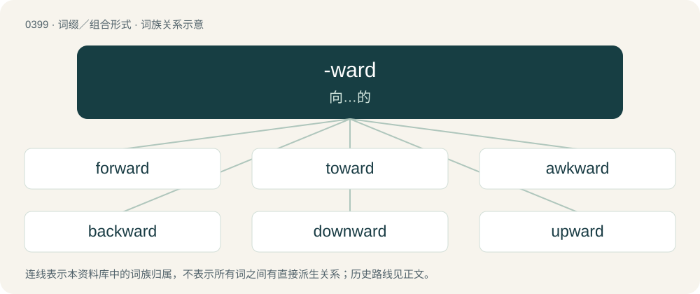

# 0459 · -ward — 向…的

[总目录](../00_总目录_按常用程度.md)

**类型**：词缀／组合形式　｜　**来源语言**：见词源记录

## 核心含义与来源

- 核心含义：向…的
- 英文含义：Forming adverbs denoting course or direction to, or motion or tendency toward, as in "backward", "toward", "forward", etc.
- 词形：-ward

**来源记录 1**（后缀／后置成分；Forming adverbs denoting course or direction to, or motion or tendency toward, as in "backward", "toward", "forward", etc.）

From Old English -weard, from Proto-Germanic \*wardaz, earlier \*warþaz (“turned toward, in the direction of, facing”); compare -wards, from -weardes. Cognate with Dutch -waarts, Low German -warts, German -wärts, Old Norse -verðr, Icelandic -verðr, Swedish -vart, Gothic -𐍅𐌰𐌹𐍂𐌸𐍃 (-wairþs), Latin vertere (“to turn”) or versus (“toward”), and Sanskrit वर्तते (vártate, “he turns”). Also related to worth (“to become”). Compare verse.

## 词族图

## 单词速览（常用到不常用）

| 单词 | 音标 | 释义 |
|---|---|---|
| [forward](#w-1) | 英 /ˈfɔːwəd/；美 /ˈfɔɹwəɹd/ | a. 向前的, 早的, 迅速的, 在前的, 进步的；vt. 促进...的生长, 转寄, 运送；adv. 向前地 |
| [toward](#w-2) | 英 /təˈwɔːd/；美 /tɔɹd/ | prep. 向, 对于, 为了；a. 即将来临的, 进行中的 |
| [awkward](#w-3) | 英 /ˈɔːk.wəd/；美 /ˈɔk.wɚd/ | a. 笨拙的, 棘手的 |
| [backward](#w-4) | 英 /ˈbæk.wə(ɹ)d/；美 /ˈbækwɚd/ | adv. 向后地, 相反地；a. 向后的, 相反的；\[计\] 倒推 |
| [downward](#w-5) | 英 /ˈdaʊnwəd/；美 /ˈdaʊnwɚd/ | a. 向下的 |
| [upward](#w-6) | 英 /ˈʌpwəd/；美 /ˈʌpwɚd/ | a. 向上的；adv. 以上 |
| [outward](#w-7) | 英 /ˈaʊt.wəd/；美 /ˈaʊt.wɚd/ | a. 向外的, 表面的, 外服的；adv. 向外, 在外, 表面 |
| [onward](#w-8) | 英 /ˈɒnwəd/；/ˈɑnwɚd/ | a. 向前的, 前进的；adv. 向前, 前进, 在先 |
| [inward](#w-9) | 英 /ˈɪnwəd/；美 /ˈɪnwɚd/ | a. 内心的, 向内的, 本来的；\[医\] 向内的 |
| [eastward](#w-10) | 英 /ˈiːst.wəd/；美 /ˈist.wɚd/ | n. 朝东方向；a. 向东方的；adv. 向东 |
| [northward](#w-11) | 英 /ˈnɔːθwəd/；美 /ˈnɔɹθwɚd/ | n. 北方, 北；a. 向北的；adv. 向北 |
| [wayward](#w-12) | /ˈweɪwə(ɹ)d/ | a. 任性的, 难以捉摸的, 不稳定的, 刚愎的；\[法\] 顽强的, 任性的, 不规则的 |
| [southward](#w-13) | 英 /ˈsaʊθwəd/ | n. 朝南的方向(或地点、地区)；a. 在南方的, 往南方的；adv. 往南 |
| [windward](#w-14) | /ˈwɪndwə(ɹ)d/ | adv. 向风, 上风；a. 向风的, 上风的；n. 上风面 |
| [homeward](#w-15) | 英 /ˈhəʊmwəd/；美 /ˈhoʊmwɚd/ | a. 在归途上的, 向家的；adv. 在归途上, 向家地 |
| [untoward](#w-16) | 英 /ˌʌn.tʊˈwɔːd/；美 /ˌʌn.təˈwɔɹd/ | a. 事与愿违的, 麻烦的, 困难的, 不幸的 |
| [skyward](#w-17) | /ˈskaiwəd/ | adv. 向着天空, 向上；a. 向着天空的, 向上的 |
| [leeward](#w-18) | 英 /ˈliːwəd/；美 /ˈliwɚd/ | a. 下风的, 在下风的；adv. 在下风, 在下风方向；n. 下风, 背风 |
| [seaward](#w-19) | 英 /ˈsiːwəd/；美 /ˈsiwəɹd/ | n. 朝海的方向；a. 面海的, 向海的；adv. 往海那边 |
| [rearward](#w-20) | 英 /ˈɹɪəwɜːd/；美 /ˈɹiɹwɝd/ | adv. 在背后, 向后方；n. 后方, 后部, 背后；a. 向后方的, 在末尾的 |
| [rightward](#w-21) | 英 /ˈɹaɪtwəd/；美 /ˈɹaɪtwɚd/ | adv. 向右, 向右倾；a. 朝右的 |
| [northeastward](#w-22) | /.nɒːθˈiːstwəd/ | adv. 向东北, 在东北；a. 来自东北方, 向东北的；n. 东北 |
| [landward](#w-23) | 美 /ˈlændwɚd/ | a. 向陆的, 近陆的；adv. 向陆地 |
| [leftward](#w-24) | /ˈleftwəd/ | a. 左方的, 左侧的；adv. 在左方, 在左手 |
| [northwestward](#w-25) | /ˈnɔːθˈwestwəd/ | adv. 向西北；a. 向西北的 |
| [southeastward](#w-26) | /sauθˈiːstwəd/ | adv. 往东南；n. 朝东南的方向；a. 向东南的 |
| [southwestward](#w-27) | /sauθˈwestwəd/ | a. 向西南的, 来自西南方的；adv. 向西南；n. 朝西南的方向 |

## 逐词详解

### 1. forward

**词性**：形容词　｜　**音标**：英 /ˈfɔːwəd/；美 /ˈfɔɹwəɹd/

**中文释义**：a. 向前的, 早的, 迅速的, 在前的, 进步的；vt. 促进...的生长, 转寄, 运送；adv. 向前地

**英文义项**：Situated toward or at the front of something. / Situated toward or near the enemy lines.

**构词拆分**：fore + -ward

**词源与演化**：

From Middle English foreward, from Old English foreweard (“forward, inclined to the front, fore, early, former”), from Proto-Germanic \*fura- (“fore-”), \*warþaz (“turned”), equivalent to fore + -ward. Cognate with Dutch voorwaarts (“forward”), German vorwärts (“forward”).

**例句**：

> The grass is forward, or forward for the season. We have a forward spring.

该用例对应义项：Advanced beyond the usual degree; advanced for the season; precocious.

### 2. toward

**词性**：介词　｜　**音标**：英 /təˈwɔːd/；美 /tɔɹd/

**中文释义**：prep. 向, 对于, 为了；a. 即将来临的, 进行中的

**英文义项**：In the direction of. / In relation to (someone or something).

**构词拆分**：to + -ward

**词源与演化**：

From Middle English toward, from Old English tōweard, from Proto-West Germanic \*tōward, equivalent to to + -ward. Cognate with Middle Low German tôwart, Middle Dutch toewaert (Modern Dutch toewaarts), Middle High German zuowart, zūwart (Modern German zuwärts). Compare also Middle English tilward, tillward (“toward”).

**例句**：

> Our place is over toward the station.

该用例对应义项：Located close to; near (a time or place).

### 3. awkward

**词性**：形容词　｜　**音标**：英 /ˈɔːk.wəd/；美 /ˈɔk.wɚd/

**中文释义**：a. 笨拙的, 棘手的

**英文义项**：Lacking dexterity in the use of the hands, or of instruments. / Not easily managed or effected; embarrassing.

**构词拆分**：awk + -ward；awk (“odd, clumsy”) + -ward

**词源与演化**：

From awk (“odd, clumsy”) + -ward. Compare Middle English aukeward (“in the wrong direction”).

**例句**：

> John was awkward at performing the trick. He'll have to practice to improve.

该用例对应义项：Lacking dexterity in the use of the hands, or of instruments.

### 4. backward

**词性**：形容词　｜　**音标**：英 /ˈbæk.wə(ɹ)d/；美 /ˈbækwɚd/

**中文释义**：adv. 向后地, 相反地；a. 向后的, 相反的；\[计\] 倒推

**英文义项**：Situated toward or at the rear of something. / Acting or moving in the direction opposite to that in which someone or something is facing.

**构词拆分**：back (adverb) + -ward

**词源与演化**：

From Middle English bakwarde, abakward, equivalent to back (adverb) + -ward. Cognate with Old Frisian bekward (“backward”).

**例句**：

> The occasional apparent backward movement of planets is evidence that they revolve around the sun.

该用例对应义项：Acting or moving in the direction opposite to the usual direction of movement.

### 5. downward

**词性**：形容词　｜　**音标**：英 /ˈdaʊnwəd/；美 /ˈdaʊnwɚd/

**中文释义**：a. 向下的

**英文义项**：Moving, sloping or oriented down. / Located at a lower level.

**构词拆分**：down + -ward

**词源与演化**：

From down + -ward.

**例句**：

> He spoke with a downward glance.

该用例对应义项：Moving, sloping or oriented down.

### 6. upward

**词性**：形容词　｜　**音标**：英 /ˈʌpwəd/；美 /ˈʌpwɚd/

**中文释义**：a. 向上的；adv. 以上

**英文义项**：Directed toward a higher place.

**构词拆分**：up + -ward

**词源与演化**：

From Old English upweardes, equivalent to up + -ward.

**用法示例／搭配（非完整句）**：

> with upward eye; with upward course

该用例对应义项：Directed toward a higher place.

### 7. outward

**词性**：形容词　｜　**音标**：英 /ˈaʊt.wəd/；美 /ˈaʊt.wɚd/

**中文释义**：a. 向外的, 表面的, 外服的；adv. 向外, 在外, 表面

**英文义项**：Outer; located towards the outside. / Visible, noticeable.

**构词拆分**：out + -ward

**词源与演化**：

From Middle English outward, from Old English ūtweard, equivalent to out + -ward.

**例句**：

> By all outward indications, he's a normal happy child, but if you talk to him, you will soon realize he has some psychological problems.

该用例对应义项：Visible, noticeable.

### 8. onward

**词性**：形容词　｜　**音标**：英 /ˈɒnwəd/；/ˈɑnwɚd/

**中文释义**：a. 向前的, 前进的；adv. 向前, 前进, 在先

**英文义项**：Moving forward. / Advanced in a forward direction or toward an end.

**构词拆分**：on + -ward

**词源与演化**：

From on + -ward.

**例句**：

> There was an onward rush as the gates opened.

该用例对应义项：Moving forward.

### 9. inward

**词性**：形容词　｜　**音标**：英 /ˈɪnwəd/；美 /ˈɪnwɚd/

**中文释义**：a. 内心的, 向内的, 本来的；\[医\] 向内的

**英文义项**：Situated on the inside; that is within, inner; belonging to the inside. / Not superficially obvious, inner, not expressed, especially relating to mental or spiritual faculties as opposed to external ones.

**构词拆分**：in + -ward

**词源与演化**：

From Middle English inward, from Old English inweard, corresponding to in + -ward.

**例句**：

> Inward flood of capital.

该用例对应义项：directed or moving inward or toward a center

### 10. eastward

**词性**：名词　｜　**音标**：英 /ˈiːst.wəd/；美 /ˈist.wɚd/

**中文释义**：n. 朝东方向；a. 向东方的；adv. 向东

**英文义项**：The direction or area lying to the east.

**构词拆分**：east + -ward

**词源与演化**：

From Middle English estward, from Old English ēastweard, ēasteweard; equivalent to east + -ward.

**例句**：

> The empire expanded eastward, in search of resources for its burgeoning textile industry.

### 11. northward

**词性**：名词　｜　**音标**：英 /ˈnɔːθwəd/；美 /ˈnɔɹθwɚd/

**中文释义**：n. 北方, 北；a. 向北的；adv. 向北

**英文义项**：The direction or area lying to the north of a place.

**构词拆分**：north + -ward

**词源与演化**：

From north + -ward.

**例句**：

> There is a gradual cline of decreasing size to the northward.

### 12. wayward

**词性**：形容词　｜　**音标**：/ˈweɪwə(ɹ)d/

**中文释义**：a. 任性的, 难以捉摸的, 不稳定的, 刚愎的；\[法\] 顽强的, 任性的, 不规则的

**英文义项**：Given to a wilful, perverse deviation from the expected norm; tending to stray. / Obstinate, contrary and unpredictable.

**构词拆分**：away + -ward

**词源与演化**：

Shortening of away + -ward.

**例句**：

> The father had trouble communicating with his wayward son.

### 13. southward

**词性**：名词　｜　**音标**：英 /ˈsaʊθwəd/

**中文释义**：n. 朝南的方向(或地点、地区)；a. 在南方的, 往南方的；adv. 往南

**英文义项**：The direction or area lying to the south of a place.

**构词拆分**：south + -ward

**词源与演化**：

From south + -ward.

**例句**：

> Europe is not really a continent; it juts westward out of Eurasia, the continent, as India juts southward out thereof.

### 14. windward

**词性**：形容词　｜　**音标**：/ˈwɪndwə(ɹ)d/

**中文释义**：adv. 向风, 上风；a. 向风的, 上风的；n. 上风面

**英文义项**：Towards the wind, or the direction from which the wind is blowing. / On the side exposed to the wind.

**构词拆分**：wind + -ward

**词源与演化**：

From wind + -ward.

**例句**：

> The windward boat must give way to the leeward boat.

该用例对应义项：Towards the wind, or the direction from which the wind is blowing.

### 15. homeward

**词性**：副词　｜　**音标**：英 /ˈhəʊmwəd/；美 /ˈhoʊmwɚd/

**中文释义**：a. 在归途上的, 向家的；adv. 在归途上, 向家地

**英文义项**：Towards home.

**构词拆分**：home + -ward

**词源与演化**：

From Middle English homward, from Old English hāmweard, from Proto-Germanic \*haimawarda, equivalent to home + -ward. Cognate with Dutch heimwaarts, German heimwärts (“homeward”).

**例句**：

> I am homeward bound.

该用例对应义项：Towards home.

### 16. untoward

**词性**：形容词　｜　**音标**：英 /ˌʌn.tʊˈwɔːd/；美 /ˌʌn.təˈwɔɹd/

**中文释义**：a. 事与愿违的, 麻烦的, 困难的, 不幸的

**英文义项**：Unfavourable, adverse, or disadvantageous. / Unruly, troublesome; not easily guided.

**构词拆分**：to + -ward；un- + toward (“to + -ward”)

**词源与演化**：

From un- + toward (“to + -ward”).

**例句**：

> Moved to curb their untoward ribaldry.

该用例对应义项：not in keeping with accepted standards of what is right or proper in polite society

### 17. skyward

**词性**：副词　｜　**音标**：/ˈskaiwəd/

**中文释义**：adv. 向着天空, 向上；a. 向着天空的, 向上的

**英文义项**：At or toward the sky.

**构词拆分**：sky + -ward

**词源与演化**：

From sky + -ward.

**例句**：

> The rocket shot skyward and exploded in a burst of glittering stars.

该用例对应义项：At or toward the sky.

### 18. leeward

**词性**：形容词　｜　**音标**：英 /ˈliːwəd/；美 /ˈliwɚd/

**中文释义**：a. 下风的, 在下风的；adv. 在下风, 在下风方向；n. 下风, 背风

**英文义项**：On the side sheltered from the wind; in that direction.

**构词拆分**：lee + -ward

**词源与演化**：

From lee (“side away from the wind”) + -ward (“direction”).

**例句**：

> On the leeward side of the island.

该用例对应义项：on the side away from the wind

### 19. seaward

**词性**：形容词　｜　**音标**：英 /ˈsiːwəd/；美 /ˈsiwəɹd/

**中文释义**：n. 朝海的方向；a. 面海的, 向海的；adv. 往海那边

**英文义项**：Being in or facing towards the sea.

**构词拆分**：sea + -ward

**词源与演化**：

From Middle English seaward, seward (attested only as an adjective), equivalent to sea + -ward.

**例句**：

> The landward side of the fort faced more dangerous guns than the seaward side, which only faced what could be put on a ship.

该用例对应义项：Being in or facing towards the sea.

### 20. rearward

**词性**：形容词　｜　**音标**：英 /ˈɹɪəwɜːd/；美 /ˈɹiɹwɝd/

**中文释义**：adv. 在背后, 向后方；n. 后方, 后部, 背后；a. 向后方的, 在末尾的

**英文义项**：Toward the back or rear of something.

**构词拆分**：rear + -ward

**词源与演化**：

From rear + -ward.

**例句**：

> The rearward seats of the bus were unpleasantly close to the toilet facilities.

该用例对应义项：Toward the back or rear of something.

### 21. rightward

**词性**：形容词　｜　**音标**：英 /ˈɹaɪtwəd/；美 /ˈɹaɪtwɚd/

**中文释义**：adv. 向右, 向右倾；a. 朝右的

**英文义项**：To or from the right.

**构词拆分**：right + -ward

**词源与演化**：

From right + -ward.

### 22. northeastward

**词性**：形容词　｜　**音标**：/.nɒːθˈiːstwəd/

**中文释义**：adv. 向东北, 在东北；a. 来自东北方, 向东北的；n. 东北

**英文义项**：In or toward the northeast.

**构词拆分**：northeast + -ward

**词源与演化**：

From northeast + -ward.

### 23. landward

**词性**：形容词　｜　**音标**：美 /ˈlændwɚd/

**中文释义**：a. 向陆的, 近陆的；adv. 向陆地

**英文义项**：Located, facing or moving in the direction of the land, as opposed to the sea. / Of the country as opposed to the city, rural; agricultural.

**构词拆分**：land + -ward

**词源与演化**：

From land + -ward.

**例句**：

> As cliffs and sand dunes retreat, the vacated area becomes part of the beach environment and the position of the beach shifts landward.

### 24. leftward

**词性**：形容词　｜　**音标**：/ˈleftwəd/

**中文释义**：a. 左方的, 左侧的；adv. 在左方, 在左手

**英文义项**：To or from the left.

**构词拆分**：left + -ward

**词源与演化**：

From left + -ward.

### 25. northwestward

**词性**：形容词　｜　**音标**：/ˈnɔːθˈwestwəd/

**中文释义**：adv. 向西北；a. 向西北的

**英文义项**：In or toward the northwest

**构词拆分**：northwest + -ward

**词源与演化**：

From northwest + -ward.

### 26. southeastward

**词性**：形容词　｜　**音标**：/sauθˈiːstwəd/

**中文释义**：adv. 往东南；n. 朝东南的方向；a. 向东南的

**英文义项**：In or toward the southeast

**构词拆分**：southeast + -ward

**词源与演化**：

From southeast + -ward.

### 27. southwestward

**词性**：形容词　｜　**音标**：/sauθˈwestwəd/

**中文释义**：a. 向西南的, 来自西南方的；adv. 向西南；n. 朝西南的方向

**英文义项**：In or toward the southwest

**构词拆分**：southwest + -ward

**词源与演化**：

From southwest + -ward.
