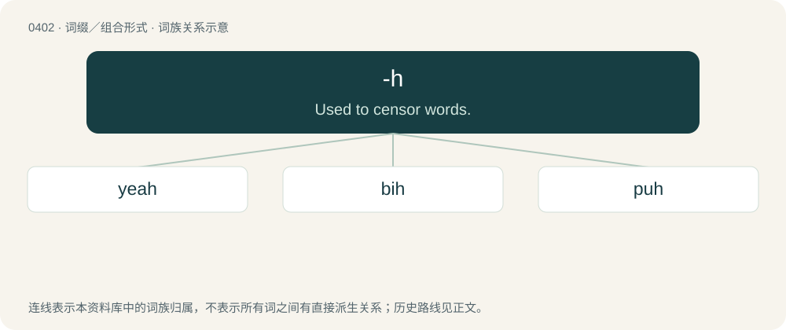

# 0463 · -h — Used to censor words.

[总目录](../00_总目录_按常用程度.md)

**类型**：词缀／组合形式　｜　**来源语言**：见词源记录

## 核心含义与来源

- 核心含义：Used to censor words.
- 英文含义：Used to censor words.
- 词形：-h

**来源记录 1**（后缀／后置成分；Used to censor words.）

An orthographic device that forces the preceding vowel to be read ‘short’: ⟨dih⟩ /dɪ/, ⟨bruh⟩ /bɹʌ/, etc. (not \*/da͡ɪ, bɹu/). Although the letter h has long been used ad-hoc for this purpose in English — see uh and meh — the practice of clipping content words to humorous effect took off as an Internet meme in 2025 and created a productive association between -h and such clippings.

## 词族图

## 单词速览（常用到不常用）

| 单词 | 音标 | 释义 |
|---|---|---|
| [yeah](#w-1) | /jɛ(ə)/ | adv. (非正式)是, 是的 |
| [bih](#w-2) | /bɪ(ː)/ | abbr. 国际时间局（bureau internationale de l’heure） |
| [puh](#w-3) | /pʊ(ː)/ | 孕尿激素(pregnancy urine hormone) |

## 逐词详解

### 1. yeah

**词性**：小品词　｜　**音标**：/jɛ(ə)/

**中文释义**：adv. (非正式)是, 是的

**英文义项**：Yes. / Used to express acknowledgment of what was previously said.

**构词拆分**：yes + -h

**词源与演化**：

Colloquial form of yea or yes. Compare nah. Analyzable as yes + -h.

**例句**：

> I was walking down the road, yeah, and you know what I saw, yeah? A dog wearing a dress!

该用例对应义项：Used to ascertain the continued attention of the listener.

### 2. bih

**词性**：名词　｜　**音标**：/bɪ(ː)/

**中文释义**：abbr. 国际时间局（bureau internationale de l’heure）

**英文义项**：A bitch.

**构词拆分**：bitch + -h

**词源与演化**：

From bitch + -h.

### 3. puh

**词性**：名词　｜　**音标**：/pʊ(ː)/

**中文释义**：孕尿激素(pregnancy urine hormone)

**英文义项**：Filter-avoidance spelling of pussy.

**构词拆分**：puss(y) + -h

**词源与演化**：

Equivalent to puss(y) + -h.

**用法示例／搭配（非完整句）**：

> "Eat my puh"

该用例对应义项：Filter-avoidance spelling of pussy.
