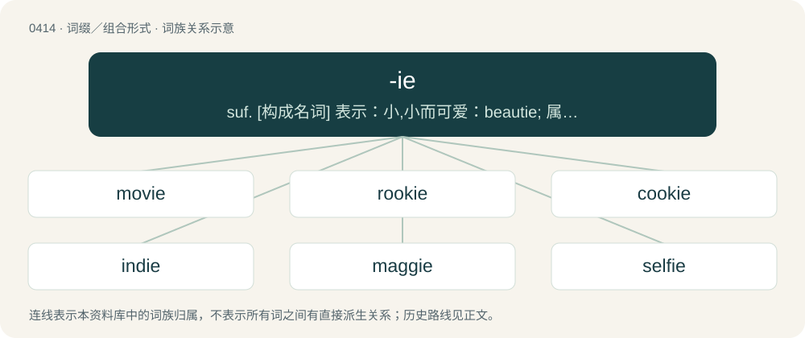

# 0475 · -ie — suf. \[构成名词\] 表示：小,小而可爱：beautie; 属于...类型的人(或物), 有...性质的人(或物)：bookie; 与...有关的人(或物)：townie

[总目录](../00_总目录_按常用程度.md)

**类型**：词缀／组合形式　｜　**来源语言**：见词源记录

## 核心含义与来源

- 核心含义：suf. \[构成名词\] 表示：小,小而可爱：beautie; 属于...类型的人(或物), 有...性质的人(或物)：bookie; 与...有关的人(或物)：townie
- 英文含义：Forming diminutive or affectionate forms of nouns or names.
- 词形：-ie

**来源记录 1**（后缀／后置成分；A photograph, especially a selfie.）

Back-formation from selfie.

## 词族图

## 单词速览（常用到不常用）

| 单词 | 音标 | 释义 |
|---|---|---|
| [movie](#w-1) | /ˈmuːvi/ | n. 电影 |
| [rookie](#w-2) | /ˈɹʊki/ | n. 新手 |
| [cookie](#w-3) | /ˈkʊki/ | 【英文】Affectionate name for a cook. |
| [indie](#w-4) | /ˈɪndi/ | n. 独立制片人, 独立制作的影(唱)片 |
| [maggie](#w-5) | /ˈmæɡi/ | 【英文】Any of several kinds of bird in the family Corvidae, especially Pica pica. |
| [selfie](#w-6) | 英 /ˈsɛlfi/ | n. 自拍照 |
| [donkey](#w-7) | 英 /ˈdɒŋ.ki/；美 /ˈdɑŋ.ki/ | n. 驴子, 笨蛋, 顽固者, 辅助发动机, 辅助泵 |
| [sweetie](#w-8) | 英 /ˈswiːti/；美 /ˈswi.ti/ | n. 情人, 爱人, 甜食 |
| [barbie](#w-9) | /bɑː(ɹ)bi/ | 【英文】A barbecue (apparatus for grilling). |
| [reggie](#w-10) | /ˈɹɛdʒi/ | 【英文】Being regular marijuana, as opposed to good-quality marijuana. |
| [goalie](#w-11) | 英 /ˈɡəʊl.i/；美 /ˈɡoʊli/ | n. 守门员 |
| [hoodie](#w-12) | 英 /ˈhʊdi/ | n. 有冠乌鸦 |
| [minnie](#w-13) |  | 【英文】A minenwerfer trench mortar. |
| [cutie](#w-14) | 英 /ˈkjuːti/；美 /ˈkjuti/ | n. 漂亮女孩 |
| [auntie](#w-15) | 英 /ˈæn.ti/；/ˈɐn.ti/ | n. 阿姨, 姨妈, 舅妈, 姑妈, 伯母 |
| [junkie](#w-16) | /ˈd͡ʒʌŋki/ | n. 有毒瘾者, 废旧品商人 |
| [birdie](#w-17) | 英 /ˈbɜː.di/；美 /ˈbɝ.di/ | n. 小鸟 |
| [homie](#w-18) | 英 /ˈhəʊ.mi/；美 /ˈhoʊ.mi/ | a. 家庭似的, 舒适的, 自在的 |
| [veggie](#w-19) | /ˈvɛd͡ʒi/ | n. 素食者 |
| [maddie](#w-20) |  | 【英文】A mad person. |
| [smoothie](#w-21) | /ˈsmuːði/ | n. 举止优雅的人, 善于奉承的人, 油嘴滑舌的人 |
| [brownie](#w-22) | 英 /ˈbɹaʊni/ | n. 界仁巧克力饼 |
| [avi](#w-23) |  | abbr. 多媒体文件格式（Audio Video Interactive） |
| [goldie](#w-24) |  | 【英文】Something which is golden in color. |
| [foodie](#w-25) | /ˈfuːdi/ | n. 美食家 |
| [blondie](#w-26) | 英 /ˈblɒndi/；美 /ˈblɑndi/ | n. 白肤金发碧眼的人；n. (Blondie)人名；(法)布隆迪 |
| [hottie](#w-27) | 英 /ˈhɒti/；/ˈhɔti/ | n. \[口\]=hot-water bottle |
| [beanie](#w-28) | 英 /ˈbiː.ni/ | n. (大学一年级男生或儿童等戴的)无檐小便帽 |
| [kiddie](#w-29) | /ˈkɪdi/ | n. 小孩, 小家伙 |
| [commie](#w-30) | 英 /ˈkɒ.mi/；美 /ˈkɑ.mi/ | 【英文】A Holden Commodore. |
| [freebie](#w-31) | /ˈfɹiːbi/ | n. 免费的东西；免费赠品（尤指戏院赠券） |
| [aggie](#w-32) | 美 /ˈæ.ɡi/ | n. 农业学校；农科大学生 |
| [walkie](#w-33) |  | n. 步行式 |
| [girlie](#w-34) | /ˈgəːli/ | n. 少女 |
| [beastie](#w-35) | /ˈbiːsti/ | n. 动物,小动物 |
| [ozzie](#w-36) | 英 /ˈɒzi/ | n. 奥齐（男子名） |
| [goodie](#w-37) | /ˈɡudi/ | n. 身份低微之老妇；正面人物；好人 |
| [quickie](#w-38) | /ˈkwɪki/ | n. 匆匆做成的事；a. 简短的, 迅速的, 突发的 |
| [sharpie](#w-39) | 英 /ˈʃɑːpi/；美 /ˈʃɑɹpi/ | n. 骗子, 非常机灵的人, 狡诈精明的人, 时髦人物；\[法\] 骗子, 狡猾的人 |
| [lassie](#w-40) | /ˈlæsi/ | n. 少女, 姑娘, 恋人 |
| [wheelie](#w-41) | 英 /ˈ(h)wiːli/；美 /ˈ(h)wili/ | n. 自行车前轮离地平衡特技 |
| [bookie](#w-42) | 英 /ˈbʊki/ | n. 登记赌注者 |
| [groupie](#w-43) | /ˈɡɹuːpi/ | n. 追随歌星的年轻女子, 歌星倾慕者 |
| [oldie](#w-44) | 英 /ˈəʊldi/；美 /ˈoʊldi/ | n. 老人, 陈旧之物 |
| [cabbie](#w-45) | /ˈkæ.bi/ | n. 出租马车车夫; 出租汽车司机 |
| [chewie](#w-46) | /ˈt͡ʃuː.i/ | n. &lt;澳口&gt;胶姆糖,口香糖,橡皮糖 |
| [bestie](#w-47) | /ˈbɛsti/ | 〈俚〉最好的朋友; 闺蜜 |
| [burnie](#w-48) | /ˈbəːni/ | \[苏\]小溪 |
| [queenie](#w-49) | 英 /ˈkwiːni/ | 【英文】An effeminate man; a male homosexual (especially as a term of address). |
| [doobie](#w-50) | 英 /ˈduːbi/ | 数据库 |
| [techie](#w-51) | /ˈtɛki/ | n. 技师, 技术员 |
| [baddie](#w-52) | /ˈbædi/ | n. 坏人, (尤指电影中之)恶人 |
| [budgie](#w-53) | /ˈbʌd͡ʒi/ | n. (budgerigar之略), 相思鹦鹉 |
| [roadie](#w-54) | 英 /ˈɹəʊdi/；美 /ˈɹoʊdi/ | n. 巡回乐队管理员 |
| [roomie](#w-55) | /ˈruːmi/ | n. 住在同室的人 |
| [nettie](#w-56) | /ˈneti/ | n. 内蒂（女子名, Janet的昵称） |
| [meanie](#w-57) | /ˈmiːni/ | n. 小气鬼, 卑鄙家伙 |
| [rollie](#w-58) |  | \[网络\] 罗比庄园；路徕；罗拉尔拯救世界 |
| [bogie](#w-59) | 英 /ˈbəʊ.ɡi/；美 /ˈboʊ.ɡi/ | 【英文】A marijuana cigarette; a joint. |
| [wolfie](#w-60) |  | 【英文】A werewolf. |
| [wedgie](#w-61) | 英 /ˈwɛdʒ.i/ | n. 楔形后跟的女鞋 |
| [yuppie](#w-62) | 英 /ˈjʌpɪ/；美 /ˈjʌpi/ | n. （美）雅皮士（属于中上阶层的年轻专业人士） |
| [normie](#w-63) | 英 /ˈnɔː.mi/；美 /ˈnɔɹ.mi/ | 【英文】A normal person; one with commonly held, normative beliefs, neurology, tastes or interests. |
| [dearie](#w-64) | 英 /ˈdɪəɹi/；美 /ˈdɪɚi/ | n. 可爱的小宝贝, 亲亲 |
| [softie](#w-65) | /ˈsɔ(ː)fti/ | n. 1.柔弱的人 2.笨人 |
| [laddie](#w-66) | /ˈlædi/ | n. &lt;主苏&gt;少年, 年青人,老弟(表示亲密的称呼) |
| [baggie](#w-67) | /ˈbæɡi/ | 垃圾袋 |
| [sammie](#w-68) | /ˈsæmiə/ | (木屑)回潮 |
| [druggie](#w-69) | /ˈdɹʌɡi/ | n. 吸毒者,瘾君子 |
| [muskie](#w-70) | /ˈmʌski/ | n. &lt;口&gt; = maskinonge |
| [lambie](#w-71) | /ˈlæmbik/ | n. &lt;昵&gt;乖乖,小宝贝儿 |
| [nudie](#w-72) | 英 /ˈnjuːdi/；美 /ˈnuːdi/ | n. 裸体电影 |
| [plushie](#w-73) | 英 /ˈplʌʃi/ | 【英文】Synonym of plush toy. |
| [ralphie](#w-74) | /ɹɑːɹˈfi/ | 【英文】A scruffy school child. |
| [albie](#w-75) |  | 【英文】A false albacore. |
| [townie](#w-76) | /ˈtaʊni/ | a. 城市生活的 |
| [bridie](#w-77) | /ˈbɹaɪdi/ | 【英文】A Scottish meat pastry, similar to a Cornish pasty. |
| [teenie](#w-78) |  | n. 蒂妮（女子名） |
| [woodie](#w-79) | /ˈwʊ.di/ | n. 斑尾林鸽（等于wood pigeon） |
| [gillie](#w-80) | 英 /ˈdʒɪli/；美 /ˈd͡ʒili/ | 【英文】A gill of an alcoholic drink. |
| [juvie](#w-81) | /ˈd͡ʒuːvi/ | n. (=juvey)少年罪犯(管教所), 失足青年 |
| [nightie](#w-82) | /ˈnaɪti/ | n. 女式睡衣, 孩子穿的睡衣, 妇女穿的睡衣 |
| [loonie](#w-83) | 英 /ˈluːni/ | n. 加元的一元硬币, 可指加元 |
| [preemie](#w-84) | /ˈpɹiːmi/ | n. 早产婴孩 |
| [blankie](#w-85) | /ˈblæŋki/ | 【英文】A blanket, especially one used as a security blanket. |
| [shellie](#w-86) |  | 【英文】A small or miniature shell. |
| [smokie](#w-87) | /ˈsməuki/ | 除内脏去头熏鳕 |

## 逐词详解

### 1. movie

**词性**：名词　｜　**音标**：/ˈmuːvi/

**中文释义**：n. 电影

**英文义项**：A recorded sequence of images displayed on a screen at a rate sufficiently fast to create the appearance of motion; a film; a video. / A professionally made motion picture of a substantive narrative work, typically around 1 to 3 hours long, typically intended for cinema, art, entertainment, and a widespread audience; a feature film, theatrical film.

**词源与演化**：

From moving (picture) + -ie. Attested since at least 1912 (if not 1908), originally in American English.

**例句**：

> Don't worry; this isn't the first time I've been through this movie.

该用例对应义项：Any event, especially one that is unpleasant or tiresome.

### 2. rookie

**词性**：形容词　｜　**音标**：/ˈɹʊki/

**中文释义**：n. 新手

**英文义项**：Non-professional; amateur

**构词拆分**：rook (“a cheat”) + -ie

**词源与演化**：

Thought to be an alteration of recruit + -ie, or from rook (“a cheat”) + -ie. Another possible origin is Dutch broekie (short for broekvent (“a boy still in short trousers”)), a common term for a shipmate. Also suggested is Irish rúca (“an inexperienced person”).

**例句**：

> The game was going well until I made that rookie mistake.

该用例对应义项：Non-professional; amateur

### 3. cookie

**词性**：名词　｜　**音标**：/ˈkʊki/

**英文义项**：Affectionate name for a cook.

**构词拆分**：From cook + -ie.

**词源与演化**：

From cook + -ie.

### 4. indie

**词性**：形容词　｜　**音标**：/ˈɪndi/

**中文释义**：n. 独立制片人, 独立制作的影(唱)片

**英文义项**：Independent; from outside the mainstream.

**词源与演化**：

From independent, by shortening, + -ie. Used of popular music since the 1980s, and of cinema for some decades before that.

**用法示例／搭配（非完整句）**：

> an indie video game

该用例对应义项：Independent; from outside the mainstream.

### 5. maggie

**词性**：名词　｜　**音标**：/ˈmæɡi/

**英文义项**：Any of several kinds of bird in the family Corvidae, especially Pica pica. / A superficially similar Australian bird, Gymnorhina tibicen or Cracticus tibicen.

**构词拆分**：From magpie + -ie.

**词源与演化**：

From magpie + -ie.

**例句**：

> Maggie said you can hold your own in darts.

### 6. selfie

**词性**：名词　｜　**音标**：英 /ˈsɛlfi/

**中文释义**：n. 自拍照

**英文义项**：A photographic self-portrait, especially one taken manually (not using a timer, tripod etc.) with a small camera or mobile phone.

**构词拆分**：self + -ie

**词源与演化**：

From self + -ie. Attested since 2002, originally Australian English.

**用法示例／搭配（非完整句）**：

> take a selfie

该用例对应义项：A photographic self-portrait, especially one taken manually (not using a timer, tripod etc.) with a small camera or mobile phone.

### 7. donkey

**词性**：名词　｜　**音标**：英 /ˈdɒŋ.ki/；美 /ˈdɑŋ.ki/

**中文释义**：n. 驴子, 笨蛋, 顽固者, 辅助发动机, 辅助泵

**英文义项**：A domestic animal, Equus asinus asinus, similar to a horse. / A stubborn person.

**词源与演化**：

The origin is uncertain. Originally a slang term from the late eighteenth century. Perhaps from Middle English \*donekie (“a miniature dun horse”), a double diminutive of Middle English don, dun, dunne (a name for a dun horse), equivalent to modern English dun (“brownish grey colour”) + -ock (diminutive suffix) + -ie (diminutive suffix), or similarly formed from the given name Duncan. Compare Middle English donning (“a dun horse”), English dunnock. Became more common than the original term ass due to the latter's homophony and partial merger with arse (compare similar development between coney and rabbit).

**例句**：

> The horsepower of a car matters not, with a donkey in control.

### 8. sweetie

**词性**：名词　｜　**音标**：英 /ˈswiːti/；美 /ˈswi.ti/

**中文释义**：n. 情人, 爱人, 甜食

**英文义项**：A person who is much loved. / A sweetheart.

**构词拆分**：sweet + -ie

**词源与演化**：

From sweet + -ie.

**例句**：

> Can I have a box of sweeties for being a good boy?

该用例对应义项：A sweet; a candy.

### 9. barbie

**词性**：名词　｜　**音标**：/bɑː(ɹ)bi/

**英文义项**：A barbecue (apparatus for grilling). / A barbecue (event: cookout).

**词源与演化**：

Clipping of barbecue + -ie (diminutive suffix).

**例句**：

> Robert just saw Sandra as a Barbie doll to decorate his castle.

### 10. reggie

**词性**：形容词　｜　**音标**：/ˈɹɛdʒi/

**英文义项**：Being regular marijuana, as opposed to good-quality marijuana.

**词源与演化**：

Clipping of regular + -ie.

**例句**：

> Ever the organizer, Reggie separates his Skittles into groupings of the same flavor before he eats them.

### 11. goalie

**词性**：名词　｜　**音标**：英 /ˈɡəʊl.i/；美 /ˈɡoʊli/

**中文释义**：n. 守门员

**英文义项**：A goalkeeper or goaltender.

**词源与演化**：

Clipping of goalkeeper or goaltender + -ie.

**例句**：

> Tom was a better goalie than Mary thought he would be.

### 12. hoodie

**词性**：名词　｜　**音标**：英 /ˈhʊdi/

**中文释义**：n. 有冠乌鸦

**英文义项**：A sweatshirt with an integral hood and, sometimes, a large kangaroo pocket at the front. / A young person wearing such a sweatshirt, usually a male, stereotypically associated with antisocial behaviour.

**构词拆分**：hood + -ie (diminutive suffix)

**词源与演化**：

From hood + -ie (diminutive suffix). In sense “person wearing a hoodie”, influenced by sense -ie (“person associated with suffixed noun, often derogatory”); compare townie.

**例句**：

> You can buy hoodies on the cheap in summer.

该用例对应义项：A sweatshirt with an integral hood and, sometimes, a large kangaroo pocket at the front.

### 13. minnie

**词性**：名词

**英文义项**：A minenwerfer trench mortar.

**词源与演化**：

Clipping of minenwerfer + -ie.

**例句**：

> Eve swore Minnie to secrecy in hopes that she wouldn't tattle about what they'd done.

### 14. cutie

**词性**：名词　｜　**音标**：英 /ˈkjuːti/；美 /ˈkjuti/

**中文释义**：n. 漂亮女孩

**英文义项**：A cute person or animal.

**构词拆分**：cute + -ie

**词源与演化**：

From cute + -ie.

**例句**：

> Who's the cutie in the blue shirt?

### 15. auntie

**词性**：名词　｜　**音标**：英 /ˈæn.ti/；/ˈɐn.ti/

**中文释义**：n. 阿姨, 姨妈, 舅妈, 姑妈, 伯母

**英文义项**：Term of familiarity or respect for a middle-aged or elderly woman. / Female domestic helper.

**构词拆分**：aunt + -ie

**词源与演化**：

From aunt + -ie.

**例句**：

> We won't be seeing Auntie Jo this time round – maybe next time.

### 16. junkie

**词性**：名词　｜　**音标**：/ˈd͡ʒʌŋki/

**中文释义**：n. 有毒瘾者, 废旧品商人

**英文义项**：A narcotics addict, especially a heroin user. / An enthusiast of something.

**构词拆分**：junk + -ie

**词源与演化**：

From junk (“narcotic drug”) + -ie.

**例句**：

> English people are travel junkies, but Americans hardly ever leave their state.

该用例对应义项：An enthusiast of something.

### 17. birdie

**词性**：名词　｜　**音标**：英 /ˈbɜː.di/；美 /ˈbɝ.di/

**中文释义**：n. 小鸟

**英文义项**：A bird; especially, a small and cute one. / The completion of a hole one stroke below par.

**构词拆分**：bird + -ie

**词源与演化**：

From bird + -ie.

**例句**：

> Aw, that's a cute little birdie. Is it a budgie?

该用例对应义项：A bird; especially, a small and cute one.

### 18. homie

**词性**：名词　｜　**音标**：英 /ˈhəʊ.mi/；美 /ˈhoʊ.mi/

**中文释义**：a. 家庭似的, 舒适的, 自在的

**英文义项**：Someone, particularly a friend or male acquaintance, from one's hometown. / A close friend or fellow member of a youth gang.

**构词拆分**：home + -ie

**词源与演化**：

Earliest known reference is in the tune The House of Blue Lights (1946) by Ella Mae Morse and Freddie Slack, when Morse improvises a spoken-word intro. Equivalent to home + -ie.

**例句**：

> Hey there, Francis, my homie!

该用例对应义项：A close friend or fellow member of a youth gang.

### 19. veggie

**词性**：名词　｜　**音标**：/ˈvɛd͡ʒi/

**中文释义**：n. 素食者

**英文义项**：A vegetable. / A vegetarian.

**词源与演化**：

Clipping of vegetable and/or vegetarian + -ie.

**例句**：

> Did you really order sweet potato fries to go with your veggie burger?

### 20. maddie

**词性**：名词

**英文义项**：A mad person.

**构词拆分**：mad + -ie

**词源与演化**：

From mad + -ie.

### 21. smoothie

**词性**：名词　｜　**音标**：/ˈsmuːði/

**中文释义**：n. 举止优雅的人, 善于奉承的人, 油嘴滑舌的人

**英文义项**：A smooth-talking person. / A drink made from whole fruit, thus thicker than fruit juice.

**构词拆分**：smooth + -ie

**词源与演化**：

From smooth + -ie.

**例句**：

> My favorite smoothie is one made with green tea, frozen raspberries and blueberries.

### 22. brownie

**词性**：名词　｜　**音标**：英 /ˈbɹaʊni/

**中文释义**：n. 界仁巧克力饼

**英文义项**：A small square piece of rich cake, usually made with chocolate. / A sweet bread with brown sugar and currants.

**构词拆分**：brown + -ie (diminutive suffix)

**词源与演化**：

From brown + -ie (diminutive suffix). In folkloric sense, originally Scots. For sense 7, compare with Dutch kabouter (“a very young female member of the scout movement”) (literally "gnome").

**例句**：

> Order for the brownie was placed but it took half an hour to prepare it.

该用例对应义项：A small square piece of rich cake, usually made with chocolate.

### 23. avi

**词性**：名词

**中文释义**：abbr. 多媒体文件格式（Audio Video Interactive）

**英文义项**：Synonym of avatar.

**构词拆分**：avatar + -ie

**词源与演化**：

From avatar + -ie.

**例句**：

> Avi Shlaim's first language is Arabic, and Hebrew is his second language.

### 24. goldie

**词性**：名词

**英文义项**：Something which is golden in color. / The golden eagle.

**构词拆分**：gold + -ie

**词源与演化**：

From gold + -ie.

**例句**：

> At 10½, Goldie is older than most adoptees.

### 25. foodie

**词性**：名词　｜　**音标**：/ˈfuːdi/

**中文释义**：n. 美食家

**英文义项**：A person with a special interest in or knowledge of food, a gourmet.

**构词拆分**：food + -ie

**词源与演化**：

From food + -ie. Popularized by Ann Barr and Paul Levy in The Official Foodie Handbook (1984). Levy credits New York food critic Gael Greene with the coinage. The word was used by Greene in a 1980 article in New York magazine, see quotations.

**例句**：

> We self-professed foodies liked to meet in restaurants and talk like experts about what we were eating.

该用例对应义项：A person with a special interest in or knowledge of food, a gourmet.

### 26. blondie

**词性**：名词　｜　**音标**：英 /ˈblɒndi/；美 /ˈblɑndi/

**中文释义**：n. 白肤金发碧眼的人；n. (Blondie)人名；(法)布隆迪

**英文义项**：A nickname for a person with blond hair, particularly an attractive woman. / A sweet, chewy, generally vanilla-flavoured and chocolate-free baked good: a blond-colored brownie.

**构词拆分**：From blond + -ie.

**词源与演化**：

From blond + -ie.

**例句**：

> He named his guinea pigs Blondie, Thumper, and Candy.

### 27. hottie

**词性**：名词　｜　**音标**：英 /ˈhɒti/；/ˈhɔti/

**中文释义**：n. \[口\]=hot-water bottle

**英文义项**：A physically or sexually attractive person. / A hot water bottle.

**构词拆分**：hot + -ie

**词源与演化**：

From hot + -ie. Sense “stolen vehicle” perhaps from hot-wired.

**例句**：

> She isn't the only hottie on the face of the earth.

### 28. beanie

**词性**：名词　｜　**音标**：英 /ˈbiː.ni/

**中文释义**：n. (大学一年级男生或儿童等戴的)无檐小便帽

**英文义项**：A cap that fits the head closely, usually knitted from wool. / A head-hugging brimless cap, with or without a visor, made from triangular sections of cloth, leather, or silk joined by a button at the crown and seamed together around the sides.

**构词拆分**：bean + -ie

**词源与演化**：

From bean (“the head”) + -ie (diminutive suffix).

**例句**：

> Enrique Iglesias is often seen wearing a beanie.

该用例对应义项：A cap that fits the head closely, usually knitted from wool.

### 29. kiddie

**词性**：名词　｜　**音标**：/ˈkɪdi/

**中文释义**：n. 小孩, 小家伙

**英文义项**：A child.

**构词拆分**：From kid + -ie.

**词源与演化**：

From kid + -ie.

**例句**：

> The kiddie pool was shallow so the children would be safe, which meant it was much warmer than the adult pool.

该用例对应义项：A child.

### 30. commie

**词性**：名词　｜　**音标**：英 /ˈkɒ.mi/；美 /ˈkɑ.mi/

**英文义项**：A Holden Commodore.

**构词拆分**：From Commodore (“name of a car model”) + -ie (“diminutive suffix”).

**词源与演化**：

From Commodore (“name of a car model”) + -ie (“diminutive suffix”).

### 31. freebie

**词性**：名词　｜　**音标**：/ˈfɹiːbi/

**中文释义**：n. 免费的东西；免费赠品（尤指戏院赠券）

**英文义项**：Something which is free; a giveaway or handout.

**构词拆分**：free + -b- (epenthetic) + -ie；free + -bie

**词源与演化**：

From free + -b- (epenthetic) + -ie or free + -bie.

**例句**：

> I didn't buy a thing, but they were handing out some neat freebies and samples.

该用例对应义项：Something which is free; a giveaway or handout.

### 32. aggie

**词性**：名词　｜　**音标**：美 /ˈæ.ɡi/

**中文释义**：n. 农业学校；农科大学生

**英文义项**：Marble or a marble made of agate, or one that looks as if it were made of agate.

**构词拆分**：From agate + -ie.

**词源与演化**：

From agate + -ie.

### 33. walkie

**词性**：名词

**中文释义**：n. 步行式

**英文义项**：A walkie-talkie. / A pallet truck, beside which the operator must walk.

**构词拆分**：walk + -ie

**词源与演化**：

From walk + -ie.

**例句**：

> Tom called Mary on a walkie talkie.

### 34. girlie

**词性**：名词　｜　**音标**：/ˈgəːli/

**中文释义**：n. 少女

**英文义项**：A magazine targeting an adult male audience and containing nude or seminude photographs of women. / A young girl.

**构词拆分**：girl + -ie

**词源与演化**：

From girl + -ie.

**例句**：

> When Grandma came to visit, the boy hid the girlies in his dresser so she wouldn't see them.

该用例对应义项：A magazine targeting an adult male audience and containing nude or seminude photographs of women.

### 35. beastie

**词性**：名词　｜　**音标**：/ˈbiːsti/

**中文释义**：n. 动物,小动物

**英文义项**：Beast, animal.

**构词拆分**：From beast + -ie.

**词源与演化**：

From beast + -ie.

### 36. ozzie

**词性**：名词　｜　**音标**：英 /ˈɒzi/

**中文释义**：n. 奥齐（男子名）

**英文义项**：A hospital.

**词源与演化**：

From a pronunciation of hospital with h-dropping, + -ie.

### 37. goodie

**词性**：名词　｜　**音标**：/ˈɡudi/

**中文释义**：n. 身份低微之老妇；正面人物；好人

**英文义项**：A good character in a story, often a hero.

**构词拆分**：good + -ie

**词源与演化**：

From good + -ie (nominal suffix).

**例句**：

> The next song is an oldie but a goodie.

### 38. quickie

**词性**：名词　｜　**音标**：/ˈkwɪki/

**中文释义**：n. 匆匆做成的事；a. 简短的, 迅速的, 突发的

**英文义项**：Something made or done swiftly. / A brief sexual encounter.

**构词拆分**：quick + -ie

**词源与演化**：

From quick + -ie.

**例句**：

> We only have time for a quick quickie.

### 39. sharpie

**词性**：名词　｜　**音标**：英 /ˈʃɑːpi/；美 /ˈʃɑɹpi/

**中文释义**：n. 骗子, 非常机灵的人, 狡诈精明的人, 时髦人物；\[法\] 骗子, 狡猾的人

**英文义项**：An alert person. / A knowledgeable fisherman.

**构词拆分**：From sharp + -ie (“diminutive suffix”).

**词源与演化**：

From sharp + -ie (“diminutive suffix”).

### 40. lassie

**词性**：名词　｜　**音标**：/ˈlæsi/

**中文释义**：n. 少女, 姑娘, 恋人

**英文义项**：A young girl, a lass, especially one seen as a sweetheart.

**构词拆分**：From lass + -ie.

**词源与演化**：

From lass + -ie.

### 41. wheelie

**词性**：名词　｜　**音标**：英 /ˈ(h)wiːli/；美 /ˈ(h)wili/

**中文释义**：n. 自行车前轮离地平衡特技

**英文义项**：An action or stunt where a bicycle, motorcycle, or other vehicle is ridden for a short period while it is standing only on its rear wheel or wheels. / A wheelchair user.

**构词拆分**：wheel + -ie

**词源与演化**：

From wheel + -ie.

**例句**：

> Jim fell off his bike when he was trying to do a wheelie.

该用例对应义项：An action or stunt where a bicycle, motorcycle, or other vehicle is ridden for a short period while it is standing only on its rear wheel or wheels.

### 42. bookie

**词性**：名词　｜　**音标**：英 /ˈbʊki/

**中文释义**：n. 登记赌注者

**英文义项**：A bookmaker, being a person who, or business which, takes bets from the general public on sporting events and similar.

**词源与演化**：

Clipping of bookmaker + -ie.

### 43. groupie

**词性**：名词　｜　**音标**：/ˈɡɹuːpi/

**中文释义**：n. 追随歌星的年轻女子, 歌星倾慕者

**英文义项**：A fan, especially a young female fan of a male singer or rock group, who seeks intimacy (most often physical, sometimes emotional) with a celebrity; usually with a rock 'n' roll artist or band member. / Any dedicated fan of something.

**构词拆分**：group + -ie (“person associated”)

**词源与演化**：

From group + -ie (“person associated”). In the fan sense, from 1967.

**例句**：

> You didn't just call me a groupie, did you?

### 44. oldie

**词性**：名词　｜　**音标**：英 /ˈəʊldi/；美 /ˈoʊldi/

**中文释义**：n. 老人, 陈旧之物

**英文义项**：Something or someone old. / A song or record from a previous era.

**构词拆分**：From old + -ie.

**词源与演化**：

From old + -ie.

**用法示例／搭配（非完整句）**：

> an oldies radio station

该用例对应义项：The genre of music composed of popular music from previous eras.

### 45. cabbie

**词性**：名词　｜　**音标**：/ˈkæ.bi/

**中文释义**：n. 出租马车车夫; 出租汽车司机

**英文义项**：A cabdriver; someone who drives a taxi.

**构词拆分**：From cab + -ie.

**词源与演化**：

From cab + -ie.

**例句**：

> I tipped the cabbie ten bucks for getting me to the airport on time.

### 46. chewie

**词性**：名词　｜　**音标**：/ˈt͡ʃuː.i/

**中文释义**：n. &lt;澳口&gt;胶姆糖,口香糖,橡皮糖

**英文义项**：Chewing gum. / A chewable treat or toy intended for a pet.

**构词拆分**：From chew + -ie.

**词源与演化**：

From chew + -ie.

### 47. bestie

**词性**：名词　｜　**音标**：/ˈbɛsti/

**中文释义**：〈俚〉最好的朋友; 闺蜜

**英文义项**：A best friend. / A term of address for someone, usually used to instruct, to make a statement, or to draw attention.

**构词拆分**：From best + -ie.

**词源与演化**：

From best + -ie.

**例句**：

> Donald my bestie? I'd rather have a pig as a best friend.

### 48. burnie

**词性**：名词　｜　**音标**：/ˈbəːni/

**中文释义**：\[苏\]小溪

**英文义项**：A small brook.

**构词拆分**：burn + -ie

**词源与演化**：

From burn + -ie.

### 49. queenie

**词性**：名词　｜　**音标**：英 /ˈkwiːni/

**英文义项**：An effeminate man; a male homosexual (especially as a term of address). / The queen scallop.

**构词拆分**：queen + -ie

**词源与演化**：

From queen + -ie. Piecewise doublet of queanie.

### 50. doobie

**词性**：名词　｜　**音标**：英 /ˈduːbi/

**中文释义**：数据库

**英文义项**：A marijuana cigarette. / A cobbler-like fruit dessert.

**构词拆分**：doob + -ie

**词源与演化**：

From doob + -ie.

### 51. techie

**词性**：名词　｜　**音标**：/ˈtɛki/

**中文释义**：n. 技师, 技术员

**英文义项**：One who works with, or has an interest in, technology or computers. / A person who works on the technical side of events.

**构词拆分**：tech + -ie

**词源与演化**：

From tech + -ie (q.v.). Compare techy and yuppie.

### 52. baddie

**词性**：名词　｜　**音标**：/ˈbædi/

**中文释义**：n. 坏人, (尤指电影中之)恶人

**英文义项**：A person of bad character, especially in a work of fiction. / An attractive, confident woman, especially one who is a social media influencer.

**构词拆分**：From bad + -ie.

**词源与演化**：

From bad + -ie.

**例句**：

> I didn't realize my professor was dating an absolute baddie; I didn't know he had motion like that.

该用例对应义项：An attractive person.

### 53. budgie

**词性**：名词　｜　**音标**：/ˈbʌd͡ʒi/

**中文释义**：n. (budgerigar之略), 相思鹦鹉

**英文义项**：A budgerigar.

**构词拆分**：budgerigar + -ie

**词源与演化**：

From a clipping of budgerigar + -ie.

**例句**：

> She keeps a ton of budgies in her home.

该用例对应义项：A budgerigar.

### 54. roadie

**词性**：名词　｜　**音标**：英 /ˈɹəʊdi/；美 /ˈɹoʊdi/

**中文释义**：n. 巡回乐队管理员

**英文义项**：One of the crew for a musical group or other travelling stage production, especially a stagehand or technician. / A cyclist who rides on the roads rather than off-road.

**构词拆分**：road + -ie

**词源与演化**：

From road + -ie.

**例句**：

> I don't know about any trails for cycling because I'm mainly a roadie.

该用例对应义项：A cyclist who rides on the roads rather than off-road.

### 55. roomie

**词性**：名词　｜　**音标**：/ˈruːmi/

**中文释义**：n. 住在同室的人

**英文义项**：A roommate.

**构词拆分**：room + -ie

**词源与演化**：

From room + -ie.

### 56. nettie

**词性**：名词　｜　**音标**：/ˈneti/

**中文释义**：n. 内蒂（女子名, Janet的昵称）

**英文义项**：An Internet user, particularly a Usenet user.

**构词拆分**：net + -ie

**词源与演化**：

From net + -ie, on the model of Trekkie.

### 57. meanie

**词性**：名词　｜　**音标**：/ˈmiːni/

**中文释义**：n. 小气鬼, 卑鄙家伙

**英文义项**：A mean (unkind or miserly) person; a killjoy. / A villain.

**构词拆分**：From mean + -ie.

**词源与演化**：

From mean + -ie.

**例句**：

> Teacher kept me in after school again. What a meanie!

该用例对应义项：A mean (unkind or miserly) person; a killjoy.

### 58. rollie

**词性**：名词

**中文释义**：\[网络\] 罗比庄园；路徕；罗拉尔拯救世界

**英文义项**：A cigarette rolled by hand.

**构词拆分**：roll + -ie

**词源与演化**：

From roll + -ie.

### 59. bogie

**词性**：名词　｜　**音标**：英 /ˈbəʊ.ɡi/；美 /ˈboʊ.ɡi/

**英文义项**：A marijuana cigarette; a joint.

**构词拆分**：bogart (“to selfishly take or keep something, to hog; especially to hold a joint (marijuana cigarette) dangling between the lips instead of passing it on”) + -ie (suffix forming colloquial nouns)

**词源与演化**：

Possibly from bogart (“to selfishly take or keep something, to hog; especially to hold a joint (marijuana cigarette) dangling between the lips instead of passing it on”) + -ie (suffix forming colloquial nouns). Bogart is derived from the surname of the American actor Humphrey Bogart (1899–1957), who was frequently shown smoking (tobacco) cigarettes in his films. The verb was popularized by its use in the song “Don’t Bogart Me” (1968) by the rock group Fraternity of Man which appeared in the soundtrack of the film Easy Rider (1969); the song has the lines “Don’t bogart that joint my friend. / Pass it over to me.”

### 60. wolfie

**词性**：名词

**英文义项**：A werewolf.

**构词拆分**：wolf + -ie

**词源与演化**：

From wolf + -ie.

### 61. wedgie

**词性**：名词　｜　**音标**：英 /ˈwɛdʒ.i/

**中文释义**：n. 楔形后跟的女鞋

**英文义项**：A wedge-heeled shoe. / A prank in which a person's underpants are pulled up sharply from behind in order to wedge the clothing uncomfortably between the person's buttocks.

**构词拆分**：From wedge + -ie.

**词源与演化**：

From wedge + -ie.

### 62. yuppie

**词性**：名词　｜　**音标**：英 /ˈjʌpɪ/；美 /ˈjʌpi/

**中文释义**：n. （美）雅皮士（属于中上阶层的年轻专业人士）

**英文义项**：A young upwardly mobile urban professional person with an affluent lifestyle.

**词源与演化**：

Originally an acronym for young upwardly mobile professional or young urban professional, + -ie (suffix forming noun signifying person associated with suffixed noun).

**例句**：

> He was often described as a yuppie.

### 63. normie

**词性**：名词　｜　**音标**：英 /ˈnɔː.mi/；美 /ˈnɔɹ.mi/

**英文义项**：A normal person; one with commonly held, normative beliefs, neurology, tastes or interests. / A person who is not a member of an ingroup, such as a fandom or other (online) community; an outsider.

**构词拆分**：norm + -ie

**词源与演化**：

From norm + -ie, or a clipping of normal + -ie. Compare normalfag.

### 64. dearie

**词性**：名词　｜　**音标**：英 /ˈdɪəɹi/；美 /ˈdɪɚi/

**中文释义**：n. 可爱的小宝贝, 亲亲

**英文义项**：A person who is dear; sweetie.

**构词拆分**：From dear + -ie.

**词源与演化**：

From dear + -ie.

### 65. softie

**词性**：名词　｜　**音标**：/ˈsɔ(ː)fti/

**中文释义**：n. 1.柔弱的人 2.笨人

**英文义项**：Synonym of soft girl. / Soft serve; a cone of soft serve

**构词拆分**：soft + -ie

**词源与演化**：

From soft + -ie.

### 66. laddie

**词性**：名词　｜　**音标**：/ˈlædi/

**中文释义**：n. &lt;主苏&gt;少年, 年青人,老弟(表示亲密的称呼)

**英文义项**：A small boy.

**构词拆分**：lad + -ie

**词源与演化**：

From lad + -ie.

### 67. baggie

**词性**：名词　｜　**音标**：/ˈbæɡi/

**中文释义**：垃圾袋

**英文义项**：A small bag, especially a small, clear, plastic bag.

**构词拆分**：bag + -ie

**词源与演化**：

From bag + -ie (diminutive suffix).

**例句**：

> I need a baggie to put my phone in while I'm in the bath.

### 68. sammie

**词性**：名词　｜　**音标**：/ˈsæmiə/

**中文释义**：(木屑)回潮

**英文义项**：A sandwich.

**词源与演化**：

Abbreviation of sandwich (pronounced "sammich") + -ie (colloquial/diminutive suffix).

### 69. druggie

**词性**：名词　｜　**音标**：/ˈdɹʌɡi/

**中文释义**：n. 吸毒者,瘾君子

**英文义项**：A drug addict or abuser.

**构词拆分**：drug + -ie

**词源与演化**：

From drug + -ie.

### 70. muskie

**词性**：名词　｜　**音标**：/ˈmʌski/

**中文释义**：n. &lt;口&gt; = maskinonge

**英文义项**：muskellunge; a large freshwater gamefish of the pike family.

**构词拆分**：From muskellunge + -ie.

**词源与演化**：

From muskellunge + -ie.

### 71. lambie

**词性**：名词　｜　**音标**：/ˈlæmbik/

**中文释义**：n. &lt;昵&gt;乖乖,小宝贝儿

**英文义项**：A lamb.

**构词拆分**：lamb + -ie

**词源与演化**：

From lamb + -ie.

### 72. nudie

**词性**：名词　｜　**音标**：英 /ˈnjuːdi/；美 /ˈnuːdi/

**中文释义**：n. 裸体电影

**英文义项**：Entertainment involving naked people, especially women. / A nudist.

**构词拆分**：From nude + -ie.

**词源与演化**：

From nude + -ie.

### 73. plushie

**词性**：名词　｜　**音标**：英 /ˈplʌʃi/

**英文义项**：Synonym of plush toy. / A plush slipper.

**构词拆分**：From plush + -ie.

**词源与演化**：

From plush + -ie.

**例句**：

> Step right up and try your luck at this game, win a plushie!

### 74. ralphie

**词性**：名词　｜　**音标**：/ɹɑːɹˈfi/

**英文义项**：A scruffy school child.

**词源与演化**：

From Ralph Gardeners High School in North Shields, which had a past reputation as a bad school, + -ie.

### 75. albie

**词性**：名词

**英文义项**：A false albacore.

**词源与演化**：

Clipping of false albacore + -ie.

### 76. townie

**词性**：名词　｜　**音标**：/ˈtaʊni/

**中文释义**：a. 城市生活的

**英文义项**：A person living in a university area who is not associated with the university. / A person who has moved from a town or city to a rural area. Especially, one who is perceived not to have adopted rural ways.

**构词拆分**：town + -ie

**词源与演化**：

From town + -ie (“person associated”).

### 77. bridie

**词性**：名词　｜　**音标**：/ˈbɹaɪdi/

**英文义项**：A Scottish meat pastry, similar to a Cornish pasty.

**构词拆分**：bride + -ie

**词源与演化**：

Perhaps bride + -ie, from being traditionally served at weddings; perhaps from Bridie, a maker's surname.

**例句**：

> Please may I have two pies, a plain bridie and an onion one as well.

### 78. teenie

**词性**：名词

**中文释义**：n. 蒂妮（女子名）

**英文义项**：A sixteenth of a dollar, a unit in which stocks could formerly be traded.

**词源与演化**：

From sixteen + -ie.

### 79. woodie

**词性**：名词　｜　**音标**：/ˈwʊ.di/

**中文释义**：n. 斑尾林鸽（等于wood pigeon）

**英文义项**：An early station wagon or estate car whose rear bodywork is made of wood, often associated with Southern California surfing culture. / A wooden rollercoaster; an amusement ride whose rails are overlaid upon a wooden track.

**构词拆分**：wood + -ie

**词源与演化**：

From wood + -ie.

### 80. gillie

**词性**：名词　｜　**音标**：英 /ˈdʒɪli/；美 /ˈd͡ʒili/

**英文义项**：A gill of an alcoholic drink.

**构词拆分**：gill (“drink measure for spirits”) + -ie

**词源与演化**：

From gill (“drink measure for spirits”) + -ie; probably a nonce word coined by Scottish poet Robert Burns (1759–1796) to maintain the rhyme in a poem entitled On a Scotch Bard Gone to the West Indies, first published in 1786: see the quotation.

### 81. juvie

**词性**：名词　｜　**音标**：/ˈd͡ʒuːvi/

**中文释义**：n. (=juvey)少年罪犯(管教所), 失足青年

**英文义项**：Synonym of juvenile hall (a youth detention centre). / A minor (youth); especially, synonym of juvenile delinquent.

**构词拆分**：juvenile + -ie

**词源与演化**：

From juvenile + -ie with elision; morphologically analogous to bougie = bourgeoisie + -ie/-y.

**例句**：

> Have you ever been in juvie?

### 82. nightie

**词性**：名词　｜　**音标**：/ˈnaɪti/

**中文释义**：n. 女式睡衣, 孩子穿的睡衣, 妇女穿的睡衣

**英文义项**：A woman's nightgown or nightdress for wearing to bed.

**构词拆分**：From night + -ie (diminutive suffix).

**词源与演化**：

From night + -ie (diminutive suffix).

**例句**：

> I was too embarrassed to answer the door in my nightie.

该用例对应义项：A woman's nightgown or nightdress for wearing to bed.

### 83. loonie

**词性**：名词　｜　**音标**：英 /ˈluːni/

**中文释义**：n. 加元的一元硬币, 可指加元

**英文义项**：The Canadian dollar coin in common circulation since 1987. / The dollar as the Canadian unit of currency.

**构词拆分**：loon + -ie

**词源与演化**：

From loon + -ie from the depiction of a loon on the reverse (tail-side) of the Canadian one-dollar coin.

**例句**：

> The loonie continued to rise against the greenback today.

该用例对应义项：The dollar as the Canadian unit of currency.

### 84. preemie

**词性**：名词　｜　**音标**：/ˈpɹiːmi/

**中文释义**：n. 早产婴孩

**英文义项**：A baby that has been born prematurely.

**构词拆分**：From prem(ature) + -ie.

**词源与演化**：

From prem(ature) + -ie.

**例句**：

> Tom was born as a preemie.

### 85. blankie

**词性**：名词　｜　**音标**：/ˈblæŋki/

**英文义项**：A blanket, especially one used as a security blanket.

**构词拆分**：blanket + -ie

**词源与演化**：

Shortened from blanket + -ie.

### 86. shellie

**词性**：名词

**英文义项**：A small or miniature shell.

**构词拆分**：shell + -ie (diminutive suffix)

**词源与演化**：

From shell + -ie (diminutive suffix).

### 87. smokie

**词性**：名词　｜　**音标**：/ˈsməuki/

**中文释义**：除内脏去头熏鳕

**英文义项**：A type of smoked sausage, often used for hot dogs. / A smoked fish.

**构词拆分**：From smoke + -ie.

**词源与演化**：

From smoke + -ie.
