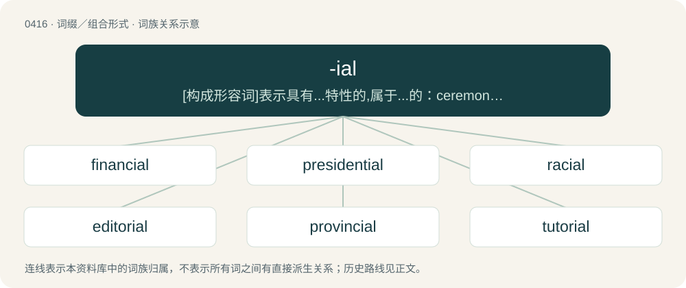

# 0477 · -ial — \[构成形容词\]表示具有...特性的,属于...的：ceremonial, jovial, judicial, artificial

[总目录](../00_总目录_按常用程度.md)

**类型**：词缀／组合形式　｜　**来源语言**：见词源记录

## 核心含义与来源

- 核心含义：\[构成形容词\]表示具有...特性的,属于...的：ceremonial, jovial, judicial, artificial
- 英文含义：Forms a noun from a verb ending in -y.
- 词形：-ial

**来源记录 1**（后缀／后置成分；Forms a noun from a verb ending in -y.）

Inherited from Middle English -ial, derived from Old French -ial, derived from Latin -ālis after radical in -ius, -ia, -ium. Equivalent to -i- + -al.

## 词族图

## 单词速览（常用到不常用）

| 单词 | 音标 | 释义 |
|---|---|---|
| [financial](#w-1) | 英 /faɪˈnæn.ʃəl/；美 /faɪˈnæn.ʃəl/ | a. 财政的, 金融的；\[经\] 财政的, 金融的, 财务的 |
| [presidential](#w-2) | /pɹɛzɪˈdɛnʃ(ə)l/ | a. 总统制的, 总统的, 首长的, 统辖的；\[法\] 总统的, 议长的, 总经理的 |
| [racial](#w-3) | /ˈɹeɪʃəl/ | a. 人种的, 种族的；\[医\] 种族的 |
| [editorial](#w-4) | 英 /ˌɛdɪˈtɔːɹɪəl/；美 /ˌɛdɪˈtɔɹiəl/ | n. 社论, 评论；a. 编辑的, 主笔的, 社论的 |
| [provincial](#w-5) | 英 /pɹəˈvɪn(t)ʃəl/ | n. 外地人, 粗野的人；a. 省的, 外地的, 偏狭的 |
| [tutorial](#w-6) | /ˌtjuːˈtɔːɹɪəl/ | n. 个别指导, 论文, 学习指南, 指导手册；a. 个别指导的, 家庭教师的, 辅导的；\[计\] 教程 |
| [managerial](#w-7) | 英 /ˌmænɪˈd͡ʒɪəɹi.əl/；美 /ˌmænəˈd͡ʒɪɹi.əl/ | a. 管理的；\[经\] 管理上的, 经营上的 |
| [ministerial](#w-8) | /ˌmɪnəˈstɪɹi.əl/ | a. 部长的, 内阁的, 执政的；\[法\] 部长的, 部的, 公使的 |
| [entrepreneurial](#w-9) | 英 /ˌɒn.tɹə.pɹəˈnɜː.ɹi.əl/；美 /ˌɑn.tɹə.pɹəˈnɝ.i.əl/ | a. 创业的, 具有企业精神的; 企业性质的 |
| [exponential](#w-10) | 英 /ˌɛk.spəˈnɛn.t͡ʃəl/；美 /ˌɛk.spəˈnɛn.t͡ʃəl/ | a. 指数的；n. 指数；\[计\] 指数 |
| [microbial](#w-11) | 英 /maɪˈkɹəʊ.bi.əl/；美 /maɪˈkɹoʊ.bi.əl/ | a. 微生物的, 由细菌引起的；\[医\] 微生物的 |
| [gubernatorial](#w-12) | 英 /ˌɡ(j)uː.bə.nəˈtɔː.ɹi.əl/；美 /ˌɡ(j)ubə(r)nəˈtɔriəl/ | a. 州长的, 统治者的 |
| [circumstantial](#w-13) | 英 /səːkəmˈstanʃəl/；美 /səɹ.kəmˈstænʃəl/ | a. 依照情况的 |
| [proverbial](#w-14) | 英 /pɹəˈvɜɹb.iː.əl/ | a. 谚语的, 谚语式的, 闻名的 |
| [consequential](#w-15) | 英 /ˌkɒnsɪˈkwɛnʃəl/；美 /ˌkɑnsɪˈkwɛnʃəl/ | a. 作为结果的, 随之发生的, 推论的, 间接的, 重大的, 自大的, 傲慢的, 自傲的；\[法\] 结果的, 相应而生的, 接着发生的 |
| [dictatorial](#w-16) | /diktəˈtɒːriəl/ | a. 独裁者的, 独裁的, 独断的 |
| [torrential](#w-17) | 英 /təˈɹɛn.tʃəl/；美 /tɔˈɹɛn.t͡ʃəl/ | a. 奔流的, 急流的, 猛烈的 |
| [jovial](#w-18) | 英 /ˈd͡ʒəʊ.vɪ.əl/；美 /ˈd͡ʒoʊ.vɪ.əl/ | a. 快活的, 高兴的, 愉快的；\[计\] 国际算法语言的朱尔斯文本 |
| [tangential](#w-19) | 英 /tænˈd͡ʒɛn.t͡ʃəl/；美 /tænˈd͡ʒɛn.t͡ʃəl/ | a. 切线的, 相切的, 正切的, 离题的, 扯远的；\[医\] 正切的, 切线的 |
| [referential](#w-20) | /ɹɛfəˈɹɛnʃəl/ | a. 与...有关的, 有所指的；\[法\] 参考的, 参照的, 指示的 |
| [prosecutorial](#w-21) | /prɒsɪkjuːˈtɔːrɪəl/ | a. 公诉人的, 原告的； 起诉的 |
| [curatorial](#w-22) | 英 /ˌkjʊəɹəˈtɔːɹi.əl/；美 /ˌkjʊɹəˈtɔɹi.əl/ | a. 管理者的 |
| [factorial](#w-23) | /fækˈtɔːɹi.əl/ | a. 因子的, 阶乘的, 代理商的；n. 阶乘；\[计\] 阶乘 |
| [janitorial](#w-24) | 英 /dʒæn.ɪˈtɔːɹ.i.əl/ | a. 管理的(janitor的变形) |
| [sartorial](#w-25) | 英 /sɑːˈtɔː.ɹi.əl/；美 /sɑɹˈtɔɹ.i.əl/ | a. 裁缝匠的, 缝工的, 裁缝的 |
| [interfacial](#w-26) | /.intəˈfeiʃəl/ | a. 界面的；\[医\] 界面的 |
| [authorial](#w-27) | /ɒːˈθɒːriəl/ | a. 著作者的 |
| [ambassadorial](#w-28) | 美 /æm.bæs.əˈdɔɹ.iəl/ | a. 大使的, 大使一级的；\[法\] 大使的, 使节的 |
| [armorial](#w-29) | /ɑːˈməuriəl/ | 【英文】In, or pertaining to, armor. |
| [inferential](#w-30) | /.infəˈrenʃəl/ | a. 推理的, 可以推论的, 推理上的；\[电\] 推论上的 |
| [inquisitorial](#w-31) | 英 /ɪnˌkwɪzɪˈtɔːɹiəl/；美 /ɪnˌkwɪzəˈtɔɹiəl/ | a. 询问者的, 严格审问的, 好询问的；\[法\] 审问官的, 调查官的, 有关审问的 |

## 逐词详解

### 1. financial

**词性**：形容词　｜　**音标**：英 /faɪˈnæn.ʃəl/；美 /faɪˈnæn.ʃəl/

**中文释义**：a. 财政的, 金融的；\[经\] 财政的, 金融的, 财务的

**英文义项**：Related to finances. / Having dues and fees paid up to date for a club or society.

**构词拆分**：finance + -ial

**词源与演化**：

From finance + -ial.

**例句**：

> For financial reasons, we're not going to be able to continue to fund this program.

该用例对应义项：Related to finances.

### 2. presidential

**词性**：形容词　｜　**音标**：/pɹɛzɪˈdɛnʃ(ə)l/

**中文释义**：a. 总统制的, 总统的, 首长的, 统辖的；\[法\] 总统的, 议长的, 总经理的

**英文义项**：Pertaining to a president or presidency. / With the bearing or composure that befits a president; stately, dignified.

**构词拆分**：president + -ial

**词源与演化**：

From president + -ial.

**例句**：

> Criticized the candidate for not looking presidential.

该用例对应义项：befitting a president

### 3. racial

**词性**：形容词　｜　**音标**：/ˈɹeɪʃəl/

**中文释义**：a. 人种的, 种族的；\[医\] 种族的

**英文义项**：Of or relating to a race (or a people).

**构词拆分**：race + -ial

**词源与演化**：

From race + -ial.

**用法示例／搭配（非完整句）**：

> the racial complexion

该用例对应义项：Of or relating to a race (or a people).

### 4. editorial

**词性**：形容词　｜　**音标**：英 /ˌɛdɪˈtɔːɹɪəl/；美 /ˌɛdɪˈtɔɹiəl/

**中文释义**：n. 社论, 评论；a. 编辑的, 主笔的, 社论的

**英文义项**：Of or relating to an editor, editing or an editorial. / Appropriate for high fashion magazines.

**构词拆分**：editor + -ial

**词源与演化**：

From editor + -ial.

**用法示例／搭配（非完整句）**：

> editorial labours; editorial remarks

该用例对应义项：Of or relating to an editor, editing or an editorial.

### 5. provincial

**词性**：形容词　｜　**音标**：英 /pɹəˈvɪn(t)ʃəl/

**中文释义**：n. 外地人, 粗野的人；a. 省的, 外地的, 偏狭的

**英文义项**：Of or pertaining to a province. / Constituting a province.

**构词拆分**：province + -ial

**词源与演化**：

From Middle English provincial, from Old French provincial, from Latin prōvinciālis (“of a province”), equivalent to province + -ial.

**用法示例／搭配（非完整句）**：

> a provincial government

该用例对应义项：Of or pertaining to a province.

### 6. tutorial

**词性**：形容词　｜　**音标**：/ˌtjuːˈtɔːɹɪəl/

**中文释义**：n. 个别指导, 论文, 学习指南, 指导手册；a. 个别指导的, 家庭教师的, 辅导的；\[计\] 教程

**英文义项**：Of or pertaining to a tutor; belonging to, or exercised by, a tutor.

**构词拆分**：tutor (noun) + -ial

**词源与演化**：

The adjective is from tutor (noun) + -ial, ultimately from Latin tūtor (“watcher, protector, defender”). The noun is transferred from the adjective.

**例句**：

> It's a tutorial on how to sew a dress shirt with cuffs.

### 7. managerial

**词性**：形容词　｜　**音标**：英 /ˌmænɪˈd͡ʒɪəɹi.əl/；美 /ˌmænəˈd͡ʒɪɹi.əl/

**中文释义**：a. 管理的；\[经\] 管理上的, 经营上的

**英文义项**：Of or relating to a manager or management; involving management-like duties.

**构词拆分**：manager + -ial

**词源与演化**：

From manager + -ial.

**例句**：

> Problem-solving and decision-making skills are essential in a managerial position.

### 8. ministerial

**词性**：形容词　｜　**音标**：/ˌmɪnəˈstɪɹi.əl/

**中文释义**：a. 部长的, 内阁的, 执政的；\[法\] 部长的, 部的, 公使的

**英文义项**：Related to a religious minister or ministry. / Related to a governmental minister or ministry.

**构词拆分**：minister + -ial

**词源与演化**：

Borrowed from Middle French ministeriel, equivalent to minister + -ial. Doublet of minstrel and ministerialis.

**例句**：

> Filling out the form under the direction of a lawyer is a ministerial task performed by a legal secretary.

该用例对应义项：Serving as an instrument or means (i.e., procedural or ancillary, not substantive).

### 9. entrepreneurial

**词性**：形容词　｜　**音标**：英 /ˌɒn.tɹə.pɹəˈnɜː.ɹi.əl/；美 /ˌɑn.tɹə.pɹəˈnɝ.i.əl/

**中文释义**：a. 创业的, 具有企业精神的; 企业性质的

**英文义项**：Having the spirit, attitude or qualities of an entrepreneur; enterprising.

**构词拆分**：entrepreneur + -ial

**词源与演化**：

From entrepreneur + -ial.

**例句**：

> Dependability is part of our entrepreneurial culture.

### 10. exponential

**词性**：形容词　｜　**音标**：英 /ˌɛk.spəˈnɛn.t͡ʃəl/；美 /ˌɛk.spəˈnɛn.t͡ʃəl/

**中文释义**：a. 指数的；n. 指数；\[计\] 指数

**英文义项**：Expressed in terms of an exponent (power of a base), the base often being 10 or e. / Characterised by a rate of change that is proportional to the value of the varying quantity, or, equivalently, by a doubling or halving over successive fixed intervals of time or other parameter, described as exponential growth or exponential decay.

**构词拆分**：exponent + -ial

**词源与演化**：

From exponent + -ial.

**例句**：

> If not otherwise specified, "the" exponential function is normally understood to mean eˣ.

该用例对应义项：Expressed in terms of an exponent (power of a base), the base often being 10 or e.

### 11. microbial

**词性**：形容词　｜　**音标**：英 /maɪˈkɹəʊ.bi.əl/；美 /maɪˈkɹoʊ.bi.əl/

**中文释义**：a. 微生物的, 由细菌引起的；\[医\] 微生物的

**英文义项**：Of, relating to, or caused by microbes or microorganisms. / Small; tiny; minuscule.

**构词拆分**：microbe + -ial

**词源与演化**：

From microbe + -ial.

**例句**：

> The Mars 2020 Perseverance rover's astrobiology mission will search for signs of ancient microbial life.

### 12. gubernatorial

**词性**：形容词　｜　**音标**：英 /ˌɡ(j)uː.bə.nəˈtɔː.ɹi.əl/；美 /ˌɡ(j)ubə(r)nəˈtɔriəl/

**中文释义**：a. 州长的, 统治者的

**英文义项**：Of or pertaining to a governor or the office of governor.

**词源与演化**：

From Latin gubernātor (“governor”), from gubernō (“govern”), + -ial.

### 13. circumstantial

**词性**：形容词　｜　**音标**：英 /səːkəmˈstanʃəl/；美 /səɹ.kəmˈstænʃəl/

**中文释义**：a. 依照情况的

**英文义项**：Pertaining to or dependent on circumstances, especially as opposed to essentials; incidental, not essential. / Involving evidence that relies on inference to connect it to a conclusion of fact, thus, suggesting guilt but not directly proving it.

**构词拆分**：-al + circumstance + -ial；circumstance + -ial

**词源与演化**：

From Latin circumstantia + English -al, equivalent to circumstance + -ial.

**例句**：

> It is unlikely he will be convicted; the evidence against him is circumstantial at best.

该用例对应义项：Involving evidence that relies on inference to connect it to a conclusion of fact, thus, suggesting guilt but not directly proving it.

### 14. proverbial

**词性**：形容词　｜　**音标**：英 /pɹəˈvɜɹb.iː.əl/

**中文释义**：a. 谚语的, 谚语式的, 闻名的

**英文义项**：Of, resembling, or expressed as a proverb, cliché, fable, or fairy tale. / Optionally placed before an element of a well-known proverb or metaphor to emphasize that the element is not being used in a literal sense (see Usage notes below)

**构词拆分**：proverb + -ial

**词源与演化**：

From Latin prōverbiālis, equivalent to proverb + -ial

**例句**：

> The beaver in this instance upheld the reputation of the proverbial one: her output was prodigious.

该用例对应义项：Of, resembling, or expressed as a proverb, cliché, fable, or fairy tale.

### 15. consequential

**词性**：形容词　｜　**音标**：英 /ˌkɒnsɪˈkwɛnʃəl/；美 /ˌkɑnsɪˈkwɛnʃəl/

**中文释义**：a. 作为结果的, 随之发生的, 推论的, 间接的, 重大的, 自大的, 傲慢的, 自傲的；\[法\] 结果的, 相应而生的, 接着发生的

**英文义项**：Following as a result. / Having significant consequences; of importance.

**构词拆分**：consequent + -ial

**词源与演化**：

From consequent + -ial.

**例句**：

> The year's only really consequential legislation.

该用例对应义项：having important issues or results

### 16. dictatorial

**词性**：形容词　｜　**音标**：/diktəˈtɒːriəl/

**中文释义**：a. 独裁者的, 独裁的, 独断的

**英文义项**：of or pertaining to a dictator / in the manner of a dictator, usually with callous disregard for others.

**构词拆分**：dictator + -ial

**词源与演化**：

From dictator + -ial.

**例句**：

> The Algerian dictatorial regime is opposed to democracy and human rights.

### 17. torrential

**词性**：形容词　｜　**音标**：英 /təˈɹɛn.tʃəl/；美 /tɔˈɹɛn.t͡ʃəl/

**中文释义**：a. 奔流的, 急流的, 猛烈的

**英文义项**：Coming or characterized by torrents; flowing heavily or in large quantities.

**构词拆分**：torrent + -ial

**词源与演化**：

From torrent + -ial.

**例句**：

> There was a torrential downpour and we were all soaked.

该用例对应义项：Coming or characterized by torrents; flowing heavily or in large quantities.

### 18. jovial

**词性**：形容词　｜　**音标**：英 /ˈd͡ʒəʊ.vɪ.əl/；美 /ˈd͡ʒoʊ.vɪ.əl/

**中文释义**：a. 快活的, 高兴的, 愉快的；\[计\] 国际算法语言的朱尔斯文本

**英文义项**：Cheerful and good-humoured; jolly, merry.

**构词拆分**：Jove + -ial

**词源与演化**：

First attested in 1590; borrowed from Middle French jovial (“under the influence of Jupiter; of Jove; jovial, jolly”), from Italian gioviale (“(now obsolete) born under the influence of the planet Jupiter”) (attested in Dante, Paradiso, canto XVIII, early 14th century), from Late Latin Ioviālis (“relating to the Roman god Jupiter”), from Iuppiter, Iovis (“the Roman god Jove or Jupiter, counterpart of the Greek god Zeus”) (from Proto-Indo-European \*dyew- (“to be bright; heaven, sky”)) + -ālis (suffix forming adjectives of relationship); analysable as Jove + -ial. Sense 1 (“cheerful and good-humoured”) refers to the fact that individuals born under the astrological influence of the planet Jupiter were believed to have that disposition.

**例句**：

> But these jovial sounds fell sadly on the ear of the ruined nobleman.

### 19. tangential

**词性**：形容词　｜　**音标**：英 /tænˈd͡ʒɛn.t͡ʃəl/；美 /tænˈd͡ʒɛn.t͡ʃəl/

**中文释义**：a. 切线的, 相切的, 正切的, 离题的, 扯远的；\[医\] 正切的, 切线的

**英文义项**：Referring to a tangent, moving at a tangent to something. / Merely touching, positioned as a tangent.

**构词拆分**：tangent + -ial

**词源与演化**：

From tangent + -ial.

**例句**：

> That subject is tangential to our discussion, and we cannot let it distract us.

该用例对应义项：Only indirectly related.

### 20. referential

**词性**：形容词　｜　**音标**：/ɹɛfəˈɹɛnʃəl/

**中文释义**：a. 与...有关的, 有所指的；\[法\] 参考的, 参照的, 指示的

**英文义项**：Of a word or phrase applied to a particular person, place, or thing and not to any other. / Of or relating to a referent.

**构词拆分**：reference + -ial

**词源与演化**：

From reference + -ial.

**例句**：

> The standard pitch A is used as referential pitch for tuning most of all instruments and is set to 440 Hertz.

### 21. prosecutorial

**词性**：形容词　｜　**音标**：/prɒsɪkjuːˈtɔːrɪəl/

**中文释义**：a. 公诉人的, 原告的； 起诉的

**英文义项**：Relating to prosecuting of criminal cases.

**构词拆分**：prosecutor + -ial

**词源与演化**：

From prosecutor + -ial.

**例句**：

> Prosecutorial misconduct can lead to the lawyer's disbarment.

该用例对应义项：Relating to prosecuting of criminal cases.

### 22. curatorial

**词性**：形容词　｜　**音标**：英 /ˌkjʊəɹəˈtɔːɹi.əl/；美 /ˌkjʊɹəˈtɔɹi.əl/

**中文释义**：a. 管理者的

**英文义项**：Of or relating to a curator.

**构词拆分**：curator + -ial

**词源与演化**：

From curator + -ial.

**例句**：

> Established in 1932, the architecture and design collection is the world's first curatorial department devoted to this category.

### 23. factorial

**词性**：名词　｜　**音标**：/fækˈtɔːɹi.əl/

**中文释义**：a. 因子的, 阶乘的, 代理商的；n. 阶乘；\[计\] 阶乘

**英文义项**：The result of multiplying a given number of consecutive integers from 1 to the given number. In equations, it is symbolized by an exclamation mark (!). For example, 5! = 1 × 2 × 3 × 4 × 5 = 120.

**构词拆分**：factor + -ial

**词源与演化**：

From factor + -ial.

**例句**：

> No factorial of an integer greater than one is a perfect power.

### 24. janitorial

**词性**：形容词　｜　**音标**：英 /dʒæn.ɪˈtɔːɹ.i.əl/

**中文释义**：a. 管理的(janitor的变形)

**英文义项**：Of or pertaining to a janitor.

**构词拆分**：janitor + -ial

**词源与演化**：

From janitor + -ial.

**例句**：

> As a janitorial worker, Carlos keeps the office clean and tidy.

### 25. sartorial

**词性**：形容词　｜　**音标**：英 /sɑːˈtɔː.ɹi.əl/；美 /sɑɹˈtɔɹ.i.əl/

**中文释义**：a. 裁缝匠的, 缝工的, 裁缝的

**英文义项**：Of or relating to the tailoring of clothing. / Of or relating to the quality of dress.

**词源与演化**：

From New Latin sartorius (“pertaining to a tailor”), from Late Latin sartor (“tailor”), from Latin sarcire (“to patch, mend”) + -ial.

**例句**：

> In his smart suit, Jacob was by far the most sartorial of our party.

该用例对应义项：Of or relating to the quality of dress.

### 26. interfacial

**词性**：形容词　｜　**音标**：/.intəˈfeiʃəl/

**中文释义**：a. 界面的；\[医\] 界面的

**英文义项**：Of or pertaining to an interface.

**构词拆分**：interface + -ial

**词源与演化**：

From interface + -ial.

**例句**：

> Interfacial tension is the surface tension at the interface between two liquids.

该用例对应义项：relating to or situated at an interface

### 27. authorial

**词性**：形容词　｜　**音标**：/ɒːˈθɒːriəl/

**中文释义**：a. 著作者的

**英文义项**：Of, coming from, or typical of an author (especially of books)

**构词拆分**：author + -ial

**词源与演化**：

From author + -ial.

### 28. ambassadorial

**词性**：形容词　｜　**音标**：美 /æm.bæs.əˈdɔɹ.iəl/

**中文释义**：a. 大使的, 大使一级的；\[法\] 大使的, 使节的

**英文义项**：Of or pertaining to an ambassador.

**构词拆分**：ambassador + -ial

**词源与演化**：

From ambassador + -ial.

### 29. armorial

**词性**：形容词　｜　**音标**：/ɑːˈməuriəl/

**英文义项**：In, or pertaining to, armor.

**构词拆分**：armor + -ial

**词源与演化**：

From armor + -ial.

### 30. inferential

**词性**：形容词　｜　**音标**：/.infəˈrenʃəl/

**中文释义**：a. 推理的, 可以推论的, 推理上的；\[电\] 推论上的

**英文义项**：Of, pertaining to, or derived using inference.

**构词拆分**：inference + -ial

**词源与演化**：

From inference + -ial.

### 31. inquisitorial

**词性**：形容词　｜　**音标**：英 /ɪnˌkwɪzɪˈtɔːɹiəl/；美 /ɪnˌkwɪzəˈtɔɹiəl/

**中文释义**：a. 询问者的, 严格审问的, 好询问的；\[法\] 审问官的, 调查官的, 有关审问的

**英文义项**：Of or pertaining to an inquisition, specifically the Inquisition. / In a manner of inquisition or inquisitors.

**构词拆分**：inquisitory + -ial

**词源与演化**：

From inquisitory + -ial.
