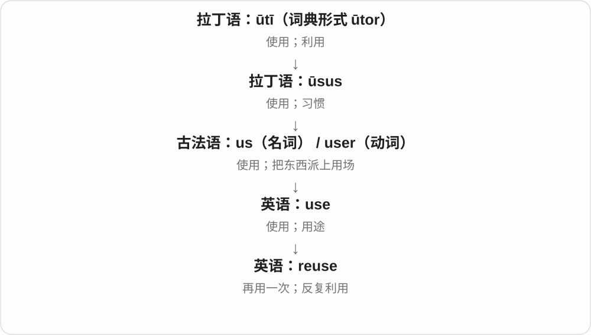

# 0485 · re-, red- — 再一次；回到原处或原状态

[逐词精讲目录](../00_逐词精讲目录.md) · [总目录](../00_总目录_按常用程度.md)

## 核心词根与来源

先把两种常见画面分开：redo、rewrite 是再做，restore、return 是恢复或回去。re- 可以接英语本族词，所以 rewrite 并不是整词来自拉丁。另一方面，老借词中的意思常已变化，不能把每个 re 开头的词都机械译成再一次。

**把一个动作再做一遍，或把偏离、损坏的东西带回原先的状态。**

拉丁 re-／red- → 古法语及英语 re-；英语自由组合 redo、rewrite、rethink、rebuild；借词路线 redigere → redact、restaurare → restore。

- **再做、再写、再使用**：redo, rewrite, reuse, reusable, reapply
- **重新考虑与重新排列**：rethink, reconsider, reconsideration, rearrange, rearrangement
- **重建、续期与更新**：rebuild, renew, renewal
- **回到原处、原状态**：restore, restoration, return, recede
- **归整文本与删隐内容**：redact, redaction, redacted

## 词形与演化规律

古拉丁 red- 常见于元音前的形式，保存在 redact 等词里。现代透明组合中的 re- 常读 /riː/，如 redo；旧借词常有弱读 /rɪ/，如 restore。rewrite、rethink 的名词与动词重音还不同。

## 单词速览（常用到不常用）

| 单词 | 音标 | 核心意思 |
|---|---|---|
| [return](#w-1) | 英 /rɪˈtɜːn/；美 /rɪˈtɜːrn/ | 返回；归还；回报；申报表 |
| [restore](#w-2) | 英 /rɪˈstɔː/；美 /rɪˈstɔːr/ | 恢复；修复；还原；归还 |
| [restoration](#w-3) | /ˌrestəˈreɪʃən/ | 修复；恢复；复辟 |
| [rebuild](#w-4) | /ˌriːˈbɪld/ | 重建；重新建立；重组 |
| [renewal](#w-5) | 英 /rɪˈnjuːəl/；美 /rɪˈnuːəl/ | 续期；续订；更新；重新焕发活力 |
| [renew](#w-6) | 英 /rɪˈnjuː/；美 /rɪˈnuː/ | 续期；续订；重新开始；使恢复活力 |
| [reconsider](#w-7) | 英 /ˌriːkənˈsɪdə/；美 /ˌriːkənˈsɪdər/ | 重新考虑；再斟酌是否改变决定 |
| [rethink](#w-8) | 动词 /ˌriːˈθɪŋk/；名词 /ˈriːθɪŋk/ | 重新思考；重新考虑方案；一次重新审视 |
| [rewrite](#w-9) | 动词 /ˌriːˈraɪt/；名词 /ˈriːraɪt/ | 重写；改写；重写后的稿件或版本 |
| [reuse](#w-10) | 名词 /ˌriːˈjuːs/；动词 /ˌriːˈjuːz/ | 再次使用；重复利用 |
| [reusable](#w-11) | /ˌriːˈjuːzəbəl/ | 可重复使用的；可复用的 |
| [redo](#w-12) | /ˌriːˈduː/ | 重做；重新装修或布置；恢复刚撤销的操作 |
| [redacted](#w-13) | /rɪˈdæktɪd/ | 经过删隐的；敏感部分已遮去的 |
| [rearrange](#w-14) | /ˌriːəˈreɪndʒ/ | 重新摆放；重新安排；调整顺序或时间 |
| [rearrangement](#w-15) | /ˌriːəˈreɪndʒmənt/ | 重新安排；重新排列；调整后的布局 |
| [recede](#w-16) | /rɪˈsiːd/ | 退去；后退；逐渐减弱 |
| [reapply](#w-17) | 英、美 /ˌriːəˈplaɪ/ | 重新申请；再涂、再次施用 |
| [reconsideration](#w-18) | /ˌriːkənˌsɪdəˈreɪʃən/ | 重新考虑；复议；再次审视 |
| [redaction](#w-19) | /rɪˈdækʃən/ | 删隐处理；被隐去的部分；编订 |
| [redact](#w-20) | /rɪˈdækt/ | 删去或遮去敏感内容；编纂、编辑〔较旧或专门用法〕 |

## 逐词讲解

### 1. return — 返回；归还；回报；申报表

**音标**：英 /rɪˈtɜːn/；美 /rɪˈtɜːrn/

**先抓住这个画面**

沿着关系往回走：人回原处，书回主人手里，投入之后收益回到出资者手中。

**怎么拆**

动词经古法语 retorner / retourner，并受中世纪拉丁语 retornare 影响；名词经法语 retorn 等及中世纪拉丁语 returnum 借入。现代 re- + turn 容易看懂，但名词不是单一路线的后来产物。

**怎么变成今天的意思**

**希腊语 tornos → 拉丁语 tornus / tornare**  
画圆、车削的工具 → 在车床上旋转加工

↓

**古法语 retorner / retourner；中世纪拉丁语 retornare**  
转回、返回

↓

**并行名动词：法语 retorn 等 → 英语 return**  
返回、归还；正式报送的信息及回报

return home 不用 to，return to school 要用 to；return a book 是还书。tax return 是向税务机关提交的申报资料，不是“退税”，退税通常是 tax refund。

**常见搭配与例句**

return to；return something to someone；in return；a tax return。

> Please return the book to the library by Friday.

请在周五之前把书还给图书馆。

> They returned home after midnight.

他们午夜过后才回到家。

> She filed her tax return online.

她在网上提交了纳税申报表。

**别混淆**

go back 强调回去；return 可回去也可回来，且较正式。return 的投资回报可能是负数，不保证赚钱。

### 2. restore — 恢复；修复；还原；归还

**音标**：英 /rɪˈstɔː/；美 /rɪˈstɔːr/

**先抓住这个画面**

把已经损坏、消失或偏离原样的东西，拉回原先应有的状态。

**怎么拆**

经古法语 restorer 接拉丁 restaurare 修复、重建，历史上有 re- 与 -staurare。现代不能把它理解成把物品再存进 store 商店或仓库。

**怎么变成今天的意思**

**拉丁 re- 回、再；-staurare 建立一系**  
后者不作为独立拉丁动词使用，不能照现代 store 仓储拆

↓

**拉丁 restaurare → 古法语 restorer → 中古英语 restoren → restore**  
重建、修复、归还，发展出恢复原状态的用途

restore an old painting 是修复旧画；restore confidence 是恢复信心；restore files from a backup 是从备份还原文件。核心是恢复，不保证每次都能完全复原。

**常见搭配与例句**

restore order；restore confidence；restore something to its original condition；restore from a backup。

> The team restored the painting to its former brightness.

团队修复了这幅画，使它恢复以往的鲜亮。

> I restored the missing files from yesterday’s backup.

我从昨天的备份中还原了丢失的文件。

**别混淆**

renovate 常指翻新并改善，restore 更强调找回旧有状态；数据领域的 recover 与 restore 有重叠，具体产品可能另有术语约定。

### 3. restoration — 修复；恢复；复辟

**音标**：/ˌrestəˈreɪʃən/

**先抓住这个画面**

把恢复原状的工作当成一个过程来谈，从修古画到恢复供电都可以用。

**怎么拆**

接古法语 restoration、晚期拉丁 restauratio 一系，英语拼形也受 restore 影响。虽能与 restore 对照，但名词有独立借入路线，不只由英语动词加 -ation。

**怎么变成今天的意思**

**拉丁 restaurare 修复 → 晚期拉丁 restauratio**  
同族的动作名词

↓

**古法语及拉丁名词支线 → 英语 restoration**  
恢复、修复；英语词形也受 restore 影响

the restoration of power 是恢复供电，building restoration 是建筑修复。英国历史里的 the Restoration 特指君主制复辟时期，是这个普通名词的一项专门用法。

**常见搭配与例句**

the restoration of services；restoration work；undergo restoration。

> Restoration of the damaged ceiling took six months.

修复受损天花板花了六个月。

> Residents welcomed the restoration of the water supply.

居民欢迎供水恢复。

**别混淆**

restoration 强调恢复，conservation 常强调保存、减缓损坏；艺术和建筑项目可能同时包含二者。

### 4. rebuild — 重建；重新建立；重组

**音标**：/ˌriːˈbɪld/

**先抓住这个画面**

房子坏了再建起来，信任受损也得一点点重新搭起来。

**怎么拆**

英语 re- 再次 + build 建造。过去式、分词 rebuilt，读 /ˌriːˈbɪlt/；不是规则加 -ed。

**怎么变成今天的意思**

**re- 再次；英语 build 建造**  
外来前缀与英语本族动词组合

↓

**英语 rebuild**  
重建实体，也比喻恢复组织、生活和信任

rebuild a bridge 是重建桥梁；rebuild trust 是重新建立信任。它常暗示原来的结构已受损、散掉或不足，需要重新组织起来。

**常见搭配与例句**

rebuild a house；rebuild trust；rebuild someone’s life。

> The community helped rebuild the bridge after the flood.

洪水过后，社区帮助重建了桥梁。

> It took months to rebuild trust within the team.

团队内部花了好几个月才重建信任。

**别混淆**

repair 偏修好坏掉的部分；rebuild 往往动得更大，也可能保留部分旧材料，并不一定全部拆光。

### 5. renewal — 续期；续订；更新；重新焕发活力

**音标**：英 /rɪˈnjuːəl/；美 /rɪˈnuːəl/

**先抓住这个画面**

从快到期、陈旧或低落，走到还能继续、重新有劲的那个过程。

**怎么拆**

英语 renew + 名词后缀 -al。这里 -al 造名词，不能一见这个后缀就断定是形容词。

**怎么变成今天的意思**

**拉丁来源 re-；中古英语 newen 使更新**  
外来前缀与日耳曼本族动词组合

↓

**中古英语 renewen → 英语 renew**  
使恢复新鲜、继续有效；可能受拉丁 renovare 类推影响

↓

**英语 renew + -al → renewal**  
使重新有效或恢复活力的过程

subscription renewal 是续订，a renewal notice 是续费提醒；urban renewal 是城市更新。更新可能涉及整修和改建，不单是把期限往后移。

**常见搭配与例句**

membership renewal；a renewal fee；urban renewal；a sense of renewal。

> The membership renewal notice arrived by email.

会员续期通知通过电子邮件发来了。

> The town’s renewal plan includes repairing old public buildings.

小镇的更新计划包括修缮旧公共建筑。

**别混淆**

renewal 是更新过程，renewable 是能够更新或再生的形容词；两者在句子里的位置不同。

### 6. renew — 续期；续订；重新开始；使恢复活力

**音标**：英 /rɪˈnjuː/；美 /rɪˈnuː/

**先抓住这个画面**

旧的快到期，就让它继续有效；原本弱下来的劲头，也可以重新起来。

**怎么拆**

中古英语 re- + newen 使更新，接本族 new 词族，并可能类推拉丁 renovare。是外来前缀和英语本族材料的组合，不是拉丁整词直接变短。

**怎么变成今天的意思**

**拉丁来源 re-；中古英语 newen 使更新**  
外来前缀与日耳曼本族动词组合

↓

**中古英语 renewen → 英语 renew**  
使恢复新鲜、继续有效；可能受拉丁 renovare 类推影响

renew a passport 是换发或延续护照的有效使用资格；renew a subscription 是续订。renew interest 是让兴趣重新起来，不一定换一个全新的对象。

**常见搭配与例句**

renew a subscription；renew a lease；renew efforts；renew interest in something。

> I renewed my library membership online.

我在网上续办了图书馆会员资格。

> The discovery renewed her interest in the project.

这项发现重新激起了她对项目的兴趣。

**别混淆**

replace 是用另一件替换；renew 常保留同一关系、服务或目标，使它继续或恢复。

### 7. reconsider — 重新考虑；再斟酌是否改变决定

**音标**：英 /ˌriːkənˈsɪdə/；美 /ˌriːkənˈsɪdər/

**先抓住这个画面**

原先点了头或摇了头，现在愿意把理由再看一遍。

**怎么拆**

来源包括法语 reconsidérer，也可能部分由英语 re- + consider 自行构成。现代这两部分透明可认，但不能把借词路线全部省掉。

**怎么变成今天的意思**

**re- 再次；consider 考虑**  
重新审视已有想法或决定

↓

**法语 reconsidérer 与英语 re- + consider → reconsider**  
既有法语借入解释，也有英语自行组合的路线

reconsider a decision 是重新考虑一个决定；Please reconsider 是请对方再想想。它表达重审的意愿或过程，不表示已经答应改变结果。

**常见搭配与例句**

reconsider a proposal；reconsider doing something；ask someone to reconsider。

> The new evidence made the committee reconsider its decision.

新证据使委员会重新考虑了原来的决定。

> She asked him to reconsider leaving the team.

她请他重新考虑离开团队这件事。

**别混淆**

change your mind 是已经改变主意；reconsider 只说明重新思量，最终也可能坚持原决定。

### 8. rethink — 重新思考；重新考虑方案；一次重新审视

**音标**：动词 /ˌriːˈθɪŋk/；名词 /ˈriːθɪŋk/

**先抓住这个画面**

先把原来的方案放回桌上，看看是不是从思路开始就需要调整。

**怎么拆**

英语 re- 再次 + think 思考；先有动词，后来也作名词。过去式和分词都是 rethought，继承 think 的变化。

**怎么变成今天的意思**

**re- 再次；英语 think 思考**  
在英语里组合成重新想一遍

↓

**英语 rethink 动词；另有同形名词**  
重新审视某事；一次方案重想

rethink the strategy 常暗示要重新检查基本做法；a rethink of the plan 是对计划的重新考虑。它不保证最终一定换掉方案。

**常见搭配与例句**

rethink an approach；rethink our priorities；a major rethink。

> The delays forced us to rethink the schedule.

这些延误迫使我们重新考虑日程安排。

> The survey led to a rethink of the service.

这项调查促使人们重新审视这项服务的做法。

**别混淆**

reconsider 常针对一个决定要不要改，rethink 更容易涉及整套方法；二者也有重叠。

### 9. rewrite — 重写；改写；重写后的稿件或版本

**音标**：动词 /ˌriːˈraɪt/；名词 /ˈriːraɪt/

**先抓住这个画面**

保留想表达的内容，却换一套写法，让文章、代码或规则变成新版本。

**怎么拆**

re- 回、再次 + write。英语早期也有书面答复义，后来常指重新写；名词用法较晚。不是从拉丁语借来一个现成的整词。

**怎么变成今天的意思**

**re- 回、再次；英语 write 写**  
两组材料在英语中组合

↓

**英语动词 rewrite → 较晚的名词 rewrite**  
从写回、再写到改写；一次重写或新稿

rewrite a paragraph 是改写一段，a complete rewrite 是彻底重写。过去式 rewrote、分词 rewritten；动词重音靠后，名词通常在前。

**常见搭配与例句**

rewrite the introduction；rewrite the rules；a major rewrite。

> Please rewrite the opening paragraph in simpler language.

请用更简单的语言改写开头一段。

> The editor asked for a complete rewrite.

编辑要求彻底重写一遍。

**别混淆**

proofread 主要查校错误；rewrite 往往更大幅改变表达或结构。rewrite history 还可指重新解释历史，有时带歪曲之意。

### 10. reuse — 再次使用；重复利用

**音标**：名词 /ˌriːˈjuːs/；动词 /ˌriːˈjuːz/

**先抓住这个画面**

reuse 是把已经用过的东西再拿来用：玻璃瓶洗净后装米，不用先把它变成另一种原材料。

**怎么拆**

re-（再）+ use。名词保留 /s/，动词保留 /z/。

**怎么变成今天的意思**

前缀只改变使用的次数，不要求第二次用途和第一次相同。旧纸箱继续装货，或改成猫窝，都可以是 reuse。

**常见搭配与例句**

reuse a container；reuse code；for reuse；the reuse of materials。

> We reuse glass jars to store rice and beans.

我们把用过的玻璃罐再拿来装米和豆子。

> The boxes were collected for reuse.

这些箱子被收集起来，以便再次使用。

**别混淆**

reuse 是让现成的东西继续派用场；recycle 通常涉及回收处理，让材料重新进入生产或使用循环。

### 11. reusable — 可重复使用的；可复用的

**音标**：/ˌriːˈjuːzəbəl/

**先抓住这个画面**

用过一次还有下一次，不必完成这次任务就丢掉或重新制作。

**怎么拆**

reuse 再使用 + -able 能够；去末尾 e 再接后缀。reuse 本身是 re- + use，不要求物品回到完全未使用的状态。

**怎么变成今天的意思**

**re- 再次；英语 use 使用**  
形成 reuse 再利用的动词

↓

**reuse + -able → reusable**  
能够再用，也用于代码或内容的复用

a reusable bottle 是可反复使用的瓶子；reusable code 是其他地方还能调用的代码。还可以说 make something reusable，让某个成品便于再次使用。

**常见搭配与例句**

a reusable container；reusable packaging；reusable code。

> She carries a reusable bottle to work.

她上班随身带一个可重复使用的水瓶。

> We put the common logic into a reusable function.

我们把通用逻辑放进一个可复用的函数。

**别混淆**

recyclable 是可回收处理成材料，reusable 是可再次使用；同一物品可能两者都符合，也可能只符合其中之一。

### 12. redo — 重做；重新装修或布置；恢复刚撤销的操作

**音标**：/ˌriːˈduː/

**先抓住这个画面**

已经做过一次，现在再做一遍，通常因为要改进或刚才做错了。

**怎么拆**

英语 re- 再次 + do 做；这是真正在英语里组合的词。过去式 redid，过去分词 redone，继承 do 的变化。

**怎么变成今天的意思**

**re- 再次；英语 do 做**  
外来前缀与日耳曼本族动词组合

↓

**英语 redo**  
重做；后来也用于重新装修、布置

redo the calculation 是重算；redo the kitchen 可指重装厨房。软件按钮 Redo 常把刚 Undo 撤销的操作恢复，并不一定把整个任务从头再做。

**常见搭配与例句**

redo the work；redo a room；Undo and Redo。

> I had to redo the calculation after finding a missing number.

发现漏了一个数字后，我不得不重新计算。

> They are redoing the kitchen this summer.

他们今年夏天要重新装修厨房。

**别混淆**

repeat 只说重复，redo 常暗示重做以替换上一版。重做不必每一步完全一样。

### 13. redacted — 经过删隐的；敏感部分已遮去的

**音标**：/rɪˈdæktɪd/

**先抓住这个画面**

你拿到的是处理后的版本，一些位置已经看不到原文。

**怎么拆**

redact + -ed，既是过去式或分词，也可作形容词修饰文件。末尾 -ed 在 /t/ 后读 /ɪd/。

**怎么变成今天的意思**

**拉丁 red- 回、再次；agere 带动、做**  
两部分共同形成 redigere，收拢、归整等意思

↓

**拉丁 redigere → redactus → 中古英语 redacten → redact**  
使形成一定形式、编纂；现代常用于隐去敏感文字

↓

**英语 redact + -ed → redacted**  
已经完成删隐处理，或具有这种处理后的状态

a redacted copy 是删隐版副本；heavily redacted 说明删隐很多。a redacted name 通常意味着姓名被隐藏，不是姓名本身被改成新名字。

**常见搭配与例句**

a redacted version；a heavily redacted report；redacted emails。

> The journalist received a heavily redacted copy of the memo.

记者收到了一份删隐很多内容的备忘录副本。

> We compared the redacted version with the original file.

我们把删隐版本与原始文件作了对照。

**别混淆**

redacted 不等于 confidential：保密文件可能完全不公开，删隐版本则可能正是为了公开。

### 14. rearrange — 重新摆放；重新安排；调整顺序或时间

**音标**：/ˌriːəˈreɪndʒ/

**先抓住这个画面**

桌上的东西还是那些，换一换位置；日程里的事还是那些，重新排一排。

**怎么拆**

英语 re- 再次 + arrange 安排、排列；不是 rear 后面加一个不存在的 -range 词块。

**怎么变成今天的意思**

**re- 再次；英语 arrange 排列、安排**  
两个已有材料组合

↓

**英语 rearrange**  
改变原有顺序、布局或安排

rearrange the furniture 是换家具的位置；rearrange a meeting 可以是改约时间。它说重新组织，不一定新增或删掉内容。

**常见搭配与例句**

rearrange the furniture；rearrange the order；rearrange a meeting。

> We rearranged the chairs so everyone could see the screen.

我们重新摆了椅子，让每个人都能看见屏幕。

> Can we rearrange the meeting for Thursday?

我们能把会议改到星期四吗？

**别混淆**

replace 是替换东西，rearrange 主要是改安排；两种动作可能一起发生，但意思不同。

### 15. rearrangement — 重新安排；重新排列；调整后的布局

**音标**：/ˌriːəˈreɪndʒmənt/

**先抓住这个画面**

把位置和顺序重新排好这件事，或排出来的新样子。

**怎么拆**

现代可按 rearrange + -ment 理解，也能分析为 re- + arrangement；两种分析都围绕重新安排，不必虚构一个唯一的构词时刻。

**怎么变成今天的意思**

**英语 re-、arrange／arrangement**  
再一次安排的构词材料

↓

**rearrange + -ment／re- + arrangement → rearrangement**  
重新安排的过程、结果或具体调整

a rearrangement of the room 可以是房间布局调整；a rearrangement of the timetable 是日程重排。可数时常是一项具体变动，作为过程则可不可数。

**常见搭配与例句**

a rearrangement of the furniture；some minor rearrangements；a structural rearrangement。

> A simple rearrangement of the desks created more space.

把桌子简单重新摆放，就腾出了更多空间。

> The timetable required several minor rearrangements.

时间表需要作几处小调整。

**别混淆**

arrangement 说安排本身，rearrangement 明确已有一个安排在前；不是所有新安排都需要这个 re-。

### 16. recede — 退去；后退；逐渐减弱

**音标**：/rɪˈsiːd/

**先抓住这个画面**

原来靠近眼前的边缘，慢慢往后撤。

**怎么拆**

拉丁 re-“向后” + cēdere；经中古法语 receder 及拉丁词进入中古英语 receden。

**怎么变成今天的意思**

**拉丁 cēdere；分词词干 cess-**  
走、离开；让步、让出

↓

**拉丁 re- + cēdere → recēdere**  
往后走、退去

↓

**中古法语 receder／拉丁 recēdere → 中古英语 receden → 英语 recede**  
向后退；潮水、声音、记忆等渐远

潮水退去是最直观的画面。发际线后移、远去的脚步声、渐淡的恐惧，也都可用。recede 通常是不及物动词。

**常见搭配与例句**

the tide recedes；a receding hairline；recede into the distance。

> The floodwater began to recede overnight.

洪水在夜间开始退去。

> The sound of the train receded into the distance.

火车声渐渐消失在远处。

**别混淆**

retreat 常有主动撤退的意味；recede 也能描述自然退去和逐渐减弱。

### 17. reapply — 重新申请；再涂、再次施用

**音标**：英、美 /ˌriːəˈplaɪ/

**先抓住这个画面**

再做一次 apply：申请没成再申请，涂层磨掉再涂一遍。

**怎么拆**

英语 re-“再” + apply；不是另一个古代拉丁语借词。

**怎么变成今天的意思**

**拉丁语 plicare**  
折叠、使相接；与编织、弯曲一组词有更早联系

↓

**拉丁语 ad- + plicare → applicare**  
使贴到一起、连接；把力量用于某事

↓

**古法语 applier / aploier → 中古英语 aplien → apply**  
贴上、运用；后来也指申请

↓

**英语 re- + apply → reapply**  
再次申请或施用

reapply for a position 与 reapply a coating 的宾语结构不同：申请对象前常用 for，直接涂的东西直接作宾语。

**常见搭配与例句**

reapply for；reapply next year；reapply a coating。

> Applicants who were unsuccessful may reapply next year.

未成功的申请人明年可以重新申请。

> The conservator reapplied a thin protective coating.

修复人员重新涂了一层薄薄的保护层。

**别混淆**

renew 常指延续原有效期；reapply 说重新提出申请或重新施用，不保证获准。

### 18. reconsideration — 重新考虑；复议；再次审视

**音标**：/ˌriːkənˌsɪdəˈreɪʃən/

**先抓住这个画面**

把再想一次作为一个正式步骤，给原先的结论一次重新评估的机会。

**怎么拆**

英语 reconsider + -ation 形成动作名词。与动词共享重新审视的意思，名词重音移到 -ation。

**怎么变成今天的意思**

**re- 再次；consider 考虑**  
重新审视已有想法或决定

↓

**法语 reconsidérer 与英语 re- + consider → reconsider**  
既有法语借入解释，也有英语自行组合的路线

↓

**英语 reconsider → reconsideration**  
重新考虑的行为或过程

after reconsideration 是重新考虑后；a request for reconsideration 是要求再审视的请求。是否属于某种正式法律程序，要由具体制度决定。

**常见搭配与例句**

careful reconsideration；a request for reconsideration；under reconsideration。

> After careful reconsideration, we kept the original design.

经过认真重新考虑，我们保留了原设计。

> She submitted a request for reconsideration of the funding decision.

她提出申请，请对方重新考虑资助决定。

**别混淆**

reconsideration 不等于 reversal 撤回或推翻；复议可以得出与原来相同的结论。

### 19. redaction — 删隐处理；被隐去的部分；编订

**音标**：/rɪˈdækʃən/

**先抓住这个画面**

把一份文件变成可公开版本的那道处理，也可以指页面上一处处被遮掉的内容。

**怎么拆**

编辑义接法语 rédaction，远接拉丁 redigere 的分词词干；另有早期退回义。现代可与 redact 配对，但名词有自己的借入史，不只是在英语动词后加 -ion。

**怎么变成今天的意思**

**拉丁 red- 回；agere 带动 → redigere／redact-**  
整理、归整的词族

↓

**法语 rédaction → 英语 redaction**  
编订、编订后的版本；现代也指删隐处理与被隐去处

after redaction 是经过删隐后；a report with many redactions 是有很多遮盖或删去部分的报告。文本学里的 redaction 可能谈编订过程，并不一定与保密有关。

**常见搭配与例句**

the redaction of personal data；heavy redaction；a page with several redactions。

> The report was released after the redaction of personal details.

隐去个人信息后，报告得以公开。

> The black rectangles show where redactions were made.

黑色方块显示了哪些地方经过遮盖处理。

**别混淆**

deletion 泛指删除；redaction 常特别关乎公开版本的处理，或文学文献的编辑成形。

### 20. redact — 删去或遮去敏感内容；编纂、编辑〔较旧或专门用法〕

**音标**：/rɪˈdækt/

**先抓住这个画面**

公开文件前，把不应公开的姓名、号码或段落盖住，其他内容仍让人看见。

**怎么拆**

拉丁 red- 回 + agere 带动、做 → redigere 归整 → redactus，再进入英语。早期是把内容整理成形，现代常说隐去文字；不能拆成 re- 再次 + act 表演。

**怎么变成今天的意思**

**拉丁 red- 回、再次；agere 带动、做**  
两部分共同形成 redigere，收拢、归整等意思

↓

**拉丁 redigere → redactus → 中古英语 redacten → redact**  
使形成一定形式、编纂；现代常用于隐去敏感文字

redact a document 通常指处理其中的敏感信息；redact the names 则直接把被隐去的对象作宾语。某些文本研究里仍指编订，需看上下文。

**常见搭配与例句**

redact personal information；redact a report；names redacted from a document。

> The office redacted phone numbers before releasing the report.

办公室在公开报告前隐去了电话号码。

> Several names were redacted from the published emails.

公布的邮件里有几个姓名被遮去了。

**别混淆**

edit 是广泛修改，redact 在现代公开文件中更常指删隐敏感部分；它不一定是改写整段文字。

## 这一组要分清什么

rethink 不保证最后改主意，renew 不等于换一件新东西，restore 也不是再存进仓库。redact 的现代删隐义要从整个词的历史和用法理解。

## 串起来练习

把一篇稿件重写、一次订阅续期、一份备份还原，分别选 rewrite、renew、restore；再解释为何不是所有三种任务都用同一个重做。
