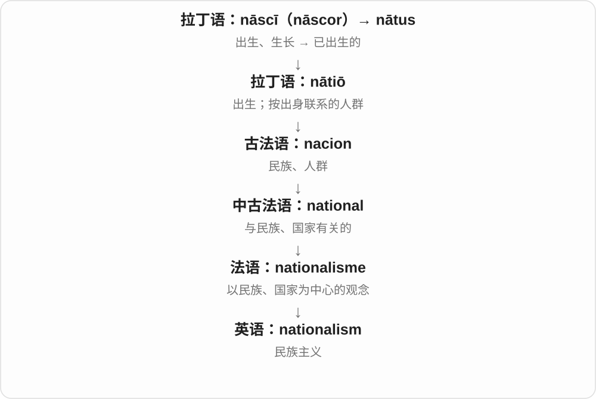
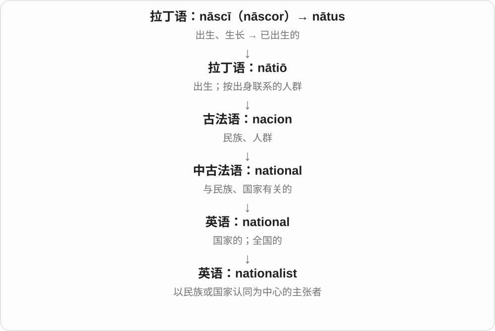
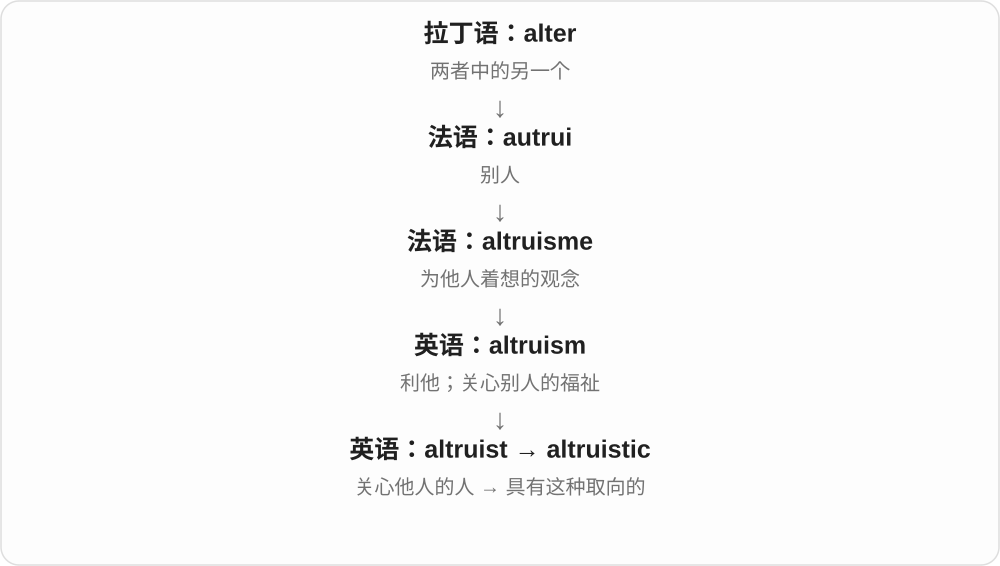
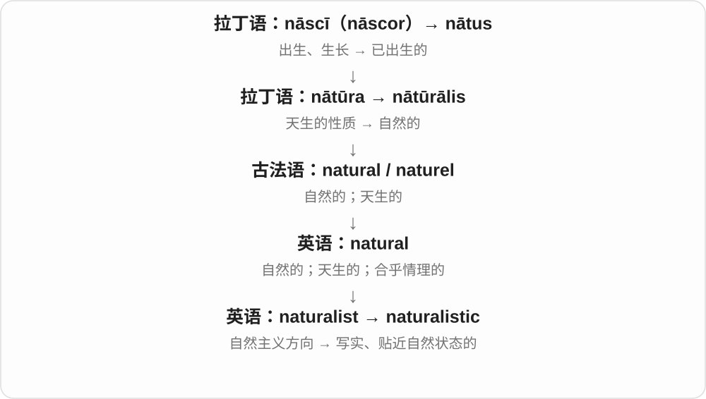
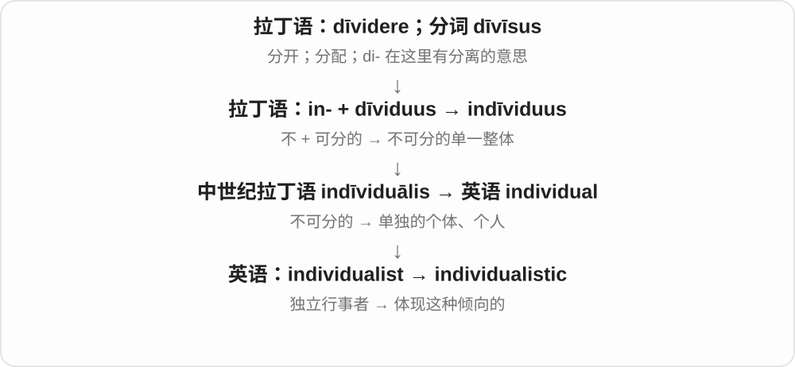
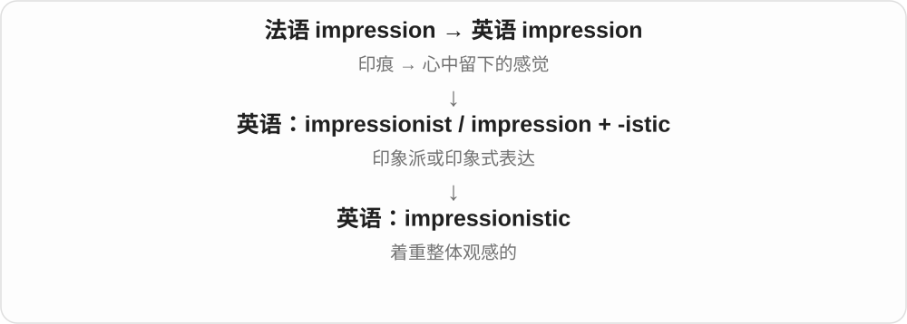

# 0486 · -ic — 与……有关；有某种性质、倾向；一些词也可作名词

[逐词精讲目录](../00_逐词精讲目录.md) · [总目录](../00_总目录_按常用程度.md)

## 核心词根与来源

别只译成某某的。forensic 指向取证、司法用途，bombastic 说语言浮夸空洞，quixotic 还带人物故事里的理想主义与不切实际。理解这些具体画面，才不会把后缀当成能直接算出所有词义的公式。

**-IC：把一个领域、人物或性质转成描述词**

pessimist 悲观者 → pessimistic 悲观的；climax 高潮 → climactic 高潮的；cartography 制图 → cartographic 制图的。基础材料和历史不同，读音、词干也会变。

- **司法、巨型和材料名称**：forensic · titanic · acrylic
- **行政体系、态度与自我关注**：bureaucracy · bureaucratic · pessimism · pessimist · pessimistic · narcissism · narcissist · narcissistic
- **预言、残酷与价值取向**：prophet · prophecy · prophetic · sadism · sadist · sadistic · nationalist · nationalistic · determinism · deterministic · humanism · humanist · humanistic
- **高潮、芳香材料与排版**：climax · climactic · balsam · balsamic · italic
- **水果、语言膨胀与业观念**：citrus · citric · bombast · bombastic · karma · karmic
- **通识、知识和地图**：encyclopedia · encyclopaedia · encyclopedic · theocracy · theocratic · cartography · cartographic
- **传播、人物命名与音乐**：evangelism · evangelist · evangelistic · quixotic · voltaic · anthem · anthemic
- **asthma 喘息词 → asthmat- + -ic**：asthma · asthmatic

## 词形与演化规律

经法语 -ique，或直接接拉丁 -icus、希腊 -ikos 等相关形容词材料，英语又继续类推构词。有的词能按完整英语词基分析，有的整体借入：prophetic 有希腊、拉丁、法语历史，不能只说英语 prophet 先加尾。常见 -ist + -ic → -istic；-graphy／-graphic 是相应形式；climax／climactic 有词干变化；encyclopedia／encyclopedic 去掉名词末段。重音常落到词尾前的相应音节，但不当作没有例外的拼读法。-ic 与 -ical 有时接近，有时分工，classic 与 classical 要按实际搭配分别学。

asthma 接希腊喘息词，经拉丁进入英语，现代为哮喘名称；-ma 名词有 asthmat- 词干，配 -ic 形成相关形容词，并可转指患者。不将症状旧义等同现代疾病全部定义。

## 单词速览（按词族由简到繁）

同一基础词的相关扩展放在一起，先读基础形式，再读扩展；各组之间优先读常用的。具体词源关系见各词讲解。

| 单词 | 音标 | 核心意思 |
|---|---|---|
| [democratic](#w-1) | /ˌdeməˈkrætɪk/ | 民主的；平等参与的 |
| [classic](#w-2) | 英、美 /ˈklæsɪk/ | 经典的、典范的；典型的；经典作品 |
| [classical](#w-5) | 英、美 /ˈklæsɪkəl/ | 古典的；古希腊罗马的；传统体系的 |
| [electronic](#w-3) | 英 /ɪˌlekˈtrɒnɪk/；美 /ɪˌlekˈtrɑːnɪk/ | 电子的；电子设备或系统的 |
| [romantic](#w-4) | 英 /rəʊˈmæntɪk/；美 /roʊˈmæntɪk/ | 爱情的、浪漫的；富想象、理想化的；浪漫主义的 |
| [magnetic](#w-6) | /mæɡˈnetɪk/ | 磁性的；有强烈吸引力的 |
| [electromagnetic](#w-30) | 英 /ɪˌlektrəʊmæɡˈnetɪk/；美 /ɪˌlektroʊmæɡˈnetɪk/ | 电磁的 |
| [realistic](#w-7) | /ˌrɪəˈlɪstɪk/ | 切合实际的；逼真、写实的 |
| [athletic](#w-8) | /æθˈletɪk/ | 运动的；擅长运动的；健壮敏捷的 |
| [atomic](#w-9) | 英 /əˈtɒmɪk/；美 /əˈtɑːmɪk/ | 原子的；原子能的；不可分割执行的 |
| [prophet](#w-315) | 英 /ˈprɒfɪt/；美 /ˈprɑːfɪt/ | 先知；预言者；某种主张的倡导者 |
| [prophecy](#w-320) | 英 /ˈprɒfəsi/；美 /ˈprɑːfəsi/ | 预言；预言能力、行为 |
| [prophetic](#w-64) | /prəˈfetɪk/ | 预言的；有预见性的 |
| [synthetic](#w-10) | /sɪnˈθetɪk/ | 合成的；人工制成的；综合性的〔语言学等〕 |
| [sonic](#w-11) | 英 /ˈsɒnɪk/；美 /ˈsɑːnɪk/ | 声音的；声学的；声速的 |
| [demographic](#w-12) | /ˌdeməˈɡræfɪk/ | 人口统计的；名词：按人口特征划分的群体 |
| [alcoholic](#w-13) | 英 /ˌælkəˈhɒlɪk/；美 /ˌælkəˈhɔːlɪk/ 或 /ˌælkəˈhɑːlɪk/ | 含酒精的；与酒精有关的；酒精依赖者〔人物名词〕 |
| [anthem](#w-316) | /ˈænθəm/ | 颂歌；国歌；代表某群体的歌曲 |
| [anthemic](#w-253) | /ænˈθemɪk/，也作 /ænˈθiːmɪk/ | 颂歌般激昂的；适合大家齐唱、令人振奋的 |
| [nationalism](#w-319) | /ˈnæʃənəlɪzəm/ | 民族主义；国家主义倾向 |
| [nationalist](#w-317) | /ˈnæʃənəlɪst/ | 民族主义者；民族主义的 |
| [nationalistic](#w-80) | /ˌnæʃənəˈlɪstɪk/ | 民族主义的；带强烈本国、民族优先色彩的 |
| [karma](#w-318) | 英 /ˈkɑːmə/；美 /ˈkɑːrmə/ | 业；因果报应〔也见日常泛用〕 |
| [karmic](#w-151) | 英 /ˈkɑːmɪk/；美 /ˈkɑːrmɪk/ | 业的；与因果报应观念有关的 |
| [optimistic](#w-14) | 英 /ˌɒptɪˈmɪstɪk/；美 /ˌɑptɪˈmɪstɪk/ | 乐观的；看好前景的 |
| [psychiatric](#w-15) | /ˌsaɪkiˈætrɪk/ | 精神医学的；精神科的 |
| [symbolic](#w-16) | 英 /sɪmˈbɒlɪk/；美 /sɪmˈbɑːlɪk/ | 象征性的；符号的 |
| [atmospheric](#w-17) | /ˌætməsˈferɪk/ | 大气的；空气的；很有氛围的 |
| [metallic](#w-18) | /məˈtælɪk/，英式也常 /mɪˈtælɪk/ | 金属的；有金属质感的；像金属声音或味道的 |
| [ironic](#w-19) | 英 /aɪˈrɒnɪk/；美 /aɪˈrɑːnɪk/ | 反讽的；具有讽刺意味的 |
| [patriotic](#w-20) | 英 /ˌpætriˈɒtɪk/；美 /ˌpeɪtriˈɑːtɪk/ | 爱国的、表达爱国情感的 |
| [allergic](#w-21) | 英 /əˈlɜːdʒɪk/；美 /əˈlɜːrdʒɪk/ | 过敏的；由过敏引起的 |
| [photographic](#w-22) | 英 /ˌfəʊtəˈɡræfɪk/；美 /ˌfoʊtəˈɡræfɪk/ | 摄影的；照片的；像照片般细致的 |
| [forensic](#w-23) | /fəˈrensɪk/ | 法庭、司法鉴定的；细致调查取证的 |
| [systemic](#w-24) | 英、美 /sɪˈstemɪk/ | 全系统的；系统性的；全身性的 |
| [asthma](#w-341) | 英 /ˈæsmə/；美 /ˈæzmə/ | 哮喘 |
| [asthmatic](#w-342) | 英 /æsˈmætɪk/；美 /æzˈmætɪk/ | 哮喘的；患哮喘的；哮喘患者〔名词〕 |
| [cubic](#w-25) | /ˈkjuːbɪk/ | 立方的；三次的；立方体形的 |
| [linguistic](#w-26) | /lɪŋˈɡwɪstɪk/ | 语言的；语言学的 |
| [volcanic](#w-27) | 英 /vɒlˈkænɪk/；美 /vɑːlˈkænɪk/ | 火山的、火山形成的；爆发般猛烈的 |
| [lyric](#w-28) | /ˈlɪrɪk/ | 歌词；抒情诗；抒情诗的 |
| [climax](#w-321) | /ˈklaɪmæks/ | 高潮；顶点；达到高潮 |
| [climactic](#w-103) | /klaɪˈmæktɪk/ | 高潮的；达到顶点的 |
| [titanic](#w-29) | /taɪˈtænɪk/ | 巨大的；力大无比的；规模惊人的 |
| [citrus](#w-322) | /ˈsɪtrəs/ | 柑橘类水果、果树；柑橘类的 |
| [citric](#w-130) | /ˈsɪtrɪk/ | 柠檬酸的；柑橘相关的〔多见于 citric acid〕 |
| [majestic](#w-31) | /məˈdʒestɪk/ | 雄伟的；庄严壮丽的 |
| [bureaucracy](#w-323) | 英 /bjʊəˈrɒkrəsi/；美 /bjʊˈrɑːkrəsi/ | 官僚行政体系；繁文缛节 |
| [bureaucratic](#w-39) | 英 /ˌbjʊərəˈkrætɪk/；美 /ˌbjʊrəˈkrætɪk/ | 官僚机构、行政体系的；官僚主义、手续繁琐的 |
| [robotic](#w-32) | 英 /rəʊˈbɒtɪk/；美 /roʊˈbɑːtɪk/ | 机器人的、机器人技术相关的；机械呆板的 |
| [seismic](#w-33) | /ˈsaɪzmɪk/ | 地震的；地震波的；影响巨大的 |
| [encyclopedia](#w-324) | /ɪnˌsaɪkləˈpiːdiə/ | 百科全书 |
| [encyclopaedia](#w-332) | /ɪnˌsaɪkləˈpiːdiə/ | 百科全书〔encyclopedia 的常见拼写变体〕 |
| [encyclopedic](#w-167) | /ɪnˌsaɪkləˈpiːdɪk/ | 百科全书的；知识广博的；内容广泛详尽的 |
| [ballistic](#w-34) | 英、美 /bəˈlɪstɪk/ | 弹道的；与投射运动有关的；暴怒的〔口语〕 |
| [diabetic](#w-35) | 英、美 /ˌdaɪəˈbetɪk/ | 糖尿病的；患糖尿病的 |
| [nostalgic](#w-36) | 英 /nɒˈstældʒɪk/；美 /nɑːˈstældʒɪk/ | 怀旧的；令人怀旧的 |
| [acrylic](#w-38) | /əˈkrɪlɪk/ | 丙烯酸类的；亚克力的；丙烯颜料、腈纶等〔看对象〕 |
| [rhythmic](#w-40) | 英、美 /ˈrɪðmɪk/ | 有节奏的；与节奏有关的 |
| [tonic](#w-41) | 英 /ˈtɒnɪk/；美 /ˈtɑːnɪk/ | 主音；汤力水；补剂或使人振奋的事物 |
| [comedic](#w-42) | /kəˈmiːdɪk/ | 喜剧的、制造喜剧效果的 |
| [endemic](#w-43) | /enˈdemɪk/，也读 /ɪnˈdemɪk/ | 地方性存在的；某地特有的；根深蒂固的 |
| [microscopic](#w-44) | 英 /ˌmaɪkrəˈskɒpɪk/；美 /ˌmaɪkrəˈskɑːpɪk/ | 显微的；极微小的；极细致的 |
| [idiotic](#w-45) | 英 /ˌɪdiˈɒtɪk/；美 /ˌɪdiˈɑːtɪk/ | 愚蠢的；荒唐的 |
| [acidic](#w-46) | /əˈsɪdɪk/ | 酸性的；带酸味的 |
| [psychedelic](#w-47) | /ˌsaɪkəˈdelɪk/ | 迷幻的；能引起明显感知变化的；迷幻风格的 |
| [demonic](#w-48) | 英 /dɪˈmɒnɪk/；美 /dɪˈmɑːnɪk/ | 恶魔的、魔鬼般的；极邪恶、狂暴的 |
| [manic](#w-49) | 英美 /ˈmænɪk/ | 忙乱疯狂的；躁狂的 |
| [journalistic](#w-51) | 英 /ˌdʒɜːnəˈlɪstɪk/；美 /ˌdʒɜːrnəˈlɪstɪk/ | 新闻工作的；新闻报道风格的 |
| [parasitic](#w-52) | 英、美 /ˌpærəˈsɪtɪk/ | 寄生的；依附性榨取的 |
| [geologic](#w-53) | 英 /ˌdʒiːəˈlɒdʒɪk/；美 /ˌdʒiːəˈlɑːdʒɪk/ | 地质的；地质学的 |
| [pessimism](#w-330) | /ˈpesɪmɪzəm/ | 悲观；悲观主义 |
| [pessimist](#w-335) | /ˈpesɪmɪst/ | 悲观的人；悲观主义者 |
| [pessimistic](#w-54) | /ˌpesɪˈmɪstɪk/ | 悲观的；不看好的 |
| [narcissism](#w-327) | 英 /ˈnɑːsɪsɪzəm/；美 /ˈnɑːrsɪsɪzəm/ | 自恋；过度自我欣赏、自我关注 |
| [narcissist](#w-329) | 英 /ˈnɑːsɪsɪst/；美 /ˈnɑːrsɪsɪst/ | 自恋的人；过度以自我为中心者 |
| [narcissistic](#w-55) | 英 /ˌnɑːsɪˈsɪstɪk/；美 /ˌnɑːrsɪˈsɪstɪk/ | 自恋的；过度自我关注的 |
| [ionic](#w-56) | 英 /aɪˈɒnɪk/；美 /aɪˈɑːnɪk/ | 离子的；离子键的 |
| [panoramic](#w-57) | 英美 /ˌpænəˈræmɪk/ | 全景的；视野开阔的；全面展现的 |
| [septic](#w-58) | 英美 /ˈseptɪk/ | 感染的、化脓的；与脓毒症有关的；腐败分解的 |
| [symmetric](#w-59) | 英、美 /sɪˈmetrɪk/ | 对称的 |
| [climatic](#w-60) | /klaɪˈmætɪk/ | 气候的、与气候有关的 |
| [aerobic](#w-61) | 英 /eəˈrəʊbɪk/；美 /erˈroʊbɪk/ | 有氧的；需氧的；有氧运动的 |
| [algebraic](#w-62) | /ˌældʒɪˈbreɪɪk/ | 代数的；代数形式的 |
| [sadism](#w-339) | /ˈseɪdɪzəm/ | 施虐倾向；以他人痛苦为乐 |
| [sadist](#w-337) | /ˈseɪdɪst/ | 施虐者；以他人痛苦为乐的人 |
| [sadistic](#w-66) | /səˈdɪstɪk/ | 施虐的；以他人痛苦为乐的；残酷的 |
| [hyperbolic](#w-67) | 英 /ˌhaɪpəˈbɒlɪk/；美 /ˌhaɪpərˈbɑːlɪk/ | 夸张的；双曲线的；双曲几何的 |
| [idealistic](#w-68) | 英、美 /ˌaɪdiəˈlɪstɪk/ | 理想主义的；抱有很高理想的 |
| [angelic](#w-70) | /ænˈdʒelɪk/ | 天使的；天使般温柔、纯真、美丽的 |
| [nomadic](#w-71) | 英 /nəʊˈmædɪk/；美 /noʊˈmædɪk/ | 游牧的；经常迁居的 |
| [conical](#w-74) | 英 /ˈkɒnɪkəl/；美 /ˈkɑːnɪkəl/ | 圆锥形的 |
| [evangelism](#w-331) | /ɪˈvændʒəlɪzəm/ | 传福音；布道；热情推广〔引申〕 |
| [evangelist](#w-325) | /ɪˈvændʒəlɪst/ | 传福音者；布道者；热情倡导者、推广者 |
| [evangelistic](#w-185) | /ɪˌvændʒəˈlɪstɪk/ | 传福音的；带热情倡导、推广意味的 |
| [opportunistic](#w-76) | 英 /ˌɒpətjuːˈnɪstɪk/；美 /ˌɑːpərtuːˈnɪstɪk/ | 投机的；趁机发生、利用条件的 |
| [humanism](#w-328) | 英、美 /ˈhjuːmənɪzəm/ | 人文主义；人本主义 |
| [humanist](#w-326) | /ˈhjuːmənɪst/ | 人文主义者；人文学者 |
| [humanistic](#w-102) | /ˌhjuːməˈnɪstɪk/ | 人文主义的；重视人的价值、体验的 |
| [anesthetic](#w-78) | /ˌænəsˈθetɪk/ | 麻醉药；麻醉的〔美式拼写〕 |
| [idyllic](#w-79) | 英 /ɪˈdɪlɪk/；美 /aɪˈdɪlɪk/ | 田园诗般的；宁静美好的；如同理想生活的 |
| [antagonistic](#w-81) | /ænˌtæɡəˈnɪstɪk/ | 敌对的；对立的；相互抵消的 |
| [mythic](#w-82) | 英、美 /ˈmɪθɪk/ | 神话的；传奇般的 |
| [episodic](#w-83) | 英 /ˌepɪˈsɒdɪk/；美 /ˌepɪˈsɑːdɪk/ | 分段发生的；偶发的；由独立片段组成的 |
| [monolithic](#w-84) | 英 /ˌmɒnəˈlɪθɪk/；美 /ˌmɑːnəˈlɪθɪk/ | 整块的；整体式的；庞大而划一的 |
| [biometric](#w-85) | 英 /ˌbaɪəʊˈmetrɪk/；美 /ˌbaɪoʊˈmetrɪk/ | 生物测量的；生物特征识别的 |
| [ethnographic](#w-86) | 英 /ˌeθnəˈɡræfɪk/；美 /ˌeθnoʊˈɡræfɪk/ | 民族志的；采用民族志方法的 |
| [caloric](#w-87) | 英 /kəˈlɒrɪk/；美 /kəˈlɔːrɪk/ | 热量的；卡路里的；热质〔旧理论名词〕 |
| [altruistic](#w-90) | /ˌæltruˈɪstɪk/ | 利他的；无私助人的 |
| [idiosyncratic](#w-92) | 英 /ˌɪdiəʊsɪŋˈkrætɪk/；美 /ˌɪdioʊsɪŋˈkrætɪk/ | 个人风格独特的；特有而不寻常的 |
| [deterministic](#w-93) | 英 /dɪˌtɜːmɪˈnɪstɪk/；美 /dɪˌtɜːrmɪˈnɪstɪk/ | 确定性的；决定论的 |
| [naturalistic](#w-94) | /ˌnætʃərəˈlɪstɪk/ | 写实的；贴近自然状态的 |
| [operatic](#w-95) | 英 /ˌɒpəˈrætɪk/；美 /ˌɑːpəˈrætɪk/ | 歌剧的；像歌剧般夸张的 |
| [chromatic](#w-96) | 英、美 /krəˈmætɪk/ | 颜色的；音乐：半音的、半音阶的 |
| [relativistic](#w-97) | 英 /ˌrelətɪˈvɪstɪk/；美 /ˌrelətəˈvɪstɪk/ | 相对论的；相对主义的〔随领域〕 |
| [autocratic](#w-98) | 英 /ˌɔːtəˈkrætɪk/；美 /ˌɑːtoʊˈkrætɪk/ | 专制的；独断专行的 |
| [taxonomic](#w-100) | 英 /ˌtæksəˈnɒmɪk/；美 /ˌtæksəˈnɑːmɪk/ | 分类学的；分类体系相关的 |
| [claustrophobic](#w-104) | 英 /ˌklɒstrəˈfəʊbɪk/；美 /ˌklɔːstrəˈfoʊbɪk/ | 怕幽闭空间的；狭窄得令人压抑的 |
| [euphoric](#w-105) | 英 /juːˈfɒrɪk/；美 /juːˈfɔːrɪk/ | 欣喜若狂的；极度兴奋的 |
| [symphonic](#w-106) | 英 /sɪmˈfɒnɪk/；美 /sɪmˈfɑːnɪk/ | 交响曲的；交响乐式的 |
| [acrobatic](#w-108) | 英、美 /ˌækrəˈbætɪk/ | 杂技的；动作灵巧高难的 |
| [telepathic](#w-111) | /ˌtelɪˈpæθɪk/ | 心灵感应的；据称能传心的 |
| [algorithmic](#w-112) | /ˌælɡəˈrɪðmɪk/ | 算法的；由算法完成、控制的 |
| [determinism](#w-333) | 英 /dɪˈtɜːmɪnɪzəm/；美 /dɪˈtɜːrmɪnɪzəm/ | 决定论；确定性 |
| [formulaic](#w-120) | 英 /ˌfɔːmjəˈleɪɪk/；美 /ˌfɔːrmjəˈleɪɪk/ | 程式化的；套用固定模式的 |
| [individualistic](#w-121) | /ˌɪndɪvɪdʒuəˈlɪstɪk/ | 强调个人独立的；富有个人风格的 |
| [balsam](#w-336) | 英 /ˈbɔːlsəm/；美 /ˈbɔːlsəm/ | 香脂、香树脂；某些产香脂植物 |
| [balsamic](#w-117) | /bɔːlˈsæmɪk/ | 香脂的、芳香的；意式香醋相关的 |
| [cryptographic](#w-124) | 英 /ˌkrɪptəˈɡræfɪk/；美 /ˌkrɪptəˈɡræfɪk/ | 密码学的；使用密码技术的 |
| [ergonomic](#w-125) | 英 /ˌɜːɡəˈnɒmɪk/；美 /ˌɜːrɡəˈnɑːmɪk/ | 人体工学的；考虑人的能力、动作与工作需求的 |
| [italic](#w-126) | /ɪˈtælɪk/ | 斜体的；斜体字 |
| [meteoric](#w-131) | 英 /ˌmiːtiˈɒrɪk/；美 /ˌmiːtiˈɔːrɪk/ | 流星般迅速耀眼的；与流星有关的；大气来源的〔专门〕 |
| [anachronistic](#w-132) | /əˌnækrəˈnɪstɪk/ | 时代错置的；与时代不合的 |
| [bibliographic](#w-134) | 英 /ˌbɪbliəˈɡræfɪk/；美 /ˌbɪbliəˈɡræfɪk/ | 书目的；文献著录的 |
| [dialectic](#w-135) | /ˌdaɪəˈlektɪk/ | 辩证法；通过论辩考察观点的方法；相互作用的矛盾关系 |
| [logarithmic](#w-137) | 英 /ˌlɒɡəˈrɪðmɪk/；美 /ˌlɑːɡəˈrɪðmɪk/ | 对数的；按比例分档的〔刻度〕 |
| [cartography](#w-334) | 英 /kɑːˈtɒɡrəfi/；美 /kɑːrˈtɑːɡrəfi/ | 地图学；地图制作 |
| [cartographic](#w-182) | 英 /ˌkɑːtəˈɡræfɪk/；美 /ˌkɑːrtəˈɡræfɪk/ | 制图的；地图绘制相关的 |
| [pedantic](#w-146) | /pəˈdæntɪk/ | 过分拘泥细节的；学究式的 |
| [myopic](#w-149) | 英 /maɪˈɒpɪk/；美 /maɪˈoʊpɪk/，亦 /maɪˈɑːpɪk/ | 近视的；目光短浅的 |
| [bombast](#w-340) | 英 /ˈbɒmbæst/；美 /ˈbɑːmbæst/ | 浮夸空洞的言辞；大话 |
| [bombastic](#w-150) | 英 /bɒmˈbæstɪk/；美 /bɑːmˈbæstɪk/ | 浮夸的；夸夸其谈的 |
| [militaristic](#w-152) | /ˌmɪlɪtəˈrɪstɪk/ | 军国主义的；崇尚军事力量的 |
| [empathic](#w-157) | /emˈpæθɪk/ | 有同理心的；共情的 |
| [theocracy](#w-338) | 英 /θiˈɒkrəsi/；美 /θiˈɑːkrəsi/ | 神权政治；神权政体 |
| [theocratic](#w-180) | 英 /ˌθiːəˈkrætɪk/；美 /ˌθiːəˈkrætɪk/ | 神权政治的；政教合一体制相关的 |
| [hedonistic](#w-161) | /ˌhedəˈnɪstɪk/，也读 /ˌhiːdəˈnɪstɪk/ | 享乐主义的；追求享受的 |
| [despotic](#w-164) | 英 /deˈspɒtɪk/；美 /deˈspɑːtɪk/ | 专制的；专横的 |
| [vitriolic](#w-166) | 英 /ˌvɪtriˈɒlɪk/；美 /ˌvɪtriˈɑːlɪk/ | 恶毒的；尖刻伤人的 |
| [anarchic](#w-169) | 英 /əˈnɑːkɪk/；美 /əˈnɑːrkɪk/ | 混乱无序的；不受拘束的；无政府的 |
| [axiomatic](#w-170) | /ˌæksiəˈmætɪk/ | 公理的；不言自明的；被视为理所当然的 |
| [nihilistic](#w-172) | /ˌnaɪɪˈlɪstɪk/ | 虚无主义的；带有否定意义或价值倾向的 |
| [atheistic](#w-174) | /ˌeɪθiˈɪstɪk/ | 无神论的；持无神论立场的 |
| [impressionistic](#w-186) | 英 /ɪmˌpreʃəˈnɪstɪk/；美 /ɪmˌpreʃəˈnɪstɪk/ | 印象派风格的；凭总体感受描绘的 |
| [trigonometric](#w-194) | /ˌtrɪɡənəˈmetrɪk/ | 三角学的；三角函数的 |
| [polyphonic](#w-196) | 英 /ˌpɒlɪˈfɒnɪk/；美 /ˌpɑːliˈfɑːnɪk/ | 复调的；能同时发多音的；多声部的 |
| [iconoclastic](#w-207) | 英 /aɪˌkɒnəˈklæstɪk/；美 /aɪˌkɑːnəˈklæstɪk/ | 反传统的；挑战权威观念的；毁坏圣像的 |
| [typographic](#w-208) | 英 /ˌtaɪpəˈɡræfɪk/；美 /ˌtaɪpəˈɡræfɪk/ | 排印的；文字编排的 |
| [quixotic](#w-211) | 英 /kwɪkˈsɒtɪk/；美 /kwɪkˈsɑːtɪk/ | 堂吉诃德式的；理想化却不切实际的 |
| [kaleidoscopic](#w-214) | 英 /kəˌlaɪdəˈskɒpɪk/；美 /kəˌlaɪdəˈskɑːpɪk/ | 万花筒般的；缤纷多变的 |
| [imperialistic](#w-219) | 英 /ɪmˌpɪəriəˈlɪstɪk/；美 /ɪmˌpɪriəˈlɪstɪk/ | 帝国主义的；奉行扩张、支配政策的 |
| [orthographic](#w-221) | 英 /ˌɔːθəˈɡræfɪk/；美 /ˌɔːrθəˈɡræfɪk/ | 拼写的；正字法的；正投影的 |
| [fatalistic](#w-228) | /ˌfeɪtəˈlɪstɪk/ | 宿命论的；听天由命的 |
| [shambolic](#w-232) | 英 /ʃæmˈbɒlɪk/；美 /ʃæmˈbɑːlɪk/ | 乱七八糟的、组织混乱的 |
| [telegraphic](#w-233) | /ˌtelɪˈɡræfɪk/ | 电报的；像电报一样简短省略的 |
| [filmic](#w-235) | /ˈfɪlmɪk/ | 电影的；具有电影表现特点的 |
| [metaphoric](#w-243) | 英 /ˌmetəˈfɒrɪk/；美 /ˌmetəˈfɔːrɪk/ | 隐喻的；比喻性的 |
| [choreographic](#w-247) | 英 /ˌkɒriəˈɡræfɪk/；美 /ˌkɔːriəˈɡræfɪk/ | 编舞的；与舞蹈编排有关的 |
| [voltaic](#w-251) | 英 /vɒlˈteɪɪk/；美 /vɑːlˈteɪɪk/ | 伏打的；由化学作用产生电流的 |
| [telephonic](#w-264) | 英 /ˌtelɪˈfɒnɪk/；美 /ˌteləˈfɑːnɪk/ | 电话的；通过电话进行的 |
| [virtuosic](#w-269) | 英 /ˌvɜːtʃuˈɒsɪk/；美 /ˌvɜːrtʃuˈɑːsɪk/ | 技艺精湛的；高手式的；炫技的〔依语境〕 |
| [iconographic](#w-272) | /ˌaɪkənəˈɡræfɪk/ | 图像学的；与图像题材、象征体系有关的 |
| [meritocratic](#w-273) | 英 /ˌmerɪtəˈkrætɪk/；美 /ˌmerɪtəˈkrætɪk/ | 按能力、成绩、功绩选拔分配的；精英治理相关的 |
| [monotonic](#w-274) | 英 /ˌmɒnəˈtɒnɪk/；美 /ˌmɑːnəˈtɑːnɪk/ | 单调的〔数学、技术〕；单一音调的 |
| [gyroscopic](#w-275) | 英 /ˌdʒaɪrəˈskɒpɪk/；美 /ˌdʒaɪrəˈskɑːpɪk/ | 陀螺仪的；与陀螺效应有关的 |
| [sophomoric](#w-291) | 英 /ˌsɒfəˈmɒrɪk/；美 /ˌsɑːfəˈmɔːrɪk/ | 幼稚而自以为是的；浅薄的 |
| [microeconomic](#w-293) | 英 /ˌmaɪkrəʊˌiːkəˈnɒmɪk/；美 /ˌmaɪkroʊˌekəˈnɑːmɪk/ | 微观经济的；微观经济学的 |
| [entropic](#w-297) | 英 /enˈtrɒpɪk/；美 /enˈtrɑpɪk/ | 熵的；与熵有关的 |

## 逐词讲解

### 1. democratic — 民主的；平等参与的

**音标**：/ˌdeməˈkrætɪk/

**先抓住这个画面**

决定不是由一个人关门拍板，相关的人能参与、表达并对结果产生影响。

**怎么拆**

经法语及拉丁语接希腊 dēmokratikós；demo- 人民 + krat- 权力 + 形容词词尾。

**怎么变成今天的意思**

**古希腊 krátos**  
力量；权力、支配

↓

**希腊 dēmokratikós → 后期拉丁 democraticus → 法语 démocratique**  
民主制度相关的

↓

**英语 democratic**  
民主的；有平等参与精神的

可描述政治制度，也可形容团队讨论、管理方式。大写 Democratic 还可能是特定政党的名称，不能自动当作制度评价。

**常见搭配与例句**

democratic participation；a democratic process；democratic values。

> The club uses a democratic process to choose its chair.

俱乐部通过民主程序选举主席。

> A democratic discussion gives every member a chance to speak.

民主的讨论让每位成员都有发言机会。

**别混淆**

democratic 强调参与、授权和问责等原则；popular 只说受欢迎或大众的，未必说明如何决策。

### 2. classic — 经典的、典范的；典型的；经典作品

**音标**：英、美 /ˈklæsɪk/

**先抓住这个画面**

本来是“排在最高等级”，后来成为“值得当范本”。但 a classic mistake 只是“典型错误”，不是夸错误好。

**怎么拆**

历史上是拉丁语 classicus 经法语 classique 借入。今天能看成 class + -ic，不能因此抹掉借词路线。

**怎么变成今天的意思**

a classic novel 通常是经得住时间考验的作品；a classic example 则是非常典型、很能说明问题的例子。名词 a classic 可以指电影、书或其他经典。

**常见搭配与例句**

a classic novel；a classic example of；an instant classic。

> The film became a classic that several generations grew up watching.

这部电影成了几代人从小看到大的经典。

> Leaving the key inside is a classic mistake.

把钥匙落在里面是个典型错误。

**别混淆**

classic 常强调经典或典型；classical 常指古希腊罗马、古典音乐或某种传统体系。

### 3. classical — 古典的；古希腊罗马的；传统体系的

**音标**：英、美 /ˈklæsɪkəl/

**先抓住这个画面**

它常给事物标出所属传统：古希腊罗马文化、古典音乐，或相对现代新理论而言的传统方法。

**怎么拆**

以拉丁语 classicus 的词干形成 -al 形容词；现代可联系 classic + -al。不同词典对英语早期造词细节有不同处理，不必假设现代 classic 一定先出现。

**怎么变成今天的意思**

classical music 日常可统称西方古典音乐，也可在音乐史中特指古典主义时期。classical physics 通常与量子物理相对；谈 classical mechanics 时常指牛顿力学体系，具体范围看语境。

**常见搭配与例句**

classical music；classical architecture；classical mechanics。

> She plays classical music but also enjoys jazz.

她演奏古典音乐，也喜欢爵士乐。

> The museum has a gallery devoted to classical sculpture.

博物馆有一间专门展示古希腊罗马雕塑的展厅。

**别混淆**

a classic song 是一首经典歌曲，可能是摇滚；classical music 才是古典音乐这一传统。

### 4. electronic — 电子的；电子设备或系统的

**音标**：英 /ɪˌlekˈtrɒnɪk/；美 /ɪˌlekˈtrɑːnɪk/

**先抓住这个画面**

普通电器可以只是把电变成热或运动；electronic 常进一步利用电子器件来计算、放大、控制或传递信息。

**怎么拆**

英语 electron + -ic。先指电子相关性质，后来扩展到 electronics 这一技术领域及其产品。

**怎么变成今天的意思**

**古希腊 elektron → 拉丁 electrum**  
琥珀；摩擦后能吸引轻小物体

↓

**近代拉丁 electricus**  
像琥珀那样具有电性；吉尔伯特在 1600 年用于这一现象

↓

**英语电学词基 electr- + -on → electron〔斯托尼，1891〕**  
起初命名基本电荷，后来用于带负电的电子这一粒子

↓

**英语 electron + -ic → electronic**  
电子的；进一步指利用电子器件处理信号的

electronic controls 是电子控制装置；electronic payment 是通过电子系统支付。electronic structure 在物理化学中仍可直接说原子、材料的电子结构。

**常见搭配与例句**

electronic equipment；electronic payment；electronic controls；electronic structure。

> The door uses an electronic lock.

这扇门使用电子锁。

> The form is available in electronic format.

这份表格有电子版。

**别混淆**

electric heater 说用电加热器；electronic thermostat 说用电子器件控制温度的装置。一件产品可以同时有这两类部分。

### 5. romantic — 爱情的、浪漫的；富想象、理想化的；浪漫主义的

**音标**：英 /rəʊˈmæntɪk/；美 /roʊˈmæntɪk/

**先抓住这个画面**

烛光晚餐是一种浪漫，想把人生过成壮丽传奇也可 romantic；艺术史的 Romantic 又是一种重情感、想象的流派关系，不只写情侣。

**怎么拆**

接 romant/romance 叙事词及法语 romantique、拉丁相应形式，现代可认 romant- + -ic。传奇性质先于今天只谈恋爱的狭义联想。

**怎么变成今天的意思**

**拉丁 Rōmānicē 等 → 古法语 romanz/romant**  
罗曼语、用俗语写的叙事

↓

**英语 romance / romantic**  
传奇、富想象叙事 → 爱情、浪漫；理想化

↓

**艺术与一般评价**  
Romanticism 特定流派；romanticize 把现实美化成故事

a romantic dinner 浪漫晚餐，a romantic relationship 恋爱关系，a romantic view of the past 对过去的理想化看法，Romantic poetry 浪漫主义诗歌。

**常见搭配与例句**

a romantic dinner；a romantic relationship；a romantic view；Romantic poetry。

> They had a romantic dinner by the river.

他们在河边吃了一顿浪漫晚餐。

> His romantic view of farming ignored the hard work.

他对务农的美好想象忽略了辛苦劳动。

**别混淆**

romantic 不总等于爱情：romantic ideas about country life 可能是把乡居想得太美；Roman 罗马的不是同一个形容词。

### 6. magnetic — 磁性的；有强烈吸引力的

**音标**：/mæɡˈnetɪk/

**先抓住这个画面**

可以说一块板有磁性，也可以说一个人的魅力像磁铁一样抓住注意力。

**怎么拆**

magnet + -ic，表示与磁铁或磁性有关。

**怎么变成今天的意思**

**希腊 Magnes／Magnetis lithos → 拉丁 magnes、magnet-**  
马格尼西亚的石头 → 磁石

↓

**英语 magnet + -ic → magnetic**  
磁铁 → 磁性的；吸引人的

magnetic field 是磁场，magnetic attraction 可以说磁力吸引。a magnetic personality 则说某个人很有吸引力，让别人自然想靠近或听他说话。

**常见搭配与例句**

a magnetic field；magnetic materials；magnetic attraction；a magnetic personality。

> The compass responds to Earth’s magnetic field.

指南针会对地球磁场作出反应。

> She has a magnetic presence on stage.

她在舞台上有一种强烈吸引观众的魅力。

**别混淆**

magnetic 不等于 electric，但电和磁可以联系。用于人物时，它常比 merely attractive 更突出强烈吸引注意力。

### 7. electromagnetic — 电磁的

**音标**：英 /ɪˌlektrəʊmæɡˈnetɪk/；美 /ɪˌlektroʊmæɡˈnetɪk/

**先抓住这个画面**

把电场与磁场联系起来看：它可以描述一个场、一种相互作用，也可以描述在空间传播的电磁波。

**怎么拆**

electro- 电 + magnetic 磁的；也可联系 electromagnet 加 -ic 理解词族关系。它是近代科学形容词。

**怎么变成今天的意思**

**古希腊 elektron → 拉丁 electrum**  
琥珀；摩擦后能吸引轻小物体

↓

**近代拉丁 electricus**  
像琥珀那样具有电性；吉尔伯特在 1600 年用于这一现象

↓

**近代科学 electro- + magnetic → electromagnetic**  
电与磁共同涉及的、具有电磁性质的

electromagnetic waves 包括无线电波、可见光和 X 射线，差别在频率等性质；它们不需要空气才能传播。声音则属于机械波，不能因为“也会传播”就叫电磁波。

**常见搭配与例句**

an electromagnetic field；electromagnetic radiation；electromagnetic interference。

> Visible light is electromagnetic radiation.

可见光属于电磁辐射。

> The engineers reduced electromagnetic interference around the sensor.

工程师减小了传感器周围的电磁干扰。

**别混淆**

electric 只突出电；magnetic 只突出磁；electromagnetic 把两者的联系或统一性质放在眼前。

### 8. realistic — 切合实际的；逼真、写实的

**音标**：/ˌrɪəˈlɪstɪk/

**先抓住这个画面**

计划按现实条件能做成，是 realistic；画面像真实世界，也可以 realistic。前者谈可行，后者谈表现效果。

**怎么拆**

realist + -ic，联系 real 实际、真实这一词族。现代常从实际条件和如实表现两条线理解。

**怎么变成今天的意思**

**拉丁 rēs 事物 → reālis → real**  
实际、真实

↓

**realist + -ic → realistic**  
符合现实条件；表现得像真实世界

a realistic goal 切实目标，a realistic estimate 实际合理的估计，realistic graphics 逼真图形，be realistic about 对……面对现实。

**常见搭配与例句**

a realistic goal；a realistic estimate；realistic graphics。

> We need a realistic deadline for the project.

我们需要给项目定个切实可行的期限。

> The film uses realistic models of insects.

电影用了很逼真的昆虫模型。

**别混淆**

realistic model 可以是仿真模型，不代表模型就是 real 的原物。realistic plan 则是在现实中有望执行的计划。

### 9. athletic — 运动的；擅长运动的；健壮敏捷的

**音标**：/æθˈletɪk/

**先抓住这个画面**

既能说事情属于体育，也能说一个人的身体很适合运动。

**怎么拆**

现代可对照 athlete + -ic，但历史上借入拉丁 athleticus 或中古法语 athletique，追溯希腊 athletikos。主重音由 athlete 的首音节移到 /let/。

**怎么变成今天的意思**

**希腊 athlos / athlon**  
竞赛、角逐；竞赛奖赏

↓

**希腊 athlein → athletes**  
为奖赏而比赛；参赛者

↓

**希腊 athletikos → 拉丁 athleticus／中古法语 athletique**  
与竞技者有关的

↓

**英语 athletic**  
运动的；身体健壮、擅长运动的

athletic ability 是运动能力；an athletic build 是健壮、匀称、适于运动的体格。形容人 athletic，不等于说他必定是职业运动员，也不只是肌肉大。

**常见搭配与例句**

athletic ability；an athletic build；athletic performance；an athletic scholarship。

> She has an athletic build and excellent balance.

她体格健壮，平衡能力很好。

> The school awarded him an athletic scholarship.

学校给了他一份体育奖学金。

**别混淆**

sporting 常说体育活动或赛事；athletic 还直接形容人的体能与动作特点。

### 10. atomic — 原子的；原子能的；不可分割执行的

**音标**：英 /əˈtɒmɪk/；美 /əˈtɑːmɪk/

**先抓住这个画面**

在科学里看原子这一层；在程序里则把几步当作一个不能拆开的整体。

**怎么拆**

atom + -ic，构成形容词。

**怎么变成今天的意思**

**希腊 temnein；tom-**  
切、分割；同源词干形式

↓

**希腊 atomos → 英语 atom + -ic → atomic**  
不可分的单位 → 原子的；整体不可分的

atomic structure 是原子结构，atomic energy 是常见的原子能说法。数据库中的 atomic transaction 借用了“不可分”的老意思：相关改动作为整体生效或不生效，不能只留下半套结果。

**常见搭配与例句**

atomic structure；atomic number；atomic energy；an atomic operation。

> The diagram shows the atomic structure of carbon.

这张图展示了碳的原子结构。

> The database treats the transfer as an atomic transaction.

数据库把这次转账作为一个原子事务处理。

**别混淆**

atomic number 原子序数是质子数，不是原子质量。编程里的 atomic 不是“很小”或“特别快”的同义词。

### 11. prophet — 先知；预言者；某种主张的倡导者

**音标**：英 /ˈprɒfɪt/；美 /ˈprɑːfɪt/

**先抓住这个画面**

宗教里可说传达神意的先知；日常也可称准确预见趋势的人，或鼓吹某种未来看法的人为 prophet。

**怎么拆**

经法语、拉丁语接希腊 prophetes 替神发言者，与 pro- 在前、代表等及说话材料相联；不能把所有义只缩成预知明天。

**怎么变成今天的意思**

**希腊 prophetes、propheteia → 拉丁语、法语相应形式**  
替神发言者、预言等相关材料

↓

**英语 prophet、prophecy、prophetic**  
先知、预言者；预言；有预见性的

a religious prophet 宗教先知；a prophet of doom 总预言灾难、坏结果的人。

**常见搭配与例句**

a prophet of doom；a false prophet。

> The text describes the teachings of an ancient prophet.

文本描述了一位古代先知的教导。

> The critics dismissed him as a prophet of doom.

批评者把他当作一个总唱衰的人，不予理会。

**别混淆**

prophet 与 profit 利润常同音，拼写、意义不同；一个是先知、预言者，一个是收益。

### 12. prophecy — 预言；预言能力、行为

**音标**：英 /ˈprɒfəsi/；美 /ˈprɑːfəsi/

**先抓住这个画面**

一句声称未来会怎样的预言，可以叫 a prophecy；这个词本身不保证它真的会实现。

**怎么拆**

经法语 prophetie、拉丁 prophetia 接希腊 propheteia，与 prophet 同族。末尾 -cy 的名词读 /si/。

**怎么变成今天的意思**

**希腊 prophetes、propheteia → 拉丁语、法语相应形式**  
替神发言者、预言等相关材料

↓

**英语 prophet、prophecy、prophetic**  
先知、预言者；预言；有预见性的

a prophecy about the future 关于未来的预言；fulfil a prophecy 实现预言；a self-fulfilling prophecy 自我实现的预言。

**常见搭配与例句**

fulfil a prophecy；a prophecy of。

> The prophecy became central to the story.

这个预言成了故事的关键。

> Their fear of failure turned into a self-fulfilling prophecy.

他们对失败的恐惧最后变成了自我实现的预言。

**别混淆**

prophecy 是名词，prophesy 是动词，末尾常读 /saɪ/；一字母、一个音的差别改变词性。

### 13. prophetic — 预言的；有预见性的

**音标**：/prəˈfetɪk/

**先抓住这个画面**

当初一句提醒，后来事情真照着发展，回头看这句话像预先看见了结果，就可说 prophetic。

**怎么拆**

经法语、拉丁语接希腊 prophetikos，与 prophet + -ic 对应。重音和元音变化，不能完全照 prophet 的读音再加 /ɪk/。

**怎么变成今天的意思**

**希腊 prophetes、propheteia → 拉丁语、法语相应形式**  
替神发言者、预言等相关材料

↓

**英语 prophet、prophecy、prophetic**  
先知、预言者；预言；有预见性的

prophetic words 有预见性的话；a prophetic warning 预见后事的警告。

**常见搭配与例句**

a prophetic vision；prove prophetic。

> Her warning proved prophetic.

她的警告后来显示出了预见性。

> The novel contains a prophetic vision of automated work.

小说对自动化工作作出了富有预见性的描绘。

**别混淆**

prophetic 有时只是事后赞某人看得准，不必每次都声称具有宗教启示；predictive 更中性指预测的。

### 14. synthetic — 合成的；人工制成的；综合性的〔语言学等〕

**音标**：/sɪnˈθetɪk/

**先抓住这个画面**

材料义像把所需成分重新搭出来；语言学义则把较多语法信息装进一个词里。

**怎么拆**

经法语 synthétique 或近代拉丁 syntheticus，接希腊 synthetikos。这个形容词有自己的历史路线，不只是英语 synthesis 加词尾。

**怎么变成今天的意思**

**古希腊语 tithenai，词典形 tithemi**  
放、安置、设定

↓

**希腊语 syntithenai → synthetikos**  
放在一起 → 与组合有关的

↓

**近代拉丁语 syntheticus／法语 synthétique → 英语 synthetic**  
综合的；后来有合成材料、人工的义

synthetic fabric 是合成纤维织物；synthetic compounds 可以与天然来源的同种分子完全相同，也可能是另一种物质。语言学 synthetic language 则常靠词形组合表达语法信息。合成不自动等于有害或劣质。

**常见搭配与例句**

synthetic fibres；a synthetic material；a synthetic language。

> The jacket contains both wool and synthetic fibres.

这件夹克同时含有羊毛和合成纤维。

> The course compares analytic and synthetic languages.

课程比较分析语与综合语。

**别混淆**

natural 说来源或形成方式；synthetic 说合成途径。判断性能、风险要看具体物质，不能只看这个标签。

### 15. sonic — 声音的；声学的；声速的

**音标**：英 /ˈsɒnɪk/；美 /ˈsɑːnɪk/

**先抓住这个画面**

sonic texture 是一段音乐听起来的层次；sonic speed 则把声音当作速度标尺。先看它修饰什么，别一律译成“超声”。

**怎么拆**

英语用拉丁 sonus 的 son- 词干加 -ic 造词。它是近现代声音、声学术语，不是英文 son“儿子”的派生。

**怎么变成今天的意思**

**拉丁 sonus**  
声音

↓

**英语科学构词 son- + -ic**  
与声音有关的

↓

**英语 sonic**  
声音的；在速度语境中与声速有关的

sonic boom 是超音速运动产生的激波经过时听到的声爆。工程里的 sonic condition 可指流速等于当地声速；一般艺术评论中的 sonic 只是“声音方面的”。

**常见搭配与例句**

sonic texture；sonic effects；a sonic boom；sonic speed。

> The producer added a new layer to the song’s sonic texture.

制作人给歌曲的声音层次增加了一层。

> A sonic boom was heard as the aircraft passed overhead.

飞机从上空经过时，人们听到了一声声爆。

**别混淆**

ultrasonic 说频率超过通常听觉上限；supersonic 说运动速度超过声速。sonic 单独并不包含“超”。

### 16. demographic — 人口统计的；名词：按人口特征划分的群体

**音标**：/ˌdeməˈɡræfɪk/

**先抓住这个画面**

年龄、收入、家庭规模等让一大群人呈现出不同组成；这个词用于描述这些特征，也用于称其中一类人群。

**怎么拆**

demography 转成 -ic 形容词；名词由 demographic group／category 等缩略，复数 demographics 常指人口特征资料。

**怎么变成今天的意思**

**希腊 graphein／graphē**  
刻画、写；文字、图画

↓

**近代 demo- 人民、人口 + -graphy → demography**  
记录、研究人口及其变化

↓

**英语 demography → demographic；再用作群体名词**  
人口统计方面的；按这些特征划分的群体

demographic change 是人口结构变化；a younger demographic 是较年轻的人群。某群体的统计倾向不等于其中每个人都一样。

**常见搭配与例句**

demographic data；a demographic shift；a target demographic；the town’s demographics。

> The survey collected basic demographic information.

调查收集了基本人口统计信息。

> The new programme attracted a younger demographic.

新节目吸引了更年轻的人群。

**别混淆**

statistical 可以讨论任何统计对象；demographic 专门围绕人口特征。作为名词时不只是“一个数字”。

### 17. alcoholic — 含酒精的；与酒精有关的；酒精依赖者〔人物名词〕

**音标**：英 /ˌælkəˈhɒlɪk/；美 /ˌælkəˈhɔːlɪk/ 或 /ˌælkəˈhɑːlɪk/

**先抓住这个画面**

放在 drink 前，说饮料含酒精；a person is an alcoholic 则在说依赖问题，不是只说他偶尔喝酒。

**怎么拆**

alcohol + -ic 相关的形容词；后来也有指人的名词用法。形容词、人物名词形成时间和语境有别，不把 drink 的含酒精义直接等同人的诊断。

**怎么变成今天的意思**

**阿拉伯语 al-kuḥl → 中世纪拉丁 alcohol → 欧洲相关形式**  
用于眼部化妆的细粉；al- 是定冠词

↓

**早期英语 alcohol 的炼金、化学用语**  
细粉、精制物 → 酒的精馏成分

↓

**现代 alcohol**  
日常常酒精、酒；化学也指醇类

↓

**alcohol + -ic → alcoholic**  
含酒精、与酒精有关；再有人物名词

alcoholic drinks 含酒精饮品，alcoholic fermentation 酒精发酵；人物名词常见于旧叙述、自我认同或具体群体名称，称人时注意语境。

**常见搭配与例句**

alcoholic drinks；an alcoholic beverage；alcoholic fermentation。

> The café serves both alcoholic and soft drinks.

这家咖啡馆既卖含酒精饮品，也卖软饮料。

> The lesson explains the role of yeast in alcoholic fermentation.

这节课解释酵母在酒精发酵中的作用。

**别混淆**

alcoholic drink 是饮料性质，alcoholic 人物名词涉及依赖；不能说凡 drink alcohol 者都是 alcoholic。

### 18. anthem — 颂歌；国歌；代表某群体的歌曲

**音标**：/ˈænθəm/

**先抓住这个画面**

一群人用一首歌表达共同的认同、赞颂或愿望。

**怎么拆**

拉丁 antiphona 等形式很早进入古英语 antefn / antefen，再经中古英语 anteme 演变；th 是后来拼写和读音变化，不是希腊原词有 th。

**怎么变成今天的意思**

**希腊 phōnḗ〔φωνή〕**  
声音、嗓音；与“说话”的动词相连

↓

**希腊 antíphōnos → antíphōna〔中性复数〕→ 拉丁 antiphona**  
回应的声音 → 应答唱诵

↓

**后期拉丁 antefana 等变体 → 古英语 antefn / antefen → 中古英语 anteme**  
应答歌唱逐渐演为宗教赞歌

↓

**英语 anthem**  
th 后起；颂歌 → 国歌、群体代表歌曲

national anthem 是国歌；an anthem for a generation 可指一代人的代表歌。它不一定属于宗教，也不必采用交替应答唱法，意义已走得很远。

**常见搭配与例句**

a national anthem；sing the anthem；an anthem for a movement。

> The crowd stood as the national anthem began.

国歌响起时，人群站了起来。

> The song became an anthem for young people seeking change.

这首歌成了渴望改变的年轻人的代表歌曲。

**别混淆**

antiphon 是后来再借入、保留更多旧形的词；anthem 不是英语里直接删掉 antiphon 几个字母得到的缩写。

### 19. anthemic — 颂歌般激昂的；适合大家齐唱、令人振奋的

**音标**：/ænˈθemɪk/，也作 /ænˈθiːmɪk/

**先抓住这个画面**

副歌一响，观众自然想跟着一起唱，气氛像把大家拧到一起；乐评里常说这种歌曲、旋律 anthemic。

**怎么拆**

anthem 颂歌、代表性歌曲 + -ic；由歌曲类型转到宏亮、振奋人心的风格特征，不只限国歌。

**怎么变成今天的意思**

**anthem**  
颂歌；具有代表性、凝聚作用的歌曲

↓

**anthem + -ic → anthemic**  
颂歌般、令人振奋的

an anthemic chorus 激昂、适合齐唱的副歌；an anthemic song 振奋人心的歌。

**常见搭配与例句**

an anthemic chorus；an anthemic melody。

> The song builds towards an anthemic chorus.

歌曲逐步走向激昂、适合齐唱的副歌。

> The crowd sang along to the band’s anthemic closing number.

观众跟着乐队最后那首激昂的歌齐唱。

**别混淆**

anthemic 不等于 national 国家的；流行歌曲也能有颂歌般凝聚全场的感觉。

### 20. nationalism — 民族主义；国家主义倾向

**音标**：/ˈnæʃənəlɪzəm/

**先抓住这个画面**

nationalism 是围绕民族或国家认同组织起来的一套情感和政治观念，强调共同体的利益、独立或地位。

**怎么拆**

与法语 nationalisme 相连，现代对应 national + -ism。

**怎么变成今天的意思**

不同历史情境下，它可关联独立运动、认同建设或排他性政治，不能把各种情况压成一种行为。

**常见搭配与例句**

the rise of nationalism；cultural nationalism；debates about nationalism。

> The lecture traced the development of nationalism in Europe.

讲座追溯了欧洲民族主义的发展。

> The book distinguishes cultural nationalism from political programmes.

这本书区分了文化民族主义与具体政治纲领。

**别混淆**

nationality 是身份归属；nationalism 是情感、立场或思想体系。

### 21. nationalist — 民族主义者；民族主义的

**音标**：/ˈnæʃənəlɪst/

**先抓住这个画面**

nationalist 把某个民族或国家的认同、独立或利益放在政治主张的中心；具体主张差异很大。

**怎么拆**

national + -ist，表示持有相关主张的人，也可作形容词。

**怎么变成今天的意思**

它可以涉及争取独立，也可以涉及强调国家利益。不能单凭一个标签判定某人的全部立场。

**常见搭配与例句**

a nationalist movement；nationalist ideas；a nationalist leader。

> The historian studied the rise of nationalist movements.

历史学家研究了民族主义运动的兴起。

> The debate revealed different versions of nationalist thought.

辩论显露出不同版本的民族主义思想。

**别混淆**

patriotic 常是爱国情感；nationalist 更常指一种政治立场或运动，语境不同。

### 22. nationalistic — 民族主义的；带强烈本国、民族优先色彩的

**音标**：/ˌnæʃənəˈlɪstɪk/

**先抓住这个画面**

言论反复强调我们国家、民族应摆在最前面，常可说 nationalistic；具体是何种民族主义立场，还要读完整语境。

**怎么拆**

nationalist + -ic；与 nation、national、nationalism 同族。-istic 也可作为整体认形，但能继续看出 -ist 与 -ic 的材料。

**怎么变成今天的意思**

**nation → national、nationalism、nationalist 等**  
国家、民族；相应立场和支持者

↓

**nationalist + -ic → nationalistic**  
带民族主义色彩的

nationalistic rhetoric 民族主义言辞；a nationalistic movement 民族主义运动。

**常见搭配与例句**

nationalistic sentiments；nationalistic rhetoric。

> The speech used strongly nationalistic language.

演讲使用了强烈的民族主义语言。

> The historian examines the period’s nationalistic movements.

历史学家考察那个时期的民族主义运动。

**别混淆**

national 是国家的，nationalistic 是民族主义倾向的；national library 国家图书馆不自动变成 nationalistic library。

### 23. karma — 业；因果报应〔也见日常泛用〕

**音标**：英 /ˈkɑːmə/；美 /ˈkɑːrmə/

**先抓住这个画面**

在相关宗教传统中，它涉及行为及后果的观念；日常有人说“这就是 karma”，常是在说做过的好事、坏事仿佛回到了自己身上。

**怎么拆**

借梵语 karma，来自 karman 行动等形式。各传统解释不完全一样，不能把它缩成一定立刻发生的奖励惩罚规则。

**怎么变成今天的意思**

**梵语 karman、karma**  
行动、所作之事

↓

**相关宗教思想中的 karma → 英语**  
业、行为及后果的观念；日常又有善恶回报的引申

↓

**karma + -ic → karmic**  
与业、因果报应观念有关的

good karma 好业、好报；bad karma 恶业、坏报；the law of karma 业的法则这一观念表述。

**常见搭配与例句**

good karma；believe in karma。

> The course compares ideas about karma in different traditions.

课程比较不同传统中的业观念。

> He joked that finding the lost wallet was good karma.

他开玩笑说，找回丢失的钱包是好报。

**别混淆**

karma 是特定宗教、文化观念及日常引申，不等于科学中的每一种 cause and effect；读到它不必替句子断言报应客观发生。

### 24. karmic — 业的；与因果报应观念有关的

**音标**：英 /ˈkɑːmɪk/；美 /ˈkɑːrmɪk/

**先抓住这个画面**

把某个结果、关系放进业或报应的观念里谈，可以用 karmic；它说明使用了这种解释框架。

**怎么拆**

karma 去 a 加 -ic → karmic；与宗教、文化命名材料相联，不是一个独立英语 karm 加随意音节。

**怎么变成今天的意思**

**梵语 karman、karma**  
行动、所作之事

↓

**相关宗教思想中的 karma → 英语**  
业、行为及后果的观念；日常又有善恶回报的引申

↓

**karma + -ic → karmic**  
与业、因果报应观念有关的

karmic consequences 业的后果；a karmic connection 以业缘观念理解的联系。

**常见搭配与例句**

karmic consequences；a karmic debt。

> The book discusses karmic consequences within that tradition.

这本书讨论该传统中的业果观念。

> She described the coincidence as a karmic connection.

她把这个巧合描述为一种业缘联系。

**别混淆**

karmic 常带宗教、灵性或玩笑语境；causal 是一般因果的，不能在所有技术句子里用 karmic 替换。

### 25. optimistic — 乐观的；看好前景的

**音标**：英 /ˌɒptɪˈmɪstɪk/；美 /ˌɑptɪˈmɪstɪk/

**先抓住这个画面**

心里的天平更偏向“这事能成”那一边。

**怎么拆**

optimist 乐观的人 + -ic，成为表示性质或态度的形容词。

**怎么变成今天的意思**

**拉丁 optimus／optimum**  
最好；最佳

↓

**法语 optimisme／optimiste**  
相信世界整体安排最佳的哲学观念及其支持者

↓

**英语 optimism／optimist**  
后来也指日常乐观态度／乐观的人

↓

**optimist → optimistic**  
乐观的人 → 持乐观态度的

be optimistic about something 是看好某件事；an optimistic estimate 是偏乐观的估计，可能把困难算得少了。描述人的态度时常是积极的，描述数字预测时却也可能提示低估风险。

**常见搭配与例句**

optimistic about the future；optimistic that it will work；an optimistic estimate。

> We are optimistic about the next stage of the project.

我们看好项目的下一阶段。

> Finishing in two days sounds like an optimistic estimate.

说两天完成，听起来估得有点乐观。

**别混淆**

hopeful 表有希望或抱希望，optimistic 更强调倾向于预期好结果；optimal 则表示最佳，两者意义不同。

### 26. psychiatric — 精神医学的；精神科的

**音标**：/ˌsaɪkiˈætrɪk/

**先抓住这个画面**

给某个服务、评估或研究标明范围：它属于精神医学这一专业。

**怎么拆**

与 psychiatry 对应的 -ic 形容词形式；词尾转换后重音和元音随之变化。

**怎么变成今天的意思**

**希腊 psyche（ψυχή）**  
生命、灵魂、心灵；在不同思想传统中含义有变化

↓

**psyche 与希腊 iatros／iatreia 等医学构词材料**  
心灵 + 医者、治疗

↓

**法语 psychiatrie 等近代欧洲术语 → 英语 psychiatry**  
研究、诊治精神与心理障碍的医学分支

↓

**英语 psychiatry → psychiatric**  
精神医学 → 精神医学方面的

psychiatric assessment 是精神科评估；psychiatric services 是相关医疗服务。这个形容词修饰的是专业范围，不能只凭它就推断某人的具体症状、严重程度或危险性。

**常见搭配与例句**

psychiatric care；a psychiatric assessment；psychiatric research。

> The clinic expanded its psychiatric services.

诊所扩充了精神科服务。

> The report describes the purpose of the psychiatric assessment.

报告说明了这次精神科评估的目的。

**别混淆**

psychiatric 明确与精神医学有关；psychological 可以说更广泛的心理因素，不一定涉及医学诊断。

### 27. symbolic — 象征性的；符号的

**音标**：英 /sɪmˈbɒlɪk/；美 /sɪmˈbɑːlɪk/

**先抓住这个画面**

动作本身可能很小，代表的态度却很大。

**怎么拆**

希腊 symbolikós 经拉丁，或再经法语 symbolique 借入；现代相当于 symbol + -ic。

**怎么变成今天的意思**

**古希腊语：bállein〔βάλλειν〕；bolḗ〔βολή〕**  
扔、放；投掷动作

↓

**古希腊 sýmbolon → symbolikós**  
符号 → 符号的

↓

**拉丁 symbolicus；经法语 symbolique 或直接借入 → symbolic**  
象征性的；符号的

a symbolic gesture 表态的意义大于实际效果；symbolic algebra 则是用符号处理数量关系。

**常见搭配与例句**

symbolic of；a symbolic gesture；symbolic value。

> Planting the tree was a symbolic gesture of reconciliation.

种下这棵树象征双方和解的意愿。

> The red thread is symbolic of the bond between them.

那根红线象征着他们之间的联系。

**别混淆**

symbolic 不一定等于没用；它强调所代表的意义，实际效果是另一问题。

### 28. atmospheric — 大气的；空气的；很有氛围的

**音标**：/ˌætməsˈferɪk/

**先抓住这个画面**

一类用法说空气层的物理性质，另一类说环境感特别鲜明、能让人沉进去。

**怎么拆**

atmosphere + -ic；去末尾 e，重音移到 /fer/，分别延续大气与气氛两种意思。

**怎么变成今天的意思**

**希腊 atmos 蒸汽 + sphaira 球 → 近代拉丁 atmosphaera**  
用古典成分命名包围地球的气体层

↓

**近代拉丁来源；亦有法语 atmosphère 路线 → 英语 atmosphere**  
大气；后比喻一个地方的气氛

↓

**英语 atmosphere + -ic → atmospheric**  
大气相关；也形容能营造鲜明氛围的事物

atmospheric pressure 是大气压；an atmospheric film 是氛围浓厚的电影。后者不等于电影在讲天气，而是场景、声音和节奏带出特定感觉。

**常见搭配与例句**

atmospheric pressure；atmospheric conditions；an atmospheric soundtrack；an atmospheric scene。

> The instrument records changes in atmospheric pressure.

仪器记录大气压的变化。

> The film is slow but wonderfully atmospheric.

这部电影节奏缓慢，却很能营造氛围。

**别混淆**

atmospheric 的氛围义常是赞赏或描述风格；emotional 直接说情绪强，不一定有细腻环境感。

### 29. metallic — 金属的；有金属质感的；像金属声音或味道的

**音标**：/məˈtælɪk/，英式也常 /mɪˈtælɪk/

**先抓住这个画面**

不只问是不是金属，还可以说看起来、听起来或尝起来像金属。

**怎么拆**

接拉丁 metallicus 金属相关的，最终来自 metallum；现代可联系 metal + -ic，但词本身有古典借入来源。

**怎么变成今天的意思**

**古希腊 metallon**  
矿坑、矿山；后来也指矿石、金属

↓

**拉丁 metallum → 法语 metal → 英语 metal**  
采出的材料 → 金属

↓

**拉丁 metallicus → 英语 metallic**  
金属相关的；具有金属特点的

a metallic surface 可以是金属表面；metallic paint 常说呈现金属光泽的漆；a metallic clang 是金属撞击般的铿锵声。形容词可以描述相似效果，不能自动推出整件物品都是金属。

**常见搭配与例句**

a metallic finish；metallic paint；a metallic sound；a metallic taste。

> The plastic case has a metallic finish.

这个塑料外壳有金属质感的表面。

> A metallic clang echoed through the workshop.

一声金属碰撞般的巨响在车间里回荡。

**别混淆**

a metal chair 通常指金属椅；a metallic finish 只说表面金属质感。这里的 -ic 表关系或性质，不是“很多金属”。

### 30. ironic — 反讽的；具有讽刺意味的

**音标**：英 /aɪˈrɒnɪk/；美 /aɪˈrɑːnɪk/

**先抓住这个画面**

嘴上说真棒，眼前却糟透了，是言语反讽；反噪声活动偏偏用大喇叭，也因结果和初衷相反而显得 ironic。

**怎么拆**

借晚期拉丁 īrōnicus，接希腊 eirōnikós，并有法语相应形式；学习时对应 irony 去掉 -y 接 -ic，得到 ironic；这说明形式关系，历史还有借入过程。

**怎么变成今天的意思**

**希腊 eirōneía、eirōnikós 一族**  
佯装、反话及相关态度

↓

**拉丁、法语相应形式 → 英语 ironic**  
具有反讽、讽刺或预期落差的性质

an ironic tone 反讽语气，an ironic twist 带讽刺意味的转折，It is ironic that ... 讽刺的是……。

**常见搭配与例句**

an ironic tone；an ironic twist；It is ironic that。

> “Wonderful weather,” she said in an ironic tone as the rain poured down.

大雨倾盆时，她用反讽的语气说：“天气可真好。”

> It was ironic that the anti-noise campaign began with loudspeakers.

反噪声活动居然用大喇叭开场，颇有讽刺意味。

**别混淆**

日常 ironic 有时宽泛说巧合、奇怪；较精确表达时，最好能指出话面与本意、预期与结果之间的落差。

### 31. patriotic — 爱国的、表达爱国情感的

**音标**：英 /ˌpætriˈɒtɪk/；美 /ˌpeɪtriˈɑːtɪk/

**先抓住这个画面**

一首歌、一个行动或一种情感，表现出对国家的关心与认同。

**怎么拆**

来自法语 patriotique 或后期拉丁 patrioticus，接希腊 patriotikos／patriōtēs；现代可联系 patriot + -ic，历史上是已有形容词的借入。

**怎么变成今天的意思**

**希腊 patēr → patris／patrios**  
父亲 → 故国／祖辈的

↓

**希腊 patriōtēs → 后期拉丁 patriota**  
同乡、同胞

↓

**希腊 patriotikos → 后期拉丁 patrioticus／法语 patriotique**  
同胞、故国相关的

↓

**英语 patriotic**  
本国的 → 爱国的

a patriotic song 是表达爱国情感的歌曲，a patriotic duty 是被视为对国家应尽的责任。它是形容词，不能用 a patriotic 直接代替一个爱国者；要说 a patriot 或 a patriotic person。

**常见搭配与例句**

patriotic songs；patriotic feelings；a patriotic duty。

> The choir sang a patriotic song at the ceremony.

合唱团在仪式上唱了一首爱国歌曲。

> He regarded public service as a patriotic duty.

他把公共服务看作一种爱国责任。

**别混淆**

patriot 是人，patriotic 描述人、行为或作品的性质。national 只是国家的、全国的，不一定带爱国情感。

### 32. allergic — 过敏的；由过敏引起的

**音标**：英 /əˈlɜːdʒɪk/；美 /əˈlɜːrdʒɪk/

**先抓住这个画面**

身体把某种东西当成需要过度反应的目标；也可夸张地说一个人特别受不了某事。

**怎么拆**

allergy 去 -y 加 -ic，构成形容词，最终仍是 allos“其他” + ergon“作用”的医学命名。

**怎么变成今天的意思**

**希腊语 ergon**  
工作、行动、做出的事

↓

**希腊语 allos“其他” + ergon“作用” → 德语 Allergie**  
皮尔凯用来命名改变了的反应

↓

**英语 allergy**  
现代常指对某物产生过敏反应

↓

**英语 allergy → allergic**  
发生过敏的；与过敏有关

be allergic to 后接过敏原；an allergic reaction 指过敏反应。allergic to paperwork 是讨厌文书工作的比喻。

**常见搭配与例句**

allergic to pollen；an allergic reaction；allergic symptoms。

> He is allergic to peanuts.

他对花生过敏。

> She jokes that she is allergic to unnecessary meetings.

她开玩笑说自己对没必要的会议过敏。

**别混淆**

allergic 不等于所有吃了不舒服；food intolerance 不一定涉及同样的免疫反应。

### 33. photographic — 摄影的；照片的；像照片般细致的

**音标**：英 /ˌfəʊtəˈɡræfɪk/；美 /ˌfoʊtəˈɡræfɪk/

**先抓住这个画面**

把事物与照片的拍摄、呈现或记录能力联系起来。

**怎么拆**

photograph + -ic，亦可按 photo- + -graphic 分析；它属于19世纪摄影术语群，重音落到 -graph-。

**怎么变成今天的意思**

**希腊语 phōs，属格 phōtos**  
光；phot- 来自它的变化词干

↓

**19世纪 photo- + -graph → 英语 photograph**  
光 + 记录、图像 → 照片；也作拍照动词

↓

**英语 photograph + -ic → photographic**  
照片、拍摄 → 与摄影或照片有关的

photographic evidence 是照片证据；photographic equipment 是摄影器材。a photographic memory 通常形容记忆细节很强，并不保证一个人能像相机一样毫无误差地保存所有画面。

**常见搭配与例句**

photographic evidence；photographic equipment；a photographic memory。

> The archive contains a photographic record of the rebuilding work.

档案保存了重建工作的照片记录。

> Photographic evidence helped identify the damaged bridge.

照片证据帮助确定了那座受损的桥。

**别混淆**

photogenic 是上镜；photographic 只是与摄影有关，不表示人一定好看。

### 34. forensic — 法庭、司法鉴定的；细致调查取证的

**音标**：/fəˈrensɪk/

**先抓住这个画面**

不是只凭感觉猜发生了什么，而是仔细检查痕迹、记录，寻找能用来说明事实的证据。forensic science 指司法鉴定相关科学。

**怎么拆**

拉丁 forensis 公共广场、法庭的材料 + -ic，上接 forum 公共场所。由公共审理走到法庭证据、科学鉴定；不是 foreign 外国的变化。

**怎么变成今天的意思**

**拉丁 forum → forensis**  
公共场所、广场 → 与公共审理、法庭有关

↓

**英语 forensic**  
司法鉴定；引申为细致取证、调查

forensic evidence 司法鉴定证据；forensic analysis 取证分析；digital forensics 是数字取证的相关名词用法。

**常见搭配与例句**

forensic evidence；forensic analysis。

> The team carried out a forensic analysis of the records.

团队对记录作了细致的取证分析。

> The case relied heavily on forensic evidence.

这个案件在很大程度上依赖司法鉴定证据。

**别混淆**

forensic 不只等于尸检；文书、财务、计算机记录也可涉及取证分析。它强调证据、调查用途，不是只要细看就一定有犯罪。

### 35. systemic — 全系统的；系统性的；全身性的

**音标**：英、美 /sɪˈstemɪk/

**先抓住这个画面**

问题不只在某一个零件，而是进入了整套运行方式。

**怎么拆**

system + -ic，表示涉及整个系统的。

**怎么变成今天的意思**

**希腊语：syn- + histanai → synistanai**  
放在一起、组织起来

↓

**希腊语 systema → 后期拉丁语 systema**  
由各部分组成的整体

↓

**英语：system**  
系统；一套彼此配合的安排

↓

**英语：system + -ic → systemic**  
关系到整个系统的

systemic failure 是体系层面的失灵；医学里 systemic 可与 local 对照，指涉及全身。

**常见搭配与例句**

systemic problems；systemic risk；a systemic effect。

> The audit revealed systemic weaknesses in the organisation.

审计发现了这家机构中普遍存在于体系层面的弱点。

> The treatment can have systemic effects rather than only local effects.

这种治疗可能产生全身性影响，而不只是局部影响。

**别混淆**

systematic 是做事有步骤、有条理；systemic 是事情存在于整个系统之中。

### 36. asthma — 哮喘

**音标**：英 /ˈæsmə/；美 /ˈæzmə/

**先抓住这个画面**

asthma 是哮喘这个疾病名称，属于影响呼吸的气道疾病。它的旧名字抓住了喘息、呼吸费力的现象，但现代疾病含义比一个单独症状更具体。

**怎么拆**

经拉丁 asthma 接希腊 asthma 喘息、气短，相关 azein 用力呼吸。英语早期常写 asma，后来按古典拼写恢复 th；今天常见读音里 th 并不单独发 /θ/。

**怎么变成今天的意思**

**希腊喘息词 → 拉丁 asthma → 英语早期 asma**  
词名来自呼吸现象，现代用于特定疾病

↓

**古典拼写恢复 → asthma**  
书写保留 th，常用读音仍是两音节，重音在开头

have asthma 是患有哮喘；asthma research 是哮喘研究；asthma symptoms 是哮喘症状。

**常见搭配与例句**

have asthma；asthma research；asthma symptoms。

> The leaflet explains asthma in plain language.

小册子用浅显语言解释哮喘。

> Her research focuses on asthma in children.

她的研究关注儿童哮喘。

**别混淆**

asthma 是疾病名，breathlessness 是呼吸困难、气短这个症状词。二者不能只因旧词源相近，就在现代每个句子里互换。

### 37. asthmatic — 哮喘的；患哮喘的；哮喘患者〔名词〕

**音标**：英 /æsˈmætɪk/；美 /æzˈmætɪk/

**先抓住这个画面**

asthma 是疾病名，asthmatic 把话转成“与哮喘有关的、患哮喘的”。所以 asthmatic patients 就是患哮喘的患者。

**怎么拆**

asthma 的希腊词干 asthmat- + 完整 -ic 相关的 → asthmatic；经希腊 asthmatikos、拉丁 asthmaticus 进入英语。中间 t 是词干扩展材料，不能只写成 asthma 后加一个 c。

**怎么变成今天的意思**

**希腊 asthma、asthmat- 喘息词干 + -ikos → 拉丁 asthmaticus**  
构成与哮喘相关、受其影响的形容词

↓

**英语 asthmatic → 相关形容词，也可转指患者**  
现代名词、形容词要按句法分别理解

asthmatic patients 是患哮喘的患者；asthmatic symptoms 是哮喘相关症状；an asthmatic 可作一位哮喘患者的名词表达。

**常见搭配与例句**

asthmatic patients；asthmatic symptoms；an asthmatic。

> The study included asthmatic patients from several clinics.

研究纳入了几家诊所的哮喘患者。

> The article explains what the term asthmatic means.

文章解释了 asthmatic 这个术语的意思。

**别混淆**

asthma 是名词，asthmatic 常作形容词，重音也移到中间。学习这组词时，注意原名词 -ma 与扩展词干 -mat- 的对应。

### 38. cubic — 立方的；三次的；立方体形的

**音标**：/ˈkjuːbɪk/

**先抓住这个画面**

在单位前表示体积，在代数里表示三次：两种用法都能从边长相乘三次来理解。

**怎么拆**

经法语 cubique 接拉丁 cubicus、希腊 kybikos，来自 kybos。英语已有较早的 cubic 形式，不必先经过现代英语 cube 再加 -ic 才产生。

**怎么变成今天的意思**

**希腊 kybos 骰子、立方块**  
形容词在希腊语阶段就形成，随后经拉丁、法语传入英语

↓

**希腊 kybikos → 拉丁 cubicus → 法语 cubique → 英语 cubic**  
三次方的；立方体形的；与三维体积有关的

a cubic metre 是立方米，1 m × 1 m × 1 m 的体积；两米边长的立方体有八立方米。a cubic equation 通常指最高次数为三次的方程。

**常见搭配与例句**

cubic metres；cubic centimetres；a cubic equation；cubic capacity。

> The tank holds two cubic metres of water.

这个水箱能装两立方米的水。

> The students used a graph to explore the cubic equation.

学生们用图像研究这个三次方程。

**别混淆**

square metres 量面积，cubic metres 量体积。three cubic metres 是三立方米，不是边长三米的立方体；后者体积是二十七立方米。

### 39. linguistic — 语言的；语言学的

**音标**：/lɪŋˈɡwɪstɪk/

**先抓住这个画面**

讨论的是词、语音、句子、含义等语言方面的特点，而不是国籍或某块地方本身。

**怎么拆**

借近代德语 linguistisch，远接 lingua 语言这一词族；现代可对应 linguist + -ic，但实际有德语借入背景。

**怎么变成今天的意思**

**拉丁 lingua**  
舌头；说话、语言

↓

**近代德语 linguistisch → 英语 linguistic**  
与语言研究有关的；后扩展为语言的

linguistic differences 是语言差异；linguistic research 是语言学研究。它可以描述某种语言的特征，也可以描述研究方法。

**常见搭配与例句**

linguistic evidence；linguistic diversity；linguistic analysis；linguistic ability。

> The two regions have important linguistic differences.

这两个地区存在重要的语言差异。

> The team used linguistic evidence to study the document’s origin.

团队利用语言方面的证据研究文献的来源。

**别混淆**

lingual 在医学里常指舌头；linguistic 通常说语言。cultural 更宽泛，语言只是文化的一部分。

### 40. volcanic — 火山的、火山形成的；爆发般猛烈的

**音标**：英 /vɒlˈkænɪk/；美 /vɑːlˈkænɪk/

**先抓住这个画面**

火山喷发留下岩石、灰和岛屿，这些可以 volcanic。人的愤怒一下爆开，也借火山爆发的形象说 volcanic anger。

**怎么拆**

经法语 volcanique，或对应 volcano 去末尾 o + -ic；volcan- 是相应组合词干。重读元音与 volcano 不同。

**怎么变成今天的意思**

**罗马火与金工神 Vulcanus → Vulcano 岛名**  
火山岛借神名命名

↓

**意大利 vulcano → volcano**  
岛名、火山相关名称成为普通火山名

↓

**volcan- + -ic／法语 volcanique → volcanic**  
火山相关的；借指爆发般的

volcanic rock 火山岩，volcanic ash 火山灰，volcanic activity 火山活动。

**常见搭配与例句**

volcanic rock；volcanic ash；volcanic activity。

> The beach was covered with dark volcanic sand.

海滩铺满深色火山砂。

> The report describes recent volcanic activity.

报告描述了近期火山活动。

**别混淆**

volcanic rock 是火成岩中的火山形成一类；不能把所有地下冷却形成的火成岩都叫火山岩。

### 41. lyric — 歌词；抒情诗；抒情诗的

**音标**：/ˈlɪrɪk/

**先抓住这个画面**

最早画面是琴声伴着诗句唱出来，后来 lyric 连到抒情诗、歌词。日常说一首歌的歌词通常用 lyrics；a lyric 也能说其中一句，或在特定文体指整篇歌词。

**怎么拆**

经法语 lyrique、拉丁语 lyricus 上接希腊 lyrikos，来自 lyra 里拉琴。原先与琴伴唱的诗相关，后来用于抒情诗和声乐文字，不是现代英语先造 lyre + -ic 才有全部用法。

**怎么变成今天的意思**

**希腊语 lyra 里拉琴 → lyrikos → 拉丁 lyricus、法语 lyrique**  
由琴伴唱的诗、与抒情诗相关

↓

**英语 lyric → 歌词、抒情；+ -al、-ist、-ism**  
抒情性质；作词人；抒情风格

song lyrics 歌词；write lyrics 写歌词；lyric poetry 抒情诗；a memorable lyric 一句难忘歌词。

**常见搭配与例句**

song lyrics；write lyrics；lyric poetry。

> I know the tune but cannot remember the lyrics.

我记得曲调，却想不起歌词。

> One lyric from the song stayed in her mind.

歌里有一句歌词一直留在她心里。

**别混淆**

lyrics 是文字内容，melody 是旋律；a lyric 并非只能按单复数认成一首完整歌曲。

### 42. climax — 高潮；顶点；达到高潮

**音标**：/ˈklaɪmæks/

**先抓住这个画面**

故事的紧张一步步往上爬，到了最关键、最强烈的那一刻，就是 climax。也能用在过程、活动的高点。

**怎么拆**

借拉丁 climax，上接希腊 klimax 梯子、阶梯；从逐级上升的修辞画面到事情的高潮。不是 climate 气候的缩短。

**怎么变成今天的意思**

**希腊 klimax → 拉丁 climax**  
梯子；修辞中逐级上升、渐强的材料

↓

**英语 climax → climactic**  
达到顶点、高潮；处于高潮的

the climax of the story 故事高潮；reach a climax 达到高潮；climax with 以……达到高潮。

**常见搭配与例句**

reach a climax；the climax of。

> The confrontation forms the climax of the novel.

这场对峙构成小说的高潮。

> The celebrations reached a climax with the fireworks.

烟花把庆祝活动推向高潮。

**别混淆**

climax 是最紧张、强烈的顶点，不一定与最后一刻完全重合；ending 只是结尾。另有性语境的高潮义，按场景读。

### 43. climactic — 高潮的；达到顶点的

**音标**：/klaɪˈmæktɪk/

**先抓住这个画面**

最后那场决定胜负的对决，把故事推上顶点，可以叫 the climactic scene；不是说天气怎么样。

**怎么拆**

climax + -ic 的对应形式，x 所含 /ks/ 在该词干中体现为 climact- 一类变化，也受 syntactic 等词形类推；不是 climate + ic。

**怎么变成今天的意思**

**希腊 klimax → 拉丁 climax**  
梯子；修辞中逐级上升、渐强的材料

↓

**英语 climax → climactic**  
达到顶点、高潮；处于高潮的

a climactic scene 高潮场面；a climactic moment 达到顶点的时刻。

**常见搭配与例句**

a climactic battle；a climactic moment。

> The film builds towards a climactic final scene.

影片一步步铺垫，走向最后的高潮场面。

> The speech ended with a climactic call for action.

演讲以一声将气氛推向高潮的行动号召结束。

**别混淆**

climactic 高潮的与 climatic 气候的分开；多一个 t，不能把气候变化写成 climactic change 来表达原意。

### 44. titanic — 巨大的；力大无比的；规模惊人的

**音标**：/taɪˈtænɪk/

**先抓住这个画面**

任务、力量、努力大到像神话巨人才能承担，就可形容 titanic。不是只有那艘著名轮船才用这个词。

**怎么拆**

来自 Titan 泰坦神族之名与 -ic；巨大的神话形象被用于规模、力量。普通形容词小写，船名 Titanic 是专名。

**怎么变成今天的意思**

**希腊神话 Titans**  
泰坦神族的名称

↓

**Titan + -ic → titanic**  
规模、力量巨大的

a titanic struggle 规模惊人的斗争；a titanic effort 巨大努力。

**常见搭配与例句**

a titanic task；a titanic struggle。

> Completing the restoration required a titanic effort.

完成修复需要付出巨大努力。

> The match became a titanic struggle between two strong teams.

比赛成了两支强队之间异常激烈的较量。

**别混淆**

titanic 是巨大的、惊人的；titanium 是钛的元素名称，两者命名都联系泰坦，却不是同一个现代词。

### 45. citrus — 柑橘类水果、果树；柑橘类的

**音标**：/ˈsɪtrəs/

**先抓住这个画面**

把橙、柠檬、葡萄柚等放到一组，谈这类水果、树木或风味，可用 citrus。

**怎么拆**

借拉丁 citrus 的树木、果类名称材料；更远与希腊、伊特鲁里亚语的联系不必当作已无争议的单线来源。

**怎么变成今天的意思**

**拉丁 citrus → 英语 citrus**  
相关树木、果类名称；更远来源有不同解释

↓

**citrus 的词族 → citric**  
柑橘类；与柠檬酸名称有关的

citrus fruit 柑橘类水果；a citrus flavour 柑橘风味；citrus trees 柑橘类果树。

**常见搭配与例句**

citrus fruit；a citrus scent。

> The recipe uses citrus juice and fresh herbs.

食谱用了柑橘类果汁和新鲜香草。

> Citrus trees grow in the sheltered garden.

背风的花园里长着柑橘类果树。

**别混淆**

citrus 是一类果树、水果，不只 lemon 柠檬；citric acid 是柠檬酸这一具体化学名称。

### 46. citric — 柠檬酸的；柑橘相关的〔多见于 citric acid〕

**音标**：/ˈsɪtrɪk/

**先抓住这个画面**

食品配料表里的 citric acid 是柠檬酸，属于一个固定化学名称；看到 citric，先连到这个高频搭配。

**怎么拆**

citrus 的词干材料 + -ic → citric；不是 citrus 全词原封不动拼成 citrus ic。酸的名称与这类水果的联系不等于只能从水果提取。

**怎么变成今天的意思**

**拉丁 citrus → 英语 citrus**  
相关树木、果类名称；更远来源有不同解释

↓

**citrus 的词族 → citric**  
柑橘类；与柠檬酸名称有关的

citric acid 柠檬酸；a solution of citric acid 柠檬酸溶液。

**常见搭配与例句**

citric acid；citric acid content。

> Citric acid appears on the ingredients list.

配料表上列有柠檬酸。

> The experiment used a dilute solution of citric acid.

实验用了稀柠檬酸溶液。

**别混淆**

citric 柠檬酸相关与 citrus 柑橘类分清；ascorbic acid 则是抗坏血酸，不能因为都常在水果话题出现就当同一种酸。

### 47. majestic — 雄伟的；庄严壮丽的

**音标**：/məˈdʒestɪk/

**先抓住这个画面**

大，而且有一种从容、庄重的气势。山峰、建筑，甚至一只缓缓走过的鹿，都可以 majestic。

**怎么拆**

英语 majesty + -ic，换成形容词时词形与重音发生变化：MAJesty → maJEStic。

**怎么变成今天的意思**

不是看到大东西就用 majestic。它强调大气、优美或威严，让人愿意停下来欣赏；一堆巨大垃圾通常只有 huge，没有这种赞美。

**常见搭配与例句**

majestic mountains；a majestic building；a majestic animal。

> A majestic eagle glided above the valley.

一只雄鹰威风凛凛地滑翔过山谷上空。

> The hall looked majestic in the morning light.

大厅在晨光中显得庄严壮丽。

**别混淆**

magnificent 泛指极出色、壮观；majestic 更集中在庄严的气势。

### 48. bureaucracy — 官僚行政体系；繁文缛节

**音标**：英 /bjʊəˈrɒkrəsi/；美 /bjʊˈrɑːkrəsi/

**先抓住这个画面**

一件事要经过多个办公室、表格和层级。这套组织方式是 bureaucracy；手续过多时，这个词就带上抱怨。

**怎么拆**

法语 bureau 官署、办公室 + -cratie 治理，借入英语。

**怎么变成今天的意思**

**古希腊 krátos**  
力量；权力、支配

↓

**法语 bureau + -cratie → bureaucratie**  
办公室、官署 + 治理

↓

**英语 bureaucracy**  
官僚行政体系；繁文缛节

社会科学中可中性地指按分工、规则和层级运行的行政体系；日常抱怨中常指拖慢办事的繁琐程序。

**常见搭配与例句**

government bureaucracy；reduce bureaucracy；layers of bureaucracy。

> The reform aims to reduce unnecessary bureaucracy.

改革旨在减少不必要的繁文缛节。

> A large bureaucracy manages the national pension system.

庞大的行政体系管理着全国养老金制度。

**别混淆**

administration 更中性地说管理；bureaucracy 更突出官署体系与规则，也常带手续过多的负面意味。

### 49. bureaucratic — 官僚机构、行政体系的；官僚主义、手续繁琐的

**音标**：英 /ˌbjʊərəˈkrætɪk/；美 /ˌbjʊrəˈkrætɪk/

**先抓住这个画面**

组织里按层级、文件、程序办事，可以中性说 bureaucratic；当程序多到阻碍办事，就常在批评繁文缛节。

**怎么拆**

借法语 bureaucratique，关联 bureaucrate、bureaucratie。现代可看 bureaucrat + -ic，bureau 办公室等与 -cracy 治理的材料也在同一词族。

**怎么变成今天的意思**

**bureau、bureaucratie、bureaucrat 等**  
办公室、行政体系、相关人员

↓

**bureaucratic**  
行政组织的；也可批评官僚程序繁琐

bureaucratic procedures 行政程序；bureaucratic delays 繁琐手续造成的延误；bureaucratic red tape 官僚主义繁文缛节。

**常见搭配与例句**

bureaucratic procedures；bureaucratic obstacles。

> The application was delayed by bureaucratic procedures.

申请被繁琐的行政程序耽搁了。

> The book studies bureaucratic organisation in large institutions.

这本书研究大型机构中的行政组织方式。

**别混淆**

bureaucratic 可能中性也可能批评；administrative 更常中性说行政管理。不是任何规章都自动无用。

### 50. robotic — 机器人的、机器人技术相关的；机械呆板的

**音标**：英 /rəʊˈbɒtɪk/；美 /roʊˈbɑːtɪk/

**先抓住这个画面**

robotic arm 说明那条机械臂的技术类型；robotic voice 则像说声音一板一眼、缺少自然变化，未必真由机器人发出。

**怎么拆**

robot + -ic，相关或像……的形容词。重音从 robot 的开头移到 /bɒt/、/bɑːt/；技术义与比喻机械呆板义分开。

**怎么变成今天的意思**

**捷克语 robota**  
苦役、强制劳役、繁重劳动

↓

**恰佩克兄弟与戏剧 R.U.R. → robot**  
以人工劳动者命名；由卡雷尔的戏剧传播，约瑟夫建议这一名称

↓

**robot + -ic → robotic**  
机器人相关的；像机器人般机械、少变化的

a robotic arm 机械臂，robotic equipment 机器人设备，a robotic voice 呆板机械的声音，robotic movements 机械式动作。

**常见搭配与例句**

a robotic arm；robotic equipment；a robotic voice。

> A robotic arm lifted the container.

一条机械臂抬起了容器。

> His robotic delivery made the speech sound unnatural.

他机械呆板的表达让演讲显得不自然。

**别混淆**

robotic 描写设备时可中性，评价人的反应时常嫌生硬；不是每个 robotic device 都有人形外壳。

### 51. seismic — 地震的；地震波的；影响巨大的

**音标**：/ˈsaɪzmɪk/

**先抓住这个画面**

本来是地面震动，后来借来形容能把原有格局都震动的大变化。

**怎么拆**

希腊 seismos 震动、地震 + 形容词后缀 -ic，形成现代科学词。不要把它的 sei- 与英语 see 看混为一谈。

**怎么变成今天的意思**

**希腊 seiein → seismos**  
摇动 → 震动、地震

↓

**现代 seism- + -ic → seismic**  
与地震或地面震动有关的

↓

**比喻 seismic change / shift**  
像大地震动一样重大的变化

seismic waves 是地震波，也可以由爆破等其他震源产生。新闻里的 a seismic shift 通常讲重大转变，比如商业模式彻底变化，不是在说真的发生了地震。先看它修饰的是 waves、activity，还是 change、shift。

**常见搭配与例句**

seismic waves；seismic activity；a seismic shift。

> The sensors detected seismic waves from a distant earthquake.

传感器探测到了远处一次地震传来的地震波。

> Streaming brought a seismic shift in the way people watch films.

流媒体使人们看电影的方式发生了巨大变化。

**别混淆**

seismic 讲震动或巨大影响，seismological 讲地震学这门研究。seismic waves 是研究对象，seismological research 是研究工作。

### 52. encyclopedia — 百科全书

**音标**：/ɪnˌsaɪkləˈpiːdiə/

**先抓住这个画面**

不是只查这个词怎么用，而是想了解一件事是什么、有什么背景，会去查 encyclopedia：把很多领域知识整理成条目的参考资料。

**怎么拆**

借新拉丁 encyclopaedia 等形式，上接希腊 enkyklios paideia 通识教育词组；合写和解释的历史有误读之说。不要把 -pedia 按脚来拆，它在这里联系教育。

**怎么变成今天的意思**

**希腊 enkyklios + paideia**  
全面、成一圈的相关材料 + 教育

↓

**新拉丁 encyclopaedia 等**  
通识教育、知识总汇的命名；形成涉及对希腊词组的合写、理解

↓

**英语 encyclopedia、encyclopaedia → encyclopedic**  
百科全书；知识广博的、百科式的

an online encyclopedia 在线百科全书；an encyclopedia entry 百科词条。

**常见搭配与例句**

an encyclopedia of；an online encyclopedia。

> She checked the dates in an online encyclopedia.

她在在线百科全书里核对了日期。

> The encyclopedia includes an entry on the history of printing.

百科全书收有印刷史词条。

**别混淆**

dictionary 主要查词语，encyclopedia 主要介绍知识对象；现代参考书内容可交叠，仍有不同用途。

### 53. encyclopaedia — 百科全书〔encyclopedia 的常见拼写变体〕

**音标**：/ɪnˌsaɪkləˈpiːdiə/

**先抓住这个画面**

和 encyclopedia 指同一种参考资料；多出的 a 属于保留拉丁化拼写的传统，不表示内容更古老或更可靠。

**怎么拆**

保留新拉丁 encyclopaedia 的 ae 形式，与 encyclopedia 对应。发音常相同，实际使用中按书名、机构或文体习惯保留。

**怎么变成今天的意思**

**希腊 enkyklios + paideia**  
全面、成一圈的相关材料 + 教育

↓

**新拉丁 encyclopaedia 等**  
通识教育、知识总汇的命名；形成涉及对希腊词组的合写、理解

↓

**英语 encyclopedia、encyclopaedia → encyclopedic**  
百科全书；知识广博的、百科式的

an encyclopaedia entry 百科词条；a volume of the encyclopaedia 一卷百科全书。

**常见搭配与例句**

an illustrated encyclopaedia；an encyclopaedia entry。

> The library keeps an illustrated encyclopaedia in the reference section.

图书馆在参考资料区放有一套图解百科全书。

> He contributed several entries to the encyclopaedia.

他为这部百科全书撰写了几个词条。

**别混淆**

encyclopaedia 与 encyclopedia 不是一个纸质、一个电子；两种拼写都能用于相关参考资料。

### 54. encyclopedic — 百科全书的；知识广博的；内容广泛详尽的

**音标**：/ɪnˌsaɪkləˈpiːdɪk/

**先抓住这个画面**

一个人什么领域都能说出很多门道，你可以赞他有 encyclopedic knowledge，像脑中带着一部百科全书。

**怎么拆**

encyclopedia 的词干材料 + -ic；末尾 -ia 不在形容词里保留。英式还可见 encyclopaedic，这里以该常用形式精讲。

**怎么变成今天的意思**

**希腊 enkyklios + paideia**  
全面、成一圈的相关材料 + 教育

↓

**新拉丁 encyclopaedia 等**  
通识教育、知识总汇的命名；形成涉及对希腊词组的合写、理解

↓

**英语 encyclopedia、encyclopaedia → encyclopedic**  
百科全书；知识广博的、百科式的

encyclopedic knowledge 渊博知识；an encyclopedic survey 广泛详尽的综述。

**常见搭配与例句**

encyclopedic knowledge of；encyclopedic coverage。

> She has an encyclopedic knowledge of birds.

她对鸟类的知识十分渊博。

> The book offers an encyclopedic survey of the subject.

这本书对这个主题作了广泛详尽的综述。

**别混淆**

encyclopedic 强调知识面、内容广泛；infallible 是永不出错。知识很广的人也可能记错细节。

### 55. ballistic — 弹道的；与投射运动有关的；暴怒的〔口语〕

**音标**：英、美 /bəˈlɪstɪk/

**先抓住这个画面**

先想到物体被发射后在空中走的轨迹；口语则像怒气突然被发射出去。

**怎么拆**

拉丁 ballista“弩炮、投石装置” + -ic；远接希腊 bállein。不是英语 ball“球” + -istic。

**怎么变成今天的意思**

**古希腊语：bállein〔βάλλειν〕；bolḗ〔βολή〕**  
扔、放；投掷动作

↓

**古希腊 ballístra → 拉丁 ballista → 英语 ballista**  
投射装置；古代弩炮

↓

**英语 ballista + -ic → ballistic**  
弹道的；后来有 go ballistic 的口语用法

技术义关注投射体运动。go ballistic 是突然大发雷霆的夸张说法，语气很口语。

**常见搭配与例句**

a ballistic trajectory；ballistic motion；go ballistic。

> The model predicts the object’s ballistic trajectory.

这个模型预测该物体的弹道轨迹。

> My brother went ballistic when he saw the broken guitar.

我哥哥看到坏掉的吉他时气炸了。

**别混淆**

ballistic 不等于所有飞行；它特别涉及投射体、弹道或相关研究。

### 56. diabetic — 糖尿病的；患糖尿病的

**音标**：英、美 /ˌdaɪəˈbetɪk/

**先抓住这个画面**

把 diabetes 变成描述某个人、研究或相关状况的形容词。

**怎么拆**

diabetes 的词干 diabet- + -ic，把病名变成相关形容词；其中 -es 是病名的词尾，不是英语复数 s。

**怎么变成今天的意思**

**古希腊语 bainein**  
走、迈步

↓

**古希腊语 dia- + bainein → diabainein**  
穿过、流过

↓

**古希腊语 diabetes → 拉丁语 diabetes**  
虹吸管；借液体不断流过的形象称病症

↓

**英语 diabetes**  
现代单用时通常指糖尿病

↓

**英语 diabet- + -ic → diabetic**  
与糖尿病有关的

a diabetic patient 是糖尿病患者，也常说 a person with diabetes。标成 diabetic food 的食品名称本身不说明它适合每个人。

**常见搭配与例句**

diabetic care；a diabetic patient；diabetic complications。

> The clinic provides diabetic eye screening.

这家诊所提供糖尿病眼部筛查。

> The study included both diabetic and nondiabetic participants.

研究同时纳入了患糖尿病和未患糖尿病的参与者。

**别混淆**

diabetic 指疾病相关；diabatic 是热交换的物理术语，虽有远源联系，不能混用。

### 57. nostalgic — 怀旧的；令人怀旧的

**音标**：英 /nɒˈstældʒɪk/；美 /nɑːˈstældʒɪk/

**先抓住这个画面**

可以是看旧照片时的那个人，也可以是让人想起旧时光的那部电影。

**怎么拆**

nostalgia 的词干 + -ic，把怀旧这个名词转成相关性质。

**怎么变成今天的意思**

**希腊 nostos + algos**  
回家 + 痛苦

↓

**现代拉丁 nostalgia（1688年命名）**  
把严重思乡之苦命名为一种病症

↓

**英语 nostalgia**  
后来扩展为对过去的眷恋

↓

**nostalgia → nostalgic**  
怀旧 → 有怀旧情绪的、唤起怀旧的

feel nostalgic 是自己生出怀旧情绪；a nostalgic film 是充满或唤起怀旧感的电影。不同于 bored/boring 那种常见配对，这个形容词可以同时用于人和事物。

**常见搭配与例句**

feel nostalgic；nostalgic for；a nostalgic look back。

> I feel nostalgic whenever I visit my old school.

每次回母校，我都会生出怀旧之情。

> The film takes a nostalgic look at life in the village.

这部电影带着怀旧情绪回望村里的生活。

**别混淆**

nostalgic 不等于古老：新拍的电影也可很怀旧。也不等于一味断言过去更好，重点是情感上的眷恋。

### 58. acrylic — 丙烯酸类的；亚克力的；丙烯颜料、腈纶等〔看对象〕

**音标**：/əˈkrɪlɪk/

**先抓住这个画面**

画画用的 acrylic paint、透明 acrylic sheet、衣物标签上的 acrylic，都与这一材料词族相关；具体是颜料、塑料板还是纤维，要看后面的东西。

**怎么拆**

acryl 化学命名材料 + -ic；上接 acrolein 的命名，相关拉丁材料有 acer 刺鼻、尖锐与 olere 发气味。这个命名来源不表示今天每件成品都气味刺鼻。

**怎么变成今天的意思**

**acrolein → acryl 等化学命名材料**  
历史名称与尖锐、发气味的拉丁材料相联

↓

**acrylic**  
相关酸、聚合物、颜料和纤维等用法

acrylic paint 丙烯颜料；an acrylic sheet 亚克力板；衣物上的 acrylic fibre 常指腈纶。

**常见搭配与例句**

acrylic paint；acrylic sheets。

> She painted the landscape in acrylics.

她用丙烯颜料画了这幅风景。

> The display case has a clear acrylic cover.

展示盒有一个透明亚克力罩。

**别混淆**

acrylic 不是所有透明塑料的通称；也不是所有画材都同一种 acrylic，需看产品、材料名称。

### 59. rhythmic — 有节奏的；与节奏有关的

**音标**：英、美 /ˈrɪðmɪk/

**先抓住这个画面**

能听见或感觉到反复的强弱、长短与起伏，让动作或声音有一个可跟随的模式。

**怎么拆**

经法语 rhythmique 或拉丁 rhythmicus，接希腊 rhythmikos“有节律的”。现代可以按 rhythm + -ic 理解，但形容词有自己的古典借入路线。

**怎么变成今天的意思**

**希腊 rhythmos → rhythmikos**  
节律 → 有节律的

↓

**拉丁 rhythmicus／法语 rhythmique → 英语 rhythmic**  
与节奏有关的

↓

**音乐、运动和日常声音**  
有反复的拍点、强弱或动作模式

rhythmic breathing 是有规律的呼吸；rhythmic gymnastics 是艺术体操，动作与节奏紧密配合。rhythmic 也能只表示“节奏方面的”，例如 rhythmic complexity 是节奏结构复杂，不是在评价是否好听。

**常见搭配与例句**

rhythmic movement；rhythmic breathing；rhythmic patterns；rhythmic gymnastics。

> We heard the rhythmic sound of wheels passing over the rails.

我们听见车轮驶过铁轨时有节奏的声音。

> The piece is known for its rhythmic complexity.

这首作品以复杂的节奏著称。

**别混淆**

regular 只是规律的；rhythmic 更突出时间里的起伏与重复。rhythmical 是意思接近的另一形容词形式。

### 60. tonic — 主音；汤力水；补剂或使人振奋的事物

**音标**：英 /ˈtɒnɪk/；美 /ˈtɑːnɪk/

**先抓住这个画面**

同一族分成两条路：音乐里的中心音，以及张力、精力带来的恢复感。

**怎么拆**

张力义接希腊 tonikos“拉紧的”；补剂义由身体张力、活力一支发展。音乐主音义与 tone + -ic 及 tonic note 的省略有关，不能画成补剂变主音。

**怎么变成今天的意思**

**希腊 tonos／tonikos**  
音调；张紧的

↓

**张力、活力支线 → tonic**  
补剂；振奋精神的事物；汤力水的简称

↓

**音乐 tone／tonic note 支线 → tonic**  
一个调的主音

音乐里 tonic 是一个调中有“归宿感”的主音；gin and tonic 里的 tonic 是汤力水；The holiday was a tonic 则比喻假期让人精神一振。补剂这一历史名称并不自动证明某种产品有疗效，学习时要按搭配辨认义项。

**常见搭配与例句**

the tonic note；gin and tonic；tonic water；a tonic for someone。

> In C major, C is the tonic.

在C大调中，C是主音。

> The visit from her friends was a real tonic after a difficult week.

艰难的一周后，朋友来访让她精神大振。

> He ordered tonic water with a slice of lime.

他点了一杯加青柠片的汤力水。

**别混淆**

tonic 与 tone 同族但不等于任何音调；音乐中的 tonic 是特定调性中心。饮料 tonic water 也不是普通碳酸水的同义词。

### 61. comedic — 喜剧的、制造喜剧效果的

**音标**：/kəˈmiːdɪk/

**先抓住这个画面**

说的是喜剧表演那套效果或本领：一句话什么时候停、什么时候接，都是 comedic timing 的一部分。

**怎么拆**

comedy 对应 -ic 形容词，词尾 y 不保留，重音、元音也变为 comedic。不是在 comedy 全词后读一个额外 /ɪk/ 就结束。

**怎么变成今天的意思**

**希腊 kōmos 与歌唱相关材料 → kōmōidia**  
欢庆、狂欢中的歌唱和表演

↓

**拉丁 cōmoedia → 法语 comédie → 英语 comedy**  
喜剧；历史也包括以圆满结束的叙事

↓

**comedy → comedic**  
与喜剧或喜剧效果有关的

comedic timing 喜剧节奏感，comedic talent 喜剧天赋，a comedic role 喜剧角色。

**常见搭配与例句**

comedic timing；comedic talent；a comedic role。

> Her comedic timing made the simple line hilarious.

她对喜剧节奏的把握，让一句简单台词变得极好笑。

> He wanted to try a comedic role after years of serious drama.

演了多年严肃戏剧后，他想试试喜剧角色。

**别混淆**

comedic 常侧重喜剧艺术、效果；comic 也能表示滑稽、喜剧的，名词还可指漫画。二者很多场合重叠，不必造绝对界线。

### 62. endemic — 地方性存在的；某地特有的；根深蒂固的

**音标**：/enˈdemɪk/，也读 /ɪnˈdemɪk/

**先抓住这个画面**

在这里长期存在，或者本来就只属于这一片地方。

**怎么拆**

接希腊 éndēmos“本地的、在人群中的”，en-“在内” + dêmos“民众、地区”；英语用了 -ic 形式，亦有法语 endémique 的中介分析。

**怎么变成今天的意思**

**希腊 dêmos**  
民众；居民；地区

↓

**希腊 en- + dêmos → éndēmos**  
本地的、居于某地的

↓

**英语 endemic；有法语 endémique 中介分析**  
地方性存在的；特有的

疾病 endemic in a region 是在当地持续或按惯常水平存在，不等于温和无害。物种 endemic to an island 则通常是这个岛特有；抽象说 corruption is endemic，是说腐败已根深蒂固。

**常见搭配与例句**

endemic in；endemic to；endemic corruption。

> The frog is endemic to this island.

这种蛙是这座岛的特有物种。

> Malaria is endemic in parts of the region.

疟疾在该地区的部分地方长期存在。

> The investigation found endemic corruption in the organisation.

调查发现该机构的腐败根深蒂固。

**别混淆**

医学的 endemic 不要求全球只有这一处有病；生物地理的 endemic to 往往强调自然分布局限于某地。

### 63. microscopic — 显微的；极微小的；极细致的

**音标**：英 /ˌmaɪkrəˈskɒpɪk/；美 /ˌmaɪkrəˈskɑːpɪk/

**先抓住这个画面**

小到要把视线拉近很多，才能看清；也能夸张地说小得可怜。

**怎么拆**

microscope + -ic，词尾 e 去掉；从显微镜相关的延伸为微小的。

**怎么变成今天的意思**

**希腊 skopein / skopos**  
观察；观察者、注视的目标；与 skeptesthai 观察、审视同源

↓

**希腊 mikros 小 + 观察词干 → 近代拉丁 microscopium**  
观察微小物体的工具

↓

**英语 microscope**  
显微镜

↓

**英语 microscope + -ic → microscopic**  
显微镜相关的 → 微小的、细致入微的

microscopic organisms 是微生物；a microscopic apartment 常是夸张地说住处极小。microscopic examination 则是显微检查。

**常见搭配与例句**

microscopic organisms；microscopic examination；microscopic detail。

> The sample contained microscopic organisms.

样本里含有微生物。

> They rented a microscopic apartment near the station.

他们在车站附近租了一间小得可怜的公寓。

**别混淆**

tiny 只是小；microscopic 真义涉及显微尺度，口语里又可夸张，不一定真小到肉眼看不见。

### 64. idiotic — 愚蠢的；荒唐的

**音标**：英 /ˌɪdiˈɒtɪk/；美 /ˌɪdiˈɑːtɪk/

**先抓住这个画面**

不是小小疏忽，而是说某个做法蠢得让人难以接受。

**怎么拆**

可按英语 idiot + -ic 分析；也有后期拉丁 idioticus 借入解释，接希腊 idiotikos“外行的、无知的”。两条分析共享 idiotes 支线。

**怎么变成今天的意思**

**希腊 idios**  
自己的；私人的；特有的

↓

**希腊 idiotes → idiotikos；拉丁 idioticus**  
外行；外行的、无知的

↓

**英语 idiotic：拉丁借入或 idiot + -ic 两种分析**  
愚蠢的、荒唐的

常修饰 idea、decision、mistake 等，表达强烈不赞同。它仍带侮辱色彩，但批评 a decision 比直接把人叫作 an idiot 更聚焦行为。

**常见搭配与例句**

an idiotic idea；an idiotic mistake；it was idiotic to...。

> Leaving the only copy on a broken laptop was an idiotic mistake.

把唯一的副本留在一台坏笔记本电脑上，真是个愚蠢的错误。

> She rejected the idiotic suggestion that they work all night without a break.

她否决了让大家整夜不停工作的荒唐建议。

**别混淆**

unwise 是不明智，语气较缓；idiotic 是强烈的愚蠢评价，不是所有错误都适合这样说。

### 65. acidic — 酸性的；带酸味的

**音标**：/əˈsɪdɪk/

**先抓住这个画面**

描述土壤、水或食物的性质：它偏酸。

**怎么拆**

acid + -ic，构成表示性质的形容词。

**怎么变成今天的意思**

**拉丁 acere → acidus**  
发酸 → 酸的、尖锐的

↓

**英语 acid + -ic → acidic**  
酸 → 有酸的性质的

acidic soil 是酸性土壤，acidic taste 是酸味。这个词常出现在园艺、饮食和化学里，不自带“有害”的判断；很多正常食物也呈酸性。

**常见搭配与例句**

acidic soil；acidic water；slightly acidic；highly acidic。

> These plants grow well in slightly acidic soil.

这些植物在略呈酸性的土壤里长得很好。

> The sauce tastes too acidic for me.

我觉得这个酱的酸味太重了。

**别混淆**

sour 偏向人尝到的酸味，也可说心情或关系变坏；acidic 更容易引出物质的酸性。

### 66. psychedelic — 迷幻的；能引起明显感知变化的；迷幻风格的

**音标**：/ˌsaɪkəˈdelɪk/

**先抓住这个画面**

颜色、图案或声音仿佛变形流动，让人联想到被改变的感知状态。

**怎么拆**

由 psyche“心灵”与希腊 delos／deloun“显现、使显露”构成；Humphry Osmond 在20世纪提出这一英语术语。

**怎么变成今天的意思**

**希腊 psyche（ψυχή）**  
生命、灵魂、心灵；在不同思想传统中含义有变化

↓

**近代以 psyche + 希腊 delos／deloun 构词**  
心灵 + 显现、使显露

↓

**英语 psychedelic**  
改变感知的；由此联想到的迷幻视觉与音乐风格

psychedelic 最初与改变感知的物质相关，后来扩展到浓烈色彩、旋转图案和特定音乐风格。psychedelic poster 只是在描述海报风格，不能据此推断创作者使用过什么物质。词源中的“显露心灵”是命名想法，不是科学结论。

**常见搭配与例句**

psychedelic colours；psychedelic art；psychedelic music。

> The poster uses swirling shapes and psychedelic colours.

海报使用旋转般的形状和迷幻色彩。

> The band experimented with psychedelic sounds.

这支乐队尝试了迷幻风格的音色。

**别混淆**

psychoactive 的范围更广，指影响心理过程；psychedelic 指更特定的感知变化类别或由此衍生的艺术风格。

### 67. demonic — 恶魔的、魔鬼般的；极邪恶、狂暴的

**音标**：英 /dɪˈmɒnɪk/；美 /dɪˈmɑːnɪk/

**先抓住这个画面**

恐怖故事里的恶魔面孔可说 demonic；笑声凶狠得像恶魔，也能用作比喻，未必真在声称有超自然存在。

**怎么拆**

经拉丁 daemonicus 接希腊 daimonikós，底层 daímōn 旧义并不一概邪恶；现代可对应 demon + -ic。英语常用义突出恶魔或其可怕性质。

**怎么变成今天的意思**

**希腊 daímōn、daimonikós → 拉丁 daemonicus**  
神灵、灵体及相关属性

↓

**英语 demonic**  
恶魔的；再比喻极邪恶、狂暴的性质

a demonic figure 恶魔形象，demonic laughter 魔鬼般的笑声，demonic energy 狂暴强烈的劲头；常带文学、戏剧化色彩。

**常见搭配与例句**

demonic laughter；a demonic figure。

> The film ends with a burst of demonic laughter.

影片以一阵魔鬼般的笑声结束。

> The painting shows a demonic figure at the edge of the crowd.

画中在人群边缘出现了一个恶魔形象。

**别混淆**

demonic 形容性质，demonization 说把某人、事物描绘成邪恶的过程；不能只靠相同开头互换。

### 68. manic — 忙乱疯狂的；躁狂的

**音标**：英美 /ˈmænɪk/

**先抓住这个画面**

日常说 manic，常是在形容整个人或一天像被按了快进键。

**怎么拆**

英语 mania 对应的 -ic 形容词；希腊语也有同族形容词 manikos。现代构词可看 mania + -ic，读音却从 /ˈmeɪ-/ 变成 /ˈmæ-/。

**怎么变成今天的意思**

**希腊 mania，与 mainesthai“狂乱、激动”相关**  
狂热、激越等状态；更远来源仍有不确定性

↓

**后期拉丁 mania → 中古及现代英语 mania**  
借入医学表达，后来也用于一般狂热

↓

**英语 mania → manic**  
形成形容词；兼有临床义和忙乱的口语义

a manic morning 通常只是忙得不可开交，不是在作医学诊断。a manic episode 则是临床表达。它们用到相近的“异常活跃”画面，严肃程度却不同。

**常见搭配与例句**

a manic day；manic energy；a manic episode。

> It was a manic morning, with calls coming in every few minutes.

那是个忙疯了的早晨，每隔几分钟就有电话打进来。

> The guide describes changes in sleep and energy during a manic episode.

这份指南介绍了躁狂发作期间睡眠和精力的变化。

**别混淆**

hectic 主要说事情多、节奏乱；manic 还可突出人的兴奋、急促劲头。manic 不是 maniac 的随意拼写。

### 69. journalistic — 新闻工作的；新闻报道风格的

**音标**：英 /ˌdʒɜːnəˈlɪstɪk/；美 /ˌdʒɜːrnəˈlɪstɪk/

**先抓住这个画面**

用来说明记者工作遵循的规范、使用的手法和写作风格。

**怎么拆**

journal + -istic，也可从 journalist + -ic 认形，表示职业、活动相关。不是自动夸文章有权威，而是说明所属范围或风格。

**怎么变成今天的意思**

**拉丁 diurnālis、diurnus〔每日的〕→ 法语 jornel、journal**  
一天、每日事项、记录

↓

**经中古英语及后续法语借入 → journal**  
日记、账簿、刊物；不同用法有不同传入阶段

↓

**journal + -istic／journalist + -ic → journalistic**  
与新闻工作、报道方式有关

journalistic standards 新闻专业规范，journalistic ethics 新闻伦理，a journalistic style 新闻报道文风。

**常见搭配与例句**

journalistic standards；journalistic ethics；a journalistic style。

> The editor insisted on high journalistic standards.

编辑坚持较高的新闻专业规范。

> The book combines research with a clear journalistic style.

这本书把研究与清楚的新闻报道文风结合起来。

**别混淆**

journalistic 相关新闻工作，academic 学术的；journal article 学术期刊文章也未必是 journalistic writing。

### 70. parasitic — 寄生的；依附性榨取的

**音标**：英、美 /ˌpærəˈsɪtɪk/

**先抓住这个画面**

资源从一方流向另一方，却不是双方都获益的合作。它可以描述生物的生活方式，也可比喻一种单方面索取的关系。

**怎么拆**

现代可辨 parasite + -ic；历史还接拉丁 parasiticus、希腊 parasitikos 的形容词支线。生物学用法晚于描述依附者的旧义；并非所有记录都由现代英语 parasite 直接派生。

**怎么变成今天的意思**

**希腊 para／para-**  
在旁边、沿着；也发展出相反、超出等用法

↓

**希腊 parasitos → parasitikos**  
依靠别人供养者 → 此类人的、此类行为的

↓

**拉丁 parasiticus → 英语 parasitic**  
依附者式的；后来用于生物学寄生关系

a parasitic organism 是以寄生方式生活的生物；a parasitic relationship 在人际或经济评论里带批评意味。电子工程还会借用它指附带出现的寄生效应，不是真的有虫子。

**常见搭配与例句**

a parasitic plant；a parasitic organism；a parasitic relationship。

> The researchers studied a parasitic plant that grows on tree branches.

研究者研究了一种生长在树枝上的寄生植物。

> The essay describes the arrangement as parasitic because one side takes all the benefits.

文章把这种安排称为寄生式的，因为好处全被一方拿走了。

**别混淆**

parasite 是寄生者；parasitic 形容它的性质或关系。mutually beneficial 说双方获益，与寄生的典型关系不同。

### 71. geologic — 地质的；地质学的

**音标**：英 /ˌdʒiːəˈlɒdʒɪk/；美 /ˌdʒiːəˈlɑːdʒɪk/

**先抓住这个画面**

用较短的形容词形式，描述地球物质和历史过程。

**怎么拆**

英语 geology + -ic，也可能受法语 géologique 影响；不是 geology 的另一种名词拼法。

**怎么变成今天的意思**

**希腊 légō / lógos**  
选取、收集 → 讲述；话语、说明、道理、计算

↓

**希腊 gē / geō-〔地球〕+ -logia → 新拉丁 geologia**  
关于地球的研究名称

↓

**英语 geology**  
地球的物质、结构、过程与历史研究

↓

**英语 geology + -ic → geologic**  
地质学相关的形容词

geologic map 标出岩层等地质信息；geologic time scale 把地球历史划分为有名称的时间单位。美式专业写作中这种短形式尤其常见。

**常见搭配与例句**

a geologic map；geologic time；geologic processes。

> The geologic map shows the fault crossing the valley.

地质图显示断层穿过山谷。

> Erosion is one of the geologic processes shaping the coast.

侵蚀是塑造海岸的地质过程之一。

**别混淆**

geologic 与 geological 通常不构成严格意义对立，按固定搭配和文体选择即可。

### 72. pessimism — 悲观；悲观主义

**音标**：/ˈpesɪmɪzəm/

**先抓住这个画面**

还没开始，先觉得大概不会成功，坏结果总在脑中占上风，这种倾向叫 pessimism；哲学里还可指特定悲观主义立场。

**怎么拆**

借法语 pessimisme 等材料，上接拉丁 pessimus 最坏的与 -ism；哲学史还有德语相应术语的影响，不必用单一英语拼词解释所有流传。

**怎么变成今天的意思**

**拉丁 pessimus → 法语 pessimisme 等**  
最坏的 → 悲观主义的命名材料

↓

**pessimism、pessimist、pessimistic**  
悲观；悲观者；悲观的

pessimism about the future 对未来的悲观；a sense of pessimism 悲观情绪。

**常见搭配与例句**

pessimism about；deep pessimism。

> There was growing pessimism about the project’s future.

人们对项目的未来越来越悲观。

> Her pessimism proved unfounded when the results arrived.

结果出来后，事实证明她的悲观没有根据。

**别混淆**

pessimism 是对坏结果的倾向，realism 是按实际条件判断；发现问题不必然就是悲观。

### 73. pessimist — 悲观的人；悲观主义者

**音标**：/ˈpesɪmɪst/

**先抓住这个画面**

别人先看机会，他先想到可能失败，这样的人可叫 a pessimist；是描述倾向，不是每次担心一下就固定成一种身份。

**怎么拆**

与 pessimism 同族，-ist 指持这种看法、立场的人；相关借入形式不必硬定为英语名词先再换尾的唯一年代链。

**怎么变成今天的意思**

**拉丁 pessimus → 法语 pessimisme 等**  
最坏的 → 悲观主义的命名材料

↓

**pessimism、pessimist、pessimistic**  
悲观；悲观者；悲观的

a born pessimist 天性悲观的人；call someone a pessimist 称某人悲观。

**常见搭配与例句**

an optimist and a pessimist；a cautious pessimist。

> I am usually an optimist, but he is a pessimist.

我通常比较乐观，他却比较悲观。

> Even the pessimists were surprised by the improvement.

连悲观的人也对这种改善感到意外。

**别混淆**

pessimist 是人，pessimistic 是形容词；说他很悲观可用 he is pessimistic，不能不带冠词写 he is pessimist。

### 74. pessimistic — 悲观的；不看好的

**音标**：/ˌpesɪˈmɪstɪk/

**先抓住这个画面**

对前景先作坏打算，觉得好结果不大可能，就是 pessimistic。可以只对某件事悲观，不必所有方面都这样。

**怎么拆**

pessimist + -ic；从持悲观看法的人，转成描述看法、预测或态度的形容词。

**怎么变成今天的意思**

**拉丁 pessimus → 法语 pessimisme 等**  
最坏的 → 悲观主义的命名材料

↓

**pessimism、pessimist、pessimistic**  
悲观；悲观者；悲观的

be pessimistic about 对……不乐观；a pessimistic forecast 悲观预测。

**常见搭配与例句**

pessimistic about；a pessimistic outlook。

> She was pessimistic about finishing before Friday.

她觉得周五前完成不太有希望。

> The report offered a pessimistic forecast.

报告给出了悲观预测。

**别混淆**

pessimistic 不等于 accurate 准确；悲观预测可能正确，也可能低估实际情况。

### 75. narcissism — 自恋；过度自我欣赏、自我关注

**音标**：英 /ˈnɑːsɪsɪzəm/；美 /ˈnɑːrsɪsɪzəm/

**先抓住这个画面**

目光总绕着自己转，很在意自己多出众、别人多崇拜自己，日常批评这种过度自我欣赏会用 narcissism。心理学还另有更具体的概念。

**怎么拆**

经德语相应术语等接希腊神话人物 Narcissus 与 -ism；人物迷恋自身倒影的故事帮助理解命名，不是对所有人的临床判断公式。

**怎么变成今天的意思**

**希腊神话 Narcissus 的名字 → 德语相应心理学术语**  
迷恋自身倒影的人物形象被用于命名

↓

**英语 narcissism、narcissist、narcissistic**  
自恋；自恋的人；自恋的

excessive narcissism 过度自恋；an accusation of narcissism 对自恋的指责。

**常见搭配与例句**

self-absorption and narcissism；a display of narcissism。

> The review criticized the memoir’s narcissism.

评论批评这本回忆录过度自我关注。

> The novel explores ambition, insecurity and narcissism.

小说探讨野心、不安全感和自恋。

**别混淆**

narcissism 日常批评词与 narcissistic personality disorder 这一专门诊断名称不完全相同；自信、爱美也不能直接等同于后者。

### 76. narcissist — 自恋的人；过度以自我为中心者

**音标**：英 /ˈnɑːsɪsɪst/；美 /ˈnɑːrsɪsɪst/

**先抓住这个画面**

把身边人都当成衬托自己、赞美自己的观众，故事里这样的人可能被称作 narcissist。用词在评价这个人，不只是说他今天拍了自拍。

**怎么拆**

narcissism、Narcissus 命名材料与 -ist 相应；-ist 在这里说有相应倾向的人。

**怎么变成今天的意思**

**希腊神话 Narcissus 的名字 → 德语相应心理学术语**  
迷恋自身倒影的人物形象被用于命名

↓

**英语 narcissism、narcissist、narcissistic**  
自恋；自恋的人；自恋的

a self-absorbed narcissist 一个过度关注自身的自恋者；describe a character as a narcissist 将角色描写为自恋者。

**常见搭配与例句**

a narcissist；portrayed as a narcissist。

> The critic described the narrator as a narcissist.

评论者把叙述者形容为自恋的人。

> The play presents its hero as both charming and a narcissist.

戏剧把主人公写得既迷人又自恋。

**别混淆**

narcissist 日常可带强烈批评；不能从一次行为直接把人定为某种临床人格障碍，读小说、评论时也要看它的用法层次。

### 77. narcissistic — 自恋的；过度自我关注的

**音标**：英 /ˌnɑːsɪˈsɪstɪk/；美 /ˌnɑːrsɪˈsɪstɪk/

**先抓住这个画面**

一段言论只顾展示自己多了不起，完全没注意别人的感受，可以被批评 narcissistic；它描述一种性质、倾向。

**怎么拆**

narcissist + -ic；词中两个 /sɪ/ 相邻，重音在后面的 -sis- 附近，按完整 IPA 读。

**怎么变成今天的意思**

**希腊神话 Narcissus 的名字 → 德语相应心理学术语**  
迷恋自身倒影的人物形象被用于命名

↓

**英语 narcissism、narcissist、narcissistic**  
自恋；自恋的人；自恋的

narcissistic behaviour 自恋行为；a narcissistic narrator 过度自我关注的叙述者。

**常见搭配与例句**

a narcissistic tendency；a narcissistic character。

> The essay criticizes the speaker’s narcissistic tone.

文章批评演讲者自我陶醉的口气。

> The character’s narcissistic behaviour drives others away.

这个角色自恋的行为让别人渐渐远离。

**别混淆**

narcissistic 不等于 confident 自信；前者常批评过度自我中心，后者可以是稳健相信自己。

### 78. ionic — 离子的；离子键的

**音标**：英 /aɪˈɒnɪk/；美 /aɪˈɑːnɪk/

**先抓住这个画面**

关注正负离子，以及它们之间的电吸引。

**怎么拆**

化学义是 ion + -ic；大写 Ionic 表示爱奥尼亚的，是另一个地名来源，不能混为离子派生义。

**怎么变成今天的意思**

**希腊 ienai 去、行进；ion 正在去的东西**  
原本描述移动

↓

**19 世纪科学命名 ion → 英语 ion**  
以电解中的移动命名；现代定义是带净电荷的原子或分子粒子

↓

**英语 ion + -ic → ionic〔化学义〕**  
离子相关的；由正负离子电吸引形成的

ionic bond 是离子键；ionic compound 是离子化合物。一个化合物内部有带电离子，整体仍可电中性。建筑中的 Ionic columns 是爱奥尼亚柱式，走的是另一条词源。

**常见搭配与例句**

an ionic bond；an ionic compound；ionic charge。

> Sodium chloride is an ionic compound.

氯化钠是一种离子化合物。

> The lesson compares ionic bonds with covalent bonds.

这节课比较离子键与共价键。

**别混淆**

covalent bond 重点是共享电子形成的键；ionic bond 重点是离子间的电吸引，实际成键性质也可能兼有两者特征。

### 79. panoramic — 全景的；视野开阔的；全面展现的

**音标**：英美 /ˌpænəˈræmɪk/

**先抓住这个画面**

它给画面或介绍加上一个特点：能看进去的范围很大，很多部分在眼前一起展开。

**怎么拆**

英语 panorama 加形容词后缀 -ic，去掉末尾 a，形成 panoramic。它是英语里现有名词的派生，不是另一个直接借入的古希腊形容词。

**怎么变成今天的意思**

**希腊 pan-，来自 pas／pan**  
全部、整个；组合时把范围扩到全体

↓

**英语用希腊构件造 panorama**  
pan-全部 + horama所见景象；起初用于环绕式全景画

↓

**英语 panorama 的扩展**  
广阔的实景；某个领域的全面展现

↓

**英语 panorama → panoramic**  
全景 → 全景的、全面展现的

panoramic windows 可以让人尽览窗外景色；a panoramic account 则是把一个时期、社会或事件铺开来讲。词义从眼睛的宽视野，顺着走到叙述的宽视野。

**常见搭配与例句**

panoramic views；a panoramic photograph；a panoramic account of an era。

> The restaurant has panoramic views of the bay.

这家餐厅能让人尽览海湾全景。

> Her novel gives a panoramic account of a town changing over three generations.

她的小说全景式地描写了一座小镇在三代人之间的变化。

**别混淆**

wide 只说明宽，panoramic 通常还强调展现大范围景象。英式 panorama 常读 /rɑː/，但 panoramic 通常读 /ræ/，不能把原词元音原样照搬。

### 80. septic — 感染的、化脓的；与脓毒症有关的；腐败分解的

**音标**：英美 /ˈseptɪk/

**先抓住这个画面**

旧意象是东西腐坏；现代要看它在伤口、疾病还是污水处理的语境里。

**怎么拆**

来自希腊 sēptikos，经拉丁 septicus 借入。这个形容词早于英语 sepsis，不能把历史写成 sepsis 后加 -ic。

**怎么变成今天的意思**

**希腊 sēpein → sēptos → sēptikos**  
腐坏 → 腐坏的 → 与腐坏有关的

↓

**拉丁 septicus → 英语 septic**  
早期围绕腐败，现代也用于感染相关语境

a septic wound 是受到感染的伤口；septic shock 则是与脓毒症有关的严重医学术语。septic tank 是化粪池，名称联系有机污物的微生物分解，并不是“装脓血的池子”。

**常见搭配与例句**

a septic wound；septic shock；a septic tank；a septic system。

> The wound became septic and required medical attention.

伤口感染了，需要医疗处理。

> The cottage uses a septic tank because it is not connected to the town sewer.

这间乡间小屋使用化粪池，因为没有接入镇上的下水道。

**别混淆**

septic 不等于仅仅 dirty“脏”。另有表示“七”的 sept- 来源，不要只看相同字母就合并。

### 81. symmetric — 对称的

**音标**：英、美 /sɪˈmetrɪk/

**先抓住这个画面**

把两边交换，关系仍保持原样；在数学里，这种对应可以写成精确条件。

**怎么拆**

symmetry + -ic，与 symmetrical 同族；不是 symmetric 先变成 symmetry 的唯一历史路线。

**怎么变成今天的意思**

**希腊语：syn- + metron → symmetros**  
共同；尺度 → 比例相称的

↓

**希腊语 symmetria → 拉丁语 symmetria**  
比例协调

↓

**法语及拉丁语 → 英语 symmetry**  
比例协调；对称

↓

**英语：symmetry + -ic → symmetric**  
具有对称性质的

a symmetric matrix 满足矩阵转置后不变；普通图形也能用此词形容。

**常见搭配与例句**

a symmetric matrix；a symmetric pattern。

> The diagonal entries of a symmetric matrix can differ.

对称矩阵的各个对角线元素可以不同。

> The model assumes a symmetric distribution around the mean.

这个模型假设分布关于均值对称。

**别混淆**

asymmetric 是不对称的；antisymmetric 是一些数学领域的特定条件，不能当普通反义词随意替换。

### 82. climatic — 气候的、与气候有关的

**音标**：/klaɪˈmætɪk/

**先抓住这个画面**

把关注点放到冷暖、降水等长期条件：climatic conditions 就是气候条件。

**怎么拆**

climate 的 climat- + -ic，与法语等对应形容词也相关。末尾 e 不保留，重音、元音也发生变化，不读成 climate 原读后添 ic。

**怎么变成今天的意思**

**古希腊 klíma〔倾斜、地带〕→ 拉丁 clima → 法语 climat → climate**  
古地理按纬度、日照角度等分带

↓

**climat- + -ic → climatic**  
与气候有关的

climatic conditions 气候条件，climatic differences 气候差异，climatic factors 气候因素。

**常见搭配与例句**

climatic conditions；climatic differences；climatic factors。

> The plants need suitable climatic conditions.

这些植物需要合适的气候条件。

> The study compares climatic differences between the regions.

研究比较各地区的气候差异。

**别混淆**

climatic 气候的，climactic 高潮的多一个 c，读 /klaɪˈmæktɪk/；电影高潮不说 climatic scene。

### 83. aerobic — 有氧的；需氧的；有氧运动的

**音标**：英 /eəˈrəʊbɪk/；美 /erˈroʊbɪk/

**先抓住这个画面**

原来讲生物生活离不开氧，后来也用来讲以有氧供能为主的运动。

**怎么拆**

近源法语 aérobie，加英语 -ic；法语词由空气 aer 与生命 bios 的希腊材料构成，不是一个古希腊健身术语。

**怎么变成今天的意思**

**希腊 aer 空气 + bios 生命**  
近代学术构词材料

↓

**法语 aérobie → 英语 aerobic**  
依赖氧而生存的 → 有氧的

↓

**英语 aerobic 的运动用法**  
与运动中的氧利用相关

aerobic bacteria 是需氧细菌；aerobic exercise 是有氧运动。词源里的空气不能直接代替现代生物学里的氧：空气含有多种气体，这个术语重点说氧的参与。

**常见搭配与例句**

aerobic bacteria；aerobic respiration；aerobic exercise；aerobic capacity。

> The lesson compares aerobic and anaerobic respiration.

这节课比较有氧呼吸和无氧呼吸。

> The sports center offers several kinds of aerobic exercise.

运动中心提供几种有氧运动项目。

**别混淆**

aerobic 与 anaerobic 的区别在氧是否参与相应生理或代谢过程，不是运动时张不张嘴呼吸。

### 84. algebraic — 代数的；代数形式的

**音标**：/ˌældʒɪˈbreɪɪk/

**先抓住这个画面**

把文字关系写成符号与运算的式子，是 algebraic expression 的典型场景。algebra 是学科，algebraic 则说方法、表达式具有代数性质。

**怎么拆**

部分由 algebra + -ic，部分经法语 algebrique 等相应形式。现代词形去末尾 a 接 -ic → algebraic，重音转到 /breɪ/。

**怎么变成今天的意思**

**阿拉伯语 al-jabr 补全、恢复，进入早期算书名**  
al- 是定冠词，jabr 接恢复、使完整的词根

↓

**中世纪拉丁语 algebra → 英语 algebra**  
方程操作名称走向代数学科名；+ -ic → algebraic

↓

**algebra 的词干 + -ic／法语对应形式 → algebraic**  
代数相关性质，重音随派生变化

an algebraic expression 代数式；an algebraic equation 代数方程；an algebraic method 代数方法。

**常见搭配与例句**

an algebraic expression；an algebraic method。

> Write the relationship as an algebraic expression.

把这个关系写成代数式。

> The teacher explained an algebraic method for solving the problem.

老师解释了一个解决问题的代数方法。

**别混淆**

algebraic 在高等数学里还有专门意义，不能把每个场景都简化为有字母的算式。

### 85. sadism — 施虐倾向；以他人痛苦为乐

**音标**：/ˈseɪdɪzəm/

**先抓住这个画面**

不只是脾气坏，而是看见别人难受、受苦，自己反而得到满足，sadism 突出这种残酷的乐趣。

**怎么拆**

来自法语、德语相应术语，以萨德侯爵的名字 de Sade 命名；不是 sad 悲伤加 -ism。心理学、性学等专门语境有更具体用法。

**怎么变成今天的意思**

**法国作家 Marquis de Sade 的名字 → 法语、德语相关术语**  
以其作品中的施虐、使他人受苦主题参与命名

↓

**英语 sadism、sadist、sadistic**  
以他人受苦为乐；相应的人、性质

an act of sadism 施虐行为；cruelty and sadism 残酷、以他人受苦为乐。

**常见搭配与例句**

a display of sadism；an element of sadism。

> The novel portrays the ruler’s cruelty and sadism.

小说描绘了统治者的残酷和施虐倾向。

> The reviewer found an element of sadism in the villain’s behaviour.

评论者认为反派行为中带有以他人痛苦为乐的成分。

**别混淆**

sadism 是从他人痛苦得到满足；sadness 是悲伤。不要被相同的 sad 字母误导成悲伤主义。

### 86. sadist — 施虐者；以他人痛苦为乐的人

**音标**：/ˈseɪdɪst/

**先抓住这个画面**

看到别人出丑、受折磨反而高兴，作品里这样的人可能被称为 sadist；词义关键是乐于他人受苦。

**怎么拆**

同样接 de Sade 命名的词族与 -ist；不是 sad 的人，也不是普通伤心的人。

**怎么变成今天的意思**

**法国作家 Marquis de Sade 的名字 → 法语、德语相关术语**  
以其作品中的施虐、使他人受苦主题参与命名

↓

**英语 sadism、sadist、sadistic**  
以他人受苦为乐；相应的人、性质

a cruel sadist 残酷的施虐者；portray someone as a sadist 把某人写成施虐者。

**常见搭配与例句**

a sadist；described as a sadist。

> The villain is portrayed as a sadist.

反派被刻画成以他人痛苦为乐的人。

> The character calls the cruel official a sadist.

角色称那个残酷的官员为施虐者。

**别混淆**

sadist 不是 sad person 伤心的人；masochist 则有从自身受苦得到满足的不同方向。

### 87. sadistic — 施虐的；以他人痛苦为乐的；残酷的

**音标**：/səˈdɪstɪk/

**先抓住这个画面**

惩罚不是为了纠正，而像故意让别人难受并享受这个过程，就会被形容为 sadistic。

**怎么拆**

sadist + -ic；主重音转到 /dɪs/，与 sadism 的开头 /seɪ/ 不完全相同。

**怎么变成今天的意思**

**法国作家 Marquis de Sade 的名字 → 法语、德语相关术语**  
以其作品中的施虐、使他人受苦主题参与命名

↓

**英语 sadism、sadist、sadistic**  
以他人受苦为乐；相应的人、性质

a sadistic streak 施虐倾向；sadistic pleasure 残酷的快感。

**常见搭配与例句**

sadistic behaviour；a sadistic sense of humour。

> The story exposes the guard’s sadistic behaviour.

故事揭露了看守残酷的施虐行为。

> The joke had a sadistic edge that made the audience uncomfortable.

这个玩笑带着残酷意味，让观众不舒服。

**别混淆**

sadistic 是残酷、带施虐意味，strict 是严格；要求严格并不自动等于享受他人痛苦。

### 88. hyperbolic — 夸张的；双曲线的；双曲几何的

**音标**：英 /ˌhaɪpəˈbɒlɪk/；美 /ˌhaɪpərˈbɑːlɪk/

**先抓住这个画面**

日常是把话说过头；数学里则是另一条专业命名线。

**怎么拆**

修辞义经拉丁 hyperbolicus 追到希腊 hyperbolikós；数学义对应 hyperbola + -ic。两条相关支线不能互相硬译。

**怎么变成今天的意思**

**古希腊语：bállein〔βάλλειν〕；bolḗ〔βολή〕**  
扔、放；投掷动作

↓

**古希腊 hypér- + bolḗ → hyperbolḗ**  
扔过头 → 过量；夸大

↓

**希腊 hyperbolikós → 拉丁 hyperbolicus → 英语 hyperbolic**  
夸张的

↓

**并列数学支线：新拉丁 hyperbola → 英语 hyperbola / hyperbolic**  
双曲线及相关数学性质

hyperbolic praise 是过火的称赞；hyperbolic functions 是数学中的双曲函数，毫无“夸大”的评价。

**常见搭配与例句**

hyperbolic language；hyperbolic functions；hyperbolic geometry。

> The review’s hyperbolic praise made me suspicious.

评论里过火的赞美让我起了疑心。

> This chapter introduces the hyperbolic sine function.

这一章介绍双曲正弦函数。

**别混淆**

hyperbolic 的修辞义相当于 exaggerated；数学语境需要直接认术语。

### 89. idealistic — 理想主义的；抱有很高理想的

**音标**：英、美 /ˌaɪdiəˈlɪstɪk/

**先抓住这个画面**

眼睛盯着“最希望实现的样子”，热心追求它，有时也把困难想得太轻。

**怎么拆**

英语 idealist + -ic，形成描述态度和观点的形容词。不要省掉 -ist-，直接把它当 ideal“最合适的”的长拼法。

**怎么变成今天的意思**

**英语 idealist**  
坚持理想的人

↓

**idealist + -ic → idealistic**  
具有理想主义态度的

↓

**日常评价**  
理想高远；有时不够顾及现实限制

an idealistic proposal 可以有美好的目标，却尚未解决钱从哪里来、谁来执行等问题。词本身既可肯定热忱，也可含“不够现实”的保留；不会自动表示计划已经是最优解。

**常见搭配与例句**

an idealistic young teacher；an idealistic vision；idealistic goals；an idealistic proposal。

> The idealistic volunteers wanted every child to have access to books.

这些满怀理想的志愿者希望每个孩子都能读到书。

> Her proposal was idealistic, but the budget question remained unanswered.

她的提议充满理想色彩，但预算问题仍未得到回答。

**别混淆**

ideal 是理想、合适的；idealistic 是理想主义的。an ideal solution 与 an idealistic solution 的评价并不一样。

### 90. angelic — 天使的；天使般温柔、纯真、美丽的

**音标**：/ænˈdʒelɪk/

**先抓住这个画面**

把孩子的微笑、歌声形容得像艺术作品里的天使；也可以反讽某人装得特别无辜。

**怎么拆**

与拉丁 angelicus、法语及本族相应形容词形式有交汇，现代对应 angel + -ic。重音移后，开头 /eɪn/ 变为 /æn/，不是原词读音不变再加尾巴。

**怎么变成今天的意思**

**希腊 angelos → 拉丁 angelus**  
信使、传信者 → 宗教天使

↓

**古英语 engel/angel 等及法语影响 → angel**  
天使；比喻善良、及时帮助的人

↓

**angelicus 等及相应旧形式 → angelic**  
天使相关的 → 天使般甜美、无辜的

an angelic smile 天使般微笑，an angelic voice 天籁般嗓音，an angelic expression 无辜神情。描写外表、语气，不证明人物内心一定怎样。

**常见搭配与例句**

an angelic smile；an angelic voice；an angelic expression。

> The child gave her an angelic smile.

孩子对她露出天使般的微笑。

> His angelic expression did not explain the broken vase.

他那无辜神情可解释不了摔碎的花瓶。

**别混淆**

angelic 形容词，angel 人物名词；an angelic face 天使般面容，不需要写成 an angel face 的同一种结构。

### 91. nomadic — 游牧的；经常迁居的

**音标**：英 /nəʊˈmædɪk/；美 /noʊˈmædɪk/

**先抓住这个画面**

不是一直把生活固定在同一个地点，而是随着季节、资源或工作不断移动。

**怎么拆**

学习时是 nomad + -ic。词源也有两种分析：英语从 nomad 加后缀，或借希腊已有的 nomadikos“牧人的、游牧的”。无论采用哪一种，都接希腊 nomad-，不表示“没有规则”。

**怎么变成今天的意思**

**希腊 nomas／nomad-，及形容词 nomadikos**  
游牧者；游牧有关的

↓

**英语 nomad + -ic，或希腊形容词借入 → nomadic**  
两种词源分析

↓

**现代 nomadic**  
游牧生活的；频繁迁居的

a nomadic community 是以迁移为生活一部分的群体；a nomadic career 可以形容职业生涯让人常在不同城市生活。重点在空间流动，不自动表示贫穷、落后或没有秩序。

**常见搭配与例句**

a nomadic lifestyle；nomadic communities；a nomadic existence。

> The exhibition describes the tools used in nomadic life.

展览介绍了游牧生活中使用的工具。

> Her work gave the family a rather nomadic existence.

她的工作让一家人过着经常迁居的生活。

**别混淆**

nomad 是人，nomadic 是生活方式或群体的性质；migratory 更常着重迁徙行为或季节性移动。

### 92. conical — 圆锥形的

**音标**：英 /ˈkɒnɪkəl/；美 /ˈkɑːnɪkəl/

**先抓住这个画面**

不必精确画数学图，只要外形从宽底收向尖顶，就容易用这个词描述。

**怎么拆**

conic 与形容词结尾 -al 结合形成；conic 的来源是希腊 konikos 圆锥形的。

**怎么变成今天的意思**

**希腊 konos → konikos；拉丁 conicus**  
圆锥 → 与圆锥有关、圆锥形的

↓

**英语 conic → conical**  
圆锥相关 → 常用于描述圆锥形状

a conical roof 是尖尖的圆锥形屋顶，a conical flask 是底宽、上部收窄的锥形瓶。生活中的形状不必每一部分都符合完美数学圆锥，照样可以这样形容。

**常见搭配与例句**

a conical roof；a conical hat；a conical flask。

> The tower has a red conical roof.

这座塔有一个红色的圆锥形屋顶。

> She poured the liquid into a conical flask.

她把液体倒进锥形瓶。

**别混淆**

conical 常描写物体长什么样；conic 更常见于数学术语，如 conic section。两者有重合，不是绝对不能替换。

### 93. evangelism — 传福音；布道；热情推广〔引申〕

**音标**：/ɪˈvændʒəlɪzəm/

**先抓住这个画面**

宗教里向别人传播福音；商业、技术里借用这种强烈热情，说积极推广一种产品、理念，也会用 evangelism。

**怎么拆**

evangel 福音的材料 + -ism，上接希腊好消息的词族；不是 evil 恶的开头。宗教本义和技术推广的引申分清。

**怎么变成今天的意思**

**希腊 eu- + 宣告等材料 → euangelion、euangelistes 等**  
好消息；传好消息的人

↓

**教会拉丁语、法语 → 英语 evangelist、evangelism**  
福音传播者；传福音活动

↓

**evangelistic 与现代比喻**  
传福音的；也可形容热情推广某理念、技术的

Christian evangelism 基督教传福音活动；technology evangelism 技术推广的比喻用法。

**常见搭配与例句**

digital evangelism；technology evangelism。

> The lecture examines the history of evangelism.

讲座考察传福音活动的历史。

> His role combines developer education with technology evangelism.

他的工作结合开发者教育与技术推广。

**别混淆**

evangelism 是传播、推广活动，evangelist 是相应的人；advertising 是广告，不必都带这样强的信念、倡导色彩。

### 94. evangelist — 传福音者；布道者；热情倡导者、推广者

**音标**：/ɪˈvændʒəlɪst/

**先抓住这个画面**

不只自己相信，还愿意到处解释、示范，让别人也接受这套想法；evangelist 原指福音传播者，现代也借说技术推广者。

**怎么拆**

经法语、教会拉丁语接希腊 euangelistes 传好消息的人，-ist 指相关的人；早已有宗教专义，现代才有产品、技术引申。

**怎么变成今天的意思**

**希腊 eu- + 宣告等材料 → euangelion、euangelistes 等**  
好消息；传好消息的人

↓

**教会拉丁语、法语 → 英语 evangelist、evangelism**  
福音传播者；传福音活动

↓

**evangelistic 与现代比喻**  
传福音的；也可形容热情推广某理念、技术的

a Christian evangelist 布道者；a developer evangelist 开发者技术推广者。

**常见搭配与例句**

a technology evangelist；an evangelist for。

> The town invited an evangelist to speak at the church.

镇上邀请一位布道者到教堂演讲。

> She became an evangelist for accessible software design.

她成了无障碍软件设计的热情倡导者。

**别混淆**

Evangelist 大写还可指特定宗教传统中的福音书作者；普通职位名 developer evangelist 不意味着该人一定在从事宗教活动。

### 95. evangelistic — 传福音的；带热情倡导、推广意味的

**音标**：/ɪˌvændʒəˈlɪstɪk/

**先抓住这个画面**

evangelist 是推广、传福音的人，evangelistic 描述相关活动、语气；有时也在说推广得非常热情。

**怎么拆**

evangelist + -ic；与 evangelism 的活动名词并列看，不把所有 evangelical 的用法都直接搬过来。

**怎么变成今天的意思**

**希腊 eu- + 宣告等材料 → euangelion、euangelistes 等**  
好消息；传好消息的人

↓

**教会拉丁语、法语 → 英语 evangelist、evangelism**  
福音传播者；传福音活动

↓

**evangelistic 与现代比喻**  
传福音的；也可形容热情推广某理念、技术的

an evangelistic campaign 布道活动；an evangelistic tone 热情劝人接受的口气。

**常见搭配与例句**

evangelistic work；an evangelistic approach。

> The church organised an evangelistic campaign.

教会组织了一次布道活动。

> The presentation had an almost evangelistic enthusiasm for the new tool.

介绍对新工具的热情几乎像在布道推广。

**别混淆**

evangelistic 主要说传福音、推广的活动性质；evangelical 还可指福音派等特定宗教传统，不能在每个场景完全互换。

### 96. opportunistic — 投机的；趁机发生、利用条件的

**音标**：英 /ˌɒpətjuːˈnɪstɪk/；美 /ˌɑːpərtuːˈnɪstɪk/

**先抓住这个画面**

人的行为可以是趁有利条件牟利；感染也可能趁身体防御减弱时发生。共同点是利用出现的机会，评价随领域变化。

**怎么拆**

opportunist + -ic 形成性质词；日常常有投机评价，医学、生态等领域常中性说利用适宜条件。

**怎么变成今天的意思**

**拉丁 ob 朝向 + portus 港口的材料 → opportunus**  
顺着入港条件的画面 → 合适、及时

↓

**opportunitas 等经法语 → opportunity；相应词族扩展**  
有利时机；利用时机的人及性质

↓

**opportunist + -ic → opportunistic**  
机会主义性质；利用有利条件发生的

opportunistic behaviour 投机行为；an opportunistic infection 机会性感染；an opportunistic feeder 利用现有食物来源觅食的动物。

**常见搭配与例句**

opportunistic behaviour；an opportunistic infection。

> The move was criticised as opportunistic.

这一举动被批评为投机。

> The article discusses opportunistic infections.

文章讨论机会性感染。

**别混淆**

科学用语的 opportunistic 不在谴责微生物没有原则；它说发生、利用条件的方式。

### 97. humanism — 人文主义；人本主义

**音标**：英、美 /ˈhjuːmənɪzəm/

**先抓住这个画面**

把人的经验、能力、尊严和生活放到思考中心，而不是只从抽象权威出发。

**怎么拆**

human + -ism；英语早有不同神学、哲学用法，后来用于古典人文教育和以人的利益为中心的思想，并非只有一个时代的一次命名。

**怎么变成今天的意思**

**拉丁语 humanus，与 homo / homin- 同族**  
人的；有教养、有人情味的

↓

**古法语 humain → 英语 human / humane**  
人的，也曾包含仁慈的意思

↓

**英语 human + -ism → humanism**  
早有哲学、神学相关用法

↓

**古典人文学问与现代人本思想等分支**  
不同历史语境分别发展

Renaissance humanism 着重古典学问与人的培养；secular humanism 常强调非宗教的伦理立场。前者不能一概等同无神论。

**常见搭配与例句**

Renaissance humanism；secular humanism；a tradition of humanism。

> The course traces the influence of Renaissance humanism.

这门课程追溯文艺复兴人文主义的影响。

> Her account of humanism emphasizes human dignity and critical inquiry.

她对人本主义的阐释强调人的尊严与批判性探究。

**别混淆**

humanitarianism 着重改善人的处境、减轻苦难；humanism 是更广的思想与文化取向。

### 98. humanist — 人文主义者；人文学者

**音标**：/ˈhjuːmənɪst/

**先抓住这个画面**

可说重视人的能力、尊严和生活的人文主义者；历史文章也会用来指研究古典文献、人文学问的学者。要看时代和立场。

**怎么拆**

借法语 humaniste 等形式，与拉丁人的、人文修养等材料相联；不能说 human 人类 + -ist 就把所有人都叫 humanist。

**怎么变成今天的意思**

**法语 humaniste → 英语 humanist**  
与人的学问、人文研究等相关的人

↓

**humanism、humanistic 等词族**  
人文主义及相应取向；各历史、思想语境有专义

a Renaissance humanist 文艺复兴人文学者；a secular humanist 世俗人文主义者。

**常见搭配与例句**

a humanist thinker；humanist values。

> The course examines the writings of Renaissance humanists.

课程研究文艺复兴人文学者的著作。

> She described herself as a secular humanist.

她把自己称为世俗人文主义者。

**别混淆**

humanist 与 humanitarian 人道主义者有联系却不全同；前者有思想、学术传统，后者更常强调减轻苦难、援助等。

### 99. humanistic — 人文主义的；重视人的价值、体验的

**音标**：/ˌhjuːməˈnɪstɪk/

**先抓住这个画面**

先问一个做法怎样影响人的尊严、体验、成长，humanistic 常用来描述这类重视人的取向；也可指人文学术传统。

**怎么拆**

humanist + -ic；与 humanism 同族，不是 human 直接后加 tic。心理学等领域的专门流派还需按学科理解。

**怎么变成今天的意思**

**法语 humaniste → 英语 humanist**  
与人的学问、人文研究等相关的人

↓

**humanism、humanistic 等词族**  
人文主义及相应取向；各历史、思想语境有专义

a humanistic approach 人文取向的方法；humanistic education 人文教育。

**常见搭配与例句**

humanistic values；a humanistic perspective。

> The programme takes a humanistic approach to education.

这个项目以人文取向看待教育。

> Her research combines scientific methods with a humanistic perspective.

她的研究结合科学方法与人文视角。

**别混淆**

humanistic 是人文取向，humane 是仁慈、人道的；human 是人类的。三个相关形容词常用搭配不同。

### 100. anesthetic — 麻醉药；麻醉的〔美式拼写〕

**音标**：/ˌænəsˈθetɪk/

**先抓住这个画面**

与 anaesthetic 相同，只是在美式常用拼写中把 ae 简化成 e。

**怎么拆**

与 anaesthetic 共享希腊无感觉词干的近代英语构词；anesthetic 是拼写变体，不是后来发现的另一类药。

**怎么变成今天的意思**

**希腊 anaisthētos 无感觉的，相关名词 anaisthesia**  
an- 无 + 感觉相关词干

↓

**近代英语 anaesthetic / anesthetic〔先形容词，后名词〕**  
无感觉的、使感觉消失的 → 麻醉药

↓

**英式 anaesthetic / 美式 anesthetic**  
同一词的地区拼写，名词和形容词用法都保留

an anesthetic drug 是麻醉药物；the anesthetic wore off 是麻醉药效逐渐消退。不要与表示艺术美感的 aesthetic 混读。

**常见搭配与例句**

a local anesthetic；an anesthetic drug；the anesthetic wears off。

> The anesthetic began to take effect before the procedure.

操作开始前，麻醉药开始起效。

> The article describes the development of modern anesthetic drugs.

文章介绍了现代麻醉药物的发展。

**别混淆**

anesthesia 常是不可数的麻醉状态；an anesthetic 可以是一种麻醉药。词尾 -tic 与 -sia 的句法角色不同。

### 101. idyllic — 田园诗般的；宁静美好的；如同理想生活的

**音标**：英 /ɪˈdɪlɪk/；美 /aɪˈdɪlɪk/

**先抓住这个画面**

风景很美，人也不着急，日子像被暂时拿掉了烦恼。

**怎么拆**

来源可按法语 idyllique 借入，或英语 idyll + -ic 解释。较早表示与田园诗有关，后来常说有田园诗般的自然魅力、安宁和美好；不是 ideal“理想的”的拼写变体。

**怎么变成今天的意思**

**希腊 eidyllion，经拉丁、法语形成田园诗词汇**  
小图景、田园描写

↓

**两种分析：法语 idyllique／英语 idyll + -ic**  
田园诗相关的

↓

**英语 idyllic 常用义**  
风景或生活宁静美好，像理想中的田园画面

an idyllic village 是让人觉得宁静优美的村庄；an idyllic childhood 是回忆里近乎无忧的童年。它常是人的感受或描写角度，并不承诺那个地方从无困难。

**常见搭配与例句**

an idyllic setting；an idyllic village；an idyllic childhood；an idyllic holiday。

> They rented a cottage in an idyllic setting beside the river.

他们在河边一处宁静优美的地方租了间小屋。

> Her memoir challenges the family’s story of an idyllic childhood.

她的回忆录质疑了家人对那段无忧童年的描述。

**别混淆**

ideal 是对某种目的来说理想、合适；idyllic 更强调宁静、美好、无忧的气氛。an ideal solution 不通常换成 an idyllic solution。

### 102. antagonistic — 敌对的；对立的；相互抵消的

**音标**：/ænˌtæɡəˈnɪstɪk/

**先抓住这个画面**

一方往这个方向推，另一方却向相反方向施力。

**怎么拆**

antagonist + -ic；重音移到 -nis-，描述对抗者的态度或两种力量的关系。

**怎么变成今天的意思**

**希腊语 agein / agō**  
带领、使移动；在一些构词中表示聚集

↓

**希腊语 agōn**  
人群聚集 → 竞技、争斗

↓

**希腊语 anti- + agōnizesthai → antagōnizesthai**  
反对 + 争斗 → 与对方竞争、对抗

↓

**希腊语 antagōnistēs → 晚期拉丁语 antagonista / 法语 antagoniste**  
对抗者、竞争者

↓

**英语 antagonist**  
对手；故事中阻碍主角的一方

↓

**英语 antagonist + -ic → antagonistic**  
对抗者 → 敌对、相互抵触的

an antagonistic attitude 是带敌意的态度；antagonistic interests 是彼此冲突的利益。专业用法也可描述作用相反，不需要有人怀恨在心。

**常见搭配与例句**

antagonistic towards；antagonistic to；antagonistic interests。

> He became openly antagonistic towards the new manager.

他开始公开敌视新经理。

> The groups had antagonistic interests in the negotiations.

这几个团体在谈判中有相互冲突的利益。

**别混淆**

different 只是不同；antagonistic 还表示对立、冲突或互相阻碍。

### 103. mythic — 神话的；传奇般的

**音标**：英、美 /ˈmɪθɪk/

**先抓住这个画面**

把人物或事件放大到像古老英雄故事那样，带上一层超乎日常的光环。

**怎么拆**

接后期拉丁 mythicus、希腊 mythikos。现代可看成 myth + -ic，但 mythic 的英语记录早于单独的 myth，历史不能画成英语 myth 首先造出它。

**怎么变成今天的意思**

**希腊 mythos**  
话语、讲述、故事；后可指神话

↓

**希腊 mythikos → 后期拉丁 mythicus**  
故事、神话相关的

↓

**英语 mythic**  
神话的；有传奇气息的

mythic heroes 可以是真正来自神话的英雄；mythic status 则可能说现实人物被人们越传越神。后一种用法说的是人们赋予的传奇地位，不表示这个人根本不存在。

**常见搭配与例句**

a mythic hero；mythic status；a mythic landscape；mythic proportions。

> The poem follows a mythic hero into the underworld.

这首诗讲述一位神话英雄进入冥界的经历。

> Over the years, the musician acquired almost mythic status.

多年以后，这位音乐家几乎获得了传奇般的地位。

**别混淆**

mythic 和 mythical 有重叠；说真实人物获得传奇光环时，mythic 很自然。mythical 常更容易让人想到只存在于故事或想象中。

### 104. episodic — 分段发生的；偶发的；由独立片段组成的

**音标**：英 /ˌepɪˈsɒdɪk/；美 /ˌepɪˈsɑːdɪk/

**先抓住这个画面**

事情不是一条连续不断的线，而是一段一段地出现。

**怎么拆**

episode + -ic；与法语 épisodique 有对应形式。

**怎么变成今天的意思**

**古希腊 hodós**  
道路、旅程；做事的途径

↓

**希腊 epi- + eis- + hodós → epeisódion**  
另行进来的部分；戏剧中两段合唱间的场次

↓

**新拉丁、法语 épisode → 英语 episode**  
故事的一段 → 一集、一次事件

↓

**英语 episode + -ic → episodic**  
由若干事件或片段构成的

episodic memory 是有关具体经历的记忆；episodic pain 是一阵阵出现的疼痛，不必按固定周期来。

**常见搭配与例句**

episodic memory；episodic symptoms；an episodic narrative。

> The novel has an episodic structure, with each chapter telling a separate adventure.

小说采用分段结构，每章讲述一次独立冒险。

> Episodic memory includes recollections of particular events in one’s life.

情景记忆包括对人生中具体事件的回忆。

**别混淆**

periodic 强调周期重复；episodic 强调分次、分段，不保证等间隔。

### 105. monolithic — 整块的；整体式的；庞大而划一的

**音标**：英 /ˌmɒnəˈlɪθɪk/；美 /ˌmɑːnəˈlɪθɪk/

**先抓住这个画面**

好像一整块石头，内部难以拆开，也看不出独立的部分。

**怎么拆**

现代可按 monolith + -ic 理解；有法语 monolithique 借入分析。形容词的早期记录早于英语名词 monolith 的常见记录，历史上不能只排成“英语名词先、形容词后”的单线。

**怎么变成今天的意思**

**希腊 monos**  
单独；唯一；一个

↓

**希腊 monos + lithos → monolithos**  
由一块石头做成的

↓

**拉丁 monolithus → 法语 monolithe**  
单块石材的；整块石碑

↓

**法语 monolithique → 英语 monolithic：一条借入分析**  
整块石材的；与现代 monolith + -ic 分析相对应

建筑中可以表示整块浇筑、整体式；讨论组织时常暗示庞大又僵硬。软件中说 monolithic application，通常是作为一个整体部署的应用，不等于代码一定毫无模块。

**常见搭配与例句**

a monolithic structure；a monolithic organization；a monolithic application。

> The sculpture was carved from a monolithic block of granite.

这座雕塑由一整块花岗岩雕成。

> The team split the monolithic application into several deployable services.

团队把整体式应用拆成了几个可部署的服务。

**别混淆**

uniform 强调一致；monolithic 还带整体难拆、庞大的画面。技术上的整体式也不必一律带贬义。

### 106. biometric — 生物测量的；生物特征识别的

**音标**：英 /ˌbaɪəʊˈmetrɪk/；美 /ˌbaɪoʊˈmetrɪk/

**先抓住这个画面**

把身体或行为的特征变成可测量、可比较的数据。

**怎么拆**

bio-“生物” + -metric“测量的”，也与 biometry 对应的 -ic 形式相接。

**怎么变成今天的意思**

**希腊 bios（βίος）**  
生命、一生、生活方式

↓

**近代构词成分 bio-**  
生命；生物；与生物有关的

↓

**英语 bio- + -metric → biometric**  
与生物测量相关的；后来常指身份识别特征

biometric authentication 可使用指纹、面部或某些行为特征核验身份。更早、更宽的用法也可指生物数据测量。这个词说使用哪类特征，不代表系统判断永远正确。

**常见搭配与例句**

biometric data；biometric identification；biometric authentication。

> The device uses biometric authentication.

这台设备使用生物特征认证。

> The study compared biometric measurements across the groups.

研究比较了各组的生物测量数据。

**别混淆**

biometric 是形容词；biometrics 常指相应技术或研究领域。biographic 则是生平资料相关的。

### 107. ethnographic — 民族志的；采用民族志方法的

**音标**：英 /ˌeθnəˈɡræfɪk/；美 /ˌeθnoʊˈɡræfɪk/

**先抓住这个画面**

不是只统计有多少人，而是贴近生活场景去理解人怎样行动。

**怎么拆**

ethnography 去掉末尾 -y，接 -ic 成形容词；重音从 /nɒɡ/ 一带移到 /ɡræf/。

**怎么变成今天的意思**

**希腊 ethnos**  
一群人；人民、族群

↓

**近代 ethno- + -graphy；可能有德语 Ethnographie 中介**  
描述一个群体的生活与文化

↓

**英语 ethnography**  
民族志研究；由研究写成的描述

↓

**英语 ethnography + -ic → ethnographic**  
属于民族志研究方法或成果的

ethnographic fieldwork 是进入实际场域观察、访谈等工作；ethnographic detail 是能让读者看到具体生活情境的细节。它并不是“带民族花纹”的形容词。

**常见搭配与例句**

ethnographic research；ethnographic fieldwork；ethnographic detail。

> The team spent a year doing ethnographic fieldwork in the factory.

团队在这家工厂进行了为期一年的民族志田野研究。

> The film includes rich ethnographic detail about family routines.

影片包含了丰富的家庭日常生活民族志细节。

**别混淆**

ethnic 描述族群身份；ethnographic 描述研究或记录方式。研究多族群社区的文章也未必用了民族志方法。

### 108. caloric — 热量的；卡路里的；热质〔旧理论名词〕

**音标**：英 /kəˈlɒrɪk/；美 /kəˈlɔːrɪk/

**先抓住这个画面**

把热量作为一个需要统计或讨论的属性，例如摄入多少、消耗多少。

**怎么拆**

现代卡路里义可与 calorie + -ic 联系；历史上先有法语 calorique 借入的旧热质名词，来自 calor 热，不能把整词所有用法都倒推为现代 calorie 的派生。

**怎么变成今天的意思**

**拉丁热词族 calere 热；calor 热量；calidus 热的**  
不同词形共同围绕热，不是现代字母 cal 可以任意替换

↓

**法语 calorique → 英语 caloric〔旧名词〕**  
旧理论假定的热质

↓

**英语 caloric 的热相关形容词义；后来也与 calorie 卡路里义对应**  
旧名词、热的性质和现代营养用法须按语境分开

caloric intake 是能量摄入，caloric expenditure 是能量消耗。历史书中的 caloric theory 是热质说，那个被假想成物质的 caloric 已不是现代热学的解释。

**常见搭配与例句**

caloric intake；caloric content；caloric expenditure；the caloric theory。

> The report compares the caloric content of the two meals.

报告比较了这两餐的热量。

> The history lecture discussed the rise and fall of the caloric theory.

历史课讨论了热质说的兴起与被取代。

**别混淆**

caloric 常中性地说与热量有关；calorific 在食物描述中还常带热量高的意思。不要见 caloric 就自动译成高热量。

### 109. altruistic — 利他的；无私助人的

**音标**：/ˌæltruˈɪstɪk/

**先抓住这个画面**

一个行为的出发点主要是“这样能帮到别人”，可以说它 altruistic。

**怎么拆**

altruist（利他的人）+ -ic（具有这种性质的）；与 altruism 是同一现代词族。

**怎么变成今天的意思**

从利他这套观念，变成形容具体动机或行为的词。它评价为什么这样做，不只评价最后有没有人得利。

**常见搭配与例句**

altruistic motives；altruistic behavior；an altruistic act。

> His offer to help seemed genuinely altruistic.

他提出帮忙，看起来确实是出于为别人着想。

> The study explored altruistic behavior among strangers.

这项研究探讨了陌生人之间的利他行为。

**别混淆**

helpful 说有帮助，altruistic 更强调为别人着想的动机。提供付费服务也可以很 helpful，却未必主要出于利他。

### 110. idiosyncratic — 个人风格独特的；特有而不寻常的

**音标**：英 /ˌɪdiəʊsɪŋˈkrætɪk/；美 /ˌɪdioʊsɪŋˈkrætɪk/

**先抓住这个画面**

一眼就觉得“这很像他”，因为不是大家共享的标准做法。

**怎么拆**

idiosyncrasy 的词族接 -ic，出现 -cratic 形态，主重音移到 /kræt/；这里仍接“混合、体质”一支，不要看见 -cratic 就当作统治。

**怎么变成今天的意思**

**希腊 idios**  
自己的；私人的；特有的

↓

**希腊 idios + synkrasis → idiosynkrasia**  
个人特有的混合、体质；syn- 一起 + krasis 混合

↓

**拉丁化形式；法语 idiosyncrasie → 英语 idiosyncrasy**  
从个人体质延伸到个人的习惯、特点

↓

**英语 idiosyncrasy → idiosyncratic**  
具有个人特有习惯、特点的

an idiosyncratic style 可以是有个性的赞赏，也可能暗示古怪、难预测，语气要看上下文。说某个系统行为 idiosyncratic，则常指它有自己的一套规则。

**常见搭配与例句**

an idiosyncratic style；an idiosyncratic approach；idiosyncratic behaviour。

> Her idiosyncratic drawings are easy to recognize.

她风格独特的画很容易认出来。

> The software has an idiosyncratic way of naming files.

这款软件有一套很特别的文件命名方式。

**别混淆**

unique 只说独一无二；idiosyncratic 更突出带个人特点、偏离通常习惯。

### 111. deterministic — 确定性的；决定论的

**音标**：英 /dɪˌtɜːmɪˈnɪstɪk/；美 /dɪˌtɜːrmɪˈnɪstɪk/

**先抓住这个画面**

在计算中，相同的完整输入、状态和规则，总给相同结果，就是常见的 deterministic；哲学里则涉及事件怎样被先前条件决定。

**怎么拆**

determinist + -ic，与 determine、determinism 的决定、确定材料同族；现代技术义与哲学义要随领域理解。

**怎么变成今天的意思**

**determine、determinism、determinist 等**  
确定、决定；决定论等相应材料

↓

**deterministic**  
结果由相应条件、规则确定；决定论的

a deterministic algorithm 确定性算法；a deterministic model 确定性模型。必须把随机种子、外部状态等算清楚才谈相同输入。

**常见搭配与例句**

a deterministic process；a deterministic algorithm。

> The test requires a deterministic output for the same input.

测试要求相同输入得到确定、相同的输出。

> The article contrasts deterministic and probabilistic models.

文章比较确定性模型与概率模型。

**别混淆**

deterministic 是按条件确定，不等于 easily predictable 容易预测；确定的复杂过程也可能很难算出结果。

### 112. naturalistic — 写实的；贴近自然状态的

**音标**：/ˌnætʃərəˈlɪstɪk/

**先抓住这个画面**

naturalistic 像表演里的人真的在生活，而不是摆着姿势念台词；研究中也可指接近现实情境。

**怎么拆**

naturalist + -ic，表示自然主义的风格或方法。

**怎么变成今天的意思**

艺术中重在逼真呈现生活；naturalistic observation 是尽量在自然情境下观察，而不是刻意搭出的场面。

**常见搭配与例句**

naturalistic dialogue；naturalistic acting；naturalistic observation。

> The actors used quiet, naturalistic dialogue.

演员们采用了平实而写实的对白。

> The study used naturalistic observation in classrooms.

研究在课堂的日常环境中进行了观察。

**别混淆**

natural 是自然的；naturalistic 常是有意识地模仿或研究自然状态，未必没有人为设计。

### 113. operatic — 歌剧的；像歌剧般夸张的

**音标**：英 /ˌɒpəˈrætɪk/；美 /ˌɑːpəˈrætɪk/

**先抓住这个画面**

属于歌剧的声音或表演方式，也可比喻情绪起伏很大、场面很戏剧化。

**怎么拆**

opera + -ic 的派生受 dramatic 的形式影响，形成 -atic；不是从 operate“操作”派生。

**怎么变成今天的意思**

**拉丁 opus〔属格 operis〕／opera**  
工作、劳动；做成的作品

↓

**意大利 opera**  
拉丁复数形式被作为阴性单数使用；作品

↓

**英语 opera〔借自意大利语〕**  
以音乐和歌唱展开戏剧的歌剧

↓

**英语 opera → operatic〔受 dramatic 形式影响〕**  
与歌剧有关的；歌剧般强烈的

operatic training 是歌剧演唱训练。把一次普通争吵说成 operatic，通常是觉得它的情绪、姿态和场面像舞台大戏。

**常见搭配与例句**

an operatic voice；an operatic role；operatic intensity。

> Her operatic training gives her voice unusual power.

歌剧训练让她的声音格外有力量。

> The film ends with an argument of almost operatic intensity.

电影以一场情绪强烈得近乎歌剧的争吵结束。

**别混淆**

operative 是起作用的或手术的；operatic 是歌剧的，拼写只差一点，意思却走了不同分支。

### 114. chromatic — 颜色的；音乐：半音的、半音阶的

**音标**：英、美 /krəˈmætɪk/

**先抓住这个画面**

视觉里说颜色；音乐里说把半音也纳入音阶或旋律，听起来更细密、更多变化。

**怎么拆**

经法语 chromatique 或拉丁 chromaticus 借自希腊 chromatikos，接 chroma／chromat-“颜色”。希腊语已把这词用于音乐；最初怎样从颜色联系到音乐并不完全清楚，不能说现代英语先有颜色义才生出音乐义。

**怎么变成今天的意思**

**希腊 chroma → chromatikos**  
颜色；古希腊已有音乐上的用法

↓

**拉丁 chromaticus／法语 chromatique → 英语 chromatic**  
英语早期音乐用法

↓

**现代两类用法**  
颜色相关；半音阶及半音变化

a chromatic scale 在常见西方音乐体系中依次走半音。chromatic aberration 则是镜头的色差：不同波长的光没有同样成像，边缘可能出现彩色条纹。二者共享历史词形，不是音乐真的有可见色彩。

**常见搭配与例句**

a chromatic scale；chromatic notes；chromatic aberration；chromatic contrast。

> The pianist practised a chromatic scale slowly.

钢琴演奏者慢慢练习了一遍半音阶。

> The lens design reduces chromatic aberration near the edges.

这种镜头设计减少了边缘附近的色差。

**别混淆**

diatonic 常说自然音阶体系中的音；chromatic 常涉及半音及体系外的变化音。视觉语境里 chromatic 与 achromatic“无彩色的”相对。

### 115. relativistic — 相对论的；相对主义的〔随领域〕

**音标**：英 /ˌrelətɪˈvɪstɪk/；美 /ˌrelətəˈvɪstɪk/

**先抓住这个画面**

物理书里通常在说相对论效应、模型；哲学讨论里也可描述相对主义的看法。

**怎么拆**

可从 relativist + -ic 或 relative + -istic 分析。现代相对论相关用法已固定，不能只按相对地这个副词来理解。

**怎么变成今天的意思**

**拉丁 referre → relātus → 晚期拉丁 relātīvus**  
带回、联系、涉及 → 相联系的

↓

**法语 relatif → 英语 relative**  
相对、相关的；与自己有亲属关系的人

↓

**relativist + -ic／relative + -istic → relativistic**  
与相对论或相对主义相关，依领域分义

relativistic effects 相对论效应，relativistic physics 相对论物理学，a relativistic view 相对主义观点〔看哲学语境〕。

**常见搭配与例句**

relativistic effects；relativistic physics；a relativistic model。

> The model includes relativistic effects.

模型包含相对论效应。

> The lecture compares classical and relativistic physics.

讲座比较经典物理学与相对论物理学。

**别混淆**

relativistic 技术形容词，relative 普通相对、相关形容词；relative speed 相对速度与 relativistic effects 不是同一个短语含义。

### 116. autocratic — 专制的；独断专行的

**音标**：英 /ˌɔːtəˈkrætɪk/；美 /ˌɑːtoʊˈkrætɪk/

**先抓住这个画面**

决定集中到一个人手中，其他人的意见难以真正约束他。

**怎么拆**

一条借入分析接法语 autocratique；现代也可分析为 autocrat + -ic，保留 auto- 自己 + krat- 权力的主线。

**怎么变成今天的意思**

**古希腊 krátos**  
力量；权力、支配

↓

**希腊 autokratḗs → 法语 autocrate**  
自己掌握权力 → 独掌权力者

↓

**法语 autocrate → autocratique → 英语 autocratic**  
独掌权力者 → 专断的

可描述政体，也可形容上司或管理作风。放在办公室里通常说事事由领导说了算。

**常见搭配与例句**

autocratic rule；an autocratic manager。

> His autocratic management style left little room for discussion.

他的独断管理方式几乎不给讨论留空间。

> The play portrays an autocratic ruler who distrusts everyone.

这出戏刻画了一位不信任任何人的专制统治者。

**别混淆**

authoritative 可指有权威、可信的；autocratic 强调独断，不是对专业可靠性的赞扬。

### 117. taxonomic — 分类学的；分类体系相关的

**音标**：英 /ˌtæksəˈnɒmɪk/；美 /ˌtæksəˈnɑːmɪk/

**先抓住这个画面**

讨论一个对象该归哪类、这些类别之间怎样组织。

**怎么拆**

taxonomy 去 -y 加 -ic，构词受法语 taxonomique 对应形式影响；重音移到后面的 nom 音节。

**怎么变成今天的意思**

**希腊 nemein → nómos；复合词中的 -nomos／-nomia**  
分配、安排 → 惯例、规则；管理的方法

↓

**希腊 táxis + -nomia → 近代法语 taxonomie**  
排列 + 分类的方法；近代学术造词

↓

**英语 taxonomy**  
分类学；一套分类体系

↓

**英语 taxonomy + -ic；法语 taxonomique 为对应形式 → taxonomic**  
与分类学或分类体系有关的

taxonomic rank 是分类等级；taxonomic revision 是修订分类，不只是把标签重新按字母排序。技术领域外也可说其他事物的分类安排。

**常见搭配与例句**

taxonomic classification；a taxonomic group；taxonomic rank；a taxonomic revision。

> The two names refer to the same taxonomic group.

这两个名称指同一分类群。

> The paper proposes a taxonomic revision based on new specimens.

论文根据新标本提出分类修订。

**别混淆**

taxonomic 强调分类归属；alphabetical 只强调字母顺序。一张字母表不自动构成科学分类。

### 118. claustrophobic — 怕幽闭空间的；狭窄得令人压抑的

**音标**：英 /ˌklɒstrəˈfəʊbɪk/；美 /ˌklɔːstrəˈfoʊbɪk/

**先抓住这个画面**

人觉得被困住，或者空间给人这种被困住的感觉。

**怎么拆**

claustrophobia 的词族换成 -ic 形容词；claustr- 来自拉丁 claustrum“封闭场所”。

**怎么变成今天的意思**

**拉丁 claudere；分词 clausus**  
关上、围住、使结束；复合词常变为 -cludere / -clusus

↓

**拉丁 claustrum + 希腊来源后缀 -phobia → 英语 claustrophobia**  
封闭场所 + 恐惧 → 对幽闭空间的强烈恐惧

↓

**英语 claustrophobia → claustrophobic**  
有幽闭恐惧的；使人感到狭窄压抑的

I feel claustrophobic 说人的感受；a claustrophobic room 说房间引发的感觉。日常形容压抑空间，不等于对某个人作临床诊断。

**常见搭配与例句**

feel claustrophobic；a claustrophobic room；a claustrophobic atmosphere。

> The low ceiling made the tiny room feel claustrophobic.

低矮的天花板让小房间显得压抑憋闷。

> She felt claustrophobic in the crowded lift.

她在拥挤的电梯里感到被困住般的压抑。

**别混淆**

cramped 说空间局促；claustrophobic 进一步强调局促带来的被困、压抑感。

### 119. euphoric — 欣喜若狂的；极度兴奋的

**音标**：英 /juːˈfɒrɪk/；美 /juːˈfɔːrɪk/

**先抓住这个画面**

如果 euphoria 是那股涌来的喜悦，euphoric 就是被这股喜悦包住的状态。

**怎么拆**

英语 euphoria 换用形容词后缀 -ic，描述有强烈欣喜感的人、气氛或反应。

**怎么变成今天的意思**

**希腊 eu**  
好；顺利；良好地

↓

**希腊 euphoros → euphoria**  
承受得好；舒适或容易承受的状态

↓

**新拉丁 euphoria → 英语 euphoria**  
早期医学中的舒适感；后来泛指强烈欣喜

↓

**英语 euphoria → euphoric**  
强烈欣喜 → 处在这种状态的

可以说 feel euphoric，也可以说 a euphoric crowd。重点在当下情绪非常高涨，不保证造成这种情绪的判断就是正确的，也不必然指一种长期性格。

**常见搭配与例句**

feel euphoric；a euphoric mood；euphoric fans。

> She felt euphoric after hearing that her application had been accepted.

听说申请获批后，她欣喜若狂。

> The euphoric fans sang all the way home.

兴奋不已的球迷一路唱着歌回家。

**别混淆**

optimistic 表示对未来看好，euphoric 表示此刻极度兴奋。一个人可以冷静乐观，也可以短暂狂喜。

### 120. symphonic — 交响曲的；交响乐式的

**音标**：英 /sɪmˈfɒnɪk/；美 /sɪmˈfɑːnɪk/

**先抓住这个画面**

声音在规模、配器或展开方式上带有交响音乐的特点。

**怎么拆**

现代可按 symphony + -ic；部分用法也可能受法语 symphonique 影响，不必把所有出现都限定成同一种派生路线。

**怎么变成今天的意思**

**希腊 phōnḗ〔φωνή〕**  
声音、嗓音；与“说话”的动词相连

↓

**希腊 syn- + phōnḗ → sýmphōnos / symphōnía**  
共同发声、声音协调

↓

**拉丁 symphonia／古法语 simphonie → 中古英语 symphony**  
和谐声音、乐器名称；后来发展为交响曲

↓

**英语 symphony + -ic → symphonic；亦受法语 symphonique 影响**  
交响曲的；具有交响音乐特点的

symphonic music 可以泛指有交响风格的管弦乐。symphonic poem 是交响诗，不因带 symphonic 就自动变成多乐章交响曲。

**常见搭配与例句**

symphonic music；a symphonic poem；symphonic writing。

> The film score has a rich symphonic sound.

这部电影的配乐具有丰富的交响音色。

> She adapted the song into a symphonic poem.

她把这首歌改编成了一首交响诗。

**别混淆**

symphony 是作品名称；symphonic 是性质形容词，适用范围更宽。

### 121. acrobatic — 杂技的；动作灵巧高难的

**音标**：英、美 /ˌækrəˈbætɪk/

**先抓住这个画面**

身体像杂技演员那样腾跃、翻转，做出普通动作之外的灵巧变化。

**怎么拆**

acrobat + -ic；词根里的走、迈步经高处行走者发展为杂技演员，再形成形容词。

**怎么变成今天的意思**

**古希腊语 bainein**  
走、迈步

↓

**古希腊语 akros + bainein → akrobates**  
高处、尖端 + 迈步 → 踮脚或高处行走者

↓

**法语 acrobate → 英语 acrobat**  
杂技演员

↓

**英语 acrobat + -ic → acrobatic**  
杂技的；像杂技般灵巧的

acrobatic skills 是杂技技巧；an acrobatic save 可以形容守门员做出高难度扑救。

**常见搭配与例句**

an acrobatic performance；an acrobatic save。

> The audience applauded the acrobatic performance.

观众为杂技表演鼓掌。

> The goalkeeper made an acrobatic save.

守门员做出了一次高难度扑救。

**别混淆**

athletic 强调运动能力；acrobatic 特别突出翻转、平衡等高难动作。

### 122. telepathic — 心灵感应的；据称能传心的

**音标**：/ˌtelɪˈpæθɪk/

**先抓住这个画面**

把 telepathy 变成形容词，用来描写这种交流方式，或故事里拥有这种能力的人。

**怎么拆**

telepathy 对应 -ic 形容词；词尾 -y 改为 -ic，重音也随之变化。

**怎么变成今天的意思**

**希腊 têle → 构词成分 tele-**  
远处；隔着距离

↓

**tele- + -pathy〔接希腊 páthos 感受〕**  
隔着距离感受

↓

**英语 telepathy**  
不用常规感官交流思想的所谓能力

↓

**英语 telepathy → telepathic**  
心灵感应 → 心灵感应的

telepathic powers 是虚构或声称的传心能力。体育评论中 telepathic understanding 通常只是夸张说配合极其默契。

**常见搭配与例句**

telepathic communication；telepathic powers；telepathic understanding。

> The story gives its heroine telepathic powers.

故事赋予女主人公心灵感应能力。

> The two musicians seemed to have a telepathic understanding.

这两位音乐家仿佛心意相通，配合极其默契。

**别混淆**

empathetic 是能理解他人的感受；telepathic 是仿佛直接读取或传递思想，二者不是同一能力。

### 123. algorithmic — 算法的；由算法完成、控制的

**音标**：/ˌælɡəˈrɪðmɪk/

**先抓住这个画面**

algorithm 是步骤本身，algorithmic 把这种方式放在系统、决策、过程前面。algorithmic recommendation 就说推荐由算法规则完成。

**怎么拆**

algorithm + -ic；与算法相关的性质形容词，重音转到后面的 /rɪðm/ 一带。

**怎么变成今天的意思**

**数学家 al-Khwarizmi 的名字 → 中世纪拉丁 algorismus**  
与其著作传播相关的计算术名称

↓

**古法语 algorisme、法语 algorithme → algorithm**  
拼写受希腊 arithmos 数的影响；意义推广到计算步骤

↓

**algorithm + -ic → algorithmic**  
与算法有关、由算法处理的

algorithmic thinking 算法思维，algorithmic recommendation 算法推荐，algorithmic decision making 算法决策。

**常见搭配与例句**

algorithmic thinking；algorithmic recommendation。

> The course develops algorithmic thinking through small problems.

课程通过小问题培养算法思维。

> The platform uses algorithmic recommendation to rank videos.

平台用算法推荐给视频排序。

**别混淆**

algorithmic 只说明使用算法，不保证决策公平、结果正确；这些要看目标、规则、数据和验证。

### 124. determinism — 决定论；确定性

**音标**：英 /dɪˈtɜːmɪnɪzəm/；美 /dɪˈtɜːrmɪnɪzəm/

**先抓住这个画面**

把世界或程序想成一套规则：完整起点和条件一旦相同，后面的走向就被这些条件固定。

**怎么拆**

经法语 déterminisme 借入，联系 determine 与 -ism“学说、原则”。

**怎么变成今天的意思**

**拉丁语 terminus**  
边界；界标；尽头

↓

**拉丁 dētermināre → 法语 déterminer / déterminisme**  
确定 → 事件被条件决定的学说

↓

**英语 determinism**  
决定论；行为由给定状态、输入决定的性质

哲学里讨论过去状态与规律是否决定未来；计算中常说给定同样状态和输入会得同样结果。是否容得下自由意志，是另一个需要论证的问题。

**常见搭配与例句**

causal determinism；strict determinism；determinism in computation。

> The course compares determinism with different accounts of free will.

课程比较决定论与不同的自由意志理论。

> The test checks the program’s determinism under identical conditions.

测试检查程序在相同条件下是否具有确定性。

**别混淆**

fatalism 常是无论做什么某结果都注定；determinism 中人的行动也在因果过程里，不能直接推出“努力没用”。

### 125. formulaic — 程式化的；套用固定模式的

**音标**：英 /ˌfɔːmjəˈleɪɪk/；美 /ˌfɔːrmjəˈleɪɪk/

**先抓住这个画面**

每个故事都套同一套模板，连反转出现的位置都猜得到。

**怎么拆**

formula + -ic；重音移到后面，读音与 formula 明显不同。

**怎么变成今天的意思**

文学、电影评论里常带缺少新意的批评；语言学中的 formulaic expressions 也可以中性地指固定表达。

**常见搭配与例句**

a formulaic plot；formulaic writing；formulaic expressions。

> The film was entertaining, although its plot was formulaic.

电影挺好看，但情节有些套路化。

> Greetings often use formulaic expressions.

问候常采用固定表达。

**别混淆**

formal 是正式；formulaic 是套路化。文章可以既不正式，也很有套路。

### 126. individualistic — 强调个人独立的；富有个人风格的

**音标**：/ˌɪndɪvɪdʒuəˈlɪstɪk/

**先抓住这个画面**

一幅画、一种生活方式或一套观念，都很明显地把个人选择放在中心，可以说 individualistic。

**怎么拆**

individualist + -ic；也可按 individual + -istic 分析，表示这种倾向的形容词。

**怎么变成今天的意思**

它比 individual 多了一层倾向评价。individual work 是个人作业；an individualistic style 是很有个人风格的样式。

**常见搭配与例句**

an individualistic approach；an individualistic culture；individualistic art。

> His individualistic approach produced an unusual design.

他独立而有个人风格的做法带来了一个不同寻常的设计。

> The essay discusses individualistic values in the novel.

这篇文章讨论了小说中强调个人自主的价值观。

**别混淆**

individual 只说个别、单独；individualistic 说强调独立或有强烈个人特点。

### 127. balsam — 香脂、香树脂；某些产香脂植物

**音标**：英 /ˈbɔːlsəm/；美 /ˈbɔːlsəm/

**先抓住这个画面**

一些树木分泌有香味的树脂，这类芳香材料可叫 balsam；植物名里也会见到它。先抓树脂、芳香的画面。

**怎么拆**

借拉丁 balsamum，上接希腊 balsamon，远与闪米特语芳香材料相联；与 balm 同族，不是 balsa 轻木的同一个现代名词。

**怎么变成今天的意思**

**闪米特语相关芳香材料 → 希腊 balsamon → 拉丁 balsamum**  
芳香树脂等名称

↓

**英语 balsam、balsamic**  
香脂、香树脂；相应形容词及香醋固定用法

balsam resin 香脂树脂；balsam fir 香脂冷杉。

**常见搭配与例句**

a balsam scent；balsam resin。

> The sample had the sweet scent of balsam.

样本带着香脂的甜香。

> The guide pointed out a balsam fir beside the trail.

向导指出了小径旁的一棵香脂冷杉。

**别混淆**

balsam 与 balm 有历史联系，但不能把今天所有 balm 膏、安慰都换成 balsam；balsamic vinegar 更是固定食品名。

### 128. balsamic — 香脂的、芳香的；意式香醋相关的

**音标**：/bɔːlˈsæmɪk/

**先抓住这个画面**

超市、餐厅里最常在 balsamic vinegar 见到，指意式香醋；也有香脂、芳香等相关形容词义。

**怎么拆**

balsam + -ic，并有法语 balsamique 的联系。历史曾有使人舒适、健康等评价义，不能由这个名称推成今天确定的医疗功效。

**怎么变成今天的意思**

**闪米特语相关芳香材料 → 希腊 balsamon → 拉丁 balsamum**  
芳香树脂等名称

↓

**英语 balsam、balsamic**  
香脂、香树脂；相应形容词及香醋固定用法

balsamic vinegar 意式香醋；balsamic dressing 香醋调味汁。菜谱里 balsamic 也可能省指这种醋。

**常见搭配与例句**

balsamic vinegar；a balsamic dressing。

> She mixed olive oil with balsamic vinegar.

她把橄榄油和意式香醋混合。

> The salad came with a balsamic dressing.

沙拉配了一份香醋调味汁。

**别混淆**

balsamic 的食品名不表示往醋里简单加了香树脂；固定名称要按食物本身理解，不靠词源猜配方。

### 129. cryptographic — 密码学的；使用密码技术的

**音标**：英 /ˌkrɪptəˈɡræfɪk/；美 /ˌkrɪptəˈɡræfɪk/

**先抓住这个画面**

给算法、密钥或协议加上这个词，是说明它属于用数学方法保护信息、核验信息的技术体系。

**怎么拆**

cryptography 的词干配 -ic，英语形容词；crypto- 隐藏与 graph- 记录的旧构件继续保留。

**怎么变成今天的意思**

**希腊 graphein／graphē**  
刻画、写；文字、图画

↓

**希腊 kryptos 隐藏 + 写画构件 → 近代拉丁 cryptographia**  
秘密书写

↓

**法语 cryptographie／直接近代拉丁 → 英语 cryptography**  
密码学、密码技术

↓

**英语 cryptography → cryptographic**  
涉及密码学、密码技术的

cryptographic key 是密码密钥；cryptographic hash 是密码学散列。名称说明用途和性质，不表示只要贴上这个标签就一定安全，还要看具体算法与使用条件。

**常见搭配与例句**

a cryptographic key；a cryptographic hash；cryptographic methods。

> The document was checked using a cryptographic hash.

文档通过密码学散列进行核查。

> The system stores cryptographic keys separately from ordinary settings.

系统把密码密钥与普通设置分开存放。

**别混淆**

cryptic 常说语言晦涩、像谜；cryptographic 是明确的密码技术形容词，两者不能随意互换。

### 130. ergonomic — 人体工学的；考虑人的能力、动作与工作需求的

**音标**：英 /ˌɜːɡəˈnɒmɪk/；美 /ˌɜːrɡəˈnɑːmɪk/

**先抓住这个画面**

让工具、环境和任务配合使用它的人，而不是只要求人去迁就工具。

**怎么拆**

与 ergonomics 同族，远源是希腊 érgon“工作”与 nómos“规则”。词典有 erg- + economic 的英语造词分析；现代可按 ergo- + -nomic 理解，不必假定它直接借自一个完整古希腊形容词。

**怎么变成今天的意思**

**希腊 nemein → nómos；复合词中的 -nomos／-nomia**  
分配、安排 → 惯例、规则；管理的方法

↓

**希腊 érgon 与 nómos；近代 ergonomics 词系**  
工作与活动规律

↓

**英语 ergonomic；有 erg- + economic 的构词分析**  
与人的工作条件、工具适配相关的

an ergonomic keyboard 是考虑手部操作等因素设计的键盘；ergonomic design 也可涉及界面和工作流程。标签说明设计取向，不能单凭这个词断言某产品对所有人都合适。

**常见搭配与例句**

ergonomic design；an ergonomic assessment；an ergonomic keyboard；ergonomic principles。

> The team reviewed the ergonomic design of the control panel.

团队评估了控制面板的人体工学设计。

> The new handle has an ergonomic shape that fits the user’s grip.

新手柄采用贴合使用者握持方式的人体工学形状。

**别混淆**

comfortable 说主观感觉舒服；ergonomic 更强调设计与人的操作、能力和任务相适配。它不只是“柔软”的高级说法。

### 131. italic — 斜体的；斜体字

**音标**：/ɪˈtælɪk/

**先抓住这个画面**

字母整体斜过去，常用来强调、标书名等，那种字形叫 italic。不是只要手写歪一点就必然属于规范斜体字体。

**怎么拆**

命名与 Italy 意大利相联，-ic 表相关；早期印刷中的这种字体与意大利印刷传统、Aldus Manutius 等有关。字体义通常小写，语言族等专名用法可能大写。

**怎么变成今天的意思**

**Italy 的相关命名材料**  
意大利的；与早期印刷字体的联系

↓

**italic、italics**  
斜体字形；斜体文字

italic type 斜体；in italics 用斜体；italic text 斜体文字。

**常见搭配与例句**

in italics；italic type。

> The book titles are printed in italic type.

书名用斜体排印。

> Put the phrase in italics for emphasis.

把这句话改成斜体以示强调。

**别混淆**

italic 是字形样式；bold 是粗体。强调文字可用不同方式，两词不是同一种排版。

### 132. meteoric — 流星般迅速耀眼的；与流星有关的；大气来源的〔专门〕

**音标**：英 /ˌmiːtiˈɒrɪk/；美 /ˌmiːtiˈɔːrɪk/

**先抓住这个画面**

像一道亮光突然抓住所有人的目光，所以可形容迅速成名。

**怎么拆**

meteor + -ic；保留流星义，也在专门用语里保留早先的大气义。

**怎么变成今天的意思**

**希腊 meta- + aeirein → meteōros**  
抬起、悬在空中的

↓

**希腊 meteōron → 拉丁 meteorum → 法语 météore → 英语 meteor**  
空中现象；现代常特指流星现象

↓

**英语 meteoric**  
与空中现象有关 → 流星般迅速、耀眼

a meteoric rise 是地位或名气飞快上升，虽然流星本身并不是朝上飞才叫流星。这个比喻抓的是快与耀眼，不必自动理解成成功一定短命。地学中的 meteoric water 指降水来源的水。

**常见搭配与例句**

a meteoric rise；meteoric success；meteoric water。

> The singer enjoyed a meteoric rise to fame.

这位歌手迅速走红。

> The article examines her meteoric career.

这篇文章分析了她迅速崛起的事业历程。

**别混淆**

meteorological 是气象学的；meteoric 日常最常见的是迅速崛起，专业场景仍要看具体所指。

### 133. anachronistic — 时代错置的；与时代不合的

**音标**：/əˌnækrəˈnɪstɪk/

**先抓住这个画面**

把 anachronism 这个“时代错位”贴到一个细节或想法上。

**怎么拆**

anachronism + -ic，构成形容词 anachronistic。

**怎么变成今天的意思**

**希腊 anakhronismos → 英语 anachronism**  
放错时代 → 时代错置

↓

**anachronism → anachronistic**  
时代错置 → 不合时代的

anachronistic dialogue 可以指古装人物说出了只有现代人才会用的话；anachronistic attitudes 则批评某种态度已不合今天的环境。

**常见搭配与例句**

anachronistic details；anachronistic language；seem anachronistic；an anachronistic practice。

> Some of the dialogue sounds anachronistic for a story set in the eighteenth century.

对于一个设定在十八世纪的故事，有些对白听起来不合时代。

> The office still follows an anachronistic dress code.

这间办公室仍遵守过时的着装规定。

**别混淆**

old 是年代久；anachronistic 强调它放在这个时代不搭。历史电影用旧衣服反而可能很合适。

### 134. bibliographic — 书目的；文献著录的

**音标**：英 /ˌbɪbliəˈɡræfɪk/；美 /ˌbɪbliəˈɡræfɪk/

**先抓住这个画面**

不是评论一本书好不好，而是把它的作者、书名、版本、出版时间等身份信息说清楚。

**怎么拆**

bibliography 的词干配 -ic，英语形容词；biblio- 书 + graph- 记录。

**怎么变成今天的意思**

**希腊 graphein／graphē**  
刻画、写；文字、图画

↓

**希腊 biblion 书 + 写画构件 → bibliographia**  
抄写、书写书籍

↓

**希腊学术词；可能经新拉丁 bibliographia → 英语 bibliography**  
早指写书；后指书目研究、文献目录

↓

**英语 bibliography → bibliographic**  
关于书目或文献著录的

bibliographic record 是用来识别、检索文献的记录；bibliographic information 是书目信息。可用于纸书，也可用于文章和其他出版物。

**常见搭配与例句**

bibliographic information；a bibliographic record；bibliographic details。

> Please check the bibliographic details before submitting the essay.

提交文章前，请核对文献信息。

> The catalogue contains a bibliographic record for each edition.

目录为每个版本保存一条书目记录。

**别混淆**

biographical information 是人的生平信息；bibliographic information 是文献身份信息，一个字母组合的差别会改变对象。

### 135. dialectic — 辩证法；通过论辩考察观点的方法；相互作用的矛盾关系

**音标**：/ˌdaɪəˈlektɪk/

**先抓住这个画面**

把一个观点和对它的质疑摆到一起，让它们互相逼出更清楚的问题。

**怎么拆**

希腊 dialektike 原说交谈、问答辩论的技艺，经拉丁、法语等借入；不等于现代英语 dialect“方言”加后缀后的唯一含义。

**怎么变成今天的意思**

**希腊 legein／lego（λέγειν／λέγω）**  
说、讲；与“挑选、收集”的更早词族有关

↓

**希腊 dialektike（techne），接 dialektikos**  
交谈、问答辩论的技艺

↓

**拉丁 dialectica → 古法语 dialectique／直接借入英语 dialectic**  
通过论辩考察观点；不同哲学传统中的辩证法

早期可以从问答论辩理解 dialectic；在不同哲学传统里，它又有特定含义。现代评论中的 a dialectic between freedom and control，常说自由与控制之间不断相互作用的紧张关系。不能把所有用法压成一套固定的三步公式。

**常见搭配与例句**

the dialectic of；a dialectic between；Socratic dialectic。

> The seminar explored the dialectic between freedom and responsibility.

研讨课探讨了自由与责任之间相互作用的辩证关系。

> Questions and objections drive the dialectic forward.

提问与反驳推动论辩继续展开。

**别混淆**

dialectic 多谈论辩或矛盾关系；dialect 谈语言变体。两者历史相连，现代核心意思已经分开。

### 136. logarithmic — 对数的；按比例分档的〔刻度〕

**音标**：英 /ˌlɒɡəˈrɪðmɪk/；美 /ˌlɑːɡəˈrɪðmɪk/

**先抓住这个画面**

在对数刻度上，走同样远，表示乘同样的倍数。

**怎么拆**

logarithm + -ic；词尾里的 /ð/ 保留，重音移到 -rithm-。

**怎么变成今天的意思**

**希腊 légō / lógos**  
选取、收集 → 讲述；话语、说明、道理、计算

↓

**新拉丁 logarithmus → 英语 logarithm**  
比例数 → 对数

↓

**英语 logarithm + -ic → logarithmic**  
与对数运算或对数表示有关

横轴等距放 1、10、100、1000，就是以固定倍数递增的对数刻度。它能把跨度很大的数放进一张图，不意味着中间的实际数值差相等。

**常见搭配与例句**

a logarithmic scale；a logarithmic function；logarithmic growth。

> The graph uses a logarithmic scale to display values across six orders of magnitude.

图表用对数刻度展示跨越六个数量级的数值。

> On this logarithmic axis, the distance from ten to a hundred equals the distance from a hundred to a thousand.

在这条对数轴上，十到一百的距离与一百到一千的距离相同。

**别混淆**

linear scale 的等距通常代表等差；logarithmic scale 的等距代表等比。

### 137. cartography — 地图学；地图制作

**音标**：英 /kɑːˈtɒɡrəfi/；美 /kɑːrˈtɑːɡrəfi/

**先抓住这个画面**

把真实世界压缩到一张可读的地图：哪些东西保留、怎样投影、用什么符号表示，都要设计。

**怎么拆**

借法语 cartographie，由 carte 地图 + -graphie 绘写构成；carte 经拉丁 charta 接希腊 khartēs“纸草纸片”等义。

**怎么变成今天的意思**

**希腊 graphein／graphē**  
刻画、写；文字、图画

↓

**法语 carte 地图 + -graphie → cartographie**  
地图绘制；carte 远接拉丁 charta 纸张

↓

**英语 cartography**  
地图制作与设计的学问

不是只把地名写到纸上。地图的比例、符号、文字布局会影响读者怎样理解空间，数字地图同样需要这些选择。

**常见搭配与例句**

digital cartography；the history of cartography；a course in cartography。

> The course covers both traditional and digital cartography.

课程涵盖传统制图和数字制图。

> Good cartography makes complex spatial information easier to read.

好的地图设计让复杂的空间信息更容易读懂。

**别混淆**

topography 关注地形及其描述；cartography 关注制图，可以绘地形，也可以绘交通、人口等专题。

### 138. cartographic — 制图的；地图绘制相关的

**音标**：英 /ˌkɑːtəˈɡræfɪk/；美 /ˌkɑːrtəˈɡræfɪk/

**先抓住这个画面**

地图怎么画、符号怎么选、空间怎样表示，这些地图制作方面的事情可用 cartographic 修饰。

**怎么拆**

cartography 的相应形容词，-graphy 到 -graphic 的词形对应；carto- 地图材料与 graph- 书写、绘制相联。

**怎么变成今天的意思**

**carto- + -graphy → cartography**  
地图的绘制、研究

↓

**cartography → cartographic**  
地图制作、表达相关的

cartographic methods 制图方法；cartographic symbols 地图符号。

**常见搭配与例句**

cartographic techniques；cartographic representation。

> The course introduces basic cartographic methods.

课程介绍基本制图方法。

> The map uses standard cartographic symbols.

地图使用标准制图符号。

**别混淆**

cartographic 地图绘制与 photographic 摄影的不同；地图可以使用照片，但两种表达方式不等于同一门技术。

### 139. pedantic — 过分拘泥细节的；学究式的

**音标**：/pəˈdæntɪk/

**先抓住这个画面**

本来是在帮人理解，结果每句话都塞满细枝末节，主旨反而被遮住了。

**怎么拆**

英语 pedant + -ic，形容词；pedant 的更早意大利语词源仍未确定，不能仅凭 ped- 就断定直接等于儿童。

**怎么变成今天的意思**

**意大利语 pedante〔更早来源未定〕**  
教师、学究

↓

**法语 pédant 或直接意大利语 → 英语 pedant**  
早期指教师；后来多指过分卖弄知识、拘泥细节的人

↓

**英语 pedant + -ic → pedantic**  
表现得学究气、过度讲究细节的

pedantic explanation 常嫌解释太卖弄、太琐碎；pedantic correction 嫌纠正没有必要。是否过分，取决于具体任务与听众。

**常见搭配与例句**

a pedantic explanation；a pedantic distinction；sound pedantic；overly pedantic。

> The explanation was accurate but too pedantic for beginners.

解释虽准确，对初学者却过于琐细。

> He avoided a pedantic argument about the wording.

他避免了一场围绕措辞的咬文嚼字式争论。

**别混淆**

precise 是准确，通常是优点；pedantic 指对精确细节的追求已经妨碍交流或失去重点。

### 140. myopic — 近视的；目光短浅的

**音标**：英 /maɪˈɒpɪk/；美 /maɪˈoʊpɪk/，亦 /maɪˈɑːpɪk/

**先抓住这个画面**

形容视力看不清远处，或计划只照顾眼前那一小块。

**怎么拆**

myopia + -ic，替换名词尾部形成形容词；-op- 仍接眼与看的希腊支线。

**怎么变成今天的意思**

**希腊 myein + ops → myops**  
闭拢、眯起眼睛看

↓

**后期希腊 myopia；医学拉丁 myopia**  
近视

↓

**英语 myopia**  
近视；也比喻缺乏长远眼光

↓

**英语 myopia + -ic → myopic**  
近视的；缺少长远考虑的

myopic vision 是生理视力描述；a myopic policy 是对决策眼光的批评。看所修饰的名词，就能分清是眼睛还是计划。

**常见搭配与例句**

myopic vision；a myopic view；a myopic policy；politically myopic。

> The study compared myopic and non-myopic eyes.

研究比较了近视眼与非近视眼。

> Cutting every training programme would be a myopic decision.

砍掉所有培训项目会是目光短浅的决定。

**别混淆**

short-sighted 与 myopic 在不少语境中相近；myopic 更正式，不等于一个人所有方面都愚蠢。

### 141. bombast — 浮夸空洞的言辞；大话

**音标**：英 /ˈbɒmbæst/；美 /ˈbɑːmbæst/

**先抓住这个画面**

一段话词很大、声势很足，拆开却没多少内容，bombast 就像把话塞得鼓鼓的填充物。

**怎么拆**

较早指棉花、填充料，经法语、拉丁语等棉的材料进入；后来比喻夸大、空泛言辞。不是 bomb 炸弹直接加 ast。

**怎么变成今天的意思**

**法语 bombace、拉丁 bombax 等 → 英语 bombast**  
棉花、填塞衣物的材料

↓

**填得鼓鼓的 → 言辞浮夸、空泛**  
从物质填充转到语言膨胀

↓

**bombast + -ic → bombastic**  
夸夸其谈的、浮夸空洞的

political bombast 政治大话；empty bombast 空洞夸言。通常不可数。

**常见搭配与例句**

full of bombast；empty bombast。

> The speech was full of bombast but offered no clear plan.

演讲满是大话，却没有清楚计划。

> She preferred plain facts to political bombast.

比起政治大话，她更愿听朴素事实。

**别混淆**

bombast 不是普通 enthusiasm 热情；它批评声势、言辞超过实际内容。

### 142. bombastic — 浮夸的；夸夸其谈的

**音标**：英 /bɒmˈbæstɪk/；美 /bɑːmˈbæstɪk/

**先抓住这个画面**

说得像每句话都要改变世界，实际信息却少，这种风格常叫 bombastic；重点是过分膨胀，不只是音量大。

**怎么拆**

bombast + -ic；保留填充料到膨胀言辞的历史比喻。不是 bomb + 一个表示爆炸性的 astic 后缀。

**怎么变成今天的意思**

**法语 bombace、拉丁 bombax 等 → 英语 bombast**  
棉花、填塞衣物的材料

↓

**填得鼓鼓的 → 言辞浮夸、空泛**  
从物质填充转到语言膨胀

↓

**bombast + -ic → bombastic**  
夸夸其谈的、浮夸空洞的

bombastic language 浮夸语言；a bombastic speech 夸夸其谈的演讲。

**常见搭配与例句**

a bombastic style；bombastic claims。

> The editor removed the article’s bombastic opening.

编辑删掉了文章浮夸的开头。

> His bombastic promises failed to convince the audience.

他夸大的承诺没能说服听众。

**别混淆**

bombastic 是批评浮夸；powerful 是有力。讲话有力、感染人不一定空洞浮夸。

### 143. militaristic — 军国主义的；崇尚军事力量的

**音标**：/ˌmɪlɪtəˈrɪstɪk/

**先抓住这个画面**

一个社会、政策或表达方式把军队、武力和军事纪律捧得特别高，甚至让它们压过其他解决问题的方式。

**怎么拆**

可分析为 militarist + -ic，或 military 词基 + -istic；是英语内部的形容词构成。

**怎么变成今天的意思**

**拉丁 miles，属格 militis**  
士兵；更早来源尚无定论

↓

**拉丁 militaris → 法语 militaire／直接借入英语**  
士兵的、军事的

↓

**中古英语 militari → military**  
军事的；后来 the military 指军队整体

↓

**英语 militarist + -ic / military 词基 + -istic → militaristic**  
具有军国主义或崇尚军力倾向的

它通常带评价意味。a military parade 只是军事阅兵；a militaristic culture 则在评价一种过度看重军力的文化倾向。

**常见搭配与例句**

a militaristic society；militaristic rhetoric；a militaristic outlook。

> The novel portrays a rigid and militaristic society.

小说描绘了一个僵化而崇尚军事力量的社会。

> Critics objected to the speech’s militaristic language.

批评者反对演讲中崇尚武力的措辞。

**别混淆**

military 是一般的“军事的”；militaristic 强调军事化思想或对军力的崇尚，语气更强。

### 144. empathic — 有同理心的；共情的

**音标**：/emˈpæθɪk/

**先抓住这个画面**

把注意力放在理解对方正在经历什么。

**怎么拆**

英语 empathy 的词干加 -ic。它与较长的 empathetic 同样属于二十世纪的现代派生。

**怎么变成今天的意思**

**希腊 páthos；同族动词 páschein / patheîn**  
所遭遇的事；感受、痛苦；经历、受苦

↓

**希腊 empátheia；德语 Einfühlung 的概念**  
感情投入；把自己投入对象中去感受

↓

**近代英语 empathy，借希腊材料对应德语概念**  
移情；后来广用于理解、体会他人的感受

↓

**英语 empathy + -ic → empathic**  
具有共情能力的；与共情有关的

常见于心理学、沟通训练等语境，也能用于日常描述。较短的 empathic 与 empathetic 意义相近，但重音不同：empathic 重读 -path-。

**常见搭配与例句**

empathic listening；an empathic response；empathic understanding。

> The training focuses on empathic listening.

培训重点是带着同理心倾听。

> His empathic response helped her feel understood.

他的共情回应让她感到被理解。

**别混淆**

emphatic 是“强调的、坚决的”，没有 path 的感受词根；字母接近但意思不同。

### 145. theocracy — 神权政治；神权政体

**音标**：英 /θiˈɒkrəsi/；美 /θiˈɑːkrəsi/

**先抓住这个画面**

公共权力以神意或宗教权威为最高依据，并通过相应宗教制度来治理。

**怎么拆**

希腊 theós 神 + -kratía 治理；希腊 theokratía 经后续借用进入英语。

**怎么变成今天的意思**

**古希腊 krátos**  
力量；权力、支配

↓

**希腊 theós + -kratía → theokratía**  
神 + 治理 → 神权治理

↓

**英语 theocracy**  
神权政治、政体

重点在统治权力与宗教权威的关系。一个社会有很多信教者，并不足以让它成为 theocracy。

**常见搭配与例句**

a theocracy；theocratic government。

> The seminar compared monarchy, democracy and theocracy.

研讨课比较了君主制、民主制与神权政治。

> In the fictional theocracy, religious authorities controlled the courts.

在这个虚构的神权政体中，宗教权威控制着法院。

**别混淆**

religious society 只说社会宗教性强；theocracy 说的是政治权威如何组织和获得依据。

### 146. theocratic — 神权政治的；政教合一体制相关的

**音标**：英 /ˌθiːəˈkrætɪk/；美 /ˌθiːəˈkrætɪk/

**先抓住这个画面**

政治权威被解释为来自神、宗教权威，宗教机构在治理中居主导时，讨论这种体制可用 theocratic。

**怎么拆**

theocrat + -ic 或 theo- 神与 -cratic 统治的材料相联；与 theocracy 同族。不是一个国家居民有宗教信仰就自动属于这种政体。

**怎么变成今天的意思**

**theo- + -cracy、theocrat 等**  
神、宗教权威与统治的相关命名

↓

**theocratic**  
神权政治、相应体制的

a theocratic state 神权国家；theocratic rule 神权统治。

**常见搭配与例句**

a theocratic system；theocratic government。

> The chapter compares theocratic and secular forms of government.

这一章比较神权与世俗治理形式。

> The historian studied the development of theocratic rule.

历史学家研究了神权统治的发展。

**别混淆**

theocratic 是政体、统治权威相关；religious 只是宗教的，范围更广，两词不等同。

### 147. hedonistic — 享乐主义的；追求享受的

**音标**：/ˌhedəˈnɪstɪk/，也读 /ˌhiːdəˈnɪstɪk/

**先抓住这个画面**

把好不好玩、舒不舒服、能不能享受作为重要取向。

**怎么拆**

英语 hedonist + -ic，形成形容词；主重音在 -nis-。

**怎么变成今天的意思**

**希腊 hedone 快乐、享受**  
与甜美感相关；这里没有英语 head 头的成分

↓

**英语 hedon- + -ist → hedonist**  
用希腊成分命名快乐主义者；英语记录早于 hedonism

↓

**英语 hedonist + -ic → hedonistic**  
与快乐主义或追求享乐的方式有关

a hedonistic lifestyle 多描写追求美食、娱乐等享受的生活；a hedonistic theory 则可能是严肃哲学，未必主张放纵。

**常见搭配与例句**

a hedonistic lifestyle；hedonistic pleasures；a hedonistic philosophy。

> The film depicts the hedonistic nightlife of the resort.

电影描绘了度假地追求享乐的夜生活。

> Her essay examines a hedonistic account of well-being.

她的论文研究了一种以快乐解释福祉的观点。

**别混淆**

hedonic 常中性地说与快乐体验有关；hedonistic 更容易指享乐取向或快乐主义观点。

### 148. despotic — 专制的；专横的

**音标**：英 /deˈspɒtɪk/；美 /deˈspɑːtɪk/

**先抓住这个画面**

despotic 描写“我的话就是规则，你没有商量余地”的统治或做派。

**怎么拆**

由法语 despotique 借入，追溯希腊 despotikos，与 despotes“主人”相连；现代可联系 despot + -ic，历史并非英语名词先进入法语。

**怎么变成今天的意思**

despotic rule 可以谈国家统治；a despotic manager 可以比喻公司里不容异议的管理者。常带明确批评色彩。

**常见搭配与例句**

despotic rule；a despotic regime；despotic behavior。

> The reforms ended decades of despotic rule.

改革结束了数十年的专制统治。

> His despotic manner drove experienced staff away.

他专横的作风把有经验的员工逼走了。

**别混淆**

strict 只是严格，仍可按公平规则办事；despotic 更强调权力任性、别人没有发言空间。

### 149. vitriolic — 恶毒的；尖刻伤人的

**音标**：英 /ˌvɪtriˈɒlɪk/；美 /ˌvɪtriˈɑːlɪk/

**先抓住这个画面**

一句话像泼出来的酸，目的或效果都是刺伤对方。

**怎么拆**

可来自法语 vitriolique，或由英语 vitriol 加 -ic 形成。先有与矾、强酸相关的字面用法，后用来形容刺人而恶毒的言辞。

**怎么变成今天的意思**

**vitriol → 法语 vitriolique 或英语 vitriol + -ic**  
矾或强酸相关物质 → 与之有关的

↓

**英语 vitriolic 的比喻用法**  
像腐蚀性物质一样尖刻伤人

a vitriolic attack 通常是言语攻击，不一定是身体袭击；a vitriolic review 是带着恶意、措辞尖毒的评论。它比 harsh 更强，不能只因评论给低分就说 vitriolic。

**常见搭配与例句**

vitriolic criticism；a vitriolic attack；a vitriolic review。

> The proposal drew a vitriolic response from its opponents.

这项提议招来了反对者恶毒尖刻的回应。

> Her review was critical without becoming vitriolic.

她的评论提出了批评，但没有变得恶毒。

**别混淆**

sarcastic 侧重讽刺挖苦，vitriolic 侧重恶毒伤人；尖刻言辞可以带讽刺，也可以直接辱骂。

### 150. anarchic — 混乱无序的；不受拘束的；无政府的

**音标**：英 /əˈnɑːkɪk/；美 /əˈnɑːrkɪk/

**先抓住这个画面**

没有一个强有力的规则把大家压在同一种秩序里。

**怎么拆**

anarchy 的词干 + -ic；重音从 anarchy 前部移到 -arch-。

**怎么变成今天的意思**

**希腊 an- 无 + arkhos 统领者 → anarkhia**  
没有统治者、缺少统治权威

↓

**拉丁 anarchia／法语 anarchie → 英语 anarchy**  
无政府状态；后来也泛指失序

↓

**英语 anarchy → anarchic**  
缺乏统一权威或秩序的

an anarchic classroom 常带负面，指课堂失控；anarchic humor 却可能赞赏喜剧不按常规、乱闹得有趣。词本身能表示缺少约束，赞贬要看所修饰的对象和上下文。

**常见搭配与例句**

anarchic humor；an anarchic atmosphere；an anarchic situation；an anarchic comedy。

> The comedy has a wild, anarchic sense of humor.

这部喜剧有一种狂放、不按常规出牌的幽默感。

> The classroom became increasingly anarchic after the teacher left.

老师离开后，教室变得越来越混乱。

**别混淆**

anarchic 常描述场面或风格，anarchistic 更常明确联系无政府主义思想；实际使用会有重叠。

### 151. axiomatic — 公理的；不言自明的；被视为理所当然的

**音标**：/ˌæksiəˈmætɪk/

**先抓住这个画面**

一件事被摆在起点，仿佛不需要再论证。

**怎么拆**

源于希腊 axiomatikos，与 axioma 的词干 axiomat- 有关。学习时记 axiom 的形容词是 axiomatic，但中间的 at 不是随便插入的。

**怎么变成今天的意思**

**希腊 axioma、axiomat- → axiomatikos**  
公理、被接受的命题 → 公理性的

↓

**英语 axiomatic**  
与公理有关；也说被视为当然成立的

an axiomatic system 是以公理为基础建立的体系；It is axiomatic that… 在一般文章里表示作者把后面的观点视为理所当然。后者表达的是说话者的立场，不替观点自动提供证据。

**常见搭配与例句**

an axiomatic system；an axiomatic approach；It is axiomatic that…。

> The chapter introduces an axiomatic approach to geometry.

这一章介绍用公理体系研究几何的方法。

> It seemed axiomatic to him that experience mattered more than titles.

在他看来，经验比头衔重要是理所当然的。

**别混淆**

obvious 通常说看起来明显；axiomatic 更正式，还带有作为基础原则接受的味道。automatic 自动的不是这个词。

### 152. nihilistic — 虚无主义的；带有否定意义或价值倾向的

**音标**：/ˌnaɪɪˈlɪstɪk/

**先抓住这个画面**

把“什么都没有内在价值”的态度投到一部作品或一种看法上。

**怎么拆**

英语 nihilist + -ic 构成形容词，表示与虚无主义者或其立场有关。

**怎么变成今天的意思**

**拉丁 nihil；缩写形式 nil**  
没有任何东西；零

↓

**法语 nihiliste → 英语 nihilist**  
虚无主义者

↓

**英语 nihilist + -ic → nihilistic**  
虚无主义的；带这种倾向的

常修饰 outlook、attitude、fiction 等。影评中的 nihilistic 不一定是在精确判断哲学流派，也可能只是说作品让人觉得没有意义、没有值得相信的价值。应结合作者具体说法理解，而不是看到黑暗结局就自动贴这个标签。

**常见搭配与例句**

a nihilistic outlook；a nihilistic attitude；nihilistic fiction。

> Critics disagreed about whether the film was nihilistic or deeply compassionate.

评论家对这部电影究竟是虚无主义的，还是充满同情心，意见不一。

> Her early essays express a nihilistic outlook that her later work challenges.

她早期的文章流露出虚无主义倾向，而后来的作品开始质疑这种看法。

**别混淆**

dark 只说氛围阴暗；nihilistic 进一步涉及意义或价值受到否定。情节悲惨的作品也可能非常肯定人的尊严。

### 153. atheistic — 无神论的；持无神论立场的

**音标**：/ˌeɪθiˈɪstɪk/

**先抓住这个画面**

用来描述思想、论证或观点的立场，不只给人贴标签。

**怎么拆**

atheist + -ic；形容与无神论者或无神论有关的，重音落在 -ist-。

**怎么变成今天的意思**

**古希腊语 a- / an-**  
不、没有；an- 常出现在元音之前

↓

**希腊 a- + theos → atheos**  
无神的；theos 是神

↓

**法语 athéiste → 英语 atheist + -ic → atheistic**  
无神论者 → 无神论相关的

an atheistic philosophy 是无神论哲学；atheistic arguments 是相关论证。一个观点没谈宗教，未必已经是在明确主张无神论。

**常见搭配与例句**

an atheistic philosophy；atheistic arguments；an atheistic worldview。

> The book presents an atheistic interpretation of the philosopher’s work.

这本书从无神论角度解读那位哲学家的作品。

> The seminar compared atheistic and theistic arguments.

研讨会比较了无神论与有神论的论证。

**别混淆**

secular 是世俗的、非宗教的，未必否认神；atheistic 更直接涉及不信神的立场。

### 154. impressionistic — 印象派风格的；凭总体感受描绘的

**音标**：英 /ɪmˌpreʃəˈnɪstɪk/；美 /ɪmˌpreʃəˈnɪstɪk/

**先抓住这个画面**

不给你完整测量表，而是用几笔把当时的氛围、光色和感受带出来。

**怎么拆**

impressionist + -ic，或 impression + -istic；艺术风格义扩展到一般叙述方式。

**怎么变成今天的意思**

an impressionistic account 可能生动，却未必系统、全面。用于批评研究时，常暗示缺少扎实资料。

**常见搭配与例句**

an impressionistic sketch；an impressionistic account。

> The essay gives an impressionistic account of life in the city.

这篇文章以印象式笔法描绘城市生活。

> Her use of light gives the scene an impressionistic quality.

她对光线的处理让画面带有印象派的味道。

**别混淆**

impressionistic 强调印象式描绘；impressive 只是令人赞叹，没有相同的艺术含义。

### 155. trigonometric — 三角学的；三角函数的

**音标**：/ˌtrɪɡənəˈmetrɪk/

**先抓住这个画面**

用来修饰正弦、余弦这类函数、恒等式和计算关系。

**怎么拆**

英语 trigonometry 去掉结尾 -y，词干 trigonometr- 加形容词后缀 -ic。前面的 tri 与 gon 仍是“三、角”的历史材料。

**怎么变成今天的意思**

**希腊语 gonia；组合形式 -gonos**  
角、角落；有某种角的

↓

**希腊语 trigonon + metron**  
三角形 + 度量

↓

**近代拉丁 trigonometria → 英语 trigonometry**  
三角学的学科名称

↓

**英语 trigonometry → trigonometric**  
三角学 → 与三角学有关的

a trigonometric function 指正弦、余弦、正切等函数；a trigonometric identity 是在适用范围内成立的三角恒等式。这里重点是数学关系，不是在说某个东西外形像三角形。

**常见搭配与例句**

trigonometric functions；a trigonometric identity；trigonometric ratios；a trigonometric equation。

> Sine and cosine are trigonometric functions.

正弦和余弦是三角函数。

> She simplified the expression using a trigonometric identity.

她用一个三角恒等式化简了这个表达式。

**别混淆**

triangular 描述三角形状；trigonometric 描述三角学内容。三角形桌子是 triangular table，不能因此叫 trigonometric table。

### 156. polyphonic — 复调的；能同时发多音的；多声部的

**音标**：英 /ˌpɒlɪˈfɒnɪk/；美 /ˌpɑːliˈfɑːnɪk/

**先抓住这个画面**

几条旋律各有自己的路线，却能一起进行。

**怎么拆**

英语据希腊 polýphōnos“多声的”形成 -ic 形容词；现代可看 poly- “多” + -phonic。音乐形容词出现早于相关名词的特定音乐义。

**怎么变成今天的意思**

**希腊 phōnḗ〔φωνή〕**  
声音、嗓音；与“说话”的动词相连

↓

**希腊 polýs + phōnḗ → polýphōnos → 英语 polyphonic**  
多声的 → 多条独立旋律并行；设备可同时发多音

复调织体不只是很多人一起唱同一条旋律。合成器规格里的 polyphonic 则常只说能同时响几个音，并不保证演奏出来的作品属于复调音乐。

**常见搭配与例句**

polyphonic music；a polyphonic texture；a polyphonic synthesizer。

> The fugue develops a dense polyphonic texture.

这首赋格逐渐展开密集的复调结构。

> A polyphonic synthesizer can play several notes at once.

复音合成器能同时发出几个音。

**别混淆**

stereophonic 说声道与空间重放；polyphonic 可以说旋律关系或同时发音能力，标准不同。

### 157. iconoclastic — 反传统的；挑战权威观念的；毁坏圣像的

**音标**：英 /aɪˌkɒnəˈklæstɪk/；美 /aɪˌkɑːnəˈklæstɪk/

**先抓住这个画面**

带着把既有偶像和规则敲开看看的态度。

**怎么拆**

iconoclast + -ic，形容词形式；历史宗教用法与后来的挑战传统用法并存。

**怎么变成今天的意思**

**英语 iconoclast**  
毁坏圣像者；挑战传统者

↓

**英语 iconoclastic**  
具有破除偶像或挑战传统性质的

iconoclastic ideas 可以是打破既有认识的想法，an iconoclastic artist 是不愿照旧规则创作的艺术家。说作品 iconoclastic 是描述它与传统的关系，不等于说它一定优秀。

**常见搭配与例句**

iconoclastic ideas；an iconoclastic approach；an iconoclastic artist。

> Her iconoclastic essay questioned several long accepted assumptions.

她那篇挑战传统的文章质疑了几个长期被接受的假设。

> The artist’s iconoclastic approach divided the critics.

这位艺术家反传统的创作方式让评论界意见分裂。

**别混淆**

innovative 侧重有新意；iconoclastic 侧重对公认权威或传统的挑战。创新可以温和，反传统则更带冲击。

### 158. typographic — 排印的；文字编排的

**音标**：英 /ˌtaɪpəˈɡræfɪk/；美 /ˌtaɪpəˈɡræfɪk/

**先抓住这个画面**

把注意力放到字怎样呈现：字形、字号、字距或排印错误都属于这一层。

**怎么拆**

现代可对照 typography 与 -ic；历史词源也追到中世纪拉丁 typographicus，来自 typographus，以希腊 typos 与 graph- 写构成。

**怎么变成今天的意思**

**古希腊 typtein / typtō → typos**  
敲击 → 打出的印记；形状、样式

↓

**希腊来源 typ- + graph- → 中世纪拉丁 typographus / typographicus**  
印刷、印刷的

↓

**英语 typographic〔另可按 typography + -ic 分析〕**  
与排印、字形编排有关的

typographic hierarchy 用字号、粗细等区分标题与正文。typographic error 指打字或排印造成的错误，未必是作者不知道事实。

**常见搭配与例句**

typographic design；typographic hierarchy；a typographic error。

> The designer used a clear typographic hierarchy for the report.

设计师为报告安排了清晰的文字层级。

> The second edition corrected several typographic errors.

第二版改正了几处排印错误。

**别混淆**

typical 是典型的；typographic 是排印的，词形相近但不可换用。

### 159. quixotic — 堂吉诃德式的；理想化却不切实际的

**音标**：英 /kwɪkˈsɒtɪk/；美 /kwɪkˈsɑːtɪk/

**先抓住这个画面**

想做一件高尚的大事，却几乎不顾现实条件，像拿骑士理想去挑战不可能，这种可敬又有点天真的尝试叫 quixotic。

**怎么拆**

小说人物 Don Quixote 堂吉诃德的名字 + -ic。形容词按英语常读 /kwɪkˈsɒtɪk/ 等，不照搬人物西班牙语姓名的读音。

**怎么变成今天的意思**

**塞万提斯小说人物 Don Quixote**  
以骑士理想面对现实的人物形象

↓

**Quixote + -ic → quixotic**  
追求难实现的理想、过于浪漫而不切实际

a quixotic quest 不切实际的理想追求；a quixotic attempt 堂吉诃德式的尝试。

**常见搭配与例句**

a quixotic campaign；a quixotic dream。

> They called his plan to save every old building quixotic.

他们认为他想救下每一栋老楼的计划过于理想化。

> The novel follows a quixotic search for perfect justice.

小说描写了一场追求绝对公正、却不切实际的探索。

**别混淆**

quixotic 不只是 brave 勇敢，也不只是 foolish 愚蠢；常同时带理想主义和现实上难以实现的意味。

### 160. kaleidoscopic — 万花筒般的；缤纷多变的

**音标**：英 /kəˌlaɪdəˈskɒpɪk/；美 /kəˌlaɪdəˈskɑːpɪk/

**先抓住这个画面**

画面、人物或事件迅速换组合，让人一下看见许多面貌。

**怎么拆**

kaleidoscope + -ic，去掉词尾 e；重音移到 -scop-。

**怎么变成今天的意思**

**希腊 skopein / skopos**  
观察；观察者、注视的目标；与 skeptesthai 观察、审视同源

↓

**希腊 kalos 美 + eidos 形状 + -scope → 英语 kaleidoscope**  
Brewster 为观察美丽形状的仪器造词

↓

**英语 kaleidoscope 的比喻用法**  
图案不断改变 → 纷繁变化的景象

↓

**英语 kaleidoscope + -ic → kaleidoscopic**  
万花筒 → 像万花筒一样变化的

kaleidoscopic images 是色彩或形状多变的图像；a kaleidoscopic novel 可以有许多视角不断切换。词义比单纯 colourful 更强调变化。

**常见搭配与例句**

kaleidoscopic patterns；a kaleidoscopic view；kaleidoscopic images。

> The lights cast kaleidoscopic patterns across the ceiling.

灯光在天花板上投下万花筒般变幻的图案。

> The film offers a kaleidoscopic portrait of city life.

电影从不断切换的多种角度描绘城市生活。

**别混淆**

colourful 只需色彩丰富；kaleidoscopic 常再加上多样组合、快速变化的感觉。

### 161. imperialistic — 帝国主义的；奉行扩张、支配政策的

**音标**：英 /ɪmˌpɪəriəˈlɪstɪk/；美 /ɪmˌpɪriəˈlɪstɪk/

**先抓住这个画面**

不仅是与帝国有关，而是强调把权力、控制伸向别国或地区的帝国主义立场、做法。常带批评意味。

**怎么拆**

imperialist + -ic，或 imperial + -istic，联系 imperialism。imperial 接拉丁 imperium 命令、统治、政权一系，现代新增词尾让重点落到思想、政策性质。

**怎么变成今天的意思**

**拉丁 imperium → imperial**  
统治、帝国相关

↓

**imperialism／imperialist → imperialistic**  
与帝国主义、扩张支配政策有关的

imperialistic policies 帝国主义政策，an imperialistic attitude 扩张支配的态度。历史、政治评论中较常见，要看文本在评价何种政策。

**常见搭配与例句**

imperialistic policies；an imperialistic attitude。

> The historian examines imperialistic policies of the period.

历史学家研究那个时期的帝国主义政策。

> The essay criticizes the movement’s imperialistic ambitions.

文章批评了这场运动的扩张支配野心。

**别混淆**

imperial 只是帝国的也可以中性，如 imperial administration；imperialistic 更聚焦帝国主义性质，不与所有皇室装饰、帝制物品同义。

### 162. orthographic — 拼写的；正字法的；正投影的

**音标**：英 /ˌɔːθəˈɡræfɪk/；美 /ˌɔːrθəˈɡræfɪk/

**先抓住这个画面**

写字时按某套规则呈现词形；绘图时则按正投影呈现物体，两个技术语境要分开。

**怎么拆**

绘图义接 ortho- 正 + graphic 绘图；拼写义与较早 orthography 正字法 + -ic 相连，不用单一路线覆盖所有意思。

**怎么变成今天的意思**

**希腊 orthos 直的、正确的 → ortho-**  
物理上直，或符合某种规范

↓

**并列构词：ortho- + graphic；orthography + -ic**  
正投影绘图；规范书写与拼写

↓

**英语 orthographic 的两种常见专业用途**  
语言中的拼写系统；制图中的正投影

orthographic conventions 是拼写惯例；orthographic projection 是正投影，不按透视近大远小缩放。看到句子先判断它在谈语言还是工程图。

**常见搭配与例句**

orthographic conventions；orthographic differences；orthographic projection。

> The two editions differ mainly in orthographic conventions.

这两个版本主要在拼写惯例上不同。

> The engineer prepared an orthographic projection of the part.

工程师绘制了这个零件的正投影图。

**别混淆**

phonetic 关注声音，orthographic 关注书写形式；perspective drawing 有透视效果，orthographic projection 按垂直投射关系表示。

### 163. fatalistic — 宿命论的；听天由命的

**音标**：/ˌfeɪtəˈlɪstɪk/

**先抓住这个画面**

面对事情时，总觉得“该发生就会发生，我也改变不了”。

**怎么拆**

由 fatalist“宿命论者”加 -ic；fatalist 与 fatalism 都沿 fatal 的命运义发展，不是 fatal“致命”直接加 -istic。

**怎么变成今天的意思**

**拉丁 fārī**  
说、讲

↓

**拉丁 fātum／fāta**  
说出的话、预言、已定的命运

↓

**拉丁 fātālis → 法语 fatal／拉丁直接借入**  
命中注定的；致命的

↓

**英语 fatal**  
引起死亡或导致不可挽回失败的

↓

**英语 fatal 一系 → fatalist → fatalistic**  
认为受命运支配的人 → 持这种态度的

a fatalistic attitude 常说一种处事心态。它可以带平静接受，也可以带放弃努力，要看语境；不必每次都涉及完整哲学学说。

**常见搭配与例句**

a fatalistic attitude；a fatalistic view of life；become fatalistic。

> He took a fatalistic view of the delay and made no attempt to find another route.

他对延误听天由命，也没尝试寻找其他路线。

> The character becomes less fatalistic as she learns to make her own choices.

这个人物学会自己作选择后，不再那么听天由命。

**别混淆**

realistic 是按实际条件判断；fatalistic 容易把可改变和不可改变的事都交给命运。

### 164. shambolic — 乱七八糟的、组织混乱的

**音标**：英 /ʃæmˈbɒlɪk/；美 /ʃæmˈbɑːlɪk/

**先抓住这个画面**

时间表对不上、人不知道去哪、现场没人管，这种失去组织的乱局可以 shambolic。它比只说有点凌乱更像在批评管理。

**怎么拆**

来自 shambles 一片混乱，可能按 symbolic 等词形改造成 shambolic；也有 shambles + -o- + -ic 的分析。具体构形有不同解释，整体联系混乱义明确。

**怎么变成今天的意思**

**希腊等组合词的词干、连接元音形式 → 科学英语 -o-**  
把前后成分接起来，通常没有独立词义

↓

**shambles 一片混乱 → shambolic**  
可能受 symbolic 等词形影响；组织失序的

a shambolic performance 乱成一团的表现，a shambolic start 混乱开局，shambolic planning 混乱规划，英式常见。

**常见搭配与例句**

shambolic planning；a shambolic performance。

> The event got off to a shambolic start.

活动开场就乱成一团。

> Shambolic planning left several teams without a schedule.

规划混乱，导致几个团队连日程都没有。

**别混淆**

shambolic 主要说组织、执行混乱；房间略有几本书没放好，不一定需要这么重的评价。

### 165. telegraphic — 电报的；像电报一样简短省略的

**音标**：/ˌtelɪˈɡræfɪk/

**先抓住这个画面**

旧式电报往往惜字如金，只留下必要信息；telegraphic style 就让句子像这种短讯。

**怎么拆**

telegraph + -ic，英语形容词；后来把电报常见的简短表达方式借来形容语言。

**怎么变成今天的意思**

**希腊 graphein／graphē**  
刻画、写；文字、图画

↓

**希腊 tēle 远 + 写画构件 → 法语 télégraphe**  
远距离传送文字信息的装置

↓

**英语 telegraph**  
早指可视信号传送装置；后包括电报系统，并转为动词

↓

**英语 telegraph + -ic → telegraphic**  
电报方面的；表达简短省略的

telegraphic communication 是电报通信；telegraphic notes 是省掉许多连接词、只记重点的笔记。简短可能有效，也可能让读者得自己补足关系。

**常见搭配与例句**

telegraphic communication；a telegraphic style；telegraphic notes。

> His notes were telegraphic but easy for him to follow.

他的笔记很简略，不过他自己容易看懂。

> The archive contains records of early telegraphic communication.

档案保存了早期电报通信的记录。

**别混淆**

concise 强调精练且保留必要内容；telegraphic 常进一步带省略、片段式表达的感觉。

### 166. filmic — 电影的；具有电影表现特点的

**音标**：/ˈfɪlmɪk/

**先抓住这个画面**

讨论的是镜头、剪辑、影像表现等电影媒介特点；也可说文字、场景让人联想到电影画面。

**怎么拆**

film 的电影义 + -ic 相关形容词，取电影分支，与取薄膜分支的 filmy 对照。

**怎么变成今天的意思**

**古英语 filmen → 中古英语 filme → film**  
薄皮、薄膜

↓

**film 的摄影分支**  
感光材料薄层、胶片 → 电影作品及拍摄动作

↓

**film 的电影义 + -ic → filmic**  
电影 → 电影方面、电影感的

filmic language 电影语言，a filmic quality 电影感；常见于电影、艺术评论，比日常电影票务用语更偏分析。

**常见搭配与例句**

filmic language；filmic techniques；a filmic quality。

> The essay analyses the filmic language of the opening scene.

文章分析开场戏的电影语言。

> Her descriptions have a strongly filmic quality.

她的描写很有电影画面感。

**别混淆**

filmic 与 cinematic 意义有交叠；filmy 通常讲薄、覆膜，不能见到 film 相同就任意换尾。

### 167. metaphoric — 隐喻的；比喻性的

**音标**：英 /ˌmetəˈfɒrɪk/；美 /ˌmetəˈfɔːrɪk/

**先抓住这个画面**

说到的东西是在借它的特点，不是要按字面认定真的存在。

**怎么拆**

metaphor + -ic；与 metaphorical 意思接近。

**怎么变成今天的意思**

**希腊 meta- + pherein → metapherein / metaphora**  
把东西移到另一边 → 把一种说法移用到另一事物

↓

**拉丁 metaphora → 法语 métaphore / 英语 metaphor**  
意义的转移 → 隐喻

↓

**英语 metaphoric**  
具有隐喻性质的

a metaphoric bridge 是沟通、连接的比喻，不一定真有一座桥。metaphoric 与 metaphorical 通常没有必须背下来的严格意义分界，后者更常见于一般表达。

**常见搭配与例句**

metaphoric meaning；metaphoric language；metaphoric use。

> The wall has a metaphoric meaning in the poem.

诗中的墙具有隐喻意义。

> The critic explores the image’s metaphoric power.

评论者探讨这个意象的隐喻力量。

**别混淆**

不要为 metaphoric 和 metaphorical 硬编“一个具体、一个抽象”的区别；主要看习惯搭配。

### 168. choreographic — 编舞的；与舞蹈编排有关的

**音标**：英 /ˌkɒriəˈɡræfɪk/；美 /ˌkɔːriəˈɡræfɪk/

**先抓住这个画面**

谈的是动作怎样被设计、衔接和放进整个作品，而不只是舞者能不能完成动作。

**怎么拆**

英语 choreography 这一词族形成的形容词，可按 choreo- 舞蹈 + -graphic 写画、编排的形式理解。choreography 经法语借入，远处结合希腊 khoreia 舞蹈与 graphein 写。

**怎么变成今天的意思**

**希腊 khoreia 与写画构件**  
舞蹈 + 记录

↓

**法语 chorégraphie → 英语 choreography**  
记录舞蹈，后来也指创作、编排

↓

**英语 choreographic**  
与编舞、舞蹈动作安排有关

a choreographic choice 是编舞时作出的选择，例如让群舞先停、独舞后起；choreographic style 说的是某位创作者怎样组织身体动作。

**常见搭配与例句**

choreographic ideas；a choreographic work；a choreographic style；choreographic development。

> The repeated hand gesture became a central choreographic idea.

反复出现的手势成了这段编舞的核心构思。

> Her choreographic style gives the dancers room to improvise.

她的编舞风格给舞者留下了即兴发挥的空间。

**别混淆**

choreography 是编排或作品，choreographic 用来修饰名词；choreographed 强调某个动作或活动已经被安排好，含义和用法不完全相同。

### 169. voltaic — 伏打的；由化学作用产生电流的

**音标**：英 /vɒlˈteɪɪk/；美 /vɑːlˈteɪɪk/

**先抓住这个画面**

化学课里的 voltaic cell，是利用自发氧化还原反应产生电能的原电池。名字纪念伏打，不是每种电的通用形容词。

**怎么拆**

物理学家 Alessandro Volta 的姓氏 + -ic；volt 伏特与同一人物命名材料相关，但英语单位名还有与 voltaic 逆构的历史联系。

**怎么变成今天的意思**

**Alessandro Volta**  
参与电池发展史的意大利物理学家

↓

**Volta + -ic → voltaic**  
化学作用发电相关的命名

a voltaic cell 原电池；the voltaic pile 伏打电堆。

**常见搭配与例句**

a voltaic cell；a voltaic pile。

> The students assembled a simple voltaic cell in the laboratory.

学生们在实验室组装了一个简单原电池。

> The display explains the history of the voltaic pile.

展览解释了伏打电堆的发展史。

**别混淆**

voltaic 这里说化学作用产生电流；photovoltaic 加 photo- 光，指光伏相关。volcanic 是火山的，不能漏看中间字母。

### 170. telephonic — 电话的；通过电话进行的

**音标**：英 /ˌtelɪˈfɒnɪk/；美 /ˌteləˈfɑːnɪk/

**先抓住这个画面**

把“这件事是通过电话完成的”放到名词前说明。

**怎么拆**

telephone + -ic，去掉词尾 e，重音移到 -phon-。

**怎么变成今天的意思**

**希腊 phōnḗ〔φωνή〕**  
声音、嗓音；与“说话”的动词相连

↓

**近代 telephone：tele- “远” + -phone “声音”**  
把声音传到远处；相应名称经法语等技术用法发展

↓

**英语 telephone + -ic → telephonic**  
与电话有关的；通过电话传递的

telephonic interview 是电话访谈，telephonic communication 是电话通信。这种形容词较正式；日常更常直接说 a phone interview。

**常见搭配与例句**

telephonic communication；a telephonic interview；telephonic contact。

> The report was based on a telephonic interview.

报告依据一次电话访谈写成。

> They maintained telephonic contact throughout the journey.

旅途中他们一直保持电话联系。

**别混淆**

telephonic 说通信方式；phonetic 说语音性质，不是同一个技术领域。

### 171. virtuosic — 技艺精湛的；高手式的；炫技的〔依语境〕

**音标**：英 /ˌvɜːtʃuˈɒsɪk/；美 /ˌvɜːrtʃuˈɑːsɪk/

**先抓住这个画面**

形容一次表演或一种写法，把难度高的东西控制得十分熟练，技巧本身很醒目。

**怎么拆**

virtuoso 去末尾 o + -ic，英语形容词。它与 virtuous“有美德”虽然远源相同，不能按相似拼写混用。

**怎么变成今天的意思**

**拉丁 vir**  
成年男子；男人

↓

**拉丁 virtus，词干 virtut-**  
勇气、力量、卓越；品德、效能

↓

**晚期拉丁 virtuosus → 意大利 virtuoso**  
优秀、富有才识的；有才识的人

↓

**英语借入 virtuoso**  
早期艺术鉴赏者 → 技艺特别高超的表演者或专家

↓

**英语 virtuoso + -ic → virtuosic**  
具有高手技艺特征的

virtuosic playing 常是赞赏精湛演奏；virtuosic prose 可说文字技巧娴熟。若上下文批评只有花样，则可译炫技，但这个词本身并不必然贬义。

**常见搭配与例句**

virtuosic playing；a virtuosic passage；virtuosic prose；a virtuosic display。

> The concerto ends with a virtuosic passage for the soloist.

这首协奏曲以一段考验独奏者高超技巧的乐段收尾。

> Her virtuosic prose turns a simple walk into a vivid adventure.

她娴熟的文字把一次普通散步写成了鲜活的冒险。

**别混淆**

virtuoso 可直接修饰 performance，virtuosic 也是相关形容词；virtuosity 则是名词。virtuous music 不是“技巧高超的音乐”的常规表达。

### 172. iconographic — 图像学的；与图像题材、象征体系有关的

**音标**：/ˌaɪkənəˈɡræfɪk/

**先抓住这个画面**

同样画一个人，他手里拿什么、身边跟什么动物，可能在传统里标明身份。iconographic 关心的正是这些图像主题与象征关系。

**怎么拆**

icono- 图像 + -graphic 描绘相关，也可与 iconography → iconographic 配对记。前半不是只指电脑上的小图标。

**怎么变成今天的意思**

**希腊 eikon 图像 → icono-；graph- 写、画**  
图像与描绘材料结合

↓

**iconography 图像学、图像体系 → iconographic**  
关于图像主题、象征及其传统的性质

iconographic analysis 图像学分析；an iconographic tradition 图像表现传统；iconographic details 具有象征、身份意义的图像细节。

**常见搭配与例句**

iconographic analysis；iconographic details。

> The historian examined the painting’s iconographic details.

历史学家研究了这幅画中有象征意义的图像细节。

> The museum label explains the iconographic meaning of the bird.

博物馆说明牌解释了那只鸟在图像传统中的含义。

**别混淆**

iconic 常说标志性的、极具代表性的；iconographic 多说图像主题、符号和传统，不能因为都含 icon 就互换。

### 173. meritocratic — 按能力、成绩、功绩选拔分配的；精英治理相关的

**音标**：英 /ˌmerɪtəˈkrætɪk/；美 /ˌmerɪtəˈkrætɪk/

**先抓住这个画面**

职位、机会按表现和能力分配，而不是只看出身、关系，这种原则叫 meritocratic。现实中怎样衡量能力，是另一个需要讨论的问题。

**怎么拆**

merit + 连接元音 -o- + -cratic，或 meritocrat + -ic；与 meritocracy 的 -cracy／-cratic 名词、形容词对应。-cratic 通向治理、权力词族。

**怎么变成今天的意思**

**拉丁 merere、mereri → meritum**  
挣得、应得 → 值得奖惩的表现、价值

↓

**法语 merite 等 → 英语 merit**  
优点、长处、价值；动词说值得、应得到

↓

**merit + -o- + -cratic → meritocratic**  
以能力、功绩为依据的制度性质

a meritocratic system 按能力、功绩选拔的制度，a meritocratic ideal 任人唯贤的理想，meritocratic selection 按能力表现选拔。

**常见搭配与例句**

a meritocratic system；meritocratic selection。

> The organisation aimed to make promotion more meritocratic.

机构希望晋升更依据能力和表现。

> The essay questions whether the system is truly meritocratic.

文章质疑这个制度是否真正按能力、功绩运行。

**别混淆**

meritocratic 是制度原则、性质的描述，不单凭这个标签就能证明衡量标准已经公平。

### 174. monotonic — 单调的〔数学、技术〕；单一音调的

**音标**：英 /ˌmɒnəˈtɒnɪk/；美 /ˌmɑːnəˈtɑːnɪk/

**先抓住这个画面**

变化沿一个方向走，不忽上忽下折回来。

**怎么拆**

mono-“单一”与 ton- 音调一族结合，相关形式加 -ic；技术义从单一变化特征发展，需按具体定义理解。

**怎么变成今天的意思**

**希腊 monos“单一” + tonos“音调” → monotonos**  
只有一种音调

↓

**英语相关同族词**  
声音没有变化 → 事情缺乏变化

↓

**英语 monotonic**  
单一调子；数学中变化方向不反转

一个序列可以单调不减，例如1、1、3、5；严格递增则不允许相邻值相等。技术里的 monotonic clock 强调时钟读数不会倒退，不等于它显示现实世界的日期，也不保证不同设备的读数可直接对齐。

**常见搭配与例句**

a monotonic sequence；a monotonic function；a monotonic clock；strictly monotonic。

> The sequence is monotonic because its values never decrease.

这个序列是单调的，因为它的值从不下降。

> The program uses a monotonic clock to measure elapsed time.

程序使用单调时钟来测量经过的时间。

**别混淆**

monotonous 常是生活里的乏味，monotonic 常是中性的数学性质。有些教材对递增等术语约定不同，要看是否允许相等。

### 175. gyroscopic — 陀螺仪的；与陀螺效应有关的

**音标**：英 /ˌdʒaɪrəˈskɒpɪk/；美 /ˌdʒaɪrəˈskɑːpɪk/

**先抓住这个画面**

快速旋转的轮子，转轴方向没那么容易随意改变；描述这种效应或相关仪器时，就用 gyroscopic。

**怎么拆**

英语 gyroscope + -ic，去掉末尾 e，重音移到 -scop- 音节。它是已借入名称上的形容词派生。

**怎么变成今天的意思**

**法语 gyroscope → 英语 gyroscope**  
以转圈和观察命名的装置

↓

**英语 gyroscope + -ic → gyroscopic**  
与陀螺仪或陀螺效应有关的

gyroscopic effect 说旋转物体因角动量而出现的响应，不是物体无视重力。gyroscopic sensor 说与陀螺测量相关的传感器；具体工作原理仍要看装置，不能一律推断里面有高速旋转的大轮子。

**常见搭配与例句**

gyroscopic effects；gyroscopic stability；a gyroscopic sensor。

> The demonstration showed the gyroscopic effect of a spinning wheel.

演示展示了旋转轮子的陀螺效应。

> The control system receives data from a gyroscopic sensor.

控制系统接收陀螺传感器的数据。

**别混淆**

gyroscopic 强调陀螺相关性质，rotating 只说正在旋转。一个东西会转，并不意味着任何稳定效果都只由陀螺原理造成。

### 176. sophomoric — 幼稚而自以为是的；浅薄的

**音标**：英 /ˌsɒfəˈmɒrɪk/；美 /ˌsɑːfəˈmɔːrɪk/

**先抓住这个画面**

懂了一点就觉得自己很高明，表现却还不成熟。

**怎么拆**

sophomore 加 -ic，来自对年轻学生自以为懂很多的刻板印象，后来不再只用于学生。

**怎么变成今天的意思**

**希腊 sophós / sophía**  
有技巧、聪明的；智慧

↓

**英语 sophomore**  
二年级学生；历史上联系论辩练习

↓

**英语 sophomore + -ic → sophomoric**  
浅薄、自以为是、缺乏成熟判断的

sophomoric humour 常指幼稚、低水平的笑料；sophomoric arguments 则看似聪明，却缺少深度。它是批评，不是中性年级标签。

**常见搭配与例句**

sophomoric humour；a sophomoric joke；sophomoric arguments。

> The review criticized the film’s sophomoric jokes.

影评批评这部电影的笑话幼稚浅薄。

> His confident speech was full of sophomoric generalizations.

他自信满满的发言里充斥着肤浅的概括。

**别混淆**

childish 侧重像孩子般不成熟；sophomoric 往往还带浅薄却自鸣得意的味道。

### 177. microeconomic — 微观经济的；微观经济学的

**音标**：英 /ˌmaɪkrəʊˌiːkəˈnɒmɪk/；美 /ˌmaɪkroʊˌekəˈnɑːmɪk/

**先抓住这个画面**

把镜头拉到消费者、企业、某个市场怎样作选择，而不是先看全国总量。

**怎么拆**

micro- 小、微观 + economic；也可对应 microeconomics 的形容词关系。micro- 来自希腊表示小的构词材料。

**怎么变成今天的意思**

**economic〔经济的〕；micro-〔微观〕**  
两个构词材料组合

↓

**micro- + economic → microeconomic**  
关注个体、企业及具体市场的经济分析

microeconomic analysis 微观经济分析，microeconomic theory 微观经济理论；已有 microeconomics 是学科名词。

**常见搭配与例句**

microeconomic analysis；microeconomic theory；microeconomic factors。

> The course introduces microeconomic analysis of consumer choices.

课程介绍消费者选择的微观经济分析。

> The paper examines microeconomic factors affecting small firms.

论文研究影响小企业的微观经济因素。

**别混淆**

microeconomic 不是小金额的唯一说法；macroeconomic 关注总量等更整体层面。economical 节省的与 economic 经济的另分。

### 178. entropic — 熵的；与熵有关的

**音标**：英 /enˈtrɒpɪk/；美 /enˈtrɑpɪk/

**先抓住这个画面**

把注意力放到不同状态有多少种微观实现方式，以及这些可能性带来的影响。

**怎么拆**

entropy 去名词结尾并加 -ic，形成形容词，重音后移。

**怎么变成今天的意思**

**希腊 tropē → 德语 Entropie → 英语 entropy**  
转变 → 熵这一科学概念

↓

**entropy + -ic → entropic**  
与熵有关的

entropic contribution 是熵的贡献，entropic effects 是熵相关效应。科学文章中它常用来区分不同因素的作用，不是笼统说“很乱的”。

**常见搭配与例句**

entropic effects；an entropic contribution；entropic forces。

> The model includes both energetic and entropic contributions.

模型同时考虑了能量与熵的贡献。

> The researchers examined the entropic effects of mixing the materials.

研究人员考察了混合这些材料时与熵有关的效应。

**别混淆**

energetic 说能量相关或精力充沛，entropic 说熵相关。日常说人有活力时不能用 entropic。

## 这一组要分清什么

climactic 高潮与 climatic 气候分开；prophet 与 profit 同音但不同词；sadism 不接 sad 悲伤；deterministic 确定性不等于容易预测；forensic 不限尸检；acrylic 的具体材料、用途要看搭配；italic 常说斜体，百科词中 -pedia 联系教育。

## 串起来练习

The critic praised the climactic scene but found the hero’s speeches bombastic.

评论者赞赏高潮场面，却觉得主人公的演讲浮夸空洞。
