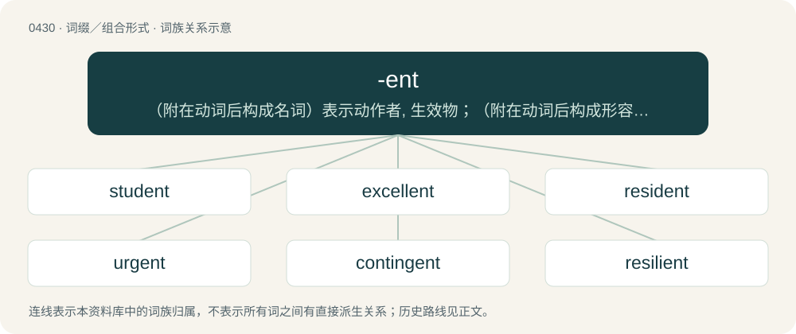

# 0492 · -ent — （附在动词后构成名词）表示动作者, 生效物；（附在动词后构成形容词）表示有...性质的, 作...动作的

[总目录](../00_总目录_按常用程度.md)

**类型**：词缀／组合形式　｜　**来源语言**：见词源记录

## 核心含义与来源

- 核心含义：（附在动词后构成名词）表示动作者, 生效物；（附在动词后构成形容词）表示有...性质的, 作...动作的
- 英文含义：Causing, doing, or promoting a certain action.
- 词形：-ent

**来源记录 1**（后缀／后置成分；Causing, doing, or promoting a certain action.）

From Middle English -ent, also -ant, -aunt, etc., from Old French -ent and its source Latin -ēns (accusative singular -entem), suffix of present participles of verbs in the 2nd, 3rd, and 4th conjugations.

## 词族图

## 单词速览（常用到不常用）

| 单词 | 音标 | 释义 |
|---|---|---|
| [student](#w-1) | /ˈstjuː.dn̩t/ | n. 学生, 研究者, 学者 |
| [excellent](#w-2) | 英 /ˈɛk.sə.lənt/；美 /ˈɛk.sə.lənt/ | a. 优良的, 杰出的, 出色的 |
| [resident](#w-3) | /ˈɹɛzɪdənt/ | n. 居民, 常驻程序, 居住者, 留鸟；a. 居留的, 定居的 |
| [urgent](#w-4) | 英 /ˈɜː.d͡ʒənt/；美 /ˈɝ.d͡ʒənt/ | a. 紧急的, 急迫的, 催逼的；\[经\] 紧急的, 急迫的 |
| [contingent](#w-5) | /kənˈtɪn.d͡ʒənt/ | a. 或许发生的, 附随的, 偶然发生的；n. 偶然事件, 分遣队 |
| [resilient](#w-6) | /ɹɪˈzɪl.jənt/ | a. 弹回的, 有弹力的；\[医\] 回弹的, 回能的 |
| [differentiation](#w-7) | 英 /dɪf.əˌɹɛn.ʃiˈeɪ.ʃən/；美 /ˌdɪf.əˌɹɛn.ʃiˈeɪ.ʃən/ | n. 区别, 分化, 变异；\[医\] 鉴别, 区别, 分化\[作用\], 微分法 |
| [solvent](#w-8) | 英 /ˈsɒlvənt/；美 /ˈsɔlvənt/ | n. 溶剂；a. 有偿付能力的, 有溶解力的 |
| [fluorescent](#w-9) | 英 /ˌflʊəˈɹɛsənt/；美 /flɔˈɹɛsənt/ | n. 荧光；a. 荧光的 |
| [recurrent](#w-10) | 英 /ɹɪˈkʌɹənt/；美 /ɹɪˈkɝənt/ | a. 再发生的, 定期重复的, 循环的；\[医\] 复发的, 再发的, 回归的 |
| [lenient](#w-11) | /ˈliːni.ənt/ | a. 宽大的, 温和的, 慈悲为怀的；\[法\] 宽大的, 仁慈的 |
| [salient](#w-12) | 英 /ˈseɪ.li.ənt/ | a. 显著的, 突出的, 跳跃的；n. 凸角, 突出部分 |
| [abhorrent](#w-13) | 英 /æbˈ(h)ɒɹənt/；美 /æbˈhɔɹənt/ | a. 令人憎恨的, 可恶的, 厌恶的, 相抵触的, 不一致的 |
| [transcendent](#w-14) | /tɹæn(t)ˈsɛndənt/ | a. 卓越的, 出类拔萃的, 超常的；n. 卓越的人, 超绝物 |
| [repellent](#w-15) | 英 /ɹəˈpɛlənt/；美 /ɹəˈpɛlənt/ | a. 抵抗的, 排斥的, 令人讨厌的, 防水的；n. 防水布, 防护剂 |
| [resplendent](#w-16) | /ɹɪˈsplɛn.dənt/ | a. 辉煌的, 灿烂的 |
| [luminescent](#w-17) | /luːmɪˈnɛs(ə)nt/ | a. 发冷光的, 发光的；\[电\] 发光的 |
| [referent](#w-18) | 英 /ˈɹɛf(ə)ɹənt/；美 /ˈɹɛf(ə)ɹənt/ | n. 指示物 |

## 逐词详解

### 1. student

**词性**：名词　｜　**音标**：/ˈstjuː.dn̩t/

**中文释义**：n. 学生, 研究者, 学者

**英文义项**：A person who studies or learns about a particular subject. / A person who is formally enrolled at a school, a college or university, or another educational institution.

**构词拆分**：stud(y) + -ent

**词源与演化**：

From Middle English student, studient, from Old French estudiant, estudiente, from Latin studēns, present participle of studeō (“dedicate oneself to, study”). Equivalent to stud(y) + -ent.

**例句**：

> The students were out raising funds for rag week.

该用例对应义项：A person who is formally enrolled at a school, a college or university, or another educational institution.

### 2. excellent

**词性**：形容词　｜　**音标**：英 /ˈɛk.sə.lənt/；美 /ˈɛk.sə.lənt/

**中文释义**：a. 优良的, 杰出的, 出色的

**英文义项**：Having excelled, having surpassed. / Of higher or the highest quality; splendid.

**构词拆分**：excel + -ent

**词源与演化**：

From Middle English excellent, from Old French excellent, from Latin excellēns (“elevated, exalted”), present participle of excellō (“elevate, exult”), equivalent to excel + -ent.

**例句**：

> Bill and Ted had an excellent adventure last week in preparation for their history exam.

该用例对应义项：Exceptionally good of its kind.

### 3. resident

**词性**：名词　｜　**音标**：/ˈɹɛzɪdənt/

**中文释义**：n. 居民, 常驻程序, 居住者, 留鸟；a. 居留的, 定居的

**英文义项**：A person, animal or plant living at a certain location or in a certain area. / A bird which does not migrate during the course of the year.

**构词拆分**：reside + -ent

**词源与演化**：

From Middle English resident, from Anglo-Norman resident, from Latin residēns, present participle of resideō (“to remain behind, reside, dwell”), equivalent to reside + -ent, from re- (“back”) + sedeō (“to sit”). Doublet of resiant and rezident. The espionage sense is a semantic loan from Russian резиде́нт (rezidént). (physician): So called because in the 19th century they resided in the hospital dormitories.

**例句**：

> She's a resident in neurosurgery at Mass General.

该用例对应义项：A physician receiving postgraduate medical training in a hospital or clinic.

### 4. urgent

**词性**：形容词　｜　**音标**：英 /ˈɜː.d͡ʒənt/；美 /ˈɝ.d͡ʒənt/

**中文释义**：a. 紧急的, 急迫的, 催逼的；\[经\] 紧急的, 急迫的

**英文义项**：Requiring immediate attention. / Of people: insistent, solicitous.

**构词拆分**：urge + -ent

**词源与演化**：

Borrowed from Middle French urgent (“pressing, impelling”), from Latin urgēns, from urgēre (“to press”), from Proto-Indo-European \*werǵʰ- (“bind, squeeze”). Equivalent to urge + -ent. Related to German würgen (“to strangle”), Lithuanian ver̃žti (“to string, tighten, constrict”), Russian (poetic) отверза́ть (otverzátʹ, “to open”, literally “to untie”), Polish otwierać (“to open”)) and English worry, wring, wreak, wreck.

**例句**：

> An urgent appeal was sent out for assistance.

该用例对应义项：Requiring immediate attention.

### 5. contingent

**词性**：形容词　｜　**音标**：/kənˈtɪn.d͡ʒənt/

**中文释义**：a. 或许发生的, 附随的, 偶然发生的；n. 偶然事件, 分遣队

**英文义项**：Possible or liable, but not certain, to occur. / Dependent on something that is undetermined or unknown, that may or may not occur.

**词源与演化**：

From Middle English, from Old French contingent (whence con- and -ent), from Medieval Latin contingens (“possible, contingent”), present participle of contingere (“to touch, meet, attain to, happen”), from com- (“together”) + tangere (“to touch”).

**例句**：

> The success of his undertaking is contingent upon events which he cannot control.

该用例对应义项：Dependent on something that is undetermined or unknown, that may or may not occur.

### 6. resilient

**词性**：形容词　｜　**音标**：/ɹɪˈzɪl.jənt/

**中文释义**：a. 弹回的, 有弹力的；\[医\] 回弹的, 回能的

**英文义项**：Returning quickly to original shape after force is applied; elastic. (of objects or substances) / Having the ability to absorb energy when deformed.

**词源与演化**：

From Latin resiliēns, resilientem (“rebounding”, present active participle of resiliō) (whence -ent), from saliō (“leap, jump”).

**例句**：

> As resilient as seasoned hickory.

该用例对应义项：elastic; rebounds readily

### 7. differentiation

**词性**：名词　｜　**音标**：英 /dɪf.əˌɹɛn.ʃiˈeɪ.ʃən/；美 /ˌdɪf.əˌɹɛn.ʃiˈeɪ.ʃən/

**中文释义**：n. 区别, 分化, 变异；\[医\] 鉴别, 区别, 分化\[作用\], 微分法

**英文义项**：The act of treating one thing as distinct from another, or of creating such a distinction; of separating a class of things into categories; of describing a thing by illustrating how it is different from something else. / The process of developing distinct components.

**构词拆分**：differentiate + -ion；different + -iate；differ + -ent

**词源与演化**：

From differentiate + -ion, from different + -iate, from differ + -ent, from Middle English differen, from Old French differer, from Latin differō (“carry apart, put off, defer; differ”), from dis- (“apart”) + ferō (“carry, bear”); cognate with Ancient Greek διαφέρω (diaphérō, “to differ”).

**例句**：

> Cell differentiation in the developing embryo.

该用例对应义项：(biology) the structural adaptation of some body part for a particular function

### 8. solvent

**词性**：名词　｜　**音标**：英 /ˈsɒlvənt/；美 /ˈsɔlvənt/

**中文释义**：n. 溶剂；a. 有偿付能力的, 有溶解力的

**英文义项**：A fluid that dissolves a solid, liquid, or gaseous solute, resulting in a solution. / That which resolves.

**构词拆分**：By surface analysis, solv(e) + -ent

**词源与演化**：

From French solvent, from Latin solventem, accusative singular of solvens, present participle of solvō. By surface analysis, solv(e) + -ent.

**例句**：

> The solvent does not change its state in forming a solution.

该用例对应义项：a liquid substance capable of dissolving other substances

### 9. fluorescent

**词性**：形容词　｜　**音标**：英 /ˌflʊəˈɹɛsənt/；美 /flɔˈɹɛsənt/

**中文释义**：n. 荧光；a. 荧光的

**英文义项**：Of or relating to fluorescence. / Exhibiting or produced by fluorescence.

**构词拆分**：fluoresce + -ent

**词源与演化**：

From fluoresce + -ent.

**例句**：

> The quality of fluorescent lighting technology has improved dramatically in recent years.

该用例对应义项：Emitting visible light as a result of the excitation of phosphors by ultraviolet photons produced by the passage of an electrical current through an inert gas infused with mercury.

### 10. recurrent

**词性**：形容词　｜　**音标**：英 /ɹɪˈkʌɹənt/；美 /ɹɪˈkɝənt/

**中文释义**：a. 再发生的, 定期重复的, 循环的；\[医\] 复发的, 再发的, 回归的

**英文义项**：Recurring; happening time after time. / Non-transient.

**构词拆分**：recur + -ent

**词源与演化**：

From Latin recurrens, present participle of recurrere. Morphologically recur + -ent.

**例句**：

> The patient complained of recurrent chest pain.

该用例对应义项：Recurring; happening time after time.

### 11. lenient

**词性**：形容词　｜　**音标**：/ˈliːni.ənt/

**中文释义**：a. 宽大的, 温和的, 慈悲为怀的；\[法\] 宽大的, 仁慈的

**英文义项**：Lax; not strict; tolerant of dissent or deviation.

**构词拆分**：-i- + -ent

**词源与演化**：

From Middle French lénient, from Latin lēniēns (whence -i- + -ent), present participle of lēnīre (“to soften, soothe”), from lēnis (“soft”).

**例句**：

> The standard is fairly lenient, so use your discretion.

该用例对应义项：Lax; not strict; tolerant of dissent or deviation.

### 12. salient

**词性**：形容词　｜　**音标**：英 /ˈseɪ.li.ənt/

**中文释义**：a. 显著的, 突出的, 跳跃的；n. 凸角, 突出部分

**英文义项**：Worthy of note; pertinent or relevant. / Prominent; conspicuous.

**词源与演化**：

The heraldic sense “leaping” and the sense “projecting outward” are borrowed from Latin salientem, the accusative form of saliēns (“springing, leaping”) (whence -ent), present participle of saliō (“leap, spring”, verb). The senses “prominent” and “pertinent” are relatively recent, and derive from the phrase salient point, which is a calque of the Latin punctum saliēns, a translation of Aristotle's term for the embryonal heart visible in (opened) eggs, which he thought seemed to move already. Compare also the German calque der springende Punkt.

**例句**：

> The article is not exhaustive, but it covers the salient points pretty well.

该用例对应义项：Worthy of note; pertinent or relevant.

### 13. abhorrent

**词性**：形容词　｜　**音标**：英 /æbˈ(h)ɒɹənt/；美 /æbˈhɔɹənt/

**中文释义**：a. 令人憎恨的, 可恶的, 厌恶的, 相抵触的, 不一致的

**英文义项**：Contrary to something; discordant. / Abhorring; detesting; having or showing abhorrence; loathing.

**构词拆分**：abhor + -ent

**词源与演化**：

Borrowed from Latin abhorrēns, abhorrēntis, present active participle of abhorreō (“abhor”). Equivalent to abhor + -ent.

**例句**：

> The behaviour of the kids during the lesson was abhorrent.

### 14. transcendent

**词性**：形容词　｜　**音标**：/tɹæn(t)ˈsɛndənt/

**中文释义**：a. 卓越的, 出类拔萃的, 超常的；n. 卓越的人, 超绝物

**英文义项**：Surpassing usual limits. / Supreme in excellence.

**构词拆分**：transcend + -ent

**词源与演化**：

From transcend + -ent, or borrowed from Latin trānscendēns.

**例句**：

> The notion of any transcendent reality beyond thought.

该用例对应义项：beyond and outside the ordinary range of human experience or understanding

### 15. repellent

**词性**：形容词　｜　**音标**：英 /ɹəˈpɛlənt/；美 /ɹəˈpɛlənt/

**中文释义**：a. 抵抗的, 排斥的, 令人讨厌的, 防水的；n. 防水布, 防护剂

**英文义项**：Repulsive, inspiring aversion. / Resistant or impervious to something.

**构词拆分**：repel + -ent

**词源与演化**：

From Latin repellēns. Equivalent to repel + -ent.

**例句**：

> The mixture of whey, beetroot juice, and spirulina seems repellent to me.

该用例对应义项：Repulsive, inspiring aversion.

### 16. resplendent

**词性**：形容词　｜　**音标**：/ɹɪˈsplɛn.dənt/

**中文释义**：a. 辉煌的, 灿烂的

**英文义项**：Shining brilliantly; gleaming; radiant. / Shiny and colorful, and thus pleasing to the eye; splendid in appearance.

**构词拆分**：resplend + -ent

**词源与演化**：

From the obsolete sense of the English verb splendish (“to shine”), from Latin splendere (“to shine”), or from resplend + -ent, from Latin resplendere (“to shine back, glitter”).

**例句**：

> The peacock displayed its resplendent plumage.

该用例对应义项：Shiny and colorful, and thus pleasing to the eye; splendid in appearance.

### 17. luminescent

**词性**：形容词　｜　**音标**：/luːmɪˈnɛs(ə)nt/

**中文释义**：a. 发冷光的, 发光的；\[电\] 发光的

**英文义项**：Emitting light by luminescence.

**构词拆分**：luminesce + -ent

**词源与演化**：

From stem of Latin lumen (“light”) + -escent, equivalent to luminesce + -ent.

### 18. referent

**词性**：名词　｜　**音标**：英 /ˈɹɛf(ə)ɹənt/；美 /ˈɹɛf(ə)ɹənt/

**中文释义**：n. 指示物

**英文义项**：The specific entity in the world that a word or phrase identifies or denotes: what it refers to. / That which is referenced.

**构词拆分**：From refer + -ent.

**词源与演化**：

From refer + -ent.
