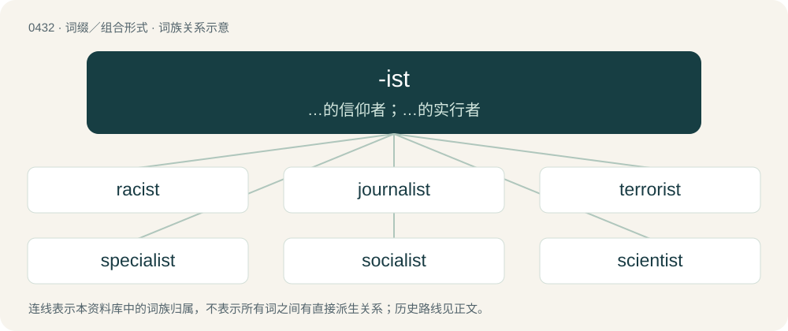

# 0494 · -ist — …的信仰者；…的实行者

[总目录](../00_总目录_按常用程度.md)

**类型**：词缀／组合形式　｜　**来源语言**：见词源记录

## 核心含义与来源

- 核心含义：…的信仰者；…的实行者
- 英文含义：a person who studies or practices a particular discipline;
- 词形：-ist

**来源记录 1**（后缀／后置成分；a person who studies or practices a particular discipline;）

From Middle English -ist, -iste, from Old French -iste and Latin -ista, from Ancient Greek -ιστής (-istḗs), from -ίζω (-ízō, “-ize, -ise”, verbal suffix) + -τής (-tḗs, agent-noun suffix). Equivalent to -ism + -t. Doublet of -ista. The speaker of a language sense is influenced by Esperanto -isto.

## 词族图

## 单词速览（常用到不常用）

| 单词 | 音标 | 释义 |
|---|---|---|
| [racist](#w-1) | 英 /ˈɹeɪ.sɪst/ | n. 种族主义者；\[法\] 种族主义的, 种族歧视 |
| [journalist](#w-2) | 英 /ˈd͡ʒɜːnəlɪst/；美 /ˈd͡ʒɝnəlɪst/ | n. 新闻记者, 从事新闻杂志业的人 |
| [terrorist](#w-3) | /ˈtɛɹəɹɪst/ | n. 恐怖分子；\[法\] 恐怖份子, 恐怖主义 |
| [specialist](#w-4) | /ˈspɛʃəlɪst/ | n. 专门医师, 专家；a. 专业的, 专家的 |
| [socialist](#w-5) | 英 /ˈsəʊʃəlɪst/；美 /ˈsoʊ.ʃə.lɪst/ | n. 社会主义者, 社会党党员；\[法\] 社会主义的 |
| [scientist](#w-6) | 英 /ˈsaɪəntɪst/；美 /ˈsaɪəntəst/ | n. 科学家；\[医\] 科学家 |
| [tourist](#w-7) | 英 /ˈtʊəɹɪst/；美 /ˈtʊɹɪst/ | n. 观光客, 旅行者；a. 旅游的 |
| [activist](#w-8) | 美 /ˈæk.tɪ.vɪst/ | n. 激进主义分子 |
| [therapist](#w-9) | /ˈθɛɹəpɪst/ | n. 治疗学家；\[医\] 治疗学家 |
| [nationalist](#w-10) | /ˈnæʃ.ə.nə.lɪst/ | n. 国家主义者, 民族主义者 |
| [psychologist](#w-11) | 美 /ˌsaɪˈkɑl.ə.d͡ʒɪst/ | n. 心理学家；\[医\] 心理学家 |
| [capitalist](#w-12) | /ˈkæp.ɪ.tə.lɪst/ | n. 资本家, 资本主义者；a. 资本主义的 |
| [catalyst](#w-13) | 英 /ˈkæt.ɪ.lɪst/；美 /ˈkæt.ə.lɪst/ | n. 触媒, 接触剂, 催化剂, 刺激因素, 促进因素；\[计\] 催化剂 |
| [psychiatrist](#w-14) | 美 /ˌsaɪˈkaɪ.ə.tɹɪst/ | n. 精神病医生, 精神病学家；\[医\] 精神病学家 |
| [methodist](#w-15) | /ˈmeθədist/ | n. 墨守成规者 |
| [guitarist](#w-16) | 英 /ɡɪˈtɑɹɪst/ | n. 吉他弹奏者 |
| [leftist](#w-17) | 英 /ˈlɛf.tɪst/ | n. 左翼的人, 左派；a. 左派的 |
| [rapist](#w-18) | /ˈɹeɪ.pɪst/ | n. 强奸犯；\[法\] 强奸犯 |
| [sexist](#w-19) | 英 /ˈsɛksɪst/ | n. 性别歧视者 |
| [novelist](#w-20) | 英 /ˈnɒvəlɪst/；美 /ˈnɑvəlɪst/ | n. 小说家 |
| [columnist](#w-21) | 英 /ˈkɒ.lə.mɪst/；美 /ˈkɑ.ləm.nɪst/ | n. 专栏作家 |
| [cyclist](#w-22) | 英 /ˈsaɪ.klɪst/ | n. 骑脚踏车的人 |
| [pianist](#w-23) | 英 /ˈpi.ənɪst/；美 /ˈpi.ənɪst/ | n. 钢琴家, 钢琴演奏者 |
| [extremist](#w-24) | /ɪkˈstɹiːmɪst/ | \[经\] 偏激份子 |
| [finalist](#w-25) | /ˈfainəlist/ | n. 决赛选手, 决赛队 |
| [physicist](#w-26) | 英 /ˈfɪzɪsɪst/ | n. 物理学家, 机械唯物论者, 自然科学家；\[医\] 菲西克氏手术(虹膜圆片切除) |
| [stylist](#w-27) | /ˈstaɪlɪst/ | n. 文体学家, 时装设计师 |
| [vocalist](#w-28) | 美 /ˈvoʊkəlɪst/ | n. 声乐家, 歌手 |
| [populist](#w-29) | 英 /ˈpɒp.jʊ.lɪst/；美 /ˈpɑ.pjə.lɪst/ | 民粹主義者 /民粹主义者 |
| [anarchist](#w-30) | 英 /ˈæn.ə.kɪst/；美 /ˈæn.ɑɹ.kɪst/ | n. 无政府主义者；\[法\] 无政府主义者 |
| [biologist](#w-31) | /baɪˈɒləd͡ʒɪst/ | n. 生物学家；\[医\] 生物学家 |
| [pharmacist](#w-32) | /ˈfɑɹməsɪst/ | n. 药师, 药品商, 药商, 药剂师；\[医\] 药师, 调剂员, 药商 |
| [unionist](#w-33) | /ˈjuː.ni.ə.nɪst/ | n. 工会会员, 工联主义者；\[法\] 工会会员, 工会主义者 |
| [minimalist](#w-34) | 英 /ˈmɪn.ɪ.məl.ɪst/；美 /ˈmɪn.ə.məl.ɪst/ | n. 极简抽象派艺术家 |
| [realist](#w-35) | 英 /ˈɹɪəlɪst/ | n. 现实主义者, 写实主义者, 实在论者 |
| [receptionist](#w-36) | 英 /ɹɪˈsɛp.ʃə.nɪst/ | n. 接待员 |
| [strategist](#w-37) | /ˈstɹætəd͡ʒɪst/ | n. 战略家 |
| [supremacist](#w-38) | /səˈpreməsist, sju-/ | n. 至上主义者 |
| [medalist](#w-39) | /ˈmɛdəlɪst/ | n. 奖章获得者, 奖章设计者, 奖章制作者, 勋章制作者, 奖章搜集者, 勋章搜集者 |
| [geologist](#w-40) | 英 /dʒiˈɒlədʒɪst/；美 /d͡ʒiˈɑːlədʒɪst/ | n. 地质学家, 地质学者 |
| [modernist](#w-41) | /ˈmɒdənist/ | n. 现代主义者, 现代人, 现代主义作家 |
| [bassist](#w-42) | 英 /ˈbeɪs.ɪst/ | n. 低音提琴手 |
| [centrist](#w-43) | 英 /ˈsɛn.tɹɪst/ | n. 中间党派的成员, 温和主义者；\[法\] 中间派议员, 中立派议员 |
| [anthropologist](#w-44) | 美 /ˌæn.θɹoʊˈpɑl.ə.d͡ʒɪst/ | n. 人类学家 |
| [fundamentalist](#w-45) | /.fʌndəˈmentəlist/ | n. 基要主义者 |
| [theorist](#w-46) | 英 /ˈθɪəɹɪst/；美 /ˈθiːəɹəst/ | n. 理论家, 理论工作者 |
| [naturalist](#w-47) | /ˈnæ.tʃə.ɹə.lɪst/ | n. 自然主义者 |
| [pathologist](#w-48) | /pæˈθɒlədʒist/ | n. 病理学家；\[医\] 病理学家 |
| [imperialist](#w-49) | /ɪmˈpɪəɹiəlɪst/ | n. 帝国主义者, 皇帝统治的拥护者, 皇帝派的人；a. 帝国主义的 |
| [archaeologist](#w-50) | 英 /ˌɑː.kiˈɒl.ə.d͡ʒɪst/；美 /ˌɑɹ.kiˈɑ.lə.d͡ʒɪst/ | n. 考古学家 |
| [philanthropist](#w-51) | /fiˈlænθrəpist/ | n. 慈善家, 博爱主义者, 乐善好施的人；\[法\] 慈善家, 博爱主义者 |
| [separatist](#w-52) | /ˈsɛpəɹətɪst/ | n. 分离主义者, 独立派 |
| [evangelist](#w-53) | /ɪˈvænd͡ʒəlɪst/ | n. 福音传道者, 圣经新约福音书的作者 |
| [lobbyist](#w-54) | 英 /ˈlɒ.bi.ɪst/；美 /ˈlɑ.bi.ɪst/ | n. 说客；\[法\] 院外活动集团成员 |
| [violinist](#w-55) | /.vaiəˈlinist/ | n. 小提琴演奏者, 小提琴家 |
| [alchemist](#w-56) | 美 /ˈæl.kə.mɪst/ | n. 炼金术士；\[化\] 炼丹家; 炼金术士 |
| [cartoonist](#w-57) | 美 /kɑɹˈtunɪst/ | n. 漫画家 |
| [elitist](#w-58) | 英 /ɪˈliːtɪst/ | n. 优秀人材, 杰出人材；a. 优秀人材的, 杰出人材的 |
| [motorist](#w-59) | /ˈməʊ.tə.ɹɪst/ | n. 开汽车者, 驾车旅行的人 |
| [pacifist](#w-60) | /ˈpæsɪfɪst/ | n. 和平主义者, 反战论者, 不抵抗主义者 |
| [publicist](#w-61) | /ˈpʌblisist/ | n. 国际法学家, 政治评论家, 政治作家, 广告员；\[法\] 国际法学家, 公法学家, 政治学 |
| [dermatologist](#w-62) | 英 /ˌdɜːməˈtɒlədʒɪst/；美 /ˌdɝ.məˈtɑ.lə.d͡ʒɪst/ | n. 皮肤学者, 皮肤科医生；\[医\] 皮肤病学家, 皮肤科医师 |
| [federalist](#w-63) | /ˈfɛdəɹəlˌɪst/ | n. 联邦制拥护者；\[法\] 联邦党, 联邦派, 联邦制拥护者 |
| [sociologist](#w-64) | /.səusiˈɒlədʒist/ | n. 社会学家；\[法\] 社会学家 |
| [loyalist](#w-65) | /ˈlɔɪəlɪst/ | n. 忠诚的人, 反对独立者, 反佛朗哥派的人 |
| [florist](#w-66) | 英 /ˈflɒɹɪst/；美 /ˈfloɹɪst/ | n. 花匠, 花商, 花卉研究者 |
| [soloist](#w-67) | /ˈsəuləuist/ | n. 独奏者, 独唱者 |
| [narcissist](#w-68) | /nɑːˈsisist/ | n. 自我陶醉者 |
| [jihadist](#w-69) |  | n. 伊斯兰圣战士 |
| [environmentalist](#w-70) | /in,vaiərənˈmentlist/ | n. 环保人士 |
| [meteorologist](#w-71) | /ˌmiːti.əˈɹɒ.lə.dʒɪst/ | n. 气象学者 |
| [reformist](#w-72) | /riˈfɒːmist/ | n. 改良主义者, 改革者 |
| [revisionist](#w-73) | /ɹɪˈvɪʒənɪst/ | n. 修正主义者；a. 修正主义的 |
| [misogynist](#w-74) | 英 /mɪˈsɒd͡ʒ.ən.ɪst/；美 /mɪˈsɑd͡ʒ.ən.ɪst/ | n. 厌恶女人的人 |
| [nutritionist](#w-75) | /njuːˈtɹɪʃ.ənɪst/ | n. 营养学家；\[医\] 营养学家 |
| [botanist](#w-76) | 英 /ˈbɒt.ən.ɪst/ | n. 植物学家 |
| [perfectionist](#w-77) | 美 /pɚˈfɛk.ʃənɪst/ | n. 至善论者, 过分挑剔者, 追求尽善尽美者, 圆满论者 |
| [linguist](#w-78) | 英 /ˈlɪŋɡwɪst/ | n. 语言学家 |
| [lyricist](#w-79) | /ˈlɪɹ.ɪsɪst/ | n. 抒情诗人, 歌曲作者 |
| [protectionist](#w-80) | /prəˈtekʃənist/ | n. 贸易保护主义者；a. 贸易保护主义的 |
| [idealist](#w-81) | /aiˈdiəlist/ | n. 理想主义者, 唯心主义者；a. 唯心论的, 理想主义的 |
| [industrialist](#w-82) | /inˈdʌstriəlist/ | n. 企业家, 实业家；\[经\] 实业家, 工业主义者 |
| [nudist](#w-83) | 英 /ˈnjuːdɪst/；美 /ˈnudɪst/ | n. 裸体主义者 |
| [archivist](#w-84) | /ˈɑː(ɹ)kɪvɪst/ | n. 案卷保管员；\[法\] 档案保管人 |
| [dramatist](#w-85) | /ˈdɹæmətɪst/ | n. 剧作家 |
| [royalist](#w-86) | /ˈrɒiəlist/ | n. 保皇党员, 顽固分子；a. 保皇党的 |
| [technologist](#w-87) | 英 /tɛkˈnɒləd͡ʒɪst/；美 /tɛkˈnɑləd͡ʒɪst/ | n. 工艺师, 技术员；\[医\] 技术员 |
| [oncologist](#w-88) | /ɒŋˈkɒləd͡ʒɪst/ | n. 肿瘤学家；肿瘤医师 |
| [apologist](#w-89) | /əˈpɒl.ə.d͡ʒɪst/ | n. 辩护者, 教义辩护文作者；\[法\] 辩护者, 辩解者 |
| [globalist](#w-90) | /-list/ | n. 支持全球主义者 |
| [opportunist](#w-91) | /ˌɒpə(ɹ)ˈtjuːnɪst/ | n. 机会主义者, 投机取巧者 |
| [surrealist](#w-92) | /səˈriəlist/ | n. 超现实主义者 |
| [traditionalist](#w-93) |  | n. 传统主义者, 因循守旧者 |
| [abolitionist](#w-94) | 英 /ˌæ.bəˈlɪʃ.n̩.ɪst/；美 /ˌæ.bəˈlɪʃ.n̩.ɪst/ | n. 废除主义者, 废奴主义者 |
| [motorcyclist](#w-95) | /ˈməutəsaiklist/ | n. 骑摩托车 |
| [saxophonist](#w-96) | 英 /ˌsækˈsɒ.fə.nɪst/；美 /ˈsæk.səˌfoʊn.ɪst/ | n. 萨克斯管吹奏者 |
| [psychotherapist](#w-97) | /.saikəuˈθerəpist/ | n. 精神治疗医生 |
| [futurist](#w-98) | /ˈfjuːtʃərist/ | n. 未来派画家, 未来主义者 |
| [cellist](#w-99) | /ˈt͡ʃɛlɪst/ | n. 大提琴演奏家 |
| [entomologist](#w-100) | /.entəməˈlɒdʒist/ | n. 昆虫学者；\[医\] 昆虫学家 |
| [conservationist](#w-101) | /,kənsəˈveiʃənist/ | n. 自然资源保护论者 |
| [ophthalmologist](#w-102) | 英 /ˌɒf.θælˈmɒ.lə.d͡ʒɪst/；美 /ˌɔf.θə(l)ˈmɑ.lə.d͡ʒɪst/ | n. 眼科医师；\[医\] 眼科学家 |
| [propagandist](#w-103) | 英 /pɹɒpəˈɡandɪst/ | n. 宣传者；a. 宣传的, 宣传者的 |
| [pessimist](#w-104) | /ˈpɛsɪmɪst/ | n. 悲观者, 厌世者, 悲观主义者 |
| [physiotherapist](#w-105) |  | n. 物理疗法家, 理疗家；\[医\] 理疗医师, 理疗学家 |
| [essayist](#w-106) | 美 /ˈɛ.seɪ.ɪst/ | n. 随笔作家, 评论家 |
| [panelist](#w-107) | /ˈpænəlist/ | n. 专门小组成员, 演出小组成员, 参加电视公开讨论会的成员, 答问小组的成员 |
| [radiologist](#w-108) | 英 /ˌɹeɪ.diːˈɒl.ə.d͡ʒɪst/；美 /ˌɹeɪ.diˈɑ.lə.d͡ʒɪst/ | n. 放射学者；\[医\] 放射学家 |
| [generalist](#w-109) | 英 /ˈd͡ʒɛn.(ə.)ɹə.lɪst/ | n. 多面手, 通才 |
| [isolationist](#w-110) | /.aisəˈleiʃənist/ | n. 孤立主义者 |
| [satirist](#w-111) | /ˈsætərist/ | n. 讽刺作者, 爱挖苦的人 |
| [typist](#w-112) | /ˈtaɪpɪst/ | n. 打字员 |
| [universalist](#w-113) | /.juːniˈvəːsəlist/ | n. 博学多才者, 兴趣广泛者, 普救论者, 普救派教徒 |
| [anesthesiologist](#w-114) | /,ænis,θiziˈɔlədʒist/ | n. 麻醉学者；\[医\] 麻醉学家 |
| [interventionist](#w-115) | /.intəˈvenʃənist/ | n. 干涉主义者；a. 干涉主义的 |
| [geneticist](#w-116) | /d͡ʒəˈnɛt.ɪ.sɪst/ | n. 遗传学家；\[医\] 遗传学家 |
| [materialist](#w-117) | /məˈtiːɹɪəlɪst/ | n. 唯物主义者 |
| [statist](#w-118) | 英 /ˈsteɪtɪst/ | n. 统计学者, 中央集权论者 |
| [arsonist](#w-119) | 英 /ˈɑːsənɪst/；美 /ˈɑɹsənəst/ | n. 纵火犯；\[法\] 纵火犯, 放火犯 |
| [purist](#w-120) | 英 /ˈpjʊəɹɪst/；美 /ˈpjʊɹ.ɪst/ | n. 纯粹主义者 |
| [secessionist](#w-121) | /siˈseʃənist/ | n. 脱离论者, 分离论者 |
| [expansionist](#w-122) | /ɪkˈspæn.ʃən.ɪst/ | a. (关于)扩张主义的, 赞同扩张主义的；n. 扩张主义者, 领土扩张论者 |
| [hobbyist](#w-123) | 英 /ˈhɒb.ɪ.ɪst/；美 /ˈhɑb.i.ɪst/ | n. 有业余癖好者；\[计\] 业余爱好者 |
| [alarmist](#w-124) | 美 /əˈlɑɹmɪst/ | n. 轻事重报者, 杞人忧天者 |
| [rationalist](#w-125) | /ˈræʃənəlist/ | n. 理性论者, 纯理论者, 理性主义者 |
| [conformist](#w-126) | 英 /kənˈfɔː.mɪst/；美 /kənˈfɔɹ.mɪst/ | n. 遵奉习俗, 遵纪守法者, 遵奉国教会惯例者 |
| [hygienist](#w-127) | /ˈhaidʒiːnist/ | n. 卫生学者；\[医\] 卫生学家 |
| [individualist](#w-128) | /.indiˈvidʒuəlist/ | n. 个人主义者, 利己主义者 |
| [instrumentalist](#w-129) | /.instruˈmentəlist. instrə-/ | n. 工具主义者；乐器演奏家 |
| [escapist](#w-130) | /isˈkeipist/ | a. 逃避现实的；n. 逃避现实者 |
| [colonist](#w-131) | 英 /ˈkɒlənɪst/；美 /ˈkɑlənɪst/ | n. 殖民地居民, 移民 |
| [expressionist](#w-132) | /ikˈspreʃənist/ | n. 表现派作家；a. 表现主义的 |
| [optometrist](#w-133) | 英 /ɒpˈtɒmətɹɪst/；美 /ɑpˈtɑmətɹɪst/ | n. 验光师, 配镜师；\[医\] 验光师 |
| [keyboardist](#w-134) | /ˈkiː,bɔːdist/ | n. 键盘乐器演奏者 |
| [orthodontist](#w-135) | /ˌɔː(ɹ)θəˈdɒntɪst/ | n. 畸齿校整医生；\[医\] 正牙学家 |
| [paleontologist](#w-136) | /.pæliɒnˈtɒlədʒist/ | n. 古生物学者 |
| [survivalist](#w-137) | /səˈvaivəlist/ | n. 成功地活下来的人,活命主义者 |
| [urologist](#w-138) | /juəˈrɒlədʒist/ | n. 泌尿科医师；\[医\] 泌尿科学家, 泌尿科医师 |
| [internationalist](#w-139) | /.intəˈnæʃənəlist/ | n. 国际主义者, 国际法学家；\[法\] 国际法学家, 国际主义者, 国际派 |
| [tsarist](#w-140) | /ˈ(t)sɑːɹɪst/ | a. 沙皇的, 沙皇式的, 专制的, 沙皇时代的, 沙皇派的, 拥护沙皇制度的；n. 沙皇的支持者, 沙皇制度的支持者 |
| [zoologist](#w-141) | 英 /zəʊˈɒləd͡ʒɪst/；美 /zoʊˈɑləd͡ʒɪst/ | n. 动物学家；\[医\] 动物学家 |
| [hypnotist](#w-142) | /ˈhɪpnətɪst/ | n. 催眠术士；\[医\] 催眠术士 |
| [creationist](#w-143) | /krɪˈeɪʃnɪst/ | n. 神灵论者, 上帝论者; 特创论者（即相信万物皆由上帝一次造成者） |
| [epidemiologist](#w-144) | /ˈepi,diːmiˈɔlədʒist/ | n. 流行病学家 |
| [reservist](#w-145) | /riˈzəːvist/ | n. 后备军人 |
| [collectivist](#w-146) | /kəˈlɛktɪvɪst/ | n. 集体主义者 |
| [constructivist](#w-147) | /kənˈstrʌktivist/ | n. 构成派造型艺术家 |
| [sensationalist](#w-148) | /senˈseiʃənəlist/ | n. 爱采用耸人听闻手法的人, 感觉论者 |
| [endocrinologist](#w-149) | 英 /ˈɛn.dəʊ.kɹɪnˌɒl.ə.dʒɪst/ | \[医\] 内分泌学家 |
| [percussionist](#w-150) | /pəˈkʌʃənist/ | n. 敲击乐器演奏者, 敲奏打击乐器的人 |
| [ventriloquist](#w-151) | 英 /vɛnˈtɹɪl.ə.kwɪst/ | n. 口技艺人 |
| [colonialist](#w-152) | 美 /kəˈloʊ.ni.ə.lɪst/ | n. 殖民主义者；\[法\] 殖民主义者 |
| [humorist](#w-153) | /ˈhjuːmərist/ | n. 幽默家, 幽默作家 |
| [illusionist](#w-154) | /iˈluːʒ(ə)nist/ | n. 幻想家, 魔术师 |
| [masochist](#w-155) | /ˈmæ.səˌkɪst/ | n. 被虐待狂, 受虐待者；\[医\] 受虐狂者 |
| [spiritualist](#w-156) | /ˈspiritjjəlist,-tʃjə-/ | n. 唯灵论者, 迷信招魂术者 |
| [mentalist](#w-157) |  | n. 算命者 |
| [rightist](#w-158) | /ˈɹaɪtɪst/ | n. 右派人士, 保守党员；a. 右翼的, 右派的 |
| [exhibitionist](#w-159) | /ɛksɪˈbɪʃənɪst/ | n. 倾向自我宣传的人, 裸露症患者；\[医\] 露出欲者, 露出狂者 |
| [monarchist](#w-160) | /ˈmɒnəkist/ | n. 君主主义者 |
| [absolutist](#w-161) | 英 /ˈæb.səˌluː.tɪst/；美 /ˈæb.səˌlu.tɪst/ | n. 专制主义者, 专制政体者, 绝对主义者 |
| [cubist](#w-162) | /ˈkjuːbist/ | n. 立体派画家；a. 立体派的 |
| [consumerist](#w-163) | /kənˈsuːmərɪst/ | 用户至上主义者, 主张消费主义的人 |
| [defeatist](#w-164) | 英 /dɪˈfiːtɪst/ | n. 失败主义者 |
| [existentialist](#w-165) | 美 /ɛɡzɪsˈtɛnt͡ʃʰələst/ | n. 存在主义者 |
| [absurdist](#w-166) | 英 /əbˈsɜːd.əst/；美 /æbˈsɝd.əst/ | n. 荒诞主义者 |
| [corporatist](#w-167) | /ˈkɔːpərətist/ | n. 组合主义者,社团主义者 |
| [nihilist](#w-168) | 英 /ˈnaɪ.(h)ɪl.ɪst/；美 /ˈnaɪ.(h)ɪl.ɪst/ | n. 虚无主义者 |
| [genealogist](#w-169) | 英 /ˈdʒiː.niːˌæl.ə.dʒɪst/ | n. 系谱学者, 系谱专家 |
| [herbalist](#w-170) | 英 /ˈhɜːbəlɪst/；美 /ˈ(h)ɜɹbələst/ | n. 草药医生；\[医\] 草药医 |
| [conversationalist](#w-171) | 英 /ˌkɒnvəˈseɪʃənəlɪst/；美 /ˌkɑːnvɚˈseɪʃənəlɪst/ | n. 交谈者, 健谈者 |
| [colorist](#w-172) | /ˈkʌlərist/ | n. 善于运用色彩的画家, 配色师, 着色师；\[建\] 着色师 |
| [internist](#w-173) | /inˈtəːnist/ | n. 内科医师；\[医\] 内科医师 |
| [naturist](#w-174) | /ˈneɪt͡ʃəɹɪst/ | n. (=nudist)天体运动者, 裸体主义者(指认为裸体有益身心的人) |
| [secularist](#w-175) | /ˈsekjulərist/ | n. 现世主义者, 宗教与教育分离论者 |
| [orientalist](#w-176) | 美 /ˌɔɹiˈɛntəlɪst/ | 【英文】Of the West, to take in aspects of the East; pertaining to the representational tendency orientalism. |
| [accompanist](#w-177) | /əˈkʌmp(ə)nɪst/ | n. 伴奏者 |
| [brutalist](#w-178) | /ˈbruːtəlist/ | n. 野兽派(信奉美术、建筑或文学上野兽主义的人) |
| [reductionist](#w-179) | /rɪˈdʌkʃənɪst/ | 还原论者 |
| [criminologist](#w-180) | 英 /ˈkɹɪ.mɪ.nɒ.lə.dʒɪst/；美 /ˈkɹɪ.mə.nɑ.lə.dʒɪst/ | n. 犯罪学学者；\[法\] 刑事学家, 犯罪学家 |
| [horticulturist](#w-181) | /.hɒːtiˈkʌltʃərist/ | n. 园艺家 |
| [ableist](#w-182) | /ˈeɪ.bəl.ɪst/ | 【英文】Exhibiting or relating to ableism. |
| [behaviorist](#w-183) |  | n. 行为主义者；\[医\] 行为主义者 |
| [podiatrist](#w-184) | /pəˈdaɪətɹɪst/ | n. 脚病医生；\[医\] \[手\]足医 |
| [occultist](#w-185) | /əˈkʌltɪst/ | n. 神秘学者,术士 |
| [ornithologist](#w-186) | 英 /ˌɔːnɪˈθɒləd͡ʒɪst/；美 /ˌɔɹnɪˈθɑləd͡ʒɪst/ | n. 鸟类学者 |
| [nativist](#w-187) | /ˈneitivist/ | n. 先天论者, 乡土主义者, 本土主义者 |
| [agronomist](#w-188) | 英 /əˈɡɹɒnəmɪst/；美 /əˈɡɹɑːnəmɪst/ | n. 农艺师, 农学家 |
| [pluralist](#w-189) | /ˈpluərəlist/ | n. 兼职者, 多元论者 |
| [anatomist](#w-190) | 英 /əˈnæt.ə.mɪst/ | n. 解剖学家；\[医\] 解剖学家 |
| [gastroenterologist](#w-191) |  | n. 胃肠病学家；\[医\] 胃肠病学家 |
| [militarist](#w-192) | 英 /ˈmɪl.ɪ.tə.ɹɪst/；美 /ˈmɪl.ə.tə.ɹɪst/ | n. 军国主义者, 军事家 |
| [obstructionist](#w-193) | 英 /əbˈstɹʌk.ʃənˌɪst/ | \[法\] 妨碍会议议事者 |
| [polygamist](#w-194) | /pəˈlɪɡəmɪst/ | n. 多配偶者, 多配偶论者 |
| [contortionist](#w-195) | /kənˈtɔː(ɹ)ʃənɪst/ | n. 善作柔体表演的杂技演员 |
| [psalmist](#w-196) | /ˈsɑːmɪst/ | n. 赞美诗作者, 领唱者 |
| [theist](#w-197) | /ˈθiːɪst/ | n. 有神论者, 一神论者 |
| [harpist](#w-198) | 美 /ˈhɑɹpɪst/ | n. 竖琴师 |
| [positivist](#w-199) | /ˈpɒzitivist/ | n. 实证论者, 实证主义者；\[法\] 实在法学派, 实证主义者, 实证论者 |
| [diarist](#w-200) | /ˈdaɪəɹɪst/ | n. 记日记的人, 日记作者 |
| [panellist](#w-201) | /ˈpænəlist/ | n. 小组辩论, 猜谜参加者 |
| [postmodernist](#w-202) | /pəʊstˈmɒdənɪst/ | n. 现代派后期艺术家(或信徒)；后现代主义艺术家(或信徒)；a. 现代派后期艺术家(或艺术)的；后现代主义艺术家(或艺术)的 |
| [projectionist](#w-203) | /prəˈdʒekʃənist/ | n. 放映员, 电视技师, 地图制作者 |
| [syndicalist](#w-204) | /ˈsindiklist/ | n. 工团主义者 |
| [moralist](#w-205) | /ˈmɒrəlist/ | n. 道德家, 讲道德的人, 伦理学者 |
| [revivalist](#w-206) | /riˈvaivəlist/ | n. 信仰复兴运动者, 领导宗教复兴运动者 |
| [segregationist](#w-207) | /,se^riˈ^eiʃənist/ | n. 种族隔离主义者 |
| [classicist](#w-208) | 美 /ˈklæsɪsɪst/ | n. 古典学者, 古典主义者 |
| [copyist](#w-209) | 英 /ˈkɒpiɪst/；美 /ˈkɑpiɪst/ | n. 抄写员, 模仿者 |
| [metallurgist](#w-210) | 英 /ˌməˈtæləd͡ʒɪst/；美 /ˈmɛtəˌlɝd͡ʒɪst/ | n. 冶金家, 冶金学者；\[机\] 治金学者, 治金家 |
| [objectivist](#w-211) | /əbˈdʒektivist/ | n. 客观主义者 |
| [virologist](#w-212) | /vɪˈɹɒlədʒɪst/ | n. 病毒学学者；\[医\] 病毒学家 |
| [structuralist](#w-213) | /ˈstrʌktʃərəlist/ | n. 结构主义者, 结构语言学家 |
| [allergist](#w-214) | /ˈælədʒist/ | n. 过敏症专科医生 |
| [functionalist](#w-215) | /ˈfʌŋkʃənəlɪst/ | n. 机能主义者 |
| [formalist](#w-216) | 美 /ˈfɔɹml̩ˌɪst/ | n. 拘泥形式的人, 形式主义者 |
| [cultist](#w-217) | /ˈkʌltɪst/ | n. 热衷搞迷信崇拜的人 |
| [musicologist](#w-218) | /.mjuːziˈkɒlədʒist/ | n. 音乐学者 |
| [philologist](#w-219) | /fiˈlɒlədʒist/ | n. 语文学者, 文献学者 |
| [semifinalist](#w-220) | /ˌsɛmiˈfaɪnəlɪst/ | n. 半决赛选手 |
| [classist](#w-221) | 美 /ˈklæsɪst/ | n. 阶级歧视者；a. 实行阶级歧视的；有阶级偏见的 |
| [duelist](#w-222) | /ˈdjuːəlist/ | n. 决斗者 |
| [rheumatologist](#w-223) |  | \[医\] 风湿病学家 |
| [ageist](#w-224) | 英 /ˈeɪ̯.dʒɪst/ | 年龄歧视者 |
| [constitutionalist](#w-225) | /-ist/ | n. 立宪主义者, 拥护宪政者 |
| [pugilist](#w-226) | 英 /ˈpjuː.d͡ʒɪlɪst/；美 /ˈpju(ː).d͡ʒəlɪst/ | n. 拳击手 |
| [climatologist](#w-227) | /klaɪməˈtɒlədʒɪst/ | n. 气候学家 |
| [fetishist](#w-228) | /ˈfɛtɪʃɪst/ | n. 物神崇拜者；\[医\] 恋物癖者 |
| [librettist](#w-229) | /liˈbretist/ | n. 歌词作者 |
| [maximalist](#w-230) | /ˈmæksiməlist/ | n. 俄国多数派成员 |
| [trombonist](#w-231) | 英 /tɹɒmˈbəʊ.nɪst/；美 /tɹɑmˈboʊ.nɪst/ | n. 长号手 |
| [ethicist](#w-232) | /ˈɛθɪsɪst/ | 伦理学家 |
| [anesthetist](#w-233) | 英 /əˈniːsθətɪst/；美 /əˈnɛsθətɪst/ | n. 麻醉师；\[医\] 麻醉师 |
| [hedonist](#w-234) | 英 /ˈhɛdənɪst/；美 /ˈhiːdənɪst/ | n. 快乐主义者, 享乐主义者 |
| [audiologist](#w-235) |  | \[医\] 听力学家 |
| [essentialist](#w-236) | /ˌɪˈsenʃəlɪst/ | n. 基本教育说, 实在说 |
| [tobacconist](#w-237) | /təˈbækənist/ | n. 烟草商 |
| [toxicologist](#w-238) | /.tɒksiˈkɒlədʒist/ | n. 毒理学者, 毒物学者；\[医\] 毒理学家, 毒物学家 |
| [clarinetist](#w-239) | /ˌklæɹɪˈnɛtɪst/ | n. 吹木箫者 |
| [hospitalist](#w-240) | /ˈhɒspɪtəlɪst/ | n. 仅在医院工作的医师。亦称为 hospital-based specialist or internist,admitting doctor,rounder |
| [immunologist](#w-241) |  | n. 免疫学家；\[医\] 免疫学家 |
| [acupuncturist](#w-242) | 英 /ˈæk.jʊ.pʌŋk.tʃər.ɪst/；美 /ˈæk.jə.pʌŋk.tʃɚ.ɪst/ | n. 针灸医生 |
| [arborist](#w-243) | /ˈɑːbɔːrist/ | n. 树木栽培家 |
| [fantasist](#w-244) | /ˈfæntəsist/ | n. 幻想曲作曲家 |
| [chartist](#w-245) | /ˈtʃɑːtist/ | n. 宪章派, 宪章运动者；\[经\] 图解专家 |
| [parachutist](#w-246) | /ˈpærəʃuːtist/ | n. 伞兵, 跳伞运动员 |
| [prohibitionist](#w-247) |  | n. 禁酒主义者 |

## 逐词详解

### 1. racist

**词性**：形容词　｜　**音标**：英 /ˈɹeɪ.sɪst/

**中文释义**：n. 种族主义者；\[法\] 种族主义的, 种族歧视

**英文义项**：Constituting, exhibiting, advocating, or pertaining to racism. / Discriminatory.

**构词拆分**：race + -ist

**词源与演化**：

1932 (noun), 1938 (adjective). Formed from racism (1928), paralleling French raciste (1892). Replaced older racialist (1910). Equivalent to race + -ist.

**例句**：

> They don't allow Muslims and gays to join the club? That's racist!

该用例对应义项：Discriminatory.

### 2. journalist

**词性**：名词　｜　**音标**：英 /ˈd͡ʒɜːnəlɪst/；美 /ˈd͡ʒɝnəlɪst/

**中文释义**：n. 新闻记者, 从事新闻杂志业的人

**英文义项**：The keeper of a personal journal, who writes in it regularly. / One whose occupation is journalism, originally only writing in the printed press.

**构词拆分**：journal + -ist

**词源与演化**：

From journal + -ist.

**例句**：

> This journalist, whose article you were so interested in, is my neighbor.

### 3. terrorist

**词性**：名词　｜　**音标**：/ˈtɛɹəɹɪst/

**中文释义**：n. 恐怖分子；\[法\] 恐怖份子, 恐怖主义

**英文义项**：A person, group, or organization that uses violent action, or the threat of violent action, to further political goals.

**构词拆分**：terror + -ist

**词源与演化**：

From terror + -ist. In the historical sense, after French terroriste. First used in 1794 in the Courier and Evening Gazette.

**例句**：

> Mr. President, my name is Khan and I am not a terrorist.

### 4. specialist

**词性**：名词　｜　**音标**：/ˈspɛʃəlɪst/

**中文释义**：n. 专门医师, 专家；a. 专业的, 专家的

**英文义项**：Someone who is an expert in, or devoted to, some specific branch of study or research. / A player on a team who primarily employs one particular skill or takes one particular role.

**构词拆分**：special + -ist

**词源与演化**：

Borrowed from French spécialiste, equivalent to special + -ist.

**例句**：

> The tree Lepidothamnus laxifolius is a high alpine specialist found in high-altitude bog communities and in scrub.

该用例对应义项：An organism that is specialized for a particular environment.

### 5. socialist

**词性**：形容词　｜　**音标**：英 /ˈsəʊʃəlɪst/；美 /ˈsoʊ.ʃə.lɪst/

**中文释义**：n. 社会主义者, 社会党党员；\[法\] 社会主义的

**英文义项**：Of, relating to, supporting, or advocating socialism.

**构词拆分**：social + -ist

**词源与演化**：

From social + -ist.

**例句**：

> The Nazis were as socialist as the Holy Roman Empire was Roman.

### 6. scientist

**词性**：名词　｜　**音标**：英 /ˈsaɪəntɪst/；美 /ˈsaɪəntəst/

**中文释义**：n. 科学家；\[医\] 科学家

**英文义项**：One whose activities make use of the scientific method to answer questions regarding the measurable universe. A scientist may be involved in original research, or make use of the results of the research of others.

**词源与演化**：

Coined by English philosopher and historian of science William Whewell in March 1834 in an anonymous review of Mary Somerville's book On the Connexion of the Physical Sciences in the Quarterly Review as a suggested replacement for, and later seriously introduced by him in 1840 (see the quotation) as a more precise substitute for, the terms natural philosopher and man of science. Modeled after artist, from the Latin stem scientia (“knowledge”) + -ist.

**例句**：

> The scientist searched for the bones of the dinosaurs in the valley.

### 7. tourist

**词性**：名词　｜　**音标**：英 /ˈtʊəɹɪst/；美 /ˈtʊɹɪst/

**中文释义**：n. 观光客, 旅行者；a. 旅游的

**英文义项**：Someone who travels for pleasure rather than for business; a leisure visitor. / One who only has a superficial interest in something.

**构词拆分**：tour + -ist

**词源与演化**：

From tour + -ist. Doublet of turista.

**例句**：

> Tourist shops are full of kitsch.

该用例对应义项：Someone who travels for pleasure rather than for business; a leisure visitor.

### 8. activist

**词性**：名词　｜　**音标**：美 /ˈæk.tɪ.vɪst/

**中文释义**：n. 激进主义分子

**英文义项**：One who is politically active in the role of a citizen; especially, one who campaigns for change. / One who is conspicuously active in carrying out any occupational or professional functions.

**构词拆分**：active + -ist

**词源与演化**：

From active + -ist.

**例句**：

> Activist groups for the environment and food safety question the product's safety.

### 9. therapist

**词性**：名词　｜　**音标**：/ˈθɛɹəpɪst/

**中文释义**：n. 治疗学家；\[医\] 治疗学家

**英文义项**：Someone who provides therapy, usually professionally. / A psychotherapist specifically.

**构词拆分**：therapy + -ist

**词源与演化**：

From therapy + -ist.

**例句**：

> Tom has been seeing a therapist for a month and a half.

### 10. nationalist

**词性**：名词　｜　**音标**：/ˈnæʃ.ə.nə.lɪst/

**中文释义**：n. 国家主义者, 民族主义者

**英文义项**：An advocate of nationalism.

**构词拆分**：national + -ist

**词源与演化**：

From national + -ist.

**例句**：

> You are either a globalist or a nationalist; one cannot be both.

该用例对应义项：An advocate of nationalism.

### 11. psychologist

**词性**：名词　｜　**音标**：美 /ˌsaɪˈkɑl.ə.d͡ʒɪst/

**中文释义**：n. 心理学家；\[医\] 心理学家

**英文义项**：An expert in the field of psychology.

**构词拆分**：psychology + -ist

**词源与演化**：

From psycholog(y) + -ist.

**例句**：

> Tom could've become an excellent surgeon, but instead became a mediocre psychologist.

### 12. capitalist

**词性**：形容词　｜　**音标**：/ˈkæp.ɪ.tə.lɪst/

**中文释义**：n. 资本家, 资本主义者；a. 资本主义的

**英文义项**：Of, or pertaining to, capitalism. / Supporting or endorsing capitalism.

**构词拆分**：capital + -ist

**词源与演化**：

From capital + -ist. Calque of French capitaliste.

**用法示例／搭配（非完整句）**：

> capitalist countries

该用例对应义项：Of, or pertaining to, capitalism.

### 13. catalyst

**词性**：名词　｜　**音标**：英 /ˈkæt.ɪ.lɪst/；美 /ˈkæt.ə.lɪst/

**中文释义**：n. 触媒, 接触剂, 催化剂, 刺激因素, 促进因素；\[计\] 催化剂

**英文义项**：A substance that increases the rate of a chemical reaction without being consumed in the process. / Something that encourages progress or change.

**构词拆分**：catalysis + -ist

**词源与演化**：

From catalysis + -ist.

**例句**：

> Economic development and integration are working as a catalyst for peace.

该用例对应义项：Something that encourages progress or change.

### 14. psychiatrist

**词性**：名词　｜　**音标**：美 /ˌsaɪˈkaɪ.ə.tɹɪst/

**中文释义**：n. 精神病医生, 精神病学家；\[医\] 精神病学家

**英文义项**：A medical doctor specializing in psychiatry.

**构词拆分**：psychiatry + -ist

**词源与演化**：

From psychiatry + -ist.

**例句**：

> We can't let it get out that Tom is seeing a psychiatrist.

### 15. methodist

**词性**：名词　｜　**音标**：/ˈmeθədist/

**中文释义**：n. 墨守成规者

**英文义项**：One who follows a method. / One who limits the domain of science to that which can be investigated using the scientific method.

**构词拆分**：method + -ist

**词源与演化**：

From method + -ist.

**例句**：

> George Lucas describes himself as a Buddhist Methodist.

### 16. guitarist

**词性**：名词　｜　**音标**：英 /ɡɪˈtɑɹɪst/

**中文释义**：n. 吉他弹奏者

**英文义项**：Someone who plays a guitar.

**构词拆分**：guitar + -ist

**词源与演化**：

From guitar + -ist.

**例句**：

> Tom is primarily the bass guitarist, but he sometimes sings backup vocals.

### 17. leftist

**词性**：名词　｜　**音标**：英 /ˈlɛf.tɪst/

**中文释义**：n. 左翼的人, 左派；a. 左派的

**英文义项**：A person who holds views associated with the political left. / Someone who holds socialist or communist-leaning economic views, usually alongside progressive social views; an anticapitalist.

**构词拆分**：left + -ist

**词源与演化**：

From left + -ist.

**例句**：

> I'm leftist. This means that my left hand is dominant.

### 18. rapist

**词性**：名词　｜　**音标**：/ˈɹeɪ.pɪst/

**中文释义**：n. 强奸犯；\[法\] 强奸犯

**英文义项**：One who has committed rape; someone who raped another person.

**构词拆分**：rape + -ist

**词源与演化**：

From rape + -ist.

**例句**：

> Julian Assange is accused of being a rapist and a spy.

### 19. sexist

**词性**：形容词　｜　**音标**：英 /ˈsɛksɪst/

**中文释义**：n. 性别歧视者

**英文义项**：Unfairly discriminatory against one sex in favour of the other.

**构词拆分**：sex + -ist

**词源与演化**：

From sex + -ist, after sexism.

**例句**：

> How come only girls get to be vampire slayers? That's so sexist!

### 20. novelist

**词性**：名词　｜　**音标**：英 /ˈnɒvəlɪst/；美 /ˈnɑvəlɪst/

**中文释义**：n. 小说家

**英文义项**：An author of novels.

**构词拆分**：novel + -ist

**词源与演化**：

From novel + -ist.

**例句**：

> In addition to being a famous physicist, he is a great novelist.

### 21. columnist

**词性**：名词　｜　**音标**：英 /ˈkɒ.lə.mɪst/；美 /ˈkɑ.ləm.nɪst/

**中文释义**：n. 专栏作家

**英文义项**：A regular writer of a column, such as in a magazine or newspaper.

**构词拆分**：column + -ist

**词源与演化**：

From column + -ist, from Latin and Greek, ultimately from Proto-Indo-European \*kʷel-.

**用法示例／搭配（非完整句）**：

> a sporadic columnist

该用例对应义项：A regular writer of a column, such as in a magazine or newspaper.

### 22. cyclist

**词性**：名词　｜　**音标**：英 /ˈsaɪ.klɪst/

**中文释义**：n. 骑脚踏车的人

**英文义项**：A person who rides a cycle, especially a bicycle, or who habitually engages in cycling. / A motorcyclist.

**构词拆分**：cycle + -ist

**词源与演化**：

From cycle + -ist, 1882.

**例句**：

> A cyclist was hit by a lorry turning right and seriously injured.

### 23. pianist

**词性**：名词　｜　**音标**：英 /ˈpi.ənɪst/；美 /ˈpi.ənɪst/

**中文释义**：n. 钢琴家, 钢琴演奏者

**英文义项**：A person who plays the piano, particularly with skill or as part of an orchestra. / A spy using radio or wireless telegraphy to keep in touch with headquarters during the Second World War.

**构词拆分**：piano + -ist

**词源与演化**：

From French pianiste, from Italian pianista. Analyzable as piano + -ist.

**例句**：

> By the time she became the world's greatest pianist, she had already practised for thousands of hours on her prized piano.

该用例对应义项：A person who plays the piano, particularly with skill or as part of an orchestra.

### 24. extremist

**词性**：名词　｜　**音标**：/ɪkˈstɹiːmɪst/

**中文释义**：\[经\] 偏激份子

**英文义项**：A person who holds extreme views, especially one who advocates such views; a radical or fanatic.

**构词拆分**：extreme + -ist

**词源与演化**：

From extreme + -ist.

**例句**：

> We're not going to let a bunch of extremist sociopaths divide Algeria.

### 25. finalist

**词性**：名词　｜　**音标**：/ˈfainəlist/

**中文释义**：n. 决赛选手, 决赛队

**英文义项**：An adherent of finalism; someone who believes that a given process or situation is in its final state, with no further change possible. / Someone who believes that natural processes (especially evolution) are tending towards some specific final state; a teleologist.

**构词拆分**：final + -ist

**词源与演化**：

From final + -ist.

**例句**：

> Former Delray Beach finalist Donald Young is now a French Open doubles finalist.

### 26. physicist

**词性**：名词　｜　**音标**：英 /ˈfɪzɪsɪst/

**中文释义**：n. 物理学家, 机械唯物论者, 自然科学家；\[医\] 菲西克氏手术(虹膜圆片切除)

**英文义项**：A person whose occupation specializes in the science of physics, especially at a professional level.

**构词拆分**：physics + -ist

**词源与演化**：

From physics + -ist. Coined by the English polymath William Whewell (1794–1866) in his book The Philosophy of the Inductive Sciences (1840): see the quotation.

**例句**：

> In addition to being a famous physicist, he is a great novelist.

### 27. stylist

**词性**：名词　｜　**音标**：/ˈstaɪlɪst/

**中文释义**：n. 文体学家, 时装设计师

**英文义项**：A designer. / A hairdresser.

**构词拆分**：style + -ist

**词源与演化**：

From style + -ist. Piecewise doublet of stylista.

**例句**：

> Tom thanked his hair stylist and stunt double when accepting his Academy Award.

### 28. vocalist

**词性**：名词　｜　**音标**：美 /ˈvoʊkəlɪst/

**中文释义**：n. 声乐家, 歌手

**英文义项**：A singer; a person who likes to sing.

**构词拆分**：vocal + -ist

**词源与演化**：

From vocal + -ist.

**用法示例／搭配（非完整句）**：

> talented vocalist

该用例对应义项：A singer; a person who likes to sing.

### 29. populist

**词性**：名词　｜　**音标**：英 /ˈpɒp.jʊ.lɪst/；美 /ˈpɑ.pjə.lɪst/

**中文释义**：民粹主義者 /民粹主义者

**英文义项**：A person who advocates populism (a movement against ruling elites who are presumed not to act in the interests of the ordinary citizen). / A politician who advocates specific policies just because they are popular.

**词源与演化**：

From Latin populus + English -ist.

**例句**：

> Algerians are tired of the populist tone of the Islamists.

### 30. anarchist

**词性**：名词　｜　**音标**：英 /ˈæn.ə.kɪst/；美 /ˈæn.ɑɹ.kɪst/

**中文释义**：n. 无政府主义者；\[法\] 无政府主义者

**英文义项**：One who believes in or advocates the absence of hierarchy and authority in most forms (compare anarchism), especially one who works toward the realization of such. / One who disregards laws and social norms as a form of rebellion against authority.

**构词拆分**：anarchy + -ist

**词源与演化**：

From French anarchiste, from Ancient Greek ἀναρχία (anarkhía) from the roots ἀν- (an-, “without”) + ἀρχή (arkhḗ, “rule”), equivalent to anarchy + -ist.

**例句**：

> You can't be an anarchist and a capitalist at the same time.

### 31. biologist

**词性**：名词　｜　**音标**：/baɪˈɒləd͡ʒɪst/

**中文释义**：n. 生物学家；\[医\] 生物学家

**英文义项**：A student or professor of biology; one versed in the science of biology.

**构词拆分**：biology + -ist

**词源与演化**：

From biology + -ist.

**例句**：

> I have been studying you just as a biologist studies an animal species.

### 32. pharmacist

**词性**：名词　｜　**音标**：/ˈfɑɹməsɪst/

**中文释义**：n. 药师, 药品商, 药商, 药剂师；\[医\] 药师, 调剂员, 药商

**英文义项**：A health professional who controls, formulates, preserves, and dispenses medications and provides medical advice and counseling on how medicines should be used in order to achieve maximum benefit, and minimal side effects in order to avoid drug interactions. / One who studies pharmacy.

**构词拆分**：pharmacy + -ist

**词源与演化**：

From pharmacy (“the art of preparing drugs, a drug, especially laxatives”) + -ist.

**例句**：

> You should consult with a pharmacist before buying that medicine.

### 33. unionist

**词性**：形容词　｜　**音标**：/ˈjuː.ni.ə.nɪst/

**中文释义**：n. 工会会员, 工联主义者；\[法\] 工会会员, 工会主义者

**英文义项**：Of or pertaining to unionism (in any sense).

**构词拆分**：union + -ist

**词源与演化**：

From union + -ist.

**例句**：

> When they came for the trade unionists, I said nothing, because I was not a trade unionist.

### 34. minimalist

**词性**：形容词　｜　**音标**：英 /ˈmɪn.ɪ.məl.ɪst/；美 /ˈmɪn.ə.məl.ɪst/

**中文释义**：n. 极简抽象派艺术家

**英文义项**：Believing in or seeking a minimal state; seeking to minimize or reduce to a minimum.

**构词拆分**：minimal + -ist

**词源与演化**：

From minimal + -ist.

**例句**：

> I am sure such a minimalist style of furniture would never fit well with my packrat nature.

该用例对应义项：Believing in or seeking a minimal state; seeking to minimize or reduce to a minimum.

### 35. realist

**词性**：名词　｜　**音标**：英 /ˈɹɪəlɪst/

**中文释义**：n. 现实主义者, 写实主义者, 实在论者

**英文义项**：An advocate of realism; one who believes that matter, objects etc. have real existence beyond our perception of them. / An adherent of the realism movement; an artist who seeks to portray real everyday life accurately.

**构词拆分**：real + -ist

**词源与演化**：

From real + -ist.

**例句**：

> He's a realist, and doesn't believe that miracles are possible.

### 36. receptionist

**词性**：名词　｜　**音标**：英 /ɹɪˈsɛp.ʃə.nɪst/

**中文释义**：n. 接待员

**英文义项**：An employee (such as a secretary) who works in reception (receiving visitors and/or calls) for a person or business, especially an office. / A proponent of receptionism.

**构词拆分**：reception + -ist

**词源与演化**：

Recorded since 1901, derived from reception + -ist.

**例句**：

> The receptionist at the hotel was surly and not at all friendly.

### 37. strategist

**词性**：名词　｜　**音标**：/ˈstɹætəd͡ʒɪst/

**中文释义**：n. 战略家

**英文义项**：A person who devises strategies.

**构词拆分**：strategy + -ist

**词源与演化**：

From strategy + -ist.

**例句**：

> He was a skilled strategist and canny political operator.

### 38. supremacist

**词性**：形容词　｜　**音标**：/səˈpreməsist, sju-/

**中文释义**：n. 至上主义者

**英文义项**：Supportive of supremacism, the belief that some groups should control others.

**构词拆分**：supremacy + -ist

**词源与演化**：

From supremacy + -ist.

**例句**：

> Trump wanted to shape the US into a white supremacist and militaristic society.

### 39. medalist

**词性**：名词　｜　**音标**：/ˈmɛdəlɪst/

**中文释义**：n. 奖章获得者, 奖章设计者, 奖章制作者, 勋章制作者, 奖章搜集者, 勋章搜集者

**英文义项**：An engraver, designer or maker of medals. / Someone who has received a medal.

**构词拆分**：medal + -ist

**词源与演化**：

From medal + -ist.

**例句**：

> Mark Spitz set a record as an Olympic gold medalist.

该用例对应义项：Someone who has received a medal.

### 40. geologist

**词性**：名词　｜　**音标**：英 /dʒiˈɒlədʒɪst/；美 /d͡ʒiˈɑːlədʒɪst/

**中文释义**：n. 地质学家, 地质学者

**英文义项**：A person whose occupation specializes in the science of geology, especially at a professional or academic level.

**构词拆分**：geology + -ist

**词源与演化**：

From geology + -ist.

**例句**：

> The geologist noted a tabular layer of anthracite running between two bands of shale.

### 41. modernist

**词性**：形容词　｜　**音标**：/ˈmɒdənist/

**中文释义**：n. 现代主义者, 现代人, 现代主义作家

**英文义项**：Of, relating to, or characteristic of modernism.

**构词拆分**：modern + -ist

**词源与演化**：

From modern + -ist.

**例句**：

> Intelligence services in Algeria instead of spying on dangerous people they spy on modernist opponents and the oppressed.

### 42. bassist

**词性**：名词　｜　**音标**：英 /ˈbeɪs.ɪst/

**中文释义**：n. 低音提琴手

**英文义项**：A musician who plays a bass instrument, especially the bass guitar.

**构词拆分**：bass + -ist

**词源与演化**：

From bass + -ist.

**例句**：

> The drummer and bassist are often called the rhythm section, sometimes joined by a rhythm guitarist.

### 43. centrist

**词性**：形容词　｜　**音标**：英 /ˈsɛn.tɹɪst/

**中文释义**：n. 中间党派的成员, 温和主义者；\[法\] 中间派议员, 中立派议员

**英文义项**：Of, pertaining to, or advocating centrism.

**构词拆分**：centre + -ist

**词源与演化**：

From French centriste, equivalent to centre + -ist.

**例句**：

> Growing centrist sentiment threatens to upset the United States traditional two-party system.

### 44. anthropologist

**词性**：名词　｜　**音标**：美 /ˌæn.θɹoʊˈpɑl.ə.d͡ʒɪst/

**中文释义**：n. 人类学家

**英文义项**：An expert in anthropology.

**构词拆分**：anthropology + -ist

**词源与演化**：

From anthropology + -ist.

**例句**：

> The anthropologist is piecing together pottery shards she unearthed at the excavation site.

### 45. fundamentalist

**词性**：名词　｜　**音标**：/.fʌndəˈmentəlist/

**中文释义**：n. 基要主义者

**英文义项**：One who reduces religion to strict interpretation of core or original texts. / A trader who trades on the financial fundamentals of the companies involved, as opposed to a chartist or technician.

**构词拆分**：fundamental + -ist

**词源与演化**：

From fundamental + -ist, after a book series called “The Fundamentals: A Testimony to the Truth“ (1910).

**例句**：

> Once more, fundamentalist ideologies are opposed to great historical advances.

### 46. theorist

**词性**：名词　｜　**音标**：英 /ˈθɪəɹɪst/；美 /ˈθiːəɹəst/

**中文释义**：n. 理论家, 理论工作者

**英文义项**：Someone who constructs theories, especially in the arts or sciences.

**构词拆分**：theory + -ist

**词源与演化**：

From theory + -ist.

**例句**：

> As a conspiracy theorist, Tom is always in a certain amount of danger.

### 47. naturalist

**词性**：名词　｜　**音标**：/ˈnæ.tʃə.ɹə.lɪst/

**中文释义**：n. 自然主义者

**英文义项**：A person who believes in or advocates the tenets of philosophical or methodological naturalism. / An expert in natural history or the study of plants and animals.

**构词拆分**：natural + -ist

**词源与演化**：

From natural + -ist. Piecewise doublet of naturalista.

**例句**：

> John Muir was a famous naturalist who founded the Sierra Club.

### 48. pathologist

**词性**：名词　｜　**音标**：/pæˈθɒlədʒist/

**中文释义**：n. 病理学家；\[医\] 病理学家

**英文义项**：An expert in pathology; a specialist who examines samples of body tissues for diagnostic or forensic purpose.

**构词拆分**：pathology + -ist

**词源与演化**：

From pathology + -ist.

**例句**：

> A speech pathologist might be able to help you with your speech impediment.

### 49. imperialist

**词性**：形容词　｜　**音标**：/ɪmˈpɪəɹiəlɪst/

**中文释义**：n. 帝国主义者, 皇帝统治的拥护者, 皇帝派的人；a. 帝国主义的

**英文义项**：Of, or relating to imperialism.

**构词拆分**：imperial + -ist

**词源与演化**：

From imperial + -ist, after French impérialiste.

**例句**：

> Their pseudo-scientific rhetoric serves as justification for America's imperialist foreign policy.

### 50. archaeologist

**词性**：名词　｜　**音标**：英 /ˌɑː.kiˈɒl.ə.d͡ʒɪst/；美 /ˌɑɹ.kiˈɑ.lə.d͡ʒɪst/

**中文释义**：n. 考古学家

**英文义项**：Someone who studies or practises archaeology.

**构词拆分**：archaeology + -ist + archaeo- + -logist

**词源与演化**：

From archaeolog(y) + -ist. By surface analysis, archaeo- + -logist.

**例句**：

> This female archaeologist is interested in the daily life of ordinary people.

### 51. philanthropist

**词性**：名词　｜　**音标**：/fiˈlænθrəpist/

**中文释义**：n. 慈善家, 博爱主义者, 乐善好施的人；\[法\] 慈善家, 博爱主义者

**英文义项**：A person who loves humankind in general. / A person or institution who seeks to improve the world, especially by monetary gifts.

**构词拆分**：philanthropy + -ist

**词源与演化**：

From philanthropy + -ist; compare French philanthrope.

**例句**：

> The philanthropist tried to use her wealth to help people in need.

### 52. separatist

**词性**：名词　｜　**音标**：/ˈsɛpəɹətɪst/

**中文释义**：n. 分离主义者, 独立派

**英文义项**：Someone who advocates separation from the established Church; a member of any of various sects or schismatic movements. / A person who advocates or seeks the splitting of one country or territory into two politically independent countries or territories.

**构词拆分**：separate + -ist

**词源与演化**：

From separate + -ist.

**例句**：

> On rare occasions French-Canadian separatists have resorted to violence.

该用例对应义项：A person who advocates or seeks the splitting of one country or territory into two politically independent countries or territories.

### 53. evangelist

**词性**：名词　｜　**音标**：/ɪˈvænd͡ʒəlɪst/

**中文释义**：n. 福音传道者, 圣经新约福音书的作者

**英文义项**：An itinerant or special preacher, especially a revivalist, who conducts services in different cities or locations, now often televised. / A writer of a gospel, especially the four New Testament Gospels (Matthew, Mark, Luke, and John), usually capitalized (Evangelist).

**构词拆分**：evangel + -ist

**词源与演化**：

From Old French evangeliste, equivalent to evangel + -ist, from ecclesiastical Latin evangelista, from ecclesiastical Ancient Greek εὐαγγελιστής (euangelistḗs, “bringer of good news”), from εὐαγγελίζεσθαι (euangelízesthai, “to evangelize”), from εὐάγγελος (euángelos, “bringing good news”), from εὖ (eû, “well”) + ἀγγέλλειν (angéllein, “to announce”).

**用法示例／搭配（非完整句）**：

> developer evangelist

该用例对应义项：A person hired to promote a particular technology.

### 54. lobbyist

**词性**：名词　｜　**音标**：英 /ˈlɒ.bi.ɪst/；美 /ˈlɑ.bi.ɪst/

**中文释义**：n. 说客；\[法\] 院外活动集团成员

**英文义项**：A person who is paid to lobby politicians and encourage them to vote a certain way or otherwise use their office to effect a desired result.

**构词拆分**：lobby + -ist

**词源与演化**：

From lobby + -ist.

### 55. violinist

**词性**：名词　｜　**音标**：/.vaiəˈlinist/

**中文释义**：n. 小提琴演奏者, 小提琴家

**英文义项**：A person who plays the violin.

**构词拆分**：violin + -ist

**词源与演化**：

From violin + -ist.

**例句**：

> You run that backhoe like a concert violinist plays a concerto.

### 56. alchemist

**词性**：名词　｜　**音标**：美 /ˈæl.kə.mɪst/

**中文释义**：n. 炼金术士；\[化\] 炼丹家; 炼金术士

**英文义项**：One who practices alchemy. / One who blends material or substances in the nature or supposed nature of alchemy.

**构词拆分**：alchemy + -ist

**词源与演化**：

From Old French alquemiste (French alchimiste), from Medieval Latin alchemista. Equivalent to alchemy + -ist.

**例句**：

> The alchemist tried unsuccessfully to convert quicksilver into gold.

### 57. cartoonist

**词性**：名词　｜　**音标**：美 /kɑɹˈtunɪst/

**中文释义**：n. 漫画家

**英文义项**：One who creates a cartoon or strip cartoon. / One who both writes and illustrates comic books or graphic novels.

**构词拆分**：cartoon + -ist

**词源与演化**：

From cartoon + -ist.

**例句**：

> One day in 1906, a newspaper cartoonist named Tad Dorgan went to a baseball game.

### 58. elitist

**词性**：形容词　｜　**音标**：英 /ɪˈliːtɪst/

**中文释义**：n. 优秀人材, 杰出人材；a. 优秀人材的, 杰出人材的

**英文义项**：Of or relating to elitism.

**构词拆分**：elite + -ist

**词源与演化**：

From elite + -ist.

**例句**：

> Criticizing something as being "elitist" is often a disguised form of anti-intellectualism.

### 59. motorist

**词性**：名词　｜　**音标**：/ˈməʊ.tə.ɹɪst/

**中文释义**：n. 开汽车者, 驾车旅行的人

**英文义项**：One who drives a motor vehicle.

**构词拆分**：motor + -ist

**词源与演化**：

From motor + -ist.

**例句**：

> Tom wore dark clothing and was killed by a motorist last evening.

### 60. pacifist

**词性**：名词　｜　**音标**：/ˈpæsɪfɪst/

**中文释义**：n. 和平主义者, 反战论者, 不抵抗主义者

**英文义项**：One who loves, supports, or favours peace. / One who prefers to avoid violence in daily life.

**构词拆分**：pacific + -ist

**词源与演化**：

From French pacifiste, equivalent to pacific + -ist.

**例句**：

> Mahatma Gandhi was one of the world's most famous pacifists.

该用例对应义项：One who loves, supports, or favours peace.

### 61. publicist

**词性**：名词　｜　**音标**：/ˈpʌblisist/

**中文释义**：n. 国际法学家, 政治评论家, 政治作家, 广告员；\[法\] 国际法学家, 公法学家, 政治学

**英文义项**：A person whose job is to publicize information or events; a publicity agent; a public relations agent or worker. / A journalist, often a commentator, who focusses on politics.

**构词拆分**：public + -ist

**词源与演化**：

Borrowed from French publiciste, equivalent to public + -ist.

**例句**：

> The publicist boasted of her multifarious contacts across film, fashion, and politics.

### 62. dermatologist

**词性**：名词　｜　**音标**：英 /ˌdɜːməˈtɒlədʒɪst/；美 /ˌdɝ.məˈtɑ.lə.d͡ʒɪst/

**中文释义**：n. 皮肤学者, 皮肤科医生；\[医\] 皮肤病学家, 皮肤科医师

**英文义项**：A person who is skilled in, professes or practices dermatology.

**构词拆分**：dermatology + -ist；dermato- + -logist

**词源与演化**：

From dermatology + -ist or dermato- + -logist.

**例句**：

> I didn't know that Tom was a dermatologist.

### 63. federalist

**词性**：名词　｜　**音标**：/ˈfɛdəɹəlˌɪst/

**中文释义**：n. 联邦制拥护者；\[法\] 联邦党, 联邦派, 联邦制拥护者

**英文义项**：Advocate of federalism. / Supporter of the view that the province of Québec should remain within the Canadian federal system; an opponent of Québec‐based separatism or sovereigns.

**构词拆分**：federal + -ist

**词源与演化**：

From federal + -ist.

### 64. sociologist

**词性**：名词　｜　**音标**：/.səusiˈɒlədʒist/

**中文释义**：n. 社会学家；\[法\] 社会学家

**英文义项**：A scientist studying the field of sociology; a social scientist.

**构词拆分**：sociology + -ist

**词源与演化**：

From sociology + -ist.

**例句**：

> The sociologist has a habit of scratching his back.

### 65. loyalist

**词性**：名词　｜　**音标**：/ˈlɔɪəlɪst/

**中文释义**：n. 忠诚的人, 反对独立者, 反佛朗哥派的人

**英文义项**：A person who is loyal to a cause, generally used as a political affiliation.

**构词拆分**：loyal + -ist

**词源与演化**：

From loyal + -ist. Piecewise doublet of legalist.

### 66. florist

**词性**：名词　｜　**音标**：英 /ˈflɒɹɪst/；美 /ˈfloɹɪst/

**中文释义**：n. 花匠, 花商, 花卉研究者

**英文义项**：A person who sells flowers. / A person who cultivates flowers.

**词源与演化**：

From French fleuriste, from Latin floris (“genitive singular of flōs, flower”), + -ist.

**例句**：

> The florist made up an attractive bouquet.

该用例对应义项：someone who grows and deals in flowers

### 67. soloist

**词性**：名词　｜　**音标**：/ˈsəuləuist/

**中文释义**：n. 独奏者, 独唱者

**英文义项**：A person who performs a solo. / A solo artist, one who is not in a band.

**构词拆分**：solo + -ist

**词源与演化**：

From solo + -ist.

### 68. narcissist

**词性**：名词　｜　**音标**：/nɑːˈsisist/

**中文释义**：n. 自我陶醉者

**英文义项**：One who shows extreme love and admiration for themself. / An egoist; a person full of egoism and pride.

**构词拆分**：Narcissus (“a character in Greek mythology who became obsessed with his own reflection”) + -ist

**词源与演化**：

From Narcissus (“a character in Greek mythology who became obsessed with his own reflection”) + -ist.

**例句**：

> The CEO of this large company is a narcissist and a sociopath.

### 69. jihadist

**词性**：名词

**中文释义**：n. 伊斯兰圣战士

**英文义项**：One who participates in a jihad, an Islamic holy war or conflict; a mujahid. / An adherent of jihadism.

**构词拆分**：jihad + -ist

**词源与演化**：

From jihad + -ist. Attested from the 1910s in the sense of "a mujahid".http://books.google.ch/books?id=LZ1VAAAAYAAJ&q=jihadist&dq=jihadist&hl=de&ei=CHXKTaC3NMnJsgaKj72pAw&sa=X&oi=book\_result&ct=result&resnum=1&ved=0CC0Q6AEwAA The adjectival sense of "pertaining to the jihadist movement" is from the 1960s.http://books.google.ch/books?id=eN4\_AQAAIAAJ&q=jihadist&dq=jihadist&hl=de&ei=XHXKTauaHobBswaNz\_SMAw&sa=X&oi=book\_result&ct=result&resnum=2&ved=0CDIQ6AEwAQhttp://books.google.ch/books?id=K-VxAAAAMAAJ&q=jihadist&dq=jihadist&hl=de&ei=G3bKTaGTNtHLswaOndSUAw&sa=X&oi=book\_result&ct=result&resnum=1&ved=0CCwQ6AEwADgKhttp://books.google.ch/books?id=pQJyAAAAMAAJ&q=jihadist&dq=jihadist&hl=de&ei=7HXKTefaDsbDswar9-WmAw&sa=X&oi=book\_result&ct=result&resnum=5&ved=0CD4Q6AEwBA.

**例句**：

> Algeria needs to prevent Libya from turning into a sanctuary for jihadist militants.

### 70. environmentalist

**词性**：名词　｜　**音标**：/in,vaiərənˈmentlist/

**中文释义**：n. 环保人士

**英文义项**：One who advocates for the protection of the environment and biosphere from misuse from human activity through such measures as ecosystem protection, waste reduction and pollution prevention. / One who holds the view that environment, rather than heredity or culture, is the primary factor in the development of an individual or group.

**构词拆分**：environmental + -ist

**词源与演化**：

From environmental + -ist.

**例句**：

> Environmentalist parties generally use the color green in their symbols and names.

### 71. meteorologist

**词性**：名词　｜　**音标**：/ˌmiːti.əˈɹɒ.lə.dʒɪst/

**中文释义**：n. 气象学者

**英文义项**：A person who studies meteorology. / A weather forecaster.

**构词拆分**：meteorology + -ist

**词源与演化**：

From meteorology + -ist.

**例句**：

> My girlfriend knows a lot about meteorology, as her mother was a meteorologist for the Marines.

### 72. reformist

**词性**：形容词　｜　**音标**：/riˈfɒːmist/

**中文释义**：n. 改良主义者, 改革者

**英文义项**：Advocating reform of an institution or body. / Specifically, advocating reform and the gradual accumulation of small changes, as opposed to revolutionary action.

**构词拆分**：reform + -ist

**词源与演化**：

From reform + -ist. Originated around the end of the 16th century.

**例句**：

> Reformist prison systems try and encourage learning the teachings of stoicism because it lowers reoffending rates a lot.

### 73. revisionist

**词性**：形容词　｜　**音标**：/ɹɪˈvɪʒənɪst/

**中文释义**：n. 修正主义者；a. 修正主义的

**英文义项**：Of or pertaining to revisionism.

**构词拆分**：revision + -ist

**词源与演化**：

From revision + -ist.

### 74. misogynist

**词性**：名词　｜　**音标**：英 /mɪˈsɒd͡ʒ.ən.ɪst/；美 /mɪˈsɑd͡ʒ.ən.ɪst/

**中文释义**：n. 厌恶女人的人

**英文义项**：One who professes misogyny; a hater of women. / One who displays prejudice against or looks down upon women.

**构词拆分**：misogyny + -ist

**词源与演化**：

From Ancient Greek μῑσογύνης (mīsogúnēs), from μῑσέω (mīséō, “I hate”) + γυνή (gunḗ, “woman”), equivalent to misogyny + -ist.

**例句**：

> A chicken is not a bird, and a misogynist is not a person.

### 75. nutritionist

**词性**：名词　｜　**音标**：/njuːˈtɹɪʃ.ənɪst/

**中文释义**：n. 营养学家；\[医\] 营养学家

**英文义项**：An expert or specialist in nutrition.

**构词拆分**：nutrition + -ist

**词源与演化**：

From nutrition + -ist (“person”).

**例句**：

> How can I find a registered dietitian or nutritionist?

### 76. botanist

**词性**：名词　｜　**音标**：英 /ˈbɒt.ən.ɪst/

**中文释义**：n. 植物学家

**英文义项**：A person engaged in botany, the scientific study of plants.

**构词拆分**：botany + -ist

**词源与演化**：

From botany + -ist.

**例句**：

> The botanist specialized in herbaceous species rather than trees and shrubs.

### 77. perfectionist

**词性**：形容词　｜　**音标**：美 /pɚˈfɛk.ʃənɪst/

**中文释义**：n. 至善论者, 过分挑剔者, 追求尽善尽美者, 圆满论者

**英文义项**：Demanding perfection; being a perfectionist; imposing overly high standards. / Inclined or related to perfectionism.

**构词拆分**：perfection + -ist

**词源与演化**：

From perfection + -ist.

**例句**：

> Maybe I'm a perfectionist, but we could certainly do better.

### 78. linguist

**词性**：名词　｜　**音标**：英 /ˈlɪŋɡwɪst/

**中文释义**：n. 语言学家

**英文义项**：One who studies linguistics. / One who studies modern-day linguistics, that is, linguistic science.

**词源与演化**：

Borrowed from Latin lingua (“language”) + -ist.

**例句**：

> Although Tom is a linguist, he does not speak any foreign language.

### 79. lyricist

**词性**：名词　｜　**音标**：/ˈlɪɹ.ɪsɪst/

**中文释义**：n. 抒情诗人, 歌曲作者

**英文义项**：A person who writes the lyrics of a song.

**构词拆分**：lyric + -ist

**词源与演化**：

From lyric + -ist.

**例句**：

> Pindar, the greatest lyricist of the Greeks, wrote about athletic contests; athletes were his heroes.

### 80. protectionist

**词性**：形容词　｜　**音标**：/prəˈtekʃənist/

**中文释义**：n. 贸易保护主义者；a. 贸易保护主义的

**英文义项**：Of or pertaining to protectionism, or an advocate thereof.

**构词拆分**：protection + -ist

**词源与演化**：

Borrowed from French protectionniste, equivalent to protection + -ist.

**例句**：

> Algeria has its own reasons to adopt its protectionist policy.

### 81. idealist

**词性**：名词　｜　**音标**：/aiˈdiəlist/

**中文释义**：n. 理想主义者, 唯心主义者；a. 唯心论的, 理想主义的

**英文义项**：One who adheres to idealism. / Someone whose conduct stems from idealism rather than from practicality.

**构词拆分**：ideal + -ist

**词源与演化**：

From French idéaliste, from Late Latin idealis (“ideal”), from Latin idea (“idea”), equivalent to ideal + -ist.

**例句**：

> Hooray! We have another dreamy, starry-eyed idealist to disenfranchise and oppress!

### 82. industrialist

**词性**：名词　｜　**音标**：/inˈdʌstriəlist/

**中文释义**：n. 企业家, 实业家；\[经\] 实业家, 工业主义者

**英文义项**：A person involved in the ownership or management of an industrial enterprise. / One who performs or enjoys industrial music.

**构词拆分**：industrial + -ist

**词源与演化**：

From industrial + -ist.

**例句**：

> The industrialist of today is more powerful than the emperor of yesterday.

### 83. nudist

**词性**：形容词　｜　**音标**：英 /ˈnjuːdɪst/；美 /ˈnudɪst/

**中文释义**：n. 裸体主义者

**英文义项**：Relating to, or reserved for, nudists and nudism.

**构词拆分**：nude + -ist

**词源与演化**：

From nude + -ist.

**用法示例／搭配（非完整句）**：

> nudist colony

该用例对应义项：Relating to, or reserved for, nudists and nudism.

### 84. archivist

**词性**：名词　｜　**音标**：/ˈɑː(ɹ)kɪvɪst/

**中文释义**：n. 案卷保管员；\[法\] 档案保管人

**英文义项**：One who is in charge of, or performs the task of creating, collecting, cataloguing and organising archives.

**构词拆分**：archive + -ist

**词源与演化**：

From archive + -ist.

**例句**：

> The billionaire’s will established a trust to create a staff of archivists that would chronicle and preserve his rise to prominence.

该用例对应义项：One who is in charge of, or performs the task of creating, collecting, cataloguing and organising archives.

### 85. dramatist

**词性**：名词　｜　**音标**：/ˈdɹæmətɪst/

**中文释义**：n. 剧作家

**英文义项**：Synonym of playwright.

**词源与演化**：

From the stem of Ancient Greek δρᾶμα (drâma) + -ist.

**例句**：

> Shakespeare is recognized by all as the greatest dramatist.

### 86. royalist

**词性**：形容词　｜　**音标**：/ˈrɒiəlist/

**中文释义**：n. 保皇党员, 顽固分子；a. 保皇党的

**英文义项**：Of or related to royalists or some royalist faction. / Of or characterized by royalism.

**构词拆分**：royal + -ist

**词源与演化**：

From royal + -ist.

**例句**：

> Tom is a monarchist and a royalist.

### 87. technologist

**词性**：名词　｜　**音标**：英 /tɛkˈnɒləd͡ʒɪst/；美 /tɛkˈnɑləd͡ʒɪst/

**中文释义**：n. 工艺师, 技术员；\[医\] 技术员

**英文义项**：A scientist, engineer, or technician who specializes in a particular technology, or who uses technology in a particular field.

**构词拆分**：technology + -ist

**词源与演化**：

From technolog(y) + -ist.

### 88. oncologist

**词性**：名词　｜　**音标**：/ɒŋˈkɒləd͡ʒɪst/

**中文释义**：n. 肿瘤学家；肿瘤医师

**英文义项**：A doctor or scientist who specializes in oncology.

**构词拆分**：oncology + -ist；onco- + -logist

**词源与演化**：

From oncology + -ist or onco- + -logist.

**例句**：

> The oncologist outlined a treatment plan for the cancer patient.

### 89. apologist

**词性**：名词　｜　**音标**：/əˈpɒl.ə.d͡ʒɪst/

**中文释义**：n. 辩护者, 教义辩护文作者；\[法\] 辩护者, 辩解者

**英文义项**：One who speaks or writes in defense of a faith, a cause, or an institution. / Synonym of apologizer.

**构词拆分**：apology + -ist

**词源与演化**：

From apology + -ist.

**例句**：

> An apologist for capital punishment.

该用例对应义项：a person who argues to defend or justify some policy or institution

### 90. globalist

**词性**：名词　｜　**音标**：/-list/

**中文释义**：n. 支持全球主义者

**英文义项**：An advocate of globalism. / One who believes that Adolf Hitler intended to extend the Third Reich beyond the continent of Europe.

**构词拆分**：global + -ist

**词源与演化**：

From global + -ist.

**例句**：

> You are either a globalist or a nationalist; one cannot be both.

该用例对应义项：An advocate of globalism.

### 91. opportunist

**词性**：名词　｜　**音标**：/ˌɒpə(ɹ)ˈtjuːnɪst/

**中文释义**：n. 机会主义者, 投机取巧者

**英文义项**：Someone who takes advantage of any opportunity to advance their own situation, placing expediency above principle.

**构词拆分**：opportune + -ist

**词源与演化**：

From French opportuniste, equivalent to opportune + -ist.

**例句**：

> If the Algerians succeed in overthrowing the politico-military mafia, it's to install another opportunist politico-religious mafia. Just more of the same!

### 92. surrealist

**词性**：形容词　｜　**音标**：/səˈriəlist/

**中文释义**：n. 超现实主义者

**英文义项**：Of, or relating to the modernist art movement surrealism; (by extension) having a similar surreal aesthetic or narrative.

**构词拆分**：surreal + -ist

**词源与演化**：

From surreal + -ist.

**例句**：

> I'd like to read surrealist writing in my target language.

### 93. traditionalist

**词性**：名词

**中文释义**：n. 传统主义者, 因循守旧者

**英文义项**：A person who adheres to tradition, especially in cultural or religious practices. / A traditional climbing climber.

**构词拆分**：traditional + -ist

**词源与演化**：

From traditional + -ist.

**例句**：

> In a world full of constantly changing techniques, there's some honour in being a traditionalist.

### 94. abolitionist

**词性**：形容词　｜　**音标**：英 /ˌæ.bəˈlɪʃ.n̩.ɪst/；美 /ˌæ.bəˈlɪʃ.n̩.ɪst/

**中文释义**：n. 废除主义者, 废奴主义者

**英文义项**：In favor of the abolition of any particular institution or practice.

**构词拆分**：abolition + -ist

**词源与演化**：

First attested in 1788. abolition + -ist.

### 95. motorcyclist

**词性**：名词　｜　**音标**：/ˈməutəsaiklist/

**中文释义**：n. 骑摩托车

**英文义项**：Someone who rides a motorcycle.

**构词拆分**：motorcycle + -ist；motor + cyclist

**词源与演化**：

From motorcycle + -ist or motor + cyclist.

**例句**：

> Were you involved in the accident as a pedestrian, cyclist, motorcyclist or motorist?

### 96. saxophonist

**词性**：名词　｜　**音标**：英 /ˌsækˈsɒ.fə.nɪst/；美 /ˈsæk.səˌfoʊn.ɪst/

**中文释义**：n. 萨克斯管吹奏者

**英文义项**：A person who owns, plays or practices with the saxophone.

**构词拆分**：saxophone + -ist

**词源与演化**：

From saxophone + -ist.

**例句**：

> I know that Tom is a much better saxophonist than Mary is.

### 97. psychotherapist

**词性**：名词　｜　**音标**：/.saikəuˈθerəpist/

**中文释义**：n. 精神治疗医生

**英文义项**：Someone who practices psychotherapy.

**构词拆分**：psycho- + therapist + psychotherapy + -ist

**词源与演化**：

From psycho- + therapist, or from psychotherapy + -ist.

**例句**：

> We ought to consult a psychotherapist about our marital problems.

### 98. futurist

**词性**：名词　｜　**音标**：/ˈfjuːtʃərist/

**中文释义**：n. 未来派画家, 未来主义者

**英文义项**：An adherent to the principles of the artistic movement of futurism. / One who studies and predicts possible futures.

**构词拆分**：future + -ist

**词源与演化**：

From future + -ist.

### 99. cellist

**词性**：名词　｜　**音标**：/ˈt͡ʃɛlɪst/

**中文释义**：n. 大提琴演奏家

**英文义项**：Someone who plays the cello.

**构词拆分**：cello + -ist

**词源与演化**：

From cello + -ist.

**例句**：

> Mister Stern supported and guided younger classical musicians. They include violinists Itzhak Perlman and Pinchas Zukerman, cellist Yo-Yo Ma, and pianist Yefim Bronfman.

### 100. entomologist

**词性**：名词　｜　**音标**：/.entəməˈlɒdʒist/

**中文释义**：n. 昆虫学者；\[医\] 昆虫学家

**英文义项**：A scientist who studies insects.

**构词拆分**：entomology + -ist

**词源与演化**：

From entomology + -ist.

**例句**：

> The noted entomologist Charles W. Woodworth suggested the use of Drosophila melanogaster for genetic studies.

该用例对应义项：A scientist who studies insects.

### 101. conservationist

**词性**：名词　｜　**音标**：/,kənsəˈveiʃənist/

**中文释义**：n. 自然资源保护论者

**英文义项**：A person who maintains natural areas or protects threatened species. / Someone who advocates for these actions.

**构词拆分**：conservation + -ist

**词源与演化**：

From conservation + -ist.

**例句**：

> The conservationist is against the building of a tidal barrage across the Severn estuary.

### 102. ophthalmologist

**词性**：名词　｜　**音标**：英 /ˌɒf.θælˈmɒ.lə.d͡ʒɪst/；美 /ˌɔf.θə(l)ˈmɑ.lə.d͡ʒɪst/

**中文释义**：n. 眼科医师；\[医\] 眼科学家

**英文义项**：A medical doctor specializing in the eye: deficiencies of vision requiring correction, and diseases. Compare optometrist.

**构词拆分**：ophthalmology + -ist

**词源与演化**：

From ophthalmology + -ist.

**例句**：

> There are two doctors in his circle of friends, a surgeon and an ophthalmologist.

### 103. propagandist

**词性**：名词　｜　**音标**：英 /pɹɒpəˈɡandɪst/

**中文释义**：n. 宣传者；a. 宣传的, 宣传者的

**英文义项**：A person who disseminates propaganda.

**构词拆分**：propaganda + -ist

**词源与演化**：

From propaganda + -ist, after French propagandiste.

**例句**：

> Are you just a paid state propagandist or what?

### 104. pessimist

**词性**：名词　｜　**音标**：/ˈpɛsɪmɪst/

**中文释义**：n. 悲观者, 厌世者, 悲观主义者

**英文义项**：Someone who habitually expects the worst outcome; one who looks on the dark side of things.

**词源与演化**：

From French pessimiste, from Latin pessimus (“worst”) + -ist.

**例句**：

> I'm a real pessimist when it comes to the topic of energy.

### 105. physiotherapist

**词性**：名词

**中文释义**：n. 物理疗法家, 理疗家；\[医\] 理疗医师, 理疗学家

**英文义项**：A therapist who treats physical injury or dysfunction, usually with exercise.

**构词拆分**：physio- + therapist；physiotherapy + -ist

**词源与演化**：

From physio- + therapist or physiotherapy + -ist.

**例句**：

> As a physiotherapist, Mary leads a group for spinal exercises.

### 106. essayist

**词性**：名词　｜　**音标**：美 /ˈɛ.seɪ.ɪst/

**中文释义**：n. 随笔作家, 评论家

**英文义项**：One who composes essays; a writer of short compositions.

**构词拆分**：essay + -ist

**词源与演化**：

From essay + -ist.

**例句**：

> She was an essayist whose frequent contributions to the editorial pages of major newspapers had a loyal following.

该用例对应义项：One who composes essays; a writer of short compositions.

### 107. panelist

**词性**：名词　｜　**音标**：/ˈpænəlist/

**中文释义**：n. 专门小组成员, 演出小组成员, 参加电视公开讨论会的成员, 答问小组的成员

**英文义项**：A person who is a member of a panel.

**构词拆分**：panel + -ist

**词源与演化**：

From panel + -ist.

**例句**：

> The panelist talked about their experience as a researcher.

### 108. radiologist

**词性**：名词　｜　**音标**：英 /ˌɹeɪ.diːˈɒl.ə.d͡ʒɪst/；美 /ˌɹeɪ.diˈɑ.lə.d͡ʒɪst/

**中文释义**：n. 放射学者；\[医\] 放射学家

**英文义项**：A person who is skilled in or practices radiology.

**构词拆分**：radiology + -ist

**词源与演化**：

From radiology + -ist.

### 109. generalist

**词性**：名词　｜　**音标**：英 /ˈd͡ʒɛn.(ə.)ɹə.lɪst/

**中文释义**：n. 多面手, 通才

**英文义项**：A person with a broad general knowledge, especially one with more than superficial knowledge in several areas and the ability to combine ideas from diverse fields. / A general practitioner.

**构词拆分**：general + -ist

**词源与演化**：

From general + -ist.

**例句**：

> A statistician has to be something of a generalist.

该用例对应义项：a modern scholar who is in a position to acquire more than superficial knowledge about many different interests

### 110. isolationist

**词性**：形容词　｜　**音标**：/.aisəˈleiʃənist/

**中文释义**：n. 孤立主义者

**英文义项**：Relating to, or supporting, isolationism.

**构词拆分**：isolation + -ist

**词源与演化**：

From isolation + -ist.

**例句**：

> The isolationist policy of the US president is dangerous for the economy.

### 111. satirist

**词性**：名词　｜　**音标**：/ˈsætərist/

**中文释义**：n. 讽刺作者, 爱挖苦的人

**英文义项**：A person who writes satire.

**构词拆分**：satire + -ist

**词源与演化**：

From satire + -ist.

### 112. typist

**词性**：名词　｜　**音标**：/ˈtaɪpɪst/

**中文释义**：n. 打字员

**英文义项**：A person who types, a clerical worker who writes letters, etc., using a typewriter.

**构词拆分**：type + -ist

**词源与演化**：

From type + -ist.

**例句**：

> She got a part-time job as a typist.

### 113. universalist

**词性**：形容词　｜　**音标**：/.juːniˈvəːsəlist/

**中文释义**：n. 博学多才者, 兴趣广泛者, 普救论者, 普救派教徒

**英文义项**：Universal in scope. / Following a form of neopaganism, especially Germanic neopaganism, that is supportive of minorities and marginalized groups.

**构词拆分**：universal + -ist

**词源与演化**：

From universal + -ist.

**例句**：

> Christianity and Islam are universalist religions, while Judaism is an ethnic religion.

### 114. anesthesiologist

**词性**：名词　｜　**音标**：/,ænis,θiziˈɔlədʒist/

**中文释义**：n. 麻醉学者；\[医\] 麻醉学家

**英文义项**：A physician who specializes in anesthesiology and administers anesthesia.

**构词拆分**：anesthesiology + -ist

**词源与演化**：

From anesthesiology + -ist.

**例句**：

> What made you want to become an anesthesiologist?

### 115. interventionist

**词性**：形容词　｜　**音标**：/.intəˈvenʃənist/

**中文释义**：n. 干涉主义者；a. 干涉主义的

**英文义项**：Of or pertaining to interventionism, or an advocate thereof.

**构词拆分**：intervention + -ist

**词源与演化**：

Borrowed from French interventionniste, equivalent to intervention + -ist.

**例句**：

> Considering the UK's unwavering endorsement of the US's aggressive interventionist agenda, London should seriously assess the viability of becoming a US state.

### 116. geneticist

**词性**：名词　｜　**音标**：/d͡ʒəˈnɛt.ɪ.sɪst/

**中文释义**：n. 遗传学家；\[医\] 遗传学家

**英文义项**：A scientist who studies genes. / A physician who diagnoses, treats, and counsels patients with genetic disorders or syndromes.

**构词拆分**：genetic + -ist

**词源与演化**：

From genetic (“related to genes”) + -ist (“person following a profession or interest”).

**例句**：

> I wanted to be a geneticist for a while after Jurassic Park was made into a movie.

### 117. materialist

**词性**：名词　｜　**音标**：/məˈtiːɹɪəlɪst/

**中文释义**：n. 唯物主义者

**英文义项**：Someone who is materialistic, concerned only with material possessions. / A follower or proponent of philosophical materialism.

**构词拆分**：material + -ist

**词源与演化**：

From material + -ist.

**例句**：

> I tend to look at things from a scientific materialist perspective.

### 118. statist

**词性**：名词　｜　**音标**：英 /ˈsteɪtɪst/

**中文释义**：n. 统计学者, 中央集权论者

**英文义项**：A supporter of statism. / A statistician.

**构词拆分**：state + -ist

**词源与演化**：

From state + -ist.

### 119. arsonist

**词性**：名词　｜　**音标**：英 /ˈɑːsənɪst/；美 /ˈɑɹsənəst/

**中文释义**：n. 纵火犯；\[法\] 纵火犯, 放火犯

**英文义项**：One who has committed the act of arson, or illegally setting fire to property.

**构词拆分**：arson + -ist

**词源与演化**：

From arson + -ist.

**例句**：

> This is like putting an arsonist as head of a fire department.

### 120. purist

**词性**：形容词　｜　**音标**：英 /ˈpjʊəɹɪst/；美 /ˈpjʊɹ.ɪst/

**中文释义**：n. 纯粹主义者

**英文义项**：Of or pertaining to purism.

**构词拆分**：By surface analysis, pur(e) + -ist

**词源与演化**：

Borrowed from French puriste. By surface analysis, pur(e) + -ist.

**例句**：

> Tom is a radical linguistic purist.

### 121. secessionist

**词性**：名词　｜　**音标**：/siˈseʃənist/

**中文释义**：n. 脱离论者, 分离论者

**英文义项**：A person who secedes or supports secession from a political union or an alliance or organisation.

**构词拆分**：secession + -ist

**词源与演化**：

From secession + -ist.

**例句**：

> Gustav Klimt was of the Viennese secessionist school.

该用例对应义项：A person who secedes or supports secession from a political union or an alliance or organisation.

### 122. expansionist

**词性**：形容词　｜　**音标**：/ɪkˈspæn.ʃən.ɪst/

**中文释义**：a. (关于)扩张主义的, 赞同扩张主义的；n. 扩张主义者, 领土扩张论者

**英文义项**：Of or pertaining to expansionism.

**构词拆分**：expansion + -ist

**词源与演化**：

From expansion + -ist.

**例句**：

> The empire fell as a result of the expansionist tendencies of its neighbors.

### 123. hobbyist

**词性**：名词　｜　**音标**：英 /ˈhɒb.ɪ.ɪst/；美 /ˈhɑb.i.ɪst/

**中文释义**：n. 有业余癖好者；\[计\] 业余爱好者

**英文义项**：A person who is interested in an activity or a subject as a hobby. / A client in a girlfriend experience.

**构词拆分**：hobby + -ist

**词源与演化**：

From hobby + -ist.

**例句**：

> This computer magazine is targeted at both professionals and hobbyists.

该用例对应义项：A person who is interested in an activity or a subject as a hobby.

### 124. alarmist

**词性**：名词　｜　**音标**：美 /əˈlɑɹmɪst/

**中文释义**：n. 轻事重报者, 杞人忧天者

**英文义项**：One who causes others to become alarmed without cause.

**构词拆分**：alarm + -ist

**词源与演化**：

From alarm + -ist.

**例句**：

> I don't mean to be an alarmist, but I do think you should prepare yourself for the worst.

该用例对应义项：One who causes others to become alarmed without cause.

### 125. rationalist

**词性**：名词　｜　**音标**：/ˈræʃənəlist/

**中文释义**：n. 理性论者, 纯理论者, 理性主义者

**英文义项**：A person who follows the philosophy of rationalism. / A member of the rationalist community.

**构词拆分**：rational + -ist

**词源与演化**：

From Middle French rationaliste; rational + -ist.

### 126. conformist

**词性**：名词　｜　**音标**：英 /kənˈfɔː.mɪst/；美 /kənˈfɔɹ.mɪst/

**中文释义**：n. 遵奉习俗, 遵纪守法者, 遵奉国教会惯例者

**英文义项**：Someone who tries to conform to the mainstream. / A noctuid moth (Lithophane furcifera)

**构词拆分**：conform + -ist

**词源与演化**：

From conform + -ist.

**例句**：

> Channers are some of the most rigorously conformist people on the planet.

### 127. hygienist

**词性**：名词　｜　**音标**：/ˈhaidʒiːnist/

**中文释义**：n. 卫生学者；\[医\] 卫生学家

**英文义项**：A person skilled in hygienics, but especially a dental assistant who cleans teeth etc

**构词拆分**：hygiene + -ist

**词源与演化**：

From hygiene + -ist.

**例句**：

> Tom was a dental hygienist for a few years.

### 128. individualist

**词性**：名词　｜　**音标**：/.indiˈvidʒuəlist/

**中文释义**：n. 个人主义者, 利己主义者

**英文义项**：Someone who believes in individualism as a sociopolitical system. / Someone who believes in the philosophy of individualism; a solipsist.

**构词拆分**：individual + -ist

**词源与演化**：

From individual + -ist.

**例句**：

> Sheena took time to get used to the individualist culture of the West.

### 129. instrumentalist

**词性**：名词　｜　**音标**：/.instruˈmentəlist. instrə-/

**中文释义**：n. 工具主义者；乐器演奏家

**英文义项**：One who plays a musical instrument, as distinguished from a vocalist. / An adherent of instrumentalism.

**构词拆分**：instrumental + -ist

**词源与演化**：

From instrumental + -ist.

### 130. escapist

**词性**：形容词　｜　**音标**：/isˈkeipist/

**中文释义**：a. 逃避现实的；n. 逃避现实者

**英文义项**：Intended for or tending toward escape; especially, used to avoid, deny, or forget about reality, as through fantasy.

**构词拆分**：escape + -ist

**词源与演化**：

From escape + -ist.

**例句**：

> He enjoys reading escapist fiction in his free time.

该用例对应义项：Intended for or tending toward escape; especially, used to avoid, deny, or forget about reality, as through fantasy.

### 131. colonist

**词性**：名词　｜　**音标**：英 /ˈkɒlənɪst/；美 /ˈkɑlənɪst/

**中文释义**：n. 殖民地居民, 移民

**英文义项**：A founder of a colony. / A member of a colony.

**构词拆分**：colony + -ist

**词源与演化**：

From colon(y) + -ist.

**例句**：

> This outfit was typical of a colonist at that time.

### 132. expressionist

**词性**：形容词　｜　**音标**：/ikˈspreʃənist/

**中文释义**：n. 表现派作家；a. 表现主义的

**英文义项**：Of, pertaining to, or in the style of expressionism.

**构词拆分**：expression + -ist

**词源与演化**：

From expression + -ist.

**例句**：

> In nineteen forty-four, Pollock married Lee Krasner who was also a skilled Abstract Expressionist painter.

### 133. optometrist

**词性**：名词　｜　**音标**：英 /ɒpˈtɒmətɹɪst/；美 /ɑpˈtɑmətɹɪst/

**中文释义**：n. 验光师, 配镜师；\[医\] 验光师

**英文义项**：A person trained and skilled in examining and testing the eyes for defects, in order to prescribe corrective lenses or treatment.

**构词拆分**：optometry + -ist

**词源与演化**：

From optometry + -ist.

**例句**：

> Mary regularly needs to have ingrowing eyelashes trimmed by an optometrist.

### 134. keyboardist

**词性**：名词　｜　**音标**：/ˈkiː,bɔːdist/

**中文释义**：n. 键盘乐器演奏者

**英文义项**：Someone who plays a keyboard.

**构词拆分**：keyboard + -ist

**词源与演化**：

From keyboard + -ist.

**例句**：

> I have been a keyboardist at a local band for three years.

### 135. orthodontist

**词性**：名词　｜　**音标**：/ˌɔː(ɹ)θəˈdɒntɪst/

**中文释义**：n. 畸齿校整医生；\[医\] 正牙学家

**英文义项**：An orthodontic dentist.

**构词拆分**：orthodontic + -ist

**词源与演化**：

From orthodontic + -ist.

**例句**：

> The orthodontist told him he'd need braces for at least two years.

### 136. paleontologist

**词性**：名词　｜　**音标**：/.pæliɒnˈtɒlədʒist/

**中文释义**：n. 古生物学者

**英文义项**：One who studies paleontology.

**构词拆分**：paleontology + -ist

**词源与演化**：

From paleontology + -ist.

**例句**：

> Mary has wanted to be a paleontologist ever since she first saw a drawing of a plesiosaur.

### 137. survivalist

**词性**：名词　｜　**音标**：/səˈvaivəlist/

**中文释义**：n. 成功地活下来的人,活命主义者

**英文义项**：A person who believes in being prepared to survive and is actively preparing for possible future emergencies and disruptions in local, regional, national, or international social or political order.

**构词拆分**：survival + -ist

**词源与演化**：

From survival + -ist.

**例句**：

> What's the difference between a prepper and a survivalist?

### 138. urologist

**词性**：名词　｜　**音标**：/juəˈrɒlədʒist/

**中文释义**：n. 泌尿科医师；\[医\] 泌尿科学家, 泌尿科医师

**英文义项**：A doctor of urology.

**构词拆分**：urolog(y) + -ist；uro- + -logist

**词源与演化**：

From urolog(y) + -ist or uro- + -logist.

**例句**：

> John Jackson is a urologist, his wife Tao is an ear-nose-throat specialist.

### 139. internationalist

**词性**：形容词　｜　**音标**：/.intəˈnæʃənəlist/

**中文释义**：n. 国际主义者, 国际法学家；\[法\] 国际法学家, 国际主义者, 国际派

**英文义项**：Of or pertaining to internationalism.

**构词拆分**：international + -ist

**词源与演化**：

From international + -ist.

### 140. tsarist

**词性**：名词　｜　**音标**：/ˈ(t)sɑːɹɪst/

**中文释义**：a. 沙皇的, 沙皇式的, 专制的, 沙皇时代的, 沙皇派的, 拥护沙皇制度的；n. 沙皇的支持者, 沙皇制度的支持者

**英文义项**：One who supports a tsar.

**构词拆分**：tsar + -ist

**词源与演化**：

From tsar + -ist. Piecewise doublet of Caesarist.

**例句**：

> What the law does not do, the bullet must make up for! This is what the tsarist government thinks.

### 141. zoologist

**词性**：名词　｜　**音标**：英 /zəʊˈɒləd͡ʒɪst/；美 /zoʊˈɑləd͡ʒɪst/

**中文释义**：n. 动物学家；\[医\] 动物学家

**英文义项**：One who studies or practices zoology.

**构词拆分**：zoology + -ist

**词源与演化**：

From zoology + -ist.

**例句**：

> Sami continued his studies to become a zoologist.

### 142. hypnotist

**词性**：名词　｜　**音标**：/ˈhɪpnətɪst/

**中文释义**：n. 催眠术士；\[医\] 催眠术士

**英文义项**：A person who uses hypnotism to induce hypnosis in someone, either for entertainment or therapy.

**构词拆分**：hypnotise + -ist

**词源与演化**：

From hypnotise + -ist.

**例句**：

> The hypnotist was able to put his subject into a trance.

### 143. creationist

**词性**：名词　｜　**音标**：/krɪˈeɪʃnɪst/

**中文释义**：n. 神灵论者, 上帝论者; 特创论者（即相信万物皆由上帝一次造成者）

**英文义项**：A proponent or supporter of creationism.

**构词拆分**：creation + -ist

**词源与演化**：

From creation + -ist.

**例句**：

> Academics are voicing alarm that creationist ideas are replacing those of evolution.

### 144. epidemiologist

**词性**：名词　｜　**音标**：/ˈepi,diːmiˈɔlədʒist/

**中文释义**：n. 流行病学家

**英文义项**：A scientist (often a medical doctor) who specializes in epidemiology.

**构词拆分**：epidemiology + -ist

**词源与演化**：

From epidemiology + -ist.

**例句**：

> I'm an epidemiologist. When I heard about Britain's "herd immunity" coronavirus plan, I thought it was satire.

### 145. reservist

**词性**：名词　｜　**音标**：/riˈzəːvist/

**中文释义**：n. 后备军人

**英文义项**：A soldier who is assigned as reserved: after training, no longer on full active duty.

**构词拆分**：reserve + -ist

**词源与演化**：

From reserve + -ist.

**例句**：

> The operational reservist actively supports the armed forces during exercises or specific missions.

### 146. collectivist

**词性**：形容词　｜　**音标**：/kəˈlɛktɪvɪst/

**中文释义**：n. 集体主义者

**英文义项**：Of or pertaining to collectivism.

**构词拆分**：collective + -ist

**词源与演化**：

From collective + -ist.

**例句**：

> Wearing a mask during the pandemic is more accepted in collectivist cultures.

### 147. constructivist

**词性**：形容词　｜　**音标**：/kənˈstrʌktivist/

**中文释义**：n. 构成派造型艺术家

**英文义项**：Of or relating to constructivism.

**构词拆分**：constructive + -ist

**词源与演化**：

From constructive + -ist.

### 148. sensationalist

**词性**：形容词　｜　**音标**：/senˈseiʃənəlist/

**中文释义**：n. 爱采用耸人听闻手法的人, 感觉论者

**英文义项**：Sensationalistic; tending to sensationalize; characterized by sensationalism (the use of exaggerated or lurid material in order to gain public attention).

**构词拆分**：sensational + -ist

**词源与演化**：

From sensational + -ist.

**例句**：

> It was a sensationalist newspaper, even by tabloid standards.

该用例对应义项：Sensationalistic; tending to sensationalize; characterized by sensationalism (the use of exaggerated or lurid material in order to gain public attention).

### 149. endocrinologist

**词性**：名词　｜　**音标**：英 /ˈɛn.dəʊ.kɹɪnˌɒl.ə.dʒɪst/

**中文释义**：\[医\] 内分泌学家

**英文义项**：A person who is skilled at, or practices, endocrinology.

**构词拆分**：endocrinology + -ist

**词源与演化**：

From endocrinology + -ist.

**例句**：

> Could I get a referral to another endocrinologist?

### 150. percussionist

**词性**：名词　｜　**音标**：/pəˈkʌʃənist/

**中文释义**：n. 敲击乐器演奏者, 敲奏打击乐器的人

**英文义项**：A trained musician who plays percussion instruments, as opposed to a drummer who lacks formal training.

**构词拆分**：percussion + -ist

**词源与演化**：

From percussion + -ist.

**例句**：

> Their father was a composer, and vodun percussionist, and their mother was a traditional singer.

### 151. ventriloquist

**词性**：名词　｜　**音标**：英 /vɛnˈtɹɪl.ə.kwɪst/

**中文释义**：n. 口技艺人

**英文义项**：A person, especially an entertainer, who practices ventriloquism.

**构词拆分**：ventriloquy + -ist

**词源与演化**：

From ventriloquy + -ist.

**例句**：

> Tom is a much better ventriloquist than Mary.

### 152. colonialist

**词性**：形容词　｜　**音标**：美 /kəˈloʊ.ni.ə.lɪst/

**中文释义**：n. 殖民主义者；\[法\] 殖民主义者

**英文义项**：Of or pertaining to colonialism.

**构词拆分**：colonial + -ist

**词源与演化**：

From colonial + -ist.

**例句**：

> The Palestinians are the victims of a racist and colonialist ideology.

### 153. humorist

**词性**：名词　｜　**音标**：/ˈhjuːmərist/

**中文释义**：n. 幽默家, 幽默作家

**英文义项**：A humorous or witty person, especially someone skilled in humorous writing or performance. / One who studies or portrays the humours of people.

**构词拆分**：humor + -ist

**词源与演化**：

From humor + -ist.

**例句**：

> The author is also an outstanding humorist.

### 154. illusionist

**词性**：名词　｜　**音标**：/iˈluːʒ(ə)nist/

**中文释义**：n. 幻想家, 魔术师

**英文义项**：One who works with illusion or sleight of hand. / One who deceives by magical or mystical means.

**构词拆分**：illusion + -ist

**词源与演化**：

From illusion + -ist.

**例句**：

> You experienced the same situation as Mr Bean when the illusionist addressed him.

### 155. masochist

**词性**：名词　｜　**音标**：/ˈmæ.səˌkɪst/

**中文释义**：n. 被虐待狂, 受虐待者；\[医\] 受虐狂者

**英文义项**：Someone who enjoys pain or humiliation, or who derives pleasure from harming oneself or being harmed by others. / Someone who puts up with teasing.

**词源与演化**：

Leopold von Sacher-Masoch + -ist. Coined by Richard von Krafft-Ebing and popularized by Freud in relation to sadomasochism.

**例句**：

> A sadist is always at the same time a masochist.

### 156. spiritualist

**词性**：名词　｜　**音标**：/ˈspiritjjəlist,-tʃjə-/

**中文释义**：n. 唯灵论者, 迷信招魂术者

**英文义项**：One who professes a regard for spiritual things only; one whose employment is of a spiritual character; an ecclesiastic. / One who maintains the philosophic doctrine of spiritualism.

**构词拆分**：spiritual + -ist

**词源与演化**：

From spiritual + -ist.

**例句**：

> Many prominent bourgeois philosophers in England are members of spiritualist and theosophical societies.

### 157. mentalist

**词性**：形容词

**中文释义**：n. 算命者

**英文义项**：Of or relating to mentalism

**构词拆分**：mental + -ist

**词源与演化**：

From mental + -ist.

### 158. rightist

**词性**：名词　｜　**音标**：/ˈɹaɪtɪst/

**中文释义**：n. 右派人士, 保守党员；a. 右翼的, 右派的

**英文义项**：One who believes in the politics or policies of the political right. / One who supports the rights of a specified group.

**构词拆分**：right + -ist

**词源与演化**：

From right + -ist.

**用法示例／搭配（非完整句）**：

> an animal rightist

该用例对应义项：One who supports the rights of a specified group.

### 159. exhibitionist

**词性**：名词　｜　**音标**：/ɛksɪˈbɪʃənɪst/

**中文释义**：n. 倾向自我宣传的人, 裸露症患者；\[医\] 露出欲者, 露出狂者

**英文义项**：One who attempts to draw attention to themselves by their behavior. / One who exposes their genitalia (or female nipples) in public.

**构词拆分**：exhibition + -ist

**词源与演化**：

From exhibition + -ist.

**例句**：

> An exhibitionist would be the ideal partner for a voyeur.

### 160. monarchist

**词性**：名词　｜　**音标**：/ˈmɒnəkist/

**中文释义**：n. 君主主义者

**英文义项**：A supporter of, or believer in, monarchy.

**构词拆分**：monarchy + -ist

**词源与演化**：

From French monarchiste, equivalent to monarchy + -ist.

**例句**：

> My friend had a professor who was a monarchist.

### 161. absolutist

**词性**：名词　｜　**音标**：英 /ˈæb.səˌluː.tɪst/；美 /ˈæb.səˌlu.tɪst/

**中文释义**：n. 专制主义者, 专制政体者, 绝对主义者

**英文义项**：One who is in favor of an absolute or autocratic government. / One who believes that it is possible to realize a cognition or concept of the Absolute.

**构词拆分**：absolute + -ist

**词源与演化**：

From absolute + -ist after French absolutiste.

**例句**：

> By no stretch of the imagination is Elon Musk a "free speech absolutist," and his behavior since taking over Twitter proves this.

### 162. cubist

**词性**：名词　｜　**音标**：/ˈkjuːbist/

**中文释义**：n. 立体派画家；a. 立体派的

**英文义项**：A player of Rubik's cube; a cuber.

**构词拆分**：cube + -ist

**词源与演化**：

From cube + -ist.

### 163. consumerist

**词性**：形容词　｜　**音标**：/kənˈsuːmərɪst/

**中文释义**：用户至上主义者, 主张消费主义的人

**英文义项**：Of or pertaining to consumerism; consumeristic.

**构词拆分**：consumer + -ist

**词源与演化**：

From consumer + -ist.

**用法示例／搭配（非完整句）**：

> consumerist society

该用例对应义项：Of or pertaining to consumerism; consumeristic.

### 164. defeatist

**词性**：形容词　｜　**音标**：英 /dɪˈfiːtɪst/

**中文释义**：n. 失败主义者

**英文义项**：Of or relating to defeatism.

**构词拆分**：defeat + -ist

**词源与演化**：

From defeat + -ist, after French défaitiste.

**例句**：

> You can't fight a good fight with such a defeatist attitude.

### 165. existentialist

**词性**：名词　｜　**音标**：美 /ɛɡzɪsˈtɛnt͡ʃʰələst/

**中文释义**：n. 存在主义者

**英文义项**：A person who adheres to the philosophy of existentialism.

**构词拆分**：existential + -ist

**词源与演化**：

From French existentialiste, equivalent to existential + -ist.

### 166. absurdist

**词性**：名词　｜　**音标**：英 /əbˈsɜːd.əst/；美 /æbˈsɝd.əst/

**中文释义**：n. 荒诞主义者

**英文义项**：An advocate of absurdism, in particular a writer of absurd topics.

**构词拆分**：absurd + -ist

**词源与演化**：

From absurd + -ist.

### 167. corporatist

**词性**：形容词　｜　**音标**：/ˈkɔːpərətist/

**中文释义**：n. 组合主义者,社团主义者

**英文义项**：Having the principles, doctrine, or system of corporative organization of a political unit, as a city or state.

**构词拆分**：corporate + -ist

**词源与演化**：

From corporate + -ist. \[1885–90\] Late 19th century.

### 168. nihilist

**词性**：名词　｜　**音标**：英 /ˈnaɪ.(h)ɪl.ɪst/；美 /ˈnaɪ.(h)ɪl.ɪst/

**中文释义**：n. 虚无主义者

**英文义项**：A person who accepts or champions nihilism. / An absolute skeptic; a person who believes in the truth of nothing.

**词源与演化**：

From Latin nihil (“nothing”) + -ist.

**例句**：

> Mary renounced her moral values and became a nihilist.

### 169. genealogist

**词性**：名词　｜　**音标**：英 /ˈdʒiː.niːˌæl.ə.dʒɪst/

**中文释义**：n. 系谱学者, 系谱专家

**英文义项**：A person who studies or practises genealogy; an expert in genealogy.

**构词拆分**：genealogy + -ist

**词源与演化**：

From genealogy + -ist.

### 170. herbalist

**词性**：名词　｜　**音标**：英 /ˈhɜːbəlɪst/；美 /ˈ(h)ɜɹbələst/

**中文释义**：n. 草药医生；\[医\] 草药医

**英文义项**：A person who treats diseases by means of medicinal herbs.

**构词拆分**：herbal + -ist

**词源与演化**：

From herbal + -ist.

**例句**：

> The herbalist will concoct a potion for that.

### 171. conversationalist

**词性**：名词　｜　**音标**：英 /ˌkɒnvəˈseɪʃənəlɪst/；美 /ˌkɑːnvɚˈseɪʃənəlɪst/

**中文释义**：n. 交谈者, 健谈者

**英文义项**：A person who participates in a conversation. / A person skilled in general conversation.

**构词拆分**：conversational + -ist

**词源与演化**：

From conversational + -ist.

**例句**：

> If you can just ask questions about a person and nod sagely then they will leave thinking you are a brilliant conversationalist.

该用例对应义项：A person who participates in a conversation.

### 172. colorist

**词性**：名词　｜　**音标**：/ˈkʌlərist/

**中文释义**：n. 善于运用色彩的画家, 配色师, 着色师；\[建\] 着色师

**英文义项**：One who colors; an artist with a talent for coloring. / A hairdresser who is a specialist in coloring and tinting hair.

**构词拆分**：color + -ist

**词源与演化**：

From color + -ist.

### 173. internist

**词性**：名词　｜　**音标**：/inˈtəːnist/

**中文释义**：n. 内科医师；\[医\] 内科医师

**英文义项**：A physician who specialises in internal medicine.

**构词拆分**：intern (“internal”) + -ist

**词源与演化**：

From German Internist, corresponding to intern (“internal”) + -ist.

### 174. naturist

**词性**：名词　｜　**音标**：/ˈneɪt͡ʃəɹɪst/

**中文释义**：n. (=nudist)天体运动者, 裸体主义者(指认为裸体有益身心的人)

**英文义项**：One who follows a philosophical belief in a naked, natural life and prefers to live without clothes, often for reasons of ecology, health, religious belief, and/or ethical concerns. / One who believes in the doctrine of naturism, which attributes everything to nature.

**构词拆分**：nature + -ist

**词源与演化**：

From nature + -ist.

**例句**：

> I am a naturist and I love it.

### 175. secularist

**词性**：名词　｜　**音标**：/ˈsekjulərist/

**中文释义**：n. 现世主义者, 宗教与教育分离论者

**英文义项**：A person who believes in or supports secularism.

**构词拆分**：secular + -ist

**词源与演化**：

From secular + -ist.

### 176. orientalist

**词性**：形容词　｜　**音标**：美 /ˌɔɹiˈɛntəlɪst/

**英文义项**：Of the West, to take in aspects of the East; pertaining to the representational tendency orientalism.

**构词拆分**：oriental + -ist

**词源与演化**：

From oriental + -ist.

### 177. accompanist

**词性**：名词　｜　**音标**：/əˈkʌmp(ə)nɪst/

**中文释义**：n. 伴奏者

**英文义项**：The performer in music who takes the accompanying part.

**构词拆分**：accompany + -ist

**词源与演化**：

First attested in 1833. From accompany + -ist.

### 178. brutalist

**词性**：名词　｜　**音标**：/ˈbruːtəlist/

**中文释义**：n. 野兽派(信奉美术、建筑或文学上野兽主义的人)

**英文义项**：Someone that follows brutalism.

**构词拆分**：brutal + -ist

**词源与演化**：

From brutal + -ist.

### 179. reductionist

**词性**：形容词　｜　**音标**：/rɪˈdʌkʃənɪst/

**中文释义**：还原论者

**英文义项**：Of, or relating to reductionism.

**构词拆分**：reduction + -ist

**词源与演化**：

From reduction + -ist.

### 180. criminologist

**词性**：名词　｜　**音标**：英 /ˈkɹɪ.mɪ.nɒ.lə.dʒɪst/；美 /ˈkɹɪ.mə.nɑ.lə.dʒɪst/

**中文释义**：n. 犯罪学学者；\[法\] 刑事学家, 犯罪学家

**英文义项**：One who practices criminology.

**构词拆分**：criminology + -ist

**词源与演化**：

From criminology + -ist.

**例句**：

> To answer these questions, we turned to leading criminologist Madhumita Jitesh.

### 181. horticulturist

**词性**：名词　｜　**音标**：/.hɒːtiˈkʌltʃərist/

**中文释义**：n. 园艺家

**英文义项**：A gardener; a person interested in or practicing horticulture.

**构词拆分**：horticulture + -ist

**词源与演化**：

From horticulture + -ist.. By surface analysis, horti- + cult + -ure + -ist.

**例句**：

> The loganberry, which is a hybrid of a blackberry and a raspberry, was accidentally created in the late nineteenth century by an American horticulturist.

### 182. ableist

**词性**：形容词　｜　**音标**：/ˈeɪ.bəl.ɪst/

**英文义项**：Exhibiting or relating to ableism.

**构词拆分**：able + -ist

**词源与演化**：

From able + -ist, by analogy with racist, sexist, etc.

**例句**：

> The words "lame" and "spaz" are ableist slurs.

该用例对应义项：Exhibiting or relating to ableism.

### 183. behaviorist

**词性**：名词

**中文释义**：n. 行为主义者；\[医\] 行为主义者

**英文义项**：One who studies behavior of humans or animals. / A supporter of behaviorism.

**构词拆分**：behavior + -ist

**词源与演化**：

From behavior + -ist.

### 184. podiatrist

**词性**：名词　｜　**音标**：/pəˈdaɪətɹɪst/

**中文释义**：n. 脚病医生；\[医\] \[手\]足医

**英文义项**：A health care practitioner who specializes in the diagnosis and treatment of foot ailments.

**构词拆分**：podiatry + -ist

**词源与演化**：

From podiatry + -ist.

**例句**：

> I visited my podiatrist to get a new pair of orthopedic inserts for my sneakers.

该用例对应义项：A health care practitioner who specializes in the diagnosis and treatment of foot ailments.

### 185. occultist

**词性**：名词　｜　**音标**：/əˈkʌltɪst/

**中文释义**：n. 神秘学者,术士

**英文义项**：A person who practises or studies occultism; a practitioner of, or person learned in, the occult.

**构词拆分**：occult + -ist

**词源与演化**：

From occult + -ist.

### 186. ornithologist

**词性**：名词　｜　**音标**：英 /ˌɔːnɪˈθɒləd͡ʒɪst/；美 /ˌɔɹnɪˈθɑləd͡ʒɪst/

**中文释义**：n. 鸟类学者

**英文义项**：A person who studies or practices ornithology.

**构词拆分**：ornithology + -ist

**词源与演化**：

From ornithology + -ist.

**例句**：

> Olivia calls herself a bird-lover who hopes to one day become an ornithologist.

### 187. nativist

**词性**：名词　｜　**音标**：/ˈneitivist/

**中文释义**：n. 先天论者, 乡土主义者, 本土主义者

**英文义项**：An advocate of nativism.

**构词拆分**：native + -ist

**词源与演化**：

From native + -ist.

### 188. agronomist

**词性**：名词　｜　**音标**：英 /əˈɡɹɒnəmɪst/；美 /əˈɡɹɑːnəmɪst/

**中文释义**：n. 农艺师, 农学家

**英文义项**：A scientist whose speciality is agronomy.

**构词拆分**：agronomy + -ist

**词源与演化**：

From agronomy + -ist.

### 189. pluralist

**词性**：名词　｜　**音标**：/ˈpluərəlist/

**中文释义**：n. 兼职者, 多元论者

**英文义项**：A person who holds multiple offices, especially a clergyman who holds more than one ecclesiastical benefice. / An advocate of pluralism (in all senses)

**构词拆分**：plural + -ist

**词源与演化**：

From plural + -ist.

### 190. anatomist

**词性**：名词　｜　**音标**：英 /əˈnæt.ə.mɪst/

**中文释义**：n. 解剖学家；\[医\] 解剖学家

**英文义项**：One who studies, teaches, writes on, or does research on anatomy and anatomical structures.

**构词拆分**：anatomy + -ist

**词源与演化**：

From anatomy + -ist.

### 191. gastroenterologist

**词性**：名词

**中文释义**：n. 胃肠病学家；\[医\] 胃肠病学家

**英文义项**：A physician who specializes in gastroenterology.

**构词拆分**：gastroenterology + -ist

**词源与演化**：

From gastroenterology + -ist.

**例句**：

> Pediatric gastroenterologist Erick Hernandez, who helped treat Halla, said patients with the condition suffer massive diarrhea and need constant feeding.

### 192. militarist

**词性**：名词　｜　**音标**：英 /ˈmɪl.ɪ.tə.ɹɪst/；美 /ˈmɪl.ə.tə.ɹɪst/

**中文释义**：n. 军国主义者, 军事家

**英文义项**：One who advocates military force to an ardent degree and (usually also) advocates the militarization of society. / One who believes in the use of military force (at all).

**构词拆分**：military + -ist

**词源与演化**：

From military + -ist.

**例句**：

> It is widely agreed that rule by intransigent militarists led the Empire of Japan to ruin.

该用例对应义项：One who advocates military force to an ardent degree and (usually also) advocates the militarization of society.

### 193. obstructionist

**词性**：名词　｜　**音标**：英 /əbˈstɹʌk.ʃənˌɪst/

**中文释义**：\[法\] 妨碍会议议事者

**英文义项**：Someone who systematically obstructs the actions of others. / Someone who attempts to impede the progress of legislation.

**构词拆分**：obstruction + -ist

**词源与演化**：

From obstruction + -ist.

### 194. polygamist

**词性**：名词　｜　**音标**：/pəˈlɪɡəmɪst/

**中文释义**：n. 多配偶者, 多配偶论者

**英文义项**：One who practices polygamy, or maintains that it is lawful.

**构词拆分**：polygamy + -ist

**词源与演化**：

From polygamy + -ist.

### 195. contortionist

**词性**：名词　｜　**音标**：/kənˈtɔː(ɹ)ʃənɪst/

**中文释义**：n. 善作柔体表演的杂技演员

**英文义项**：An acrobat who is capable of twisting their body into unusual positions. / One who twists words and phrases.

**构词拆分**：contortion + -ist

**词源与演化**：

From contortion + -ist.

**例句**：

> Maria worked in a circus. She was a contortionist.

### 196. psalmist

**词性**：名词　｜　**音标**：/ˈsɑːmɪst/

**中文释义**：n. 赞美诗作者, 领唱者

**英文义项**：A composer of psalms. / A composer of one of the Biblical Psalms.

**构词拆分**：psalm + -ist

**词源与演化**：

From psalm + -ist.

**例句**：

> David is called The Psalmist because he is believed to be the author of the Book of Psalms.

该用例对应义项：a composer of sacred songs

### 197. theist

**词性**：名词　｜　**音标**：/ˈθiːɪst/

**中文释义**：n. 有神论者, 一神论者

**英文义项**：One who believes in the existence of a god or gods.

**词源与演化**：

From Ancient Greek θεός (theós, “god”) + English -ist.

**例句**：

> Theist and atheist: the fight between them is as to whether God shall be called God or shall have some other name.

### 198. harpist

**词性**：名词　｜　**音标**：美 /ˈhɑɹpɪst/

**中文释义**：n. 竖琴师

**英文义项**：Someone who plays a harp, especially a pedal harp.

**构词拆分**：harp + -ist

**词源与演化**：

From harp + -ist.

**例句**：

> I got pregnant from the Finnish harpist that I told you about last night.

### 199. positivist

**词性**：名词　｜　**音标**：/ˈpɒzitivist/

**中文释义**：n. 实证论者, 实证主义者；\[法\] 实在法学派, 实证主义者, 实证论者

**英文义项**：A believer in positivism.

**构词拆分**：positive + -ist

**词源与演化**：

Perhaps borrowed from French positiviste. Equivalent to positive + -ist, after positivism.

### 200. diarist

**词性**：名词　｜　**音标**：/ˈdaɪəɹɪst/

**中文释义**：n. 记日记的人, 日记作者

**英文义项**：Someone who keeps a diary.

**构词拆分**：diary + -ist

**词源与演化**：

From diary + -ist.

### 201. panellist

**词性**：名词　｜　**音标**：/ˈpænəlist/

**中文释义**：n. 小组辩论, 猜谜参加者

**英文义项**：A person who appears on a panel, either as a member of a committee or jury, or as part of a panel game.

**构词拆分**：panel + -ist

**词源与演化**：

From panel + -ist.

**例句**：

> Each panellist spoke for five minutes.

### 202. postmodernist

**词性**：形容词　｜　**音标**：/pəʊstˈmɒdənɪst/

**中文释义**：n. 现代派后期艺术家(或信徒)；后现代主义艺术家(或信徒)；a. 现代派后期艺术家(或艺术)的；后现代主义艺术家(或艺术)的

**英文义项**：postmodern

**构词拆分**：postmodern + -ist

**词源与演化**：

From postmodern + -ist.

**例句**：

> Yona Wallach had been a postmodernist two decades before the term "Postmodernism" was even conceived.

### 203. projectionist

**词性**：名词　｜　**音标**：/prəˈdʒekʃənist/

**中文释义**：n. 放映员, 电视技师, 地图制作者

**英文义项**：A person who operates a film projector, especially one who does so as an occupation at a movie theatre or drive-in theatre. / One who subscribes to the philosophy of projectionism.

**构词拆分**：projection + -ist

**词源与演化**：

From projection + -ist.

**例句**：

> The films shown in this modest cinema had an intermission during which the projectionist changed the reel.

### 204. syndicalist

**词性**：形容词　｜　**音标**：/ˈsindiklist/

**中文释义**：n. 工团主义者

**英文义项**：Of, relating to, supporting, or advocating syndicalism.

**构词拆分**：syndical + -ist

**词源与演化**：

From syndical + -ist.

### 205. moralist

**词性**：名词　｜　**音标**：/ˈmɒrəlist/

**中文释义**：n. 道德家, 讲道德的人, 伦理学者

**英文义项**：One who bases all decisions on perceived morals, especially one who enforces them with censorship. / A teacher of morals; a person who studies morality; a moral philosopher.

**构词拆分**：moral + -ist

**词源与演化**：

From moral + -ist.

**例句**：

> He liked food and wine and conversation. He was a moralist, but not a solemn or humorless man in the least.

### 206. revivalist

**词性**：名词　｜　**音标**：/riˈvaivəlist/

**中文释义**：n. 信仰复兴运动者, 领导宗教复兴运动者

**英文义项**：Someone who seeks to revive something. / An evangelistic preacher.

**构词拆分**：revival + -ist

**词源与演化**：

From revival + -ist.

**用法示例／搭配（非完整句）**：

> an Art Deco revivalist

该用例对应义项：Someone who seeks to revive something.

### 207. segregationist

**词性**：名词　｜　**音标**：/,se^riˈ^eiʃənist/

**中文释义**：n. 种族隔离主义者

**英文义项**：A person who supports or believes in segregation.

**构词拆分**：segregation + -ist

**词源与演化**：

From segregation + -ist.

### 208. classicist

**词性**：名词　｜　**音标**：美 /ˈklæsɪsɪst/

**中文释义**：n. 古典学者, 古典主义者

**英文义项**：A classical scholar, especially one who studies ancient Greek and Latin language and culture. / A follower of classicism.

**构词拆分**：classic + -ist

**词源与演化**：

From classic + -ist.

### 209. copyist

**词性**：名词　｜　**音标**：英 /ˈkɒpiɪst/；美 /ˈkɑpiɪst/

**中文释义**：n. 抄写员, 模仿者

**英文义项**：A person who makes manual copies of works such as manuscripts or paintings.

**构词拆分**：copy + -ist

**词源与演化**：

From copy + -ist.

### 210. metallurgist

**词性**：名词　｜　**音标**：英 /ˌməˈtæləd͡ʒɪst/；美 /ˈmɛtəˌlɝd͡ʒɪst/

**中文释义**：n. 冶金家, 冶金学者；\[机\] 治金学者, 治金家

**英文义项**：A person who works in metal (the type of material). / A person skilled in metallurgy.

**构词拆分**：metallurgy + -ist

**词源与演化**：

From metallurgy + -ist.

**例句**：

> She is a metallurgist and has a husband. He is also a metallurgist but at a competing company.

### 211. objectivist

**词性**：形容词　｜　**音标**：/əbˈdʒektivist/

**中文释义**：n. 客观主义者

**英文义项**：Of or pertaining to objectivism.

**构词拆分**：objective + -ist

**词源与演化**：

From objective + -ist.

### 212. virologist

**词性**：名词　｜　**音标**：/vɪˈɹɒlədʒɪst/

**中文释义**：n. 病毒学学者；\[医\] 病毒学家

**英文义项**：A scientist or doctor who studies or specializes in viruses.

**构词拆分**：virology + -ist

**词源与演化**：

From virology + -ist.

### 213. structuralist

**词性**：形容词　｜　**音标**：/ˈstrʌktʃərəlist/

**中文释义**：n. 结构主义者, 结构语言学家

**英文义项**：Of or pertaining to structuralism.

**构词拆分**：structural + -ist

**词源与演化**：

From structural + -ist.

**例句**：

> I argue that the structuralist theory suffers from a number of irredeemable flaws that render it of little or no value.

### 214. allergist

**词性**：名词　｜　**音标**：/ˈælədʒist/

**中文释义**：n. 过敏症专科医生

**英文义项**：A doctor who specializes in the treatment of allergies.

**构词拆分**：allergy + -ist

**词源与演化**：

From allergy + -ist.

### 215. functionalist

**词性**：名词　｜　**音标**：/ˈfʌŋkʃənəlɪst/

**中文释义**：n. 机能主义者

**英文义项**：One who believes in functionalism.

**构词拆分**：functional + -ist

**词源与演化**：

From functional + -ist.

**例句**：

> According to functionalist theory, acne outbreaks provide a necessary limit on the number of prom attendees.

### 216. formalist

**词性**：名词　｜　**音标**：美 /ˈfɔɹml̩ˌɪst/

**中文释义**：n. 拘泥形式的人, 形式主义者

**英文义项**：An overly formal person, especially one who adheres to current forms; a stickler / An advocate of formalism

**构词拆分**：formal + -ist

**词源与演化**：

From formal + -ist.

### 217. cultist

**词性**：名词　｜　**音标**：/ˈkʌltɪst/

**中文释义**：n. 热衷搞迷信崇拜的人

**英文义项**：A member of a cult.

**构词拆分**：cult + -ist

**词源与演化**：

From cult + -ist.

### 218. musicologist

**词性**：名词　｜　**音标**：/.mjuːziˈkɒlədʒist/

**中文释义**：n. 音乐学者

**英文义项**：One who studies musicology.

**构词拆分**：musicology + -ist

**词源与演化**：

From musicology + -ist.

**例句**：

> The Ryom-Verzeichnis, a catalogue of the works of Antonio Vivaldi, is named after Peter Ryom, a Danish musicologist.

### 219. philologist

**词性**：名词　｜　**音标**：/fiˈlɒlədʒist/

**中文释义**：n. 语文学者, 文献学者

**英文义项**：A person who engages in philology (historical linguistics), especially as a profession; a collector of words and their etymologies. / A person devoted to general learning and literature.

**构词拆分**：philology + -ist

**词源与演化**：

From philology + -ist.

**例句**：

> Being a philologist, studying languages was necessary for his work.

### 220. semifinalist

**词性**：名词　｜　**音标**：/ˌsɛmiˈfaɪnəlɪst/

**中文释义**：n. 半决赛选手

**英文义项**：A person who competes in the semifinals, the winner of which goes on to compete in the finals.

**构词拆分**：semi- + finalist；semifinal + -ist

**词源与演化**：

From semi- + finalist or semifinal + -ist.

### 221. classist

**词性**：形容词　｜　**音标**：美 /ˈklæsɪst/

**中文释义**：n. 阶级歧视者；a. 实行阶级歧视的；有阶级偏见的

**英文义项**：Of or pertaining to classism.

**构词拆分**：class + -ist

**词源与演化**：

From class + -ist.

### 222. duelist

**词性**：名词　｜　**音标**：/ˈdjuːəlist/

**中文释义**：n. 决斗者

**英文义项**：A person who fights a duel.

**构词拆分**：duel + -ist

**词源与演化**：

From duel + -ist.

### 223. rheumatologist

**词性**：名词

**中文释义**：\[医\] 风湿病学家

**英文义项**：A doctor specializing in the treatment of arthritis and other ailments of the joints.

**构词拆分**：rheumatology + -ist

**词源与演化**：

From rheumatology + -ist.

**例句**：

> Gail Cawkwell is a rheumatologist who treats children and young people with arthritis and fibromyalgia. She is also a Vice President at Pfizer.

### 224. ageist

**词性**：形容词　｜　**音标**：英 /ˈeɪ̯.dʒɪst/

**中文释义**：年龄歧视者

**英文义项**：Unfairly discriminatory against someone based on their age.

**构词拆分**：age + -ist

**词源与演化**：

From age + -ist.

**例句**：

> Upon hearing that his employer would soon require yearly physical examinations and vision screening, my father exclaimed that the policy was ageist.

该用例对应义项：Unfairly discriminatory against someone based on their age.

### 225. constitutionalist

**词性**：名词　｜　**音标**：/-ist/

**中文释义**：n. 立宪主义者, 拥护宪政者

**英文义项**：A person who adheres to the philosophy of constitutionalism. / A person who is expert in constitutional law.

**构词拆分**：constitutional + -ist

**词源与演化**：

From constitutional + -ist.

### 226. pugilist

**词性**：名词　｜　**音标**：英 /ˈpjuː.d͡ʒɪlɪst/；美 /ˈpju(ː).d͡ʒəlɪst/

**中文释义**：n. 拳击手

**英文义项**：One who fights with their fists, especially a professional prize fighter; a boxer. / One who engages in rhetorical attacks, for himself or on behalf of another.

**词源与演化**：

From Latin pugil (“boxer”) + -ist, related to pugnus (“fist”), from Proto-Indo-European \*pewǵ- (“prick, punch”). Compare contemporary pugilism (“boxing”) (1791).

### 227. climatologist

**词性**：名词　｜　**音标**：/klaɪməˈtɒlədʒɪst/

**中文释义**：n. 气候学家

**英文义项**：A person who studies, professes or practices climatology.

**构词拆分**：climatology + -ist

**词源与演化**：

From climatology + -ist.

### 228. fetishist

**词性**：名词　｜　**音标**：/ˈfɛtɪʃɪst/

**中文释义**：n. 物神崇拜者；\[医\] 恋物癖者

**英文义项**：One who has a sexual fetish.

**构词拆分**：fetish + -ist

**词源与演化**：

From fetish + -ist.

### 229. librettist

**词性**：名词　｜　**音标**：/liˈbretist/

**中文释义**：n. 歌词作者

**英文义项**：The person who writes a libretto.

**构词拆分**：libretto + -ist

**词源与演化**：

From libretto + -ist.

### 230. maximalist

**词性**：形容词　｜　**音标**：/ˈmæksiməlist/

**中文释义**：n. 俄国多数派成员

**英文义项**：Preferring redundancy; tending to do or provide more rather than less. / Aggressive, expansive.

**构词拆分**：maximal + -ist

**词源与演化**：

From maximal + -ist, by analogy with minimalist.

### 231. trombonist

**词性**：名词　｜　**音标**：英 /tɹɒmˈbəʊ.nɪst/；美 /tɹɑmˈboʊ.nɪst/

**中文释义**：n. 长号手

**英文义项**：A person who plays the trombone.

**构词拆分**：trombone + -ist

**词源与演化**：

From trombone + -ist.

**例句**：

> A trombonist by trade, Harry sometimes doubles on the euphonium.

### 232. ethicist

**词性**：名词　｜　**音标**：/ˈɛθɪsɪst/

**中文释义**：伦理学家

**英文义项**：A person, especially a philosopher, who studies ethics (principles governing right and wrong conduct). / A person who advocates a particular set of principles governing right and wrong conduct.

**构词拆分**：ethics + -ist

**词源与演化**：

From ethics + -ist, changing /ks/ to /θ/ for ease of pronunciation and dropping the -s.

### 233. anesthetist

**词性**：名词　｜　**音标**：英 /əˈniːsθətɪst/；美 /əˈnɛsθətɪst/

**中文释义**：n. 麻醉师；\[医\] 麻醉师

**英文义项**：One who gives an anesthetic.

**构词拆分**：anesthet(ize) + -ist

**词源与演化**：

From anesthet(ize) + -ist.

**例句**：

> The anesthetist put the patient to sleep for the surgery.

### 234. hedonist

**词性**：名词　｜　**音标**：英 /ˈhɛdənɪst/；美 /ˈhiːdənɪst/

**中文释义**：n. 快乐主义者, 享乐主义者

**英文义项**：Someone devoted to hedonism.

**词源与演化**：

From Ancient Greek ἡδονή (hēdonḗ, “pleasure”) + English -ist.

### 235. audiologist

**词性**：名词

**中文释义**：\[医\] 听力学家

**英文义项**：A healthcare professional who diagnoses, treats and/or manages hearing and balance disorders.

**构词拆分**：audiology + -ist

**词源与演化**：

From audiology + -ist.

### 236. essentialist

**词性**：名词　｜　**音标**：/ˌɪˈsenʃəlɪst/

**中文释义**：n. 基本教育说, 实在说

**英文义项**：An advocate of essentialism.

**构词拆分**：essential + -ist

**词源与演化**：

From essential + -ist.

### 237. tobacconist

**词性**：名词　｜　**音标**：/təˈbækənist/

**中文释义**：n. 烟草商

**英文义项**：A person who sells tobacco, cigarettes, cigars, snuff and sundry items. / A tobacconist's shop.

**构词拆分**：tobacco + -n- + -ist

**词源与演化**：

From tobacco + -n- + -ist.

**例句**：

> People used to buy their smokes at a tobacconist. Now they buy them at a convenience store.

### 238. toxicologist

**词性**：名词　｜　**音标**：/.tɒksiˈkɒlədʒist/

**中文释义**：n. 毒理学者, 毒物学者；\[医\] 毒理学家, 毒物学家

**英文义项**：A scientist or physician who specializes in toxicology.

**构词拆分**：toxicology + -ist

**词源与演化**：

From toxicology + -ist.

### 239. clarinetist

**词性**：名词　｜　**音标**：/ˌklæɹɪˈnɛtɪst/

**中文释义**：n. 吹木箫者

**英文义项**：Someone who plays the clarinet.

**构词拆分**：clarinet + -ist

**词源与演化**：

From clarinet + -ist.

**例句**：

> I don't like to brag, but I'm a pretty good clarinetist.

### 240. hospitalist

**词性**：名词　｜　**音标**：/ˈhɒspɪtəlɪst/

**中文释义**：n. 仅在医院工作的医师。亦称为 hospital-based specialist or internist,admitting doctor,rounder

**英文义项**：A hospitaller. / A physician who specializes in the care of hospital inpatients.

**构词拆分**：hospital + -ist

**词源与演化**：

From hospital + -ist. The “physician” sense was coined by Robert M. Wachter and Lee Goldman in a 1996 article in The New England Journal of Medicine.

### 241. immunologist

**词性**：名词

**中文释义**：n. 免疫学家；\[医\] 免疫学家

**英文义项**：A person who studies or practices medicine in the area of immunology.

**构词拆分**：immunology + -ist

**词源与演化**：

From immunology + -ist.

**例句**：

> America's chief immunologist since 1984, Fauci has served under five presidents.

### 242. acupuncturist

**词性**：名词　｜　**音标**：英 /ˈæk.jʊ.pʌŋk.tʃər.ɪst/；美 /ˈæk.jə.pʌŋk.tʃɚ.ɪst/

**中文释义**：n. 针灸医生

**英文义项**：A healthcare professional who is qualified or professionally engaged in the practice of acupuncture.

**构词拆分**：acupuncture + -ist

**词源与演化**：

From acupuncture + -ist.

### 243. arborist

**词性**：名词　｜　**音标**：/ˈɑːbɔːrist/

**中文释义**：n. 树木栽培家

**英文义项**：One who practices arboriculture; a tree surgeon.

**构词拆分**：arbor + -ist

**词源与演化**：

From arbor + -ist.

**例句**：

> Ziri paid an arborist to help him remove the ivy from the fence.

### 244. fantasist

**词性**：名词　｜　**音标**：/ˈfæntəsist/

**中文释义**：n. 幻想曲作曲家

**英文义项**：One who creates fantasies. / One living in a fantasy world.

**构词拆分**：fantasy + -ist

**词源与演化**：

From fantas(y) + -ist.

### 245. chartist

**词性**：名词　｜　**音标**：/ˈtʃɑːtist/

**中文释义**：n. 宪章派, 宪章运动者；\[经\] 图解专家

**英文义项**：A financial analyst who attempts to predict future movements in the prices of shares or other financial instruments by looking for patterns in charts of historical data.

**构词拆分**：chart + -ist

**词源与演化**：

From chart + -ist.

### 246. parachutist

**词性**：名词　｜　**音标**：/ˈpærəʃuːtist/

**中文释义**：n. 伞兵, 跳伞运动员

**英文义项**：Someone who jumps from an aircraft using a parachute, especially as a sport.

**构词拆分**：parachute + -ist

**词源与演化**：

From parachute + -ist.

**例句**：

> The parachutist fell into the ocean and drowned.

### 247. prohibitionist

**词性**：名词

**中文释义**：n. 禁酒主义者

**英文义项**：A person who agrees with, or advocates a prohibition, especially the outlawing of the sale of alcoholic beverages

**构词拆分**：prohibition + -ist

**词源与演化**：

From prohibition + -ist.
