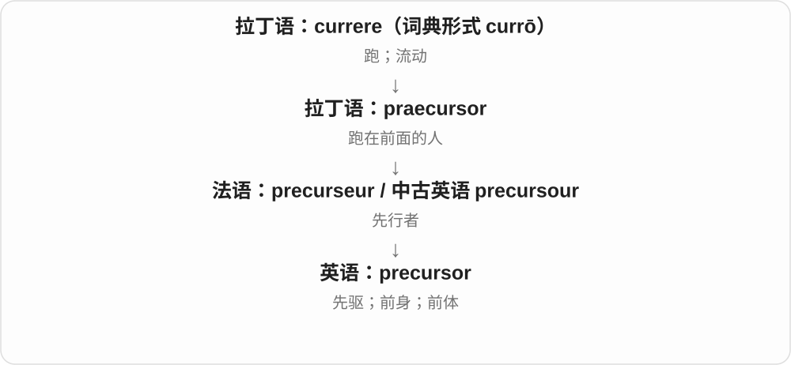
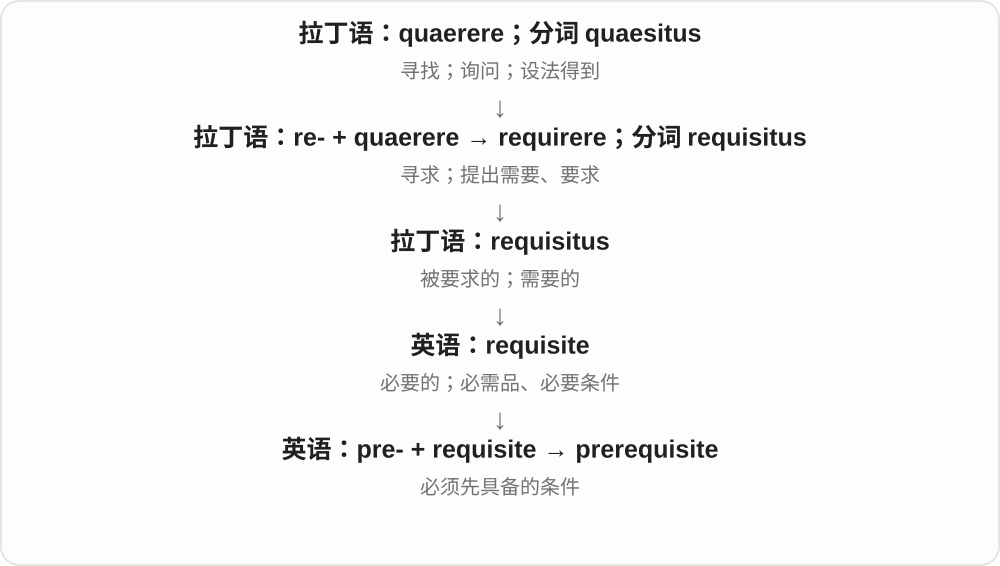
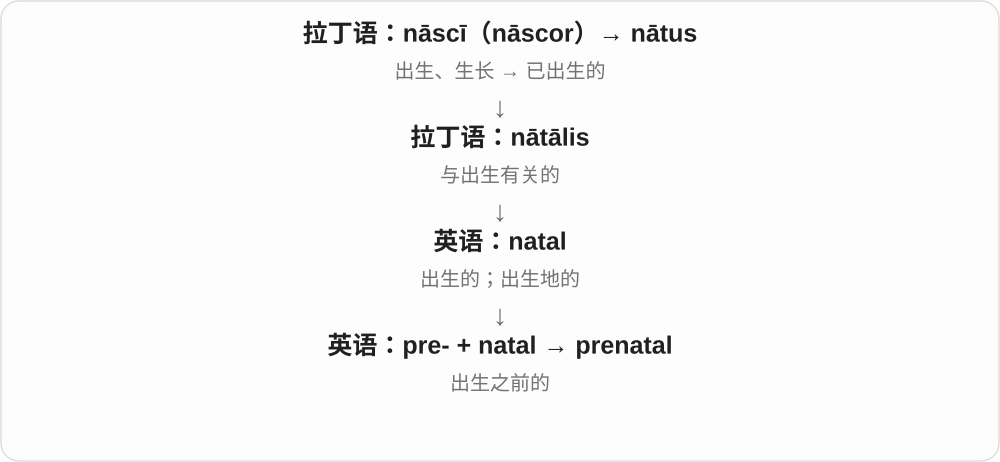
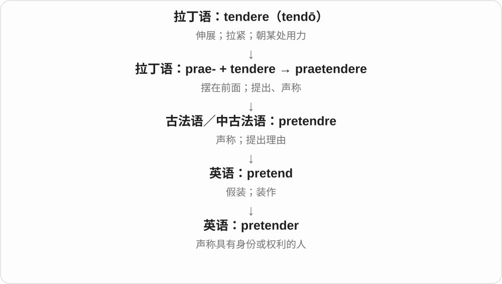
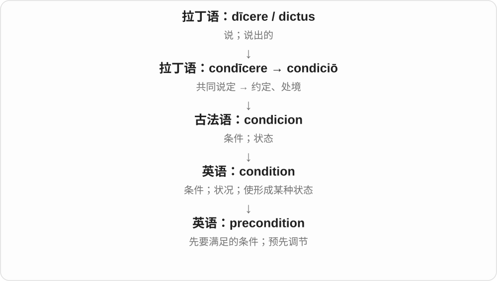
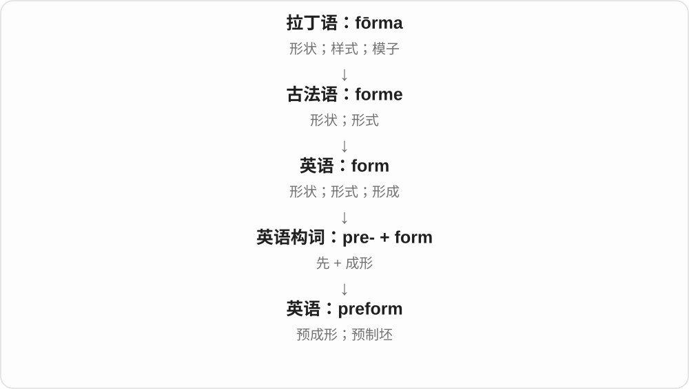
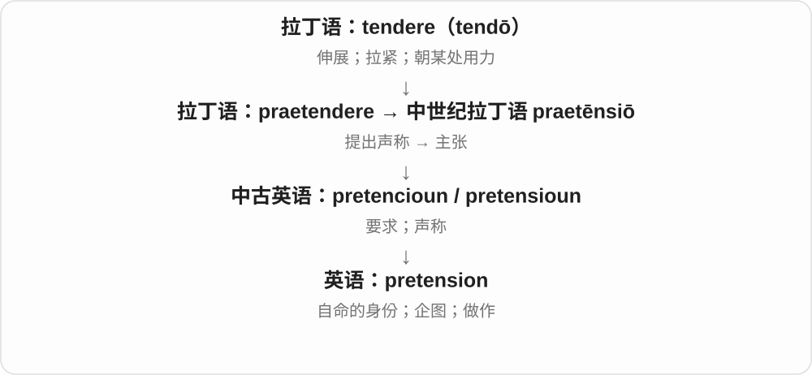
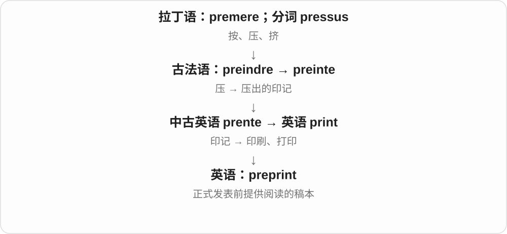
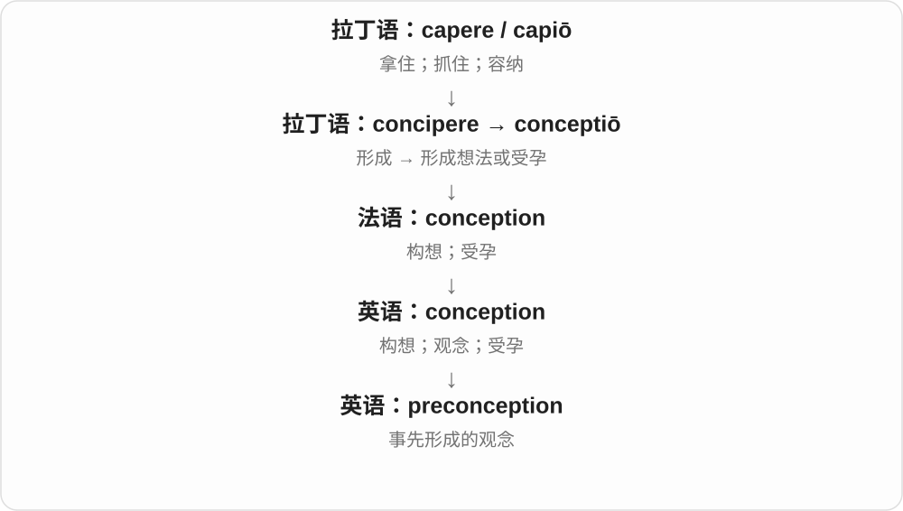
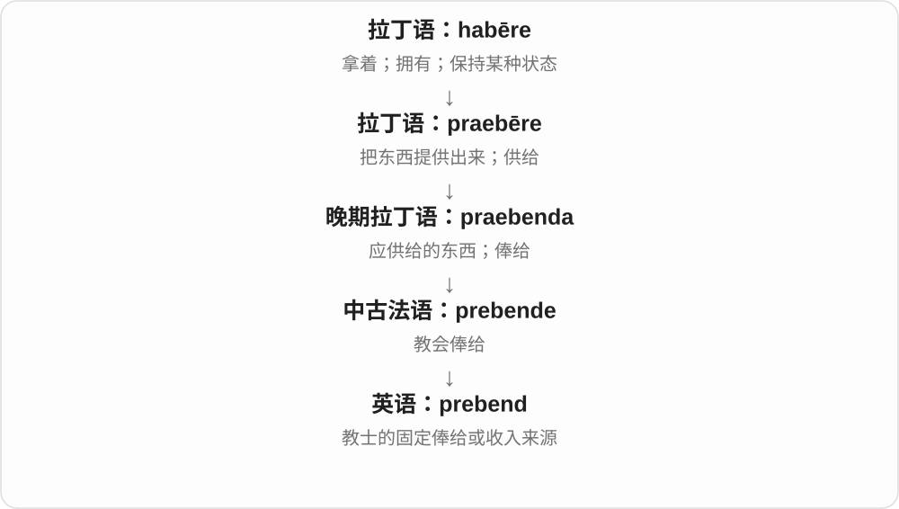

# 0513 · pre- — 在前；预先；早于；处于前方

[逐词精讲目录](../00_逐词精讲目录.md) · [总目录](../00_总目录_按常用程度.md)

## 核心词根与来源

拉丁语 prae 表示时间或位置在前，经法语和中世纪拉丁语进入英语，成为能继续造新词的前缀。previous、premature、presumption 等有已经形成的古典词和借入历史；preheat、prepay、preprocessor 等则是在英语中组合。普通 precarious 不属于这个前缀，已经纠正原目录的误归。

**先确定一个参照点，再看哪件事发生在它之前：开火前 preheat，付款期限前 prepay，正式开拍前 preproduction。**

在一条时间线上放一根标杆，标出开学、开赛、手术或生产；标杆之前的准备和状态可以接 pre-。另一幅空间图把前端标出，帮助理解 prefrontal、presynaptic。

- **先前与更早历史**：previous, previously, predate, prehistoric, prehistory, predawn
- **先看、先想、先决定**：preview, predetermined, predefined, precondition, preconception, precognition, predisposition, predisposed, presumption, presumptive
- **成长、学年和婚姻以前**：preschool, preteen, prepubescent, prenatal, preterm, premature, premarital, prenuptial
- **先支付、先销售**：prepay, prepayment, preorder, presale, premarket, pretax
- **开始前先准备**：preset, preheat, prefabricated, precast, premade, prepackaged, pretreatment, precure, prestressed, preproduction, pretest, preselection
- **比赛、飞行、临床和审判前**：pregame, preseason, preflight, preclinical, preoperative, pretrial, premenstrual
- **专业部位与疾病名称**：prefrontal, presynaptic, precancerous, preeclampsia
- **信息和设备前置步骤**：preload, preamp, preprocessor, preprint
- **其他已分族的历史支线**：precursor, predominant, prerequisite, prequel, pretender, pretension, preposition, preform, preferment, prebend

## 词形与演化规律

pre- 可以接名词、动词、形容词，如 pregame、preheat、preclinical。拉丁语 praesumere 的 sumpt- 解释 presumption、presumptive 的形态；prequel 是与 sequel 拼合，preamp 是 preamplifier 缩略。predate 的捕食义则另接 predator、predation。

## 单词速览（按词族由简到繁）

同一基础词的相关扩展放在一起，先读基础形式，再读扩展；各组之间优先读常用的。具体词源关系见各词讲解。

| 单词 | 音标 | 核心意思 |
|---|---|---|
| [previous](#w-1) | 英、美 /ˈpriːviəs/ | 先前的；以前的；前一个的 |
| [previously](#w-2) | 英、美 /ˈpriːviəsli/ | 以前；此前；先前 |
| [preview](#w-3) | /ˈpriːvjuː/ | 预览；预告；提前观看 |
| [premature](#w-4) | 英 /ˈpremətʃə/；美 /ˌpriːməˈtʃʊr/、/ˌpriːməˈtʊr/ | 过早的；时机未到的；早产的 |
| [preseason](#w-5) | /ˌpriːˈsiːzən/ | 赛季前阶段；赛季前的；预先调味〔动词〕 |
| [preschool](#w-6) | 英、美 /ˈpriːskuːl/ | 幼儿园；学前教育机构；学龄前的 |
| [precursor](#w-7) | 英 /prɪˈkɜːsə/；美 /prɪˈkɜːrsər/ | 先驱；前身；前体 |
| [prehistoric](#w-8) | 英 /ˌpriːhɪˈstɒrɪk/；美 /ˌpriːhɪˈstɔːrɪk/ | 史前的；极其古老或过时的〔口语〕 |
| [predetermined](#w-9) | 英 /ˌpriːdɪˈtɜːmɪnd/；美 /ˌpriːdɪˈtɜːrmɪnd/ | 预先决定的；事先设定的 |
| [predominant](#w-10) | 英 /prɪˈdɒmɪnənt/；美 /prɪˈdɑːmənənt/ | 主要的；最突出的；占优势的 |
| [prerequisite](#w-11) | /ˌpriːˈrekwɪzɪt/ | 先决条件；先修课程；预先必需的 |
| [presumption](#w-12) | 英、美 /prɪˈzʌmpʃən/ | 推定；假定；擅自做主；冒昧 |
| [prequel](#w-13) | 英、美 /ˈpriːkwəl/ | 前传 |
| [prenatal](#w-14) | /ˌpriːˈneɪtəl/ | 出生前的；产前的 |
| [preorder](#w-15) | 动词：英 /ˌpriːˈɔːdə/，美 /ˌpriːˈɔːrdər/；名词也常主重音在 pre- | 预订；预购；预序〔数学〕；先序〔计算机〕 |
| [preset](#w-16) | 名词、形容词英、美 /ˈpriːset/；动词 /ˌpriːˈset/ | 预设；预先设定的；预先设置 |
| [pregame](#w-17) | 英 /priːˈɡeɪm/；美形容词 /ˈpriːˌɡeɪm/、动词 /ˌpriːˈɡeɪm/ | 赛前的；赛前准备或节目；聚会前先饮酒〔美式口语〕 |
| [preheat](#w-18) | 英、美 /ˌpriːˈhiːt/ | 预热 |
| [predisposition](#w-19) | 英、美 /ˌpriːdɪspəˈzɪʃən/ | 倾向；易感性；易患某种状况的体质 |
| [prefrontal](#w-20) | 英、美 /ˌpriːˈfrʌntəl/ | 额叶前部的；前额的 |
| [presumptive](#w-21) | 英、美 /prɪˈzʌmptɪv/ | 推定的；暂可认定的；预计将取得某地位的 |
| [predisposed](#w-22) | 英 /ˌpriːdɪˈspəʊzd/；美 /ˌpriːdɪˈspoʊzd/ | 有某种倾向的；容易出现某种情况的 |
| [pretender](#w-23) | 英 /prɪˈtendə/；美 /prɪˈtendər/ | 冒充者；自称有继承权的人 |
| [prefabricated](#w-24) | 英、美 /ˌpriːˈfæbrɪkeɪtɪd/ | 预制的；由预制部件组装的 |
| [prehistory](#w-25) | 英、美 /ˌpriːˈhɪstəri/ | 史前时期；史前史；更早的背景阶段 |
| [preterm](#w-26) | 英 /ˌpriːˈtɜːm/；美 /ˌpriːˈtɜːrm/ | 早产的；妊娠未满规定足月界限的 |
| [premarital](#w-27) | 英、美 /ˌpriːˈmærɪtəl/ | 婚前的 |
| [pretrial](#w-28) | 英、美 /ˌpriːˈtraɪəl/ | 审判前的；庭审前程序 |
| [predefined](#w-29) | 英、美 /ˌpriːdɪˈfaɪnd/ | 预先定义的；事先规定的 |
| [precondition](#w-30) | 名词 /ˌpriːkənˈdɪʃən/；动词同形，重音有变体 | 先决条件；预先调节 |
| [preposition](#w-31) | 英、美 /ˌprepəˈzɪʃən/ | 介词 |
| [preclinical](#w-32) | 英、美 /ˌpriːˈklɪnɪkəl/ | 临床前的；临床症状出现前的 |
| [predate](#w-33) | 在先义英、美 /ˌpriːˈdeɪt/；捕食义英 /prɪˈdeɪt/、美 /prəˈdeɪt/ | 早于；把日期提前；捕食〔另源〕 |
| [prepay](#w-51) | 英、美 /ˌpriːˈpeɪ/ | 预付；提前支付 |
| [prepayment](#w-34) | 英、美 /ˌpriːˈpeɪmənt/ | 预付款；提前付款 |
| [preteen](#w-35) | 英、美 /ˌpriːˈtiːn/ | 接近青少年阶段的儿童；十三岁以前、接近十三岁的 |
| [precast](#w-36) | 英 /ˌpriːˈkɑːst/；美 /ˌpriːˈkæst/ | 预制浇筑的；预先浇筑 |
| [preform](#w-37) | 英 /ˌpriːˈfɔːm/；美 /ˌpriːˈfɔːrm/（动词）；名词常重读前部 /ˈpriːfɔːrm/ | 预先成形；预制坯件 |
| [pretreatment](#w-38) | 英、美 /ˌpriːˈtriːtmənt/ | 预处理；正式治疗前的处理；治疗前的 |
| [preoperative](#w-39) | 英 /ˌpriːˈɒpərətɪv/；美 /ˌpriːˈɑːpərətɪv/ | 手术前的 |
| [presale](#w-40) | 英、美 /ˌpriːˈseɪl/ | 预售；正式公开销售前的销售；售前的 |
| [preload](#w-41) | 英 /ˌpriːˈləʊd/；美 /ˌpriːˈloʊd/〔动词〕 | 预加载；预先装入；预加载荷 |
| [prepackaged](#w-42) | 英、美 /ˌpriːˈpækɪdʒd/ | 预先包装好的；现成的、整套提供的 |
| [pretax](#w-43) | 英、美 /ˌpriːˈtæks/ | 税前的 |
| [pretension](#w-44) | /prɪˈtenʃən/ | 自命的身份或能力；野心；做作 |
| [preamp](#w-45) | 英 /priːˈæmp/；美 /ˈpriːˌæmp/ | 前置放大器；前级放大器 |
| [preeclampsia](#w-46) | 英、美 /ˌpriːɪˈklæmpsiə/ | 子痫前期 |
| [prenuptial](#w-47) | 英、美 /ˌpriːˈnʌpʃəl/ | 婚前的；婚前协议的 |
| [preselection](#w-48) | /ˌpriːsɪˈlekʃən/ | 预先选择；候选人预选 |
| [premade](#w-49) | 英、美 /ˌpriːˈmeɪd/ | 预先做好的；现成的 |
| [premarket](#w-50) | 英 /ˌpriːˈmɑːkɪt/；美 /ˌpriːˈmɑːrkɪt/ | 上市前的；常规交易开盘前的 |
| [preprint](#w-52) | 英 /ˈpriːprɪnt/；美 /ˈpriːprɪnt/ | 预印本；正式发表前流通的论文稿 |
| [prepubescent](#w-53) | 英、美 /ˌpriːpjuːˈbesənt/ | 青春期前的；尚未进入青春期的人 |
| [presynaptic](#w-54) | 英、美 /ˌpriːsɪˈnæptɪk/ | 突触前的；染色体联会前的〔专门义〕 |
| [precognition](#w-55) | 英 /ˌpriːkɒɡˈnɪʃən/；美 /ˌpriːkɑːɡˈnɪʃən/ | 预知；先知〔常指超常能力主张〕 |
| [preconception](#w-56) | /ˌpriːkənˈsepʃən/ | 先入之见；预先形成的看法 |
| [preferment](#w-57) | 英 /prɪˈfɜːmənt/；美 /prɪˈfɜːrmənt/ | 晋升；升迁；获授职位 |
| [precancerous](#w-58) | 英 /ˌpriːˈkænsərəs/；美 /ˌpriːˈkænsərəs/ | 癌前的；可能发展为癌的 |
| [prestressed](#w-59) | 英、美 /ˌpriːˈstrest/ | 预加应力的；预应力的 |
| [preflight](#w-60) | 英、美 /ˌpriːˈflaɪt/；美亦 /ˈpriːˌflaɪt/ | 飞行前的；飞行前检查或准备 |
| [premenstrual](#w-61) | 英、美 /ˌpriːˈmenstruəl/ | 月经前的；经前期的 |
| [precure](#w-62) | 英 /priːˈkjʊə/ | 预固化；提前固化；使材料在后续工序前固化〔技术用语〕 |
| [preproduction](#w-63) | 英、美 /ˌpriːprəˈdʌkʃən/ | 前期筹备；投产前阶段；试生产阶段的 |
| [preprocessor](#w-64) | 英 /priːˈprəʊsesə/；美 /ˈpriːˌprɑːsesər/ | 预处理器；预处理程序 |
| [predawn](#w-65) | 英 /ˌpriːˈdɔːn/；美 /ˌpriːˈdɔːn/、/ˌpriːˈdɑːn/ | 黎明前的 |
| [pretest](#w-66) | 名词英、美 /ˈpriːtest/；动词 /ˌpriːˈtest/ | 前测；预测试；事先测试 |
| [prebend](#w-67) | /ˈprebənd/ | 教士俸给；提供这笔收入的财产或职位 |

## 逐词讲解

### 1. previous — 先前的；以前的；前一个的

**音标**：英、美 /ˈpriːviəs/

**先抓住这个画面**

把时间或顺序排成一队，previous 指站在当前这一项前面的。

**怎么拆**

来自拉丁语 praevius“走在前面的”，由 prae“在前”与 via“道路”组成；不是英语 preview 的变形。

**怎么变成今天的意思**

**拉丁语 prae + via → praevius**  
在前 + 道路 → 走在前面的

↓

**英语 previous**  
时间、次序上在前的

the previous day 是相对于叙述中的某一天而言的前一天，不一定是今天的昨天。previous experience 则泛指以前积累的经验。

**常见搭配与例句**

the previous owner；previous experience；the previous evening。

> The previous owner had planted an apple tree.

上一位主人曾种下一棵苹果树。

> She arrived on Friday, and I had arrived the previous day.

她星期五到达，而我前一天就到了。

**别混淆**

last 常从现在往回看；previous 常从句中已经确定的时间点往回看。

### 2. previously — 以前；此前；先前

**音标**：英、美 /ˈpriːviəsli/

**先抓住这个画面**

把镜头从当前这件事，往之前发生过的事情拉回去。

**怎么拆**

previous + -ly，形容词“先前的”变为副词“先前曾经”。

**怎么变成今天的意思**

**拉丁语 prae + via → praevius**  
在前 + 道路 → 走在前面的

↓

**英语 previous**  
时间、次序上在前的

↓

**英语 previous + -ly → previously**  
在此前的时间里

previously unknown 是此前不知道的；as previously mentioned 是如前面已经提到的。它不要求事情发生在很久以前。

**常见搭配与例句**

previously worked；previously unknown；as previously mentioned。

> She had previously worked as a translator.

她此前做过翻译。

> The survey revealed a previously unknown footpath.

这次调查发现了一条此前不为人知的小路。

**别混淆**

formerly 常强调过去是、现在已不是；previously 只把时间定位在此前。

### 3. preview — 预览；预告；提前观看

**音标**：/ˈpriːvjuː/

**先抓住这个画面**

preview 是正式打开、发布或看完整内容之前，先看一眼。

**怎么拆**

pre-（预先）+ view（看）。

**怎么变成今天的意思**

电影 preview 展示提前放出的内容，文件 preview 帮你检查打开或输出后的样子。通常还不是最终完整体验。

**常见搭配与例句**

preview a document；a film preview；print preview；a preview of… 。

> Use print preview to check the page layout.

用打印预览检查页面排版。

> We saw a preview of the new exhibition.

我们提前看了新展览的部分内容。

**别混淆**

review 是看过之后检查或评价；preview 是正式进行之前先看。

### 4. premature — 过早的；时机未到的；早产的

**音标**：英 /ˈpremətʃə/；美 /ˌpriːməˈtʃʊr/、/ˌpriːməˈtʊr/

**先抓住这个画面**

事情还没到合适的阶段，就已经发生了。

**怎么拆**

借自拉丁语 praematurus：prae“提前” + maturus“成熟的、时机适当的”。现代可以用 pre- 与 mature 帮助理解，但整个词在拉丁语中已经形成。

**怎么变成今天的意思**

**拉丁语 prae + maturus → praematurus**  
提前 + 成熟 → 早熟；过早的

↓

**英语 premature**  
早于正常或合适时机的

a premature conclusion 是证据还不够就下了结论；a premature baby 是早产儿。词中不只是“早”，往往还含“比应有时机早”。

**常见搭配与例句**

a premature conclusion；premature birth；It is premature to say…。

> It would be premature to declare the project a success.

现在就宣布项目成功还为时过早。

> The hospital opened a new unit for premature babies.

医院开设了一个新的早产儿护理病区。

**别混淆**

early 可以只是时间早，甚至是好事；premature 强调正常进程或适当时机还没到。

### 5. preseason — 赛季前阶段；赛季前的；预先调味〔动词〕

**音标**：/ˌpriːˈsiːzən/

**先抓住这个画面**

正式比赛还没开始，球队先练习、试阵容，把状态调到能上场。

**怎么拆**

pre- 在前 + season。体育名词用的是赛季义；动词 preseason food 则是在 season“调味”之前加“预先”。

**怎么变成今天的意思**

**拉丁语 serere，分词 satus**  
播种、栽种

↓

**拉丁语 satio，宾格 sationem**  
播种行为 → 播种时节

↓

**古法语 seison / saison**  
时节；适当时候

↓

**中古英语 sesoun → season**  
季节；某项活动的固定时期

↓

**英语 pre- + season → preseason**  
赛季开始前；另可指预先调味

preseason training 是季前训练，preseason games 是正式赛季前的比赛。它不是一定在春季，而是相对于某项运动的赛历。

**常见搭配与例句**

preseason training；a preseason match。

> The team focused on fitness during the preseason.

球队在季前阶段重点训练体能。

> Two new players impressed the coach in a preseason match.

两名新球员在一场季前赛中给教练留下了好印象。

**别混淆**

postseason 是常规赛之后的阶段；preseason 是赛季开始前。

### 6. preschool — 幼儿园；学前教育机构；学龄前的

**音标**：英、美 /ˈpriːskuːl/

**先抓住这个画面**

正式进入小学前，孩子先在这里学习相处、表达和基本习惯。

**怎么拆**

英语 pre-“在……以前” + school；此处 school 以正式学校教育为参照，并不否认幼儿园也在教育孩子。

**怎么变成今天的意思**

**拉丁语 prae → 法语、中世纪拉丁语 pre- → 英语 pre-**  
时间在先；位置在前；后来可与英语现成词自由组合

↓

**英语 pre- + school → preschool**  
正式入学前的阶段；服务于这一阶段的学校

既可作名词：go to preschool，也可放在名词前：preschool children。具体入园年龄与当地教育制度有关。

**常见搭配与例句**

attend preschool；preschool education；preschool children。

> Our daughter started preschool this autumn.

我们女儿今年秋天开始上幼儿园。

> The library holds story sessions for preschool children.

图书馆为学龄前儿童举办故事活动。

**别混淆**

daycare 强调照护服务；preschool 强调入小学前的教育，两者实际可能重叠。

### 7. precursor — 先驱；前身；前体

**音标**：英 /prɪˈkɜːsə/；美 /prɪˈkɜːrsər/

**先抓住这个画面**

一个东西先跑到前面，为后来出现的东西开路，或逐步变成它。

**怎么拆**

拉丁语 prae-（在前）+ cursor（跑者）形成 praecursor，经法语或拉丁语路径进入英语。

**怎么变成今天的意思**

可以是后来技术的早期版本，也可以是形成另一物质前的材料。并非只要时间更早就能叫 precursor，还要有先导或形成关系。

**常见搭配与例句**

a precursor to modern computers；a precursor of；a chemical precursor。

> This device was a precursor to modern computers.

这种设备是现代计算机的前身之一。

> The material serves as a precursor for the final compound.

这种材料是最终化合物的前体。

**别混淆**

predecessor 常是同一职位或系列的上一任；precursor 更强调给后来发展铺路，未必只紧挨着前一代。

### 8. prehistoric — 史前的；极其古老或过时的〔口语〕

**音标**：英 /ˌpriːhɪˈstɒrɪk/；美 /ˌpriːhɪˈstɔːrɪk/

**先抓住这个画面**

人和动物早已生活在那里，只是那个时期还没有留下当地的文字历史记录。

**怎么拆**

英语 pre- + historic；historic 最终联系希腊语 historia“调查、记述”。这里的“历史以前”以书面记录为分界。

**怎么变成今天的意思**

**拉丁语 prae → 法语、中世纪拉丁语 pre- → 英语 pre-**  
时间在先；位置在前；后来可与英语现成词自由组合

↓

**英语 pre- + historic → prehistoric**  
早于有关地区的文字历史记录

prehistoric tools 可以是人类制作的工具，不能把 prehistoric 理解成“人类出现以前”。不同地区进入有文字记录阶段的时间不同。

**常见搭配与例句**

prehistoric settlements；prehistoric animals；prehistoric tools。

> Archaeologists discovered prehistoric tools near the river.

考古学家在河边发现了史前工具。

> That prehistoric printer takes five minutes to start.

那台老掉牙的打印机启动要花五分钟。

**别混淆**

ancient 说非常久远，不一定早于文字记录；prehistoric 的正式用法有这层分期含义。

### 9. predetermined — 预先决定的；事先设定的

**音标**：英 /ˌpriːdɪˈtɜːmɪnd/；美 /ˌpriːdɪˈtɜːrmɪnd/

**先抓住这个画面**

你到场时，路线或结果已经有人在此前定好了。

**怎么拆**

predetermine 的过去分词：pre-“预先” + determine“决定”，再加 -ed；也可直接看出 pre- + determined。

**怎么变成今天的意思**

**拉丁语 prae → 法语、中世纪拉丁语 pre- → 英语 pre-**  
时间在先；位置在前；后来可与英语现成词自由组合

↓

**英语 pre- + determine → predetermine → predetermined**  
预先决定 → 已预定的

a predetermined route 可以只是提前规划的路线，不含舞弊；a predetermined outcome 在竞赛、调查语境中可能暗示结果早已被操控。

**常见搭配与例句**

a predetermined order；a predetermined outcome；at a predetermined time。

> The samples were tested in a predetermined order.

样本按预先确定的顺序接受检测。

> The participants met at a predetermined location.

参与者在事先约定的地点会合。

**别混淆**

planned 强调做过计划；predetermined 更突出在后续事件发生前就已定下。

### 10. predominant — 主要的；最突出的；占优势的

**音标**：英 /prɪˈdɒmɪnənt/；美 /prɪˈdɑːmənənt/

**先抓住这个画面**

把许多成分摆在一起，看看哪一种最显眼、份量最大或影响最强，它就是 predominant。

**怎么拆**

prae- 有领先、居前的意思，加 dominari 词族，中世纪拉丁复合形式进入法语 prédominant，再进英语；不要把 pre- 机械读成时间上的“提前”。

**怎么变成今天的意思**

**拉丁 domus → dominus／domina**  
家、房屋 → 男主人／女主人，主人、掌权者

↓

**中世纪拉丁 prae- + dominari 的复合词族 → 法语 prédominant**  
居于更前、更优越地位的

↓

**英语 predominant**  
最主要的；数量或影响占上风的

the predominant colour 是主要颜色；the predominant view 是最有影响或最普遍的看法。这个词表达相对突出，不一定要求超过严格的百分之五十。

**常见搭配与例句**

the predominant view；the predominant feature；a predominant role。

> The predominant colour in the room is pale green.

这个房间的主色调是淡绿色。

> Farming remained the predominant activity in the valley.

农业仍是山谷中最主要的生产活动。

**别混淆**

dominant 更容易突出控制力；predominant 常用来描述组成、频率或相对份量。

### 11. prerequisite — 先决条件；先修课程；预先必需的

**音标**：/ˌpriːˈrekwɪzɪt/

**先抓住这个画面**

prerequisite 像下一关门口的钥匙：要进去，得先拿到它。

**怎么拆**

pre-“在前” + requisite“必要的”，在英语中构成；不是所有必要条件都强调先后，但这个词强调。

**怎么变成今天的意思**

课程目录里可指必须先完成的课程；一般语境里指任何先决条件。常用 a prerequisite for / to，不要把它理解为仅仅“建议准备一下”。

**常见搭配与例句**

a prerequisite for；a prerequisite to；meet the prerequisites；a prerequisite course。

> Basic algebra is a prerequisite for this course.

基础代数是这门课的先修要求。

> Trust is a prerequisite for effective cooperation.

信任是有效合作的先决条件。

**别混淆**

prerequisite 要先满足；corequisite 通常允许或要求同时满足，具体以课程规定为准。

### 12. presumption — 推定；假定；擅自做主；冒昧

**音标**：英、美 /prɪˈzʌmpʃən/

**先抓住这个画面**

证据或许可还没完全到位，就先拿某个判断当作出发点。

**怎么拆**

经古法语 presumcion 或直接来自拉丁语 praesumptio、praesumption-，基于 praesumere“事先拿取”。不是英语 presume 机械加 -tion。

**怎么变成今天的意思**

**拉丁语 prae + sumere → praesumere**  
事先 + 拿取 → 预先认定；擅自承担

↓

**拉丁语 praesumptio / praesumption- → 古法语 presumcion → 英语 presumption**  
预先认定；越过应有界限的自信、擅自做主

the presumption of innocence 是法律上的无罪推定，不是法院已证明某人绝不可能犯罪。日常说 someone’s presumption，也可批评对方未经允许就自作主张。

**常见搭配与例句**

on the presumption that；the presumption of innocence；a rebuttable presumption。

> We booked two rooms on the presumption that everyone would come.

我们按所有人都会来的假定订了两个房间。

> She was annoyed by his presumption in speaking for the whole team.

他擅自代表整个团队发言，让她很恼火。

**别混淆**

assumption 常指采用的假设；presumption 可以是依据现有情况或规则先作出的推定，也保留冒昧义。

### 13. prequel — 前传

**音标**：英、美 /ˈpriːkwəl/

**先抓住这个画面**

这部作品后来才推出，但讲的故事发生得更早。

**怎么拆**

由 pre-“在前”与 sequel“续集”的后半部分拼合而成；-quel 在这里是从现成词借来的片段。

**怎么变成今天的意思**

**拉丁语 prae → 法语、中世纪拉丁语 pre- → 英语 pre-**  
时间在先；位置在前；后来可与英语现成词自由组合

↓

**英语 pre- 与 sequel 拼合 → prequel**  
后来创作、叙事时间却在原作以前的作品

a prequel to a film 填补原作之前的故事。不能只看上映先后，关键在故事时间线。

**常见搭配与例句**

a prequel to；a prequel novel；a prequel series。

> The prequel explores the detective’s early career.

这部前传讲述了那名侦探早年的职业经历。

> I watched the original film before its prequel.

我先看了原版电影，再看它的前传。

**别混淆**

sequel 通常把故事往后接；prequel 则回到原作发生之前。

### 14. prenatal — 出生前的；产前的

**音标**：/ˌpriːˈneɪtəl/

**先抓住这个画面**

prenatal 站在出生这个时间点向前看，指孩子出生以前的阶段。

**怎么拆**

pre-（在……之前）+ natal（出生的）。

**怎么变成今天的意思**

可以修饰发育、检查或照护；这个词说明时间范围，不单独给出具体医疗做法。

**常见搭配与例句**

prenatal development；prenatal care；a prenatal appointment。

> The textbook describes prenatal development.

教材描述了出生前的发育。

> She wrote down the date of her prenatal appointment.

她记下了产前预约的日期。

**别混淆**

prenatal 在出生前；postnatal 在出生后。pre- 与 post- 是最直接的时间区别。

### 15. preorder — 预订；预购；预序〔数学〕；先序〔计算机〕

**音标**：动词：英 /ˌpriːˈɔːdə/，美 /ˌpriːˈɔːrdər/；名词也常主重音在 pre-

**先抓住这个画面**

书还没正式发售，先下单把购买请求排进去，是日常的 preorder。技术里同样的词形还有各自的排序含义。

**怎么拆**

pre- 在前 + order。购物义指提前订购；数学预序是比偏序少一项限制的关系；遍历义指先访问当前节点。

**怎么变成今天的意思**

**拉丁语：ōrdō；词干 ōrdin-**  
一行、一列；次序、等级、安排

↓

**古法语 ordre → 中古英语 ordre**  
排列、规则；有共同规则的团体

↓

**英语：order**  
次序；命令；订购；分类中的目

↓

**英语：pre- + order → preorder〔不同用途〕**  
提前订购；数学预序；树的先序遍历

数学 preorder 要求自反、传递，不必反对称。以“字符串长度不大于”为关系，cat与dog可双向成立但不是同一串，仍是预序。计算机 preorder traversal 则先处理节点，再处理子节点。

**常见搭配与例句**

preorder a book；place a preorder；a preorder relation；preorder traversal。

> You can preorder the book before its release next month.

你可以在这本书下个月发行前预购。

> Every partial order is a preorder, but the reverse need not hold.

每个偏序都是预序，反过来未必成立。

**别混淆**

购物的 preorder 不保证立刻发货；数学 preorder 与“先下订单”没有技术上的联系，只共享构词材料。

### 16. preset — 预设；预先设定的；预先设置

**音标**：名词、形容词英、美 /ˈpriːset/；动词 /ˌpriːˈset/

**先抓住这个画面**

把常用的一套参数先存好，需要时按一下就调用。

**怎么拆**

英语 pre- + set；set 的过去式、过去分词仍为 set，因此预设的也写 preset。

**怎么变成今天的意思**

**拉丁语 prae → 法语、中世纪拉丁语 pre- → 英语 pre-**  
时间在先；位置在前；后来可与英语现成词自由组合

↓

**英语 pre- + set → preset**  
提前设定；已设定的参数组合

a camera preset 是预存设置；preset the timer 是提前设置定时器。预设不一定不能修改，通常只是一个方便的起点。

**常见搭配与例句**

a preset value；save a preset；preset the temperature。

> The camera has a preset for night photography.

相机有一个夜间摄影预设。

> You can preset the timer before leaving home.

你可以在出门前预先设好定时器。

**别混淆**

default 是不作选择时自动采用的值；preset 可以有多个，由用户主动选择。

### 17. pregame — 赛前的；赛前准备或节目；聚会前先饮酒〔美式口语〕

**音标**：英 /priːˈɡeɪm/；美形容词 /ˈpriːˌɡeɪm/、动词 /ˌpriːˈɡeɪm/

**先抓住这个画面**

比赛还没正式开始，热身、分析和准备已经在进行。

**怎么拆**

英语 pre- + game；game 在这里是体育比赛，pre- 把参照点放在开赛以前。

**怎么变成今天的意思**

**拉丁语 prae → 法语、中世纪拉丁语 pre- → 英语 pre-**  
时间在先；位置在前；后来可与英语现成词自由组合

↓

**英语 pre- + game → pregame**  
比赛前的活动、准备或报道

pregame warmups 是赛前热身，a pregame show 是赛前节目。体育用法写成 pre-game 也很常见；美式口语中作动词，还可指参加聚会或外出前先饮酒。

**常见搭配与例句**

pregame preparation；a pregame show；pregame warmups。

> The players completed their pregame warmups in the rain.

球员们在雨中完成了赛前热身。

> The pregame show included an interview with the captain.

赛前节目安排了对队长的采访。

**别混淆**

preseason 以整个赛季开始为参照；pregame 以一场比赛开始为参照。

### 18. preheat — 预热

**音标**：英、美 /ˌpriːˈhiːt/

**先抓住这个画面**

主步骤开始前，先让设备达到需要的温度。

**怎么拆**

英语 pre-“预先” + heat“加热”，是英语中的直接组合。

**怎么变成今天的意思**

**拉丁语 prae → 法语、中世纪拉丁语 pre- → 英语 pre-**  
时间在先；位置在前；后来可与英语现成词自由组合

↓

**英语 pre- + heat → preheat**  
开始烘烤或加工前先加热

preheat the oven to a temperature 表示先把烤箱升到指定温度。pre- 说的是加热在主过程之前，不是把食物再热一次。

**常见搭配与例句**

preheat the oven；preheat to 180°C；a preheated pan。

> Preheat the oven while you prepare the vegetables.

准备蔬菜的时候先把烤箱预热。

> The machine takes a few minutes to preheat.

这台机器需要几分钟预热。

**别混淆**

reheat 是把已经冷下来的东西重新热起来；preheat 是提前预热。

### 19. predisposition — 倾向；易感性；易患某种状况的体质

**音标**：英、美 /ˌpriːdɪspəˈzɪʃən/

**先抓住这个画面**

事情还没发生，天平已经稍微往某一边倾斜了。

**怎么拆**

英语 pre- + disposition“倾向、性情”；这一名词早于相关动词 predispose 的英语记录，不能强行画成动词先造出名词。

**怎么变成今天的意思**

**拉丁语 prae → 法语、中世纪拉丁语 pre- → 英语 pre-**  
时间在先；位置在前；后来可与英语现成词自由组合

↓

**英语 pre- + disposition → predisposition**  
事情发生前已有的倾向；disposition 更早接拉丁语 dispositio“安排”

a predisposition to something 表示比一般情况更容易出现它。可以涉及习惯、态度或身体特点，但“更容易”不等于“注定”。

**常见搭配与例句**

a predisposition to；a genetic predisposition；a predisposition toward caution。

> She has a predisposition to see the optimistic side of things.

她倾向于看到事情乐观的一面。

> A genetic predisposition does not make an outcome inevitable.

遗传倾向并不意味着某个结果不可避免。

**别混淆**

destiny 是注定的命运；predisposition 是倾向或易感性，仍可能受环境与经历影响。

### 20. prefrontal — 额叶前部的；前额的

**音标**：英、美 /ˌpriːˈfrʌntəl/

**先抓住这个画面**

把脑的额叶再往前看，额头后方这部分区域就常用 prefrontal 来描述。

**怎么拆**

pre-“在前” + frontal“额部的”；frontal 最终来自拉丁语 frons、front-“额头”。在 prefrontal cortex 中，pre- 是位置关系。

**怎么变成今天的意思**

**拉丁语 prae → 法语、中世纪拉丁语 pre- → 英语 pre-**  
时间在先；位置在前；后来可与英语现成词自由组合

↓

**英语 pre- + frontal → prefrontal**  
额部前方的；神经科学中指额叶前部的

the prefrontal cortex 是前额叶皮层，参与计划、决策等多种活动。它属于脑的一部分，不是在脑外，也不是一个独自负责所有理性思考的按钮。

**常见搭配与例句**

the prefrontal cortex；prefrontal activity；prefrontal regions。

> The diagram highlights the prefrontal cortex.

图中突出标出了前额叶皮层。

> The researchers measured prefrontal activity during the task.

研究人员测量了执行任务时的前额叶活动。

**别混淆**

frontal 范围较宽；prefrontal 在脑科学里通常指额叶更靠前的区域。

### 21. presumptive — 推定的；暂可认定的；预计将取得某地位的

**音标**：英、美 /prɪˈzʌmptɪv/

**先抓住这个画面**

根据眼下情况，先认为大概如此，但最后确认可能还没完成。

**怎么拆**

来自后期、中世纪拉丁语 praesumptivus、presumptivus，基于 praesumere 的 praesumpt- 词干；部分词典也列法语中介。

**怎么变成今天的意思**

**拉丁语 prae + sumere → praesumere**  
事先 + 拿取 → 预先认定；擅自承担

↓

**后期、中世纪拉丁语 praesumptivus / presumptivus → 英语 presumptive**  
依推定或可能性判断的；亦有法语中介解释

the presumptive winner 是目前看来最有可能获胜的人，并不等于正式宣布的胜者。heir presumptive 是推定继承人，其地位可能因更优先的继承人出现而改变。

**常见搭配与例句**

the presumptive nominee；the presumptive winner；an heir presumptive。

> Reporters described her as the presumptive nominee.

记者们把她称为预计将获提名的人选。

> He was the heir presumptive until the king’s son was born.

在国王的儿子出生前，他一直是推定继承人。

**别混淆**

presumptuous 是冒昧、自作主张的；presumptive 通常说依据现有信息作出的推定。

### 22. predisposed — 有某种倾向的；容易出现某种情况的

**音标**：英 /ˌpriːdɪˈspəʊzd/；美 /ˌpriːdɪˈspoʊzd/

**先抓住这个画面**

尚未遇到这件事，人的习惯、条件或经历已经让他更容易往某个方向反应。

**怎么拆**

predispose + -ed；predispose 可能从较早的 predisposition 反构，也可能来自或仿照法语 prédisposer。不能只按现代拼写断言唯一来源。

**怎么变成今天的意思**

**拉丁语 prae → 法语、中世纪拉丁语 pre- → 英语 pre-**  
时间在先；位置在前；后来可与英语现成词自由组合

↓

**英语 pre- + disposition → predisposition**  
事情发生前已有的倾向；disposition 更早接拉丁语 dispositio“安排”

↓

**可能的动词路线：英语 predisposition → predispose；或法语 prédisposer → predispose**  
预先使倾向于某种状态

↓

**英语 predispose + -ed → predisposed**  
已经具有某种倾向的

be predisposed to do something 和 be predisposed to something 都常见；前者接动词，后者接名词。它描述倾向，不保证结果。

**常见搭配与例句**

predisposed to believe；predisposed to anxiety；genetically predisposed。

> After that experience, I was predisposed to distrust easy promises.

有了那次经历，我更容易对轻易作出的承诺抱有怀疑。

> People who are predisposed to motion sickness may find the topic familiar.

容易晕车的人可能对这个话题很熟悉。

**别混淆**

willing 是愿意；predisposed 强调在具体选择前已有的偏向或易感条件。

### 23. pretender — 冒充者；自称有继承权的人

**音标**：英 /prɪˈtendə/；美 /prɪˈtendər/

**先抓住这个画面**

pretender 是提出“我有这个身份或资格”的人；有时是假冒，有时是王位争夺中的自称继承者。

**怎么拆**

pretend + -er。历史 pretend 也有提出权利主张的意思，并非始终只指装假。

**怎么变成今天的意思**

王位语境中 a pretender to the throne 是提出王位继承要求的人；这个名称本身不完成法律真假判断。

**常见搭配与例句**

a pretender to the throne；expose a pretender；a mere pretender。

> Several pretenders claimed the vacant throne.

几名自称有继承权的人争夺空缺的王位。

> The supposed expert turned out to be a pretender.

那个所谓的专家原来是个冒牌货。

**别混淆**

pretender 强调声称某种身份；contender 强调正在竞争并有胜算。

### 24. prefabricated — 预制的；由预制部件组装的

**音标**：英、美 /ˌpriːˈfæbrɪkeɪtɪd/

**先抓住这个画面**

把需要的部件先在别处做好，运到现场后再组装。

**怎么拆**

prefabricate + -ed；pre-“提前” + fabricate“制造”。fabricate 的拉丁来源 fabricari 与制作、建造有关。

**怎么变成今天的意思**

**拉丁语 prae → 法语、中世纪拉丁语 pre- → 英语 pre-**  
时间在先；位置在前；后来可与英语现成词自由组合

↓

**英语 pre- + fabricate → prefabricate → prefabricated**  
预先制造 → 预制的部件或由其搭成的结构

prefabricated housing 可以由预先做好的墙板、模块等组成，不表示整栋房子一定作为一个整体运来。

**常见搭配与例句**

prefabricated panels；prefabricated housing；prefabricated sections。

> The shelter was assembled from prefabricated panels.

这个临时住所由预制板组装而成。

> Prefabricated sections arrived at the building site by truck.

预制构件由卡车运抵建筑工地。

**别混淆**

fabricated 有时指捏造的；prefabricated 的常见建筑义是事先制造，不能译成“事先造假的”。

### 25. prehistory — 史前时期；史前史；更早的背景阶段

**音标**：英、美 /ˌpriːˈhɪstəri/

**先抓住这个画面**

文字开始记事以前，人类生活留下的痕迹仍能由工具、遗址和骨骼讲述。

**怎么拆**

英语 pre- + history；与 prehistoric 是同一类组合，不能仅凭词形把其中一个必定当作另一个的直接来源。

**怎么变成今天的意思**

**拉丁语 prae → 法语、中世纪拉丁语 pre- → 英语 pre-**  
时间在先；位置在前；后来可与英语现成词自由组合

↓

**英语 pre- + history → prehistory**  
早于文字历史记录的时期；研究这一时期的领域

prehistory 不是“什么都没有发生的时候”，而是缺乏当地文字记录的时期。也可比喻某项事业正式起步前的背景。

**常见搭配与例句**

human prehistory；the prehistory of a region；study prehistory。

> Stone tools provide evidence about human prehistory.

石器为了解人类史前时期提供了证据。

> The book traces the prehistory of modern computing.

这本书追溯了现代计算技术正式兴起之前的发展背景。

**别混淆**

history 广义可涵盖全部过去；与 prehistory 对举时，常专指有文字记载的阶段。

### 26. preterm — 早产的；妊娠未满规定足月界限的

**音标**：英 /ˌpriːˈtɜːm/；美 /ˌpriːˈtɜːrm/

**先抓住这个画面**

宝宝出生时，妊娠还没有完成三十七周。

**怎么拆**

pre-“在……以前” + term“期限、足月”，是现代医学中的英语组合。

**怎么变成今天的意思**

**拉丁语 prae → 法语、中世纪拉丁语 pre- → 英语 pre-**  
时间在先；位置在前；后来可与英语现成词自由组合

↓

**英语 pre- + term → preterm**  
未到足月界限；用于早产及相关照护

按 WHO 定义，preterm birth 指妊娠未满三十七个完整周的活产。只是比预计日期早几天，并不能单凭这点叫 preterm。

**常见搭配与例句**

preterm birth；a preterm infant；preterm labour。

> The study compared outcomes for preterm and full-term infants.

这项研究比较了早产儿与足月儿的结局。

> The unit provides specialized care for preterm babies.

这个病区为早产儿提供专门护理。

**别混淆**

premature 还可用于决定、结论等一般过早行为；preterm 通常用于妊娠和出生语境。

### 27. premarital — 婚前的

**音标**：英、美 /ˌpriːˈmærɪtəl/

**先抓住这个画面**

以结婚为时间分界，讨论跨过这条线之前的事。

**怎么拆**

pre- + marital“婚姻的”；marital 最终来自拉丁语 maritalis，关联 maritus“丈夫”。

**怎么变成今天的意思**

**拉丁语 prae → 法语、中世纪拉丁语 pre- → 英语 pre-**  
时间在先；位置在前；后来可与英语现成词自由组合

↓

**英语 pre- + marital → premarital**  
婚姻开始以前的

premarital counselling 是婚前咨询，讨论沟通、期望等问题。这个形容词本身只标时间，不自动带有道德评价。

**常见搭配与例句**

premarital counselling；premarital assets；premarital relationships。

> They attended premarital counselling before the wedding.

他们在婚礼前参加了婚前咨询。

> The form asks about premarital assets.

这张表格要求填写婚前资产。

**别混淆**

prenuptial 也指婚前，尤其常见于婚前协议；premarital 可用于更广的婚前生活与安排。

### 28. pretrial — 审判前的；庭审前程序

**音标**：英、美 /ˌpriːˈtraɪəl/

**先抓住这个画面**

案件进入正式审判前，先处理证据、争议点和程序安排。

**怎么拆**

英语 pre- + trial；trial 在这里是审判，不是产品试用。

**怎么变成今天的意思**

**拉丁语 prae → 法语、中世纪拉丁语 pre- → 英语 pre-**  
时间在先；位置在前；后来可与英语现成词自由组合

↓

**英语 pre- + trial → pretrial**  
正式审判之前的阶段和程序

a pretrial hearing 已经属于法律程序，只是还没到正式审判；不能理解成案件尚未开始。

**常见搭配与例句**

a pretrial hearing；a pretrial conference；pretrial detention。

> The judge scheduled a pretrial hearing for Monday.

法官把一次审前听证安排在星期一。

> Several issues were resolved at the pretrial conference.

几个问题在审前会议上得到了解决。

**别混淆**

pretrial 以审判为分界；preliminary 更宽，指各种正式活动之前的初步阶段。

### 29. predefined — 预先定义的；事先规定的

**音标**：英、美 /ˌpriːdɪˈfaɪnd/

**先抓住这个画面**

等你开始使用时，名称、规则或取值已经先说清楚了。

**怎么拆**

pre- + defined；defined 是 define“定义、规定”的过去分词。

**怎么变成今天的意思**

**拉丁语 prae → 法语、中世纪拉丁语 pre- → 英语 pre-**  
时间在先；位置在前；后来可与英语现成词自由组合

↓

**英语 pre- + define → predefine → predefined**  
提前规定 → 已预先定义的

a predefined list 是事先列好的选项；a predefined function 是环境中预先提供的函数。它不保证永远不能改变，只说明定义早于当前使用。

**常见搭配与例句**

predefined values；a predefined list；predefined criteria。

> Choose a category from the predefined list.

从预先列好的列表中选择一个类别。

> The applications were assessed against predefined criteria.

这些申请按事先规定的标准接受评估。

**别混淆**

predetermined 偏向结果或决定事先确定；predefined 偏向名称、范围、规则先已明确。

### 30. precondition — 先决条件；预先调节

**音标**：名词 /ˌpriːkənˈdɪʃən/；动词同形，重音有变体

**先抓住这个画面**

想进入下一步，得先过这一关。名词 precondition 强调某件事发生之前必须具备的条件。

**怎么拆**

pre-（预先）+ condition。动词则指在正式使用前，先把人或物调整到某种状态。

**怎么变成今天的意思**

普通 condition 可以是任何附带条件；precondition 特别把先后顺序挑出来。它也常用于谈判，表示坐下来谈之前的要求。

**常见搭配与例句**

a precondition for…；without preconditions；meet a precondition；precondition a sample。

> Mutual trust is a precondition for meaningful cooperation.

相互信任是开展实质合作的先决条件。

> The two sides agreed to meet without preconditions.

双方同意不设先决条件地会面。

**别混淆**

precondition 是开始之前的门槛；result 是做完之后的结果。别把“有助于成功”的东西都说成不可缺少的先决条件。

### 31. preposition — 介词

**音标**：英、美 /ˌprepəˈzɪʃən/

**先抓住这个画面**

把一个名词性成分和其他内容接起来，说明位置、时间、方式等关系。

**怎么拆**

借法语 preposicion，追到拉丁 praepositiō：prae-“前面” + pōnere“放”。名字是“放在前面”，不等于英语介词永远只能在前面。

**怎么变成今天的意思**

**拉丁语 pōnere；过去分词 positus**  
放、安置；已经放好的

↓

**拉丁 prae- + pōnere → praepōnere → praepositiō**  
放在前面 → 语法中的介词

↓

**古法语 preposicion → 英语 preposition**  
in、on、with 等关系词的一类

in the room 的 in 表位置；after lunch 的 after 表时间。有些英语结构中介词可以留在后面，如 the person I spoke to。

**常见搭配与例句**

a preposition of place；a prepositional phrase；end with a preposition。

> In “under the table,” under is a preposition.

在“under the table”中，under 是介词。

> The exercise asks us to choose the correct preposition.

这道练习要求我们选择正确的介词。

**别混淆**

prefix 是黏在单词前面的构词成分；preposition 通常是句法中的独立词。

### 32. preclinical — 临床前的；临床症状出现前的

**音标**：英、美 /ˌpriːˈklɪnɪkəl/

**先抓住这个画面**

正式在人体上开展临床研究之前，先在实验室等环境中研究候选方案。

**怎么拆**

pre- + clinical；clinical 关联诊疗和临床研究，pre- 标出进入该阶段之前。

**怎么变成今天的意思**

**拉丁语 prae → 法语、中世纪拉丁语 pre- → 英语 pre-**  
时间在先；位置在前；后来可与英语现成词自由组合

↓

**英语 pre- + clinical → preclinical**  
临床研究前；也可指临床表现出现前

药物开发中的 preclinical research 可以涉及体外实验、动物研究等。取得有希望的结果，不等于已经证实对人体有效或安全。另有疾病尚无明显临床表现的用法。

**常见搭配与例句**

preclinical research；preclinical studies；preclinical development。

> The compound showed promise in preclinical studies.

这种化合物在临床前研究中显示出研究潜力。

> The team reviewed the preclinical data before proposing a human trial.

团队在提出人体试验方案前审查了临床前数据。

**别混淆**

clinical trial 通常涉及人体参与者；preclinical 说的是此前阶段，两者的证据不能直接等同。

### 33. predate — 早于；把日期提前；捕食〔另源〕

**音标**：在先义英、美 /ˌpriːˈdeɪt/；捕食义英 /prɪˈdeɪt/、美 /prəˈdeɪt/

**先抓住这个画面**

把两件事摆上时间轴：A predates B，就是 A 在 B 以前已经存在或发生。

**怎么拆**

时间义为 pre- + date；生态学中“捕食”的 predate 则从 predation 或 predator 反构，远源是拉丁语 praeda“猎物”，不属于 prae“在前”。

**怎么变成今天的意思**

**拉丁语 prae → 法语、中世纪拉丁语 pre- → 英语 pre-**  
时间在先；位置在前；后来可与英语现成词自由组合

↓

**英语 pre- + date → predate〔时间〕**  
把日期提前；在时间上早于

↓

**并列另源：拉丁语 praeda → predation / predator → predate〔捕食〕**  
猎物 → 捕食相关名词 → 反构动词

常见结构 A predates B by fifty years，不用再加 before。“捕食”义较专门，不能把 birds predate insects 读成鸟在历史上早于昆虫。

**常见搭配与例句**

predate something by；predate the discovery；predate a document。

> The stone bridge predates the village church by a century.

这座石桥比村里的教堂早建成一百年。

> The archive contains letters that predate the war.

档案中保存着战争以前的书信。

**别混淆**

postdate 表示晚于或把日期写晚；predate 的时间方向相反。

### 34. prepay — 预付；提前支付

**音标**：英、美 /ˌpriːˈpeɪ/

**先抓住这个画面**

先付款，再接受服务、拿到商品，或等待原本的到期日。

**怎么拆**

英语 pre- + pay；过去式、过去分词为 prepaid，与 pay → paid 相对应。

**怎么变成今天的意思**

**拉丁语 prae → 法语、中世纪拉丁语 pre- → 英语 pre-**  
时间在先；位置在前；后来可与英语现成词自由组合

↓

**英语 pre- + pay → prepay**  
在通常付款时点以前支付

prepay for parking 是提前支付停车费；prepay a bill 是提前付账。pre- 没有说明金额是全部还是部分，要看对象和约定。

**常见搭配与例句**

prepay for a service；prepay a bill；a prepaid card。

> You can prepay for parking through the app.

你可以通过这个应用预付停车费。

> We chose to prepay the annual fee.

我们选择提前支付年费。

**别混淆**

repay 是偿还先前欠下的钱；prepay 强调付款发生在通常时点之前。

### 35. prepayment — 预付款；提前付款

**音标**：英、美 /ˌpriːˈpeɪmənt/

**先抓住这个画面**

商品、服务还没全部交付，或者付款期限未到，钱已经先付出去。

**怎么拆**

英语 pre- + payment；也与 prepay“预先支付”相对应。

**怎么变成今天的意思**

**拉丁语 prae → 法语、中世纪拉丁语 pre- → 英语 pre-**  
时间在先；位置在前；后来可与英语现成词自由组合

↓

**英语 pre- + payment → prepayment**  
应付时间或交付阶段以前的付款

require prepayment 是要求预先付款；a prepayment of a loan 可指提前偿还部分或全部贷款。是否能退、是否有费用，要看实际条款。

**常见搭配与例句**

require prepayment；a prepayment fee；make a prepayment。

> The venue requires prepayment for group bookings.

这家场馆要求团体预订提前付款。

> The invoice records the prepayment we made last month.

发票记载了我们上个月支付的预付款。

**别混淆**

deposit 通常是为了预留或担保而先交的一部分；prepayment 更广，既可部分也可全部。

### 36. preteen — 接近青少年阶段的儿童；十三岁以前、接近十三岁的

**音标**：英、美 /ˌpriːˈtiːn/

**先抓住这个画面**

已经不是幼小的孩子，但年龄还没进入 thirteen 到 nineteen 的 teen 阶段。

**怎么拆**

pre- + teen；teen 来自 thirteen、fourteen 等数词中的共同部分，用来称青少年。

**怎么变成今天的意思**

**拉丁语 prae → 法语、中世纪拉丁语 pre- → 英语 pre-**  
时间在先；位置在前；后来可与英语现成词自由组合

↓

**英语 teen → pre- + teen → preteen**  
青少年阶段 → 即将进入这一阶段的儿童

preteen 通常用于快进入青少年阶段的儿童，具体年龄边界因作者而异，不是一切十三岁以下儿童的统称。

**常见搭配与例句**

preteen children；a preteen audience；books for preteens。

> The novel is aimed at a preteen audience.

这本小说面向快进入青少年阶段的读者。

> The workshop gives preteens a chance to try different art forms.

这个工作坊让接近青少年阶段的孩子有机会尝试不同艺术形式。

**别混淆**

teenager 通常指十三至十九岁；preteen 在这个年龄段之前。

### 37. precast — 预制浇筑的；预先浇筑

**音标**：英 /ˌpriːˈkɑːst/；美 /ˌpriːˈkæst/

**先抓住这个画面**

先在模具里把构件浇好，等成形后再送到使用位置。

**怎么拆**

pre- + cast“浇铸”；cast 的过去分词仍是 cast，所以 precast 可以是动词，也可以形容已预制的构件。

**怎么变成今天的意思**

**拉丁语 prae → 法语、中世纪拉丁语 pre- → 英语 pre-**  
时间在先；位置在前；后来可与英语现成词自由组合

↓

**英语 pre- + cast → precast**  
安装前先在模具内浇筑成形

precast concrete 是预制混凝土，常用于梁、板、楼梯等构件。它与在最终位置直接浇筑的做法形成对比。

**常见搭配与例句**

precast concrete；precast panels；precast beams。

> The building uses precast concrete stairs.

这栋建筑使用预制混凝土楼梯。

> Workers lifted the precast panels into position.

工人把预制板吊装到位。

**别混淆**

prefabricated 泛指预先制造；precast 特别点出浇筑成形的方式。

### 38. preform — 预先成形；预制坯件

**音标**：英 /ˌpriːˈfɔːm/；美 /ˌpriːˈfɔːrm/（动词）；名词常重读前部 /ˈpriːfɔːrm/

**先抓住这个画面**

在最终加工之前，先把材料做出大致形状，给后面的步骤一个起点。

**怎么拆**

pre- 表事先，接 form；它和 perform 的字母顺序不同。

**怎么变成今天的意思**

动词是提前成形的动作；名词是尚待进一步加工的坯件。例如塑料瓶可由较小的预制坯吹制成最终外形。

**常见搭配与例句**

preform the material；a plastic preform；a glass preform。

> The machine preforms the plastic before the final shaping step.

机器在最终成形前先对塑料进行预成形。

> Each preform is heated and shaped into a bottle.

每个预制坯都经过加热，再制成瓶子。

**别混淆**

preform 是预先塑形；perform 是执行或表演。不要把 perform 拼成 preform。

### 39. pretreatment — 预处理；正式治疗前的处理；治疗前的

**音标**：英、美 /ˌpriːˈtriːtmənt/

**先抓住这个画面**

主步骤开始前，先把材料或对象整理到适合处理的状态。

**怎么拆**

pre- + treatment；treatment 既可表示治疗，也可表示材料处理，不能一律译成医疗。

**怎么变成今天的意思**

**拉丁语 prae → 法语、中世纪拉丁语 pre- → 英语 pre-**  
时间在先；位置在前；后来可与英语现成词自由组合

↓

**英语 pre- + treatment → pretreatment**  
主要处理前的准备；或治疗开始前的阶段

surface pretreatment 可以是涂装前的表面处理；pretreatment measurements 则可能只指治疗开始前取得的测量值，并非一种治疗。

**常见搭配与例句**

surface pretreatment；a pretreatment stage；pretreatment measurements。

> The metal needs pretreatment before painting.

这块金属在涂漆前需要预处理。

> The researchers compared pretreatment and follow-up measurements.

研究人员比较了治疗前与随访时的测量结果。

**别混淆**

preparation 范围很宽；pretreatment 特别指主处理以前的一道处理或有关时间阶段。

### 40. preoperative — 手术前的

**音标**：英 /ˌpriːˈɒpərətɪv/；美 /ˌpriːˈɑːpərətɪv/

**先抓住这个画面**

手术还没开始，评估、说明和准备已经展开。

**怎么拆**

pre- + operative；operative 在此关联手术 operation，pre- 标出手术前阶段。

**怎么变成今天的意思**

**拉丁语 prae → 法语、中世纪拉丁语 pre- → 英语 pre-**  
时间在先；位置在前；后来可与英语现成词自由组合

↓

**英语 pre- + operative → preoperative**  
手术开始前的

a preoperative assessment 是术前评估；preoperative instructions 是术前说明。这个词本身不说明具体应该接受哪种检查或准备。

**常见搭配与例句**

preoperative care；a preoperative assessment；preoperative instructions。

> She attended a preoperative assessment at the hospital.

她到医院接受了术前评估。

> The nurse explained the preoperative instructions clearly.

护士清楚地解释了术前注意事项。

**别混淆**

postoperative 是手术后的；perioperative 通常涵盖围绕手术的相关阶段。

### 41. presale — 预售；正式公开销售前的销售；售前的

**音标**：英、美 /ˌpriːˈseɪl/

**先抓住这个画面**

还没轮到全面开卖，就先开放一个较早的购买窗口。

**怎么拆**

英语 pre- + sale；可以指提前售卖，也可以描述销售前的准备活动。

**怎么变成今天的意思**

**拉丁语 prae → 法语、中世纪拉丁语 pre- → 英语 pre-**  
时间在先；位置在前；后来可与英语现成词自由组合

↓

**英语 pre- + sale → presale**  
正式销售前的提前销售或准备阶段

演出票的 presale 常是公众开售前向特定人群开放的购买；商品预售也可能发生在交货前。不要把所有 presale 都理解成东西还没生产。

**常见搭配与例句**

a ticket presale；presale access；presale inspection。

> Subscribers received access to the ticket presale.

订阅用户获得了参加门票预售的资格。

> The owner arranged a presale inspection of the house.

房主安排了售前房屋检查。

**别混淆**

preorder 是提前下订单的行为；presale 通常指提前销售的活动、时段或销售前阶段。

### 42. preload — 预加载；预先装入；预加载荷

**音标**：英 /ˌpriːˈləʊd/；美 /ˌpriːˈloʊd/〔动词〕

**先抓住这个画面**

真正需要用到之前，先把内容或负荷放到位。

**怎么拆**

英语 pre- + load；load 可以是装载动作，也可以是机械负荷，具体意义跟着后面的对象走。

**怎么变成今天的意思**

**拉丁语 prae → 法语、中世纪拉丁语 pre- → 英语 pre-**  
时间在先；位置在前；后来可与英语现成词自由组合

↓

**英语 pre- + load → preload**  
使用前先装载；主工作负荷前先施加载荷

软件可 preload images，提前加载图片以缩短之后等待；机械里的 preload 是预先施加的负荷。另有出门社交前先饮酒的口语义，需由场景识别。

**常见搭配与例句**

preload images；preload data；apply a preload。

> The app can preload maps before you leave home.

这个应用可以在你出门前预先加载地图。

> The manual specifies a preload for the spring.

说明书规定了弹簧的预加载荷。

**别混淆**

download 说从网络取得数据；preload 说取得或装入的时机提前，两者不完全相同。

### 43. prepackaged — 预先包装好的；现成的、整套提供的

**音标**：英、美 /ˌpriːˈpækɪdʒd/

**先抓住这个画面**

到你手里时，内容已经分好份、装好包，几乎不需要自己组合。

**怎么拆**

pre- + packaged，或 prepackage 的过去分词；package 本来是打包、包装。

**怎么变成今天的意思**

**拉丁语 prae → 法语、中世纪拉丁语 pre- → 英语 pre-**  
时间在先；位置在前；后来可与英语现成词自由组合

↓

**英语 pre- + package → prepackage → prepackaged**  
预先装包 → 已包装好的；现成成套的

prepackaged food 是销售前已包装的食品，不自动等于某一种加工程度。比喻 a prepackaged answer 则批评答案是现成套话。

**常见搭配与例句**

prepackaged meals；prepackaged food；a prepackaged solution。

> The shop sells both fresh produce and prepackaged meals.

这家店既卖新鲜农产品，也卖预先包装好的餐食。

> We wanted a thoughtful reply, not a prepackaged answer.

我们想要经过思考的回应，而不是现成套话。

**别混淆**

processed 说经过加工；prepackaged 只直接说提前包装，不能完全画等号。

### 44. pretax — 税前的

**音标**：英、美 /ˌpriːˈtæks/

**先抓住这个画面**

先看还没把税扣掉、或还没把税加进去时的数字。

**怎么拆**

pre- + tax；参照点是税的计算或扣缴。

**怎么变成今天的意思**

**拉丁语 prae → 法语、中世纪拉丁语 pre- → 英语 pre-**  
时间在先；位置在前；后来可与英语现成词自由组合

↓

**英语 pre- + tax → pretax**  
扣税前的收入、利润；加税前的价格

pretax profit 是扣除所得税前的利润；pretax price 是加上有关税款以前的价格。读财务数字时要看它说收入还是售价。

**常见搭配与例句**

pretax income；pretax profit；the pretax price。

> The company reported higher pretax profits this year.

这家公司报告今年的税前利润有所增长。

> The label shows the pretax price of the item.

标签显示的是这件商品的税前价格。

**别混淆**

tax-free 表示免税或不征相应税；pretax 只是税前口径，并不表示不用纳税。

### 45. pretension — 自命的身份或能力；野心；做作

**音标**：/prɪˈtenʃən/

**先抓住这个画面**

pretension 像给自己贴了一张过大的标签，声称有某种地位、品位或能力。

**怎么拆**

名词来自中世纪拉丁 praetēnsiō，联系 praetendere“声称”。工程动词 pre+tension 则另指预先张拉。

**怎么变成今天的意思**

pretensions to expertise 常带“实际未必配得上”的怀疑。have no pretensions to 是不自称具备。工程中 pretension a cable 只是事先施加张力，不是虚荣。

**常见搭配与例句**

literary pretensions；pretensions to greatness；without pretension。

> He has no pretensions to being a professional chef.

他并不自称是专业厨师。

> The restaurant serves good food without pretension.

这家餐馆做菜好吃，也不故作高雅。

> The crew will pretension the cables before the test.

工作人员将在试验前预先张拉缆索。

**别混淆**

pretense 侧重假装、借口；pretension 常侧重自命不凡或声称的资格。

### 46. preamp — 前置放大器；前级放大器

**音标**：英 /priːˈæmp/；美 /ˈpriːˌæmp/

**先抓住这个画面**

很弱的声音信号先经过它放大和调整，再送往后续设备。

**怎么拆**

常用名词是 preamplifier 的缩略形式；完整词为 pre- + amplifier。动词也可表示作前级放大。

**怎么变成今天的意思**

**拉丁语 prae → 法语、中世纪拉丁语 pre- → 英语 pre-**  
时间在先；位置在前；后来可与英语现成词自由组合

↓

**英语 pre- + amplifier → preamplifier → preamp**  
前置放大器 → 日常缩略称呼

a microphone preamp 把麦克风的微弱信号提高到适合后续处理的水平。pre- 指信号处理顺序上的前级，不是“旧式放大器”。

**常见搭配与例句**

a microphone preamp；a phono preamp；connect to a preamp。

> The microphone is connected to an external preamp.

麦克风连接着一个外置前置放大器。

> This audio interface has two built-in preamps.

这个音频接口内置了两个前置放大器。

**别混淆**

power amplifier 主要提供驱动扬声器等所需的功率；preamp 通常处理较前级的信号。

### 47. preeclampsia — 子痫前期

**音标**：英、美 /ˌpriːɪˈklæmpsiə/

**先抓住这个画面**

妊娠相关的一种高血压疾病状态，名字里的“前”不表示患者一定会继续出现抽搐。

**怎么拆**

医学新拉丁语构词 pre- + eclampsia“子痫”，进入英语后沿用；eclampsia 经医学拉丁语联系希腊语 eklampsis“闪出、突然发作”，用于描述抽搐发作。

**怎么变成今天的意思**

**希腊语 eklampsis → 医学拉丁语 eclampsia**  
闪出、突然发作 → 医学上的子痫

↓

**医学新拉丁语 pre- + eclampsia → 英语 preeclampsia**  
子痫前期；前缀来自拉丁语 prae

子痫前期通常在妊娠二十周后出现，也可能在产后发生；可涉及高血压及其他器官异常。它与 eclampsia 不相同，后者涉及相关抽搐发作。

**常见搭配与例句**

develop preeclampsia；a diagnosis of preeclampsia；postpartum preeclampsia。

> The doctor explained the diagnosis of preeclampsia to the family.

医生向家人解释了子痫前期的诊断。

> The leaflet explains that preeclampsia can also develop after childbirth.

宣传单说明子痫前期也可能在分娩后发生。

**别混淆**

pre- 体现命名背景，不能推导出每例子痫前期都必然进展为子痫。

### 48. prenuptial — 婚前的；婚前协议的

**音标**：英、美 /ˌpriːˈnʌpʃəl/

**先抓住这个画面**

在婚礼或婚姻开始前，先把有关事项谈好、安排好。

**怎么拆**

pre- + nuptial“婚礼的、婚姻的”；nuptial 来自拉丁语 nuptialis，关联 nuptiae“婚礼”。

**怎么变成今天的意思**

**拉丁语 prae → 法语、中世纪拉丁语 pre- → 英语 pre-**  
时间在先；位置在前；后来可与英语现成词自由组合

↓

**英语 pre- + nuptial → prenuptial**  
婚礼、婚姻开始前的

最常见的搭配是 prenuptial agreement“婚前协议”。口语可说 a prenup；具体协议的效力取决于当地法律与实际情况。

**常见搭配与例句**

a prenuptial agreement；prenuptial arrangements；sign a prenuptial agreement。

> They discussed a prenuptial agreement before setting a wedding date.

他们在确定婚期前讨论了婚前协议。

> Both partners sought independent advice about the prenuptial agreement.

双方各自就婚前协议寻求了独立意见。

**别混淆**

premarital 用法较广；prenuptial 尤其容易和正式婚前安排、协议联系起来。

### 49. preselection — 预先选择；候选人预选

**音标**：/ˌpriːsɪˈlekʃən/

**先抓住这个画面**

preselection 像正式选择前先筛出一批，或者政党先决定谁代表自己参选。

**怎么拆**

pre-（预先）+ selection。

**怎么变成今天的意思**

一般可指提前筛选；某些政治制度里专指政党确定候选人的过程。

**常见搭配与例句**

candidate preselection；a preselection process；preselection of options。

> The party began its candidate preselection process.

该党启动了候选人预选程序。

> Preselection reduced the number of files we had to review.

预先筛选减少了需要审查的文件数量。

**别混淆**

preselection 预选；election 最终选举，两者不是同一阶段。

### 50. premade — 预先做好的；现成的

**音标**：英、美 /ˌpriːˈmeɪd/

**先抓住这个画面**

等你准备开始动手时，成品或半成品已经有人做好了。

**怎么拆**

pre- + made；made 是 make 的过去分词，“做好的”加上“提前”。

**怎么变成今天的意思**

**拉丁语 prae → 法语、中世纪拉丁语 pre- → 英语 pre-**  
时间在先；位置在前；后来可与英语现成词自由组合

↓

**英语 pre- + made → premade**  
使用前已经制成的

premade sauce 是现成酱料；a premade template 是已经做好可直接用的模板。词本身不保证适合你的具体需要。

**常见搭配与例句**

premade dough；a premade template；premade meals。

> We used premade dough to save time.

为了节省时间，我们用了现成面团。

> The website offers premade templates for invitations.

这个网站提供现成的请柬模板。

**别混淆**

homemade 说在哪里、由谁做；premade 说何时做好，自家也可以提前做好食物。

### 51. premarket — 上市前的；常规交易开盘前的

**音标**：英 /ˌpriːˈmɑːkɪt/；美 /ˌpriːˈmɑːrkɪt/

**先抓住这个画面**

正式进入市场活动之前，先有一个准备、评估或提前交易的阶段。

**怎么拆**

pre- 在前 + market，英语合成；“在什么之前”取决于具体领域。

**怎么变成今天的意思**

**拉丁语 merx，属格 mercis**  
货物、商品

↓

**拉丁语 mercari**  
做买卖、交易

↓

**拉丁语 mercatus → 北部古法语 market / 古法语 marchiet**  
交易；市场

↓

**中古英语 market〔也承接晚期古英语形式〕**  
集市；买卖的范围

↓

**英语 pre- + market → premarket**  
进入市场前；常规开盘前

产品语境可说 premarket research，即上市前研究；证券新闻里 premarket trading 指常规交易时段开始前的交易。两种“前”参照点不同。

**常见搭配与例句**

premarket research；premarket trading。

> Premarket research revealed a problem with the packaging.

上市前研究发现了包装上的一个问题。

> The news report described price movements during premarket trading.

新闻报道描述了盘前交易时的价格变化。

**别混淆**

aftermarket 常指产品售出后的配件服务市场；不应机械地当成所有 premarket 的反义词。

### 52. preprint — 预印本；正式发表前流通的论文稿

**音标**：英 /ˈpriːprɪnt/；美 /ˈpriːprɪnt/

**先抓住这个画面**

研究文章还没走完正式期刊发表流程，作者先把稿件拿出来供人阅读讨论。

**怎么拆**

pre- 在前 + print；名词表示正式出版之前的印本，后来延伸到电子稿。

**怎么变成今天的意思**

现代科研常指尚未正式同行评审发表的公开论文版本；是否经过哪些检查，应看平台和具体版本。

**常见搭配与例句**

upload a preprint；a preprint server；the latest preprint。

> The researchers uploaded a preprint before submitting the paper to a journal.

研究者在向期刊投稿前上传了预印本。

> The preprint was later revised after receiving feedback.

预印本后来根据反馈作了修改。

**别混淆**

preprint 是发表阶段或稿件版本，不是“先打印一份”的任何文件，也不能直接当作已通过同行评审。

### 53. prepubescent — 青春期前的；尚未进入青春期的人

**音标**：英、美 /ˌpriːpjuːˈbesənt/

**先抓住这个画面**

身体还没有进入青春期发育阶段；这里按发育阶段分，不只是按身份证年龄分。

**怎么拆**

pre- + pubescent；pubescent 来自拉丁语 pubescens、pubescent-，与达到青春期、开始长毛有关。

**怎么变成今天的意思**

**拉丁语 prae → 法语、中世纪拉丁语 pre- → 英语 pre-**  
时间在先；位置在前；后来可与英语现成词自由组合

↓

**英语 pre- + pubescent → prepubescent**  
进入青春期以前的；也可名词化指这一阶段的人

常见于医学、心理学和成长研究。由于进入青春期的时间存在个体差异，prepubescent 不完全等于某个固定年龄段。

**常见搭配与例句**

prepubescent children；the prepubescent years；a prepubescent group。

> The study included both prepubescent and adolescent participants.

研究同时纳入了青春期前和青少年阶段的参与者。

> The book discusses friendships during the prepubescent years.

这本书讨论了青春期前阶段的友谊。

**别混淆**

preteen 主要按年龄位置说；prepubescent 主要按身体发育阶段说。

### 54. presynaptic — 突触前的；染色体联会前的〔专门义〕

**音标**：英、美 /ˌpriːsɪˈnæptɪk/

**先抓住这个画面**

把化学突触看成信息交接处：发出神经递质的那一侧就是 presynaptic 一侧。

**怎么拆**

pre- + synaptic；synaptic 来自 synapse，远源希腊语 synapsis“连接”。神经科学中表示突触传递的发送端；遗传学中另可指联会以前。

**怎么变成今天的意思**

**拉丁语 prae → 法语、中世纪拉丁语 pre- → 英语 pre-**  
时间在先；位置在前；后来可与英语现成词自由组合

↓

**英语 pre- + synaptic → presynaptic**  
突触前、传递的发送侧；或染色体联会之前

在化学突触，presynaptic terminal 释放神经递质，作用于接收侧。这里的“前”主要是传递关系，不是“神经尚未形成突触”。

**常见搭配与例句**

a presynaptic terminal；presynaptic release；a presynaptic neuron。

> The diagram shows vesicles in the presynaptic terminal.

图中显示了突触前末梢里的小泡。

> The experiment measured changes in presynaptic release.

这项实验测量了突触前释放过程的变化。

**别混淆**

postsynaptic 指接收侧；同一个神经元在不同连接中可以承担不同位置。

### 55. precognition — 预知；先知〔常指超常能力主张〕

**音标**：英 /ˌpriːkɒɡˈnɪʃən/；美 /ˌpriːkɑːɡˈnɪʃən/

**先抓住这个画面**

事情还没发生，就声称已经知道它会怎样发生。

**怎么拆**

经法语 precognition 或直接来自拉丁语 praecognitio，pre- / prae-“提前” + cognoscere“知道”的名词支线。

**怎么变成今天的意思**

**拉丁语：gnoscere / noscere；notus**  
开始认识、了解；已知的

↓

**拉丁语：co- + gnoscere → cognoscere / cognitus**  
认识、辨认、查明

↓

**拉丁语 praecognoscere → praecognitio**  
提前知道

↓

**法语及英语 precognition**  
预知；后来常用于超常能力主张

现代常见于奇幻作品、超心理学主张。词的存在不表示这种超常能力已经被证实；苏格兰法律文本还可指预先询问、取证，需按专业语境读。

**常见搭配与例句**

claims of precognition；a character with precognition。

> The novel gives its heroine the power of precognition.

小说赋予女主人公预知能力。

> The experiment tested a claim of precognition under controlled conditions.

实验在受控条件下检验了一项预知能力的主张。

**别混淆**

prediction 可依据模型或证据预测；precognition 的常见超常义声称在正常信息之外预先知道。

### 56. preconception — 先入之见；预先形成的看法

**音标**：/ˌpriːkənˈsepʃən/

**先抓住这个画面**

还没认真看事实，脑子里的答案已经写好了。这就是 preconception。它未必全错，但容易挡住新信息。

**怎么拆**

pre-（在前）+ conception（观念）。重点是观念形成得比实际了解更早。

**怎么变成今天的意思**

“先形成的想法”在讨论里常带提醒意味：你是否带着旧答案来观察新问题？放下 preconceptions，就是先让证据进来。

**常见搭配与例句**

preconceptions about…；challenge a preconception；without preconceptions。

> Try to approach the problem without preconceptions.

试着放下先入之见来处理这个问题。

> The trip challenged her preconceptions about the country.

这次旅行挑战了她对那个国家原先的看法。

**别混淆**

preconception 强调时间上先入为主；misconception 强调内容上理解错误。先入之见可能碰巧正确，但仍值得检验。

### 57. preferment — 晋升；升迁；获授职位

**音标**：英 /prɪˈfɜːmənt/；美 /prɪˈfɜːrmənt/

**先抓住这个画面**

把一个人提到更靠前、更有地位的岗位上。

**怎么拆**

中古英语 preferment，来自 prefer 的旧义“提拔” + -ment；不能只用现代“更喜欢”来理解。

**怎么变成今天的意思**

**拉丁语：ferre；第一人称 ferō**  
带、承载；承受；生出

↓

**拉丁语：prae- + ferre → praeferre**  
放到前面；优先看待

↓

**盎格鲁法语 preferer → 中古英语 preferren**  
把人提到前面；提拔

↓

**中古英语 preferment → 英语 preferment**  
升迁；受授职位

常见于历史、政治、教会或较正式的职业叙述，尤其谈关系和机会如何影响升迁。

**常见搭配与例句**

political preferment；seek preferment；opportunities for preferment。

> Court connections opened a path to preferment.

宫廷关系为他打开了升迁之路。

> She valued useful work more than personal preferment.

比起个人升迁，她更看重做有用的工作。

**别混淆**

promotion 是日常的晋升；preferment 更书面，常带历史制度或人事恩宠的背景。

### 58. precancerous — 癌前的；可能发展为癌的

**音标**：英 /ˌpriːˈkænsərəs/；美 /ˌpriːˈkænsərəs/

**先抓住这个画面**

细胞或组织已经出现某些变化，可能继续发展为癌，但这一步尚不能直接等同于癌。

**怎么拆**

pre- + cancerous；cancerous 来自 cancer“癌”加 -ous。前缀标出与癌发生前阶段的联系，不表达必然结局。

**怎么变成今天的意思**

**拉丁语 prae → 法语、中世纪拉丁语 pre- → 英语 pre-**  
时间在先；位置在前；后来可与英语现成词自由组合

↓

**英语 pre- + cancerous → precancerous**  
具有向癌发展可能的癌前改变

precancerous changes 是癌前改变；这个词说的是风险和病变性质，不是一个必然倒计时。是否进展取决于具体病变和其他因素。

**常见搭配与例句**

precancerous cells；precancerous changes；a precancerous lesion。

> The report described precancerous changes in the tissue.

报告描述了组织中的癌前改变。

> The doctor explained that precancerous does not mean cancer is inevitable.

医生解释说，癌前改变并不意味着一定会得癌症。

**别混淆**

cancerous 说已经具有癌的性质；precancerous 说可能发展为癌，二者不能互换。

### 59. prestressed — 预加应力的；预应力的

**音标**：英、美 /ˌpriːˈstrest/

**先抓住这个画面**

构件正式承担使用荷载之前，先给它安排一股内部应力，以抵消之后不利的受力。

**怎么拆**

pre- + stressed，或 prestress 的过去分词；stress 在这里是材料内部的应力，不是人的心理紧张。

**怎么变成今天的意思**

**拉丁语 prae → 法语、中世纪拉丁语 pre- → 英语 pre-**  
时间在先；位置在前；后来可与英语现成词自由组合

↓

**英语 pre- + stress → prestress → prestressed**  
预先施加应力 → 具有预应力的

prestressed concrete 常通过预先引入压应力，减少使用荷载带来的拉应力。预应力可以用不同施工办法实现，pre- 不等于只允许先张法。

**常见搭配与例句**

prestressed concrete；prestressed beams；a prestressed structure。

> The bridge uses prestressed concrete beams.

这座桥使用预应力混凝土梁。

> The engineer compared prestressed and conventional reinforced designs.

工程师比较了预应力方案与普通钢筋混凝土方案。

**别混淆**

reinforced concrete 有钢筋等增强材料；prestressed 进一步强调主动预先施加应力。

### 60. preflight — 飞行前的；飞行前检查或准备

**音标**：英、美 /ˌpriːˈflaɪt/；美亦 /ˈpriːˌflaɪt/

**先抓住这个画面**

飞机起飞之前，先确认人、设备和安排都已经准备好。

**怎么拆**

英语 pre- + flight“飞行”；之后也被借作其他流程开始前的检查名称。

**怎么变成今天的意思**

**拉丁语 prae → 法语、中世纪拉丁语 pre- → 英语 pre-**  
时间在先；位置在前；后来可与英语现成词自由组合

↓

**英语 pre- + flight → preflight**  
飞行前的准备、简报或检查

a preflight check 是飞行前检查；a preflight briefing 是飞行前简报。它说明检查的时点，不仅指地勤，也可涉及机组准备。

**常见搭配与例句**

preflight checks；a preflight briefing；preflight preparation。

> The pilot completed the preflight checks before boarding the passengers.

在乘客登机前，飞行员完成了飞行前检查。

> The crew attended a preflight briefing.

机组人员参加了飞行前简报会。

**别混淆**

in-flight 指飞行过程中的；postflight 指飞行结束后的。

### 61. premenstrual — 月经前的；经前期的

**音标**：英、美 /ˌpriːˈmenstruəl/

**先抓住这个画面**

以月经开始为参照，说的是来潮前的那段时间。

**怎么拆**

pre- + menstrual；menstrual 追溯至拉丁语 menstrualis“每月的”，关联 mensis“月”。

**怎么变成今天的意思**

**拉丁语 prae → 法语、中世纪拉丁语 pre- → 英语 pre-**  
时间在先；位置在前；后来可与英语现成词自由组合

↓

**英语 pre- + menstrual → premenstrual**  
月经开始前的

premenstrual symptoms 是经前出现的症状；premenstrual syndrome 常缩写为 PMS。形容词本身只标时段，不代表每个人都有同样感受。

**常见搭配与例句**

premenstrual symptoms；premenstrual syndrome；premenstrual changes。

> She keeps a record of her premenstrual symptoms.

她记录自己的经前症状。

> The article discusses changes in sleep during the premenstrual phase.

文章讨论了经前阶段睡眠方面的变化。

**别混淆**

menstrual 指月经相关；premenstrual 特别指月经来潮前的阶段。

### 62. precure — 预固化；提前固化；使材料在后续工序前固化〔技术用语〕

**音标**：英 /priːˈkjʊə/

**先抓住这个画面**

材料还没进入下一道工序，就已经先发生了部分或全部固化。

**怎么拆**

英语 pre- + cure；cure 在材料加工中表示固化、硫化等性质变化，不是只表示治病。

**怎么变成今天的意思**

**拉丁语 prae → 法语、中世纪拉丁语 pre- → 英语 pre-**  
时间在先；位置在前；后来可与英语现成词自由组合

↓

**英语 pre- + cure → precure**  
在后续工序前固化；也可指不希望发生的过早固化

precure 可表示设计好的预固化，也可表示树脂过早固化造成的问题。橡胶与树脂等材料中的具体工艺含义要看上下文。

**常见搭配与例句**

precure a resin；a precure stage；unwanted precure。

> The process includes a stage to precure the resin.

这套工艺包含一道树脂预固化工序。

> Unwanted precure made the material difficult to shape.

不希望出现的提前固化使材料难以成形。

**别混淆**

postcure 是后续固化处理；precure 强调固化发生在某道后续工序之前。

### 63. preproduction — 前期筹备；投产前阶段；试生产阶段的

**音标**：英、美 /ˌpriːprəˈdʌkʃən/

**先抓住这个画面**

正式大量生产或开拍之前，先把方案、人员、场地和样品准备好。

**怎么拆**

英语 pre- + production；production 在电影中是制作、拍摄，在工业中是生产。

**怎么变成今天的意思**

**拉丁语 prae → 法语、中世纪拉丁语 pre- → 英语 pre-**  
时间在先；位置在前；后来可与英语现成词自由组合

↓

**英语 pre- + production → preproduction**  
正式生产、拍摄以前的准备与试制阶段

电影的 preproduction 可包含选角、选景和分镜等工作；preproduction model 是量产前的样机，可能还会修改。

**常见搭配与例句**

in preproduction；preproduction planning；a preproduction model。

> The film is still in preproduction.

这部电影仍处于前期筹备阶段。

> The reviewers tested a preproduction model of the camera.

评测人员测试了这款相机的一台量产前样机。

**别混淆**

postproduction 是拍摄完成后的剪辑等制作；preproduction 位于实际拍摄之前。

### 64. preprocessor — 预处理器；预处理程序

**音标**：英 /priːˈprəʊsesə/；美 /ˈpriːˌprɑːsesər/

**先抓住这个画面**

把原材料先整理一遍，再交给后面的主要处理程序。

**怎么拆**

pre- + processor；在计算机语境中指执行前置处理的程序或组件，不一定是一块硬件芯片。

**怎么变成今天的意思**

**拉丁语 prae → 法语、中世纪拉丁语 pre- → 英语 pre-**  
时间在先；位置在前；后来可与英语现成词自由组合

↓

**英语 pre- + processor → preprocessor**  
在主要处理前先加工输入的程序、设备

C 预处理器可展开宏、引入头文件、按条件保留代码等，让后续编译阶段处理变换后的内容。别把名字中的 processor 一律理解为 CPU。

**常见搭配与例句**

the C preprocessor；a preprocessor directive；preprocessor output。

> The preprocessor expands the macro before the code is compiled.

预处理器在代码编译前展开这个宏。

> We inspected the preprocessor output to find the missing declaration.

我们查看了预处理器输出，以查找缺失的声明。

**别混淆**

compiler 负责更完整的编译工作；preprocessor 负责前置变换，实际工具可以把两者整合。

### 65. predawn — 黎明前的

**音标**：英 /ˌpriːˈdɔːn/；美 /ˌpriːˈdɔːn/、/ˌpriːˈdɑːn/

**先抓住这个画面**

天还没有亮起来，事情已经发生了。

**怎么拆**

英语 pre- + dawn“黎明”；这里按自然光线变化标时间，不是固定几点钟。

**怎么变成今天的意思**

**拉丁语 prae → 法语、中世纪拉丁语 pre- → 英语 pre-**  
时间在先；位置在前；后来可与英语现成词自由组合

↓

**英语 pre- + dawn → predawn**  
黎明开始以前的

a predawn departure 是天亮前出发。黎明时刻随季节与地点变化，所以它比某个具体钟点更有画面感。

**常见搭配与例句**

predawn darkness；a predawn departure；the predawn hours。

> We set off in the predawn darkness.

我们在黎明前的黑暗中出发。

> The fishermen prepared their boats during the predawn hours.

渔民们在黎明前的时段准备船只。

**别混淆**

early morning 可以已经天亮；predawn 明确在黎明之前。

### 66. pretest — 前测；预测试；事先测试

**音标**：名词英、美 /ˈpriːtest/；动词 /ˌpriːˈtest/

**先抓住这个画面**

正式教学、研究或使用开始前，先测一下原来的水平，或者试试看测试工具是否好用。

**怎么拆**

英语 pre- + test；既可作名词，也可作动词，常见读法的主重音不同。

**怎么变成今天的意思**

**拉丁语 prae → 法语、中世纪拉丁语 pre- → 英语 pre-**  
时间在先；位置在前；后来可与英语现成词自由组合

↓

**英语 pre- + test → pretest**  
正式过程前的测量或试测

教学中的 pretest 常用来了解学生原有知识；问卷的 pretest 则可能是在正式调查前试用题目，发现歧义。参照点不同，目的也不同。

**常见搭配与例句**

give a pretest；pretest a questionnaire；pretest scores。

> The pretest showed which topics the students already understood.

前测显示了学生已经掌握哪些主题。

> We will pretest the questionnaire with a small group.

我们将先找一个小组试测这份问卷。

**别混淆**

posttest 是干预或教学后的测量；pilot test 强调小范围试运行，不一定用来测量起点水平。

### 67. prebend — 教士俸给；提供这笔收入的财产或职位

**音标**：/ˈprebənd/

**先抓住这个画面**

教堂为承担特定职责的教士留出一份收入，供其生活和服务，这份俸给在历史上叫 prebend。

**怎么拆**

经法语 prebende 和中世纪拉丁语来自 praebenda“应供给之物”；praebēre“提供”由 prae-（在前）与 habēre 构成。

**怎么变成今天的意思**

从应当提供的生活供应发展为固定教会收入。词也可转指相应职位；现代政治分析有时借它比喻靠任命获取利益的职位。

**常见搭配与例句**

hold a prebend；the income from a prebend；a cathedral prebend。

> The canon received income from a prebend.

这位教士从一项教会俸给中取得收入。

> The records describe the land attached to the prebend.

档案记载了作为这份俸给收入来源的土地。

**别混淆**

prebend 与 provender 同源，但一个走向教会俸给，一个走向食物饲料。另有 pre- + bend“预先弯曲”的同形动词，不属于这条词源。

## 这一组要分清什么

pre- 是以前，re- 是再来一次；preheat 不等于 reheat。predisposition 是倾向而非必然，precancerous 不等于已经患癌，preeclampsia 不等于必然发展为子痫。prefrontal、presynaptic 的前主要按位置或传递关系理解。

## 串起来练习

给“烤箱、学费、电影、问卷”分别选 preheat、prepay、preproduction、pretest；再比较 a predefined list 与 a predetermined outcome，说明预先定义规则和预先决定结果的不同。
