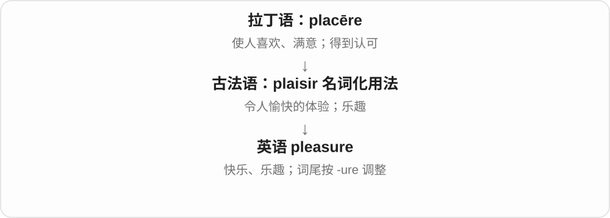

# 0519 · -ure — 动作、结果或状态的名词词尾

[逐词精讲目录](../00_逐词精讲目录.md) · [总目录](../00_总目录_按常用程度.md)

## 核心词根与来源

-ure 经古法语 -ure 或直接接拉丁 -ura，形成动作、结果、状态等名词。在法语中也有造词能力，所以英语词不都要有一个完全对应的古典拉丁原词。记住常用词的完整词族，比看到 ure 三个字母就统一拆分更可靠。

**URE：把做这件事、做出的结果，或形成的状态当名词说**

expose 是露出来，exposure 是暴露这件事或程度；compose oneself 是稳住自己，composure 是那份镇定。

- **暴露与擦除**：expose · exposure；erase · erasure
- **抓住与支出**：seize · seizure；expend · expenditure
- **情绪和结果**：compose · composure；fail · failure
- **完整词的历史**：measure · pleasure；candidate · candidature
- **furniture：法语供应名词到家具统称**：furnish · furniture
- **compose 的动作变化与保留、去掉词尾 e**：compose · composes · composing

## 词形与演化规律

compose 去末尾 e + -ure → composure；expose／exposure、erase／erasure、seize／seizure 可对照认形。expenditure 还含 expend 的扩展词干；measure、pleasure 等有整体借词及拼写演变，不应强造一个英语 meas、pleas 动词。

furniture 借法语 fourniture 供应、装备等名词，与 fournir 同族；英语后专门化为家具，不是 furnish 去 sh 的现代随意拼写规则。

composes 保留 e 加 -s；composing 去不发音 e 加完整 -ing。

## 单词速览（按词族由简到繁）

同一基础词的相关扩展放在一起，先读基础形式，再读扩展；各组之间优先读常用的。具体词源关系见各词讲解。

| 单词 | 音标 | 核心意思 |
|---|---|---|
| [fail](#w-12) | /feɪl/ | 失败；未能做到；失灵；使失望 |
| [failure](#w-1) | 英 /ˈfeɪljə/；美 /ˈfeɪljər/ | 失败；未履行；故障、失效；失败的人或事 |
| [candidate](#w-11) | /ˈkændɪdət/，亦 /ˈkændɪdeɪt/ | 候选人；求职者；考生；可能适合的对象 |
| [candidature](#w-10) | 英 /ˈkændɪdətʃə/；美 /ˈkændɪdətʃər/ | 候选资格；候选人身份；参选 |
| [measure](#w-2) | 英 /ˈmeʒə/；美 /ˈmeʒər/ | 测量；衡量；尺度；措施 |
| [pleasure](#w-3) | 英 /ˈpleʒə/；美 /ˈpleʒər/ | 快乐；乐趣；令人高兴的事 |
| [expose](#w-13) | 英 /ɪkˈspəʊz/；美 /ɪkˈspoʊz/ | 使暴露；揭露；让接触 |
| [exposure](#w-4) | 英 /ɪkˈspəʊʒə/；美 /ɪkˈspoʊʒər/ | 暴露；接触；曝光；公众关注 |
| [furnish](#w-19) | 英 /ˈfɜːnɪʃ/；美 /ˈfɝːnɪʃ/ | 为……配家具、装备；提供、供给 |
| [furniture](#w-18) | 英 /ˈfɜːnɪtʃə/；美 /ˈfɝːnɪtʃər/ | 家具〔不可数统称〕 |
| [seize](#w-14) | /siːz/ | 抓住、夺取、扣押；把握机会；突然攫住 |
| [seizure](#w-6) | 英 /ˈsiːʒə/；美 /ˈsiːʒər/ | 夺取、扣押；〔医学〕癫痫性发作等发作事件 |
| [expenditure](#w-5) | 英 /ɪkˈspendɪtʃə/；美 /ɪkˈspendɪtʃər/ | 支出；支出额；资源的耗费 |
| [erase](#w-15) | 英 /ɪˈreɪz/；美 /ɪˈreɪs/ | 擦掉；抹去；清除 |
| [erasure](#w-9) | 英 /ɪˈreɪʒə/；美 /ɪˈreɪʒər/ | 擦除；删除；抹去；擦除痕迹 |
| [compose](#w-16) | 英 /kəmˈpəʊz/；美 /kəmˈpoʊz/ | 创作、作曲；组成；安排构图；使平静、镇定 |
| [composing](#w-20) | 英 /kəmˈpəʊzɪŋ/；美 /kəmˈpoʊzɪŋ/ | 作曲、撰写、组织作品的过程；使自己镇定 |
| [composure](#w-7) | 英 /kəmˈpəʊʒə/；美 /kəmˈpoʊʒər/ | 镇定；沉着 |
| [composes](#w-21) | 英 /kəmˈpəʊzɪz/；美 /kəmˈpoʊzɪz/ | 作曲、撰写、组成〔第三人称单数〕 |
| [expend](#w-17) | 英、美 /ɪkˈspend/ | 花费；耗费；投入资源 |

## 逐词讲解

### 1. fail — 失败；未能做到；失灵；使失望

**音标**：/feɪl/

**先抓住这个画面**

预期中的结果没接上：事情没成，机器没运转，承诺没兑现。

**怎么拆**

古法语 falir 接通俗拉丁 *fallīre，远接 fallere“欺骗、使落空”。语义走向未达预期，不表示每次失败都有人故意骗人。

**怎么变成今天的意思**

**拉丁 fallere；完成分词 falsus**  
欺骗、使落空；错误的、虚假的

↓

**通俗拉丁 \*fallīre → 古法语 falir**  
缺少、不能成功、使失望

↓

**中古英语 failen → 英语 fail**  
失败；没有做到；停止起作用

fail an exam 是没通过考试；fail to reply 是没有回复，不一定尝试过却做不到；the brakes failed 是刹车失灵。fail someone 还可以说辜负对方，或给对方不及格。

**常见搭配与例句**

fail to do；fail an exam；fail in an attempt；without fail。

> The key failed to open the door.

这把钥匙没能打开门。

> The notice failed to mention the change of venue.

通知没有提到场地变更。

**别混淆**

fail to do 有时只是“没有做”，比 try and fail 所说的“尝试后失败”范围更广。

### 2. failure — 失败；未履行；故障、失效；失败的人或事

**音标**：英 /ˈfeɪljə/；美 /ˈfeɪljər/

**先抓住这个画面**

本来希望事情能接着运转或达到目标，结果在某处断了。

**怎么拆**

来自盎格鲁法语动词 failer 的名词用法，英语早期也写 failer，后来词尾仿 -ure 改写。现代能联系 fail + -ure，但不宜把它当成简单英语新造词。

**怎么变成今天的意思**

**拉丁 fallere；完成分词 falsus**  
欺骗、使落空；错误的、虚假的

↓

**通俗拉丁 \*fallīre → 古法语 falir／盎格鲁法语 failer**  
未能成功、缺少

↓

**法语动词名词化 → 英语 failer → failure**  
失败、缺陷；拼写改为 -ure

a failure 可以是一件不成功的事；power failure 是供电中断；failure to report 是未履行报告这一动作。语境决定它是可数结果，还是不可数过程或失效状态。

**常见搭配与例句**

a complete failure；power failure；failure to do；learn from failure。

> A power failure stopped the lifts for several minutes.

一次停电使电梯停止运行了几分钟。

> Failure to include the reference number delayed the application.

没有填写编号，导致申请处理延迟。

**别混淆**

a failed attempt 只评价一次尝试；称一个人 a failure 是对人的笼统负面评价，语气更重。

### 3. candidate — 候选人；求职者；考生；可能适合的对象

**音标**：/ˈkændɪdət/，亦 /ˈkændɪdeɪt/

**先抓住这个画面**

已经被拿出来考虑，或者主动来争取某个位置的人或东西。

**怎么拆**

借自拉丁 candidatus，原指穿亮白袍竞选公职的人，接 candidus；不是现代英语 candid“坦率”加 -ate 就变成候选人。

**怎么变成今天的意思**

**拉丁语 candere**  
发亮、发白、发热发光

↓

**拉丁语 candidus → candidatus → 英语 candidate**  
穿亮白袍的竞选者 → 参选人、候选人

a job candidate 是求职候选人；a candidate for replacement 可以是可能要被替换的东西。历史上的白袍是命名背景，不表示今天每位候选人都坦诚。

**常见搭配与例句**

a candidate for a post；a suitable candidate；interview candidates；exam candidates。

> We interviewed five candidates for the position.

我们面试了五名该职位的候选人。

> The old server is a strong candidate for replacement.

那台旧服务器很可能需要更换。

**别混淆**

applicant 强调已经申请；candidate 强调正被考虑或参与竞争，两者范围可重叠。

### 4. candidature — 候选资格；候选人身份；参选

**音标**：英 /ˈkændɪdətʃə/；美 /ˈkændɪdətʃər/

**先抓住这个画面**

与 candidacy 基本同义，常出现在较正式、偏英式的选任文字中。

**怎么拆**

借自法语 candidature，由 candidat + -ure 构成；现代可联系 candidate，但不是必须在英语里才加上后缀。

**怎么变成今天的意思**

**拉丁语 candere**  
发亮、发白、发热发光

↓

**拉丁 candidatus → 法语 candidat → candidature → 英语 candidature**  
候选人 → 候选身份、参选

support a candidature 是支持某人的参选或候选资格。日常和美式文字里 candidacy 往往更常见；不用为了正式而把 candidate 本人也改叫 candidature。

**常见搭配与例句**

support a candidature；withdraw one’s candidature；candidature for office。

> The committee agreed to support her candidature.

委员会同意支持她的候选资格。

> He withdrew his candidature before the final vote.

他在最后投票前退出了竞选。

**别混淆**

candidate 是人；candidature 与 candidacy 是人的候选身份或参选状态。

### 5. measure — 测量；衡量；尺度；措施

**音标**：英 /ˈmeʒə/；美 /ˈmeʒər/

**先抓住这个画面**

先把尺子贴上去看有多大，再把同一动作搬到成绩、风险和行动上。

**怎么拆**

名词经古法语 mesure 接拉丁 mēnsūra；动词经 mesurer 接晚期拉丁 mēnsūrāre，两条借入线相通。

**怎么变成今天的意思**

**拉丁 mētīrī，分词 mēnsus**  
测量、量出大小

↓

**拉丁 mēnsūra → 古法语 mesure → 英语名词 measure**  
尺寸、分量、衡量的标准

↓

**英语 measure 的用法扩展**  
量大小 → 评估；标准；为达到目的而采取的办法

measure a room 是拿工具量；measure success 是判断成功到什么程度。a measure of success 可指一定程度的成功，也可依上下文指衡量成功的指标。take measures 是采取措施，这里的措施是安排出来的行动，不是“拿几把尺子”。

**常见搭配与例句**

measure the width；measure success by；take measures to do；a measure of。

> Please measure the window before ordering the curtains.

订窗帘前请先量好窗户。

> We measure success by how much our students improve.

我们按学生进步多少来衡量是否成功。

> The school took measures to reduce food waste.

学校采取了减少食物浪费的措施。

**别混淆**

measurement 偏测量过程或结果；measure 还可表示标准、办法，词义范围更宽。

### 6. pleasure — 快乐；乐趣；令人高兴的事

**音标**：英 /ˈpleʒə/；美 /ˈpleʒər/

**先抓住这个画面**

某件事让你觉得享受，于是那份舒服、满足或开心本身就叫 pleasure。

**怎么拆**

来自古法语 plaisir 的名词用法，英语中词尾按 -ure 调整；与 please 同源，但不是直接把现代 please 加 -ure。

**怎么变成今天的意思**

read for pleasure 是为乐趣阅读；take pleasure in 是从中得到快乐；My pleasure 是礼貌地说很乐意。

**常见搭配与例句**

for pleasure；take pleasure in；a pleasure to meet you；simple pleasures。

> She reads poetry for pleasure, not for an exam.

她读诗是为了享受，不是为了考试。

> It was a pleasure to work with such a thoughtful team.

和这样周到的团队合作很愉快。

**别混淆**

pleasure 是名词，pleasant 是形容词。It was a pleasure 与 It was pleasant 都可表达愉快，但句法不同。

### 7. expose — 使暴露；揭露；让接触

**音标**：英 /ɪkˈspəʊz/；美 /ɪkˈspoʊz/

**先抓住这个画面**

把盖子掀开，让原本受保护或被藏住的东西显露出来。

**怎么拆**

经法语 exposer 借入；对应拉丁 ex-“出去” + pōnere 的 expōnere，但词形受 poser〔源于 pausāre〕替换影响。

**怎么变成今天的意思**

**晚期拉丁 pausāre → 古法语 poser**  
使停下、使安放 → 放置

↓

**拉丁 pōnere 及其复合词的影响**  
相似词形和“放置”意义交汇；不是单纯直系音变

↓

**古法语 exposer → 中古英语 exposen → 英语 expose**  
对应拉丁 expōnere“放到外面、展示”的意义

可以把皮肤暴露在阳光下，把谎言揭穿，也可以让学生接触新思想。不是每次 expose 都有羞耻或危险意味。

**常见搭配与例句**

expose something to；expose a lie；be exposed to。

> Removing the panel exposed the wires underneath.

取下盖板后，下面的电线露了出来。

> The course exposes students to different ways of thinking.

这门课程让学生接触不同的思考方式。

**别混淆**

reveal 偏揭示信息；expose 还突出失去遮蔽、直接接触外界。

### 8. exposure — 暴露；接触；曝光；公众关注

**音标**：英 /ɪkˈspəʊʒə/；美 /ɪkˈspoʊʒər/

**先抓住这个画面**

遮挡拿开了，人或物开始直接接触外界。

**怎么拆**

expose + -ure，在英语中形成名词。expose 的法语路线兼有 pausāre 与 pōnere 的影响。

**怎么变成今天的意思**

**晚期拉丁 pausāre → 古法语 poser**  
使停下、使安放 → 放置

↓

**拉丁 pōnere 及其复合词的影响**  
相似词形和“放置”意义交汇；不是单纯直系音变

↓

**古法语 exposer → 中古英语 exposen → 英语 expose**  
对应拉丁 expōnere“放到外面、展示”的意义

↓

**英语 expose + -ure → exposure**  
被暴露、接触外界的过程或状态

sun exposure 是接触阳光；media exposure 是进入公众视野；摄影 exposure 是感光材料或传感器接收光线的过程和程度。

**常见搭配与例句**

exposure to；media exposure；a long exposure。

> The fabric faded after prolonged exposure to sunlight.

长时间日晒后，布料褪色了。

> A long exposure turned the moving lights into bright trails.

长曝光把移动的灯光拍成了明亮的轨迹。

**别混淆**

experience 常是亲自做事积累的经验；exposure to 可能只是接触、见识过。

### 9. furnish — 为……配家具、装备；提供、供给

**音标**：英 /ˈfɜːnɪʃ/；美 /ˈfɝːnɪʃ/

**先抓住这个画面**

空房间里把桌椅床备齐，是 furnish；把别人办事需要的资料也备齐给他，仍然是提供所需的那条线。

**怎么拆**

经法语 furniss- 等词干接 furnir、fornir 完成、装备、提供，较早接日耳曼促进、做成的材料。与 frame 的动词历史有同族联系，但不是现代从 frame 直接派生。

**怎么变成今天的意思**

**较早日耳曼做成、促进材料 → 法语 furnir／fornir**  
把事情做成；提供、装备

↓

**法语词干 → 英语 furnish**  
供给；后来常说给房间配家具

furnish a room 为房间配家具；furnish someone with information 向某人提供资料；furnish evidence 提供证据；furnish the house simply 简单布置房屋。

**常见搭配与例句**

furnish an office；furnish someone with the details。

> They furnished the flat with second-hand furniture.

他们给公寓配了二手家具。

> The report furnishes evidence for the claim.

报告为这一说法提供了证据。

**别混淆**

furnish 不只接桌椅。furnish someone with details 里的 details 是提供的信息；谈房间时才通常是配备家具。

### 10. furniture — 家具〔不可数统称〕

**音标**：英 /ˈfɜːnɪtʃə/；美 /ˈfɝːnɪtʃər/

**先抓住这个画面**

桌子、椅子、床等东西放在一起，填充并服务一个生活、工作空间，就是 furniture。英语把它作为一类东西的统称。

**怎么拆**

借法语 fourniture 供应、装备，接 fournir 提供、装备，与 furnish 同族。英语先有供应、装备等义，后来家具义突出；不能把现代拼写当作 furnish 任意改尾。

**怎么变成今天的意思**

**法语 fournir → fourniture**  
提供、装备 → 所供应、装备的东西

↓

**英语 furniture**  
供应、装备等旧义 → 桌椅床柜等家具统称

a piece of furniture 一件家具；some furniture 一些家具；office furniture 办公家具；wooden furniture 木制家具；move the furniture 搬动家具。

**常见搭配与例句**

buy furniture；furniture for the living room。

> We need some furniture for the new office.

新办公室需要添些家具。

> This chair is my favourite piece of furniture.

这把椅子是我最喜欢的一件家具。

**别混淆**

普通家具义不说 a furniture 或 three furnitures。要数件数，用 three pieces of furniture，或直接说 three chairs。

### 11. seize — 抓住、夺取、扣押；把握机会；突然攫住

**音标**：/siːz/

**先抓住这个画面**

一把抓牢，不让它溜走，是 seize。机会抓住了就行动，恐惧抓住了人则让人突然被情绪控制。

**怎么拆**

由中古英语 seisen 等接古法语 seisir 占有、取得控制；更早联系中世纪法律用语及日耳曼语材料，细节有讨论。

**怎么变成今天的意思**

**古法语 seisir → 中古英语 seisen → seize**  
占有、取得控制；更早法律用语与日耳曼语来源有讨论

↓

**抓住、控制的动作扩展**  
抓牢实物、夺取、把握机会；情绪突然攫住人

seize a rope 抓牢绳子，seize power 夺权，seize an opportunity 把握机会，seize goods 扣押货物，be seized by fear 突然被恐惧攫住。

**常见搭配与例句**

seize an opportunity；seize control；be seized by。

> She seized the rope before it slipped away.

绳子滑走前，她一把抓住了。

> He seized the opportunity to ask a question.

他抓住机会问了个问题。

**别混淆**

seize 通常有迅速抓住、取得控制的力度；hold 可以只是持续拿着。拼写 ei，发音 /iː/。

### 12. seizure — 夺取、扣押；〔医学〕癫痫性发作等发作事件

**音标**：英 /ˈsiːʒə/；美 /ˈsiːʒər/

**先抓住这个画面**

seize 抓住、控制，seizure 可以是取得控制的那次行动；身体突然被一次异常发作影响，也沿用了突发攫住的表达。

**怎么拆**

seize 去末尾 e 加 -ure，形成行为、事件名词。扣押义接取得占有，医学义接突然发作；现代常见发音中 z 与后部融合为 /ʒ/。

**怎么变成今天的意思**

**古法语 seisir → 中古英语 seisen → seize**  
占有、取得控制；更早法律用语与日耳曼语来源有讨论

↓

**抓住、控制的动作扩展**  
抓牢实物、夺取、把握机会；情绪突然攫住人

↓

**后缀扩展**  
seizing 抓取过程；seizure 抓取、扣押，也说突然发作

↓

**seize + -ure → seizure**  
取得、扣押；突然发作事件

the seizure of goods 货物扣押，a seizure 一次发作。医学语境可指脑部异常电活动相关发作，表现不只一种；这里按词义辨认事件名称。

**常见搭配与例句**

the seizure of；have a seizure。

> The report describes the seizure of stolen goods.

报告描述了对赃物的扣押。

> The doctor asked when the seizure had occurred.

医生询问这次发作是什么时候发生的。

**别混淆**

seizure 是事件名，epilepsy 是疾病名称；发作也不都表现为明显抽搐。一般语境还可能是扣押，先看上下文。

### 13. expenditure — 支出；支出额；资源的耗费

**音标**：英 /ɪkˈspendɪtʃə/；美 /ɪkˈspendɪtʃər/

**先抓住这个画面**

把花出去的资源记成一项总量，常出现在预算、报告和正式说明里。

**怎么拆**

由中世纪拉丁 expenditus 的词干与 -ure 形成；expenditus 是 expendere 的一种非古典分词形式。现代与 expend 对应，但不能把 -iture 当成这里可随意加给英语动词的通用后缀。

**怎么变成今天的意思**

**拉丁 expendere**  
花费、付出

↓

**中世纪拉丁 expenditus 词干 + -ure**  
采用花费的分词词干形成名词

↓

**英语 expenditure**  
花费行为或花费总额；也可指具体支出项

government expenditure 是政府支出；expenditure on maintenance 是维护方面的花费。energy expenditure 说能量消耗，未必涉及钱。复数 expenditures 在财务报告中也常见。

**常见搭配与例句**

public expenditure；capital expenditure；expenditure on；reduce expenditure。

> The report separates expenditure on repairs from expenditure on new equipment.

报告把维修支出与新设备支出分开列出。

> The study compared energy expenditure during different activities.

研究比较了不同活动中的能量消耗。

**别混淆**

income 是收入，expenditure 是支出；budget 是计划，可以同时安排两者。expenses 更常说具体费用，expenditure 语气更正式。

### 14. erase — 擦掉；抹去；清除

**音标**：英 /ɪˈreɪz/；美 /ɪˈreɪs/

**先抓住这个画面**

原来写在表面上的痕迹被擦掉；后来也可以说把记录、影响或记忆抹去。

**怎么拆**

借自拉丁 erasus，是 eradere“刮掉、擦除”的分词；e- 接 ex-“向外、去掉”，radere 是刮擦。英语形态保留 ras- 分词词干，不是英语 race 或 raise 的变体。

**怎么变成今天的意思**

**拉丁 ex- + radere → eradere**  
把表面的东西刮掉

↓

**拉丁 erasus → 英语 erase**  
擦去字迹、痕迹

↓

**比喻和电子用法**  
清除记录；抹去记忆、影响等

erase pencil marks 是擦去铅笔痕迹；erase a memory 是希望记忆不再留下影响。数字语境也用 erase，但一个普通“删除”动作是否让数据完全不可恢复，要看具体系统，不能靠这个词本身判断。

**常见搭配与例句**

erase a mistake；erase a recording；erase something from memory；erase traces of something。

> She erased the pencil line and drew a wider curve.

她擦掉铅笔线，重新画了一条更宽的曲线。

> A single apology could not erase years of distrust.

一句道歉无法抹去多年来的不信任。

**别混淆**

delete 常是删去文本或数据项目；erase 更容易让人想到痕迹被消除。两词在软件里可能重叠，具体效果仍由软件决定。

### 15. erasure — 擦除；删除；抹去；擦除痕迹

**音标**：英 /ɪˈreɪʒə/；美 /ɪˈreɪʒər/

**先抓住这个画面**

把“擦掉”这件事单独拿出来谈：它发生了什么，留下了什么影响。

**怎么拆**

英语 erase + -ure 构成行为或结果名词。更早有 rasure“刮擦、擦除”这个近亲，但不能仅凭相似就把 erasure 当作它去掉词首字母后的反向来源。

**怎么变成今天的意思**

**英语 erase**  
擦去、清除

↓

**erase + -ure → erasure**  
擦除行为或结果

↓

**抽象扩义**  
对历史、贡献、身份等的抹去

data erasure 说数据清除；cultural erasure 可以说一种文化的痕迹与声音被压低、删去。后者不一定涉及拿橡皮擦，而是某些原本该被看见的东西不再被呈现。

**常见搭配与例句**

accidental erasure；data erasure；the erasure of history；signs of erasure。

> The manuscript shows several erasures beside the final paragraph.

手稿最后一段旁边有几处擦除痕迹。

> The essay examines the erasure of local voices from the historical narrative.

这篇文章考察了历史叙述中本地人声音被抹去的现象。

**别混淆**

eraser 是工具，erasure 是行为或结果。omission 可以只是漏掉一项；erasure 往往更强调抹去已经存在或应被承认的痕迹。

### 16. compose — 创作、作曲；组成；安排构图；使平静、镇定

**音标**：英 /kəmˈpəʊz/；美 /kəmˈpoʊz/

**先抓住这个画面**

把音符、句子、画面元素组织成一件完整作品。情绪乱了再把自己整理好，compose yourself 就是先定定神。

**怎么拆**

借法语 composer，是对拉丁 compōnere 放在一起的改造形式，法语 poser 也参与词形影响。不是所有字母 pose 都直接由拉丁 pōnere 原样变来。

**怎么变成今天的意思**

**拉丁 com- + pōnere → compōnere，分词 compositus**  
放到一起、组合；分词词干 composit-

↓

**不同借入路线**  
法语 composer → compose；拉丁 compositiō、法语 composicion → composition

↓

**英语 compose 的动作扩展**  
组织作品、构成整体；整理情绪使镇静

compose music 作曲，compose an email 写邮件，compose a picture 安排构图，compose yourself 定定神，be composed of 由……组成。

**常见搭配与例句**

compose music；compose an email；compose yourself；be composed of。

> She composed a short piece for the piano.

她创作了一首钢琴小曲。

> He paused to compose himself before speaking.

他停下来定了定神，再开口说话。

**别混淆**

A is composed of B 是整体由部分组成；B composes A 可说部分构成整体，方向要看主语。compose yourself 不是为自己作一首曲子。

### 17. composing — 作曲、撰写、组织作品的过程；使自己镇定

**音标**：英 /kəmˈpəʊzɪŋ/；美 /kəmˈpoʊzɪŋ/

**先抓住这个画面**

正把音符、文字安排成形，是 composing；把慌乱的自己重新收拢，也可说 composing yourself。

**怎么拆**

compose 去末尾不发音 e，加完整 -ing。com- 一起与 ponere 放的旧材料，经过借词形成 compose 后，再有现代变化。

**怎么变成今天的意思**

**拉丁 componere 的组合词族 → 法语 composer → compose**  
组织、构成；创作；使平静

↓

**compose + -ing → composing〔去 e〕**  
这些动作的进行、活动

composing a song 是写歌，composing yourself 是让自己稳住，不是替自己创作一首曲子。

**常见搭配与例句**

composing music 作曲；composing a letter 写信；composing herself 使自己镇定。

> He spent the morning composing a song.

他花了一上午写歌。

> She took a moment, composing herself before speaking.

她缓了一下，镇定下来再开口。

**别混淆**

compose yourself 把心绪收拢，calm down 更日常直接；两者可以在紧张、激动的场景里出现。

### 18. composure — 镇定；沉着

**音标**：英 /kəmˈpəʊʒə/；美 /kəmˈpoʊʒər/

**先抓住这个画面**

局面很乱，心里那些散开的东西却还能收在一起，声音和动作不慌，这种稳得住是 composure。

**怎么拆**

compose + -ure；早有组合、构造、安排义，镇定义承接 composed 平静、沉着的形容用法。把心绪收拢是帮助理解的画面，不是一个可逐字还原的古人造词故事。

**怎么变成今天的意思**

**compose + -ure → 早期 composure**  
组合、安排等旧义

↓

**与 composed 平静相连的 composure**  
镇定、沉着的常用名词义

keep one’s composure 保持镇定；lose one’s composure 失态、慌了；regain one’s composure 恢复镇定。常说受到压力、惊吓后的自控。

**常见搭配与例句**

keep your composure；regain her composure。

> She kept her composure during the difficult interview.

在那场难应付的面试中，她保持了镇定。

> He paused for a moment to regain his composure.

他停了一会儿，让自己恢复镇定。

**别混淆**

composure 说临场稳住情绪，composition 可说作文、构成、作品；相同 compose 词族不代表两个名词随便互换。

### 19. composes — 作曲、撰写、组成〔第三人称单数〕

**音标**：英 /kəmˈpəʊzɪz/；美 /kəmˈpoʊzɪz/

**先抓住这个画面**

把零散材料安排成完整作品：音符变成曲子，语句变成文章。说某人常做这件事，可用 composes。

**怎么拆**

compose + -s，原词尾 e 保留，/z/ 后读 /ɪz/。compose 经法语 composer 接拉丁 componere 把……放在一起的词族。

**怎么变成今天的意思**

**拉丁 com- + ponere → componere；法语 composer**  
放在一起、组织成整体

↓

**compose + -s → composes**  
他、她作曲、撰写或构成

composes music 是创作音乐；composes a message 是组织文字写出消息。

**常见搭配与例句**

composes for films 为电影作曲；composes an email 撰写邮件。

> She composes music for short films.

她为短片作曲。

> He carefully composes a reply before sending it.

他仔细写好回复再发送。

**别混淆**

compose 既能说创作，也有组成义；常见 be composed of 则从整体说由哪些部分组成。

### 20. expend — 花费；耗费；投入资源

**音标**：英、美 /ɪkˈspend/

**先抓住这个画面**

把有限的钱、力气或努力花出去，通常用比较正式的语气强调资源消耗。

**怎么拆**

借拉丁 expendere：ex-“向外”+ pendere“称量、支付”。早年的称钱、付钱帮助理解用资源的意思，但现代不必真的先称重。

**怎么变成今天的意思**

**拉丁 pendere“称量、支付”**  
衡量并付出

↓

**拉丁 ex- + pendere → expendere**  
向外付出、花费

↓

**英语 expend**  
正式用语：花费时间、资金、精力等

expend energy 是耗费能量；expend effort on a task 是在任务上付出努力。它通常比 spend 正式，也更关注资源的投入，而不是一般地说度过某天。

**常见搭配与例句**

expend energy；expend effort；expend resources on；expend time and money。

> We expended too much effort on a minor formatting issue.

我们在一个很小的格式问题上花费了太多精力。

> The device expends less energy when it is idle.

这台设备空闲时耗能更少。

**别混淆**

spend the weekend 很自然，expend the weekend 通常不这样说。expend 侧重消耗资源，spend 还可以泛指度过时间。

## 这一组要分清什么

composure 镇定／composition 构成、作文；exposure 暴露或接触，不是 expose 的动作人；末尾字母相同，不自动证明每个词都能在现代英语里自由拆。

## 串起来练习

She paused to regain her composure before explaining the failure.

她停下来恢复镇定，然后解释这次失败。
