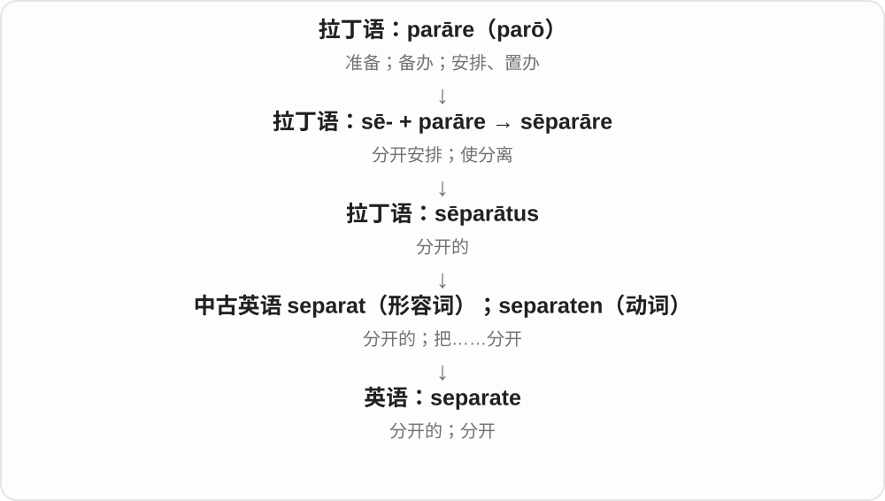
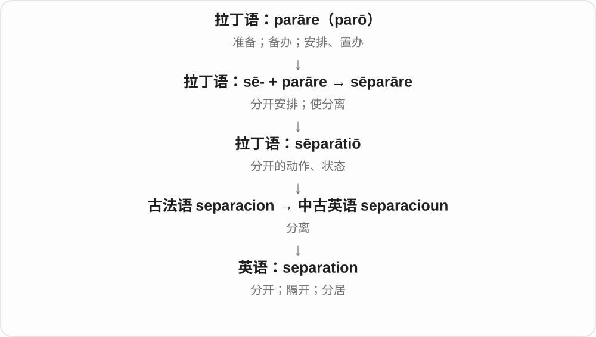

# 0525 · se-, sed- — 分开；离开；到一边

[逐词精讲目录](../00_逐词精讲目录.md) · [总目录](../00_总目录_按常用程度.md)

## 核心词根与来源

拉丁前缀 se-、sed- 表示分离或离开。它能解释 secede 的退出、seduce 的引走，也能帮助理解 separate、secluded、select 的不同分开方式。这里的 sed- 不是“坐”的 sed-，不要把 sedition 编成坐着造反。

**SE / SED = APART**

大家原本站在一起，随后有一部分走开、被带走，或者被单独挑出来。

- **分开与独处**：separate、separation、secluded、seclusion
- **政治上的分离或对立**：secede、secession、secessionist、sedition、seditious
- **把人引到一旁**：seduce、seduction、seducer、seductive、seductively
- **从整体中挑出或隐藏**：select、secret

## 词形与演化规律

se- 常见于 secede、separate、seclude、select；sed- 保留在 sedition。seduce 里的 duc- 是引导，secede 里的 ced- 是走；它们走向不同词义，不能只看共同前缀。

## 单词速览（按词族由简到繁）

同一基础词的相关扩展放在一起，先读基础形式，再读扩展；各组之间优先读常用的。具体词源关系见各词讲解。

| 单词 | 音标 | 核心意思 |
|---|---|---|
| [secret](#w-1) | /ˈsiːkrət/ | 秘密；秘密的；诀窍 |
| [separate](#w-2) | 形容词 /ˈsepərət/；动词 /ˈsepəreɪt/ | 分开的；单独的；把……分开 |
| [separation](#w-4) | /ˌsepəˈreɪʃən/ | 分开；分离；隔离距离；分居 |
| [select](#w-3) | /sɪˈlekt/ | 挑选；精选的；少数被选中的 |
| [secession](#w-5) | /sɪˈseʃən/ | 退出；脱离；分离 |
| [secessionist](#w-14) | /sɪˈseʃənɪst/ | 主张脱离联盟或国家的人；分离主义者；主张分离的 |
| [secluded](#w-6) | /sɪˈkluːdɪd/ | 僻静的；与外界隔开的 |
| [seduce](#w-7) | 英 /sɪˈdjuːs/；美 /sɪˈduːs/ | 引诱；诱惑；勾引 |
| [seductive](#w-8) | /sɪˈdʌktɪv/ | 诱人的；有诱惑力的；带有性吸引力的 |
| [seductively](#w-15) | /sɪˈdʌktɪvli/ | 诱人地；富有诱惑力地 |
| [seduction](#w-9) | /sɪˈdʌkʃən/ | 诱惑；引诱；勾引 |
| [seducer](#w-16) | 英 /sɪˈdjuːsə/；美 /sɪˈduːsər/ | 引诱者；勾引者 |
| [sedition](#w-10) | /sɪˈdɪʃən/ | 煽动叛乱；鼓动反抗权威的言行 |
| [seclusion](#w-11) | /sɪˈkluːʒən/ | 独处；隐居；隔离状态 |
| [secede](#w-12) | /sɪˈsiːd/ | 退出；脱离〔国家、联盟等〕 |
| [seditious](#w-13) | /sɪˈdɪʃəs/ | 煽动叛乱的；被认为鼓动反抗权威的 |

## 逐词讲解

### 1. secret — 秘密；秘密的；诀窍

**音标**：/ˈsiːkrət/

**先抓住这个画面**

secret 像从公开的一堆东西里拿出一件，单独放到别人看不见的抽屉里。

**怎么拆**

拉丁 sē-（分开）+ cernere（分开、筛分）→ sēcernere；分词 sēcrētus“被隔开的、隐蔽的”和名词 sēcrētum 分别通向英语相关用法。

**怎么变成今天的意思**

keep a secret 是保密；a secret meeting 是秘密会议；the secret of good bread 是做好面包的诀窍，把不为外人所知的方法当作“秘密”。

**常见搭配与例句**

keep a secret；in secret；a secret passage；the secret to success。

> Can you keep a secret until Friday?

你能把这个秘密保守到周五吗？

> The secret to the recipe is slow cooking.

这道菜的诀窍是慢慢烹煮。

> They discovered a secret passage behind the shelves.

他们在书架后面发现了一条暗道。

**别混淆**

private 只强调私人、不公开的范围；secret 往往更强调别人不知道或不该知道。

### 2. separate — 分开的；单独的；把……分开

**音标**：形容词 /ˈsepərət/；动词 /ˈsepəreɪt/

**先抓住这个画面**

separate 像把混在一起的两堆东西放到两边；作形容词则说它们已经各占一个位置。

**怎么拆**

拉丁 sē-（分开）+ parāre（安排）→ sēparāre，分词 sēparātus 进入中古英语形成相应形容词和动词。

**怎么变成今天的意思**

形容词末尾弱读 /ət/，动词末尾 /eɪt/。separate rooms 是不同房间；separate A from B 是把两者分开。

**常见搭配与例句**

a separate room；separate from；separate fact from opinion。

> We booked two separate rooms.

我们订了两个单独的房间。

> Please separate the clean towels from the used ones.

请把干净毛巾与用过的分开。

**别混淆**

different 说性质不同；separate 说分开、独立，两个 separate rooms 完全可以布置一样。

### 3. separation — 分开；分离；隔离距离；分居

**音标**：/ˌsepəˈreɪʃən/

**先抓住这个画面**

separation 像把原来连着、混着或一起生活的东西拉开，让两边不再贴在一起。

**怎么拆**

来自拉丁 sēparātiō，经法语 separacion；现代可联系 separate 与 -ion。

**怎么变成今天的意思**

可以是物理分离，也可以是职能划分或伴侣分居。separation 本身不等于已经完成 divorce“离婚”。

**常见搭配与例句**

separation of powers；separation from family；a period of separation。

> The filter allows the separation of solids from the liquid.

过滤器能把固体从液体中分离出来。

> They remained in contact during the separation.

分居期间，他们仍保持联系。

**别混淆**

division 常把一个整体分成部分；separation 更突出让两方分开、不混在一起。

### 4. select — 挑选；精选的；少数被选中的

**音标**：/sɪˈlekt/

**先抓住这个画面**

select 像把合适的东西从一大堆里单独拿出来，带着一定标准。

**怎么拆**

sē-（分开）+ legere，经 sēlēctus“选出的”进入英语。

**怎么变成今天的意思**

可选一个文件、一个人或一种方案；形容词 a select group 常指经过挑选的少数人。

**常见搭配与例句**

select a file；select from a list；a select group。

> Select the file you want to upload.

选择你要上传的文件。

> The course is open to a select group of students.

这门课面向一组经过选拔的学生。

**别混淆**

choose 更日常宽泛；select 常让人想到按标准从一组中挑选。

### 5. secession — 退出；脱离；分离

**音标**：/sɪˈseʃən/

**先抓住这个画面**

把原本连在一起的政治或组织关系断开。

**怎么拆**

借拉丁 sēcessiō“离开、退出”，来自 sēcēdere；现代能认出 secess- 与 -ion，但名词有独立借入路线。

**怎么变成今天的意思**

**拉丁 cēdere；分词词干 cess-**  
走、离开；让步、让出

↓

**拉丁 sē- + cēdere → sēcēdere**  
分开走、退出

↓

**拉丁 sēcessiō → 英语 secession**  
退出共同体的行为

常用于地区脱离国家、成员退出联盟的讨论，语气比普通 departure 更政治化。字中是 se-，不是 succession 的 suc-。

**常见搭配与例句**

secession from；a secession movement；oppose secession。

> The debate focused on the proposed secession of the region.

辩论围绕该地区拟议中的分离展开。

> The association changed its rules after the secession of several members.

几名成员退出后，协会修改了规则。

**别混淆**

succession 是接班、接续；secession 是分离、退出。

### 6. secessionist — 主张脱离联盟或国家的人；分离主义者；主张分离的

**音标**：/sɪˈseʃənɪst/

**先抓住这个画面**

一个地区本来属于更大的整体，有人主张从这个整体中退出、自成一方。

**怎么拆**

secession 脱离 + -ist 支持者；secession 来自拉丁 secessio，关联 se- 分开 + cedere 走。英语名词 secession 比现代动词 secede 的记录更早。

**怎么变成今天的意思**

**拉丁前缀 se-／sed-**  
分开；离开；到一边

↓

**拉丁 secedere → secessio**  
走开、退出 → 脱离

↓

**英语 secession + -ist → secessionist**  
支持政治脱离的人或立场

可以作名词指支持脱离的人，也能放在 movement、party 前表示分离主义的。它描述政治目标，不自动说明支持者采用暴力还是和平方式，也不等于所有争取更多自治的人。

**常见搭配与例句**

a secessionist movement；secessionist leaders；a committed secessionist。

> The secessionist movement called for an independent state.

这个分离主义运动主张建立独立国家。

> The journalist interviewed both secessionists and supporters of the union.

记者采访了主张脱离的人，也采访了支持维持联盟的人。

**别混淆**

separatist 范围更广；secessionist 更明确指退出某个现有政治共同体。autonomy 自治可以仍处于原共同体内。

### 7. secluded — 僻静的；与外界隔开的

**音标**：/sɪˈkluːdɪd/

**先抓住这个画面**

外面再热闹，这一小块地方也不容易被打扰。

**怎么拆**

seclude 的过去分词转为形容词，接拉丁 sēclūdere。

**怎么变成今天的意思**

**拉丁 claudere；分词 clausus**  
关上、围住、使结束；复合词常变为 -cludere / -clusus

↓

**拉丁 sē-“分开” + claudere → sēclūdere → 中古英语 secluden**  
隔开、关在一旁

↓

**英语 seclude**  
使远离外界；隐居、独处

↓

**英语 seclude → secluded**  
被隔开 → 僻静、隐蔽的

a secluded beach 可能离主要道路远，也可能被地形挡住。它不自动表示荒无人烟，更不保证无人能发现。

**常见搭配与例句**

a secluded spot；a secluded garden；a secluded beach。

> We found a secluded spot behind the old orchard.

我们在老果园后面找到一处僻静地方。

> The hotel has a secluded courtyard away from the street.

酒店有一个与街道隔开的僻静庭院。

**别混淆**

remote 强调地理距离远；secluded 强调隔开、不受打扰，市区里也可以有 secluded courtyard。

### 8. seduce — 引诱；诱惑；勾引

**音标**：英 /sɪˈdjuːs/；美 /sɪˈduːs/

**先抓住这个画面**

seduce 像用吸引人的东西把人从原来的打算上带开。可以是情欲上的引诱，也可以是低价、名气或美好承诺的诱惑。

**怎么拆**

拉丁语 sē-（分开、到一旁）+ dūcere（带领），形成 sēdūcere“引离、引入歧途”。

**怎么变成今天的意思**

今天不一定都有道德谴责，但常带“吸引力让人放松判断或改变打算”的感觉。普通的“吸引人”不总适合用这个词。

**常见搭配与例句**

be seduced by promises（被承诺诱惑）；seduce someone into doing…（诱使某人做……）。

> We were seduced by the promise of an easy solution.

我们被轻松解决问题的承诺诱惑了。

> The advertisement tries to seduce shoppers into spending more.

这则广告试图诱使顾客多花钱。

**别混淆**

attract 是广义吸引；seduce 更有诱惑、使人动心的意味，谈人际关系时常带性意味。

### 9. seductive — 诱人的；有诱惑力的；带有性吸引力的

**音标**：/sɪˈdʌktɪv/

**先抓住这个画面**

某种诱惑像在旁边招手，让你离开原先的打算，想朝它走过去。

**怎么拆**

基于拉丁 seducere 引到一旁的分词词干 seduct- 加 -ive；se- 离开 + ducere 引导。现代与 seduce 诱惑对应。

**怎么变成今天的意思**

**拉丁前缀 se-／sed-**  
分开；离开；到一边

↓

**拉丁 se- + ducere → seducere，分词词干 seduct-**  
把人引到一边

↓

**seduct- + -ive → seductive**  
具有诱惑力，让人想追随的

可以形容人的魅力，也可以形容方案、承诺和想法。a seductive promise of easy success 是“轻松成功”的诱人承诺，常隐含它太好听、让人放下警惕；因此不限于性意味。

**常见搭配与例句**

a seductive smile；a seductive idea；the seductive promise of success。

> The offer was seductive, but the conditions were unclear.

这个提议很诱人，但附带条件并不清楚。

> The film gives its villain a calm, seductive voice.

影片让反派拥有一种平静而充满诱惑力的嗓音。

**别混淆**

attractive 是有吸引力的，seductive 更强调把人吸过去、让人难以抵抗的力量，有时暗含值得警惕。

### 10. seductively — 诱人地；富有诱惑力地

**音标**：/sɪˈdʌktɪvli/

**先抓住这个画面**

不只是把东西摆出来，而是用声音、外观或承诺让人很想靠近。

**怎么拆**

seductive + -ly，形容一种动作或呈现方式带有诱惑力。

**怎么变成今天的意思**

**拉丁前缀 se-／sed-**  
分开；离开；到一边

↓

**seductive**  
有诱惑力的

↓

**seductive + -ly → seductively**  
以诱人的方式

可以修饰 smile、whisper，也能修饰形容词：seductively simple 表示简单得让人心动，往往提醒读者它可能把事情说得太容易。这个副词并不总与性吸引相关。

**常见搭配与例句**

smile seductively；seductively simple；seductively presented。

> The advertisement presents a seductively simple solution.

广告给出了一个简单得令人心动的解决方案。

> She smiled seductively at him across the table.

她隔着桌子向他露出充满魅力的笑容。

**别混淆**

simply 只是简单地；seductively simple 则多了“看起来太诱人”的心理效果。它既描述形式，也描述形式对人的吸引。

### 11. seduction — 诱惑；引诱；勾引

**音标**：/sɪˈdʌkʃən/

**先抓住这个画面**

seduction 是吸引力一步步把人拉过去的过程。它也可指某种很难抵挡的魅力，如权力、奢华或成名的诱惑。

**怎么拆**

来自法语 séduction、拉丁语 sēductiō，与 seduce 同源。duct- 是对应词干，不另有“鸭子”之类的意思。

**怎么变成今天的意思**

动词 seduce 说谁引诱谁；名词 seduction 把这个过程或吸引力拿出来讨论。具体是否有性意味，需要看对象和上下文。

**常见搭配与例句**

the seduction of power（权力的诱惑）；a tale of seduction（关于诱惑或勾引的故事）。

> The novel explores the seduction of fame.

这部小说探讨了名声的诱惑。

> The film tells a story of seduction and betrayal.

这部电影讲述了一个关于引诱与背叛的故事。

**别混淆**

persuasion 可通过理由说服；seduction 更突出欲望和吸引力。两者不完全相同。

### 12. seducer — 引诱者；勾引者

**音标**：英 /sɪˈdjuːsə/；美 /sɪˈduːsər/

**先抓住这个画面**

seducer 是靠魅力、承诺或欲望让别人动心的人。文学中常指勾引他人的角色，语气比“有魅力的人”重。

**怎么拆**

seduce + -er；末尾已有 e，只加 r。

**怎么变成今天的意思**

-er 把动作换成做动作的人。它强调这个人对别人施加诱惑，不能因为某人长得好看就直接称他 seducer。

**常见搭配与例句**

a charming seducer（迷人的勾引者）；play the seducer（扮演引诱者）。

> The actor plays a charming but unreliable seducer.

这名演员扮演一个迷人却不可靠的勾引者。

> The novel exposes the seducer’s empty promises.

小说揭露了引诱者的空头承诺。

**别混淆**

admirer 是爱慕者；seducer 是试图引诱的一方。两者的主动行为和语气不同。

### 13. sedition — 煽动叛乱；鼓动反抗权威的言行

**音标**：/sɪˈdɪʃən/

**先抓住这个画面**

原本同在一个政治秩序里，有人鼓动大家与它对立、脱离或反抗。

**怎么拆**

经古法语 sedicion 或直接来自拉丁 seditio，字面是分开走：sed- 分开 + itio 行走，后者来自 ire 走。

**怎么变成今天的意思**

**拉丁前缀 se-／sed-**  
分开；离开；到一边

↓

**拉丁 sed- + itio → seditio**  
分开走，继而指纷争、叛乱

↓

**古法语 sedicion → 英语 sedition**  
后来常指煽动反抗既有权威的言行

常出现在政治史和法律报道里，含义比普通不满或反对强得多。阅读时注意是谁把某些话称为 sedition：这个标签可能正是争议的一部分。词源中的“分开走”不是现代法律定义，具体法律标准也不能从拆词推出。

**常见搭配与例句**

accusations of sedition；be charged with sedition；a debate over sedition。

> The historian examined how the government used accusations of sedition.

历史学家研究了当时政府如何使用煽动叛乱的指控。

> The debate centred on the distinction between dissent and sedition.

争论的焦点是表达异议与煽动叛乱之间的区别。

**别混淆**

dissent 是表达异议，sedition 涉及煽动反抗的指控或概念。不能把正常批评自动翻成 sedition。

### 14. seclusion — 独处；隐居；隔离状态

**音标**：/sɪˈkluːʒən/

**先抓住这个画面**

与外界的来往减少到很少，自己处在一块隔开的空间里。

**怎么拆**

借中世纪拉丁 sēclūsiō，来自拉丁 sēclūdere 的分词词干；现代与 seclude 对应。

**怎么变成今天的意思**

**拉丁 claudere；分词 clausus**  
关上、围住、使结束；复合词常变为 -cludere / -clusus

↓

**拉丁 sēclūdere → 中世纪拉丁 sēclūsiō → 英语 seclusion**  
隔开 → 与外界分离的状态或行为

live in seclusion 是隐居；seek seclusion 是找个清静地方独处。它可以是主动选择，也可以由外部安排，须看上下文；并不自带“内心孤独”的评价。

**常见搭配与例句**

in seclusion；seek seclusion；the seclusion of a garden。

> The composer spent several months in seclusion working on the opera.

作曲家独处了几个月，专心创作这部歌剧。

> Visitors come here for the quiet and seclusion.

游客来这里享受安静、远离打扰的环境。

**别混淆**

solitude 侧重独自一人的状态或体验；seclusion 更突出与公众、外界隔开。

### 15. secede — 退出；脱离〔国家、联盟等〕

**音标**：/sɪˈsiːd/

**先抓住这个画面**

原来一起走，现在分出去另走一条路。

**怎么拆**

直接借拉丁 sēcēdere；sē- 是“分开”，cēdere 是“走”。

**怎么变成今天的意思**

**拉丁 cēdere；分词词干 cess-**  
走、离开；让步、让出

↓

**拉丁 sē- + cēdere → sēcēdere**  
分开走、退出

↓

**英语 secede**  
从政治共同体或组织中退出

常见于一个地区、成员或团体退出较大的政治组织。它强调脱离关系，不是单纯搬家或暂时离开会场。

**常见搭配与例句**

secede from；vote to secede。

> The province voted to secede from the federation.

该省投票决定脱离联邦。

> Several members threatened to secede from the association.

几个成员威胁要退出协会。

**别混淆**

recede 是退回、退去；secede 是退出原来的共同体。

### 16. seditious — 煽动叛乱的；被认为鼓动反抗权威的

**音标**：/sɪˈdɪʃəs/

**先抓住这个画面**

给一篇文章或一次演说贴上政治性很强的标签：它被认为在鼓动人们起来反抗。

**怎么拆**

经法语 sedicios／séditieux 或直接来自拉丁 seditiosus，后者基于 seditio 纷争、叛乱。它有独立借入链，不只是在英语 sedition 后机械加 -ous。

**怎么变成今天的意思**

**拉丁前缀 se-／sed-**  
分开；离开；到一边

↓

**拉丁 seditio → seditiosus**  
纷争、叛乱 → 煽动纷争的

↓

**法语相关形式 → 英语 seditious**  
煽动反抗的

常修饰 speech、writing、pamphlet、activity。它描述言论或行为被赋予的政治性质，未必是作者认可的事实；例如 allegedly seditious materials 就明确保留了“据称”的距离。

**常见搭配与例句**

seditious speech；seditious literature；allegedly seditious material。

> The authorities described the pamphlet as seditious.

当局把那本小册子描述为具有煽动叛乱性质。

> The essay asks why some political slogans were labelled seditious.

这篇文章追问，为什么有些政治口号会被贴上煽动叛乱的标签。

**别混淆**

rebellious 可以形容孩子不服管，seditious 通常有更明确的政治和权威背景，日常小叛逆不宜随便套用。

## 这一组要分清什么

secede 是退出共同体，sedition 是煽动反抗的概念；secluded 是远离人群的，seductive 是把注意力吸过去的。共同的 apart 只提供起点，最终意思由完整词族决定。

## 串起来练习

The seductive promise of a peaceful retreat led them to book a secluded cottage.

“安静休憩”的诱人承诺，让他们订下了一间远离人群的小屋。
