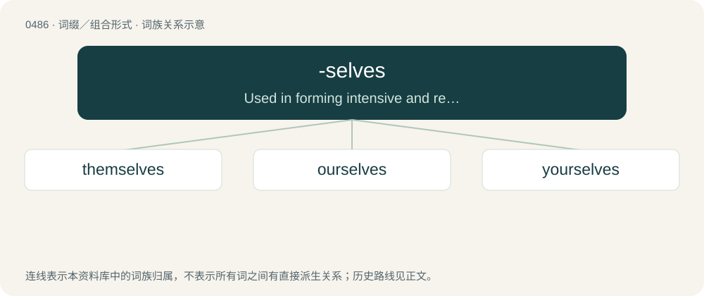

# 0551 · -selves — Used in forming intensive and reflexive forms of the plural personal pronouns.

[总目录](../00_总目录_按常用程度.md)

**类型**：词缀／组合形式　｜　**来源语言**：见词源记录

## 核心含义与来源

- 核心含义：Used in forming intensive and reflexive forms of the plural personal pronouns.
- 英文含义：Used in forming intensive and reflexive forms of the plural personal pronouns.
- 词形：-selves

## 词族图

## 单词速览（常用到不常用）

| 单词 | 音标 | 释义 |
|---|---|---|
| [themselves](#w-1) | 英 /ðɛmˈsɛlvz/ | pron. 他们自己, 她们自己, 它们自己 |
| [ourselves](#w-2) | 英 /aʊəˈsɛlvz/；美 /aʊɚˈsɛlvz/ | pron. 我们自己 |
| [yourselves](#w-3) | /jəˈsɛlvz/ | pron. 你们自己 |

## 逐词详解

### 1. themselves

**词性**：代词　｜　**音标**：英 /ðɛmˈsɛlvz/

**中文释义**：pron. 他们自己, 她们自己, 它们自己

**英文义项**：The reflexive case of they, the third-person plural personal pronoun. The group of people, animals, or objects previously mentioned, as the object of a verb or following a preposition (also used for emphasis). / The reflexive case of they, the third-person singular personal pronoun. The single person previously mentioned, as the object of a verb or following a preposition (also used for emphasis).

**构词拆分**：them + -selves

**词源与演化**：

Morphologically them + -selves.

**例句**：

> Would whoever stole my phone please make themselves known.

该用例对应义项：The reflexive case of they, the third-person singular personal pronoun. The single person previously mentioned, as the object of a verb or following a preposition (also used for emphasis).

### 2. ourselves

**词性**：代词　｜　**音标**：英 /aʊəˈsɛlvz/；美 /aʊɚˈsɛlvz/

**中文释义**：pron. 我们自己

**英文义项**：Us; the group including the speaker as the object of a verb or preposition when that group also is the subject. / Intensifies the subject as the group including the speaker, especially to indicate that no one else satisfies the predicate or needs to be included.

**构词拆分**：our + -selves

**词源与演化**：

Morphologically our + -selves.

**例句**：

> Come on everyone! Let's get ourselves up and out of bed, please.

该用例对应义项：Referring to everyone being addressed.

### 3. yourselves

**词性**：代词　｜　**音标**：/jəˈsɛlvz/

**中文释义**：pron. 你们自己

**英文义项**：You (plural), used to intensify the subject as the group addressed.

**构词拆分**：your + -selves

**词源与演化**：

Morphologically your + -selves.

**例句**：

> You yourselves won’t eat at that restaurant. Why are you recommending it to us?

该用例对应义项：You (plural), used to intensify the subject as the group addressed.
