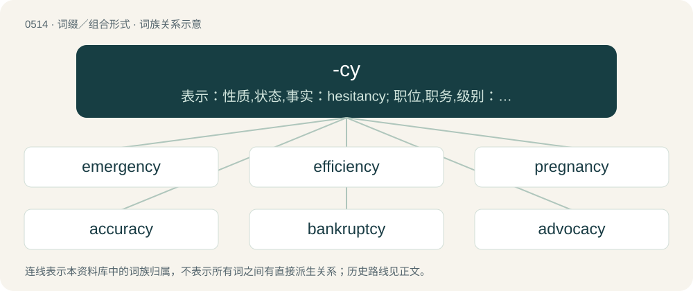

# 0575 · -cy — 表示：性质,状态,事实：hesitancy; 职位,职务,级别：captaincy

[总目录](../00_总目录_按常用程度.md)

**类型**：词缀／组合形式　｜　**来源语言**：见词源记录

## 核心含义与来源

- 核心含义：表示：性质,状态,事实：hesitancy; 职位,职务,级别：captaincy
- 英文含义：Used to form nouns of state, condition or quality.
- 词形：-cy

**来源记录 1**（后缀／后置成分；Used to form nouns of state, condition or quality.）

From Anglo-Norman -cie, ultimately from Latin -cia, -tia, Ancient Greek -κια (-kia), -τια (-tia), originally variants of Latin -ia and Ancient Greek -ια (-ia), -ία (-ía) or -εια (-eia). Original loan words like pharmacy and papacy could have formed the model.

## 词族图

## 单词速览（常用到不常用）

| 单词 | 音标 | 释义 |
|---|---|---|
| [emergency](#w-1) | 英 /ɪˈmɜː(ɹ).dʒən.si/；美 /ɪˈmɝ.d͡ʒən.si/ | n. 紧急状况, 紧急事件, 紧急需要；\[化\] 紧急情况 |
| [efficiency](#w-2) | /ɪˈfɪʃ.ən.si/ | n. 效率, 效能, 功效；\[医\] 效率, 效力 |
| [pregnancy](#w-3) | /ˈpɹɛɡnənsi/ | n. 怀孕；丰富, 多产；意义深长 |
| [accuracy](#w-4) | 英 /ˈak.jʊ.ɹə.si/；美 /ˈæk.jɚ.ə.si/ | n. 精确, 正确；\[计\] 准确度 |
| [bankruptcy](#w-5) | 英 /ˈbæŋ.kɹʌp(t).si/；美 /ˈbæŋkˌɹʌp(t).si/ | n. 破产者；\[经\] 破产, 倒闭 |
| [advocacy](#w-6) | 英 /ˈæd.və.kə.si/；/ædˈvokəsi/ | n. 拥护, 支持, 鼓吹, 辩护, 辩护术；\[法\] 辩护, 拥护, 提倡 |
| [transparency](#w-7) | 英 /tɹænsˈpæɹənsi/；美 /tɹænsˈpæɹənsi/ | n. 透明, 透明度, 透过性, 透明物, 清晰；\[计\] 透明性; 透明 |
| [residency](#w-8) | /ˈɹɛzɪdənsi/ | n. 住处；\[法\] 住处, 管辖区 |
| [deficiency](#w-9) | /dɪˈfɪʃənsi/ | n. 缺乏, 不足；\[医\] 缺乏, 不足 |
| [dependency](#w-10) | 英 /dɪˈpɛndənsi/ | n. 属国, 保护地, 从属物；\[医\] 从属, 从属部 |
| [decency](#w-11) | 英 /ˈdiːsənsi/；美 /ˈdisənsi/ | n. 得体, 礼貌, 正派；\[法\] 正当, 正派, 合乎礼仪 |
| [expectancy](#w-12) | 英 /ɪkˈspɛkt(ə)nsi/；美 /ɪkˈspɛktənsi/ | n. 期待, 期望的事物, 嘱望, 希望, 期望, 预期；\[医\] 预期 |
| [consultancy](#w-13) | 英 /kənˈsʌl.tən.si/ | n. 商量, 协商, 磋商, 会诊, 与...商量, 咨询, 请教, 找(医生)看病, 查阅, 考虑；\[经\] 咨询业务, 咨询服务 |
| [infancy](#w-14) | /ˈɪnfənsi/ | n. 幼年, 初期, 幼儿期；\[医\] 婴儿期(一足岁以内) |
| [occupancy](#w-15) | 美 /ˈɑk.jə.p(ə)n.(t)si/ | n. 占有, 居住, 占用；\[法\] 占据, 据有, 占用 |
| [redundancy](#w-16) | 英 /ɹɪˈdʌnd(ə)nsi/；美 /ɹɪˈdʌndən(t)si/ | n. 过多, 冗长, 累赘, 多余, 冗余位, 冗余度, 冗余码, 多余信息；\[计\] 冗余 |
| [insurgency](#w-17) | 英 /ɪnˈsɜːd͡ʒənsi/；美 /ɪnˈsɝd͡ʒənsi/ | n. 叛乱状态, 发生暴动；\[法\] 暴动, 起义, 叛乱 |
| [insolvency](#w-18) | /inˈsɒlvənsi/ | n. 无力偿还, 破产；\[经\] 破产, 无力偿付, 不足抵偿债务 |
| [tenancy](#w-19) | 美 /ˈtɪ̟nənsi/；/ˈtɛnənsi/ | n. 租用, 租赁；\[经\] 租赁, 租回 |
| [conservancy](#w-20) | /kənˈsəːvənsi/ | n. 保存, 保护, 管理；\[医\] 保存; 保护, 管理 |
| [fluency](#w-21) | /ˈfluːənsi/ | n. 流畅, 雄辩, 善辩 |
| [captaincy](#w-22) |  | n. 舰长的职位, 大将的才略, 舰长的衔头 |
| [buoyancy](#w-23) | 英 /ˈbɔɪ.ən.si/ | n. 浮力, 弹性, 快活, 轻快, (股票市场)保持高价；\[化\] 浮力; 浮扬性 |
| [idiocy](#w-24) | /ˈɪdiəsi/ | n. 白痴, 极端愚蠢；\[医\] 白痴 |
| [ascendancy](#w-25) | /əˈsɛndənsi/ | n. 优势, 支配地位 |
| [normalcy](#w-26) | 美 /ˈnɔɹməlsi/ | n. 常态 |
| [inadequacy](#w-27) | /ɪˈnædɪkwəsi/ | n. 不适当, 不足之处, 不充分；\[医\] 机能不全, 闭锁不全, 关闭不全 |
| [relevancy](#w-28) | /ˈɹɛlɪvənsi/ | n. 关联, 恰当, 中肯, 贴切；\[法\] 关职性, 中肯, 恰当 |
| [solvency](#w-29) | /ˈsɒlvənsi/ | n. 偿付能力, 溶解力；\[法\] 有清偿能力, 偿付能力, 支付能力 |
| [malignancy](#w-30) | /məˈlɪɡ.nən.si/ | n. 恶意, 邪恶, 恶性肿瘤；\[医\] 恶性 |
| [numeracy](#w-31) | 英 /ˈnjuːməɹəsi/ | n. 识数,计算能力 |
| [vibrancy](#w-32) | /ˈvaibrənsi/ | n. 振动, 振响, 活力 |
| [truancy](#w-33) | /ˈtruːənsi/ | n. 玩忽职守, 旷课；\[法\] 旷学, 旷职, 玩忽职守 |
| [chaplaincy](#w-34) | 英 /ˈtʃæp.lɪn.si/ | n. 礼拜堂牧师的职位或任期 |
| [incumbency](#w-35) | /ɪŋˈkʌmbənsi/ | n. 任职, 义务, 任职期；\[法\] 职责, 义务, 在职 |
| [vagrancy](#w-36) | /ˈveɪɡɹənsɪ/ | n. 漂泊, 流浪, 神思恍惚；\[法\] 流氓, 无赖 |
| [episcopacy](#w-37) | 英 /ɪˈpɪskəpəsi/ | n. 主教制度, 主教的职位 |
| [obstinacy](#w-38) | 英 /ˈɒbstɪnəsi/；美 /ˈɑbstɪnəsi/ | n. 倔强, 顽固, 固执行为, (疼痛等)难治 |
| [illegitimacy](#w-39) | /ɪlɪˈd͡ʒɪtɪməsi/ | n. 不法, 私生, 不规则性, 不合逻辑；\[医\] 私生, 违法 |
| [profligacy](#w-40) | 美 /ˈpɹɑflɪɡəsi/ | n. 放荡, 不检点, 浪费 |
| [magistracy](#w-41) | 英 /ˈmæd͡ʒɪstɹəsi/；美 /ˈmæd͡ʒəstɹəsi/ | n. 长官的职位, 地方行政长官；\[法\] 裁判司署, 地方法庭 |
| [recency](#w-42) | /ˈɹiːsənsi/ | n. 崭新, 新近 |

## 逐词详解

### 1. emergency

**词性**：名词　｜　**音标**：英 /ɪˈmɜː(ɹ).dʒən.si/；美 /ɪˈmɝ.d͡ʒən.si/

**中文释义**：n. 紧急状况, 紧急事件, 紧急需要；\[化\] 紧急情况

**英文义项**：A situation which poses an immediate risk and which requires urgent attention. / The department of a hospital that treats emergencies.

**构词拆分**：emergent + -cy；emerge + -ency

**词源与演化**：

Borrowed from Medieval Latin emergentia, from Latin emergens, present participle of emergo (“to emerge, arise, come forth”), equivalent to emergent + -cy or emerge + -ency. Doublet of emergence.

**例句**：

> Cardiac arrest is an emergency requiring medical attention.

该用例对应义项：A situation which poses an immediate risk and which requires urgent attention.

### 2. efficiency

**词性**：名词　｜　**音标**：/ɪˈfɪʃ.ən.si/

**中文释义**：n. 效率, 效能, 功效；\[医\] 效率, 效力

**英文义项**：The extent to which a resource is used for the intended purpose. / The ratio of useful work to energy expended. Often given the symbol η.

**构词拆分**：efficient + -cy

**词源与演化**：

From Latin efficientia, equivalent to efficient + -cy.

**例句**：

> The efficiency of the planning department is deplorable.

该用例对应义项：The extent to which time is well used for the intended task.

### 3. pregnancy

**词性**：名词　｜　**音标**：/ˈpɹɛɡnənsi/

**中文释义**：n. 怀孕；丰富, 多产；意义深长

**英文义项**：The condition of being pregnant; an instance of this. / The period of time this condition prevails.

**构词拆分**：From pregnant + -cy.

**词源与演化**：

From pregnant + -cy.

**例句**：

> They don't use condoms because they are no longer worried about pregnancy.

### 4. accuracy

**词性**：名词　｜　**音标**：英 /ˈak.jʊ.ɹə.si/；美 /ˈæk.jɚ.ə.si/

**中文释义**：n. 精确, 正确；\[计\] 准确度

**英文义项**：The state of being accurate; being free from error; exactness; correctness / Exact conformity to truth, or to a rule or model; degree of conformity of a measure to a true or standard value.

**构词拆分**：accurate + -cy

**词源与演化**：

\* First attested in the 1660s. \* accurate + -cy

**例句**：

> The jury doubted the accuracy of the witness' comments.

该用例对应义项：Exact conformity to truth, or to a rule or model; degree of conformity of a measure to a true or standard value.

### 5. bankruptcy

**词性**：名词　｜　**音标**：英 /ˈbæŋ.kɹʌp(t).si/；美 /ˈbæŋkˌɹʌp(t).si/

**中文释义**：n. 破产者；\[经\] 破产, 倒闭

**英文义项**：A legally declared or recognized condition of insolvency of a person or organization. / A rule in Tycoon where if the top player does not get first place that round, they instantly get last place

**构词拆分**：bankrupt + -cy

**词源与演化**：

From bankrupt + -cy, replacing earlier bankruptship.

**例句**：

> The company ended up filing for bankruptcy.

该用例对应义项：A legally declared or recognized condition of insolvency of a person or organization.

### 6. advocacy

**词性**：名词　｜　**音标**：英 /ˈæd.və.kə.si/；/ædˈvokəsi/

**中文释义**：n. 拥护, 支持, 鼓吹, 辩护, 辩护术；\[法\] 辩护, 拥护, 提倡

**英文义项**：The profession of an advocate. / The act of arguing in favour of, or supporting someone or something.

**构词拆分**：advocate + -cy

**词源与演化**：

From Middle English advocacie, advocacye, advocatye, from Middle French advocacie, advocatie, avocacie and Medieval Latin advocātia; equivalent to advocate + -cy.

**例句**：

> Health advocacy groups that have been warning of possible cell phone-cancer links are praising the WHO pronouncement.

### 7. transparency

**词性**：名词　｜　**音标**：英 /tɹænsˈpæɹənsi/；美 /tɹænsˈpæɹənsi/

**中文释义**：n. 透明, 透明度, 透过性, 透明物, 清晰；\[计\] 透明性; 透明

**英文义项**：The quality of being transparent. / Openness; accessibility to scrutiny.

**构词拆分**：transparent + -cy

**词源与演化**：

Borrowed from Medieval Latin trānspārentia, equivalent to transparent + -cy.

**例句**：

> Candidness and transparency, information and communication are the basis of mutual trust.

### 8. residency

**词性**：名词　｜　**音标**：/ˈɹɛzɪdənsi/

**中文释义**：n. 住处；\[法\] 住处, 管辖区

**英文义项**：The condition of being a resident of a particular place. / The home or residence of a person, especially in the colonies.

**构词拆分**：reside + -ency；resident + -cy

**词源与演化**：

From reside + -ency or resident + -cy.

**例句**：

> The trance DJ was keen to secure a residency in Ibiza.

该用例对应义项：The position of a musical artist who commonly performs at a particular venue.

### 9. deficiency

**词性**：名词　｜　**音标**：/dɪˈfɪʃənsi/

**中文释义**：n. 缺乏, 不足；\[医\] 缺乏, 不足

**英文义项**：Inadequacy or incompleteness. / An insufficiency, especially of something essential to health.

**构词拆分**：deficient + -cy

**词源与演化**：

From deficient + -cy. Compare Latin dēficientia.

**例句**：

> This website is not accessible to people with red-green color vision deficiency.

### 10. dependency

**词性**：名词　｜　**音标**：英 /dɪˈpɛndənsi/

**中文释义**：n. 属国, 保护地, 从属物；\[医\] 从属, 从属部

**英文义项**：A state of dependence; a refusal to exercise initiative. / Something dependent on, or subordinate to, something else

**构词拆分**：dependent + -cy；dependence + -y；depend + -ency

**词源与演化**：

From dependent + -cy or dependence + -y or depend + -ency.

**例句**：

> In the United States' governmental structure, the military is conceived as a dependency under the executive branch.

该用例对应义项：Something dependent on, or subordinate to, something else

### 11. decency

**词性**：名词　｜　**音标**：英 /ˈdiːsənsi/；美 /ˈdisənsi/

**中文释义**：n. 得体, 礼貌, 正派；\[法\] 正当, 正派, 合乎礼仪

**英文义项**：The quality of being decent; propriety. / That which is proper or becoming.

**构词拆分**：decent + -cy

**词源与演化**：

From Latin decentia, from decens. Equivalent to decent + -cy. Compare French décence.

**例句**：

> Tom didn't even have the decency to admit it was his fault.

### 12. expectancy

**词性**：名词　｜　**音标**：英 /ɪkˈspɛkt(ə)nsi/；美 /ɪkˈspɛktənsi/

**中文释义**：n. 期待, 期望的事物, 嘱望, 希望, 期望, 预期；\[医\] 预期

**英文义项**：Expectation or anticipation; the state of expecting something. / The state of being expected.

**构词拆分**：expectant + -cy；expect + -ancy

**词源与演化**：

From expectant + -cy or expect + -ancy.

**例句**：

> An indicator of expectancy in development.

该用例对应义项：something expected (as on the basis of a norm)

### 13. consultancy

**词性**：名词　｜　**音标**：英 /kənˈsʌl.tən.si/

**中文释义**：n. 商量, 协商, 磋商, 会诊, 与...商量, 咨询, 请教, 找(医生)看病, 查阅, 考虑；\[经\] 咨询业务, 咨询服务

**英文义项**：A consultant or consulting firm. / The services offered by a consultant.

**构词拆分**：consultant + -cy；consult + -ancy

**词源与演化**：

From consultant + -cy or consult + -ancy.

**例句**：

> For a PR campaign like never before, one needs a consultancy of unprecedented scope and power.

该用例对应义项：A consultant or consulting firm.

### 14. infancy

**词性**：名词　｜　**音标**：/ˈɪnfənsi/

**中文释义**：n. 幼年, 初期, 幼儿期；\[医\] 婴儿期(一足岁以内)

**英文义项**：The earliest period of childhood (crawling rather than walking). / The state of being an infant.

**构词拆分**：infant + -cy

**词源与演化**：

From Middle English infancie, from Latin īnfantia (“infancy, early childhood; childishness”), equivalent to infant + -cy.

**例句**：

> Space tourism is still in its infancy.

该用例对应义项：An early stage in the development of anything.

### 15. occupancy

**词性**：名词　｜　**音标**：美 /ˈɑk.jə.p(ə)n.(t)si/

**中文释义**：n. 占有, 居住, 占用；\[法\] 占据, 据有, 占用

**英文义项**：The act of occupying, the state of being occupied or the state of being an occupant or tenant. / The period of time during which someone rents or otherwise occupies certain land or premises.

**构词拆分**：From occupant + -cy.

**词源与演化**：

From occupant + -cy.

**例句**：

> The federal government's occupancy of immigration law precludes state action.

该用例对应义项：A mode of acquiring title to a thing which belongs to nobody, by taking possession of it with an intent of acquiring such title.

### 16. redundancy

**词性**：名词　｜　**音标**：英 /ɹɪˈdʌnd(ə)nsi/；美 /ɹɪˈdʌndən(t)si/

**中文释义**：n. 过多, 冗长, 累赘, 多余, 冗余位, 冗余度, 冗余码, 多余信息；\[计\] 冗余

**英文义项**：The state of being redundant. / A superfluity; something redundant or excessive; a needless repetition in language.

**构词拆分**：From redundant + -cy.

**词源与演化**：

From redundant + -cy.

**例句**：

> The use of industrial robots created redundancy among workers.

该用例对应义项：the attribute of being superfluous and unneeded

### 17. insurgency

**词性**：名词　｜　**音标**：英 /ɪnˈsɜːd͡ʒənsi/；美 /ɪnˈsɝd͡ʒənsi/

**中文释义**：n. 叛乱状态, 发生暴动；\[法\] 暴动, 起义, 叛乱

**英文义项**：rebellion; revolt; the state of being insurgent

**构词拆分**：From insurgent + -cy.

**词源与演化**：

From insurgent + -cy.

**用法示例／搭配（非完整句）**：

> suppress the insurgency by isolating the rebels from the rest of the population

该用例对应义项：rebellion; revolt; the state of being insurgent

### 18. insolvency

**词性**：名词　｜　**音标**：/inˈsɒlvənsi/

**中文释义**：n. 无力偿还, 破产；\[经\] 破产, 无力偿付, 不足抵偿债务

**英文义项**：The condition of being insolvent; the state or condition of a person who is insolvent; the condition of one who is unable to pay their debts as they fall due, or in the usual course of trade and business. / Insufficiency to discharge all debts of the owner.

**构词拆分**：insolvent + -cy

**词源与演化**：

From insolvent + -cy.

**例句**：

> The company faces insolvency.

该用例对应义项：The condition of being insolvent; the state or condition of a person who is insolvent; the condition of one who is unable to pay their debts as they fall due, or in the usual course of trade and business.

### 19. tenancy

**词性**：名词　｜　**音标**：美 /ˈtɪ̟nənsi/；/ˈtɛnənsi/

**中文释义**：n. 租用, 租赁；\[经\] 租赁, 租回

**英文义项**：Synonym of lease (an interest in land, its related contract or the document containing that contract); more commonly used when a lease is short-term or has a periodic rent that is not merely nominal.

**构词拆分**：From tenant + -cy.

**词源与演化**：

From tenant + -cy.

**例句**：

> A tenancy agreement is a legally binding document between a landlord and their tenant.

### 20. conservancy

**词性**：名词　｜　**音标**：/kənˈsəːvənsi/

**中文释义**：n. 保存, 保护, 管理；\[医\] 保存; 保护, 管理

**英文义项**：The conservation of a resource. / An organization dedicated to the conservation of natural resources.

**构词拆分**：conservant + -cy；conserve + -ancy

**词源与演化**：

From conservant + -cy or conserve + -ancy.

**例句**：

> Zimbabwe has moved 100 elephants from a congested conservancy in the south to another park near the border with Zambia.

### 21. fluency

**词性**：名词　｜　**音标**：/ˈfluːənsi/

**中文释义**：n. 流畅, 雄辩, 善辩

**英文义项**：The quality of smoothness of flow. / The quality of being fluent in a language; a person's command of a particular language.

**构词拆分**：fluent + -cy

**词源与演化**：

From Late Latin fluentia, equivalent to fluent + -cy. Cognate with French fluence.

**例句**：

> Fluency in spoken and written English is essential.

该用例对应义项：powerful and effective language

### 22. captaincy

**词性**：名词

**中文释义**：n. 舰长的职位, 大将的才略, 舰长的衔头

**英文义项**：The rank or status of a captain. / The jurisdiction of a captain.

**构词拆分**：captain + -cy

**词源与演化**：

From captain + -cy. Piecewise doublet of chieftaincy.

**例句**：

> Being given the captaincy was the greatest honour she'd ever been given.

### 23. buoyancy

**词性**：名词　｜　**音标**：英 /ˈbɔɪ.ən.si/

**中文释义**：n. 浮力, 弹性, 快活, 轻快, (股票市场)保持高价；\[化\] 浮力; 浮扬性

**英文义项**：The upward force on a body immersed or partly immersed in a fluid. / The ability of an object to stay afloat in a fluid.

**构词拆分**：buoyant + -cy；buoy + -ancy

**词源与演化**：

From buoyant + -cy or buoy + -ancy.

**例句**：

> A body with negative buoyancy will sink in water.

### 24. idiocy

**词性**：名词　｜　**音标**：/ˈɪdiəsi/

**中文释义**：n. 白痴, 极端愚蠢；\[医\] 白痴

**英文义项**：The state or condition of being an idiot; the quality of having an intelligence level far below average. / Lack of intelligence or sense; extremely foolish behaviour.

**构词拆分**：idiot + -cy

**词源与演化**：

From French idiotie, from Old French idiot. Displaced earlier idiotacy, idiotry. Equivalent to idiot + -cy. By surface analysis, idio- + -cy.

**例句**：

> The administrators, growing tired of such idiocy, put a new policy in place.

该用例对应义项：Lack of intelligence or sense; extremely foolish behaviour.

### 25. ascendancy

**词性**：名词　｜　**音标**：/əˈsɛndənsi/

**中文释义**：n. 优势, 支配地位

**英文义项**：The quality of being in the ascendant; dominant control, supremacy. / A quantitative attribute of an ecosystem, defined as a function of the ecosystem's trophic network, and intended to indicate its ability to prevail against disturbance by virtue of its combined organization and size.

**构词拆分**：ascend + -ancy；ascendant + -cy

**词源与演化**：

From ascend + -ancy or ascendant + -cy. The use in ecology is due to Robert Ulanowicz.

**例句**：

> The ascendancy of monarchs is what keeps their subjects from rebellion.

### 26. normalcy

**词性**：名词　｜　**音标**：美 /ˈnɔɹməlsi/

**中文释义**：n. 常态

**英文义项**：The state of being geometrically normal, at a right angle. / The state of being normal; the fact of being normal; normality.

**构词拆分**：normal + -cy

**词源与演化**：

From normal + -cy. The original sense was mathematical. The broader sense was popularized in the United States by its use by President Warren G. Harding.https://www.etymonline.com/search?q=normalcy

**例句**：

> We won't return to normalcy because normalcy was the problem.

### 27. inadequacy

**词性**：名词　｜　**音标**：/ɪˈnædɪkwəsi/

**中文释义**：n. 不适当, 不足之处, 不充分；\[医\] 机能不全, 闭锁不全, 关闭不全

**英文义项**：The state of being inadequate. / A shortage of required material.

**构词拆分**：inadequate + -cy；in- + adequacy

**词源与演化**：

From inadequate + -cy or in- + adequacy.

**例句**：

> The report exposed the inadequacy of existing regulations.

该用例对应义项：The state of being inadequate.

### 28. relevancy

**词性**：名词　｜　**音标**：/ˈɹɛlɪvənsi/

**中文释义**：n. 关联, 恰当, 中肯, 贴切；\[法\] 关职性, 中肯, 恰当

**英文义项**：Sufficiency (of a statement, claim etc.) to carry weight in law; legal pertinence. / The degree to which a thing is relevant; relevance, applicability.

**构词拆分**：From relevant + -cy.

**词源与演化**：

From relevant + -cy.

### 29. solvency

**词性**：名词　｜　**音标**：/ˈsɒlvənsi/

**中文释义**：n. 偿付能力, 溶解力；\[法\] 有清偿能力, 偿付能力, 支付能力

**英文义项**：The state of having enough funds or liquid assets to pay all of one's debts; the state of being solvent.

**构词拆分**：From solvent + -cy.

**词源与演化**：

From solvent + -cy.

### 30. malignancy

**词性**：名词　｜　**音标**：/məˈlɪɡ.nən.si/

**中文释义**：n. 恶意, 邪恶, 恶性肿瘤；\[医\] 恶性

**英文义项**：The state of being malignant or diseased. / A malignant cancer; specifically, any neoplasm that is invasive or otherwise not benign.

**构词拆分**：malignant + -cy；malign + -ancy

**词源与演化**：

From malignant + -cy or malign + -ancy or Latin malignantia.

### 31. numeracy

**词性**：名词　｜　**音标**：英 /ˈnjuːməɹəsi/

**中文释义**：n. 识数,计算能力

**英文义项**：Competence with mathematics and with how to apply it to practical applications; sufficient ability to think critically in a quantitative way. / Ability to manipulate numbers at all, even for the simplest of arithmetic, such as adding two and two.

**构词拆分**：numerate + -cy

**词源与演化**：

From numerate + -cy, from Latin numerus; coined with numerate in 1959 by the UK Committee on Education, presided over by Sir Geoffrey Crowther.

**例句**：

> John Allen Paulos and others have asked our society to consider numeracy and innumeracy in a way closer to how we view literacy and illiteracy.

该用例对应义项：Competence with mathematics and with how to apply it to practical applications; sufficient ability to think critically in a quantitative way.

### 32. vibrancy

**词性**：名词　｜　**音标**：/ˈvaibrənsi/

**中文释义**：n. 振动, 振响, 活力

**英文义项**：The quality of being vibrant.

**构词拆分**：vibrant + -cy

**词源与演化**：

From Latin vibrans, present participle of vibrare, equivalent to vibrant + -cy.

**例句**：

> Without you, my days would be colorless and monotonous. You bring vibrancy and excitement to my world.

### 33. truancy

**词性**：名词　｜　**音标**：/ˈtruːənsi/

**中文释义**：n. 玩忽职守, 旷课；\[法\] 旷学, 旷职, 玩忽职守

**英文义项**：The act of shirking from responsibilities and duties, especially from attending school.

**构词拆分**：From truant + -cy.

**词源与演化**：

From truant + -cy.

**例句**：

> Research revealed that the same high truancy levels were to be found in every inner city district.

### 34. chaplaincy

**词性**：名词　｜　**音标**：英 /ˈtʃæp.lɪn.si/

**中文释义**：n. 礼拜堂牧师的职位或任期

**英文义项**：The role or position of a chaplain. / A building, for example on a university campus, catering to people's religious needs.

**构词拆分**：From chaplain + -cy.

**词源与演化**：

From chaplain + -cy.

### 35. incumbency

**词性**：名词　｜　**音标**：/ɪŋˈkʌmbənsi/

**中文释义**：n. 任职, 义务, 任职期；\[法\] 职责, 义务, 在职

**英文义项**：The state of being incumbent. / An obligation or duty.

**构词拆分**：From incumbent + -cy.

**词源与演化**：

From incumbent + -cy.

### 36. vagrancy

**词性**：名词　｜　**音标**：/ˈveɪɡɹənsɪ/

**中文释义**：n. 漂泊, 流浪, 神思恍惚；\[法\] 流氓, 无赖

**英文义项**：the state of being a vagrant

**构词拆分**：From vagrant + -cy.

**词源与演化**：

From vagrant + -cy.

**例句**：

> The city introduced new laws dealing with vagrancy.

该用例对应义项：the state of being a vagrant

### 37. episcopacy

**词性**：名词　｜　**音标**：英 /ɪˈpɪskəpəsi/

**中文释义**：n. 主教制度, 主教的职位

**英文义项**：The office of bishop and the governance of a church (a religious denomination) by bishops. / Bishops collectively: Synonym of episcopate.

**构词拆分**：episcop (ate) + -acy；episcopa(l) + -cy

**词源与演化**：

From episcop (ate) + -acy and/or episcopa(l) + -cy.

### 38. obstinacy

**词性**：名词　｜　**音标**：英 /ˈɒbstɪnəsi/；美 /ˈɑbstɪnəsi/

**中文释义**：n. 倔强, 顽固, 固执行为, (疼痛等)难治

**英文义项**：The state, or an act, of stubbornness or doggedness. / A group or herd of bison or buffalo.

**构词拆分**：From obstinate + -cy.

**词源与演化**：

From obstinate + -cy.

**例句**：

> He finished only through a mixture of determined obstinacy and ingenuity.

该用例对应义项：The state, or an act, of stubbornness or doggedness.

### 39. illegitimacy

**词性**：名词　｜　**音标**：/ɪlɪˈd͡ʒɪtɪməsi/

**中文释义**：n. 不法, 私生, 不规则性, 不合逻辑；\[医\] 私生, 违法

**英文义项**：The state of being illegitimate. / The state of being born to parents who were not legally married to each other.

**构词拆分**：illegitimate + -cy；il- + legitimacy

**词源与演化**：

From illegitimate + -cy; may also be analyzed as il- + legitimacy.

### 40. profligacy

**词性**：名词　｜　**音标**：美 /ˈpɹɑflɪɡəsi/

**中文释义**：n. 放荡, 不检点, 浪费

**英文义项**：Careless wastefulness. / Shameless and immoral behaviour.

**构词拆分**：proflig(ate) + -acy；-ate + -cy

**词源与演化**：

From proflig(ate) + -acy (with -acy a suffixal construction from -ate + -cy), from Latin prōflīgātus, past participle of Latin prōflīgō, from prō- (“forward”) + flīgō (“to strike, dash”) (whence pro-).

**例句**：

> The profligacy that made him the most popular boy in his set eventually led to his family abruptly calling him home.

### 41. magistracy

**词性**：名词　｜　**音标**：英 /ˈmæd͡ʒɪstɹəsi/；美 /ˈmæd͡ʒəstɹəsi/

**中文释义**：n. 长官的职位, 地方行政长官；\[法\] 裁判司署, 地方法庭

**英文义项**：The dignity or office of a magistrate. / The collective body of magistrates.

**构词拆分**：From magistrate + -cy.

**词源与演化**：

From magistrate + -cy.

### 42. recency

**词性**：名词　｜　**音标**：/ˈɹiːsənsi/

**中文释义**：n. 崭新, 新近

**英文义项**：The property of being recent; newness.

**构词拆分**：recent + -cy

**词源与演化**：

From Latin recentia, from recens, equivalent to recent + -cy. See recent.

**例句**：

> Due to its recency, there are no used parts available for this model.

该用例对应义项：The property of being recent; newness.
