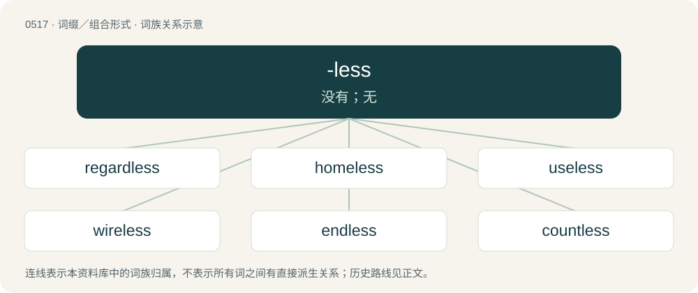

# 0578 · -less — 没有；无

[总目录](../00_总目录_按常用程度.md)

**类型**：词缀／组合形式　｜　**来源语言**：见词源记录

## 核心含义与来源

- 核心含义：没有；无
- 英文含义：Lacking (something); without (something). Added usually to a noun to form an adjective signifying a lack of that noun.
- 词形：-less

**来源记录 1**（后缀／后置成分；Lacking (something); without (something). Added usually to a noun to form an adjective signifying a lack of that noun.）

From Middle English -les, -leas, from Old English -lēas (“-less”) (compare lēas (“devoid of, loose from, false”)), from Proto-West Germanic \*-laus, from Proto-Germanic \*-lausaz, from \*lausaz (“loose”). (Not related to less, which derives from \*laisiz, \*laisizô.) Cognate with Scots -less, West Frisian -leas, Saterland Frisian -loos, Dutch -loos, Low German -los, German -los, Danish -løs, Swedish -lös, Icelandic -laus. More at loose.

## 词族图

## 单词速览（常用到不常用）

| 单词 | 音标 | 释义 |
|---|---|---|
| [regardless](#w-1) | 英 /ɹɪˈɡɑːd.lɪs/；美 /ɹɪˈɡɑɹd.lɪs/ | a. 不管, 不注意, 不顾 |
| [homeless](#w-2) | 美 /ˈhoʊmlɪs/ | a. 无家的, 无养主的 |
| [useless](#w-3) | 英 /ˈjuːs.ləs/；美 /ˈjus.ləs/ | a. 无用的, 无效的, 无益的；\[机\] 无用, 无价值, 无效 |
| [wireless](#w-4) | 英 /ˈwaɪə.ləs/；美 /ˈwaɪ(jə)ɹ.ləs/ | n. 无线电；a. 无线的, 无线电的 |
| [endless](#w-5) | /ˈɛndlɪs/ | a. 不停的, 无穷尽的, 无尽的；\[机\] 无端的, 环状的 |
| [countless](#w-6) | /ˈkaʊntləs/ | a. 数不尽的, 无数的 |
| [pointless](#w-7) | /ˈpɔɪntləs/ | a. 不尖的, 钝的, 不得要领的 |
| [reckless](#w-8) | /ˈɹɛkləs/ | a. 不介意的, 大意的, 鲁莽的, 不顾后果的；\[法\] 不注意的, 粗心大意的, 鲁莽的 |
| [worthless](#w-9) | 英 /ˈwɜːθ.ləs/；美 /ˈwɝθ.ləs/ | a. 无价值的, 无益的, 无足轻重的；\[法\] 无价值的, 无用的 |
| [harmless](#w-10) | 英 /ˈhɑːmləs/；美 /ˈhɑɹmləs/ | a. 无害处的, 未受损害的, 无辜的, 无恶意的；\[法\] 无害的, 无恶意的, 无损害的 |
| [stainless](#w-11) | /ˈsteinlis/ | a. 无瑕疵的, 不锈的；\[机\] 不绣的, 污染的 |
| [hopeless](#w-12) | 英 /ˈhəʊplɪs/；美 /ˈhoʊplɪs/ | a. 无希望的, 绝望的, 不可救药的 |
| [meaningless](#w-13) | /ˈmiː.nɪŋ.ləs/ | a. 无意义的 |
| [helpless](#w-14) | /ˈhɛlplɪs/ | a. 无助的, 无能为力的, 无依无靠的 |
| [needless](#w-15) | /ˈniːdləs/ | a. 不需要的, 不必要的 |
| [ruthless](#w-16) | /ˈɹuːθləs/ | a. 无情的, 残忍的, 毫不留情的, 彻底的；\[法\] 无情的, 残忍的 |
| [careless](#w-17) | 英 /ˈkɛəlɪs/；美 /kɛɹ.ləs/ | a. 粗心的, 不关心的, 无忧无虑的 |
| [flawless](#w-18) | 英 /ˈflɔːləs/；美 /ˈflɔləs/ | a. 无瑕疵的, 无缺点的；\[化\] 无裂纹的; 无裂缝的 |
| [restless](#w-19) | /ˈɹɛstlɪs/ | a. 不安静的, 慌张的, 休息不充分的；\[医\] 不安静的, 不宁的 |
| [priceless](#w-20) | 英 /ˈpɹaɪslɪs/ | a. 无价的, 极贵重的 |
| [fearless](#w-21) | 英 /ˈfɪələs/；美 /ˈfɪɹləs/ | a. 大胆的, 勇敢的, 无畏的 |
| [timeless](#w-22) | /ˈtaimlis/ | a. 无时间限制的, 不受时间影响的, 永恒的 |
| [relentless](#w-23) | /ɹɪˈlɛntləs/ | a. 无情的, 冷酷的, 残酷的 |
| [clueless](#w-24) | /ˈkluː.ləs/ | a. 无能的, 笨的 |
| [powerless](#w-25) | 英 /ˈpaʊələs/；美 /ˈpaʊɚləs/ | a. 无力的, 无权的, 无效能的 |
| [shameless](#w-26) | /ˈʃeɪ̯mlɪs/ | a. 不知羞耻的 |
| [topless](#w-27) | /ˈtɒplis/ | a. 无顶的, 袒胸的 |
| [senseless](#w-28) | /ˈsɛnsləs/ | a. 无感觉的, 无意识的, 不省人事的 |
| [heartless](#w-29) | 英 /ˈhɑːt.lɪs/；美 /ˈhɑɹt.lɪs/ | a. 无情的, 无勇气的 |
| [seamless](#w-30) | /ˈsiːmlis/ | a. 无缝的, 无缝合线的；\[医\] 无缝的 |
| [selfless](#w-31) | /ˈselflis/ | a. 不顾自己的, 无私的 |
| [lawless](#w-32) | /ˈlɔːləs/ | a. 非法的, 违法的 |
| [limitless](#w-33) | /ˈlimitlis/ | a. 无限的, 无界限的 |
| [speechless](#w-34) | 美 /ˈspiːt͡ʃ.lɪs/ | a. 不会说话的, 哑的, 说不出话的, 无言的, 非言语所能表达的, (非正式)烂醉的 |
| [lifeless](#w-35) | /ˈlaɪfləs/ | a. 无生命的, 无趣味的, 死气沉沉的 |
| [mindless](#w-36) | /maɪnd.ləs/ | a. 没头脑的, 不小心的, 不留神的 |
| [breathless](#w-37) | /ˈbɹɛθləs/ | a. 喘不过气来的, 屏气的, 气喘吁吁的, 无风的, 死的 |
| [sleepless](#w-38) | /ˈsliːpləs/ | a. 不睡眠的, 睡不着的, 不休息的 |
| [painless](#w-39) | /ˈpeinlis/ | a. 无痛的, 不痛的；\[医\] 无痛的 |
| [nameless](#w-40) | /ˈneimlis/ | a. 无名的, 匿名的, 不可名状的 |
| [effortless](#w-41) | /ˈɛfə(ɹ)tlɪs/ | a. 容易的, 不费力气的 |
| [jobless](#w-42) | /ˈdʒɔblis/ | a. 失职的, 无职业的；\[经\] 失业的 |
| [scoreless](#w-43) | /ˈskɒːlis/ | a. 没得分的 |
| [spotless](#w-44) | 美 /spɑtlɪs/ | a. 无脏污的, 无缺点的, 无可挑剔的 |
| [shirtless](#w-45) | 英 /ˈʃɜːtləs/；美 /ˈʃɝtləs/ | a. 赤膊的；无上装的 |
| [baseless](#w-46) | 英 /ˈbeɪsləs/ | a. 无根据的 |
| [doubtless](#w-47) | /ˈdaʊ̯tləs/ | a. 无疑的, 确定的；adv. 无疑地, 确定地 |
| [childless](#w-48) | /ˈtʃaildlis/ | a. 无儿女的 |
| [defenseless](#w-49) | 英 /dɪˈfɛnsləs/ | a. 无防备的 |
| [boundless](#w-50) | /ˈbaʊndləs/ | a. 无限的, 无边无际的；\[经\] 无限的 |
| [fruitless](#w-51) | 英 /ˈfɹuːtləs/；美 /ˈfɹutləs/ | a. 不结果的, 不长果实的, 无子的 |
| [merciless](#w-52) | 英 /ˈmɜːsɪləs/；美 /ˈmɝsɪləs/ | a. 无慈悲心的, 残忍的 |
| [tireless](#w-53) | /ˈtaiəlis/ | a. 不疲倦的, 不厌倦的, 不屈不挠的 |
| [tasteless](#w-54) | /ˈteɪstləs/ | a. 没味道的, 无鉴赏力的 |
| [headless](#w-55) | /ˈhɛdləs/ | a. 无头的, 无领导者的, 无知的 |
| [faceless](#w-56) | /ˈfeislis/ | a. 无面的, 无个性的, 匿名的, 无名的 |
| [motionless](#w-57) | 英 /ˈməʊʃənlɛs/；美 /ˈmoʊʃənlɛs/ | a. 不动的, 静止的；\[机\] 不动的, 静止的 |
| [bottomless](#w-58) | 英 /ˈbɒtəm.ləs/；美 /ˈbatəmlɪs/ | a. 无底的, 无限的, 深不可测的, 没有根据的 |
| [toothless](#w-59) | 美 /ˈtuθləs/ | a. 无齿的；\[医\] 无牙的 |
| [spineless](#w-60) | /ˈspainlis/ | a. 无脊椎的, 没有骨气的, 懦弱的 |
| [hairless](#w-61) | 英 /ˈhɛələs/；美 /ˈhɛɹləs/ | a. 无毛的 |
| [thoughtless](#w-62) | 英 /ˈθɔːtləs/；美 /ˈθɔtləs/ | a. 欠考虑的, 无深虑的, 轻率的 |
| [sleeveless](#w-63) | /ˈsliːvlɪs/ | a. 无袖的 |
| [hapless](#w-64) | 美 /ˈhæpləs/；/ˈhæplɪs/ | a. 倒霉的, 不幸的 |
| [soulless](#w-65) | 英 /ˈsəʊl.ləs/；美 /ˈsoʊl.ləs/ | a. 没有精神的, 没有灵魂的, 泄气的 |
| [penniless](#w-66) | /ˈpɛ.nɪ.ləs/ | a. 赤贫的, 贫穷的 |
| [stateless](#w-67) | /ˈsteitlis/ | a. 没有国家的；\[法\] 无国籍的, 无国家主权的 |
| [defenceless](#w-68) | 英 /dɪˈfɛnsləs/ | a. 无防御的, 没有保护的, 无助的, 无防备的 |
| [driverless](#w-69) | /dˈraɪvərles/ | 无人驾驶的 |
| [godless](#w-70) | /ˈɡɒdləs/ | a. 不信神的, 无神论者的, 罪恶的, 邪恶的 |
| [blameless](#w-71) | /ˈbleimlis/ | a. 无可责难的, 无过失的, 清白的 |
| [peerless](#w-72) | /ˈpiəlis/ | a. 无比的, 出类的, 无双的 |
| [voiceless](#w-73) | /ˈvɔɪsləs/ | a. 无声的；\[法\] 沉默的, 无声的, 未说出来的 |
| [boneless](#w-74) | /ˈbəjnlis/ | a. 无骨的 |
| [brainless](#w-75) | /ˈbreinlis/ | a. 无头脑的, 愚笨的 |
| [winless](#w-76) | /ˈwinlis/ | a. (运动比赛)未获胜的,未赢的,每次交战皆输的 |
| [contactless](#w-77) | /ˈkɔntæktlis/ | \[计\] 无接点的, 无接触的 |
| [cordless](#w-78) | /ˈkɔɹd.lɪs/ | a. 无绳索的, 交直流两用的 |
| [loveless](#w-79) | /ˈlʌvlis/ | a. 无爱情的, 不可爱的 |
| [emotionless](#w-80) | /iˈməuʃənlis/ | a. 不露情感的, 没有情感的 |
| [goalless](#w-81) | /ˈgəʊlləs/ | a. （比赛结果）零比零的 |
| [strapless](#w-82) | /ˈstrapləs/ | a. 无带的, 无背带的 |
| [ageless](#w-83) | /ˈeidʒlis/ | a. 不老的, 永恒的 |
| [bloodless](#w-84) | /ˈblʌdlis/ | a. 无血色的, 不流血的, 没精神的；\[医\] 无血的 |
| [dauntless](#w-85) | 英 /ˈdɔːnt.ləs/；美 /ˈdɔnt.ləs/ | a. 不屈不挠的, 大胆的 |
| [faithless](#w-86) | /ˈfeiθlis/ | a. 无信的, 不忠实的 |
| [shitless](#w-87) | /ˈʃitlis/ | adv. &lt;俚&gt;&lt;粗&gt;极度,非常 |
| [aimless](#w-88) | /ˈeɪm.ləs/ | a. 无目的的, 没有目标的 |
| [weightless](#w-89) | /ˈweɪt.ləs/ | a. 无重量的, 失重的, 不重要的 |
| [lossless](#w-90) | 英 /ˈlɒs.ləs/ | a. 无损的; 无损耗; 无耗 |
| [smokeless](#w-91) | /ˈsməuklis/ | a. 无烟的；\[机\] 无烟的, 不出烟的 |
| [classless](#w-92) | 美 /ˈklæsləs/ | a. 无阶级的 |
| [fatherless](#w-93) | /ˈfɑːðəlis/ | a. 无父的；\[法\] 没有父亲的, 生父不明的 |
| [thankless](#w-94) | /ˈθæŋklis/ | a. 不感谢的, 忘恩的, 不知感恩的 |
| [faultless](#w-95) | /ˈfɒːltlis/ | a. 完美的, 无缺点的；\[化\] 无故障的 |
| [ceaseless](#w-96) | /ˈsiːsləs/ | a. 不停的, 不断的 |
| [gutless](#w-97) | /ˈgʌtlis/ | a. 无胆量的 |
| [wordless](#w-98) | /ˈwəːdlis/ | a. 沉默的, 无言的 |
| [bayless](#w-99) |  | \[人名\] \[英格兰人姓氏\] 贝利斯 Bailey的变体 |
| [landless](#w-100) | /ˈlændlis/ | a. 无土地的, 无土地所有权的 |
| [listless](#w-101) | /ˈlɪstlɪs/ | a. 倦怠的, 无精打采的；\[经\] 交易清淡的 |
| [mirrorless](#w-102) | 英 /ˈmɪɹələs/ | 【英文】Without a mirror. |
| [warrantless](#w-103) | 英 /ˈwɒɹəntləs/ | a. warrant的变形；无保证的；未经授权的；无法辩解的；不正当的 |
| [groundless](#w-104) | /ˈɡɹaʊndləs/ | a. 无根据的, 无理由的；\[法\] 无根据的, 无理由的 |
| [colourless](#w-105) | 英 /ˈkʌlə(ɹ).ləs/ | a. 无色的, 无血色的, 无趣味的, 无特色的, 不生动的, 单调的, 不偏不倚的 |
| [cashless](#w-106) | /ˈkæʃlis/ | a. 无现款的,无现金的,无钱的 |
| [friendless](#w-107) | /ˈfrɛndləs/ | a. 没有朋友的, 无依无靠的 |
| [feckless](#w-108) | 英 /ˈfɛkləs/ | a. 无效的, 无能的, 不负责任的 |
| [odorless](#w-109) | 英 /ˈəʊdələs/；美 /ˈoʊdɚləs/ | a. 无嗅的, 没有气味的 |
| [flightless](#w-110) | /ˈflaitlis/ | a. 不能飞的 |
| [cloudless](#w-111) | /ˈklaudlis/ | a. 晴朗的, 无云的 |
| [featureless](#w-112) | 美 /ˈfi.t͡ʃɚ.ləs/ | a. 无特色的, 平凡的 |
| [windowless](#w-113) |  | a. 无窗的 |
| [formless](#w-114) | 英 /ˈfɔːmləs/；美 /ˈfɔɹmləs/ | a. 无定形的, 形体不明的, 没有形状的 |
| [matchless](#w-115) | /ˈmætʃlis/ | a. 无敌的, 无比的 |
| [paperless](#w-116) | /ˈpeipəlis/ | a. 无纸传输信息(或数据)的 |
| [backless](#w-117) | 美 /ˈbækləs/ | a. 无靠背的 |
| [borderless](#w-118) | /ˈbɔːdələs/ | a. 无边界的 |
| [meatless](#w-119) | /ˈmiːtləs/ | a. 无肉的, 无内容的 |
| [motherless](#w-120) | /ˈmʌðəlis/ | a. 无母的 |
| [keyless](#w-121) | /ˈkiːlis/ | a. 无键的, 不用钥匙上发条的 |
| [remorseless](#w-122) | /riˈmɒːslis/ | a. 无怜悯之心的, 冷酷的, 不知自责的 |
| [joyless](#w-123) | /ˈdʒɒilis/ | a. 不高兴的, 不快乐的 |
| [dimensionless](#w-124) |  | \[计\] 无量纲的；\[化\] 无因次的; 无量纲; 无量纲的 |
| [witless](#w-125) | /ˈwitlis/ | a. 无才智的, 不机敏的, 愚蠢的, 糊涂的, 无知的 |
| [airless](#w-126) | 英 /ˈɛə.ləs/；美 /ˈɛɹ.ləs/ | a. 无空气的, 不通风的；\[机\] 无气, 无气式 |
| [legless](#w-127) | /ˈlegləs/ | a. 无腿的 |
| [pitiless](#w-128) | /ˈpɪtɪləs/ | a. 无情的, 冷酷的, 无怜悯心的 |
| [sexless](#w-129) | /ˈsekslis/ | a. 无性的, 中性的, 无性别的, 缺乏性感的, 性欲冷淡的 |
| [frictionless](#w-130) | /fˈrɪkʃnles/ | 无摩擦的 |
| [sunless](#w-131) | /ˈsʌnlis/ | a. 阳光照射不到的, 阴暗的 |
| [expressionless](#w-132) | /ikˈspreʃənlis/ | a. 无表情的, 呆板的 |
| [skinless](#w-133) |  | a. 无皮的, 易受感动的, 敏感的 |
| [victimless](#w-134) | /ˈviktimlis/ | \[法\] 没有受害者的 |
| [seedless](#w-135) | /ˈsiːdləs/ | a. 无核的 |
| [leaderless](#w-136) |  | a. 无领袖的, 无领导的 |
| [sinless](#w-137) | /ˈsɪnləs/ | a. 无罪的, 清白的；\[法\] 无罪的, 无辜的, 清白的 |
| [tactless](#w-138) | 美 /ˈtæktləs/ | a. 不机智的, 不机敏的 |
| [wingless](#w-139) |  | a. 没有翼的, 没有翅的 |
| [brushless](#w-140) | /bˈrʌʃlɪs/ | a. 无需用刷子的; 无刷 |
| [shoeless](#w-141) | /ˈʃuːlis/ | a. 不穿鞋的, 赤脚的, 没有鞋的 |
| [deathless](#w-142) | /ˈdɛθləs/ | a. 不死的, 永恒的 |
| [frameless](#w-143) |  | \[计\] 无框架的 |
| [humorless](#w-144) | /ˈhjuːməlis/ | a. 缺乏幽默感的, 非常严肃的, 一本正经的 |
| [fingerless](#w-145) |  | a. 无指的, 失去指的 |
| [luckless](#w-146) | /ˈlʌklis/ | a. 不幸的, 坏运气的 |
| [valueless](#w-147) | /ˈvaljʊləs/ | a. 无价值的, 不值钱的；\[法\] 无价值的 |
| [armless](#w-148) | /ˈɑːmlis/ | a. 无臂的, 无扶手的, 无武器的 |
| [treeless](#w-149) | /ˈtriːlis/ | a. 无树木的 |
| [waterless](#w-150) | /ˈwɔːtə(ɹ)ləs/ | a. 无水的, 干的, 不用水的 |
| [payless](#w-151) |  | 【英文】unpaid |
| [massless](#w-152) | 美 /ˈmæs.ləs/ | a. \[物\]无质量的 |
| [rudderless](#w-153) | /ˈrʌdəlis/ | a. 无指导的, 无舵的 |
| [directionless](#w-154) | /dəˈrekʃnləs/ | a. 漫无目的的；无目标的；无计划的 |
| [genderless](#w-155) | 英 /ˈd͡ʒɛn.də.ləs/；美 /ˈd͡ʒɛn.dɚ.ləs/ | a. 无性的 |
| [heedless](#w-156) | /ˈhiːdləs/ | a. 不注意的, 不留心的, 不谨慎的 |
| [soundless](#w-157) | 英 /ˈsaʊn(d)ləs/ | a. 无声的, 完全静寂的, 静悄悄的 |
| [braless](#w-158) | /ˈbrɑːlis/ | a. 不戴胸罩的 |
| [beardless](#w-159) | /ˈbiədlis/ | a. 无须的, 乳臭未干的 |
| [leafless](#w-160) | /ˈliːflis/ | a. 无叶的 |
| [moonless](#w-161) | /ˈmuːnlis/ | n. 无月亮的 |
| [numberless](#w-162) | 英 /ˈnʌmbələs/；美 /ˈnʌmbɚləs/ | a. 无数的, 无号数的；\[机\] 无数的, 数不清的 |
| [purposeless](#w-163) | /ˈpəːpəslis/ | a. 无目的的, 无意义的 |
| [hitless](#w-164) |  | a. hit的变形 |
| [eyeless](#w-165) | /ˈaɪ.ləs/ | a. 盲目的 |
| [noiseless](#w-166) | /ˈnɒizlis/ | a. 无声的, 寂静的；\[化\] 无噪声 |
| [artless](#w-167) | /ˈɑɹt.lɪs/ | a. 无虚饰的, 单纯的, 自然的 |
| [graceless](#w-168) | /ˈɡɹeɪsləs/ | a. 不知礼的, 不知耻的, 粗野的；\[法\] 堕落的, 道德败坏的, 邪恶的 |
| [trackless](#w-169) | 英 /ˈtrækləs/ | a. 无足迹的, 无路的；\[法\] 无足迹的, 不留足迹的, 无路的 |
| [tubeless](#w-170) | /tˈjuːbləs/ | a. 无内胎的 |
| [serverless](#w-171) |  | 【英文】Based on a cloud computing execution model in which the cloud provider allocates machine resources on demand. |
| [flavorless](#w-172) | 英 /ˈfleɪvələs/；美 /ˈfleɪvɚləs/ | a. &lt;美&gt;无味的, 无滋味的 |
| [guiltless](#w-173) | /ˈɡɪltləs/ | a. 无罪的, 无辜的, 没有...经验的, 不熟悉...的, 没有...的；\[法\] 无辜的, 无罪的, 无知的 |

## 逐词详解

### 1. regardless

**词性**：副词　｜　**音标**：英 /ɹɪˈɡɑːd.lɪs/；美 /ɹɪˈɡɑɹd.lɪs/

**中文释义**：a. 不管, 不注意, 不顾

**英文义项**：Without attention to warnings or indications of bad consequences. / Anyway; irrespective of what has just been said.

**构词拆分**：regard + -less

**词源与演化**：

From regard + -less.

**例句**：

> The proposal may become law, or it may not. Regardless, we will adopt it as a club rule.

该用例对应义项：Anyway; irrespective of what has just been said.

### 2. homeless

**词性**：形容词　｜　**音标**：美 /ˈhoʊmlɪs/

**中文释义**：a. 无家的, 无养主的

**英文义项**：Lacking a permanent place of residence. / Containing no place that might be called home.

**构词拆分**：home + -less

**词源与演化**：

From Middle English \*homles, \*hamles, from Old English hāmlēas (“homeless”), equivalent to home + -less. Cognate with Dutch heemloos, Danish hjemløs (“homeless”), Swedish hemlös (“homeless”). Compare also German heimatlos (“homeless”), Icelandic heimilislaus (“homeless”), West Frisian dakleas (“homeless”, literally “having no roof, roofless”).

**例句**：

> Whenever I pass the park, I see the homeless people sleeping on the benches.

该用例对应义项：Lacking a permanent place of residence.

### 3. useless

**词性**：形容词　｜　**音标**：英 /ˈjuːs.ləs/；美 /ˈjus.ləs/

**中文释义**：a. 无用的, 无效的, 无益的；\[机\] 无用, 无价值, 无效

**英文义项**：Without use or the possibility to be used. / Unhelpful, not useful; pointless (of an action).

**构词拆分**：use + -less

**词源与演化**：

From use + -less.

**例句**：

> I think it's useless to keep this discussion going. It's like talking to a brick wall.

该用例对应义项：Unhelpful, not useful; pointless (of an action).

### 4. wireless

**词性**：形容词　｜　**音标**：英 /ˈwaɪə.ləs/；美 /ˈwaɪ(jə)ɹ.ləs/

**中文释义**：n. 无线电；a. 无线的, 无线电的

**英文义项**：Not having any wires. / Functioning without an external wired connection.

**构词拆分**：wire + -less

**词源与演化**：

From wire + -less.

**用法示例／搭配（非完整句）**：

> wireless headphones

该用例对应义项：Functioning without an external wired connection.

### 5. endless

**词性**：形容词　｜　**音标**：/ˈɛndlɪs/

**中文释义**：a. 不停的, 无穷尽的, 无尽的；\[机\] 无端的, 环状的

**英文义项**：Having no end. / Extending indefinitely.

**构词拆分**：end + -less

**词源与演化**：

From Middle English endeles, from Old English endelēas (“endless”), from Proto-Germanic \*andijalausaz (“endless”), equivalent to end + -less.

**用法示例／搭配（非完整句）**：

> endless time; endless praise

该用例对应义项：Having no end.

### 6. countless

**词性**：形容词　｜　**音标**：/ˈkaʊntləs/

**中文释义**：a. 数不尽的, 无数的

**英文义项**：Synonym of uncountable. / Too large to be counted to.

**构词拆分**：count + -less

**词源与演化**：

From count + -less.

**例句**：

> The stars in the sky are countless.

该用例对应义项：Synonym of uncountable.

### 7. pointless

**词性**：形容词　｜　**音标**：/ˈpɔɪntləs/

**中文释义**：a. 不尖的, 钝的, 不得要领的

**英文义项**：Having no point or sharp tip; terminating squarely or in a rounded end. / Having no prominent or important feature, as of an argument, discourse, etc.

**构词拆分**：By surface analysis, point + -less

**词源与演化**：

From Middle English pointles, poynteles, poyntlees. By surface analysis, point + -less.

**例句**：

> After four matches and four defeats, United remain pointless at the foot of the table.

该用例对应义项：Having no points

### 8. reckless

**词性**：形容词　｜　**音标**：/ˈɹɛkləs/

**中文释义**：a. 不介意的, 大意的, 鲁莽的, 不顾后果的；\[法\] 不注意的, 粗心大意的, 鲁莽的

**英文义项**：Careless or heedless; headstrong or rash. / Indifferent or oblivious to danger or the consequences thereof.

**构词拆分**：reck + -less

**词源与演化**：

From Middle English rekles, reckeles, rekkeles, (also recheles), from Old English rēcelēas (“reckless, careless, negligent”), equivalent to reck + -less. Cognate with West Frisian roekeleas (“reckless”), Dutch roekeloos (“reckless”), German Low German ruuklos (“careless”), German ruchlos (“careless, notorious”).

**例句**：

> Became the fiercest and most reckless of partisans.

该用例对应义项：marked by defiant disregard for danger or consequences

### 9. worthless

**词性**：形容词　｜　**音标**：英 /ˈwɜːθ.ləs/；美 /ˈwɝθ.ləs/

**中文释义**：a. 无价值的, 无益的, 无足轻重的；\[法\] 无价值的, 无用的

**英文义项**：Having no worth or use; without value.

**构词拆分**：worth + -less

**词源与演化**：

From Middle English \*worthles, from Old English weorþlēas (“worthless”), equivalent to worth + -less. Cognate with Dutch waardeloos (“worthless”), German wertlos (“worthless”), Swedish värdelös (“worthless”).

**例句**：

> Lies are as important as truth, for without lies, the truth is worthless.

该用例对应义项：Having no worth or use; without value.

### 10. harmless

**词性**：形容词　｜　**音标**：英 /ˈhɑːmləs/；美 /ˈhɑɹmləs/

**中文释义**：a. 无害处的, 未受损害的, 无辜的, 无恶意的；\[法\] 无害的, 无恶意的, 无损害的

**英文义项**：Incapable of causing harm or danger; safe. / Not intended to harm; inoffensive.

**构词拆分**：harm + -less

**词源与演化**：

From Middle English harmles, from Old English \*hearmlēas, from Proto-Germanic \*harmalausaz (“without harm; harmless”), equivalent to harm + -less. Cognate with German harmlos (“harmless”), Danish harmløs (“harlmess”), Swedish harmlös (“harmless”).

**例句**：

> This snake looks nearly the same as its poisonous cousin but is harmless.

该用例对应义项：Incapable of causing harm or danger; safe.

### 11. stainless

**词性**：形容词　｜　**音标**：/ˈsteinlis/

**中文释义**：a. 无瑕疵的, 不锈的；\[机\] 不绣的, 污染的

**英文义项**：Describing an alloy that is resistant to corrosion and discoloration. / Unmarked, spotless.

**构词拆分**：stain + -less

**词源与演化**：

From stain + -less.

**例句**：

> The virus can live for three days on plastic and stainless steel.

### 12. hopeless

**词性**：形容词　｜　**音标**：英 /ˈhəʊplɪs/；美 /ˈhoʊplɪs/

**中文释义**：a. 无希望的, 绝望的, 不可救药的

**英文义项**：Without hope; despairing; not expecting anything positive. / Giving no ground of hope; promising nothing desirable; desperate.

**构词拆分**：hope + -less

**词源与演化**：

From hope + -less. Compare Swedish hopplös.

**例句**：

> He's a hopeless writer, but can draw very well.

该用例对应义项：Without talent, not skilled.

### 13. meaningless

**词性**：形容词　｜　**音标**：/ˈmiː.nɪŋ.ləs/

**中文释义**：a. 无意义的

**英文义项**：Lacking meaning. / Insignificant; not worthy of importance.

**构词拆分**：meaning + -less

**词源与演化**：

From meaning + -less.

**例句**：

> The word "gugugu" is meaningless in English.

该用例对应义项：Lacking meaning.

### 14. helpless

**词性**：形容词　｜　**音标**：/ˈhɛlplɪs/

**中文释义**：a. 无助的, 无能为力的, 无依无靠的

**英文义项**：Unable to defend oneself. / Lacking help; powerless.

**构词拆分**：help + -less

**词源与演化**：

From Middle English helples, from Old English \*helplēas (“helpless”) from Proto-Germanic \*helpōlausaz, equivalent to help + -less. Compare Dutch hulpeloos (“helpless”), German hilflos (“helpless”), Danish hjælpeløs (“helpless”) and Swedish hjälplös (“helpless”).

**例句**：

> As helpless as a baby.

该用例对应义项：unable to manage independently

### 15. needless

**词性**：形容词　｜　**音标**：/ˈniːdləs/

**中文释义**：a. 不需要的, 不必要的

**英文义项**：Not needed; unnecessary.

**构词拆分**：need + -less

**词源与演化**：

From Middle English needlees, nedelees, nedeles, equivalent to need + -less.

**例句**：

> This new project of yours will only be a needless expense.

该用例对应义项：Not needed; unnecessary.

### 16. ruthless

**词性**：形容词　｜　**音标**：/ˈɹuːθləs/

**中文释义**：a. 无情的, 残忍的, 毫不留情的, 彻底的；\[法\] 无情的, 残忍的

**英文义项**：Without pity or compassion; cruel, pitiless. / Uncompromising; unrelenting.

**构词拆分**：ruth + -less

**词源与演化**：

From Middle English reuþeles; equivalent to ruth + -less.

**例句**：

> An act of ruthless ferocity.

该用例对应义项：without mercy or pity

### 17. careless

**词性**：形容词　｜　**音标**：英 /ˈkɛəlɪs/；美 /kɛɹ.ləs/

**中文释义**：a. 粗心的, 不关心的, 无忧无虑的

**英文义项**：Not concerned or worried (about). / Not giving sufficient attention or thought, especially concerning the avoidance of harm or mistakes.

**构词拆分**：care + -less

**词源与演化**：

From Middle English careles, from Old English carlēas (“careless, reckless, void of care, free from care, free”), equivalent to care + -less. Cognate with Icelandic kærulaus (“careless, negligent”).

**例句**：

> Jessica was so careless that she put her shorts on backwards.

该用例对应义项：Not giving sufficient attention or thought, especially concerning the avoidance of harm or mistakes.

### 18. flawless

**词性**：形容词　｜　**音标**：英 /ˈflɔːləs/；美 /ˈflɔləs/

**中文释义**：a. 无瑕疵的, 无缺点的；\[化\] 无裂纹的; 无裂缝的

**英文义项**：Without flaws, defects, or shortcomings; perfect.

**构词拆分**：flaw + -less (suffix meaning ‘without (something)’)

**词源与演化**：

From flaw + -less (suffix meaning ‘without (something)’).

**例句**：

> The pianist’s performance this evening was flawless.

该用例对应义项：Without flaws, defects, or shortcomings; perfect.

### 19. restless

**词性**：形容词　｜　**音标**：/ˈɹɛstlɪs/

**中文释义**：a. 不安静的, 慌张的, 休息不充分的；\[医\] 不安静的, 不宁的

**英文义项**：Not allowing or affording rest. / Without rest; unable to be still or quiet; uneasy; continually moving.

**构词拆分**：rest + -less

**词源与演化**：

From Middle English restles, restelees, from Old English ræstlēas, equivalent to rest + -less.

**例句**：

> They remained restless, sitting by the window the entire night.

该用例对应义项：Deprived of rest or sleep.

### 20. priceless

**词性**：形容词　｜　**音标**：英 /ˈpɹaɪslɪs/

**中文释义**：a. 无价的, 极贵重的

**英文义项**：Without a price assigned; unpriced. / So precious as not to be obtainable or sold at any price.

**构词拆分**：price + -less (“lacking, without”)

**词源与演化**：

From price + -less (“lacking, without”).

**例句**：

> The disappearance of a language means the disappearance of priceless scientific data.

### 21. fearless

**词性**：形容词　｜　**音标**：英 /ˈfɪələs/；美 /ˈfɪɹləs/

**中文释义**：a. 大胆的, 勇敢的, 无畏的

**英文义项**：Without fear.

**构词拆分**：fear + -less

**词源与演化**：

From fear + -less.

**例句**：

> Fearless reporters and photographers.

该用例对应义项：invulnerable to fear or intimidation

### 22. timeless

**词性**：形容词　｜　**音标**：/ˈtaimlis/

**中文释义**：a. 无时间限制的, 不受时间影响的, 永恒的

**英文义项**：Eternal. / Not affected by time; ageless.

**构词拆分**：time + -less

**词源与演化**：

From time + -less.

**例句**：

> The cave carvings have a timeless beauty.

该用例对应义项：Not decreasing over time in quality and appeal.

### 23. relentless

**词性**：形容词　｜　**音标**：/ɹɪˈlɛntləs/

**中文释义**：a. 无情的, 冷酷的, 残酷的

**英文义项**：Unrelenting or unyielding in severity. / Steady and persistent; unremitting.

**构词拆分**：relent + -less

**词源与演化**：

From relent + -less.

**例句**：

> In Algeria, the heat of the sun can be relentless in the summer.

### 24. clueless

**词性**：形容词　｜　**音标**：/ˈkluː.ləs/

**中文释义**：a. 无能的, 笨的

**英文义项**：Without any clues or hints. / Lacking knowledge or understanding; uninformed; oblivious.

**构词拆分**：clue + -less

**词源与演化**：

From clue + -less.

**例句**：

> I was clueless about the situation, but thankfully, Tom gave me the scoop.

### 25. powerless

**词性**：形容词　｜　**音标**：英 /ˈpaʊələs/；美 /ˈpaʊɚləs/

**中文释义**：a. 无力的, 无权的, 无效能的

**英文义项**：Lacking sufficient power or strength. / Lacking legal authority.

**构词拆分**：power + -less

**词源与演化**：

From Middle English pouerles, powerles, equivalent to power + -less.

**例句**：

> The traffic warden was powerless to stop me driving away.

该用例对应义项：Lacking legal authority.

### 26. shameless

**词性**：形容词　｜　**音标**：/ˈʃeɪ̯mlɪs/

**中文释义**：a. 不知羞耻的

**英文义项**：Having no shame, no guilt nor remorse over something considered wrong; immodest, brazen; unable to feel disgrace.

**构词拆分**：shame + -less

**词源与演化**：

From Middle English schameles, shameles, from Old English sċamlēas, sċeamlēas (“without shame; shameless”), from Proto-Germanic \*skamalausaz (“shameless”), equivalent to shame + -less. Cognate with West Frisian skamteleas (“shameless”), Dutch schaamteloos (“shameless”), German schamlos (“shameless”), Danish skamløs (“shameless”), Swedish skamlös (“shameless”), Icelandic skammlaus (“shameless; unashamed”).

**例句**：

> He sits at a table, surrounded by false friends and shameless women.

### 27. topless

**词性**：形容词　｜　**音标**：/ˈtɒplis/

**中文释义**：a. 无顶的, 袒胸的

**英文义项**：Lacking a top. / Very high; towering.

**构词拆分**：top + -less

**词源与演化**：

From top + -less.

**例句**：

> Only her closest friends knew that Jenny was working at a topless bar to help with college expenses.

该用例对应义项：Featuring women that are naked from the waist up, often strippers or dancers.

### 28. senseless

**词性**：形容词　｜　**音标**：/ˈsɛnsləs/

**中文释义**：a. 无感觉的, 无意识的, 不省人事的

**英文义项**：Without feeling or desire to work; deprived of sensation. / Lacking meaning or purpose; without common sense.

**构词拆分**：sense + -less

**词源与演化**：

From sense + -less. Compare Saterland Frisian sinloos (“senseless, foolish”).

**例句**：

> The blow to his head rendered him senseless; he didn’t awaken until he was in the ambulance.

该用例对应义项：Without feeling or desire to work; deprived of sensation.

### 29. heartless

**词性**：形容词　｜　**音标**：英 /ˈhɑːt.lɪs/；美 /ˈhɑɹt.lɪs/

**中文释义**：a. 无情的, 无勇气的

**英文义项**：Without feeling, emotion, or concern for others; uncaring; cruel. / Without a physical heart.

**构词拆分**：heart + -less

**词源与演化**：

From Middle English hertles, herteles, from Old English heortlēas (“without courage; listless”), equivalent to heart + -less. Cognate with German herzlos.

**例句**：

> His heartless actions and cold manner left her saddened and feeling alone.

该用例对应义项：Without feeling, emotion, or concern for others; uncaring; cruel.

### 30. seamless

**词性**：形容词　｜　**音标**：/ˈsiːmlis/

**中文释义**：a. 无缝的, 无缝合线的；\[医\] 无缝的

**英文义项**：Having no seams. / Without interruption; coherent.

**构词拆分**：seam + -less

**词源与演化**：

From Middle English seemles, semeles, semles, Old English \*sēamlēas, equivalent to seam + -less. Cognate with Norwegian Bokmål sømløs (“seamless”), Swedish sömlös (“seamless”).

**用法示例／搭配（非完整句）**：

> a seamless transition

该用例对应义项：Without interruption; coherent.

### 31. selfless

**词性**：形容词　｜　**音标**：/ˈselflis/

**中文释义**：a. 不顾自己的, 无私的

**英文义项**：Having, exhibiting or motivated by no concern for oneself but for others; unselfish.

**构词拆分**：self + -less

**词源与演化**：

From self + -less.

**例句**：

> In a selfless act of gratitude for saving his mother's life, Peter committed to giving money to his local breast cancer charity each year for the rest of his life.

该用例对应义项：Having, exhibiting or motivated by no concern for oneself but for others; unselfish.

### 32. lawless

**词性**：形容词　｜　**音标**：/ˈlɔːləs/

**中文释义**：a. 非法的, 违法的

**英文义项**：Not governed by any law. / Prohibited by law; unlawful, illegal.

**构词拆分**：law + -less

**词源与演化**：

From Middle English laweles; equivalent to law + -less. Cognate with Danish lovløs (“lawless”), Swedish laglös (“lawless”), Norwegian lovløs (“lawless”), Icelandic löglaus (“lawless”).

**用法示例／搭配（非完整句）**：

> On why leaving lawless places and leaving pseudovirtuous groups is loving such places and groups

该用例对应义项：Not restrained by the law or by discipline; disorderly, unruly.

### 33. limitless

**词性**：形容词　｜　**音标**：/ˈlimitlis/

**中文释义**：a. 无限的, 无界限的

**英文义项**：Without limits in extent, size, or quantity.

**构词拆分**：limit + -less

**词源与演化**：

From limit + -less.

**例句**：

> Limitless vastness of our solar system.

该用例对应义项：without limits in extent or size or quantity

### 34. speechless

**词性**：形容词　｜　**音标**：美 /ˈspiːt͡ʃ.lɪs/

**中文释义**：a. 不会说话的, 哑的, 说不出话的, 无言的, 非言语所能表达的, (非正式)烂醉的

**英文义项**：Not speaking; not knowing what to say; silent, especially due to surprise, amazement, etc.; wordless.

**构词拆分**：speech + -less

**词源与演化**：

From Middle English specheles, from Old English sprǣċlēas (“speechless; without the power of speak”), from Proto-Germanic \*sprēkalausaz, equivalent to speech + -less. Cognate with West Frisian sprakeleas (“speechless”), Dutch sprakeloos (“speechless”), German Low German spraaklos (“speechless”), German sprachlos (“speechless”).

**例句**：

> When he walked into his surprise birthday party, he was completely speechless.

该用例对应义项：Not speaking; not knowing what to say; silent, especially due to surprise, amazement, etc.; wordless.

### 35. lifeless

**词性**：形容词　｜　**音标**：/ˈlaɪfləs/

**中文释义**：a. 无生命的, 无趣味的, 死气沉沉的

**英文义项**：inanimate; having no life / dead; having lost life

**构词拆分**：life + -less

**词源与演化**：

From Middle English lyfles, lifles, from Old English līflēas (“lifeless”), equivalent to life + -less. Cognate with West Frisian libbensleas (“lifeless”), Dutch levenloos (“lifeless”), German leblos (“lifeless”), Danish livløs (“lifeless”), Swedish livlös (“lifeless”), Icelandic líflaus (“lifeless”).

**例句**：

> After the dance the littered and lifeless ballroom echoed hollowly.

该用例对应义项：destitute or having been emptied of life or living beings

### 36. mindless

**词性**：形容词　｜　**音标**：/maɪnd.ləs/

**中文释义**：a. 没头脑的, 不小心的, 不留神的

**英文义项**：Showing a lack of forethought or sense. / Having no sensible meaning or purpose.

**构词拆分**：mind + -less

**词源与演化**：

From Middle English myndles, myndelees, myndeles, mendlees, from Old English myndlēas, ġemyndlēas (“foolish, senseless”), equivalent to mind + -less.

**例句**：

> Atheism alleges that mindless scientific forces control the universe.

该用例对应义项：Lacking a mind.

### 37. breathless

**词性**：形容词　｜　**音标**：/ˈbɹɛθləs/

**中文释义**：a. 喘不过气来的, 屏气的, 气喘吁吁的, 无风的, 死的

**英文义项**：Having difficulty breathing; gasping. / That makes one hold one's breath (with excitement etc.).

**构词拆分**：breath + -less

**词源与演化**：

From breath + -less.

**例句**：

> Breathless at thought of what I had done.

该用例对应义项：not breathing or able to breathe except with difficulty

### 38. sleepless

**词性**：形容词　｜　**音标**：/ˈsliːpləs/

**中文释义**：a. 不睡眠的, 睡不着的, 不休息的

**英文义项**：Characterized by an absence of sleep: wakeful.

**构词拆分**：sleep + -less

**词源与演化**：

From Middle English slepeles, from Old English slǣplēas; equivalent to sleep + -less.

**例句**：

> I spent a sleepless night worrying about the exams.

该用例对应义项：Characterized by an absence of sleep: wakeful.

### 39. painless

**词性**：形容词　｜　**音标**：/ˈpeinlis/

**中文释义**：a. 无痛的, 不痛的；\[医\] 无痛的

**英文义项**：Free from pain; without pain or trouble. / Not difficult; easy.

**构词拆分**：pain + -less

**词源与演化**：

From Middle English paynles, peynlees, equivalent to pain + -less. Compare West Frisian pynleas (“painless”), Dutch pijnloos (“painless”).

**例句**：

> Mennad tried to find a painless way to kill himself.

### 40. nameless

**词性**：形容词　｜　**音标**：/ˈneimlis/

**中文释义**：a. 无名的, 匿名的, 不可名状的

**英文义项**：Not having a name. / Whose name is unknown; unidentified or obscured.

**构词拆分**：name + -less

**词源与演化**：

From Middle English nameles, equivalent to name + -less. Cognate with Dutch naamloos (“nameless”), German namenlos (“nameless”), Danish navnløs (“nameless”), Swedish namnlös (“nameless”), Icelandic nafnlaus (“nameless, anonymous”).

**例句**：

> The culprits shall remain nameless here, as some names have been changed to protect the guilty; just don't let it happen again.

该用例对应义项：Whose name is unknown; unidentified or obscured.

### 41. effortless

**词性**：形容词　｜　**音标**：/ˈɛfə(ɹ)tlɪs/

**中文释义**：a. 容易的, 不费力气的

**英文义项**：Without effort.

**构词拆分**：effort + -less

**词源与演化**：

From effort + -less.

**例句**：

> She made the move look completely effortless.

该用例对应义项：Without effort.

### 42. jobless

**词性**：形容词　｜　**音标**：/ˈdʒɔblis/

**中文释义**：a. 失职的, 无职业的；\[经\] 失业的

**英文义项**：Lacking employment. / Having too much time on one's hands; having nothing better to do.

**构词拆分**：job + -less

**词源与演化**：

From job + -less.

**例句**：

> ― I’m showing him our texts with her, the liar. ― Bro, that is so jobless!

该用例对应义项：Having too much time on one's hands; having nothing better to do.

### 43. scoreless

**词性**：形容词　｜　**音标**：/ˈskɒːlis/

**中文释义**：a. 没得分的

**英文义项**：With no points or goals etc having been scored.

**构词拆分**：score + -less

**词源与演化**：

From score + -less.

### 44. spotless

**词性**：形容词　｜　**音标**：美 /spɑtlɪs/

**中文释义**：a. 无脏污的, 无缺点的, 无可挑剔的

**英文义项**：Exceptionally clean. / Impeccable and free from blemish.

**构词拆分**：spot + -less

**词源与演化**：

From Middle English spotles, equivalent to spot + -less.

**用法示例／搭配（非完整句）**：

> spotless nature

该用例对应义项：Impeccable and free from blemish.

### 45. shirtless

**词性**：形容词　｜　**音标**：英 /ˈʃɜːtləs/；美 /ˈʃɝtləs/

**中文释义**：a. 赤膊的；无上装的

**英文义项**：Without a shirt. / Not wearing a shirt; having a bare torso, barechested.

**构词拆分**：shirt + -less

**词源与演化**：

From shirt + -less.

**用法示例／搭配（非完整句）**：

> a shirtless wardrobe

该用例对应义项：Without a shirt.

### 46. baseless

**词性**：形容词　｜　**音标**：英 /ˈbeɪsləs/

**中文释义**：a. 无根据的

**英文义项**：Of reasoning: based on something that is not true, or not based on solid reasons or facts; unfounded; without a basis. / Without a physical base.

**构词拆分**：base + -less

**词源与演化**：

From base + -less.

**用法示例／搭配（非完整句）**：

> baseless accusations; baseless rumors

该用例对应义项：Of reasoning: based on something that is not true, or not based on solid reasons or facts; unfounded; without a basis.

### 47. doubtless

**词性**：形容词　｜　**音标**：/ˈdaʊ̯tləs/

**中文释义**：a. 无疑的, 确定的；adv. 无疑地, 确定地

**英文义项**：Characterized by or experiencing no doubt at all, certain; undoubted; undoubting.

**构词拆分**：doubt + -less

**词源与演化**：

From Middle English douteles, dowteles, equivalent to doubt + -less.

**例句**：

> You doubtless mean well; but your ideas are unhappily mistaken.

### 48. childless

**词性**：形容词　｜　**音标**：/ˈtʃaildlis/

**中文释义**：a. 无儿女的

**英文义项**：Not having any children.

**构词拆分**：child + -less

**词源与演化**：

From Middle English childles; equivalent to child + -less.

**例句**：

> Tom and Mary are childless by choice.

### 49. defenseless

**词性**：形容词　｜　**音标**：英 /dɪˈfɛnsləs/

**中文释义**：a. 无防备的

**英文义项**：Lacking any form of defense; vulnerable; open to attack.

**构词拆分**：defense + -less

**词源与演化**：

From defense + -less.

**例句**：

> The defenseless lady was exposed to the world's mockery and slander.

### 50. boundless

**词性**：形容词　｜　**音标**：/ˈbaʊndləs/

**中文释义**：a. 无限的, 无边无际的；\[经\] 无限的

**英文义项**：Without bounds, unbounded.

**构词拆分**：bound + -less

**词源与演化**：

From bound + -less.

**例句**：

> Even after the failure of the first experiment, Talia showed boundless optimism.

### 51. fruitless

**词性**：形容词　｜　**音标**：英 /ˈfɹuːtləs/；美 /ˈfɹutləs/

**中文释义**：a. 不结果的, 不长果实的, 无子的

**英文义项**：Bearing no fruit; barren. / Unproductive, useless.

**构词拆分**：fruit + -less

**词源与演化**：

Inherited from Middle English fruytles; equivalent to fruit + -less. Compare Middle English withouten fruyt (“fruitless”, literally “without fruit”).

**例句**：

> The unskilled man’s attempt at fixing his car engine was fruitless.

该用例对应义项：Unproductive, useless.

### 52. merciless

**词性**：形容词　｜　**音标**：英 /ˈmɜːsɪləs/；美 /ˈmɝsɪləs/

**中文释义**：a. 无慈悲心的, 残忍的

**英文义项**：Showing no mercy; cruel and pitiless.

**构词拆分**：mercy + -less

**词源与演化**：

From Middle English merciles, mercyles, equivalent to mercy + -less.

**例句**：

> Gave him a merciless beating.

该用例对应义项：having or showing no mercy

### 53. tireless

**词性**：形容词　｜　**音标**：/ˈtaiəlis/

**中文释义**：a. 不疲倦的, 不厌倦的, 不屈不挠的

**英文义项**：Indefatigable, untiring and not yielding to fatigue

**构词拆分**：tire + -less

**词源与演化**：

From tire (“to become sleepy or weary”) + -less.

**例句**：

> It was your tireless efforts and devotion that made the event successful.

### 54. tasteless

**词性**：形容词　｜　**音标**：/ˈteɪstləs/

**中文释义**：a. 没味道的, 无鉴赏力的

**英文义项**：Having no flavour; bland; insipid. / Lacking delicacy, refinement, and good taste; unbecoming; crass.

**构词拆分**：taste + -less

**词源与演化**：

From taste + -less.

**例句**：

> That was a rather tasteless attack on the designer, especially given that many people like the design.

该用例对应义项：Lacking delicacy, refinement, and good taste; unbecoming; crass.

### 55. headless

**词性**：形容词　｜　**音标**：/ˈhɛdləs/

**中文释义**：a. 无头的, 无领导者的, 无知的

**英文义项**：Synonym of decapitated. / Naturally having and needing no head.

**构词拆分**：head + -less

**词源与演化**：

From Middle English heedles, hevedles, from Old English hēafodlēas (“headless”), equivalent to head + -less. Cognate with Dutch hoofdloos (“headless”), Danish hovedløs (“headless”), Swedish huvudlös (“headless”), Icelandic höfuðlaus (“headless”). Piecewise doublet of chefless and chiefless.

**例句**：

> The headless army blundered along after the death of their general, accomplishing nothing.

该用例对应义项：Without leadership.

### 56. faceless

**词性**：形容词　｜　**音标**：/ˈfeislis/

**中文释义**：a. 无面的, 无个性的, 匿名的, 无名的

**英文义项**：Having no face. / Having or revealing no individual identity or character; anonymous.

**构词拆分**：face + -less

**词源与演化**：

From face + -less.

**例句**：

> A faceless mob attacked the Capitol building.

该用例对应义项：Having or revealing no individual identity or character; anonymous.

### 57. motionless

**词性**：形容词　｜　**音标**：英 /ˈməʊʃənlɛs/；美 /ˈmoʊʃənlɛs/

**中文释义**：a. 不动的, 静止的；\[机\] 不动的, 静止的

**英文义项**：At rest, stationary, immobile, not moving.

**构词拆分**：motion + -less

**词源与演化**：

From motion + -less.

**例句**：

> A dog jumped onto the chair and lay motionless for five minutes.

### 58. bottomless

**词性**：形容词　｜　**音标**：英 /ˈbɒtəm.ləs/；美 /ˈbatəmlɪs/

**中文释义**：a. 无底的, 无限的, 深不可测的, 没有根据的

**英文义项**：Having no bottom. / Extremely deep.

**构词拆分**：bottom + -less

**词源与演化**：

From Middle English botemles, botmeles, equivalent to bottom + -less. Cognate with West Frisian boaiemleas (“bottomless”), Dutch bodemloos (“bottomless”), German Low German boddenloos (“bottomless”), German bodenlos (“bottomless”), Swedish bottenlös (“bottomless”), Icelandic botnlaus (“bottomless”).

**例句**：

> The restaurant offered bottomless drinks.

该用例对应义项：Having no bounds; limitless.

### 59. toothless

**词性**：形容词　｜　**音标**：美 /ˈtuθləs/

**中文释义**：a. 无齿的；\[医\] 无牙的

**英文义项**：Having no teeth. / Weak; having no ability to enforce something.

**构词拆分**：tooth + -less

**词源与演化**：

From Middle English tothles, from Old English tōþlēas, from Proto-Germanic \*tanþlausaz (“toothless”), equivalent to tooth + -less. Cognate with Dutch tandeloos (“toothless”), German Low German tannlos (“toothless”), German zahnlos (“toothless”), Danish tandløs (“toothless”), Swedish tandlös (“toothless”), Icelandic tannlaus (“toothless”).

**例句**：

> The treaty was toothless because of the lack of participation from the undersigned.

该用例对应义项：Weak; having no ability to enforce something.

### 60. spineless

**词性**：形容词　｜　**音标**：/ˈspainlis/

**中文释义**：a. 无脊椎的, 没有骨气的, 懦弱的

**英文义项**：Having no spines, prickles, or thorns. / Having no spinal column.

**构词拆分**：spine + -less

**词源与演化**：

From spine + -less.

**例句**：

> Tom is a gutless, spineless, gormless, underachieving twat.

### 61. hairless

**词性**：形容词　｜　**音标**：英 /ˈhɛələs/；美 /ˈhɛɹləs/

**中文释义**：a. 无毛的

**英文义项**：Destitute of hair. / Bald.

**构词拆分**：hair + -less

**词源与演化**：

From hair + -less. Piecewise doublet of hair loss. Cognate with German haarlos.

**例句**：

> A Mexican Hairless is about the size of a fox terrier and hairless except for a tufts on the head and tail.

该用例对应义项：having no hair or fur

### 62. thoughtless

**词性**：形容词　｜　**音标**：英 /ˈθɔːtləs/；美 /ˈθɔtləs/

**中文释义**：a. 欠考虑的, 无深虑的, 轻率的

**英文义项**：Marked by or showing lack of due thought or care. / Inconsiderate, inattentive.

**构词拆分**：thought + -less

**词源与演化**：

From thought + -less.

**例句**：

> The debate turned into thoughtless bickering.

该用例对应义项：Lacking thought or consideration.

### 63. sleeveless

**词性**：形容词　｜　**音标**：/ˈsliːvlɪs/

**中文释义**：a. 无袖的

**英文义项**：Of a garment, having no sleeves.

**构词拆分**：sleeve + -less

**词源与演化**：

From Middle English slevelees, sleveles, from Old English slīeflēas (“sleeveless”), equivalent to sleeve + -less.

**例句**：

> He's wearing a sleeveless shirt and a trucker hat.

### 64. hapless

**词性**：形容词　｜　**音标**：美 /ˈhæpləs/；/ˈhæplɪs/

**中文释义**：a. 倒霉的, 不幸的

**英文义项**：Especially of a person, unfortunate. / Very unlucky; ill-fated.

**构词拆分**：hap (“luck”) + -less

**词源与演化**：

From about 1400, from hap (“luck”) + -less.

**例句**：

> The black hole pulls the hapless star into its maw.

### 65. soulless

**词性**：形容词　｜　**音标**：英 /ˈsəʊl.ləs/；美 /ˈsoʊl.ləs/

**中文释义**：a. 没有精神的, 没有灵魂的, 泄气的

**英文义项**：As if without a soul; insensitive, unfeeling.

**构词拆分**：soul + -less

**词源与演化**：

From Middle English soulelez; equivalent to soul + -less. Compare Old English sāwollēas; the Middle English word likely is a re-formation.

**例句**：

> Whether male or female, humans are nothing more than soulless meat puppets.

### 66. penniless

**词性**：形容词　｜　**音标**：/ˈpɛ.nɪ.ləs/

**中文释义**：a. 赤贫的, 贫穷的

**英文义项**：Lacking even the smallest amount of money. / Of a country's system of money, abstaining from the use of penny coins, despite having fully decimalized currency, by means of rounding of cash transactions (but not necessarily of cashless ones).

**构词拆分**：penny + -less

**词源与演化**：

From Middle English penyles, penylees; equivalent to penny + -less. Compare Old Norse penningalauss (“penniless”).

**例句**：

> In societies without national insurance of any kind, almshouses are the last refuge of penniless people.

该用例对应义项：Lacking even the smallest amount of money.

### 67. stateless

**词性**：形容词　｜　**音标**：/ˈsteitlis/

**中文释义**：a. 没有国家的；\[法\] 无国籍的, 无国家主权的

**英文义项**：Of a system or protocol, such that it does not keep a persistent state between transactions. / Without state or pomp.

**构词拆分**：state + -less

**词源与演化**：

From state + -less.

**例句**：

> A stateless server treats each request independently.

该用例对应义项：Of a system or protocol, such that it does not keep a persistent state between transactions.

### 68. defenceless

**词性**：形容词　｜　**音标**：英 /dɪˈfɛnsləs/

**中文释义**：a. 无防御的, 没有保护的, 无助的, 无防备的

**英文义项**：Without defence; undefended.

**构词拆分**：defence + -less

**词源与演化**：

From defence + -less.

**例句**：

> Paralysed, the old man was defenceless; and the robbers easily stole all of his money.

该用例对应义项：Without defence; undefended.

### 69. driverless

**词性**：形容词　｜　**音标**：/dˈraɪvərles/

**中文释义**：无人驾驶的

**英文义项**：Without a driver (of a vehicle). / Without a driver (software to control hardware).

**构词拆分**：driver + -less

**词源与演化**：

From driver + -less.

**用法示例／搭配（非完整句）**：

> a driverless vehicle

该用例对应义项：Without a driver (of a vehicle).

### 70. godless

**词性**：形容词　｜　**音标**：/ˈɡɒdləs/

**中文释义**：a. 不信神的, 无神论者的, 罪恶的, 邪恶的

**英文义项**：Not acknowledging any deity or god; without belief in any deity or god. / Evil, wicked, worldly.

**构词拆分**：god + -less

**词源与演化**：

From god + -less. Compare Saterland Frisian godloos (“godless”), West Frisian goddeleas (“godless; wicked”), Dutch goddeloos (“godless; wicked”), German Low German gottlos (“godless”), German gottlos (“godless”), Danish gudløse (“godless”), Swedish gudlös (“godless; ungodly”), Icelandic guðlaus (“godless”), Gothic 𐌲𐌿𐌳𐌰𐌻𐌰𐌿𐍃 (gudalaus, “godless”).

**例句**：

> A bit of peace and quiet is welcome in this godless world.

### 71. blameless

**词性**：形容词　｜　**音标**：/ˈbleimlis/

**中文释义**：a. 无可责难的, 无过失的, 清白的

**英文义项**：Free from blame; without fault; innocent. / Not meriting blame or censure; undeserving of reproof.

**构词拆分**：blame + -less

**词源与演化**：

From Middle English blameles, equivalent to blame + -less.

**例句**：

> Has lived a blameless life.

该用例对应义项：free of guilt; not subject to blame

### 72. peerless

**词性**：形容词　｜　**音标**：/ˈpiəlis/

**中文释义**：a. 无比的, 出类的, 无双的

**英文义项**：Without peer or equal; unparalleled, nonpareil. Of the highest quality, best.

**构词拆分**：peer + -less

**词源与演化**：

From Middle English pereles, perles; equivalent to peer + -less.

**例句**：

> They constructed therewith a peerless palace, which was of great beauty and of celestial make.

### 73. voiceless

**词性**：形容词　｜　**音标**：/ˈvɔɪsləs/

**中文释义**：a. 无声的；\[法\] 沉默的, 无声的, 未说出来的

**英文义项**：Lacking a voice, without vocal sound. / Without a vote; having no input into a decision.

**构词拆分**：voice + -less

**词源与演化**：

From voice + -less.

**例句**：

> Voiceless screaming was interestingly represented through music notation by Alfred Schnittke: "silence fortissimo".

### 74. boneless

**词性**：形容词　｜　**音标**：/ˈbəjnlis/

**中文释义**：a. 无骨的

**英文义项**：Without bones, especially as pertaining to meat or poultry prepared for eating. / Without pizza crust; without pizza bones.

**构词拆分**：bone + -less

**词源与演化**：

From Middle English bonles, banles, from Old English bānlēas (“boneless”), from Proto-Germanic \*bainalausaz, equivalent to bone + -less. Cognate with Scots baneless (“boneless”), Dutch beenloos (“boneless; legless”), German beinlos (“legless”), Swedish benlös (“boneless”), Icelandic beinlaus (“boneless”).

**用法示例／搭配（非完整句）**：

> boneless, skinless chicken

该用例对应义项：Without bones, especially as pertaining to meat or poultry prepared for eating.

### 75. brainless

**词性**：形容词　｜　**音标**：/ˈbreinlis/

**中文释义**：a. 无头脑的, 愚笨的

**英文义项**：Having no brain. / Unintelligent, with little common sense.

**构词拆分**：brain + -less

**词源与演化**：

From Middle English braynles; equivalent to brain + -less.

**例句**：

> The modern theory of evolution, in all of its variants, appeals exclusively to brainless, blind processes.

### 76. winless

**词性**：形容词　｜　**音标**：/ˈwinlis/

**中文释义**：a. (运动比赛)未获胜的,未赢的,每次交战皆输的

**英文义项**：Having never won; without a win; unsuccessful.

**构词拆分**：win + -less

**词源与演化**：

From win + -less.

**例句**：

> The team had a very disappointing winless season.

该用例对应义项：having no wins

### 77. contactless

**词性**：形容词　｜　**音标**：/ˈkɔntæktlis/

**中文释义**：\[计\] 无接点的, 无接触的

**英文义项**：Conducted without human-to-human contact to improve ease of use or reduce the potential spread of a contagious disease; contact-free. / Happening without physical contact at the point of sale.

**构词拆分**：contact + -less

**词源与演化**：

From contact + -less.

**例句**：

> Can I pay here with a contactless card?

### 78. cordless

**词性**：形容词　｜　**音标**：/ˈkɔɹd.lɪs/

**中文释义**：a. 无绳索的, 交直流两用的

**英文义项**：Having no cord; especially using batteries instead of mains electricity.

**构词拆分**：cord + -less

**词源与演化**：

From cord + -less.

**例句**：

> Ziri asked Yazid if he could borrow his cordless drill.

### 79. loveless

**词性**：形容词　｜　**音标**：/ˈlʌvlis/

**中文释义**：a. 无爱情的, 不可爱的

**英文义项**：Without love.

**构词拆分**：love + -less

**词源与演化**：

From Middle English loveles; equivalent to love + -less.

**例句**：

> Theirs was a loveless marriage: they stayed together even though they didn't care for each other.

该用例对应义项：Without love.

### 80. emotionless

**词性**：形容词　｜　**音标**：/iˈməuʃənlis/

**中文释义**：a. 不露情感的, 没有情感的

**英文义项**：Lacking emotion.

**构词拆分**：emotion + -less

**词源与演化**：

From emotion + -less.

**例句**：

> Ziri's expression was so emotionless it still haunts me to this day.

### 81. goalless

**词性**：形容词　｜　**音标**：/ˈgəʊlləs/

**中文释义**：a. （比赛结果）零比零的

**英文义项**：Devoid of goals; ambitionless. / Without goals; in which no goals have been scored; having scored no goals.

**构词拆分**：goal + -less

**词源与演化**：

From goal + -less.

**例句**：

> As in 1872, so in 2021: England and Scotland played out a goalless draw.

### 82. strapless

**词性**：形容词　｜　**音标**：/ˈstrapləs/

**中文释义**：a. 无带的, 无背带的

**英文义项**：Without a strap or straps; usually describing women's clothing without shoulder straps.

**构词拆分**：strap + -less

**词源与演化**：

From strap + -less. The noun sense is by analogy of strap-on.

**例句**：

> A strapless evening gown.

该用例对应义项：having no straps

### 83. ageless

**词性**：形容词　｜　**音标**：/ˈeidʒlis/

**中文释义**：a. 不老的, 永恒的

**英文义项**：Having existed for so great a period of time that its longevity cannot be expressed. / Continuing infinitely or indefinitely.

**构词拆分**：age + -less

**词源与演化**：

From age + -less.

**例句**：

> This memorial will show our ageless respect to those who died.

该用例对应义项：Continuing infinitely or indefinitely.

### 84. bloodless

**词性**：形容词　｜　**音标**：/ˈblʌdlis/

**中文释义**：a. 无血色的, 不流血的, 没精神的；\[医\] 无血的

**英文义项**：Lacking blood; ashen, anaemic. / Taking place without loss of blood.

**构词拆分**：By surface analysis, blood + -less

**词源与演化**：

From Middle English blodles, from Old English blōdlēas (“bloodless”). Cognate with Dutch bloedeloos (“bloodless”), German blutlos (“bloodless”), Danish blodløs (“bloodless”), Swedish blodlös (“bloodless”), Icelandic blóðlaus (“bloodless”). By surface analysis, blood + -less.

**用法示例／搭配（非完整句）**：

> a bloodless conquest; a bloodless coup d'état; a bloodless revolution; a bloodless victory

该用例对应义项：Taking place without loss of blood.

### 85. dauntless

**词性**：形容词　｜　**音标**：英 /ˈdɔːnt.ləs/；美 /ˈdɔnt.ləs/

**中文释义**：a. 不屈不挠的, 大胆的

**英文义项**：Invulnerable to fear or intimidation.

**构词拆分**：daunt + -less

**词源与演化**：

From daunt + -less.

**例句**：

> Mary was dauntless in the face of Tom's abuse.

### 86. faithless

**词性**：形容词　｜　**音标**：/ˈfeiθlis/

**中文释义**：a. 无信的, 不忠实的

**英文义项**：Lacking faith; lacking belief in something. / Not believing in God, religion, or a comparable ideology.

**构词拆分**：faith + -less

**词源与演化**：

From Middle English feithles, equivalent to faith + -less.

**例句**：

> We grew faithless in our leadership, and eventually decided to take action on our own.

### 87. shitless

**词性**：形容词　｜　**音标**：/ˈʃitlis/

**中文释义**：adv. &lt;俚&gt;&lt;粗&gt;极度,非常

**英文义项**：Having an empty bowel; greatly frightened; see usage notes below.

**构词拆分**：shit + -less

**词源与演化**：

From shit + -less. Compare scare the shit out of.

**例句**：

> The movie The Ring scared me shitless as a child.

该用例对应义项：Having an empty bowel; greatly frightened; see usage notes below.

### 88. aimless

**词性**：形容词　｜　**音标**：/ˈeɪm.ləs/

**中文释义**：a. 无目的的, 没有目标的

**英文义项**：Without aim, purpose, or direction.

**构词拆分**：aim + -less

**词源与演化**：

From aim + -less.

**用法示例／搭配（非完整句）**：

> an aimless life

该用例对应义项：Without aim, purpose, or direction.

### 89. weightless

**词性**：形容词　｜　**音标**：/ˈweɪt.ləs/

**中文释义**：a. 无重量的, 失重的, 不重要的

**英文义项**：Without weight. / Not affected by gravity.

**构词拆分**：weight + -less

**词源与演化**：

From weight + -less.

**例句**：

> Floating freely in a weightless condition.

该用例对应义项：having little or no weight or apparent gravitational pull; light

### 90. lossless

**词性**：形容词　｜　**音标**：英 /ˈlɒs.ləs/

**中文释义**：a. 无损的; 无损耗; 无耗

**英文义项**：Free from loss, especially not losing electrical energy or force. / Not losing information.

**构词拆分**：loss + -less

**词源与演化**：

From loss + -less.

### 91. smokeless

**词性**：形容词　｜　**音标**：/ˈsməuklis/

**中文释义**：a. 无烟的；\[机\] 无烟的, 不出烟的

**英文义项**：Without smoke. / Of a gun, that does not produce smoke when fired.

**构词拆分**：smoke + -less

**词源与演化**：

From smoke + -less.

**用法示例／搭配（非完整句）**：

> smokeless gunpowder

该用例对应义项：Without smoke.

### 92. classless

**词性**：形容词　｜　**音标**：美 /ˈklæsləs/

**中文释义**：a. 无阶级的

**英文义项**：Not divided into societal or economic groups. / Without class or classes.

**构词拆分**：class + -less

**词源与演化**：

From class + -less.

**例句**：

> I arranged my timetable so that Friday would be a classless day.

该用例对应义项：Without class or classes.

### 93. fatherless

**词性**：形容词　｜　**音标**：/ˈfɑːðəlis/

**中文释义**：a. 无父的；\[法\] 没有父亲的, 生父不明的

**英文义项**：Without a (living) father. / Without a known author or inventor.

**构词拆分**：father + -less

**词源与演化**：

From Middle English faderles, federles, from Old English fæderlēas, from Proto-Germanic \*fadērlausaz, equivalent to father + -less. Cognate with German vaterlos.

### 94. thankless

**词性**：形容词　｜　**音标**：/ˈθæŋklis/

**中文释义**：a. 不感谢的, 忘恩的, 不知感恩的

**英文义项**：Not appreciated or rewarded. / Ungrateful or unappreciative.

**构词拆分**：thank + -less

**词源与演化**：

From Middle English thankles, equivalent to thank + -less.

**例句**：

> Grading papers is a thankless task.

该用例对应义项：not likely to be rewarded

### 95. faultless

**词性**：形容词　｜　**音标**：/ˈfɒːltlis/

**中文释义**：a. 完美的, 无缺点的；\[化\] 无故障的

**英文义项**：Without fault; free from defect or error.

**构词拆分**：fault + -less

**词源与演化**：

From fault + -less.

**用法示例／搭配（非完整句）**：

> faultless performance

该用例对应义项：Without fault; free from defect or error.

### 96. ceaseless

**词性**：形容词　｜　**音标**：/ˈsiːsləs/

**中文释义**：a. 不停的, 不断的

**英文义项**：Without an end. / Without stop or pause, incessant.

**构词拆分**：cease + -less

**词源与演化**：

From cease + -less.

**例句**：

> Her ceaseless caterwauling alarmed every dog within a 500-foot radius.

### 97. gutless

**词性**：形容词　｜　**音标**：/ˈgʌtlis/

**中文释义**：a. 无胆量的

**英文义项**：Without a gut. / Cowardly; lacking courage or morals.

**构词拆分**：gut + -less

**词源与演化**：

From gut + -less.

**例句**：

> He was a yellow gutless worm.

该用例对应义项：lacking courage or vitality

### 98. wordless

**词性**：形容词　｜　**音标**：/ˈwəːdlis/

**中文释义**：a. 沉默的, 无言的

**英文义项**：Conveyed without the use of words; unspoken or unsaid. / Unable or unwilling to speak; dumb, silent or inarticulate.

**构词拆分**：word + -less

**词源与演化**：

From Middle English wordles, equivalent to word + -less. Compare Dutch woordeloos (“speechless, inexpressible in words”), German wortlos (“silent, speechless”), Danish ordløs (“wordless”), Swedish ordlös (“wordless”), Icelandic orðlaus (“wordless, speechless”).

**例句**：

> Choking exasperation and wordless shame.

该用例对应义项：expressed without speech

### 99. bayless

**词性**：形容词

**中文释义**：\[人名\] \[英格兰人姓氏\] 贝利斯 Bailey的变体

**英文义项**：Of a coast or shore, without bays.

**构词拆分**：bay + -less

**词源与演化**：

From bay + -less.

### 100. landless

**词性**：形容词　｜　**音标**：/ˈlændlis/

**中文释义**：a. 无土地的, 无土地所有权的

**英文义项**：Not owning land. / Not containing any land.

**构词拆分**：land + -less

**词源与演化**：

From Middle English londlees, from Old English landlēas, equivalent to land + -less. Cognate with Dutch landeloos (“landless”), German landlos (“landless”), Icelandic landlaus (“landless”).

**例句**：

> The landless younger sons of the gentry often entered the military as the only way to make a living.

该用例对应义项：Not owning land.

### 101. listless

**词性**：形容词　｜　**音标**：/ˈlɪstlɪs/

**中文释义**：a. 倦怠的, 无精打采的；\[经\] 交易清淡的

**英文义项**：Lacking energy, enthusiasm, or liveliness.

**构词拆分**：list (“desire”) + -less

**词源与演化**：

From Middle English lystles, equivalent to list (“desire”) + -less. Compare German lustlos and Dutch lusteloos (“lethargic, listless”). Doublet of lustless.

**例句**：

> He was listless and bored.

该用例对应义项：lacking zest or vivacity

### 102. mirrorless

**词性**：形容词　｜　**音标**：英 /ˈmɪɹələs/

**英文义项**：Without a mirror. / Not mirrored; unreflective.

**构词拆分**：mirror + -less

**词源与演化**：

From mirror + -less.

### 103. warrantless

**词性**：形容词　｜　**音标**：英 /ˈwɒɹəntləs/

**中文释义**：a. warrant的变形；无保证的；未经授权的；无法辩解的；不正当的

**英文义项**：Of a search, arrest, etc. executed without a warrant. / Synonym of unwarranted.

**构词拆分**：warrant + -less

**词源与演化**：

From warrant + -less.

### 104. groundless

**词性**：形容词　｜　**音标**：/ˈɡɹaʊndləs/

**中文释义**：a. 无根据的, 无理由的；\[法\] 无根据的, 无理由的

**英文义项**：Without any grounds to support it; baseless.

**构词拆分**：ground + -less

**词源与演化**：

From Middle English groundles (“bottomless”), from Old English grundlēas, from Proto-Germanic \*grundulausaz, equivalent to ground + -less. Cognate with Dutch grondeloos, German Low German grundlos, German grundlos, Danish grundløs, Swedish grundlös.

**例句**：

> The allegations proved groundless.

该用例对应义项：without a basis in reason or fact

### 105. colourless

**词性**：形容词　｜　**音标**：英 /ˈkʌlə(ɹ).ləs/

**中文释义**：a. 无色的, 无血色的, 无趣味的, 无特色的, 不生动的, 单调的, 不偏不倚的

**英文义项**：Having little or no colour. / Water white.

**构词拆分**：color + -less

**词源与演化**：

From colour + -less.

**例句**：

> I can't imagine how much more colourless life would be without multiple languages.

### 106. cashless

**词性**：形容词　｜　**音标**：/ˈkæʃlis/

**中文释义**：a. 无现款的,无现金的,无钱的

**英文义项**：Operating without the need for cash, such as by accepting nondigital, noncash forms of payment (e.g., chit, cheques, money orders) or (in the 21st century, usually) using digital payment methods (e-payment). / Having no money.

**构词拆分**：cash + -less

**词源与演化**：

From cash + -less.

**用法示例／搭配（非完整句）**：

> cashless payment system

该用例对应义项：Operating without the need for cash, such as by accepting nondigital, noncash forms of payment (e.g., chit, cheques, money orders) or (in the 21st century, usually) using digital payment methods (e-payment).

### 107. friendless

**词性**：形容词　｜　**音标**：/ˈfrɛndləs/

**中文释义**：a. 没有朋友的, 无依无靠的

**英文义项**：Without friends (without a friend).

**构词拆分**：By surface analysis, friend + -less

**词源与演化**：

From Middle English frendles, from Old English frēondlēas. By surface analysis, friend + -less.

**用法示例／搭配（非完整句）**：

> friendless homebody

该用例对应义项：Without friends (without a friend).

### 108. feckless

**词性**：形容词　｜　**音标**：英 /ˈfɛkləs/

**中文释义**：a. 无效的, 无能的, 不负责任的

**英文义项**：Lacking purpose. / Without skill, ineffective, incompetent.

**构词拆分**：effect + -less

**词源与演化**：

From Scots feckless, variant of Scots fectless (“ineffectual”) (an aphetic variant of effectless), equivalent to effect + -less.

**例句**：

> Feckless attempts to repair the plumbing.

该用例对应义项：generally incompetent and ineffectual

### 109. odorless

**词性**：形容词　｜　**音标**：英 /ˈəʊdələs/；美 /ˈoʊdɚləs/

**中文释义**：a. 无嗅的, 没有气味的

**英文义项**：Having no odor.

**构词拆分**：odor + -less

**词源与演化**：

From odor + -less.

**例句**：

> They were taken unawares and overcome when the room filled with a lethal, odorless gas.

该用例对应义项：Having no odor.

### 110. flightless

**词性**：形容词　｜　**音标**：/ˈflaitlis/

**中文释义**：a. 不能飞的

**英文义项**：Describing kinds of birds that normally cannot fly, such as the penguin, ostrich, and emu. / Describing an individual bird that normally would be able to fly but in this case cannot, such as an injured sparrow.

**构词拆分**：flight + -less

**词源与演化**：

From flight + -less.

**例句**：

> Oh great, some wind is blowing in Chicago, so now I'm flightless in Seattle, because this airline can't cope!

该用例对应义项：Suddenly deprived of a scheduled (airline) flight by its cancellation.

### 111. cloudless

**词性**：形容词　｜　**音标**：/ˈklaudlis/

**中文释义**：a. 晴朗的, 无云的

**英文义项**：Without any clouds.

**构词拆分**：cloud + -less

**词源与演化**：

From Middle English cloudeles, equivalent to cloud + -less.

**用法示例／搭配（非完整句）**：

> a cloudless day

该用例对应义项：Without any clouds.

### 112. featureless

**词性**：形容词　｜　**音标**：美 /ˈfi.t͡ʃɚ.ləs/

**中文释义**：a. 无特色的, 平凡的

**英文义项**：Without distinguishing features.

**构词拆分**：feature + -less

**词源与演化**：

From feature + -less.

**用法示例／搭配（非完整句）**：

> a featureless brick wall

该用例对应义项：Without distinguishing features.

### 113. windowless

**词性**：形容词

**中文释义**：a. 无窗的

**英文义项**：Having no windows, especially no external windows.

**构词拆分**：window + -less

**词源与演化**：

From Middle English wyndowles, equivalent to window + -less.

**例句**：

> When he came to he found himself lying in a small, windowless cell.

### 114. formless

**词性**：形容词　｜　**音标**：英 /ˈfɔːmləs/；美 /ˈfɔɹmləs/

**中文释义**：a. 无定形的, 形体不明的, 没有形状的

**英文义项**：Without form; shapeless. / Without the use of forms or templates.

**构词拆分**：form + -less

**词源与演化**：

From form + -less.

**例句**：

> Belief in a world filled with...formless but often malevolent beings.

该用例对应义项：having no physical form

### 115. matchless

**词性**：形容词　｜　**音标**：/ˈmætʃlis/

**中文释义**：a. 无敌的, 无比的

**英文义项**：Having no match; without equal. / Having no mate.

**构词拆分**：match + -less；make + -less

**词源与演化**：

From match + -less, modelled after or partly continuing Middle English makeless (“having no peer or equal, matchless”), equivalent to make + -less. Compare Swedish makalös (“incomparable, matchless”), Danish mageløs (“matchless”).

**例句**：

> If you look carefully at the options, you’ll see that the quality of the leather is matchless.

### 116. paperless

**词性**：形容词　｜　**音标**：/ˈpeipəlis/

**中文释义**：a. 无纸传输信息(或数据)的

**英文义项**：Without paper. / Relating to or involving the communication or storage of information electronically, rather than with paper.

**构词拆分**：paper + -less

**词源与演化**：

From paper + -less.

**例句**：

> The paperless walls of the bedroom looked grey and cheerless.

该用例对应义项：Without paper.

### 117. backless

**词性**：形容词　｜　**音标**：美 /ˈbækləs/

**中文释义**：a. 无靠背的

**英文义项**：Having no back, especially where one would be expected, as with a chair or a dress. / Having the back uncovered, showing the skin.

**构词拆分**：back + -less

**词源与演化**：

From back + -less.

**用法示例／搭配（非完整句）**：

> a backless surgical gown

该用例对应义项：Having no back, especially where one would be expected, as with a chair or a dress.

### 118. borderless

**词性**：形容词　｜　**音标**：/ˈbɔːdələs/

**中文释义**：a. 无边界的

**英文义项**：Not having a border.

**构词拆分**：border + -less

**词源与演化**：

From border + -less.

### 119. meatless

**词性**：形容词　｜　**音标**：/ˈmiːtləs/

**中文释义**：a. 无肉的, 无内容的

**英文义项**：Without meat.

**构词拆分**：meat + -less

**词源与演化**：

From Middle English meteles, from Old English metelēas (“foodless”), equivalent to meat + -less.

**例句**：

> Tom was the only one of us who chose a meatless meal.

### 120. motherless

**词性**：形容词　｜　**音标**：/ˈmʌðəlis/

**中文释义**：a. 无母的

**英文义项**：Without a (living) mother. / Without mother (mucilaginous substance in fermenting liquid).

**构词拆分**：mother + -less

**词源与演化**：

From Middle English moderles, from Old English mōdorlēas, from Proto-Germanic \*mōdērlausaz, equivalent to mother + -less. Cognate with Saterland Frisian muurloos (“motherless”), Dutch moederloos (“motherless”), German mutterlos (“motherless”), Danish moderløs (“motherless”), Swedish moderlös (“motherless”), Icelandic móðurlaus (“motherless”).

**例句**：

> You poor motherless children! How I pity you; and yet I can do nothing to help you!

### 121. keyless

**词性**：形容词　｜　**音标**：/ˈkiːlis/

**中文释义**：a. 无键的, 不用钥匙上发条的

**英文义项**：Lacking or not requiring a key.

**构词拆分**：key + -less

**词源与演化**：

From key + -less.

**例句**：

> A keyless lock operated by a series of pushbuttons.

该用例对应义项：lacking or not requiring a key

### 122. remorseless

**词性**：形容词　｜　**音标**：/riˈmɒːslis/

**中文释义**：a. 无怜悯之心的, 冷酷的, 不知自责的

**英文义项**：Without remorse, mercy or pity. / Unyielding or relentless.

**构词拆分**：remorse + -less

**词源与演化**：

From remorse + -less.

**例句**：

> A monster of remorseless cruelty.

该用例对应义项：without mercy or pity

### 123. joyless

**词性**：形容词　｜　**音标**：/ˈdʒɒilis/

**中文释义**：a. 不高兴的, 不快乐的

**英文义项**：Without joy; unhappy, sad.

**构词拆分**：joy + -less

**词源与演化**：

From joy + -less.

**例句**：

> Without Joy, my life is joyless!

该用例对应义项：Without joy; unhappy, sad.

### 124. dimensionless

**词性**：形容词

**中文释义**：\[计\] 无量纲的；\[化\] 无因次的; 无量纲; 无量纲的

**英文义项**：Lacking dimensions. / Of a physical constant: lacking units.

**构词拆分**：dimension + -less

**词源与演化**：

From dimension + -less.

**例句**：

> Iron has a density of 7.8 grams per cubic centimeter: its dimensionless relative density is 7.8.

该用例对应义项：Of a physical constant: lacking units.

### 125. witless

**词性**：形容词　｜　**音标**：/ˈwitlis/

**中文释义**：a. 无才智的, 不机敏的, 愚蠢的, 糊涂的, 无知的

**英文义项**：Lacking wit or understanding; foolish. / Indiscreet; not using clear and sound judgment.

**构词拆分**：wit + -less

**词源与演化**：

From Middle English witles, from Old English witlēas (“senseless; witless”), from Proto-Germanic \*witjalausaz (“witless”), equivalent to wit + -less. Cognate with Swedish vettlös (“senseless; witless; wild”), Icelandic vitlaus (“senseless; witless; foolish; mad”).

### 126. airless

**词性**：形容词　｜　**音标**：英 /ˈɛə.ləs/；美 /ˈɛɹ.ləs/

**中文释义**：a. 无空气的, 不通风的；\[机\] 无气, 无气式

**英文义项**：Lacking or being without air. / Lacking air circulation.

**构词拆分**：air + -less

**词源与演化**：

From air + -less.

**例句**：

> A dusty airless attic.

该用例对应义项：lacking fresh air

### 127. legless

**词性**：形容词　｜　**音标**：/ˈlegləs/

**中文释义**：a. 无腿的

**英文义项**：Without legs. / Too drunk to stand.

**构词拆分**：leg + -less

**词源与演化**：

From Middle English legles, equivalent to leg + -less.

**例句**：

> That idea was legless.

该用例对应义项：Going nowhere.

### 128. pitiless

**词性**：形容词　｜　**音标**：/ˈpɪtɪləs/

**中文释义**：a. 无情的, 冷酷的, 无怜悯心的

**英文义项**：Having, or showing, no pity; merciless, ruthless. / Having no kind feelings; unkind.

**构词拆分**：pity + -less

**词源与演化**：

From Middle English piteeles, pyteles; equivalent to pity + -less.

**例句**：

> The attack on your ex-wife was pitiless. I'm satisfied that you were prepared to use extreme violence to get your revenge.

### 129. sexless

**词性**：形容词　｜　**音标**：/ˈsekslis/

**中文释义**：a. 无性的, 中性的, 无性别的, 缺乏性感的, 性欲冷淡的

**英文义项**：Without sexual activity. / Without physical or behavioral sexual distinction.

**构词拆分**：sex + -less

**词源与演化**：

From sex + -less. Compare sexful.

**例句**：

> They have a sexless marriage.

该用例对应义项：Without sexual activity.

### 130. frictionless

**词性**：形容词　｜　**音标**：/fˈrɪkʃnles/

**中文释义**：无摩擦的

**英文义项**：Of or pertaining to lack of friction. / Of a transaction or trade, without tariffs and non-tariff barriers.

**构词拆分**：friction + -less

**词源与演化**：

From friction + -less.

**例句**：

> A hard border is a real possibility, and a frictionless border is almost an oxymoron.

该用例对应义项：Of or pertaining to lack of friction.

### 131. sunless

**词性**：形容词　｜　**音标**：/ˈsʌnlis/

**中文释义**：a. 阳光照射不到的, 阴暗的

**英文义项**：Without the sun or sunshine; shaded; shadowed. / Dreary, cheerless.

**构词拆分**：sun + -less

**词源与演化**：

From sun + -less.

**例句**：

> Keep love in your heart. A life without it is like a sunless garden when the flowers are dead.

### 132. expressionless

**词性**：形容词　｜　**音标**：/ikˈspreʃənlis/

**中文释义**：a. 无表情的, 呆板的

**英文义项**：Without expression.

**构词拆分**：expression + -less

**词源与演化**：

From expression + -less.

**例句**：

> The legionnaires beat Ziri's mother savagely. Their faces were completely expressionless.

### 133. skinless

**词性**：形容词

**中文释义**：a. 无皮的, 易受感动的, 敏感的

**英文义项**：Not having an outer layer of skin or skinlike material, or with such a layer removed.

**构词拆分**：skin + -less

**词源与演化**：

From Middle English skynles, equivalent to skin + -less. Cognate with Old Norse skinnlauss (“skinless”).

**例句**：

> I bought skinless chicken breast because the fat right under the skin is supposed to be fattening; but they don't crisp as much.

该用例对应义项：Not having an outer layer of skin or skinlike material, or with such a layer removed.

### 134. victimless

**词性**：形容词　｜　**音标**：/ˈviktimlis/

**中文释义**：\[法\] 没有受害者的

**英文义项**：Without a victim.

**构词拆分**：victim + -less

**词源与演化**：

From victim + -less.

**例句**：

> He said that prostitution, drug trafficking, and gambling were victimless crimes.

该用例对应义项：Without a victim.

### 135. seedless

**词性**：形容词　｜　**音标**：/ˈsiːdləs/

**中文释义**：a. 无核的

**英文义项**：Not having (noticeable) seeds.

**构词拆分**：seed + -less

**词源与演化**：

From seed + -less.

**例句**：

> What do you plant to grow seedless grapes? Actually, they have seeds, but they are quite edible by humans.

该用例对应义项：Not having (noticeable) seeds.

### 136. leaderless

**词性**：形容词

**中文释义**：a. 无领袖的, 无领导的

**英文义项**：Without a person providing direction. / Without a thing serving as leader.

**构词拆分**：leader + -less

**词源与演化**：

From leader + -less.

### 137. sinless

**词性**：形容词　｜　**音标**：/ˈsɪnləs/

**中文释义**：a. 无罪的, 清白的；\[法\] 无罪的, 无辜的, 清白的

**英文义项**：Without sin; never having sinned.

**构词拆分**：sin + -less

**词源与演化**：

From Middle English synneles, senneles, from Old English synlēas (“without sin; sinless”), equivalent to sin + -less. Compare Dutch zondeloos (“sinless”), German Low German sündelos, sündlos (“sinless”), German sündenlos (“sinless”), Icelandic syndlaus (“sinless”).

**例句**：

> Those whose sins are forgiven are deemed to be sinless that they may find the way to heaven.

### 138. tactless

**词性**：形容词　｜　**音标**：美 /ˈtæktləs/

**中文释义**：a. 不机智的, 不机敏的

**英文义项**：having no tact; unaware or intentionally inconsiderate of someone else's feelings

**构词拆分**：tact + -less

**词源与演化**：

From tact + -less.

**例句**：

> It was tactless of you not to attend your sister's wedding.

该用例对应义项：having no tact; unaware or intentionally inconsiderate of someone else's feelings

### 139. wingless

**词性**：形容词

**中文释义**：a. 没有翼的, 没有翅的

**英文义项**：Having no, or only rudimentary, wings.

**构词拆分**：wing + -less

**词源与演化**：

From wing + -less.

**例句**：

> Wingless insects are less scary than winged ones.

### 140. brushless

**词性**：形容词　｜　**音标**：/bˈrʌʃlɪs/

**中文释义**：a. 无需用刷子的; 无刷

**英文义项**：Of an electric motor: that does not use brushes, physical contacts for the commutator. / Not requiring the use of a hairbrush, scrubbing brush, or other brush.

**构词拆分**：brush + -less

**词源与演化**：

From brush + -less.

**用法示例／搭配（非完整句）**：

> a brushless finish on the concrete

该用例对应义项：Not requiring the use of a hairbrush, scrubbing brush, or other brush.

### 141. shoeless

**词性**：形容词　｜　**音标**：/ˈʃuːlis/

**中文释义**：a. 不穿鞋的, 赤脚的, 没有鞋的

**英文义项**：Without shoes; not wearing shoes

**构词拆分**：shoe + -less

**词源与演化**：

From Middle English sholes, scholes, equivalent to shoe + -less. Compare Dutch schoenloos (“shoeless”), German schuhlos (“shoeless”), Old Norse skólaus (“shoeless”).

**例句**：

> He ran shoeless from the burning house.

该用例对应义项：Without shoes; not wearing shoes

### 142. deathless

**词性**：形容词　｜　**音标**：/ˈdɛθləs/

**中文释义**：a. 不死的, 永恒的

**英文义项**：Undying or immortal. / Guaranteed not to be lost or forgotten due to its importance or conspicuous excellence.

**构词拆分**：death + -less

**词源与演化**：

From death + -less.

**例句**：

> Her novels are filled with unforgettable characters and deathless prose.

该用例对应义项：Guaranteed not to be lost or forgotten due to its importance or conspicuous excellence.

### 143. frameless

**词性**：形容词

**中文释义**：\[计\] 无框架的

**英文义项**：Without a frame. / Without frames.

**构词拆分**：frame + -less

**词源与演化**：

From frame + -less.

### 144. humorless

**词性**：形容词　｜　**音标**：/ˈhjuːməlis/

**中文释义**：a. 缺乏幽默感的, 非常严肃的, 一本正经的

**英文义项**：Lacking humor or levity; serious; not funny, amusing, amused, or lighthearted.

**构词拆分**：humor + -less

**词源与演化**：

From humor + -less.

**例句**：

> He watched the little dog's antics with a humorless stare.

该用例对应义项：Lacking humor or levity; serious; not funny, amusing, amused, or lighthearted.

### 145. fingerless

**词性**：形容词

**中文释义**：a. 无指的, 失去指的

**英文义项**：Without fingers owing to either a birth defect or amputation. / With holes, such that the fingers are not covered.

**构词拆分**：finger + -less

**词源与演化**：

From finger + -less.

**用法示例／搭配（非完整句）**：

> born with a fingerless hand

该用例对应义项：Without fingers owing to either a birth defect or amputation.

### 146. luckless

**词性**：形容词　｜　**音标**：/ˈlʌklis/

**中文释义**：a. 不幸的, 坏运气的

**英文义项**：Unsuccessful, in a failing manner. / Without luck, unfortunate.

**构词拆分**：luck + -less

**词源与演化**：

From luck + -less.

**例句**：

> The search party returned dejected from the luckless search.

该用例对应义项：Unsuccessful, in a failing manner.

### 147. valueless

**词性**：形容词　｜　**音标**：/ˈvaljʊləs/

**中文释义**：a. 无价值的, 不值钱的；\[法\] 无价值的

**英文义项**：Having no value; worthless.

**构词拆分**：value + -less

**词源与演化**：

From value + -less.

**例句**：

> After the currency collapse, people found their savings suddenly valueless.

### 148. armless

**词性**：形容词　｜　**音标**：/ˈɑːmlis/

**中文释义**：a. 无臂的, 无扶手的, 无武器的

**英文义项**：Having no arms.

**构词拆分**：arm + -less

**词源与演化**：

From Middle English armlees; equivalent to arm + -less.

**例句**：

> The armless Venus de Milo.

该用例对应义项：having no arms

### 149. treeless

**词性**：形容词　｜　**音标**：/ˈtriːlis/

**中文释义**：a. 无树木的

**英文义项**：Having no trees.

**构词拆分**：tree + -less

**词源与演化**：

From tree + -less.

### 150. waterless

**词性**：形容词　｜　**音标**：/ˈwɔːtə(ɹ)ləs/

**中文释义**：a. 无水的, 干的, 不用水的

**英文义项**：Dry, arid, lacking water. / Not requiring water.

**构词拆分**：water + -less

**词源与演化**：

From Middle English waterles, waterlees, from Old English wæterlēas (“waterless”), from Proto-Germanic \*watōrlausaz, equivalent to water + -less. Cognate with Saterland Frisian woaterloos (“waterless”), West Frisian wetterleas (“waterless”), Dutch waterloos (“waterless”), German wasserlos (“waterless”), Swedish vattenlös (“waterless”), Icelandic vatnslaus (“waterless”).

**例句**：

> The waterless desert can kill in many ways but dehydration is often fastest.

该用例对应义项：Dry, arid, lacking water.

### 151. payless

**词性**：形容词

**英文义项**：unpaid

**构词拆分**：pay + -less

**词源与演化**：

From pay + -less.

### 152. massless

**词性**：形容词　｜　**音标**：美 /ˈmæs.ləs/

**中文释义**：a. \[物\]无质量的

**英文义项**：Having no mass.

**构词拆分**：mass + -less

**词源与演化**：

From mass + -less.

**例句**：

> The photon is a massless particle.

该用例对应义项：Having no mass.

### 153. rudderless

**词性**：形容词　｜　**音标**：/ˈrʌdəlis/

**中文释义**：a. 无指导的, 无舵的

**英文义项**：Without a rudder. / Lacking guidance or direction.

**构词拆分**：rudder + -less

**词源与演化**：

From rudder + -less.

### 154. directionless

**词性**：形容词　｜　**音标**：/dəˈrekʃnləs/

**中文释义**：a. 漫无目的的；无目标的；无计划的

**英文义项**：Lacking direction; aimless.

**构词拆分**：direction + -less

**词源与演化**：

From direction + -less.

### 155. genderless

**词性**：形容词　｜　**音标**：英 /ˈd͡ʒɛn.də.ləs/；美 /ˈd͡ʒɛn.dɚ.ləs/

**中文释义**：a. 无性的

**英文义项**：Without a gender. / Without grammatical gender.

**构词拆分**：gender + -less

**词源与演化**：

From gender + -less (“without, lacking”).

**例句**：

> A genderless noun includes both the masculine and feminine forms.

该用例对应义项：Without grammatical gender.

### 156. heedless

**词性**：形容词　｜　**音标**：/ˈhiːdləs/

**中文释义**：a. 不注意的, 不留心的, 不谨慎的

**英文义项**：Unaware; without noticing; careless; inattentive.

**构词拆分**：heed + -less

**词源与演化**：

From heed + -less.

**例句**：

> Sing we joyous, all together, heedless of the wind and weather.

该用例对应义项：Unaware; without noticing; careless; inattentive.

### 157. soundless

**词性**：形容词　｜　**音标**：英 /ˈsaʊn(d)ləs/

**中文释义**：a. 无声的, 完全静寂的, 静悄悄的

**英文义项**：Without sound. / Not capable of being sounded or fathomed.

**构词拆分**：sound + -less

**词源与演化**：

From sound + -less.

**用法示例／搭配（非完整句）**：

> a soundless tableau

该用例对应义项：Without sound.

### 158. braless

**词性**：形容词　｜　**音标**：/ˈbrɑːlis/

**中文释义**：a. 不戴胸罩的

**英文义项**：Not wearing a bra. / Without a bra; not worn with a bra.

**构词拆分**：bra + -less

**词源与演化**：

From bra + -less.

**例句**：

> To be more comfortable, her sister suggested to going to the store braless under her sweatshirt.

该用例对应义项：Not wearing a bra.

### 159. beardless

**词性**：形容词　｜　**音标**：/ˈbiədlis/

**中文释义**：a. 无须的, 乳臭未干的

**英文义项**：Lacking a beard. / Not having reached puberty or manhood; youthful.

**构词拆分**：beard + -less

**词源与演化**：

From Middle English bērdlēs, from Old English beardlēas (“beardless”), from Proto-West Germanic \*bardalaus (“beardless”), equivalent to beard + -less. Cognate with Scots berdles (“beardless”), Saterland Frisian boartloos (“beardless”), West Frisian burdleas (“beardless”), Dutch baardeloos (“beardless”), German Low German baartlos (“beardless”), German bartlos (“beardless”).

**用法示例／搭配（非完整句）**：

> beardless wheat

该用例对应义项：Lacking an awn.

### 160. leafless

**词性**：形容词　｜　**音标**：/ˈliːflis/

**中文释义**：a. 无叶的

**英文义项**：Of plants or trees, without leaves.

**构词拆分**：leaf + -less

**词源与演化**：

From earlier leaveless, from Middle English leveles, equivalent to leaf + -less.

**例句**：

> In winter the leafless trees look cold.

该用例对应义项：Of plants or trees, without leaves.

### 161. moonless

**词性**：形容词　｜　**音标**：/ˈmuːnlis/

**中文释义**：n. 无月亮的

**英文义项**：During which no phase of the Moon is visible to provide light, whether because of cloud cover or because of a new moon. / Having no natural satellite.

**构词拆分**：moon + -less

**词源与演化**：

From moon + -less.

**例句**：

> The dark moonless night.

该用例对应义项：without a moon or a visible moon

### 162. numberless

**词性**：形容词　｜　**音标**：英 /ˈnʌmbələs/；美 /ˈnʌmbɚləs/

**中文释义**：a. 无数的, 无号数的；\[机\] 无数的, 数不清的

**英文义项**：Without number; having too many to count.

**构词拆分**：number + -less

**词源与演化**：

From number + -less.

**例句**：

> The stars are as numberless as the grains of sand on a beach.

该用例对应义项：Without number; having too many to count.

### 163. purposeless

**词性**：形容词　｜　**音标**：/ˈpəːpəslis/

**中文释义**：a. 无目的的, 无意义的

**英文义项**：Without purpose.

**构词拆分**：purpose + -less

**词源与演化**：

From purpose + -less.

**例句**：

> A life essentially purposeless.

该用例对应义项：serving no useful purpose; having no excuse for being

### 164. hitless

**词性**：形容词

**中文释义**：a. hit的变形

**英文义项**：Without any successful songs. / Having failed to make any base hits over a period of time, usually one game.

**构词拆分**：hit + -less

**词源与演化**：

From hit + -less.

**例句**：

> You get an achievement for pulling off a hitless first area.

该用例对应义项：Completed without taking damage (getting hit).

### 165. eyeless

**词性**：形容词　｜　**音标**：/ˈaɪ.ləs/

**中文释义**：a. 盲目的

**英文义项**：Having no eyes (organs of sight). / Having no sight; blind.

**构词拆分**：eye + -less

**词源与演化**：

From Middle English eyles, eieles, equivalent to eye + -less. Compare West Frisian eachleas (“eyeless”), Dutch oogloos (“eyeless”), German augenlos (“eyeless”), Swedish ögalös (“eyeless”), Icelandic augnalaus (“eyeless”).

**例句**：

> Huge eyeless crabs roam the ocean floor around hydrothermal vents.

该用例对应义项：Having no eyes (organs of sight).

### 166. noiseless

**词性**：形容词　｜　**音标**：/ˈnɒizlis/

**中文释义**：a. 无声的, 寂静的；\[化\] 无噪声

**英文义项**：Producing no noise; without noise. / Containing no noise.

**构词拆分**：noise + -less

**词源与演化**：

From noise + -less.

**例句**：

> The movements of the cat were noiseless as it approached the mousehole.

该用例对应义项：Producing no noise; without noise.

### 167. artless

**词性**：形容词　｜　**音标**：/ˈɑɹt.lɪs/

**中文释义**：a. 无虚饰的, 单纯的, 自然的

**英文义项**：Having or displaying no guile, cunning, or deceit. / Free of artificiality; natural.

**构词拆分**：art + -less

**词源与演化**：

From art + -less.

**例句**：

> This pendant has artless charm.

该用例对应义项：Free of artificiality; natural.

### 168. graceless

**词性**：形容词　｜　**音标**：/ˈɡɹeɪsləs/

**中文释义**：a. 不知礼的, 不知耻的, 粗野的；\[法\] 堕落的, 道德败坏的, 邪恶的

**英文义项**：Without grace. / Lacking gracefulness.

**构词拆分**：grace + -less

**词源与演化**：

From Middle English graceles; equivalent to grace + -less.

**例句**：

> A graceless production of the play.

该用例对应义项：lacking grace; clumsy

### 169. trackless

**词性**：形容词　｜　**音标**：英 /ˈtrækləs/

**中文释义**：a. 无足迹的, 无路的；\[法\] 无足迹的, 不留足迹的, 无路的

**英文义项**：Of a place: not having tracks or paths; pathless, untrodden; also, having had all tracks removed. / Leaving no track or trace when moving; also, not following any track or path.

**构词拆分**：track (noun) + -less (suffix meaning ‘lacking or without something’)

**词源与演化**：

From track (noun) + -less (suffix meaning ‘lacking or without something’).

**用法示例／搭配（非完整句）**：

> a trackless trolley

该用例对应义项：Of a train, tram, etc.: not running on tracks.

### 170. tubeless

**词性**：形容词　｜　**音标**：/tˈjuːbləs/

**中文释义**：a. 无内胎的

**英文义项**：Without a tube. / Without an inner tube.

**构词拆分**：tube + -less

**词源与演化**：

From tube + -less.

**用法示例／搭配（非完整句）**：

> tubeless tyres

该用例对应义项：Without an inner tube.

### 171. serverless

**词性**：形容词

**英文义项**：Based on a cloud computing execution model in which the cloud provider allocates machine resources on demand. / Not involving a server; composed only of clients.

**构词拆分**：server + -less

**词源与演化**：

From server + -less.

**用法示例／搭配（非完整句）**：

> serverless architecture

该用例对应义项：Not involving a server; composed only of clients.

### 172. flavorless

**词性**：形容词　｜　**音标**：英 /ˈfleɪvələs/；美 /ˈfleɪvɚləs/

**中文释义**：a. &lt;美&gt;无味的, 无滋味的

**英文义项**：Lacking taste or flavor; without seasoning, spice, or discernible qualities of taste. / Flat; lacking character or definition.

**构词拆分**：flavor + -less

**词源与演化**：

From flavor + -less.

**例句**：

> This may be pilaf, but it's completely flavorless.

### 173. guiltless

**词性**：形容词　｜　**音标**：/ˈɡɪltləs/

**中文释义**：a. 无罪的, 无辜的, 没有...经验的, 不熟悉...的, 没有...的；\[法\] 无辜的, 无罪的, 无知的

**英文义项**：Free from guilt; innocent. / Without experience or trial; unacquainted (with).

**构词拆分**：guilt + -less

**词源与演化**：

From Middle English giltles, gultles, gyltles, from Old English \*gyltlēas, equivalent to guilt + -less. Compare Old English sċyldlēas (“guiltless”).

**例句**：

> Those little yogurts may be guiltless, but do they really taste like key lime pie?
