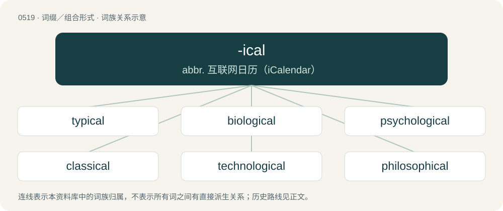

# 0580 · -ical — abbr. 互联网日历（iCalendar）

[总目录](../00_总目录_按常用程度.md)

**类型**：词缀／组合形式　｜　**来源语言**：见词源记录

## 核心含义与来源

- 核心含义：abbr. 互联网日历（iCalendar）
- 英文含义：Used to form adjectives from nouns with the meaning "of or pertaining to"; adjectival suffix appended to various words, often nouns, to make an adjective form. Often added to words of Greek or Latin origin, but used with other words also.
- 词形：-ical

**来源记录 1**（后缀／后置成分；Used to form adjectives from nouns with the meaning "of or pertaining to"; adjectival suffix appended to various words, often nouns, to make an adjective form. Often added to words of Greek or Latin origin, but used with other words also.）

From Middle English -ical, a combination of -ic from Old French -ique, from Latin -icus, related to Ancient Greek suffix Ancient Greek -ικός (-ikós), plus -al from Latin adjective suffix -alis, or Old French -el. By surface analysis, -ic + -al.

## 词族图

## 单词速览（常用到不常用）

| 单词 | 音标 | 释义 |
|---|---|---|
| [typical](#w-1) | /ˈtɪp.ɪ.kəl/ | a. 典型的, 象征性的；\[医\] 典型的 |
| [biological](#w-2) | 英 /ˌbaɪ.ə(ʊ)ˈlɒd͡ʒ.ɪ.kəl/；美 /ˌbaɪ.əˈlɑ.d͡ʒɪ.kəl/ | a. 生物学的；\[医\] 生物学的 |
| [psychological](#w-3) | 英 /ˌsaɪ.kəˈlɒd͡ʒ.ɪ.kl̩/；美 /ˌsaɪ.kəˈlɑː.d͡ʒɪ.kl̩/ | a. 心理学的, 精神上的, 心灵的；\[法\] 心理上的, 心理学的 |
| [classical](#w-4) | 英 /ˈklæs.ɪ.k(ə)l/ | a. 古典的, 正统派的, 经典的；\[医\] 古典的; 标准的, 典型的 |
| [technological](#w-5) | 英 /ˌtɛk.nəˈlɒdʒ.ɪ.kəl/；美 /ˌtɛk.nəˈlɑ.dʒɪ.kəl/ | a. 技术的；\[经\] 工艺的, 技术的 |
| [philosophical](#w-6) | 英 /ˌfɪl.əˈsɒf.ɪ.kl̩/；美 /ˌfɪl.əˈsɑ.fɪ.kl̩/ | a. 哲学的, 冷静的, 达观的, 哲学上的, 哲学家似的 |
| [biblical](#w-7) | /ˈbɪblɪkəl/ | a. 圣经的 |
| [geological](#w-8) | 英 /ˌd͡ʒiːəˈlɒd͡ʒɪkəl/；美 /ˌd͡ʒiəˈlɑd͡ʒɪkəl/ | a. 地质学的, 地质的 |
| [ecological](#w-9) | /ˌiːkəˈlɒd͡ʒɪkl̩/ | a. 生态学的, 主张生态保护的；\[法\] 生态的, 生态学的 |
| [ideological](#w-10) | 英 /ˌaɪ.diː.əˈlɒd͡ʒ.ɪ.kəl/；美 /ˌaɪ.di.əˈlɑ.d͡ʒɪ.kəl/ | a. 意识形态的, 空想的；\[法\] 思想的, 思想上的, 意识形态的 |
| [theological](#w-11) | 英 /θɪəˈlɒd͡ʒɪkl/；美 /θi.əˈlɑd͡ʒɪkl/ | a. 神学上的 |
| [archaeological](#w-12) | /.ɑːkiəˈlɒdʒikl/ | a. 考古学的, 考古学上的 |
| [neurological](#w-13) | 美 /nɝəˈlɑd͡ʒɪkəl/ | a. 神经病学上的 |
| [physiological](#w-14) | 英 /ˌfɪz.i.əˈlɒd͡ʒ.i.kəl/；美 /ˌfɪz.i.əˈlɑ.d͡ʒɪ.kəl/ | a. 生理学的, 生理学上的, 生理机能的；\[医\] 生理学的, 生理的 |
| [botanical](#w-15) | /bəˈtænɪkəl/ | a. 植物学的；n. 植物性药材 |
| [ecclesiastical](#w-16) | 英 /əˈkliː.ziˌæ.stɪ.kəl/ | a. 教会的, 神职的, 牧师的 |
| [chronological](#w-17) | 英 /ˌkɹɒnəˈlɒd͡ʒɪkəl/；美 /ˌkɹɑnəˈlɑd͡ʒɪkəl/ | a. 年代学的, 按时间顺序的, 按照年月顺序的；\[计\] 编年的, 按年月日顺序的 |
| [meteorological](#w-18) | 英 /ˌmiːtɪəɹəˈlɒd͡ʒɪkl̩/；美 /ˌmitiəɹəˈlɑd͡ʒɪkl̩/ | a. 气象的, 气象学的 |
| [biographical](#w-19) | 美 /ˌbaɪ.əˈɡɹæf.ɪ.kəl/ | a. 传记的 |
| [pathological](#w-20) | 英 /ˌpæθ.əˈlɒd͡ʒ.ɪ.kəl/；美 /ˌpæθ.əˈlɑd͡ʒ.ɪ.kəl/ | a. 病理学的, 由疾病引起的, (非正式)不合理的, 仅由想象引起的, 不理智的；\[计\] 错误的 |
| [satirical](#w-21) | /səˈtɪɹɪkəl/ | a. 讽刺的, 讥讽的, 好挖苦的, 写讽刺作品的 |
| [symmetrical](#w-22) | 英 /sɪˈmɛtɹɪkəl/；美 /səˈmɛtrək(ə)l/ | a. 对称的, 匀称的；\[医\] 对称的, 均称的 |
| [hierarchical](#w-23) | 英 /ˌhaɪəˈɹɑːkɪkəl/；美 /ˌhaɪˈɹɑɹkɪkəl/ | \[计\] 分级的, 分层的, 层次的 |
| [stereotypical](#w-24) | 英 /ˌstɛɹ.iː.əˈtɪp.ɪ.kəl/；美 /ˌstɛɹ.i.əˈtɪp.ɪ.kəl/ | a. 典型的; 带有成见的 |
| [morphological](#w-25) | 英 /ˌmɔːfəˈlɒd͡ʒɪkl̩/；美 /ˌmɔɹfəˈlɑd͡ʒɪkl̩/ | a. 形态的, 形态学的, 词法的；\[计\] 词法的 |
| [autobiographical](#w-26) | 英 /ˌɔː.təˌbaɪ.əˈɡɹæf.ɪk.əl/ | a. 自传的, 自传体的 |
| [periodical](#w-27) | 英 /ˌpɪəɹiˈɒdɪkl̩/；美 /ˌpɪɹiˈɑdɪkl̩/ | n. 期刊；a. 定期出版的, (有关)期刊的, 间歇(性的), 周期的, 定期的 |
| [whimsical](#w-28) | 英 /ˈwɪmzɪkəl/ | a. 怪念头多的, 反复无常的, 古怪的, 异想天开的 |
| [anthropological](#w-29) | 美 /æn.θɹə.pəˈlɑd͡ʒikəl/ | a. 人类学的, 人类学上的 |
| [mythological](#w-30) | /ˌmɪθəˈlɒd͡ʒɪkəl/ | a. 神话的, 神话学的, 虚构的 |
| [genealogical](#w-31) | 美 /ˌd͡ʒiniəˈlɑd͡ʒɪkəl/ | a. 宗谱的, 家系的, 系谱的 |
| [methodological](#w-32) | 英 /ˌmɛθ.ə.dəˈlɒd͡ʒ.ɪ.kəl/；美 /ˌmɛθ.ə.dəˈlɑ.d͡ʒɪ.kəl/ | a. 方法的 |
| [zoological](#w-33) | 英 /zəʊəˈlɒd͡ʒɪkl̩/；美 /zoʊəˈlɑd͡ʒɪkl̩/ | a. 动物学的 |
| [nonsensical](#w-34) | /nɒnˈsensikl/ | a. 无意义的, 荒谬的 |
| [topological](#w-35) |  | a. 地志学, 拓扑学, 局部解剖学；\[计\] 布局的 |
| [pharmacological](#w-36) | /ˌfɑɹməkəˈlɒd͡ʒɪkəl/ | a. 药理学的, 药物学的；\[医\] 药理学的 |
| [paradoxical](#w-37) | 英 /ˌpæɹəˈdɒksɪkəl/；美 /ˌpɛɹəˈdɑːksɪkəl/ | a. 似非而是的, 矛盾的, 诡论的；\[医\] 奇异的, 矛盾的, 逆理的, 反常的 |
| [radiological](#w-38) | /ˈreidiouˈlɒdʒikl/ | a. 放射学的 |
| [epidemiological](#w-39) |  | a. 流行病学 |
| [metallurgical](#w-40) | /ˌmɛtəˈlɜː(ɹ)dʒɪkəl/ | a. 冶金的, 冶金学的；\[机\] 治金的, 治金术的 |
| [cosmological](#w-41) | /ˌkɒz.məˈlɒdʒ.ɪ.kəl/ | a. 宇宙哲学的, 宇宙论的 |
| [ontological](#w-42) | 英 /ˌɒntəˈlɒd͡ʒɪkəl/ | a. 存在论的, 本体论的, 实体论的 |
| [phonological](#w-43) | 英 /ˌfɒnəˈlɒd͡ʒɪkəl/；美 /ˌfɑnəˈlɑd͡ʒɪkəl/ | a. 音位学的, 音韵学的 |
| [dialectical](#w-44) | /,daiəˈlektikəl/ | a. 辩证的, 辩证法的 |
| [farcical](#w-45) | /ˈfɑː(ɹ)sɪkəl/ | a. 笑剧的, 滑稽的, 笑剧性的 |
| [epistemological](#w-46) | 英 /ɪˌpɪstəməˈlɒd͡ʒɪkl̩/；美 /ɪˌpɪstəməˈlɑd͡ʒəkəl/ | a. 认识论的 |
| [hydrological](#w-47) | /.haidrəˈlɒdʒikl/ | a. 水文学的 |
| [histological](#w-48) |  | \[医\] 组织学的 |
| [poetical](#w-49) | 英 /pəʊˈɛtɪkl̩/；美 /poʊˈɛtɪkl̩/ | a. 诗的, 用诗写成的, 韵文的, 理想化了的 |
| [prototypical](#w-50) | 英 /ˌpɹəʊtəˈtɪpɪkəl/；美 /ˌpɹoʊtəˈtɪpɪkəl/ | \[计\] 原型的 |
| [immunological](#w-51) |  | a. 免疫学的 |
| [rabbinical](#w-52) | /ɹəˈbɪnəkəl/ | a. 希伯莱语的 |
| [entomological](#w-53) | /.entəməˈlɒdʒikəl/ | a. 昆虫学的；\[医\] 昆虫学的 |
| [phenomenological](#w-54) | /fi.nɒminəˈlɒdʒikl/ | a. 现象学的, 现象论的 |
| [alchemical](#w-55) |  | \[机\] 炼丹的 |
| [gynecological](#w-56) | /,^ainikəˈlɔdʒikəl,,dʒai-/ | a. 妇科学 |
| [etymological](#w-57) | /ˌɛt.ɪ.məˈlɑ.d͡ʒɪ.kəl/ | a. 词源的, 词源学的 |
| [philological](#w-58) | /ˌfɪ.ləˈlɒ.dʒɪ.kəl/ | a. 语文学的, 文献学的 |
| [neuropsychological](#w-59) |  | 神经心理学 |
| [monarchical](#w-60) | 英 /məˈnɑːkɪk(ə)l/ | a. 君主的, 君主政体的, 君主政治的 |
| [theosophical](#w-61) | 英 /ˌθiː.əˈsɒ.fɪ.kəl/；美 /ˌθi.əˈsɑ.fɪ.kəl/ | a. 通晓神智学的, 神智学的 |
| [mineralogical](#w-62) | /.minərəˈlɒdʒikl/ | a. 矿物学的 |
| [ornithological](#w-63) | 英 /ˌɔːnɪθəˈlɒd͡ʒɪkəl/；美 /ˌɔɹnɪθəˈlɑd͡ʒɪkəl/ | a. 鸟类学的 |
| [ethnological](#w-64) | /,eθnəuˈlɔdʒikəl/ | a. 民族的, 人种学的 |
| [urological](#w-65) |  | a. 泌尿学的 |
| [toxicological](#w-66) | /.tɒksikəˈlɒdʒikl/ | a. 毒理学的, 毒物学的 |
| [quizzical](#w-67) | /ˈkwɪzɪkəl/ | a. 戏弄的, 探询的, 古怪的 |
| [dermatological](#w-68) |  | a. 皮肤病学 |
| [seismological](#w-69) | /.saizməˈlɒdʒikl/ | a. 地震学上的 |
| [oratorical](#w-70) | /ˌɒɹəˈtɒɹɪkəl/ | a. 演说的, 雄辩的, 演说家的, 高谈阔论的 |
| [historiographical](#w-71) |  | 编史；史料编纂法 |
| [typological](#w-72) |  | a. 类型学的, 类型的 |
| [biotechnological](#w-73) | 英 /ˈbaɪəʊˌtɛk.nə.lɒdʒ.ɪk.əl/ | a. 生物技术的 |
| [neurophysiological](#w-74) |  | a. 神经生理学的; 神经生理的 |
| [serological](#w-75) | /.siərəˈlɒdʒikl/ | a. 血清学的 |
| [tautological](#w-76) | /,tɔːtəˈlɔdʒikəl/ | a. 重复的, 赘述的 |
| [climatological](#w-77) | 美 /ˌklaɪ.mə.təˈlɑː.dʒɪ.kəl/ | a. \[气象学\]与气候学有关的 |

## 逐词详解

### 1. typical

**词性**：名词　｜　**音标**：/ˈtɪp.ɪ.kəl/

**中文释义**：a. 典型的, 象征性的；\[医\] 典型的

**英文义项**：Anything that is typical, normal, or standard.

**构词拆分**：typic + -al；type + -ical

**词源与演化**：

From Late Latin typicalis, from Latin typicus (“typical”), from Ancient Greek τυπικός (tupikós, “of or pertaining to a type, conformable, typical”), from τύπος (túpos, “mark, impression, type”), equivalent to typic + -al and type + -ical.

**例句**：

> Antipsychotic drugs can be divided into typicals and atypicals.

该用例对应义项：Anything that is typical, normal, or standard.

### 2. biological

**词性**：形容词　｜　**音标**：英 /ˌbaɪ.ə(ʊ)ˈlɒd͡ʒ.ɪ.kəl/；美 /ˌbaɪ.əˈlɑ.d͡ʒɪ.kəl/

**中文释义**：a. 生物学的；\[医\] 生物学的

**英文义项**：Of or relating to biology. / Relating to anatomy; anatomic, anatomical.

**构词拆分**：biology + -ical

**词源与演化**：

From biology + -ical.

**用法示例／搭配（非完整句）**：

> biological mother

该用例对应义项：Related by consanguinity, especially as to parents and children.

### 3. psychological

**词性**：形容词　｜　**音标**：英 /ˌsaɪ.kəˈlɒd͡ʒ.ɪ.kl̩/；美 /ˌsaɪ.kəˈlɑː.d͡ʒɪ.kl̩/

**中文释义**：a. 心理学的, 精神上的, 心灵的；\[法\] 心理上的, 心理学的

**英文义项**：Of or pertaining to psychology. / Relating to the mind and behavior or to the mental, emotional, and behavioral characteristics pertaining to a specified person, group, or activity.

**构词拆分**：psychology + -ical

**词源与演化**：

From psychology + -ical.

**例句**：

> Prices seem to have stopped rising, having hit the psychological ceiling of just under 100 dollars.

该用例对应义项：Without an objective, or reasonably logical foundation.

### 4. classical

**词性**：形容词　｜　**音标**：英 /ˈklæs.ɪ.k(ə)l/

**中文释义**：a. 古典的, 正统派的, 经典的；\[医\] 古典的; 标准的, 典型的

**英文义项**：Of or relating to the first class or rank, especially in literature or art. / Of or pertaining to established principles in a discipline.

**构词拆分**：classic + -al + class + -ical + class + -ic + -al；classic + -al；class + -ic + -al

**词源与演化**：

See classic § Etymology for history. By surface analysis, class + -ical or classic + -al or class + -ic + -al

**用法示例／搭配（非完整句）**：

> classical dance

该用例对应义项：Conforming to the best authority in literature and art; chaste; pure; refined

### 5. technological

**词性**：形容词　｜　**音标**：英 /ˌtɛk.nəˈlɒdʒ.ɪ.kəl/；美 /ˌtɛk.nəˈlɑ.dʒɪ.kəl/

**中文释义**：a. 技术的；\[经\] 工艺的, 技术的

**英文义项**：Of, relating to, or involving technology, especially modern scientific technology.

**构词拆分**：technology + -ical

**词源与演化**：

From technology + -ical.

**例句**：

> There were many technological advances at the beginning of the twenty-first century.

### 6. philosophical

**词性**：形容词　｜　**音标**：英 /ˌfɪl.əˈsɒf.ɪ.kl̩/；美 /ˌfɪl.əˈsɑ.fɪ.kl̩/

**中文释义**：a. 哲学的, 冷静的, 达观的, 哲学上的, 哲学家似的

**英文义项**：Of, or pertaining to, philosophy. / Rational; analytic or critically minded; thoughtful.

**构词拆分**：philosophy + -ical

**词源与演化**：

From philosophy + -ical, from Ancient Greek φιλοσοφία (philosophía, “love of knowledge, scientific learning”). Displaced native Old English ūþwitlīċ.

**例句**：

> A considerable knowledge of philosophical terminology.

该用例对应义项：of or relating to philosophy or philosophers

### 7. biblical

**词性**：形容词　｜　**音标**：/ˈbɪblɪkəl/

**中文释义**：a. 圣经的

**英文义项**：Of or relating to the Bible. / In accordance with the teachings of the Bible (according to some interpretation of it).

**构词拆分**：bible + -ical

**词源与演化**：

From Medieval Latin biblicus + English -al, equivalent to bible + -ical.

**例句**：

> Tithing is both a quranic and biblical virtue.

该用例对应义项：Of or relating to the Bible.

### 8. geological

**词性**：形容词　｜　**音标**：英 /ˌd͡ʒiːəˈlɒd͡ʒɪkəl/；美 /ˌd͡ʒiəˈlɑd͡ʒɪkəl/

**中文释义**：a. 地质学的, 地质的

**英文义项**：Synonym of geologic.

**词源与演化**：

From Renaissance Latin geōlogia + -ical; first attested slightly earlier than geology. By surface analysis, geo- + -logical.

**例句**：

> The region is known for its unique geological formations and ancient bedrock.

### 9. ecological

**词性**：形容词　｜　**音标**：/ˌiːkəˈlɒd͡ʒɪkl̩/

**中文释义**：a. 生态学的, 主张生态保护的；\[法\] 生态的, 生态学的

**英文义项**：Relating to ecology, the interrelationships of organisms and their environment. / Not harmful to the environment.

**构词拆分**：ecology + -ical

**词源与演化**：

From ecology + -ical.

**例句**：

> It's worth noting that the solar water heater is also very ecological.

### 10. ideological

**词性**：形容词　｜　**音标**：英 /ˌaɪ.diː.əˈlɒd͡ʒ.ɪ.kəl/；美 /ˌaɪ.di.əˈlɑ.d͡ʒɪ.kəl/

**中文释义**：a. 意识形态的, 空想的；\[法\] 思想的, 思想上的, 意识形态的

**英文义项**：Of or pertaining to one or more ideologies. / Irrational; supported by misinformation and social reinforcement, as opposed to credible evidence.

**构词拆分**：ideology + -ical

**词源与演化**：

From ideology + -ical.

**例句**：

> The regime, ideological in governance, continued its agenda despite experts’ criticism.

该用例对应义项：Characterized by strict, uncompromising adherence to a particular political ideology, rather than what’s necessarily considered popular or practical.

### 11. theological

**词性**：形容词　｜　**音标**：英 /θɪəˈlɒd͡ʒɪkl/；美 /θi.əˈlɑd͡ʒɪkl/

**中文释义**：a. 神学上的

**英文义项**：Of or relating to theology.

**构词拆分**：theology + -ical

**词源与演化**：

From theology + -ical.

**例句**：

> The Jewish Theological Seminary in New York City ordains Conservative rabbis.

### 12. archaeological

**词性**：形容词　｜　**音标**：/.ɑːkiəˈlɒdʒikl/

**中文释义**：a. 考古学的, 考古学上的

**英文义项**：Relating to the science or research of archaeology.

**构词拆分**：archaeology + -ical + archaeo- + -logical

**词源与演化**：

From archaeology + -ical. By surface analysis, archaeo- + -logical.

**例句**：

> A dramatic archaeological discovery.

该用例对应义项：related to or dealing with or devoted to archaeology

### 13. neurological

**词性**：形容词　｜　**音标**：美 /nɝəˈlɑd͡ʒɪkəl/

**中文释义**：a. 神经病学上的

**英文义项**：Of or pertaining to neurology.

**构词拆分**：neurology + -ical

**词源与演化**：

From neurology + -ical.

**例句**：

> Soon, neuroscientific research will rid us of serious neurological diseases such as Parkinson's and Alzheimer's.

### 14. physiological

**词性**：形容词　｜　**音标**：英 /ˌfɪz.i.əˈlɒd͡ʒ.i.kəl/；美 /ˌfɪz.i.əˈlɑ.d͡ʒɪ.kəl/

**中文释义**：a. 生理学的, 生理学上的, 生理机能的；\[医\] 生理学的, 生理的

**英文义项**：Of, or relating to physiology. / Relating to the action of a drug when given to a healthy person, as distinguished from its therapeutic action.

**构词拆分**：physio- + -logical + physiology + -ical + -al；physio- + -logical；physiology + -ical

**词源与演化**：

Either from physio- + -logical (equivalent to physiology + -ical) or Latin physiologicus + -al.

**例句**：

> My attitude to the comma is physiological; the more breath I have, the fewer commas I use.

### 15. botanical

**词性**：形容词　｜　**音标**：/bəˈtænɪkəl/

**中文释义**：a. 植物学的；n. 植物性药材

**英文义项**：Of or pertaining to botany; relating to the study of plants.

**构词拆分**：botany + -ical

**词源与演化**：

From botany + -ical.

**用法示例／搭配（非完整句）**：

> a botanical textbook

该用例对应义项：Of or pertaining to botany; relating to the study of plants.

### 16. ecclesiastical

**词性**：形容词　｜　**音标**：英 /əˈkliː.ziˌæ.stɪ.kəl/

**中文释义**：a. 教会的, 神职的, 牧师的

**英文义项**：Of or pertaining to the church.

**构词拆分**：ecclesiast + -ical

**词源与演化**：

From Middle English ecclesiasticall, ecclesiasticalle, from Latin ecclēsiasticus + -al. By surface analysis, ecclesiastic + -al or ecclesiast + -ical.

**用法示例／搭配（非完整句）**：

> ecclesiastical architecture

该用例对应义项：Of or pertaining to the church.

### 17. chronological

**词性**：形容词　｜　**音标**：英 /ˌkɹɒnəˈlɒd͡ʒɪkəl/；美 /ˌkɹɑnəˈlɑd͡ʒɪkəl/

**中文释义**：a. 年代学的, 按时间顺序的, 按照年月顺序的；\[计\] 编年的, 按年月日顺序的

**英文义项**：Relating to time, or units of time. / In order of time from the earliest to the latest.

**构词拆分**：chrono- + -logical + chronology + -ical；chrono- + -logical；chronology + -ical

**词源与演化**：

From chrono- + -logical or chronology + -ical.

**例句**：

> He is 67 in chronological age, but has the mind and body of someone 55.

该用例对应义项：Relating to time, or units of time.

### 18. meteorological

**词性**：形容词　｜　**音标**：英 /ˌmiːtɪəɹəˈlɒd͡ʒɪkl̩/；美 /ˌmitiəɹəˈlɑd͡ʒɪkl̩/

**中文释义**：a. 气象的, 气象学的

**英文义项**：Of or pertaining to meteorology.

**构词拆分**：meteorology + -ical

**词源与演化**：

From meteorology + -ical.

**例句**：

> The trip was postponed because the meteorological conditions were so bad.

该用例对应义项：Of or pertaining to meteorology.

### 19. biographical

**词性**：形容词　｜　**音标**：美 /ˌbaɪ.əˈɡɹæf.ɪ.kəl/

**中文释义**：a. 传记的

**英文义项**：of or relating to an account of a person's life

**构词拆分**：biography + -ical

**词源与演化**：

From biography + -ical.

**例句**：

> He wrote a biographical sketch of George Washington.

### 20. pathological

**词性**：形容词　｜　**音标**：英 /ˌpæθ.əˈlɒd͡ʒ.ɪ.kəl/；美 /ˌpæθ.əˈlɑd͡ʒ.ɪ.kəl/

**中文释义**：a. 病理学的, 由疾病引起的, (非正式)不合理的, 仅由想象引起的, 不理智的；\[计\] 错误的

**英文义项**：Pertaining to pathology. / Relating to, amounting to, or caused by a physical or mental disorder.

**构词拆分**：pathology + -ical

**词源与演化**：

From pathology + -ical.

**例句**：

> A pathological urge to succeed.

该用例对应义项：caused by or evidencing a mentally disturbed condition

### 21. satirical

**词性**：形容词　｜　**音标**：/səˈtɪɹɪkəl/

**中文释义**：a. 讽刺的, 讥讽的, 好挖苦的, 写讽刺作品的

**英文义项**：Of, pertaining to, or connected with satire.

**构词拆分**：satire + -ical

**词源与演化**：

From satire + -ical.

**例句**：

> Spitting Image was a famous satirical television program.

该用例对应义项：Of, pertaining to, or connected with satire.

### 22. symmetrical

**词性**：形容词　｜　**音标**：英 /sɪˈmɛtɹɪkəl/；美 /səˈmɛtrək(ə)l/

**中文释义**：a. 对称的, 匀称的；\[医\] 对称的, 均称的

**英文义项**：Exhibiting symmetry; having harmonious or proportionate arrangement of parts; having corresponding parts or relations.

**构词拆分**：symmetry + -ical

**词源与演化**：

From symmetry + -ical.

**例句**：

> She admired the symmetrical pattern of the snowflake.

该用例对应义项：Exhibiting symmetry; having harmonious or proportionate arrangement of parts; having corresponding parts or relations.

### 23. hierarchical

**词性**：形容词　｜　**音标**：英 /ˌhaɪəˈɹɑːkɪkəl/；美 /ˌhaɪˈɹɑɹkɪkəl/

**中文释义**：\[计\] 分级的, 分层的, 层次的

**英文义项**：Pertaining to a hierarchy (a ranking). / Classified or arranged according to various criteria into successive ranks or grades.

**构词拆分**：hierarchy + -ical

**词源与演化**：

From hierarchy + -ical; compare French hiérarchique.

**例句**：

> She claimed that only a hierarchical society with a leisure class at the top can produce works of 'true' art.

该用例对应义项：Classified or arranged according to various criteria into successive ranks or grades.

### 24. stereotypical

**词性**：形容词　｜　**音标**：英 /ˌstɛɹ.iː.əˈtɪp.ɪ.kəl/；美 /ˌstɛɹ.i.əˈtɪp.ɪ.kəl/

**中文释义**：a. 典型的; 带有成见的

**英文义项**：Pertaining to a stereotype; conventional. / Banal, commonplace, and clichéd because of overuse.

**构词拆分**：stereotype + -ical

**词源与演化**：

From stereotype + -ical.

**例句**：

> I was disappointed by the stereotypical the-butler-did-it ending.

该用例对应义项：Banal, commonplace, and clichéd because of overuse.

### 25. morphological

**词性**：形容词　｜　**音标**：英 /ˌmɔːfəˈlɒd͡ʒɪkl̩/；美 /ˌmɔɹfəˈlɑd͡ʒɪkl̩/

**中文释义**：a. 形态的, 形态学的, 词法的；\[计\] 词法的

**英文义项**：Of, or pertaining to, morphology.

**构词拆分**：morphology + -ical

**词源与演化**：

From morphology + -ical.

**例句**：

> Morphological features of granite.

该用例对应义项：pertaining to geological structure

### 26. autobiographical

**词性**：形容词　｜　**音标**：英 /ˌɔː.təˌbaɪ.əˈɡɹæf.ɪk.əl/

**中文释义**：a. 自传的, 自传体的

**英文义项**：Of or relating to a person's life or an account of a person's life, as told by the subject.

**构词拆分**：autobiography + -ical；auto- + biographical

**词源与演化**：

From autobiography + -ical or auto- + biographical.

**例句**：

> They compiled an autobiographical history of the movement.

该用例对应义项：relating to or in the style of an autobiography

### 27. periodical

**词性**：名词　｜　**音标**：英 /ˌpɪəɹiˈɒdɪkl̩/；美 /ˌpɪɹiˈɑdɪkl̩/

**中文释义**：n. 期刊；a. 定期出版的, (有关)期刊的, 间歇(性的), 周期的, 定期的

**英文义项**：A publication issued regularly, but less frequently than daily. / A regularly issued thematic publication that contains the most current information in its field, often the primary means for communication of original scholarship or creative work at the cutting edge of research in its field.

**构词拆分**：period + -ical

**词源与演化**：

From period + -ical.

**例句**：

> Since then, he has already written several books and periodical short stories.

### 28. whimsical

**词性**：形容词　｜　**音标**：英 /ˈwɪmzɪkəl/

**中文释义**：a. 怪念头多的, 反复无常的, 古怪的, 异想天开的

**英文义项**：Given to whimsy.

**构词拆分**：whimsy + -ical

**词源与演化**：

From whimsy + -ical.

**例句**：

> I prefer my stories to be on the more whimsical side.

### 29. anthropological

**词性**：形容词　｜　**音标**：美 /æn.θɹə.pəˈlɑd͡ʒikəl/

**中文释义**：a. 人类学的, 人类学上的

**英文义项**：Relating to anthropology.

**构词拆分**：anthropology + -ical

**词源与演化**：

From anthropology + -ical.

**例句**：

> There is an anthropological theory that early Australoids arrived in the Americas before the Mongoloids, many thousands of years ago.

### 30. mythological

**词性**：形容词　｜　**音标**：/ˌmɪθəˈlɒd͡ʒɪkəl/

**中文释义**：a. 神话的, 神话学的, 虚构的

**英文义项**：Of, or relating to myths or mythology. / Legendary.

**构词拆分**：mythology + -ical

**词源与演化**：

From mythology + -ical.

**例句**：

> The tapestries depict scenes from mythological tales about gods and goddesses.

### 31. genealogical

**词性**：形容词　｜　**音标**：美 /ˌd͡ʒiniəˈlɑd͡ʒɪkəl/

**中文释义**：a. 宗谱的, 家系的, 系谱的

**英文义项**：Of or relating to genealogy. / Of the relationships among individuals within a species.

**构词拆分**：genealogy + -ical

**词源与演化**：

From French généalogique + -al, equivalent to genealogy + -ical.

**例句**：

> Monkeys are arboreal animals which make themselves at home in genealogical trees.

### 32. methodological

**词性**：形容词　｜　**音标**：英 /ˌmɛθ.ə.dəˈlɒd͡ʒ.ɪ.kəl/；美 /ˌmɛθ.ə.dəˈlɑ.d͡ʒɪ.kəl/

**中文释义**：a. 方法的

**英文义项**：Of, pertaining to, or using methodology or a methodology.

**构词拆分**：methodology + -ical

**词源与演化**：

From methodology + -ical.

**例句**：

> There are a number of methodological problems here, not to mention the inaccuracy of some of the results.

### 33. zoological

**词性**：形容词　｜　**音标**：英 /zəʊəˈlɒd͡ʒɪkl̩/；美 /zoʊəˈlɑd͡ʒɪkl̩/

**中文释义**：a. 动物学的

**英文义项**：Of, or relating to, animals. / Of, or relating to, zoology.

**构词拆分**：zoology + -ical

**词源与演化**：

From zoology + -ical.

**例句**：

> In the zoological gardens of Mars, there are animals from Earth.

### 34. nonsensical

**词性**：形容词　｜　**音标**：/nɒnˈsensikl/

**中文释义**：a. 无意义的, 荒谬的

**英文义项**：Without sense; absurd.

**构词拆分**：nonsense + -ical

**词源与演化**：

From nonsense + -ical.

**例句**：

> I know this sounds nonsensical, but it is exactly what I feel.

### 35. topological

**词性**：形容词

**中文释义**：a. 地志学, 拓扑学, 局部解剖学；\[计\] 布局的

**英文义项**：Of or relating to topology. / Equipped with a topology that is typically required to be compatible with the underlying structure in some way.

**构词拆分**：topology + -ical

**词源与演化**：

From topology + -ical.

**用法示例／搭配（非完整句）**：

> topological group

该用例对应义项：Equipped with a topology that is typically required to be compatible with the underlying structure in some way.

### 36. pharmacological

**词性**：形容词　｜　**音标**：/ˌfɑɹməkəˈlɒd͡ʒɪkəl/

**中文释义**：a. 药理学的, 药物学的；\[医\] 药理学的

**英文义项**：Of or having to do with pharmacology.

**构词拆分**：pharmacology + -ical

**词源与演化**：

From pharmacology + -ical.

### 37. paradoxical

**词性**：形容词　｜　**音标**：英 /ˌpæɹəˈdɒksɪkəl/；美 /ˌpɛɹəˈdɑːksɪkəl/

**中文释义**：a. 似非而是的, 矛盾的, 诡论的；\[医\] 奇异的, 矛盾的, 逆理的, 反常的

**英文义项**：Having self-contradictory properties.

**构词拆分**：paradox + -ical

**词源与演化**：

From paradox + -ical.

**例句**：

> It is paradoxical that standing is more tiring than walking.

该用例对应义项：seemingly contradictory but nonetheless possibly true

### 38. radiological

**词性**：形容词　｜　**音标**：/ˈreidiouˈlɒdʒikl/

**中文释义**：a. 放射学的

**英文义项**：Of or pertaining to radiation, radioactivity or nuclear weapons.

**构词拆分**：radiology + -ical

**词源与演化**：

From radiology + -ical.

### 39. epidemiological

**词性**：形容词

**中文释义**：a. 流行病学

**英文义项**：Of or pertaining to epidemiology.

**构词拆分**：epidemiology + -ical

**词源与演化**：

From epidemiology + -ical.

**例句**：

> Rafael Castillo, vice president of the National Penitentiary Council, said the intent is to create an epidemiological containment ring within the prison facility.

### 40. metallurgical

**词性**：形容词　｜　**音标**：/ˌmɛtəˈlɜː(ɹ)dʒɪkəl/

**中文释义**：a. 冶金的, 冶金学的；\[机\] 治金的, 治金术的

**英文义项**：Of or relating to metallurgy, the study of metals and their properties.

**构词拆分**：metallurgy + -ical

**词源与演化**：

From metallurgy + -ical.

**例句**：

> A single hopper-style rail car contains an amount of metallurgical coal sufficient to smelt the steel used to manufacture three hundred automobiles.

### 41. cosmological

**词性**：形容词　｜　**音标**：/ˌkɒz.məˈlɒdʒ.ɪ.kəl/

**中文释义**：a. 宇宙哲学的, 宇宙论的

**英文义项**：Of or pertaining to cosmology, or to the overall structure of the universe.

**构词拆分**：cosmology + -ical

**词源与演化**：

From cosmology + -ical.

**例句**：

> A cosmological argument is an argument that the universe demands the admission of an adequate external cause which is God.

该用例对应义项：pertaining to the branch of philosophy dealing with the elements and laws and especially the characteristics of the universe such as space and time and causality

### 42. ontological

**词性**：形容词　｜　**音标**：英 /ˌɒntəˈlɒd͡ʒɪkəl/

**中文释义**：a. 存在论的, 本体论的, 实体论的

**英文义项**：Of or relating to ontology. / Of or pertaining to the nature of being or existence.

**构词拆分**：ontology + -ical

**词源与演化**：

From ontology + -ical.

**例句**：

> The inconvenient improbability that we exist as self-conscious beings raises the ontological questions of where, when, and how did it all come into being.

### 43. phonological

**词性**：形容词　｜　**音标**：英 /ˌfɒnəˈlɒd͡ʒɪkəl/；美 /ˌfɑnəˈlɑd͡ʒɪkəl/

**中文释义**：a. 音位学的, 音韵学的

**英文义项**：Of or relating to phonology. / Pertaining to the way sounds function in languages, including phonemes, syllable structure, stress, and accent.

**构词拆分**：phonology + -ical

**词源与演化**：

From phonology + -ical.

**例句**：

> The phonological component of language.

该用例对应义项：of or relating to phonology

### 44. dialectical

**词性**：形容词　｜　**音标**：/,daiəˈlektikəl/

**中文释义**：a. 辩证的, 辩证法的

**英文义项**：Of or pertaining to dialectic; (in philosophy) logically reasoned through the exchange of opposing ideas. / Synonym of dialectal (“of or pertaining to a dialect”).

**构词拆分**：dialect + -ical

**词源与演化**：

From Latin dialecticus + -al. By surface analysis, dialectic + -al or dialect + -ical.

**例句**：

> Reason has long been declared the "harlot of the devil", and dialectical materialism a diabolical delusion.

### 45. farcical

**词性**：形容词　｜　**音标**：/ˈfɑː(ɹ)sɪkəl/

**中文释义**：a. 笑剧的, 滑稽的, 笑剧性的

**英文义项**：Resembling a farce; ludicrous; absurd.

**构词拆分**：farce + -ical

**词源与演化**：

From farce + -ical, after comical etc.

**例句**：

> The wild farcical exuberance of a clown.

该用例对应义项：broadly or extravagantly humorous; resembling farce

### 46. epistemological

**词性**：形容词　｜　**音标**：英 /ɪˌpɪstəməˈlɒd͡ʒɪkl̩/；美 /ɪˌpɪstəməˈlɑd͡ʒəkəl/

**中文释义**：a. 认识论的

**英文义项**：Of or pertaining to epistemology or theory of knowledge, as a field of study. / Synonym of epistemic (“of or relating to cognition or knowledge, its scope, or how it is acquired”).

**构词拆分**：epistemology + -ical

**词源与演化**：

From epistemology + -ical.

### 47. hydrological

**词性**：形容词　｜　**音标**：/.haidrəˈlɒdʒikl/

**中文释义**：a. 水文学的

**英文义项**：Of or pertaining to hydrology.

**构词拆分**：hydrology + -ical

**词源与演化**：

From hydrology + -ical.

### 48. histological

**词性**：形容词

**中文释义**：\[医\] 组织学的

**英文义项**：Pertaining to histology.

**构词拆分**：histology + -ical

**词源与演化**：

From histology + -ical.

### 49. poetical

**词性**：形容词　｜　**音标**：英 /pəʊˈɛtɪkl̩/；美 /poʊˈɛtɪkl̩/

**中文释义**：a. 诗的, 用诗写成的, 韵文的, 理想化了的

**英文义项**：Synonym of poetic.

**构词拆分**：poet + -ical

**词源与演化**：

From Middle English poetical, possibly equivalent to poet + -ical.

**例句**：

> The poppy-covered field has become the summer's poetical landscape.

### 50. prototypical

**词性**：形容词　｜　**音标**：英 /ˌpɹəʊtəˈtɪpɪkəl/；美 /ˌpɹoʊtəˈtɪpɪkəl/

**中文释义**：\[计\] 原型的

**英文义项**：Constituting or representing an original type of something that others are modelled on or derived from.

**构词拆分**：prototype + -ical

**词源与演化**：

From prototype + -ical.

### 51. immunological

**词性**：形容词

**中文释义**：a. 免疫学的

**英文义项**：Of or relating to immunology.

**构词拆分**：immunology + -ical

**词源与演化**：

From immunology + -ical.

### 52. rabbinical

**词性**：形容词　｜　**音标**：/ɹəˈbɪnəkəl/

**中文释义**：a. 希伯莱语的

**英文义项**：Of or relating to rabbis, their writings, or their work.

**构词拆分**：rabbi + -n- + -ical

**词源与演化**：

From rabbi + -n- + -ical.

### 53. entomological

**词性**：形容词　｜　**音标**：/.entəməˈlɒdʒikəl/

**中文释义**：a. 昆虫学的；\[医\] 昆虫学的

**英文义项**：Of or pertaining to entomology.

**构词拆分**：entomology + -ical

**词源与演化**：

From entomology + -ical.

**例句**：

> A study outlining the scientist’s research and findings were recently published Annals of the Entomological Society of America.

### 54. phenomenological

**词性**：形容词　｜　**音标**：/fi.nɒminəˈlɒdʒikl/

**中文释义**：a. 现象学的, 现象论的

**英文义项**：Of or relating to phenomenology, or consistent with the principles of phenomenology. / Using the method of phenomenology, by which the observer examines data and other subjective effects without trying to provide a pathophysiological explanation of them, especially in diagnosing disease states and in nosology and other forms of taxonomy.

**构词拆分**：phenomenology + -ical

**词源与演化**：

From phenomenology + -ical.

### 55. alchemical

**词性**：形容词

**中文释义**：\[机\] 炼丹的

**英文义项**：Of or pertaining to the medieval chemical science and philosophy of alchemy. / Of or pertaining to an unexplainable transmutation.

**构词拆分**：alchemy + -ical

**词源与演化**：

From alchemy + -ical.

### 56. gynecological

**词性**：形容词　｜　**音标**：/,^ainikəˈlɔdʒikəl,,dʒai-/

**中文释义**：a. 妇科学

**英文义项**：Of or pertaining to gynecology.

**构词拆分**：gynecology + -ical

**词源与演化**：

From gynecology + -ical.

### 57. etymological

**词性**：形容词　｜　**音标**：/ˌɛt.ɪ.məˈlɑ.d͡ʒɪ.kəl/

**中文释义**：a. 词源的, 词源学的

**英文义项**：Of or relating to etymology. / Consistent with its etymological characteristics (in historical usage or the source language).

**构词拆分**：etymology + -ical

**词源与演化**：

From etymology + -ical.

**例句**：

> I merely drew an etymological distinction.

该用例对应义项：based on or belonging to etymology

### 58. philological

**词性**：形容词　｜　**音标**：/ˌfɪ.ləˈlɒ.dʒɪ.kəl/

**中文释义**：a. 语文学的, 文献学的

**英文义项**：Of or pertaining to the history of literature and words. / Pertaining to historical linguistics.

**构词拆分**：philology + -ical

**词源与演化**：

From philology + -ical.

### 59. neuropsychological

**词性**：形容词

**中文释义**：神经心理学

**英文义项**：Of or pertaining to neuropsychology, the relation or combination of brain and mind.

**构词拆分**：neuro- + psychological；neuropsychology + -ical

**词源与演化**：

From neuro- + psychological or neuropsychology + -ical.

### 60. monarchical

**词性**：形容词　｜　**音标**：英 /məˈnɑːkɪk(ə)l/

**中文释义**：a. 君主的, 君主政体的, 君主政治的

**英文义项**：Of or pertaining to a monarch or monarchy. / Having sole or undivided authority.

**构词拆分**：monarch + -ical

**词源与演化**：

From monarch + -ical, perhaps after Middle French monarchique.

**用法示例／搭配（非完整句）**：

> Although a socialist he did have monarchical leanings

该用例对应义项：Of or pertaining to a monarch or monarchy.

### 61. theosophical

**词性**：形容词　｜　**音标**：英 /ˌθiː.əˈsɒ.fɪ.kəl/；美 /ˌθi.əˈsɑ.fɪ.kəl/

**中文释义**：a. 通晓神智学的, 神智学的

**英文义项**：Of or pertaining to theosophy.

**构词拆分**：theosophy + -ical

**词源与演化**：

From theosophy + -ical.

**例句**：

> Many prominent bourgeois philosophers in England are members of spiritualist and theosophical societies.

### 62. mineralogical

**词性**：形容词　｜　**音标**：/.minərəˈlɒdʒikl/

**中文释义**：a. 矿物学的

**英文义项**：Relating to mineralogy.

**构词拆分**：mineralogy + -ical

**词源与演化**：

From mineralogy + -ical.

### 63. ornithological

**词性**：形容词　｜　**音标**：英 /ˌɔːnɪθəˈlɒd͡ʒɪkəl/；美 /ˌɔɹnɪθəˈlɑd͡ʒɪkəl/

**中文释义**：a. 鸟类学的

**英文义项**：Of or pertaining to ornithology.

**构词拆分**：ornithology + -ical

**词源与演化**：

From ornithology + -ical.

### 64. ethnological

**词性**：形容词　｜　**音标**：/,eθnəuˈlɔdʒikəl/

**中文释义**：a. 民族的, 人种学的

**英文义项**：Of or pertaining to ethnology.

**构词拆分**：ethnology + -ical

**词源与演化**：

From ethnology + -ical.

### 65. urological

**词性**：形容词

**中文释义**：a. 泌尿学的

**英文义项**：Of or pertaining to urology.

**构词拆分**：urology + -ical

**词源与演化**：

From urology + -ical.

### 66. toxicological

**词性**：形容词　｜　**音标**：/.tɒksikəˈlɒdʒikl/

**中文释义**：a. 毒理学的, 毒物学的

**英文义项**：of or pertaining to toxicology

**构词拆分**：toxicology + -ical

**词源与演化**：

From toxicology + -ical.

### 67. quizzical

**词性**：形容词　｜　**音标**：/ˈkwɪzɪkəl/

**中文释义**：a. 戏弄的, 探询的, 古怪的

**英文义项**：Questioning or suggesting puzzlement. / Strange or eccentric.

**构词拆分**：quiz + -ical

**词源与演化**：

From quiz + -ical.

**例句**：

> His expression was half derisory, half quizzical.

### 68. dermatological

**词性**：形容词

**中文释义**：a. 皮肤病学

**英文义项**：Of or pertaining to dermatology

**构词拆分**：dermatology + -ical

**词源与演化**：

From dermatology + -ical.

### 69. seismological

**词性**：形容词　｜　**音标**：/.saizməˈlɒdʒikl/

**中文释义**：a. 地震学上的

**英文义项**：Relating to seismology.

**构词拆分**：seismology + -ical

**词源与演化**：

From seismology + -ical.

### 70. oratorical

**词性**：形容词　｜　**音标**：/ˌɒɹəˈtɒɹɪkəl/

**中文释义**：a. 演说的, 雄辩的, 演说家的, 高谈阔论的

**英文义项**：of, or relating to oratory or an orator.

**构词拆分**：oratory + -ical

**词源与演化**：

From orator or oratory + -ical, or else from Latin ōrātōrius.

**例句**：

> A to'oto'o is a Sāmoan oratorical staff.

该用例对应义项：of, or relating to oratory or an orator.

### 71. historiographical

**词性**：形容词

**中文释义**：编史；史料编纂法

**英文义项**：Related to historiography

**构词拆分**：historiography + -ical

**词源与演化**：

From historiography + -ical.

### 72. typological

**词性**：形容词

**中文释义**：a. 类型学的, 类型的

**英文义项**：Of or relating to typology.

**构词拆分**：typology + -ical

**词源与演化**：

From typology + -ical.

**例句**：

> As typological studies show (WALS features 98-100), ergative languages are fairly widespread throughout the world.

### 73. biotechnological

**词性**：形容词　｜　**音标**：英 /ˈbaɪəʊˌtɛk.nə.lɒdʒ.ɪk.əl/

**中文释义**：a. 生物技术的

**英文义项**：Of or pertaining to biotechnology.

**构词拆分**：biotechnology + -ical；bio- + technological

**词源与演化**：

From biotechnology + -ical or bio- + technological.

### 74. neurophysiological

**词性**：形容词

**中文释义**：a. 神经生理学的; 神经生理的

**英文义项**：Of or pertaining to neurophysiology.

**构词拆分**：neuro- + physiological + neurophysiology + -ical

**词源与演化**：

From neuro- + physiological. By surface analysis, neurophysiology + -ical.

### 75. serological

**词性**：形容词　｜　**音标**：/.siərəˈlɒdʒikl/

**中文释义**：a. 血清学的

**英文义项**：Of or pertaining to serology.

**构词拆分**：serology + -ical

**词源与演化**：

From serology + -ical.

**例句**：

> The rapid COVID test was positive, but the serological assay was negative.

### 76. tautological

**词性**：形容词　｜　**音标**：/,tɔːtəˈlɔdʒikəl/

**中文释义**：a. 重复的, 赘述的

**英文义项**：Of, relating to, or using tautology. / Using repetition or excessive wordiness; pleonastic or circumlocutionary.

**构词拆分**：tautology + -ical

**词源与演化**：

From tautology + -ical.

**例句**：

> The phrase `a beginner who has just started' is tautological.

该用例对应义项：repetition of same sense in different words

### 77. climatological

**词性**：形容词　｜　**音标**：美 /ˌklaɪ.mə.təˈlɑː.dʒɪ.kəl/

**中文释义**：a. \[气象学\]与气候学有关的

**英文义项**：Of or pertaining to climatology.

**构词拆分**：climatology + -ical

**词源与演化**：

From climatology + -ical.
