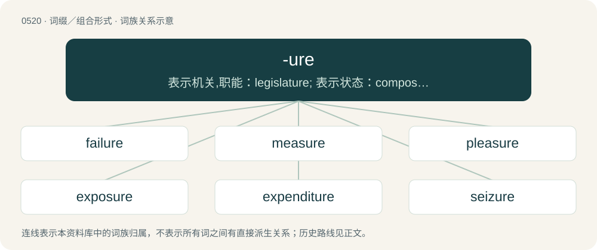

# 0581 · -ure — 表示机关,职能：legislature; 表示状态：composure; 表示动作,结果：exposure

[总目录](../00_总目录_按常用程度.md)

**类型**：词缀／组合形式　｜　**来源语言**：见词源记录

## 核心含义与来源

- 核心含义：表示机关,职能：legislature; 表示状态：composure; 表示动作,结果：exposure
- 英文含义：A process; a condition; a result of an action.
- 词形：-ure

**多个词源／构词路径**：同一拼写可能有不同来源；以下按词性和含义分别列出。

**来源记录 1**（后缀／后置成分；A process; a condition; a result of an action.）

Inherited from Middle English -ure, borrowed from Old French -ure, from Latin -(ā)tūram.

**来源记录 2**（后缀／后置成分；A tail.）

Derived from Ancient Greek οὐρᾱ́ (ourā́, “tail”)..

## 词族图

## 单词速览（常用到不常用）

| 单词 | 音标 | 释义 |
|---|---|---|
| [failure](#w-1) | 英 /ˈfeɪ.ljə/；美 /ˈfeɪ.ljəɹ/ | n. 失败, 失败者, 不足, 缺乏, 破产；\[计\] 故障; 失效 |
| [measure](#w-2) | 英 /ˈmɛʒ.ə/；美 /ˈmɛʒ.ɚ/ | n. 尺寸, 量度器, 量度标准, 测量, 量具, 程度, 范围, 限度, 分寸, 措施, 方法；vt. 测量, 测度, 估量, 权衡, 调节, 拿(自己或自己的力量等)作较量；vi. 度量 |
| [pleasure](#w-3) | 英 /ˈplɛʒə/；美 /ˈplɛʒɚ/ | n. 快乐, 愉快, 令人高兴的事, 娱乐, 希望；v. (使)高兴 |
| [exposure](#w-4) | 英 /ɪkˈspəʊ.ʒə(ɹ)/；美 /ɪkˈspoʊ.ʒɚ/ | n. 暴露, 揭发, 揭露；\[化\] 曝光量; 照射; 照射量 |
| [expenditure](#w-5) | 英 /ɛkˈspɛndɪt͡ʃə/；美 /ɛkˈspɛndɪt͡ʃɚ/ | n. 开支, 费用, 用光, 消费额；\[经\] 支出, 费用, 消费 |
| [seizure](#w-6) | 英 /ˈsiː.ʒə(ɹ)/；美 /ˈsi.ʒɚ/ | n. 捕获, 夺取, 占领, 捕获物, 没收, 充公；\[医\] 发作; 癫痫发作 |
| [composure](#w-7) | 英 /kəmˈpəʊʒə/；美 /kəmˈpoʊʒɚ/ | n. 镇静, 沉着 |
| [prefecture](#w-8) | 英 /ˈpɹiːfɛkt͡ʃə/；美 /ˈpɹiˌfɛkt͡ʃəɹ/ | n. 地方长官的职位(或辖区), 县；\[法\] 县长的职权, 地方长官的职权 |
| [erasure](#w-9) | 英 /ɪˈɹeɪʒə/；美 /ɪˈɹeɪʃɚ/ | n. 擦除, 抹掉；\[电\] 擦掉 |
| [candidature](#w-10) | /ˈkændɪdət͡ʃʊɚ/ | n. 候选人的地位, 候选人资格；\[法\] 候选资格 |

## 逐词详解

### 1. failure

**词性**：名词　｜　**音标**：英 /ˈfeɪ.ljə/；美 /ˈfeɪ.ljəɹ/

**中文释义**：n. 失败, 失败者, 不足, 缺乏, 破产；\[计\] 故障; 失效

**英文义项**：State or condition of not meeting a desirable or intended objective, opposite of success. / A condition in which a specified organ does not function well enough to support life.

**构词拆分**：fail + -ure

**词源与演化**：

From Anglo-Norman failer, from Old French faillir (“to fail”). Equivalent to fail + -ure.

**用法示例／搭配（非完整句）**：

> congestive heart failure

该用例对应义项：A condition in which a specified organ does not function well enough to support life.

### 2. measure

**词性**：名词　｜　**音标**：英 /ˈmɛʒ.ə/；美 /ˈmɛʒ.ɚ/

**中文释义**：n. 尺寸, 量度器, 量度标准, 测量, 量具, 程度, 范围, 限度, 分寸, 措施, 方法；vt. 测量, 测度, 估量, 权衡, 调节, 拿(自己或自己的力量等)作较量；vi. 度量

**英文义项**：Moderation, temperance. / A limit that cannot be exceeded; a bound. (Now chiefly in set phrases.)

**词源与演化**：

From Middle English mesure, from Old French mesure, from Latin mēnsūra (“a measure”), mētior (“to measure”, supine stem in mēns-) + -tūra. Largely displaced native Old English metan ("to measure" whence modern mete) and ġemet (“a measure”). See also -ure.

**例句**：

> By what measure should we judge the performance of our teachers?

该用例对应义项：A standard against which something can be judged; a way of measuring it; a criterion for it.

### 3. pleasure

**词性**：名词　｜　**音标**：英 /ˈplɛʒə/；美 /ˈplɛʒɚ/

**中文释义**：n. 快乐, 愉快, 令人高兴的事, 娱乐, 希望；v. (使)高兴

**英文义项**：A state of being pleased or contented; gratification. / A person, thing or action that causes enjoyment.

**词源与演化**：

From Early Modern English pleasur, plesur, alteration (with ending accommodated to -ure) of Middle English plaisir (“pleasure”), from Old French plesir, plaisir (“to please”), infinitive used as a noun, conjugated form of plaisir or plaire, from Latin placeō (“to please, to seem good”), from the Proto-Indo-European \*pleh₂-k- (“wide and flat”). Related to Dutch plezier (“pleasure, fun”). More at please.

**例句**：

> I get a lot of pleasure from watching others work hard while I relax.

该用例对应义项：A state of being pleased or contented; gratification.

### 4. exposure

**词性**：名词　｜　**音标**：英 /ɪkˈspəʊ.ʒə(ɹ)/；美 /ɪkˈspoʊ.ʒɚ/

**中文释义**：n. 暴露, 揭发, 揭露；\[化\] 曝光量; 照射; 照射量

**英文义项**：The condition of being exposed, uncovered, or unprotected. / Lack of protection from weather or the elements.

**构词拆分**：From expos(e) + -ure.

**词源与演化**：

From expos(e) + -ure.

**例句**：

> They rented a cabin with a beautiful southern exposure.

该用例对应义项：That part which is facing or exposed to something, e.g. the sun, weather, sky, or a view.

### 5. expenditure

**词性**：名词　｜　**音标**：英 /ɛkˈspɛndɪt͡ʃə/；美 /ɛkˈspɛndɪt͡ʃɚ/

**中文释义**：n. 开支, 费用, 用光, 消费额；\[经\] 支出, 费用, 消费

**英文义项**：Act of expending or paying out. / The amount expended; expense; outlay.

**词源与演化**：

From stem of Medieval Latin expenditus, irregular perfect passive participle of expendō (“to weigh, to pay out”), + -ure (“process or result”).

**例句**：

> The expenditure of time, money, and political capital on this project has been excessive.

该用例对应义项：The amount expended; expense; outlay.

### 6. seizure

**词性**：名词　｜　**音标**：英 /ˈsiː.ʒə(ɹ)/；美 /ˈsi.ʒɚ/

**中文释义**：n. 捕获, 夺取, 占领, 捕获物, 没收, 充公；\[医\] 发作; 癫痫发作

**英文义项**：The act of taking possession, as by force or right of law. / The state of being seized or of having been taken.

**构词拆分**：From seize + -ure.

**词源与演化**：

From seize + -ure.

**例句**：

> The seizure includes various belongings taken from his house and his office.

该用例对应义项：That which is seized, or taken possession of; a thing laid hold of, or possessed.

### 7. composure

**词性**：名词　｜　**音标**：英 /kəmˈpəʊʒə/；美 /kəmˈpoʊʒɚ/

**中文释义**：n. 镇静, 沉着

**英文义项**：Calmness of mind or temperament.

**构词拆分**：From compose + -ure.

**词源与演化**：

From compose + -ure.

**例句**：

> He accepted their problems with composure and she with equanimity.

该用例对应义项：steadiness of mind under stress

### 8. prefecture

**词性**：名词　｜　**音标**：英 /ˈpɹiːfɛkt͡ʃə/；美 /ˈpɹiˌfɛkt͡ʃəɹ/

**中文释义**：n. 地方长官的职位(或辖区), 县；\[法\] 县长的职权, 地方长官的职权

**英文义项**：The office or position of a prefect. / The jurisdiction of a prefect; the region administered by a prefect, especially as a translation of certain French, Chinese, and Japanese administrative divisions.

**构词拆分**：prefect + -ure

**词源与演化**：

Borrowed from Middle French préfecture, from Latin praefectūra. Equivalent to prefect + -ure. As an East Asian administrative division, a calque of Chinese 府 (fǔ) and 郡 (jùn), also used to describe 縣 /县 (xian, “county”) and 州 (zhou, “province”) in some eras.

**例句**：

> Naka is one of the 18 administrative districts that compose Yokohama prefecture.

### 9. erasure

**词性**：名词　｜　**音标**：英 /ɪˈɹeɪʒə/；美 /ɪˈɹeɪʃɚ/

**中文释义**：n. 擦除, 抹掉；\[电\] 擦掉

**英文义项**：The action of erasing; deletion; obliteration. / The state of having been erased; total blankness.

**构词拆分**：erase + -ure

**例句**：

> There were several erasures on the paper.

该用例对应义项：The place where something has been erased.

### 10. candidature

**词性**：名词　｜　**音标**：/ˈkændɪdət͡ʃʊɚ/

**中文释义**：n. 候选人的地位, 候选人资格；\[法\] 候选资格

**英文义项**：The condition of becoming a candidate; candidateship.

**构词拆分**：candidate + -ure

**词源与演化**：

From French candidature, equivalent to candidate + -ure.

**例句**：

> He has officially announced his candidature.
