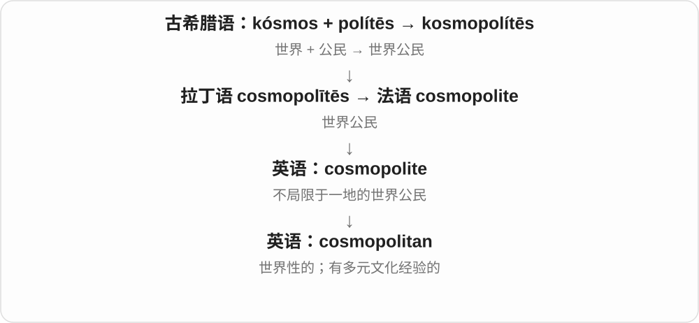

# 0598 · -an — 与……有关的、属于……的；相应的人、成员等〔含 -ian 等常见扩展〕

[逐词精讲目录](../00_逐词精讲目录.md) · [总目录](../00_总目录_按常用程度.md)

## 核心词根与来源

这个关系形容词、人物名称材料可接拉丁 -anus 等，有的经法语 -ain、-en 等路线进入。英语还发展了 -ian、-arian 等常见形式，具体词有自己的借入和扩展史；不是每次都只删掉前面的几个字母再接 an。

**AN：先说明属于哪个领域、群体，再看整个词指人还是性质**

republic → republican 共和国、共和相关；library → librarian 图书管理员；circadian 却是大约一天周期的形容词。不要把所有 an 尾巴都当人。

- **人物身份、领域**：republic · republican；library · librarian；theology · theologian；veterinarian
- **生活方式和立场**：bohemian；contrary · contrarian；utopian · dystopian · sectarian · totalitarian
- **性质、周期和生物类群**：circadian；crustacean · amphibian · ovarian
- **专门命名及其他固定词**：radius · radian；pedestrian · cosmopolitan · subterranean
- **custodian：负责照管、保管的人**：custody · custodian
- **rhythm → rhythms：可分辨的节奏模式**：rhythm · rhythms

## 词形与演化规律

republic + -an；library 的相应词干 + -ian；contrary + -an → contrarian；circadian 还含拉丁 circa、dies 材料；crustacean 接分类名 Crustacea。radian 则是专门命名的单位词。moan 呻吟虽然结尾字母相同，不属于这个关系后缀。

custodian 接 custody 与拉丁 custod- 看管材料及相应人物名词词尾；保管人、校舍管理人员等随对象分化。

同一基词后加 s，尾 mz，不增加新元音。

## 单词速览（按词族由简到繁）

同一基础词的相关扩展放在一起，先读基础形式，再读扩展；各组之间优先读常用的。具体词源关系见各词讲解。

| 单词 | 音标 | 核心意思 |
|---|---|---|
| [library](#w-36) | 英 /ˈlaɪbrəri/；美 /ˈlaɪbreri/ | 图书馆；藏书；资料库、程序库 |
| [librarian](#w-5) | 英 /laɪˈbreəriən/；美 /laɪˈbreriən/ | 图书馆员；图书馆专业工作人员 |
| [republic](#w-37) | /rɪˈpʌblɪk/ | 共和国；共和政体 |
| [republican](#w-1) | /rɪˈpʌblɪkən/ | 共和制的；共和主义者；〔大写〕共和党的、共和党人 |
| [custody](#w-44) | 英 /ˈkʌstədi/；美 /ˈkʌstədi/ | 保管、看护；监护；拘押、羁押 |
| [custodian](#w-45) | /kʌˈstəʊdiən/；美 /kʌˈstoʊdiən/ | 保管人、照管者；楼宇、校舍管理员等〔美式常见〕 |
| [contrary](#w-38) | 常见形容词 英 /ˈkɒntrəri/、美 /ˈkɑːntreri/；执拗义亦见 /kənˈtreəri/ 等变体 | 相反的；相违背的；执拗、爱反着来的 |
| [contrarian](#w-23) | 英 /kənˈtreəriən/；美 /kənˈtreriən/ | 与主流意见反着来的；持相反看法的人 |
| [rhythm](#w-39) | 英、美 /ˈrɪðəm/ | 节奏；韵律；有规律反复出现的模式 |
| [rhythms](#w-46) | /ˈrɪðəmz/ | 节奏、节律、规律性模式〔复数〕 |
| [theology](#w-40) | 英 /θiˈɒlədʒi/；美 /θiˈɑːlədʒi/ | 神学 |
| [theologian](#w-16) | 英 /ˌθiəˈləʊdʒən/；美 /ˌθiəˈloʊdʒən/ | 神学家 |
| [radius](#w-41) | 英、美 /ˈreɪdiəs/ | 半径；一定半径的范围；桡骨 |
| [radian](#w-31) | /ˈreɪdiən/ | 弧度〔角度单位〕 |
| [pedestrian](#w-3) | /pəˈdestriən/ | 行人；步行的、供行人使用的；平淡无奇的 |
| [crust](#w-42) | /krʌst/ | 硬皮、外壳；面包皮、派皮、披萨饼底；地壳；结成硬层 |
| [sect](#w-43) | /sekt/ | 宗派、教派；学派、小团体 |
| [sectarian](#w-10) | 英 /sekˈteəriən/；美 /sekˈteriən/ | 宗派的；偏执于派别的、宗派主义的；宗派成员 |
| [bohemian](#w-6) | 英 /bəʊˈhiːmiən/；美 /boʊˈhiːmiən/ | 不拘传统、自由随性的〔尤指艺术生活〕；相应生活方式的人 |
| [ovarian](#w-7) | 英 /əʊˈveəriən/；美 /oʊˈveriən/ | 卵巢的 |
| [cosmopolitan](#w-9) | 英 /ˌkɒzməˈpɒlɪtən/；美 /ˌkɑːzməˈpɑːlɪtən/ | 世界性的；多元文化的；见多识广、适应各地生活的 |
| [totalitarian](#w-11) | 英 /təʊˌtæləˈteəriən/；美 /toʊˌtæləˈteriən/ | 极权主义的；极权主义者 |
| [dystopian](#w-12) | 英 /dɪsˈtəʊpiən/；美 /dɪsˈtoʊpiən/ | 反乌托邦的；呈现压抑未来社会的 |
| [veterinarian](#w-13) | 英 /ˌvetərɪˈneəriən/；美 /ˌvetərɪˈneriən/ | 兽医 |
| [utopian](#w-14) | 英 /juːˈtəʊpiən/；美 /juːˈtoʊpiən/ | 乌托邦式的；理想化的；不切实际的 |
| [subterranean](#w-15) | /ˌsʌbtəˈreɪniən/ | 地下的；隐蔽的、暗中存在的 |
| [circadian](#w-17) | 英 /sɜːˈkeɪdiən/；美 /sɜːrˈkeɪdiən/ | 昼夜节律的；约二十四小时周期的 |
| [antiquarian](#w-18) | 英 /ˌæntɪˈkweəriən/；美 /ˌæntɪˈkweriən/ | 古物研究或收藏的；古物研究者、收藏者 |
| [amphibian](#w-21) | /æmˈfɪbiən/ | 两栖动物；两栖类的 |
| [crustacean](#w-24) | /krʌˈsteɪʃən/ | 甲壳动物；甲壳动物的 |
| [documentarian](#w-30) | 英 /ˌdɒkjumənˈteəriən/；美 /ˌdɑːkjəmənˈteriən/ | 纪录片创作者；纪实记录者 |
| [centenarian](#w-34) | 英 /ˌsentɪˈneəriən/；美 /ˌsentɪˈneriən/ | 百岁老人；百岁或以上的 |

## 逐词讲解

### 1. library — 图书馆；藏书；资料库、程序库

**音标**：英 /ˈlaɪbrəri/；美 /ˈlaɪbreri/

**先抓住这个画面**

把很多可供查找和使用的东西，按一定方式收在一起。

**怎么拆**

来自拉丁 liber“书”这一族，经法语传入。不是 liberty“自由”加后缀，二者拉丁源词不同。

**怎么变成今天的意思**

**拉丁 liber，属格 libri**  
书；这个词也曾指树的内皮

↓

**拉丁 librarius → librarium／libraria**  
与书有关 → 书柜、藏书处等

↓

**法语 librarie／librairie → 中古英语 librarie**  
藏书或藏书的地方

↓

**英语 library**  
图书馆；供查找和使用的资料集合

library 最容易想到图书馆，但核心不一定是“一栋有书的楼”。a music library 可以是一批可调用的音乐，a software library 是程序可使用的一组功能。它们都保留了“收好一批资料或资源，供人取用”的组织方式。

**常见搭配与例句**

a public library；a library card；a digital library；a software library。

> I borrowed two books from the local library.

我从当地的图书馆借了两本书。

> The app uses a library of sounds recorded outdoors.

这个应用使用了一套在户外录制的声音素材库。

**别混淆**

library 是图书馆或资料集合；bookshop／bookstore 是书店。法语 librairie 常是书店，不能只凭相似拼写照搬。

### 2. librarian — 图书馆员；图书馆专业工作人员

**音标**：英 /laɪˈbreəriən/；美 /laɪˈbreriən/

**先抓住这个画面**

帮助把资料整理好，也帮助读者找到真正需要的信息的人。

**怎么拆**

library + 表示相关人员的 -an；拼写变为 librarian。早期还有抄书人的用法，现代主要指图书馆工作者。

**怎么变成今天的意思**

**拉丁 liber，属格 libri**  
书；这个词也曾指树的内皮

↓

**拉丁 librarius → librarium／libraria**  
与书有关 → 书柜、藏书处等

↓

**法语 librarie／librairie → 中古英语 librarie**  
藏书或藏书的地方

↓

**英语 library**  
图书馆；供查找和使用的资料集合

↓

**library + -an → librarian**  
负责图书馆资料与服务的人

librarian 不只是把书摆回架子上的人。这个职业也涉及分类、检索、选书、数字资源和读者服务。想找某个主题的可靠资料，ask a librarian 是请相关专业人员帮你找路径。

**常见搭配与例句**

a school librarian；ask the librarian；a reference librarian。

> The librarian helped me find sources for my essay.

图书馆员帮我找到了写论文需要的资料。

> Our school librarian runs a weekly reading club.

我们学校的图书馆员每周组织一次读书会。

**别混淆**

librarian 是职业；library 是机构或资料库。librarian 不等于书店售货员，也不等于所有写书的人。

### 3. republic — 共和国；共和政体

**音标**：/rɪˈpʌblɪk/

**先抓住这个画面**

把国家理解为公共事务，国家元首的位置不作为君主的世袭王位。

**怎么拆**

来自法语 république，接拉丁 res publica 公共事务、国家；res 是事务、事情，开头不是表示再次的 re-。

**怎么变成今天的意思**

**拉丁 populus → 早期 poplicus → publicus**  
民众 → 属于民众、公共的；词形变化可能受 pubes 影响

↓

**拉丁 res publica → 法语 république → 英语 republic**  
公共事务、国家 → 共和国；res 是事务，不是前缀 re-

a republic 与 monarchy 君主制构成常见对照。但一个国家叫 republic，不足以说明实际选举、公民权利或权力运行的全部情况。

**常见搭配与例句**

a republic；a federal republic；declare a republic。

> The country became a republic after the monarchy ended.

君主制结束后，这个国家成为共和国。

> The museum explains how the republic’s institutions developed.

博物馆介绍了这个共和国的制度怎样发展。

**别混淆**

democracy 讨论人民如何参与和控制权力；republic 说一种政体类别。两个词相关，但不是可以无条件互换的标签。

### 4. republican — 共和制的；共和主义者；〔大写〕共和党的、共和党人

**音标**：/rɪˈpʌblɪkən/

**先抓住这个画面**

小写时支持或属于共和政体；大写时常是在说一个具体政党。

**怎么拆**

republic + -an；英语里人物名词的记录早于对应形容词，不能因为 -an 像形容词就硬画先形容词后人。

**怎么变成今天的意思**

**拉丁 populus → 早期 poplicus → publicus**  
民众 → 属于民众、公共的；词形变化可能受 pubes 影响

↓

**拉丁 res publica → 法语 république → 英语 republic**  
公共事务、国家 → 共和国；res 是事务，不是前缀 re-

↓

**英语 republic + -an → republican〔人物名词与形容词〕**  
拥护共和制的人；共和制的

↓

**大写 Republican 的政党名称用法**  
在具体国家语境中指相应政党；美国语境尤常见

republican institutions 是共和制度；a republican 可指主张共和制的人。美国新闻里 a Republican 通常指共和党人，要留意大写和国家语境。

**常见搭配与例句**

republican ideals；a republican movement；a Republican candidate。

> The historian studied the spread of republican ideas.

这位历史学者研究共和思想的传播。

> In the report, Republican refers to the American political party.

在这份报道中，Republican 指美国共和党。

**别混淆**

republican 不总等于美国共和党；Republican 作为专名也不应被翻成泛泛的共和主义者。

### 5. custody — 保管、看护；监护；拘押、羁押

**音标**：英 /ˈkʌstədi/；美 /ˈkʌstədi/

**先抓住这个画面**

某个人或东西交到一方手里，由这一方看管、负责。对象是文物，可以是保管；对象是孩子，常谈监护照护；警方控制住人，则有拘押义。

**怎么拆**

接拉丁 custodia 看管、保护，也可指监禁，来自 custos、词干 custod- 看管者、保护者。英语沿看守、保管线发展，具体自由程度由场景决定。

**怎么变成今天的意思**

**拉丁 custos／custod- → custodia**  
看管者 → 看守、保护、拘押

↓

**英语 custody**  
保管、照护；监护；警方等的拘押

in the custody of a museum 由博物馆保管；custody of the children 对孩子的监护、照护安排；in police custody 被警方拘押；take someone into custody 将某人拘押。

**常见搭配与例句**

safe custody；have custody of something。

> The manuscript remains in the custody of the library.

手稿仍由图书馆保管。

> He was taken into custody after the incident.

事件发生后，他被拘押了。

**别混淆**

custody 的统一线索是由谁看管、负责，不能看到就一律译入狱。manuscripts in the library’s custody 是图书馆保管的手稿。

### 6. custodian — 保管人、照管者；楼宇、校舍管理员等〔美式常见〕

**音标**：/kʌˈstəʊdiən/；美 /kʌˈstoʊdiən/

**先抓住这个画面**

东西交给某个人照看、维护，这个人是 custodian。照看珍贵文物可以这样称，负责校舍清洁维护的人也可以这样称。

**怎么拆**

接 custody 及拉丁 custod- 看管者材料与相应人物词尾，发展为承担照管职责的人。美式校舍管理员义由看管建筑、维持日常使用的职责专门化。

**怎么变成今天的意思**

**拉丁看管材料；英语 custody**  
看守、保管、照护

↓

**人物名词 custodian**  
负责照管的人；特定场景中楼宇管理员

the custodian of a collection 藏品保管人；a school custodian 校舍管理员；a custodian of tradition 传统的守护者。

**常见搭配与例句**

a museum custodian；the building custodian。

> The custodian unlocked the school early in the morning.

校舍管理员清早打开了学校的门。

> The museum sees itself as a custodian of local history.

博物馆把自己看作当地历史的守护者。

**别混淆**

custodian 通常强调保管、照护责任，不自动等于拥有者。物品属于谁，用 owner；谁负责照管，用 custodian 等，实际称呼依场景。

### 7. contrary — 相反的；相违背的；执拗、爱反着来的

**音标**：常见形容词 英 /ˈkɒntrəri/、美 /ˈkɑːntreri/；执拗义亦见 /kənˈtreəri/ 等变体

**先抓住这个画面**

证据朝一个方向，另一条证据却指向相反方向，是 contrary evidence；人总和别人反着来，也有 contrary 的性情用法。

**怎么拆**

经法语 contraire 接拉丁 contrarius 相反的，来自 contra 反对、对面。不是 country 国家加 r 的改写。

**怎么变成今天的意思**

**拉丁 contra → contrarius → 法语 contraire**  
相对、反对 → 相反的

↓

**英语 contrary**  
相反、违背；特定语境里执拗的

contrary to expectations 与预期相反；on the contrary 恰恰相反；to the contrary 表明相反情况。词性、语境会影响读音和搭配。

**常见搭配与例句**

contrary to；on the contrary。

> Contrary to expectations, the room was quiet.

与预期相反，房间很安静。

> There is no evidence to the contrary.

没有证据表明情况恰恰相反。

**别混淆**

on the contrary 用来反驳前述判断，并不只是补一个不同话题；in contrast 侧重对比，两者不是所有时候互换。

### 8. contrarian — 与主流意见反着来的；持相反看法的人

**音标**：英 /kənˈtreəriən/；美 /kənˈtreriən/

**先抓住这个画面**

大家一致看好，他偏要问“真的这么好吗”；经常与主流判断相反的人或思路，可叫 contrarian。反着来不自动等于正确。

**怎么拆**

contrary 的词干 + -an，仿 libertarian 等人物形式，现代也作修饰语；不是 contra 前缀后面随意接一个 rian 职业名。

**怎么变成今天的意思**

**contrary**  
相反的、爱反着来的

↓

**contrary + -an → contrarian**  
反主流的看法及持这种看法的人

a contrarian view 与主流相反的看法；a contrarian investor 逆向投资者是常见词组，此处只理解相反方向，不代表具体投资建议。

**常见搭配与例句**

a contrarian view；a natural contrarian。

> She offered a contrarian view during the discussion.

讨论中，她提出了与主流相反的看法。

> He enjoys being a contrarian, but he still needs evidence.

他喜欢与主流唱反调，但仍需要证据。

**别混淆**

independent thinker 独立思考者未必总反主流；contrarian 特别突出与多数人相反的立场，可能有洞见，也可能只是唱反调。

### 9. rhythm — 节奏；韵律；有规律反复出现的模式

**音标**：英、美 /ˈrɪðəm/

**先抓住这个画面**

声音、动作或生活进程不是乱成一团，而是在时间里呈现出能感到的长短、强弱和重复。

**怎么拆**

接拉丁 rhythmus、希腊 rhythmos“有秩序的运动、节律”，与 rhein“流动”相连。英语现代拼写还受重新靠近古典词形的影响，与经法语 rime 进入英语的旧形式有交织；不要把今天的 rhythm 当作 rhyme 的直接母词。

**怎么变成今天的意思**

**希腊 rhein／rhythmos**  
流动；有安排的运动、节律

↓

**拉丁 rhythmus 与法语、中古英语 rime 词族**  
韵律、诗的节拍等

↓

**英语恢复古典式拼写 rhythm**  
节奏；音乐、语言、身体与生活的规律

音乐里 rhythm 是声音长短、重音和停顿的安排，不只是均匀的“咚咚”拍子。settle into a rhythm 也能说逐渐找到做事的节奏；heart rhythm 指心脏跳动的节律。

**常见搭配与例句**

a steady rhythm；the rhythm of speech；get into a rhythm；heart rhythm；rhythm and blues。

> The drummer changed the rhythm without changing the tempo.

鼓手改变了节奏型，但没有改变速度。

> After a few days, we found a comfortable rhythm for working together.

几天之后，我们找到了舒服的合作节奏。

**别混淆**

beat 常是可数出的基本拍；rhythm 是声音在拍点之间如何安排。rhyme 是押韵，关心尾音相似，而不是时间上的节奏。

### 10. rhythms — 节奏、节律、规律性模式〔复数〕

**音标**：/ˈrɪðəmz/

**先抓住这个画面**

声音、动作或生活一拍一拍、有规律地重复，这些不同模式是 rhythms。音乐能有节奏，工作和生活也有自己的快慢循环。

**怎么拆**

rhythm 接拉丁 rhythmus、希腊 rhythmos 有秩序的运动，常与 rhein 流动相连；英语拼写受恢复古典形式影响，与 rime 历史有交织。现代加 -s，/m/ 后读 /z/。

**怎么变成今天的意思**

**希腊、拉丁节律材料 → 英语 rhythm**  
有安排的运动 → 节奏、规律

↓

**rhythm + -s → rhythms**  
多种节奏、不同活动循环

musical rhythms 音乐节奏；daily rhythms 日常生活节律；rhythms of speech 说话的节奏。

**常见搭配与例句**

different rhythms 不同节奏；slow rhythms 缓慢节奏。

> The drummer combined several simple rhythms.

鼓手把几种简单节奏组合起来。

> The novel captures the daily rhythms of village life.

小说捕捉了乡村生活的日常节律。

**别混淆**

rhythms 中 th 读 /ð/，全词通常两音节，末尾 s 不再添一节。rhythm 说节奏，rhyme 说押韵，现代用法要分开。

### 11. theology — 神学

**音标**：英 /θiˈɒlədʒi/；美 /θiˈɑːlədʒi/

**先抓住这个画面**

围绕神、信仰和宗教教义，系统地追问它们意味着什么。

**怎么拆**

希腊 theo- “神” + -logia，经拉丁、古法语进入英语。

**怎么变成今天的意思**

**希腊 légō / lógos**  
选取、收集 → 讲述；话语、说明、道理、计算

↓

**希腊 theós〔神〕+ 论说成分 → theología → 拉丁 theologia**  
关于神与神圣事物的论说

↓

**古法语 theologie → 中古英语 theologie → theology**  
神学

例如某宗教怎样理解神与人的关系、罪与宽恕，就可以成为神学问题。神学常在某种信仰框架内展开，不能简单等同于研究宗教的一切历史和社会现象。

**常见搭配与例句**

Christian theology；a degree in theology；a question of theology。

> She studied theology before researching the history of religious education.

她先学神学，后来研究宗教教育史。

> The debate concerned a central question in their theology.

争论涉及他们神学中的一个核心问题。

**别混淆**

religious studies 范围可含宗教史、社会学等；theology 更集中于神圣事物与教义的系统讨论。

### 12. theologian — 神学家

**音标**：英 /ˌθiəˈləʊdʒən/；美 /ˌθiəˈloʊdʒən/

**先抓住这个画面**

把信仰中的问题拿出来，作系统分析和论述的人。

**怎么拆**

借古法语 theologien，由 theologie 形成；现代可与 theology 对照，但人物名称已有法语来源。

**怎么变成今天的意思**

**希腊 légō / lógos**  
选取、收集 → 讲述；话语、说明、道理、计算

↓

**希腊 theós〔神〕+ 论说成分 → theología → 拉丁 theologia**  
关于神与神圣事物的论说

↓

**古法语 theologie → theologien → 英语 theologian**  
神学 → 神学研究者

神学家可能讨论古代宗教文本，也可能思考现代伦理问题与其信仰的关系。信仰某宗教的人，不因此自动成为 theologian。

**常见搭配与例句**

a medieval theologian；a leading theologian；the writings of a theologian。

> The theologian compared two interpretations of the passage.

神学家比较了对那段经文的两种解释。

> Her lecture introduced a theologian whose work influenced later debates.

她的讲座介绍了一位影响后世争论的神学家。

**别混淆**

believer 是信徒；theologian 指神学研究和论述者，强调工作或学术角色。

### 13. radius — 半径；一定半径的范围；桡骨

**音标**：英、美 /ˈreɪdiəs/

**先抓住这个画面**

从中心直达边缘的一段距离，像轮子里从轴心伸向轮圈的辐条。

**怎么拆**

借拉丁 radius“棒、辐条、光线”。英语保留并发展出几何半径和范围义；解剖中的桡骨名称也接这个拉丁词，不是由英语几何义现造。

**怎么变成今天的意思**

**拉丁 radius**  
棒、辐条、光线；更早来源未定

↓

**英语借入 radius**  
棒状物、桡骨等名称；随后几何半径义常见

↓

**现代英语 radius**  
半径；以一点为中心的范围；桡骨

圆的 diameter“直径”穿过中心连两边，是半径的两倍。within a radius of five kilometres 说以某点为中心、距离不超过五公里的范围。解剖语境则指前臂拇指一侧的桡骨。

**常见搭配与例句**

the radius of a circle；within a radius of five kilometres；a radius fracture。

> A circle with a radius of three centimetres has a diameter of six centimetres.

半径为三厘米的圆，直径为六厘米。

> The service covers homes within a radius of ten kilometres.

这项服务覆盖十公里半径范围内的住户。

**别混淆**

常见复数 radii 读 /ˈreɪdiaɪ/。radius 说中心到边缘，circumference 说绕一圈的周长，二者不是同一个长度。

### 14. radian — 弧度〔角度单位〕

**音标**：/ˈreɪdiən/

**先抓住这个画面**

沿圆周截一段长度，刚好等于半径，这段弧在圆心张开的角，就是一弧度。把角度和弧长、半径直接连起来。

**怎么拆**

十九世纪由 radius 半径的词干 + -an 命名。这里 -an 没把 radius 变成人，而是形成专门单位名。

**怎么变成今天的意思**

**radius**  
半径

↓

**radi- + -an → radian**  
用半径与弧长关系命名的角度单位

an angle in radians 用弧度表示的角；一整圈是 2π 弧度，半圈是 π 弧度，即 180°。公式关系是角的弧度数＝弧长÷半径。

**常见搭配与例句**

measure in radians；radian mode。

> A half-turn is equal to pi radians.

半圈等于 π 弧度。

> Set the calculator to radian mode for this exercise.

这道练习把计算器设为弧度模式。

**别混淆**

radian 弧度与 degree 度是不同角度单位；计算器模式不同，相同输入数字可能表示不同的角，不能只看都是角度就忽略单位。

### 15. pedestrian — 行人；步行的、供行人使用的；平淡无奇的

**音标**：/pəˈdestriən/

**先抓住这个画面**

最直观的是靠脚走的人。另一条比喻把平实、不飞扬的表达叫 pedestrian，今天常是在批评作品缺乏亮点。

**怎么拆**

来自拉丁 pedester 的词干 pedestri-，加 -an 形成英语形容词；拉丁语本来就有步行、朴素等用法。英语“平淡”的记录早于现代行人名词，不能硬说先有街上行人再造出所有比喻。

**怎么变成今天的意思**

**拉丁 pes，属格 pedis，词干 ped-**  
脚、足；也能由支撑作用说物体的脚

↓

**拉丁 pedes → pedester／pedestri-**  
步行者 → 步行的；也有朴素、散文式的意思

↓

**英语 pedestrian（拉丁词干 + -an）**  
步行的；平淡无奇的

↓

**英语名词 pedestrian**  
行人、步行者

pedestrian crossing 是人行横道；a pedestrian area 是步行区。a pedestrian performance 却是在说表现平庸，不是演员边走边演。

**常见搭配与例句**

a pedestrian crossing；a pedestrian zone；pedestrian access；pedestrian prose。

> The driver stopped to let the pedestrians cross.

司机停车让行人过马路。

> The film has beautiful scenery but a rather pedestrian plot.

电影的风景很美，情节却颇为平淡。

**别混淆**

walker 可以泛说走路的人或徒步爱好者；pedestrian 在交通中专与驾车、乘车的人相对。形容艺术时，pedestrian 通常带批评。

### 16. crust — 硬皮、外壳；面包皮、派皮、披萨饼底；地壳；结成硬层

**音标**：/krʌst/

**先抓住这个画面**

外面比里面硬的一层，就是 crust 的主画面。面包硬皮能吃，地球外层岩石也叫 crust；比喻常从这层外壳出发。

**怎么拆**

经法语 cruste 借拉丁 crusta 外皮、壳。名词进入英语后形成结壳、覆盖硬层的动词，不能拆成 cry + dust。

**怎么变成今天的意思**

**拉丁 crusta 硬外皮 → 法语 cruste → crust**  
面包硬皮、各种表面硬层

↓

**crust + -y、-ed、-al**  
带硬皮；表面结覆；地壳相关性质

bread crust 面包硬皮；pizza crust 披萨饼底；the Earth’s crust 地壳；a crust of ice 一层冰壳。

**常见搭配与例句**

bread crust；the Earth’s crust；a crust of。

> The bread had a crisp golden crust.

面包有酥脆金黄的硬皮。

> A thin crust of ice covered the puddle.

水洼表面结了一层薄冰壳。

**别混淆**

crust 常是较硬外层，skin 可更薄更软；pizza crust 指饼底或饼边，并非只指不能吃的壳。

### 17. sect — 宗派、教派；学派、小团体

**音标**：/sekt/

**先抓住这个画面**

一群人共同追随一种教义、老师或思想路线，就可能被称为 sect。常指宗教中的一派，但并不自动等于邪教。

**怎么拆**

经古法语 secte 接拉丁 secta 路线、追随、学派等。常联系 sequi 跟随，也有与 secare 切分材料的历史交错和不同解释，不能给出唯一的现代“切开”拼装。

**怎么变成今天的意思**

**拉丁 secta 路线、追随、学派等 → 古法语 secte → sect**  
共同遵循某种路线的群体

↓

**跟随与切分材料的历史存在交错；sectarian 接宗派分支**  
不把所有含 sect 的词当这个英语名词的派生

a religious sect 宗教派别；a small sect 一个小教派；a philosophical sect 某哲学学派。词可带局外人、较小分支的视角。

**常见搭配与例句**

a religious sect；a philosophical sect。

> The historian compared the beliefs of several religious sects.

历史学家比较了几个宗教派别的信仰。

> The book traces the growth of a small philosophical sect.

书中追溯了一个小哲学学派的发展。

**别混淆**

sect 与 cult 在某些语境有重叠，但不能看见 sect 就下危险、欺骗的结论；intersect 则明确接拉丁切开材料，并非英语 sect 群体直接造出。

### 18. sectarian — 宗派的；偏执于派别的、宗派主义的；宗派成员

**音标**：英 /sekˈteəriən/；美 /sekˈteriən/

**先抓住这个画面**

先看属于哪一宗派，再看是否把派别界线看得压倒一切；新闻里的 sectarian conflict 常说按宗派裂开的冲突。

**怎么拆**

接中世纪拉丁 sectarius 等，与 secta 宗派、追随路线有关；现代可认 sect + -arian。sect 的跟随与切分词形在历史中有交错，不能只凭现代 sect 就宣称唯一切开来源。

**怎么变成今天的意思**

**拉丁 -ārius/-āriānus 等相关词尾**  
与某事有关；相关的人或立场

↓

**英语 -arian 的借入、类推构词**  
职业身份、思想立场、生活原则；也可作形容词

↓

**secta → sectarius 等 → sectarian**  
宗派的、宗派成员 → 过分拘守派别的

sectarian divisions 宗派分歧，sectarian violence 宗派暴力，a sectarian outlook 狭隘的派别观点。可以中性说宗派关系，也常带批评。

**常见搭配与例句**

sectarian divisions；sectarian violence；a sectarian outlook。

> The school tried to bridge sectarian divisions.

学校试图弥合宗派分歧。

> The author criticizes a narrow sectarian outlook.

作者批评一种狭隘的宗派观点。

**别混淆**

sectarian 不专属于某一种宗教，也不等于所有 religious 宗教的；党派、群体的狭隘偏见也可用。

### 19. bohemian — 不拘传统、自由随性的〔尤指艺术生活〕；相应生活方式的人

**音标**：英 /bəʊˈhiːmiən/；美 /boʊˈhiːmiən/

**先抓住这个画面**

住在艺术家聚集的街区，穿衣、工作和生活不太按传统体面标准来，文学和风格评论里常说 bohemian。

**怎么拆**

借法语 bohemien，原与 Bohemia 波希米亚地名有关；法语还曾因误认来源而用于罗姆人，后来转到不拘传统的艺术生活。词源中的历史看法不能当作族群真实来源、性格的证明。

**怎么变成今天的意思**

**Bohemia 地名 → 法语 bohemien**  
地名人物称呼及历史误认造成的扩展

↓

**法语生活方式义 → 英语 bohemian**  
不拘传统的艺术生活、风格及人物

a bohemian lifestyle 波希米亚式自由生活；a bohemian artist 不拘传统的艺术家。大写 Bohemian 在地理历史里可另说波希米亚的、当地人。

**常见搭配与例句**

a bohemian lifestyle；bohemian fashion。

> The novel describes the city’s bohemian artists.

小说描写了城市里那些不拘传统的艺术家。

> The room has a relaxed, bohemian feel.

房间有一种轻松随性的波希米亚风格。

**别混淆**

bohemian 风格、生活方式不等于所有人都来自 Bohemia；也不保证一个人贫穷、从事艺术或具有某种固定道德品质。

### 20. ovarian — 卵巢的

**音标**：英 /əʊˈveəriən/；美 /oʊˈveriən/

**先抓住这个画面**

指出某项功能、组织或疾病与卵巢有关。

**怎么拆**

英语 ovary + -an，词干调整成 ovari-，形成 ovarian。它是 ovary 的形容词，不是 ovum + 一个表示疾病的词尾。

**怎么变成今天的意思**

**拉丁语 ovum**  
卵、蛋

↓

**中古拉丁 ovaria → 新拉丁 ovarium**  
鸟类的卵巢 → 卵巢名称

↓

**17 世纪英语 ovary**  
动物卵巢；也用于植物子房

↓

**19 世纪英语 ovary → ovarian**  
与卵巢有关的

ovarian tissue 是卵巢组织，ovarian function 是卵巢功能。新闻里常见 ovarian cancer，但 ovarian 本身不带“癌症”或“异常”的意思，要由后面的名词决定。

**常见搭配与例句**

ovarian tissue；ovarian function；ovarian cancer；an ovarian cyst。

> The study examined changes in ovarian function over time.

这项研究考察了卵巢功能随时间的变化。

> The laboratory stored the ovarian tissue samples separately.

实验室把卵巢组织样本分开保存。

**别混淆**

uterine 是子宫的，ovarian 是卵巢的。ovary 重读第一音节，ovarian 的重音移到中间。

### 21. cosmopolitan — 世界性的；多元文化的；见多识广、适应各地生活的

**音标**：英 /ˌkɒzməˈpɒlɪtən/；美 /ˌkɑːzməˈpɑːlɪtən/

**先抓住这个画面**

走进一条街，听到多种语言、闻到不同地方的食物香味；或一个人到不同文化里都能自在相处。

**怎么拆**

英语 cosmopolite“世界公民” + -an，形式受到 metropolitan 等词影响；远源是希腊语 kósmos“世界” + polítēs“公民”。

**怎么变成今天的意思**

形容城市，常说来自各地的人和文化在这里相遇；形容人，常说有国际经验、视野不局限一地。生物学中还表示分布广泛；名词也可指世界公民或一种鸡尾酒。

**常见搭配与例句**

a cosmopolitan city；a cosmopolitan outlook；a cosmopolitan species。

> The market reflects the city’s cosmopolitan character.

这座市场体现了城市的多元文化特点。

> Years of living abroad gave her a cosmopolitan outlook.

多年海外生活让她有了不局限于一国的视野。

**别混淆**

cosmopolitan 强调文化或地理范围广；metropolitan 强调大城市及其区域。大城市不一定同样多元。

### 22. totalitarian — 极权主义的；极权主义者

**音标**：英 /təʊˌtæləˈteəriən/；美 /toʊˌtæləˈteriən/

**先抓住这个画面**

不只要求服从某几项命令，而是试图把政治、社会组织乃至私人生活都纳入统一控制。

**怎么拆**

英语二十世纪参照意大利语 totalitario 形成，total 与 authoritarian 的词尾模式也参与构词；不能简单说这是古拉丁语现成的政治制度名称。

**怎么变成今天的意思**

**拉丁语 totus / 中世纪拉丁语 totalis → 意大利语 totale / totalitario**  
全部、完全 → 试图控制社会整体的政治概念

↓

**英语参照 totalitario；total 与 authoritarian 的词尾模式 → totalitarian**  
极权主义的；相关制度或主张的支持者

常说 totalitarian regime 或 state，指一种全面控制社会的统治模式；作名词也能指支持这类主张的人。实际历史分析还需交代具体制度特点。

**常见搭配与例句**

a totalitarian state；a totalitarian regime；totalitarian control。

> The novel depicts a totalitarian state that monitors private conversations.

小说描绘了一个监控私人谈话的极权国家。

> The lecture compared authoritarian and totalitarian systems.

讲座比较了威权体制与极权体制。

**别混淆**

authoritarian 更宽泛地强调威权、压制服从；totalitarian 更突出试图全面控制社会与思想。

### 23. dystopian — 反乌托邦的；呈现压抑未来社会的

**音标**：英 /dɪsˈtəʊpiən/；美 /dɪsˈtoʊpiən/

**先抓住这个画面**

形容一部作品或一种景象，让人看到社会可能走向的坏结果。

**怎么拆**

现代可拆 dystopia + -an；历史上也有对 utopian 按 dys- 改造的人称形式，因此不把所有早期词形都说成先有现代名词才派生。

**怎么变成今天的意思**

**古希腊语 topos**  
地方、位置；更早来源未定

↓

**近代仿 utopian，换入 dys- → dystopian 一系**  
从理想社会对照出坏得难以接受的社会设想

↓

**现代 dystopia ↔ dystopian**  
坏社会名词与其形容词；也可按 -an 记忆

dystopian fiction 是反乌托邦小说；a dystopian future 是压抑、令人恐惧的未来社会设想。不是只要故事背景在未来，就一定 dystopian。

**常见搭配与例句**

dystopian fiction；a dystopian future；a dystopian vision。

> The series combines dystopian fiction with a family drama.

这部剧把反乌托邦故事与家庭剧情结合起来。

> The artist’s dystopian city has cameras on every corner and almost no people in the streets.

艺术家笔下的反乌托邦城市每个街角都有摄像头，街上却几乎没有人。

**别混淆**

futuristic 说具有未来感；dystopian 进一步说社会状态糟糕、压抑。

### 24. veterinarian — 兽医

**音标**：英 /ˌvetərɪˈneəriən/；美 /ˌvetərɪˈneriən/

**先抓住这个画面**

像医生一样检查、诊治，但主要服务的对象是动物。

**怎么拆**

来自拉丁 veterinarius 牲畜医生；英语职业形式带 -an。英语 veterinarian 的记录比 veterinary 更早，历史不能简单倒推。

**怎么变成今天的意思**

**拉丁 veterinus／veterinae**  
役畜、牲畜相关的

↓

**拉丁 veterinarius**  
照顾牲畜的；兽医

↓

**英语 veterinarian**  
从事动物医疗的人

veterinarian 在北美英语里很常见，日常也简称 vet。工作对象可以是宠物、农场动物或野生动物，远不止词源最初提到的役畜。

**常见搭配与例句**

a veterinarian；an equine veterinarian；consult a veterinarian；a wildlife veterinarian。

> The veterinarian examined the injured owl.

兽医检查了那只受伤的猫头鹰。

> Her brother works as a veterinarian on a large dairy farm.

她哥哥在一家大型奶牛场当兽医。

**别混淆**

veterinarian 不是 veteran 老兵。二者看起来很像；前者中间多出动物医疗这一整条历史路线，现代含义完全不同。

### 25. utopian — 乌托邦式的；理想化的；不切实际的

**音标**：英 /juːˈtəʊpiən/；美 /juːˈtoʊpiən/

**先抓住这个画面**

设想把社会安排得很好，但别人可能觉得条件理想得过头。

**怎么拆**

utopia + -an；既可作形容词，也可作抱持这种理想的人这一名词。

**怎么变成今天的意思**

**古希腊语 topos**  
地方、位置；更早来源未定

↓

**Thomas More 以希腊 ou 不 + topos 地方构成 Utopia**  
1516年拉丁著作中的虚构岛名：不存在的地方

↓

**英语 utopia**  
理想社会、理想之地

↓

**英语 utopia + -an → utopian**  
理想社会 → 理想社会相关、理想化的

a utopian vision 可以是美好愿景，也可以带批评。称一个计划 utopian 时，常是在质疑它忽略了现实限制，而不只是夸它优秀。

**常见搭配与例句**

a utopian vision；utopian ideals；a utopian project。

> The architect’s utopian vision placed every home close to a public garden.

建筑师的理想化构想让每户住宅都靠近公共花园。

> Critics dismissed the proposal as utopian.

批评者认为这个提议过于理想化，不切实际。

**别混淆**

ideal 是理想的，未必不可实现；utopian 更容易让人想到全面改造社会或过度理想化。

### 26. subterranean — 地下的；隐蔽的、暗中存在的

**音标**：/ˌsʌbtəˈreɪniən/

**先抓住这个画面**

从脚下的地面继续往下走，进入表面看不见的空间。

**怎么拆**

拉丁 sub-“在下” + terra“土地”形成 subterraneus，英语配合 -an 形成 subterranean。

**怎么变成今天的意思**

**拉丁 terra**  
土地、泥土、大地

↓

**拉丁 sub + terra → subterraneus**  
土地下面的

↓

**英语 subterranean**  
地下的 → 不在表面显露的

a subterranean passage 是地下通道；subterranean tension 可以比喻表面平静下暗藏的紧张。比喻用法说看不见、未公开，不一定真的在地底举行。

**常见搭配与例句**

subterranean tunnels；a subterranean river；subterranean tensions。

> The old castle has several subterranean passages.

那座古堡有几条地下通道。

> The novel reveals the subterranean tensions within the family.

小说揭示了这个家庭内部暗藏的紧张关系。

**别混淆**

underground 较日常，也可作名词或副词；subterranean 较书面，主要作形容词。

### 27. circadian — 昼夜节律的；约二十四小时周期的

**音标**：英 /sɜːˈkeɪdiən/；美 /sɜːrˈkeɪdiən/

**先抓住这个画面**

身体里许多活动按一天左右的节奏起伏，像有一套每天转一圈的内在时间安排；circadian 常修饰这种节律。

**怎么拆**

二十世纪生物学家 Franz Halberg 用拉丁 circa 大约、dies 一天的材料命名，再接相应形容词尾。这里 circa 是大约，不只按绕圈去猜。

**怎么变成今天的意思**

**拉丁 circa + dies／diem 的材料**  
大约 + 一天

↓

**现代 circadian 命名**  
与约一天周期有关的

circadian rhythms 昼夜节律；the circadian clock 生物钟。它涉及睡眠等多种生理、行为变化，不只是每天看一次钟。

**常见搭配与例句**

a circadian rhythm；the circadian clock。

> The researchers studied circadian rhythms in plants.

研究人员研究了植物的昼夜节律。

> Light influences the body’s circadian clock.

光会影响身体的生物钟。

**别混淆**

daily 每天的可以只是日程频率，circadian 专指约二十四小时的生物节律关系；每天收一封邮件不因此叫 circadian mail。

### 28. antiquarian — 古物研究或收藏的；古物研究者、收藏者

**音标**：英 /ˌæntɪˈkweəriən/；美 /ˌæntɪˈkweriən/

**先抓住这个画面**

把旧书、古币、器物等当作研究和收藏对象。

**怎么拆**

最终接拉丁 antiquarius“古物相关的”，源于 antiquus。英语构词也可分析为 antiquary“古物研究者” + -an；两种说明都指向旧物研究支线，不是“反对某种人”。

**怎么变成今天的意思**

**拉丁语 ante；古形式 anti-**  
在前面、在……之前

↓

**拉丁语 antiquus**  
以前的、古老的

↓

**拉丁语 antiquarius；英语 antiquary**  
古物相关的；研究、收藏古物的人

↓

**英语 antiquarian**  
由该词干加 -an；可作人名词和相关形容词

antiquarian bookseller 通常经营旧书、珍本书，不是一个“很年老的书商”。作名词时，an antiquarian 指对古物有研究或收藏兴趣的人。

**常见搭配与例句**

an antiquarian bookseller；antiquarian research；a local antiquarian。

> An antiquarian bookseller helped her identify the old edition.

一位古旧书商帮她辨认了这个旧版本。

> The local antiquarian kept careful records of the coins he collected.

这位当地古物收藏者仔细记录了自己收藏的钱币。

**别混淆**

archaeologist 强调考古研究；antiquarian 范围可包括书籍、钱币和旧器物的收藏研究。两类活动会重叠，但名称并不完全一样。

### 29. amphibian — 两栖动物；两栖类的

**音标**：/æmˈfɪbiən/

**先抓住这个画面**

从蝌蚪在水里、青蛙能上岸这个画面入手，就能记住“两种生活环境”。但现代 amphibian 是动物分类名称，不是所有会游泳又能上岸的动物。

**怎么拆**

接近代拉丁 amphibium 和希腊 amphibion／amphibios，后者由 amphi“两种、两边” + bios“生命、生活”构成。英语早期形容词的范围较宽，后来名词用于两栖动物这一类。

**怎么变成今天的意思**

**希腊 amphi + bios → amphibios／amphibion**  
两种 + 生活 → 在水陆两处生活的

↓

**近代拉丁 amphibium → 英语 amphibian**  
早期有两种生活方式等较宽含义

↓

**现代动物学名词 amphibian**  
两栖动物：蛙、蟾蜍、蝾螈、蚓螈等所属类群

现代两栖动物包括蛙、蟾蜍、蝾螈和蚓螈等。河马、鳄鱼也能在水陆活动，却不因此成为 amphibians。词源画面能帮你入门，真正的分类还取决于生物的亲缘关系和特征，不能只凭“去过两个地方”来判断。

**常见搭配与例句**

an amphibian；amphibian species；amphibian conservation。作形容词时说两栖动物相关的。

> A frog is an amphibian, but a crocodile is a reptile.

青蛙是两栖动物，而鳄鱼是爬行动物。

> The project protects wetlands used by several amphibian species.

这个项目保护几种两栖动物使用的湿地。

**别混淆**

amphibian 常用来给动物分类；amphibious 则强调能在水陆活动，也能形容车辆。动物分类与某一种活动能力是两回事。

### 30. crustacean — 甲壳动物；甲壳动物的

**音标**：/krʌˈsteɪʃən/

**先抓住这个画面**

虾、蟹、龙虾是最容易想到的例子：身体分节，外面有甲壳，属于 crustaceans。不是所有带硬壳的动物都归这一类。

**怎么拆**

分类名称 Crustacea 的材料 + -an，远接拉丁 crusta 硬壳、外皮。与英语 crust 外皮、硬层同族，但不是每次看见一层面包皮就算生物分类。

**怎么变成今天的意思**

**拉丁 crusta → 分类名 Crustacea**  
硬壳、外层的材料 → 动物类群名

↓

**Crustacea + -an → crustacean**  
类群中的动物；相关形容词

a small crustacean 一只小甲壳动物；crustacean species 甲壳动物物种；复数 crustaceans。

**常见搭配与例句**

a marine crustacean；crustacean species。

> Crabs and lobsters are crustaceans.

螃蟹和龙虾都是甲壳动物。

> The students examined a small freshwater crustacean.

学生们观察了一只小型淡水甲壳动物。

**别混淆**

shellfish 水产食用等语境的范围可含甲壳类和软体动物，crustacean 是生物类群称谓，不能把所有贝类都当甲壳动物。

### 31. documentarian — 纪录片创作者；纪实记录者

**音标**：英 /ˌdɒkjumənˈteəriən/；美 /ˌdɑːkjəmənˈteriən/

**先抓住这个画面**

把现实中的人物、事件和材料组织成纪实作品的人。

**怎么拆**

可按 documentary + -an 理解，另有 document + -arian 的分析；两者都把记录活动与从事它的人联系起来。

**怎么变成今天的意思**

**拉丁 docēre；完成分词 doctus**  
教；使人知道；有学问的

↓

**拉丁 documentum → 法语 document**  
教训、示例、证明 → 文件证据

↓

**中古英语及英语 document**  
文件；留下记录、用材料证明

↓

**英语 documentary／document + 人称后缀**  
纪录片或纪实记录 → 创作者

↓

**英语 documentarian**  
纪录片作者；纪实记录者

a documentarian 可以长期跟拍一个社区，也可以借助档案材料组织叙事。这个称呼突出纪实创作，不等于任何用手机拍一段视频的人都自称职业纪录片作者。

**常见搭配与例句**

a documentary filmmaker and documentarian；an independent documentarian；a social documentarian。

> The documentarian spent a year following the fishing community.

这位纪录片创作者花了一年时间跟拍渔民社区。

> As a documentarian, she combines interviews with archival footage.

作为纪录片作者，她把采访与档案影像结合起来。

**别混淆**

documentarian 指人；documentary 指作品或有关文献的性质。

### 32. centenarian — 百岁老人；百岁或以上的

**音标**：英 /ˌsentɪˈneəriən/；美 /ˌsentɪˈneriən/

**先抓住这个画面**

年龄已经跨过一百岁这条线的人，不只限于生日当天刚满一百岁。

**怎么拆**

英语 centenary 的百年概念 + -ian，形成表示人的名词，后来也用作形容词。末尾 -arian 要整体看，不把它拆成其他相似单词。

**怎么变成今天的意思**

**拉丁 centum 一百 → centeni 每一百 → centenarius**  
以一百为单位的

↓

**英语 centenary**  
一百年；百周年及其纪念活动

↓

**英语 centenary + -ian → centenarian**  
一百岁或以上的人；也作相关形容词

a centenarian 可说一位一百零三岁的老人；centenarian residents 指社区里的百岁居民。这个词描述年龄，不自动说明健康状态或生活能力。

**常见搭配与例句**

a centenarian；centenarian residents；become a centenarian。

> The centenarian still enjoyed telling stories about her childhood.

这位百岁老人仍喜欢讲述童年故事。

> The town invited its centenarian residents to a special celebration.

小镇邀请百岁居民参加了一场特别庆祝活动。

**别混淆**

centenary 主要说百周年，centenarian 说人的年龄。elderly 是较宽的年长，不等于一百岁。

## 这一组要分清什么

bohemian 风格不表示所有这样生活的人都来自 Bohemia；contrarian 反主流不等于永远正确；crustacean 不是所有 shellfish；radian 单位名不是一个相应人物。

## 串起来练习

The contrarian librarian questioned the claim and asked for evidence.

那位喜欢提出不同看法的图书管理员质疑了说法，并要求证据。
