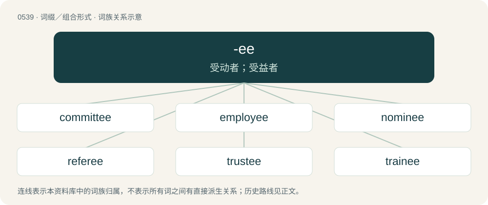

# 0607 · -ee — 受动者；受益者

[总目录](../00_总目录_按常用程度.md)

**类型**：词缀／组合形式　｜　**来源语言**：见词源记录

## 核心含义与来源

- 核心含义：受动者；受益者
- 英文含义：Added to transitive verbs to form words meaning a person or thing that is the object of that verb (i.e., to whom or to which an action is done).
- 词形：-ee

**多个词源／构词路径**：同一拼写可能有不同来源；以下按词性和含义分别列出。

**来源记录 1**（后缀／后置成分；Added to transitive verbs to form words meaning a person or thing that is the object of that verb (i.e., to whom or to which an action is done).）

From Middle English -ee, -ē, from Anglo-Norman and Old French -ee, French -é, -ée, endings forming past participle of verbs ending in -er. Doublet of -ate. More distantly related to inherited English -ed.

**来源记录 2**（后缀／后置成分；Used to form diminutives.）

Perhaps a variation on -ie and -y

**来源记录 3**（后缀／后置成分；Used in mimicking English as stereotypically spoken by the Chinese.）

Most likely derived from broken English used by Chinese immigrants to America during the 17th to 19th centuries. The -ee was added by those speakers for final consonants in English words that do not exist in Cantonese phonology.

## 词族图

## 单词速览（常用到不常用）

| 单词 | 音标 | 释义 |
|---|---|---|
| [committee](#w-1) | 英 /kəˈmɪt.i/；美 /ˌkɑ.mɪˈtiː/ | n. 委员会；\[经\] 委员会 |
| [employee](#w-2) | /ˌɛm.plɔɪˈiː/ | n. 职员, 员工, 受雇人员；\[化\] 职工; 雇员 |
| [nominee](#w-3) | /ˌnɒmɪˈniː/ | n. 被提名者, 被任命者；\[经\] 被指定人 |
| [referee](#w-4) | 英 /ˌɹɛf.əˈɹiː/；美 /ˌɹɛf.əˈɹi/ | n. 仲裁人, 调解人, 裁判员；v. 仲裁, 裁判 |
| [trustee](#w-5) | /tɹʌsˈtiː/ | n. 受托人, 理事；\[计\] 委托者 |
| [trainee](#w-6) | /tɹeɪˈni/ | n. 实习生, 新兵, 受培训者；\[经\] 学徒工, 培训人员 |
| [absentee](#w-7) | 美 /ˌæb.sn̩ˈti/ | n. 缺席者, 不在者；\[经\] 缺勤者, 缺席者, 未到工者 |
| [licensee](#w-8) | /ˌlaɪsənˈsiː/ | n. 获许可的人, 领到执照的人；\[经\] 领有执照(或许可证)者的人 |
| [devotee](#w-9) | 英 /ˌdɛv.əˈtiː/；美 /ˌdi.voʊˈti/ | n. 爱好者, 献身者, 虔诚的宗教信徒 |
| [detainee](#w-10) | 英 /ˌdɪteɪˈniː/ | n. 被拘留者, 被扣押者；\[法\] 被扣扣者, 被拘留者 |
| [pawnee](#w-11) | /pɒːˈniː/ | n. 收当人, 承典人；\[经\] 接受典当的人 |
| [retiree](#w-12) | 英 /ɹəˈtaɪ.ə(ɹ)ˌiː/ | n. 退休人员, 退休者；\[法\] 退休者, 退职者 |
| [attendee](#w-13) | /ætenˈdiː/ | \[计\] 出席人, 参加者, 被照顾者, 被服务者 |
| [interviewee](#w-14) | 英 /ˌɪn.tə.vjuːˈiː/；美 /ˌɪn.tɚ.vjuːˈiː/ | n. 被接见者, 被采访者, 被面试者 |
| [franchisee](#w-15) | /ˌfrænt͡ʃaɪ̯ˈziː/ | n. 有代销权的人(或团体)；\[经\] 特许证持有人 |
| [goatee](#w-16) | 英 /ɡəʊˈtiː/；美 /ˌɡoʊˈtiː/ | n. 山羊胡子 |
| [divorcee](#w-17) | 英 /dɪvɔːˈsiː/；美 /dɪvɔɹˈsi/ | n. 离婚者；\[法\] 离婚者 |
| [grantee](#w-18) | /grænˈtiː/ | n. 受让人, 被授予人；\[经\] 受让人, 被授与者 |
| [honoree](#w-19) | 英 /ˌɒn.əˈiː/；美 /ˌɑn.ɚˈi/ | n. 领奖人, 主宾 |
| [settee](#w-20) | /sɛˈtiː/ | n. 长靠背椅 |
| [addressee](#w-21) | /ˌædɹɛˈsiː/ | n. 收件人, 收信人；\[经\] 台头人, 收信人 |
| [escapee](#w-22) | 美 /ˌɛsˌkeɪˈpi/ | n. 逃亡者, 逃避者；\[法\] 脱逃者 |
| [inductee](#w-23) | /.indʌkˈtiː/ | n. 应召入伍的士兵 |
| [designee](#w-24) | /ˌdɛzɪɡˈni/ | n. 被指定者, 被选派者 |
| [payee](#w-25) | /peiˈiː/ | n. 收款人, 领款人；\[经\] 受款人, 收款人 |
| [awardee](#w-26) | /əwɔɹˈdi/ | n. 受奖者；\[法\] 受奖者 |
| [squeegee](#w-27) | 英 /ˈskwiːd͡ʒiː/；美 /ˈskwiˌd͡ʒi/ | n. 涂刷器, 橡胶滚轴；vt. 用涂刷器涂刷, 用橡胶滚轴压 |
| [assignee](#w-28) | /,æsiˈniː/ | n. 受让人, 受托者, 代理人；\[经\] 受让人 |
| [parolee](#w-29) | /pə,rəuˈliː/ | n. 假释犯；\[法\] 获假释者, 假释犯 |
| [adoptee](#w-30) | 美 /əˌdɑpˈti/；/əˌdɒpˈtiː/ | \[法\] 被收养者 |
| [bailee](#w-31) | /.beiˈliː/ | n. 受托者；\[经\] 受寄人, 受托人 |
| [assessee](#w-32) | 美 /əsɛsˈi/ | n. 财产价值(或收入金额)已被估定之人 |
| [invitee](#w-33) | 美 /ˌɪnvəˈtiː/ | n. 被邀请者；\[法\] 被邀请者 |
| [transferee](#w-34) | /.trænsfəˈriː/ | n. 受让人, 承让人, 被调任者；\[经\] 受让人 |
| [loanee](#w-35) | /ləuˈniː/ | n. 借入者, 债务人；\[法\] 借入者, 债务人 |
| [mortgagee](#w-36) | /.mɒːgiˈdʒiː/ | n. 承受抵押人；\[经\] 承受抵押者, 押入者贷款人 |
| [returnee](#w-37) | 英 /ɹɪˌtɜːˈniː/；美 /ɹɪˌtɝˈniː/ | n. 回国人员, 返回者 |
| [signee](#w-38) | /saiˈniː, ˈsainiː/ | n. (尤指请愿书、合同等的)签名者,签字者 |

## 逐词详解

### 1. committee

**词性**：名词　｜　**音标**：英 /kəˈmɪt.i/；美 /ˌkɑ.mɪˈtiː/

**中文释义**：n. 委员会；\[经\] 委员会

**英文义项**：A body of one or more persons convened for the accomplishment of some specific purpose, typically with formal protocols. / A guardian; someone in charge of another person deemed to be unable to look after themselves.

**构词拆分**：commit + -ee

**词源与演化**：

From commit + -ee, or else revival of Anglo-Norman commite, past participle of commettre (“to commit”), from Latin committere, from con- (“with”) + mittere (“to send”). The OED3 prefers the first etymology.

**例句**：

> My uncle is on the committee.

该用例对应义项：A body of one or more persons convened for the accomplishment of some specific purpose, typically with formal protocols.

### 2. employee

**词性**：名词　｜　**音标**：/ˌɛm.plɔɪˈiː/

**中文释义**：n. 职员, 员工, 受雇人员；\[化\] 职工; 雇员

**英文义项**：A person who provides labor to a company or another person.

**构词拆分**：employ + -ee

**词源与演化**：

From employ + -ee. First attested in the early 19th century, possibly modeled after French employé.

**例句**：

> One way to encourage your employees to work harder is by giving them incentives.

该用例对应义项：A person who provides labor to a company or another person.

### 3. nominee

**词性**：名词　｜　**音标**：/ˌnɒmɪˈniː/

**中文释义**：n. 被提名者, 被任命者；\[经\] 被指定人

**英文义项**：A person named, or designated, by another, to any office, duty, or position; one nominated, or proposed, by others for office or for election to office. / A person or organisation in whose name a security is registered though true ownership is held by another party, called nominator, especially for the purpose of concealing the identity of the nominator.

**构词拆分**：From nomin(ate) + -ee.

**词源与演化**：

From nomin(ate) + -ee.

**例句**：

> The Supreme Court confiscated half of Thaksin Shinawatra's fortune after finding that, while being Prime Minister, he held shares in commercial companies through nominees.

该用例对应义项：A person or organisation in whose name a security is registered though true ownership is held by another party, called nominator, especially for the purpose of concealing the identity of the nominator.

### 4. referee

**词性**：名词　｜　**音标**：英 /ˌɹɛf.əˈɹiː/；美 /ˌɹɛf.əˈɹi/

**中文释义**：n. 仲裁人, 调解人, 裁判员；v. 仲裁, 裁判

**英文义项**：An umpire or judge; an official who makes sure the rules are followed during a game. / A person who settles a dispute.

**构词拆分**：refer + -ee

**词源与演化**：

From Middle English \[Term?\], from past participle of Old French referer (“to relate, to refer”), from Latin referre (“to carry back, to report, to notify”); as if refer + -ee, that is, the person to whom something is referred for consideration.

**例句**：

> Your application, along with letters from three referees, should be received by January 31.

该用例对应义项：A person who writes a letter of reference or provides a reference by phone call for someone. (In the UK such a person is sometimes, and in the US the person is typically, referred to as a reference.)

### 5. trustee

**词性**：动词　｜　**音标**：/tɹʌsˈtiː/

**中文释义**：n. 受托人, 理事；\[计\] 委托者

**英文义项**：To commit (property) to the care of a trustee. / To attach (a debtor's wages, credits, or property in the hands of a third person) in the interest of the creditor.

**构词拆分**：From trust + -ee.

**词源与演化**：

From trust + -ee.

**用法示例／搭配（非完整句）**：

> to trustee an estate

该用例对应义项：To commit (property) to the care of a trustee.

### 6. trainee

**词性**：名词　｜　**音标**：/tɹeɪˈni/

**中文释义**：n. 实习生, 新兵, 受培训者；\[经\] 学徒工, 培训人员

**英文义项**：Someone who is still in the process of being formally trained in a workplace. / A juvenile inmate being trained and (re)educated in a reformatory school.

**构词拆分**：From train + -ee.

**词源与演化**：

From train + -ee.

**例句**：

> Some trainee teachers can't cope with the recalcitrance of many pupils.

### 7. absentee

**词性**：名词　｜　**音标**：美 /ˌæb.sn̩ˈti/

**中文释义**：n. 缺席者, 不在者；\[经\] 缺勤者, 缺席者, 未到工者

**英文义项**：A person who is absent from his or her employment, school, post, duty, etc. / Designating a person absent in a particular capacity, sometimes implying that they are difficult to contact, unresponsive, avoiding their responsibilities, etc.

**构词拆分**：absent + -ee

**词源与演化**：

From absent + -ee.

**例句**：

> The manufacturer's promised new model was a notable absentee at the car show.

该用例对应义项：Something that is not present where it might be expected.

### 8. licensee

**词性**：名词　｜　**音标**：/ˌlaɪsənˈsiː/

**中文释义**：n. 获许可的人, 领到执照的人；\[经\] 领有执照(或许可证)者的人

**英文义项**：A person to whom a license is granted. / A publican (because a license is needed to run a pub).

**构词拆分**：From license + -ee.

**词源与演化**：

From license + -ee.

### 9. devotee

**词性**：名词　｜　**音标**：英 /ˌdɛv.əˈtiː/；美 /ˌdi.voʊˈti/

**中文释义**：n. 爱好者, 献身者, 虔诚的宗教信徒

**英文义项**：An ardent enthusiast or admirer. / A believer in a particular religion or god.

**构词拆分**：devote + -ee

**词源与演化**：

From devote + -ee. The narrowed meaning in sense 3 arises from the sound similarity with amputee.

**例句**：

> He was a devotee of Arnold Schwarzenegger.

该用例对应义项：An ardent enthusiast or admirer.

### 10. detainee

**词性**：名词　｜　**音标**：英 /ˌdɪteɪˈniː/

**中文释义**：n. 被拘留者, 被扣押者；\[法\] 被扣扣者, 被拘留者

**英文义项**：Someone who is detained, especially in custody or confinement.

**构词拆分**：From detain + -ee.

**词源与演化**：

From detain + -ee.

**例句**：

> It’s sad when a child is a detainee of our government.

### 11. pawnee

**词性**：名词　｜　**音标**：/pɒːˈniː/

**中文释义**：n. 收当人, 承典人；\[经\] 接受典当的人

**英文义项**：One or to whom a pledge is delivered as security one who takes anything in pawn.

**构词拆分**：pawn + -ee

**词源与演化**：

From pawn + -ee.

### 12. retiree

**词性**：名词　｜　**音标**：英 /ɹəˈtaɪ.ə(ɹ)ˌiː/

**中文释义**：n. 退休人员, 退休者；\[法\] 退休者, 退职者

**英文义项**：Someone who has retired from active working.

**构词拆分**：retire + -ee

**词源与演化**：

From retire + -ee.

**例句**：

> He has been a retiree since 2001.

该用例对应义项：Someone who has retired from active working.

### 13. attendee

**词性**：名词　｜　**音标**：/ætenˈdiː/

**中文释义**：\[计\] 出席人, 参加者, 被照顾者, 被服务者

**英文义项**：A person who is in attendance or in the audience of an event. / A person who is attended.

**构词拆分**：From attend + -ee.

**词源与演化**：

From attend + -ee.

**例句**：

> You can only take advantage of our offer if you are an attendee.

### 14. interviewee

**词性**：名词　｜　**音标**：英 /ˌɪn.tə.vjuːˈiː/；美 /ˌɪn.tɚ.vjuːˈiː/

**中文释义**：n. 被接见者, 被采访者, 被面试者

**英文义项**：Someone being interviewed, i.e. the person answering the questions.

**构词拆分**：From interview + -ee.

**词源与演化**：

From interview + -ee.

**例句**：

> According to the interviewee, the region is mostly rural.

### 15. franchisee

**词性**：名词　｜　**音标**：/ˌfrænt͡ʃaɪ̯ˈziː/

**中文释义**：n. 有代销权的人(或团体)；\[经\] 特许证持有人

**英文义项**：A holder of a franchise; a person who is granted a franchise.

**构词拆分**：From franchise + -ee.

**词源与演化**：

From franchise + -ee.

### 16. goatee

**词性**：名词　｜　**音标**：英 /ɡəʊˈtiː/；美 /ˌɡoʊˈtiː/

**中文释义**：n. 山羊胡子

**英文义项**：A beard trimmed to grow only at the center of the chin.

**构词拆分**：goat + -ee；goat + -ee (diminutive suffix)

**词源与演化**：

From goat + -ee (diminutive suffix), referring to the tuft of hair on the chin of many domestic goats.

**例句**：

> Tom says he might dye his goatee red and green for Christmas.

### 17. divorcee

**词性**：名词　｜　**音标**：英 /dɪvɔːˈsiː/；美 /dɪvɔɹˈsi/

**中文释义**：n. 离婚者；\[法\] 离婚者

**英文义项**：A divorced person.

**构词拆分**：divorce + -ee

**词源与演化**：

Borrowed from French divorcée, equivalent to divorce + -ee.

**例句**：

> Sami met a sexy newly single divorcee.

### 18. grantee

**词性**：名词　｜　**音标**：/grænˈtiː/

**中文释义**：n. 受让人, 被授予人；\[经\] 受让人, 被授与者

**英文义项**：The person to whom something is granted.

**构词拆分**：grant + -ee

**词源与演化**：

From Middle English grauntees pl, from Old French granté, participle of granter, equivalent to grant + -ee.

### 19. honoree

**词性**：名词　｜　**音标**：英 /ˌɒn.əˈiː/；美 /ˌɑn.ɚˈi/

**中文释义**：n. 领奖人, 主宾

**英文义项**：One who receives an honor or award.

**构词拆分**：From honor + -ee.

**词源与演化**：

From honor + -ee.

### 20. settee

**词性**：名词　｜　**音标**：/sɛˈtiː/

**中文释义**：n. 长靠背椅

**英文义项**：A long seat with a back, made to accommodate several persons at once; a sofa.

**构词拆分**：settle (“seat, long bench”) + -ee (diminutive suffix)

**词源与演化**：

Unclear, possibly from settle (“seat, long bench”) + -ee (diminutive suffix).

**例句**：

> She lay ill on the settee all day, drinking Lucozade and watching telly.

### 21. addressee

**词性**：名词　｜　**音标**：/ˌædɹɛˈsiː/

**中文释义**：n. 收件人, 收信人；\[经\] 台头人, 收信人

**英文义项**：The person or organization to which something, such as a letter or message, is addressed or sent, for whom the item is intended. / A person or entity to whom discourse is directed, or the words referring to such an entity.

**构词拆分**：address + -ee

**词源与演化**：

From address + -ee.

**例句**：

> Send a registered letter to be sure that it will reach its addressee.

### 22. escapee

**词性**：名词　｜　**音标**：美 /ˌɛsˌkeɪˈpi/

**中文释义**：n. 逃亡者, 逃避者；\[法\] 脱逃者

**英文义项**：Someone who has become free through escaping imprisonment. / Someone who has escaped.

**构词拆分**：From escape + -ee.

**词源与演化**：

From escape + -ee.

**例句**：

> Police officers are on the hunt for the escapee.

### 23. inductee

**词性**：名词　｜　**音标**：/.indʌkˈtiː/

**中文释义**：n. 应召入伍的士兵

**英文义项**：One who, or that which, is inducted. / A person who is inducted into an organization.

**构词拆分**：From induct + -ee.

**词源与演化**：

From induct + -ee.

### 24. designee

**词性**：名词　｜　**音标**：/ˌdɛzɪɡˈni/

**中文释义**：n. 被指定者, 被选派者

**英文义项**：One who has been designated

**构词拆分**：From designate + -ee.

**词源与演化**：

From designate + -ee.

### 25. payee

**词性**：名词　｜　**音标**：/peiˈiː/

**中文释义**：n. 收款人, 领款人；\[经\] 受款人, 收款人

**英文义项**：one to whom money is paid.

**构词拆分**：From pay + -ee.

**词源与演化**：

From pay + -ee.

**例句**：

> Tom wrote Mary's name as the cheque payee.

### 26. awardee

**词性**：名词　｜　**音标**：/əwɔɹˈdi/

**中文释义**：n. 受奖者；\[法\] 受奖者

**英文义项**：The recipient of an award or special honor.

**构词拆分**：From award + -ee.

**词源与演化**：

From award + -ee.

### 27. squeegee

**词性**：名词　｜　**音标**：英 /ˈskwiːd͡ʒiː/；美 /ˈskwiˌd͡ʒi/

**中文释义**：n. 涂刷器, 橡胶滚轴；vt. 用涂刷器涂刷, 用橡胶滚轴压

**英文义项**：A tool for scraping consisting of a blade of rubber or some other material attached at a right angle to a handle. / A long-handled tool with a blade used for cleaning and/or drying surfaces, or for levelling paths, roadways, etc.

**词源与演化**：

The noun is probably derived from squeege (“(informal, dated) to squeeze”, verb) (an intensified form of squeeze (verb)) + -ee (suffix attached to verbs to form nouns meaning persons or things that are the subjects of the verbs). Compare earlier squilgee, squillgee (“tool in the form of a mop or swab, or a blade with a long handle, used for cleaning and/or drying a vessel’s deck”). The verb is derived from the noun.

**例句**：

> Whenever I get gas, I make sure to squeegee my windows.

### 28. assignee

**词性**：名词　｜　**音标**：/,æsiˈniː/

**中文释义**：n. 受让人, 受托者, 代理人；\[经\] 受让人

**英文义项**：One to whom a thing is assigned. / One to whom a right or property is being transferred.

**构词拆分**：assign + -ee

**词源与演化**：

From Middle English assigne, from Old French assigné, equivalent to assign + -ee.

**例句**：

> The insurance claim cannot be processed until the assignee submits proper documentation.

### 29. parolee

**词性**：名词　｜　**音标**：/pə,rəuˈliː/

**中文释义**：n. 假释犯；\[法\] 获假释者, 假释犯

**英文义项**：A person who is released on parole.

**构词拆分**：From parole + -ee.

**词源与演化**：

From parole + -ee.

**例句**：

> The parolee started to live in his hometown.

### 30. adoptee

**词性**：名词　｜　**音标**：美 /əˌdɑpˈti/；/əˌdɒpˈtiː/

**中文释义**：\[法\] 被收养者

**英文义项**：An adopted son or daughter. / A person who was adopted as a child.

**构词拆分**：adopt + -ee

**词源与演化**：

Learned borrowing from French adoptée, feminine past participle of adopter meaning "to adopt", equivalent to adopt + -ee.

**例句**：

> An adult Chinese female adoptee has found her biological parents.

该用例对应义项：A person who was adopted as a child.

### 31. bailee

**词性**：名词　｜　**音标**：/.beiˈliː/

**中文释义**：n. 受托者；\[经\] 受寄人, 受托人

**英文义项**：One who holds bailed property; one who takes possession of the property of another (called a bailor) in order to keep that property safe for the other. / A person who is granted bail.

**构词拆分**：From bail + -ee.

**词源与演化**：

From bail + -ee.

### 32. assessee

**词性**：名词　｜　**音标**：美 /əsɛsˈi/

**中文释义**：n. 财产价值(或收入金额)已被估定之人

**英文义项**：Something or someone that is assessed.

**构词拆分**：assess + -ee

**词源与演化**：

From assess + -ee.

### 33. invitee

**词性**：名词　｜　**音标**：美 /ˌɪnvəˈtiː/

**中文释义**：n. 被邀请者；\[法\] 被邀请者

**英文义项**：A person who is invited.

**构词拆分**：From invite + -ee.

**词源与演化**：

From invite + -ee.

### 34. transferee

**词性**：名词　｜　**音标**：/.trænsfəˈriː/

**中文释义**：n. 受让人, 承让人, 被调任者；\[经\] 受让人

**英文义项**：A person who is transferred. / A person to whom title or ownership is conveyed.

**构词拆分**：transfer + -ee

**词源与演化**：

From transfer + -ee.

### 35. loanee

**词性**：名词　｜　**音标**：/ləuˈniː/

**中文释义**：n. 借入者, 债务人；\[法\] 借入者, 债务人

**英文义项**：borrower; someone who is loaned something / Someone who is being loaned, someone playing for another club on loan.

**构词拆分**：loan + -ee

**词源与演化**：

From loan + -ee.

### 36. mortgagee

**词性**：名词　｜　**音标**：/.mɒːgiˈdʒiː/

**中文释义**：n. 承受抵押人；\[经\] 承受抵押者, 押入者贷款人

**英文义项**：One who provides a loan secured upon the borrowers' property: the lender in a mortgage agreement.

**构词拆分**：From mortgage + -ee.

**词源与演化**：

From mortgage + -ee.

**例句**：

> The bank became our mortgagee when it accepted our mortgage on our new home.

该用例对应义项：the person who accepts a mortgage

### 37. returnee

**词性**：名词　｜　**音标**：英 /ɹɪˌtɜːˈniː/；美 /ɹɪˌtɝˈniː/

**中文释义**：n. 回国人员, 返回者

**英文义项**：Someone who comes back or returns, especially to their own country or region. / A person who sends something back.

**构词拆分**：From return + -ee.

**词源与演化**：

From return + -ee.

### 38. signee

**词性**：名词　｜　**音标**：/saiˈniː, ˈsainiː/

**中文释义**：n. (尤指请愿书、合同等的)签名者,签字者

**英文义项**：One who is signed (signed up, enlisted) by someone else; thus, one who signs a contract, especially in athletic contexts.

**构词拆分**：From sign + -ee.

**词源与演化**：

From sign + -ee.

**例句**：

> Our team has landed some great signees in this draft.

该用例对应义项：One who is signed (signed up, enlisted) by someone else; thus, one who signs a contract, especially in athletic contexts.
