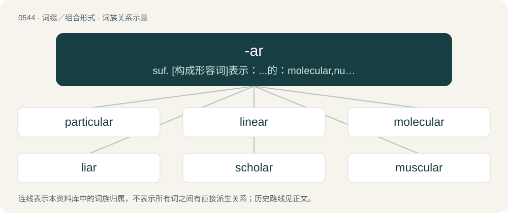

# 0612 · -ar — suf. \[构成形容词\]表示：...的：molecular,nuclear; ...状的,似...的：triangular; 有...特性的：popular; \[构成名词\]表示：...的人,...的物：bursar, scholar, vicar, morta; 动作者\[-er或-or的异体\]：liar, pedlar

[总目录](../00_总目录_按常用程度.md)

**类型**：词缀／组合形式　｜　**来源语言**：见词源记录

## 核心含义与来源

- 核心含义：suf. \[构成形容词\]表示：...的：molecular,nuclear; ...状的,似...的：triangular; 有...特性的：popular; \[构成名词\]表示：...的人,...的物：bursar, scholar, vicar, morta; 动作者\[-er或-or的异体\]：liar, pedlar
- 英文含义：Of, near, or pertaining to; adjective suffix appended to various words, often nouns, to make an adjective form. Often added to words of Latin origin, but used with other words also.
- 词形：-ar

**多个词源／构词路径**：同一拼写可能有不同来源；以下按词性和含义分别列出。

**来源记录 1**（后缀／后置成分；Of, near, or pertaining to; adjective suffix appended to various words, often nouns, to make an adjective form. Often added to words of Latin origin, but used with other words also.）

Borrowed from Latin -āris (“of, pertaining to”). Distant doublet of -al.

**来源记录 2**（后缀／后置成分；Ending of some nouns denoting occupations, chiefly inherited from Middle English nouns borrowed from Old French or Medieval Latin.）

Inherited from Middle English -ar, -er, -arie, borrowed from Latin -ārius or Old French -aire. Doublet of -ary, -eer, -ier, and -yer.

**来源记录 3**（后缀／后置成分；Ending of some agent nouns inherited from Middle English.）

From Middle English -ar, -are, variant of Middle English -ere, from Old English -ere. More at -er.

**来源记录 4**（后缀／后置成分；Used to form names of star types.）

Clipping of star or stellar; modelled after the earlier coinages pulsar and quasar.

## 词族图

## 单词速览（常用到不常用）

| 单词 | 音标 | 释义 |
|---|---|---|
| [particular](#w-1) | 英 /pəˈtɪk.jʊ.lə/；美 /pɑrˈtɪk.jə.lɚ/ | n. 一项(或条、点), 个别项目, 详细说明；a. 特别的, 独有的, 挑剔的, 详尽的 |
| [linear](#w-2) | 英 /ˈlɪn.i.ə/；美 /ˈlɪn.i.əɹ/ | a. 线的, 直线的, 线状的；\[计\] 线性 |
| [molecular](#w-3) | 英 /məˈlɛk.jʊ.lə/；美 /məˈlɛk.jə.ləɹ/ | a. 分子的, 由分子组成的；\[医\] 分子的 |
| [liar](#w-4) | 英 /ˈlaɪ.ə/；美 /ˈlaɪ.ɚ/ | n. 说谎者 |
| [scholar](#w-5) | 英 /ˈskɒlə/；美 /ˈskɑlɚ/ | n. 学者, 奖学金获得者, 有文化者, 学习者 |
| [muscular](#w-6) | 英 /ˈmʌs.kjʊl.ə/；美 /ˈmʌs.kjə.lɚ/ | a. 强壮的, 肌肉发达的, 有力的；\[医\] 肌的; 肌肉发达的 |
| [modular](#w-7) | 英 /ˈmɒdjʊlə(ɹ)/；美 /ˈmɑd͡ʒəlɚ/ | a. 模数的, 有标准组件的；\[计\] 积木式的; 模块化的 |
| [tubular](#w-8) | 英 /ˈtjuːbjʊlə/；美 /ˈt(j)ubjələɹ/ | a. 管状的；\[医\] 小管的, 管状的 |
| [beggar](#w-9) | 英 /ˈbɛɡə/；美 /ˈbɛɡɚ/ | n. 乞丐；vt. 使贫穷, 使成乞丐 |
| [planar](#w-10) | 英 /ˈpleɪnə/；美 /ˈpleɪnɚ/ | a. 平面的, 在同一平面上的, 二维的；\[电\] 平面 |
| [curricular](#w-11) | 英 /kəˈɹɪk.jə.lə/；美 /kəˈɹɪkjəlɚ/ | a. 课程的 |
| [granular](#w-12) | 英 /ˈɡɹæn.jə.lə(ɹ)/；美 /ˈɡɹæn.jə.lɚ/ | a. 颗粒的, 粒状的；\[医\] 粒状的, 颗粒状的 |
| [molar](#w-13) | 英 /məʊlə(ɹ)/；美 /ˈmoʊlɚ/ | 【英文】Of, relating to, or being a solution containing one mole of solute per litre of solution. |
| [ventricular](#w-14) | /venˈtrikjulə/ | a. 心室的, 膨胀的 |
| [pilar](#w-15) |  | 【英文】Relating to hair. |
| [alveolar](#w-16) | 英 /alˈviː.ə.lə/；美 /ælˈvi.ə.lɚ/ | a. 牙槽的, 肺泡的；n. 齿槽音 |
| [jugular](#w-17) | 英 /ˈd͡ʒʌɡ.jʊl.ə/；美 /ˈd͡ʒʌɡ.jəl.ɚ/ | a. 咽喉的, 颈部的, 颈静脉的；n. 颈静脉 |
| [cochlear](#w-18) | 英 /ˈkɒk.li.ə/；美 /ˈkoʊ.kli.ɚ/ | a. 耳蜗的；\[医\] 耳蜗的 |
| [glandular](#w-19) | 英 /ˈɡlan.djʊl.ə/；美 /ˈɡlæn.d͡ʒəl.ɚ/ | a. 腺的, 含腺的, 天生的, 固有的, 肉体的；\[医\] 腺的 |
| [macular](#w-20) | 美 /ˈmækjəlɚ/ | a. 有斑点的, 有污点的；\[医\] 斑\[点\]的 |
| [vestibular](#w-21) | 英 /vɛˈstɪb.jʊl.ə/；美 /vɛˈstɪb.jəl.ɚ/ | a. 门厅的, 前庭的；\[医\] 前庭的 |
| [mandibular](#w-22) | 英 /manˈdɪb.jʊl.ə/；美 /mænˈdɪb.jəl.ɚ/ | a. 颚的；\[医\] 下颌\[骨\]的 |
| [laminar](#w-23) | /ˈlæmɪnə/ | a. 板, 薄层, 薄片, 层；\[医\] 板状的, 层状的 |
| [cerebellar](#w-24) | 英 /ˌsɛ.ɹəˈbɛl.ə/；美 /ˌsɛɹ.əˈbɛl.ɚ/ | a. 小脑的；\[医\] 小脑的 |
| [micellar](#w-25) | /maɪˈsɛlə(ɹ)/ | a. 胶束的；微胞的 |
| [glomerular](#w-26) | 英 /ɡlɒˈmɛɹ(j)ʊlə(ɹ)/；美 /ɡləˈmɛɹ(j)əlɚ/ | \[医\] 血管小球的, 小球的 |
| [patellar](#w-27) | 英 /pəˈtɛl.ə/；美 /pəˈtɛl.ɚ/ | a. 膝盖骨的；\[医\] 髌的 |
| [nodular](#w-28) | /ˈnɒdjulə/ | a. 小节的, 地核状的, 小结节的；\[医\] 小结的, 结的; 小结状的 |
| [vesicular](#w-29) | /viˈsikjulə/ | a. (具)囊的, 有泡的, 由泡形成的；\[医\] 囊状的, 泡状的, 水疱的 |
| [capsular](#w-30) | /ˈkæpsjulə/ | a. 绞囊的, 雷管的；\[医\] 囊的 |

## 逐词详解

### 1. particular

**词性**：形容词　｜　**音标**：英 /pəˈtɪk.jʊ.lə/；美 /pɑrˈtɪk.jə.lɚ/

**中文释义**：n. 一项(或条、点), 个别项目, 详细说明；a. 特别的, 独有的, 挑剔的, 详尽的

**英文义项**：Specific; discrete; concrete. / Specialised; characteristic of a specific person or thing.

**构词拆分**：particle + -ar

**词源与演化**：

From Middle English particuler, from Anglo-Norman particuler, Middle French particuler, particulier, from Late Latin particularis (“partial; separate, individual”), from Latin particula (“(small) part”). Equivalent to particle + -ar. Compare particle.

**例句**：

> He is very particular about his food and if it isn't cooked to perfection he will send it back.

该用例对应义项：Of a person, concerned with, or attentive to, details; fastidious.

### 2. linear

**词性**：形容词　｜　**音标**：英 /ˈlɪn.i.ə/；美 /ˈlɪn.i.əɹ/

**中文释义**：a. 线的, 直线的, 线状的；\[计\] 线性

**英文义项**：Having the form of a line; straight or roughly straight; following a direct course. / Of or relating to lines.

**构词拆分**：line + -ar

**词源与演化**：

Borrowed from Latin līneāris, from līnea (“line”) + -āris (adjectival suffix), equivalent to line + -ar. Doublet of lineal.

**例句**：

> Linear television includes traditional over-the-air broadcasting, as well as much cable and satellite broadcasting.

该用例对应义项：Delivered or delivering on a fixed schedule, as opposed to on-demand.

### 3. molecular

**词性**：形容词　｜　**音标**：英 /məˈlɛk.jʊ.lə/；美 /məˈlɛk.jə.ləɹ/

**中文释义**：a. 分子的, 由分子组成的；\[医\] 分子的

**英文义项**：Relating to, or consisting of, or produced by molecules. / (of an element) Combined with itself and with no other element; elemental.

**构词拆分**：molecule + -ar

**词源与演化**：

From molecule + -ar.

**例句**：

> Molecular weight is the sum of all the atoms in a molecule.

该用例对应义项：relating to or produced by or consisting of molecules

### 4. liar

**词性**：名词　｜　**音标**：英 /ˈlaɪ.ə/；美 /ˈlaɪ.ɚ/

**中文释义**：n. 说谎者

**英文义项**：Someone who tells a lie; especially, a person who frequently lies.

**构词拆分**：lie + -ar

**词源与演化**：

Inherited from Middle English lier, liere, lyere, liȝer, lieȝer, legher, from Old English lēgere, lēogere (“liar, false witness, hypocrite”), from Proto-West Germanic \*leugārī, from Proto-Germanic \*leugārijaz (“liar”), from \*leuganą (“to lie”) + \*-ārijaz, equivalent to lie + -ar. More at lie.

**例句**：

> He told me he was a liar, but I don't believe him.

### 5. scholar

**词性**：名词　｜　**音标**：英 /ˈskɒlə/；美 /ˈskɑlɚ/

**中文释义**：n. 学者, 奖学金获得者, 有文化者, 学习者

**英文义项**：A student; one who studies at school or college, typically having a scholarship. / A specialist in a particular branch of knowledge.

**构词拆分**：school + -ar

**词源与演化**：

From Middle English scolar, scolare, scoler, scolere (also scholer), from Old English scōlere (“scholar, learner”), from Late Latin scholāris, from schola (“school”), from Ancient Greek σχολή (skholḗ, “spare time, leisure", later, "conversations and the knowledge gained through them during free time; the places where these conversations took place”), equivalent to school + -ar. Doublet of schooler, Schuyler, and escolar. Compare Saterland Frisian Sköiler, Middle Low German schö̂lære, schö̂lere, schö̂ler (&gt; modern German Low German Schöler), Dutch scholier, German Schüler.

**例句**：

> The English scholar is not conscious of his lack of common sense.

### 6. muscular

**词性**：形容词　｜　**音标**：英 /ˈmʌs.kjʊl.ə/；美 /ˈmʌs.kjə.lɚ/

**中文释义**：a. 强壮的, 肌肉发达的, 有力的；\[医\] 肌的; 肌肉发达的

**英文义项**：Of, relating to, or connected with muscles. / Brawny, thewy, having strength.

**构词拆分**：muscle (Latin mūsculus) + -ar

**词源与演化**：

Late 17th century; from muscle (Latin mūsculus) + -ar. Compare French musculaire.

**用法示例／搭配（非完整句）**：

> muscular wine

该用例对应义项：Full-bodied

### 7. modular

**词性**：形容词　｜　**音标**：英 /ˈmɒdjʊlə(ɹ)/；美 /ˈmɑd͡ʒəlɚ/

**中文释义**：a. 模数的, 有标准组件的；\[计\] 积木式的; 模块化的

**英文义项**：Consisting of separate modules; especially where each module performs or fulfills some specified function and could be replaced by a similar module for the same function, independently of the other modules. / Of or relating to a module or modules.

**构词拆分**：module + -ar

**词源与演化**：

From module + -ar.

**例句**：

> Modular division solves for the remainder, not the quotient.

### 8. tubular

**词性**：形容词　｜　**音标**：英 /ˈtjuːbjʊlə/；美 /ˈt(j)ubjələɹ/

**中文释义**：a. 管状的；\[医\] 小管的, 管状的

**英文义项**：Shaped like a tube. / Relating to, or composed of, tubes or tubules.

**词源与演化**：

From Latin tubulus + -ar. By surface analysis, tubule + -ar. The sense meaning "cool" or "awesome" is believed to be a figurative extension originating in surfing lingo, from the way that an excellent wave encloses a surfer within tubular walls of water.

**用法示例／搭配（非完整句）**：

> tubular bell

该用例对应义项：Shaped like a tube.

### 9. beggar

**词性**：名词　｜　**音标**：英 /ˈbɛɡə/；美 /ˈbɛɡɚ/

**中文释义**：n. 乞丐；vt. 使贫穷, 使成乞丐

**英文义项**：A person who begs. / A person suffering from extreme poverty.

**构词拆分**：beg + -ar

**词源与演化**：

From Middle English beggere, beggare, beggar (“beggar”), from Middle English beggen (“to beg”), equivalent to beg + -ar. Alternative etymology derives Middle English beggere, beggare, beggar from Old French begart, originally a member of the Beghards, a lay brotherhood of mendicants in the Low Countries, from Middle Dutch beggaert (“mendicant”), with pejorative suffix (see -ard); the order is said to be named after the priest Lambert le Bègue of Liège (French for “Lambert the Stammerer”).

**例句**：

> What does that silly beggar think he's doing?

该用例对应义项：A mean or wretched person; a scoundrel.

### 10. planar

**词性**：形容词　｜　**音标**：英 /ˈpleɪnə/；美 /ˈpleɪnɚ/

**中文释义**：a. 平面的, 在同一平面上的, 二维的；\[电\] 平面

**英文义项**：Of or pertaining to a plane. / Flat, two-dimensional.

**构词拆分**：plane + -ar

**词源与演化**：

From Late Latin plānārius (“relating to a plane”), derived from Latin plānus (“flat”, “level”), equivalent to plane + -ar, ultimately from Proto-Indo-European \*pleh₂- (“flat”).

**例句**：

> A planar projection of a three-dimensional object is its projection onto a plane.

该用例对应义项：Of or pertaining to a plane.

### 11. curricular

**词性**：形容词　｜　**音标**：英 /kəˈɹɪk.jə.lə/；美 /kəˈɹɪkjəlɚ/

**中文释义**：a. 课程的

**英文义项**：Of, relating to, or following a curriculum.

**构词拆分**：curriculum + -ar

**词源与演化**：

From curriculum + -ar.

**例句**：

> Mrs. Tanaka, the new teacher, is offering Japanese as an extra curricular activity twice a week to interested students.

### 12. granular

**词性**：形容词　｜　**音标**：英 /ˈɡɹæn.jə.lə(ɹ)/；美 /ˈɡɹæn.jə.lɚ/

**中文释义**：a. 颗粒的, 粒状的；\[医\] 粒状的, 颗粒状的

**英文义项**：Consisting of, or resembling, granules or grains. / Grainy.

**词源与演化**：

From Late Latin grānulum (“granule, little grain”), diminutive of Latin grānum (“grain, seed”), + -ar. By surface analysis, granule + -ar. Compare French granulaire.

**用法示例／搭配（非完整句）**：

> This should allow for a more granular degree of control

该用例对应义项：Refined or precise.

### 13. molar

**词性**：形容词　｜　**音标**：英 /məʊlə(ɹ)/；美 /ˈmoʊlɚ/

**英文义项**：Of, relating to, or being a solution containing one mole of solute per litre of solution. / Of or relating to a complete body of matter as distinct from its molecular or atomic constituents.

**构词拆分**：mol(e) + -ar

**词源与演化**：

From mol(e) + -ar in the chemistry usage.

### 14. ventricular

**词性**：形容词　｜　**音标**：/venˈtrikjulə/

**中文释义**：a. 心室的, 膨胀的

**英文义项**：Of or relating to a ventricle or ventriculus.

**构词拆分**：ventricle + -ar

**词源与演化**：

From New Latin \*ventricularis, from ventriculus (“belly, stomach, ventricle”), diminutive of venter (“belly, stomach, womb”). Equivalent to ventricle + -ar; See ventricle.

### 15. pilar

**词性**：形容词

**英文义项**：Relating to hair. / Covered in hair; hairy.

**构词拆分**：Latin pilus (“a hair”) + -ar

**词源与演化**：

Learned borrowing from Latin pilāris, from Latin pilus (“a hair”) + -ar.

**例句**：

> Pilar grew up with a secular and antifascist education.

### 16. alveolar

**词性**：形容词　｜　**音标**：英 /alˈviː.ə.lə/；美 /ælˈvi.ə.lɚ/

**中文释义**：a. 牙槽的, 肺泡的；n. 齿槽音

**英文义项**：Relating to the alveoli (small air sacs) of the lungs. / Relating to the jaw ridge containing the tooth sockets.

**构词拆分**：alveolus + -ar

**词源与演化**：

From alveolus + -ar.

**例句**：

> Alveolar bone has a high mineral content, mainly calcium and phosphate.

### 17. jugular

**词性**：名词　｜　**音标**：英 /ˈd͡ʒʌɡ.jʊl.ə/；美 /ˈd͡ʒʌɡ.jəl.ɚ/

**中文释义**：a. 咽喉的, 颈部的, 颈静脉的；n. 颈静脉

**英文义项**：Any critical vulnerability.

**构词拆分**：jugulum + -ar

**词源与演化**：

Late 16th century borrowing from Late Latin jugulāris, from jugulum (“the collarbone; the hollow part of the neck above the collarbone; the throat”) + -āris (“-ar, -ary”, adjectival suffix); equivalent to jugulum + -ar.

**例句**：

> It was vicious; he went for the jugular.

该用例对应义项：Any critical vulnerability.

### 18. cochlear

**词性**：形容词　｜　**音标**：英 /ˈkɒk.li.ə/；美 /ˈkoʊ.kli.ɚ/

**中文释义**：a. 耳蜗的；\[医\] 耳蜗的

**英文义项**：Of or pertaining to the cochlea.

**构词拆分**：cochlea + -ar

**词源与演化**：

From cochlea + -ar.

**例句**：

> A cochlear implant consists of a prosthesis in the internal ear which allows a deaf person to hear.

### 19. glandular

**词性**：形容词　｜　**音标**：英 /ˈɡlan.djʊl.ə/；美 /ˈɡlæn.d͡ʒəl.ɚ/

**中文释义**：a. 腺的, 含腺的, 天生的, 固有的, 肉体的；\[医\] 腺的

**英文义项**：Pertaining to a gland or glands. / Having the characteristics or function of a gland.

**构词拆分**：glandule + -ar

**词源与演化**：

Mid 18th century borrowing from French glandulaire, from glandule (“small gland”) + -aire (“-ar, -ary”, adjectival suffix), from Latin glandulae (“glands of the throat”); equivalent to glandule + -ar.

**用法示例／搭配（非完整句）**：

> a glandular disorder

该用例对应义项：Pertaining to a gland or glands.

### 20. macular

**词性**：形容词　｜　**音标**：美 /ˈmækjəlɚ/

**中文释义**：a. 有斑点的, 有污点的；\[医\] 斑\[点\]的

**英文义项**：Relating to the macula, the area of the retina responsible for detailed central vision / Having macules; spotted

**构词拆分**：macule + -ar

**词源与演化**：

From macula or macule + -ar.

**例句**：

> Macular degeneration primarily affects Caucasian people, usually those with light colored eyes.

### 21. vestibular

**词性**：形容词　｜　**音标**：英 /vɛˈstɪb.jʊl.ə/；美 /vɛˈstɪb.jəl.ɚ/

**中文释义**：a. 门厅的, 前庭的；\[医\] 前庭的

**英文义项**：Of or pertaining to a vestibule in a building (or railway coach). / Of, pertaining to, or functioning as a vestibule (body cavity).

**构词拆分**：vestibule or vestibulum + -ar

**词源与演化**：

From vestibule or vestibulum + -ar.

**用法示例／搭配（非完整句）**：

> vestibular impulse

该用例对应义项：Of or pertaining to the vestibule of the inner ear and the perception of body position, balance and movement.

### 22. mandibular

**词性**：形容词　｜　**音标**：英 /manˈdɪb.jʊl.ə/；美 /mænˈdɪb.jəl.ɚ/

**中文释义**：a. 颚的；\[医\] 下颌\[骨\]的

**英文义项**：Of or pertaining to the mandible.

**词源与演化**：

From Latin mandibula + -ar. By surface analysis, mandible + -ar.

### 23. laminar

**词性**：形容词　｜　**音标**：/ˈlæmɪnə/

**中文释义**：a. 板, 薄层, 薄片, 层；\[医\] 板状的, 层状的

**英文义项**：Of fluid motion, smooth and regular, flowing as though in different layers. / In the form of thin flat electronic circuits, usually flexible

**词源与演化**：

From Latin lāmina (“thin sheet of material”) + English -ar.

### 24. cerebellar

**词性**：形容词　｜　**音标**：英 /ˌsɛ.ɹəˈbɛl.ə/；美 /ˌsɛɹ.əˈbɛl.ɚ/

**中文释义**：a. 小脑的；\[医\] 小脑的

**英文义项**：Of or pertaining to the cerebellum.

**构词拆分**：cerebellum + -ar

**词源与演化**：

From cerebellum + -ar.

### 25. micellar

**词性**：形容词　｜　**音标**：/maɪˈsɛlə(ɹ)/

**中文释义**：a. 胶束的；微胞的

**英文义项**：Of or pertaining to micelles.

**构词拆分**：From micelle + -ar.

**词源与演化**：

From micelle + -ar.

### 26. glomerular

**词性**：形容词　｜　**音标**：英 /ɡlɒˈmɛɹ(j)ʊlə(ɹ)/；美 /ɡləˈmɛɹ(j)əlɚ/

**中文释义**：\[医\] 血管小球的, 小球的

**英文义项**：Of, pertaining to or affecting a glomerulus.

**构词拆分**：glomerulus + -ar

**词源与演化**：

From glomerulus + -ar. By surface analysis, glomerul- + -ar.

### 27. patellar

**词性**：形容词　｜　**音标**：英 /pəˈtɛl.ə/；美 /pəˈtɛl.ɚ/

**中文释义**：a. 膝盖骨的；\[医\] 髌的

**英文义项**：near or relating to the patella or kneecap

**构词拆分**：From patella + -ar.

**词源与演化**：

From patella + -ar.

### 28. nodular

**词性**：形容词　｜　**音标**：/ˈnɒdjulə/

**中文释义**：a. 小节的, 地核状的, 小结节的；\[医\] 小结的, 结的; 小结状的

**英文义项**：Of or relating to a nodule or nodules. / Possessing, composed of, or similar in form to nodules.

**构词拆分**：From nodule + -ar.

**词源与演化**：

From nodule + -ar.

**例句**：

> Loose nodular deposits of gold metal are commonly referred to as nuggets.

该用例对应义项：Possessing, composed of, or similar in form to nodules.

### 29. vesicular

**词性**：形容词　｜　**音标**：/viˈsikjulə/

**中文释义**：a. (具)囊的, 有泡的, 由泡形成的；\[医\] 囊状的, 泡状的, 水疱的

**英文义项**：Of, pertaining to, having, or being vesicles (vesiculae).

**构词拆分**：From vesicula + -ar.

**词源与演化**：

From vesicula + -ar.

### 30. capsular

**词性**：形容词　｜　**音标**：/ˈkæpsjulə/

**中文释义**：a. 绞囊的, 雷管的；\[医\] 囊的

**英文义项**：Of, pertaining to, or resembling a capsule.

**构词拆分**：capsule + -ar

**词源与演化**：

From capsule + -ar.

**例句**：

> The capsular ligament is a sac surrounding the articular cavity of a freely movable joint and attached to the bones.

该用例对应义项：resembling a capsule
