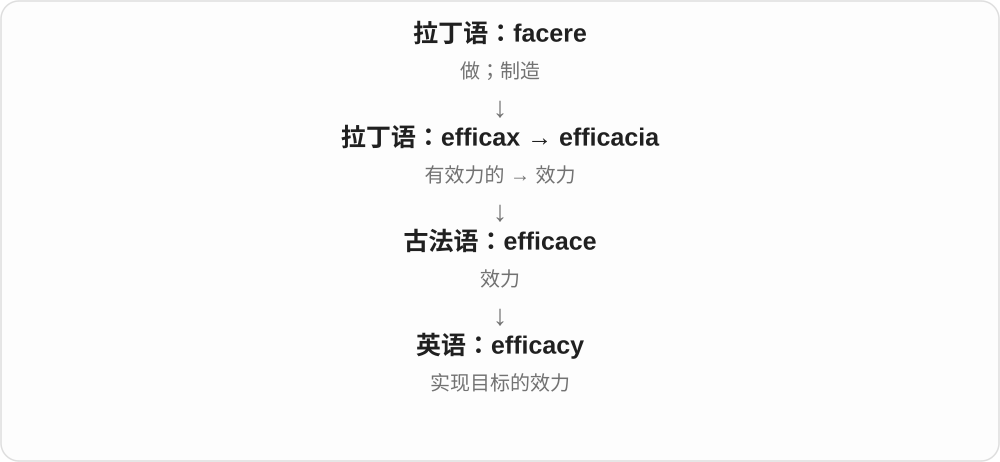
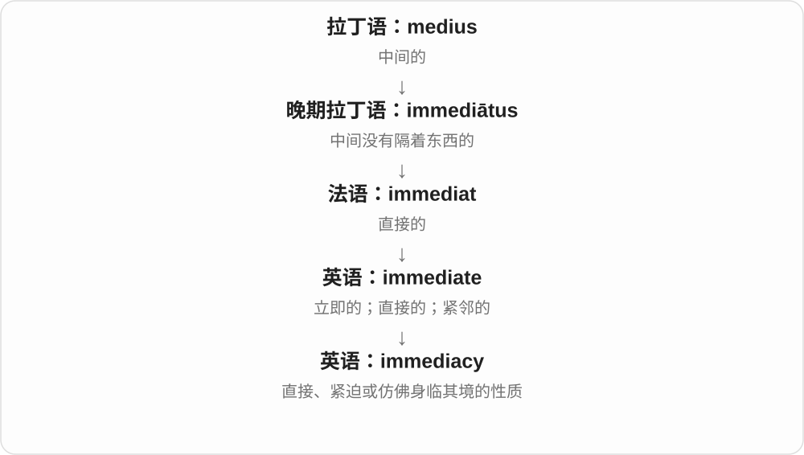
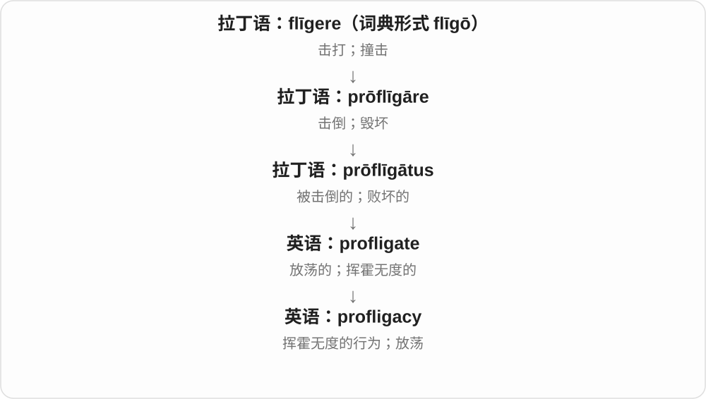

# 0614 · -acy — 性质、状态、身份；相应抽象关系

[逐词精讲目录](../00_逐词精讲目录.md) · [总目录](../00_总目录_按常用程度.md)

## 核心词根与来源

常见 -acy 来自拉丁 -acia、-atia 等历史材料，也可与 -ate 词干加 -cy 的关系对应。已有借词和英语派生并存，不能把所有 a-c-y 字母都说成同一个现代拼接动作。

**ACY：把一种评价、身份或特点作为一件事来讲**

adequate 够用，adequacy 就问够不够；intricate 细节交织，intricacy 则把复杂精细本身或那些细节拿出来说。

- **够用与复杂程度**：adequate · adequacy；intricate · intricacy
- **退化与学科状态**：degenerate · degeneracy
- **日常性质和能力**：privacy · literacy · efficacy · intimacy · delicacy
- **身份、关系及其他固定词**：legitimacy · candidacy · supremacy · primacy · immediacy · surrogacy · conspiracy · fallacy · lunacy · profligacy

## 词形与演化规律

adequate ↔ adequacy；degenerate ↔ degeneracy；intricate ↔ intricacy；private ↔ privacy；legitimate ↔ legitimacy。许多词换掉形容词尾，不能完整写成 adequateacy。

## 单词速览（按词族由简到繁）

同一基础词的相关扩展放在一起，先读基础形式，再读扩展；各组之间优先读常用的。具体词源关系见各词讲解。

| 单词 | 音标 | 核心意思 |
|---|---|---|
| [private](#w-20) | 英、美 /ˈpraɪvət/，也读 /ˈpraɪvɪt/ | 私人的；不公开的；私营的；列兵 |
| [privacy](#w-1) | 英 /ˈprɪvəsi/，也读 /ˈpraɪvəsi/；美 /ˈpraɪvəsi/ | 隐私；不受打扰的私人空间 |
| [conspiracy](#w-2) | /kənˈspɪrəsi/ | 阴谋；合谋；秘密计划 |
| [adequate](#w-21) | 英、美 /ˈæd.ə.kwət/，也记作 /ˈæd.ɪ.kwət/；重音在首音节 | 足够的；能满足需要的；尚可的 |
| [adequacy](#w-13) | /ˈædɪkwəsi/，亦有 /ə/ 非重读变体 | 充足、够用；适当、足以应付需要的程度 |
| [literacy](#w-3) | /ˈlɪtərəsi/ | 读写能力；识字能力；某领域的素养 |
| [efficacy](#w-4) | /ˈɛf.ɪ.kə.si/ | 效力；功效 |
| [intimacy](#w-5) | /ˈɪntɪməsi/ | 亲密、亲近感；亲密关系、私密程度 |
| [supremacy](#w-6) | /suːˈpreməsi/ | 至高地位；支配优势；至上主义〔特定搭配〕 |
| [legitimacy](#w-7) | /lɪˈdʒɪtɪməsi/ | 正当性；合法性；被认可的地位 |
| [intricate](#w-22) | /ˈɪntrɪkət/ | 错综复杂的；精细繁复的 |
| [intricacy](#w-17) | /ˈɪntrɪkəsi/ | 错综复杂；复杂精细之处〔常用复数 intricacies〕 |
| [candidacy](#w-8) | /ˈkændɪdəsi/ | 候选资格；参选；成为候选人的状态 |
| [degenerate](#w-23) | 动词 /dɪˈdʒenəreɪt/；形容词、名词 /dɪˈdʒenərət/ | 退化、恶化；退化的；堕落者〔贬义名词〕 |
| [degeneracy](#w-16) | /dɪˈdʒenərəsi/ | 退化、堕落；〔数学、物理等〕简并、退化状态 |
| [fallacy](#w-9) | /ˈfæləsi/ | 谬误；错误观念；推理谬误 |
| [delicacy](#w-10) | /ˈdelɪkəsi/ | 精细、柔弱；微妙、敏感；珍馐美食 |
| [lunacy](#w-11) | 英、美 /ˈluːnəsi/ | 荒唐至极的行为；疯狂；旧时指精神失常 |
| [primacy](#w-12) | 英、美 /ˈpraɪməsi/ | 首要地位；主导地位；首席主教职位 |
| [immediacy](#w-14) | /ɪˈmiːdiəsi/ | 直接感；即时性；迫切性 |
| [surrogacy](#w-15) | 英 /ˈsʌrəɡəsi/；美 /ˈsɜːrəɡəsi/ | 代孕；代理的状态或职务 |
| [profligacy](#w-19) | 英 /ˈprɒflɪɡəsi/；美 /ˈprɑːflɪɡəsi/ | 挥霍无度；放荡行为 |

## 逐词讲解

### 1. private — 私人的；不公开的；私营的；列兵

**音标**：英、美 /ˈpraɪvət/，也读 /ˈpraɪvɪt/

**先抓住这个画面**

从大家共同的一部分里分出来，属于某个人或某个小范围。

**怎么拆**

来自拉丁语 privatus，基于 privare、privus“分开的、个人的”；不是英语 priv 加 -ate 才造出的新词。列兵义由 private soldier 缩短而来。

**怎么变成今天的意思**

**拉丁语 privus → privare / privatus**  
单独的、个人的 → 分开、剥去；与公共部分分开的

↓

**拉丁语 privatus → 英语 private**  
属于个人的、非公共的；私下的

↓

**英语 private soldier → 名词 private**  
普通士兵 → 列兵

private life 是私生活；private property 是私人财产；private conversation 是不公开的谈话。private company 还要按商业语境区分私营与非上市等含义。

**常见搭配与例句**

in private；a private room；private property。

> Could we discuss the matter in private?

我们可以私下谈这件事吗？

> The path crosses private land.

这条小路穿过私人土地。

> He entered the army as a private.

他入伍时是一名列兵。

**别混淆**

personal 说与个人有关；private 常强调不对公众开放或不属于公共部门。

### 2. privacy — 隐私；不受打扰的私人空间

**音标**：英 /ˈprɪvəsi/，也读 /ˈpraɪvəsi/；美 /ˈpraɪvəsi/

**先抓住这个画面**

你可以自己决定哪些事情让别人知道，也能保有一块不被随意打扰的空间。

**怎么拆**

private 对应 priv- + -acy 形成的名词；元音在英美常用读法中有所不同。

**怎么变成今天的意思**

**拉丁语 privus → privare / privatus**  
单独的、个人的 → 分开、剥去；与公共部分分开的

↓

**拉丁语 privatus → 英语 private**  
属于个人的、非公共的；私下的

↓

**英语 private → privacy**  
私人的性质 → 私人空间、个人信息不被随意侵入的状态

privacy 不只指秘密，也包括独处、私人通信和个人信息的控制。want some privacy 常只是想单独待会儿。

**常见搭配与例句**

respect someone’s privacy；invasion of privacy；privacy settings。

> Please respect her privacy while she recovers.

她恢复期间，请尊重她的私人空间。

> The app lets users change their privacy settings.

这个应用允许用户修改隐私设置。

**别混淆**

secrecy 强调隐藏信息；privacy 强调个人边界，不要求事情本身见不得人。

### 3. conspiracy — 阴谋；合谋；秘密计划

**音标**：/kənˈspɪrəsi/

**先抓住这个画面**

重点是多人暗中达成的安排，而不只是一个人心里的坏念头。

**怎么拆**

经英法语 conspiracie 接拉丁 conspiratio，由 conspirare 形成。现代与 conspire 对照，但名词早有独立借入路线。

**怎么变成今天的意思**

**拉丁语 spirare**  
吹气、呼吸；更远词源未定

↓

**拉丁语 con- + spirare → conspirare**  
共同呼吸 → 一致、联合、共谋

↓

**拉丁语 conspiratio → 英法语 conspiracie → 英语 conspiracy**  
一致、联合 → 秘密合谋

a conspiracy to defraud 是合谋诈骗；a conspiracy theory 是用秘密合谋解释事件的说法，是否有证据要另行判断。词的存在既不证明阴谋属实，也不说明所有秘密合作都一样。

**常见搭配与例句**

a conspiracy to；uncover a conspiracy；a conspiracy theory。

> The novel centres on a conspiracy to steal a valuable manuscript.

小说围绕一场窃取珍贵手稿的阴谋展开。

> The investigators found no evidence of a wider conspiracy.

调查人员没有发现更大范围合谋的证据。

**别混淆**

plot 可以是一人的计划，也可说故事情节；conspiracy 通常突出多人参与的秘密合谋。

### 4. adequate — 足够的；能满足需要的；尚可的

**音标**：英、美 /ˈæd.ə.kwət/，也记作 /ˈæd.ɪ.kwət/；重音在首音节

**先抓住这个画面**

想象一条“需要达到的线”：现有的水、时间或能力达到了这条线，就可以说 adequate。判断的是能否满足具体需要，不是越多越好，也不是夸它特别出色。

**怎么拆**

词源上连接拉丁 ad-（向、到）+ aequus（相等）；aequāre 是“使相等”，adaequāre 是“使相等、使相称”，其过去分词 adaequātus 进入英语成为 adequate。可借 ad- + equ- + -ate 记忆，但它有完整的拉丁借词历史，不是现代英语给 equate 随意加 ad。这里的 equ- 与 equal、equation 同源；词尾 -ate 在这个形容词中弱读 /ət/，不是动词 equate 的 /eɪt/。

**怎么变成今天的意思**

**拉丁 aequus → aequāre**  
相等 → 使相等

↓

**拉丁 ad- + aequāre → adaequāre → adaequātus**  
使相等、使相称 → 已达到相当水平

↓

**英语 adequate**  
与所需标准相当 → 足够、合用、能胜任

读到 adequate rainfall 时，把降雨量与农业或作物的需要比较：它指“足够的降雨”，不要求降雨很丰富。lack adequate rainfall 是“缺少足够的降雨”。adequate 同时可评价数量与质量：adequate food 是食物够用，an adequate explanation 是解释足以说明问题。评价表现为 merely adequate，往往是“只是尚可”，并不等于优秀。

**常见搭配与例句**

adequate rainfall 足够的降雨；adequate resources 足够的资源；adequate for our needs 足以满足我们的需要；adequate to meet demand 足以满足需求；barely adequate 勉强够用。

> The crops need adequate rainfall during the growing season.

作物在生长季需要足够的降雨。

> The room is small, but it is adequate for our needs.

房间虽小，但足以满足我们的需要。

> The report provides adequate evidence to support the conclusion.

这份报告提供了足以支持该结论的证据。

**别混淆**

adequate 和 sufficient 都可表示足够，前者常强调对某个用途是否合格、合用；appropriate 强调是否合适，不保证数量足够；ample 强调充裕。inadequate = in-（否定）+ adequate，意为不足或不合格；adequately 是副词，adequacy 是“充足程度、适用性”。adequate 本身没有 -ly 或 -acy，那些后缀属于它的派生形式。

### 5. adequacy — 充足、够用；适当、足以应付需要的程度

**音标**：/ˈædɪkwəsi/，亦有 /ə/ 非重读变体

**先抓住这个画面**

一件东西不必最好，但至少能把任务接住；adequacy 就是在问它够不够、合不合这个需要。

**怎么拆**

adequate 的词干 + -acy，换掉 -ate 形容词尾形成状态名词；adequate 的历史远接拉丁使相等、相称的材料。不是 adequate 完整拼写后再生硬加 acy。

**怎么变成今天的意思**

**adequate**  
足够、合乎需要的

↓

**adequ- + -acy → adequacy**  
够用、适当的状态或程度

the adequacy of the evidence 证据是否足够；question the adequacy of the training 质疑培训够不够用。通常不可数，常与 of 连用交代评价对象。

**常见搭配与例句**

the adequacy of；assess adequacy。

> The review questioned the adequacy of the available evidence.

审查质疑现有证据是否足够。

> We need to assess the adequacy of the training.

我们需要评估培训是否足以应付工作需要。

**别混淆**

adequacy 强调达到需要的门槛，不等于 excellence 卓越。足够完成任务和表现出色是不同评价。

### 6. literacy — 读写能力；识字能力；某领域的素养

**音标**：/ˈlɪtərəsi/

**先抓住这个画面**

不是只认出几个字母，而是能从文字中获取意思，也能把意思写给别人。

**怎么拆**

literate 对应的 -cy 名词形式，书写上成为 literacy；英语记录中它比 illiteracy 更晚出现。

**怎么变成今天的意思**

**拉丁 littera／litera**  
字母；复数也可指书信、文献和学问

↓

**拉丁 litteratus → 英语 literate**  
受过文字教育的 → 会读写的、有相应素养的

↓

**英语 literate 对应的名词 literacy**  
读写能力；某方面的素养

成人 literacy 课程常教实际生活中的阅读和书写，如读通知、填表格。media literacy 把这个想法扩展到媒体：能理解信息，也能判断它靠不靠谱。具体达到什么水平，要看课程或研究如何界定。

**常见搭配与例句**

improve literacy；adult literacy；digital literacy；media literacy。

> The library offers free classes to improve adult literacy.

图书馆开设免费课程，帮助成年人提高读写能力。

> Media literacy helps students question misleading headlines.

媒体素养帮助学生识别和质疑误导性的标题。

**别混淆**

literacy 是能力，literature 是作品与文献。不能只按现代外形，就说历史上先有 literacy、再给它加 il- 得到 illiteracy。

### 7. efficacy — 效力；功效

**音标**：/ˈɛf.ɪ.kə.si/

**先抓住这个画面**

给一种办法设定明确目标，再检验它能否做到：efficacy 关心它实现这个目标的能力。

**怎么拆**

efficere“做出结果”→ efficax“有效的”→ efficacia，经古法语 efficace 传入。

**怎么变成今天的意思**

它是较正式的有效性名词，常见于研究、治疗和干预评价。画面不是“听着可信”，而是结果能不能达到预定标准。

**常见搭配与例句**

test efficacy；the efficacy of a treatment；demonstrate efficacy。

> The study tested the efficacy of the training method.

这项研究检验了这种训练方法的效力。

> More evidence is needed to establish its efficacy.

还需要更多证据来确定它是否奏效。

**别混淆**

研究中 efficacy 常指受控条件下的效力，effectiveness 常看实际条件表现；普通用法中两者也有重叠。

### 8. intimacy — 亲密、亲近感；亲密关系、私密程度

**音标**：/ˈɪntɪməsi/

**先抓住这个画面**

能放心让对方进入自己内心、共享私人经验，是 intimacy。空间很小、声音靠近，也能营造亲近感。

**怎么拆**

intimate 的形容词词干 + -acy／-cy 抽象名词形式，-ate 的结尾变为 -acy。承接亲密、深入接近的性质。

**怎么变成今天的意思**

**拉丁 intimus**  
最里面、最深处，来自在内的最高级形式

↓

**intimāre、intimātus → intimate**  
使知道、让深入了解；亲近、私人的性质；动词透露、暗示

↓

**intimate → intimacy**  
亲密、深入相识的状态、关系

emotional intimacy 情感亲密，a sense of intimacy 亲近感，the intimacy of a small venue 小场地带来的近距离氛围。

**常见搭配与例句**

emotional intimacy；a sense of intimacy。

> Years of honest conversation created a deep intimacy between them.

多年的坦诚交谈让他们之间形成了深厚的亲密感。

> The small room gave the concert a sense of intimacy.

小房间让音乐会多了一份亲近感。

**别混淆**

intimacy 可以涉及性，也可以是友情、情感信任。privacy 侧重私人边界，intimacy 侧重接近、共享的关系。

### 9. supremacy — 至高地位；支配优势；至上主义〔特定搭配〕

**音标**：/suːˈpreməsi/

**先抓住这个画面**

不只是领先一点，而是占据最上层、能压过其他竞争者的地位。

**怎么拆**

常按 supreme + -acy 分析；也有联系拉丁 supremitas 的来源分析。现代可见 highest 的关系，但不宣称只有一种历史路径。

**怎么变成今天的意思**

**拉丁 super**  
在上方、超过、越过

↓

**拉丁 superus → 最高级 supremus**  
在上面的 → 最高的

↓

**法语 suprême／拉丁直接借入 → 英语 supreme**  
最高的；极度的

↓

**英语 supreme + -acy；亦有拉丁 supremitas 关联分析 → supremacy**  
最高地位、权力或支配优势

争夺某领域优势可说 fight for supremacy。white supremacy 等指群体应统治他人的种族至上观念或制度，词义是在描述这种主张，不是认可其正确。

**常见搭配与例句**

technological supremacy；a struggle for supremacy；supremacy over。

> The companies competed for supremacy in the new market.

这些公司争夺新市场的主导地位。

> The exhibition examines the harm caused by racial supremacy.

展览考察了种族至上观念造成的伤害。

**别混淆**

superiority 可是某方面更优；supremacy 通常更进一步，强调最高或压倒性的地位。

### 10. legitimacy — 正当性；合法性；被认可的地位

**音标**：/lɪˈdʒɪtɪməsi/

**先抓住这个画面**

别人为什么承认你有这个权力，或接受你提出这个要求？这种站得住的依据就是 legitimacy 的重点。

**怎么拆**

legitimate 对应 -acy 名词，词尾 -ate 被替换；英语派生，远接 lex。

**怎么变成今天的意思**

**拉丁语 lex，属格 legis**  
法律、规则

↓

**拉丁语 legitimus**  
符合法律的

↓

**中世纪拉丁语 legitimare → legitimatus**  
使合法 → 得到合法承认的

↓

**中古英语 legitimat → legitimate**  
合法的；正当、真实的

↓

**英语 legitimate → legitimacy**  
正当、合法的 → 正当性、合法地位

常说制度、统治、决定或要求是否得到认可。法律文件可以涉及 legitimacy，但政治社会讨论还可能关注程序、公平和公众接受。

**常见搭配与例句**

question the legitimacy of；gain legitimacy。

> The debate focused on the legitimacy of the decision.

争论的焦点是这个决定是否具有正当性。

> An open process helped the committee gain legitimacy.

公开的程序帮助委员会获得了认可。

**别混淆**

legality 专注合不合法；legitimacy 常进一步问是否有正当依据、是否应被承认。

### 11. intricate — 错综复杂的；精细繁复的

**音标**：/ˈɪntrɪkət/

**先抓住这个画面**

线条、零件或关系层层交织，细节很多，得凑近才看得清，是 intricate。它常既能说难，也能夸精巧。

**怎么拆**

接拉丁 intricatus 缠在一起的，来自 intricare；与 in- 和 tricae 障碍、纠缠等材料相关。这里 -ate 是性质形，不读动词式 /eɪt/。

**怎么变成今天的意思**

**拉丁 intricare → intricatus**  
使纠缠、缠在一起

↓

**英语 intricate**  
细节交织、结构繁复

an intricate pattern 繁复花纹；an intricate mechanism 精密复杂的机构；intricate details 精细复杂的细节。

**常见搭配与例句**

an intricate pattern；an intricate mechanism。

> The cloth has an intricate pattern.

布上有繁复精细的花纹。

> The clock contains an intricate mechanism.

钟里装着一套精密复杂的机构。

**别混淆**

intricate 更让人看到细部交织，complicated 可以泛说难处理；intricate lace 可能在夸花边精致。

### 12. intricacy — 错综复杂；复杂精细之处〔常用复数 intricacies〕

**音标**：/ˈɪntrɪkəsi/

**先抓住这个画面**

一眼看像一团线，细看每根又绕着别的线；复杂不只是多，而是细节彼此勾连。

**怎么拆**

intricate 的词干 + -acy，来自其纠缠、复杂的形容词材料，远接拉丁 intricare 缠住。换掉形容词尾形成名词，不是英语 trick 直接套一个 in- 就得到。

**怎么变成今天的意思**

**intricate**  
纠缠、复杂精细的

↓

**intric- + -acy → intricacy**  
复杂性；复杂细节

the intricacy of the pattern 图案的精细复杂；the intricacies of a system 系统里错综的细节。复数很常见，不只是把一个复杂程度数成多个。

**常见搭配与例句**

the intricacies of；admire the intricacy。

> She admired the intricacy of the carved pattern.

她赞叹雕刻图案的复杂精细。

> It takes time to learn the intricacies of the system.

弄懂这套系统的复杂细节需要时间。

**别混淆**

complexity 泛指复杂度；intricacy 更容易让人看到精细交织的细节，可是欣赏也可是难懂，不自动带负面评价。

### 13. candidacy — 候选资格；参选；成为候选人的状态

**音标**：/ˈkændɪdəsi/

**先抓住这个画面**

焦点不再是那个人，而是他正在争取职位、接受考虑这件事。

**怎么拆**

candidate 的词基 + -cy，构成状态名词；不是 candid + -acy。

**怎么变成今天的意思**

**拉丁语 candere**  
发亮、发白、发热发光

↓

**拉丁语 candidus → candidatus → 英语 candidate**  
穿亮白袍的竞选者 → 参选人、候选人

↓

**英语 candidate → candidacy**  
候选人 → 候选身份、参选活动

announce one’s candidacy 常说宣布参选；support someone’s candidacy 是支持其成为或担任某职位的候选人。也用于学位、职位资格，不只选举。

**常见搭配与例句**

announce a candidacy；support somebody’s candidacy；candidacy for a post。

> She announced her candidacy for the school board.

她宣布参选学校董事会成员。

> Several colleagues supported his candidacy for department chair.

几位同事支持他竞任系主任。

**别混淆**

campaign 是为赢得支持而做的宣传行动；candidacy 是候选身份或参选本身。

### 14. degenerate — 退化、恶化；退化的；堕落者〔贬义名词〕

**音标**：动词 /dɪˈdʒenəreɪt/；形容词、名词 /dɪˈdʒenərət/

**先抓住这个画面**

讨论本来有秩序，后来变成相互指责，就是 degenerate into。物体、组织或关系也能从原有状态走向较差状态。

**怎么拆**

接拉丁 degeneratus、degenerare，de- 离开、向下等与 genus 种类、出身的材料。动词末尾 /eɪt/，形容词、名词弱读，专门学科的退化另有定义。

**怎么变成今天的意思**

**拉丁 de- + gener- 等 → degenerare、degeneratus**  
偏离原有类别、品质；变差

↓

**英语 degenerate**  
退化、恶化；评价或学科中的相应性质

degenerate into a quarrel 变成争吵；degenerate tissue 退变组织；a degenerate 作称人名词带强烈贬义。

**常见搭配与例句**

degenerate into；degenerate tissue。

> The discussion degenerated into a quarrel.

讨论变成了争吵。

> The textbook describes a degenerate case of the equation.

教材描述了这个方程的一种退化情形。

**别混淆**

degenerate 的专业退化义不必是道德谴责；把人骂作 a degenerate 则是在评价人，两种用法不能混。

### 15. degeneracy — 退化、堕落；〔数学、物理等〕简并、退化状态

**音标**：/dɪˈdʒenərəsi/

**先抓住这个画面**

普通评价里常说品质变坏；到了物理、数学里，却可能只是几种状态共用同一数值、一个一般结构变成特殊情况，不是道德变坏。

**怎么拆**

degenerate 的形容词词干 + -cy／-acy，远接拉丁 de genere 偏离本来类别、出身的旧材料。历史上的血统、道德评价与现代学科术语不能混为一谈。

**怎么变成今天的意思**

**degenerate 形容词 → degeneracy**  
退化、变坏的状态名词

↓

**学科中的专门命名**  
简并、退化等具体结构关系

moral degeneracy 是带谴责的道德堕落；energy degeneracy 等物理搭配涉及不同状态与能量关系；几何退化也有特定定义。每个领域需要看它究竟指什么。

**常见搭配与例句**

moral degeneracy；energy degeneracy。

> The critic used “degeneracy” as a harsh moral judgment.

那位评论者用 degeneracy 一词作了严厉的道德批判。

> The lecture explained degeneracy using two distinct states with the same energy.

讲座用两个能量相同的不同状态解释了简并。

**别混淆**

degeneration 常偏向退化的过程，degeneracy 偏状态、性质或学科中的特定关系；技术意义的退化不表示研究对象品德低下。

### 16. fallacy — 谬误；错误观念；推理谬误

**音标**：/ˈfæləsi/

**先抓住这个画面**

听起来像一条能走通的思路，中间却跨过了不该跨的一步。

**怎么拆**

拉丁 fallācia“欺骗、谬误”接 fallāx“会骗人的”；英语较早有法语来的 fallace，后来有 fallacy 形式。

**怎么变成今天的意思**

**拉丁 fallere；完成分词 falsus**  
欺骗、使落空；错误的、虚假的

↓

**拉丁 fallāx／fallācis → fallācia；古法语 fallace**  
骗人的 → 欺骗、谬误

↓

**中古英语 fallace／fallaci → 英语 fallacy**  
谬误；推理上的问题

以“很多人相信”为由断言“一定是真的”，就是一个典型的推理问题。fallacy 也可泛指错误观念；在逻辑讨论中，应具体说明哪一步没有被理由支持。

**常见搭配与例句**

a logical fallacy；expose a fallacy；the fallacy that…。

> It is a fallacy to assume that a popular claim must be true.

认为一个说法只要流行就一定真实，是一种谬误。

> The teacher asked us to locate the fallacy in the argument.

老师让我们找出论证中的推理错误。

**别混淆**

false 可以评价结论真假；fallacy 常评价推理方式。推理有问题，结论仍可能碰巧为真。

### 17. delicacy — 精细、柔弱；微妙、敏感；珍馐美食

**音标**：/ˈdelɪkəsi/

**先抓住这个画面**

delicate 的细腻性质变名词是 delicacy；一道被认为精美、特别的吃食，也能单独叫 a delicacy。一个性质，一个具体美食。

**怎么拆**

delic(ate) + -acy，-ate 结尾对应换成 -acy；承中古英语 delicacie，并接拉丁 delicatus 词族。

**怎么变成今天的意思**

**拉丁 delicatus**  
令人愉快、精细、柔软等，联系 deliciae 乐趣、享受

↓

**中古英语 delicat → delicate**  
精细、柔弱；容易损伤、需小心处理

↓

**delicate 的 -acy 名词形式 → delicacy**  
精细、微妙的性质；精美吃食

the delicacy of a flower 花的娇嫩，the delicacy of the situation 局势的微妙，a local delicacy 当地特色珍馐。

**常见搭配与例句**

a local delicacy；the delicacy of。

> The pastry is considered a local delicacy.

这种糕点被视为当地特色美食。

> She understood the delicacy of the situation.

她明白局面的微妙。

**别混淆**

性质义通常不可数；一道美食是 a delicacy，多种珍馐是 delicacies，y 变 ies。

### 18. lunacy — 荒唐至极的行为；疯狂；旧时指精神失常

**音标**：英、美 /ˈluːnəsi/

**先抓住这个画面**

不是简单“我不赞成”，而是觉得这件事离谱到完全失去了理智。

**怎么拆**

由英语 lunatic 词族不规则地形成状态名词，末尾换成 -acy／-cy。它继承了旧时的“受月相影响”观念，后来广泛用于批评荒唐行为。

**怎么变成今天的意思**

**lunatic 词族**  
旧时与月亮联系的精神失常说法

↓

**英语 lunatic → lunacy**  
不规则状态名词

↓

**比喻义扩展**  
极端愚蠢、荒唐的行为或安排

That is sheer lunacy 意思接近“这简直荒唐透了”。它常用于强烈反对一个做法；在喜剧评论里，inspired lunacy 也可能赞扬天马行空的荒诞创意。旧时疾病义不适合作现代诊断用语。

**常见搭配与例句**

sheer lunacy；absolute lunacy；an act of lunacy；inspired lunacy。

> Closing the only bridge before opening another would be sheer lunacy.

在另一座桥开通前就关闭唯一的桥，简直荒唐。

> The comedy mixes careful timing with moments of inspired lunacy.

这部喜剧把精准的节奏与灵光迸发的荒诞桥段结合起来。

**别混淆**

foolishness 可以只是愚蠢；lunacy 的情绪通常更强。lunatic 常指人或作形容词，lunacy 是状态、行为名词。

### 19. primacy — 首要地位；主导地位；首席主教职位

**音标**：英、美 /ˈpraɪməsi/

**先抓住这个画面**

在几个需要考虑的事情中，这一项被放在最前面，享有优先地位。

**怎么拆**

经古法语 primacie 或中世纪拉丁语 primatia，原与首席主教职位有关，追至 primas“居首者”和 primus；不是现代 prime + -acy 才首次形成。

**怎么变成今天的意思**

**拉丁语 primus**  
第一、最先；地位最高、最重要

↓

**拉丁语 primas → 中世纪拉丁语 primatia → 古法语 primacie / 直接拉丁语 → 英语 primacy**  
居首者、教会职位 → 居首或占主导的地位

the primacy of safety 表示安全被置于首位；争论某原则的 primacy，就是争论其他考虑是否应让位于它。心理学的 primacy effect 则说首先出现的信息更容易留下影响。

**常见搭配与例句**

the primacy of；give primacy to；a claim to primacy。

> The policy gives primacy to the needs of children.

这项政策把儿童的需要放在首位。

> The essay questions the primacy of economic growth.

文章质疑把经济增长置于首位的做法。

**别混淆**

priority 可以是一件具体优先事项；primacy 更强调某者长期或原则上的首要地位。

### 20. immediacy — 直接感；即时性；迫切性

**音标**：/ɪˈmiːdiəsi/

**先抓住这个画面**

一段描述让你像亲临现场，中间仿佛没有隔着纸张或屏幕，这种贴近的感觉就是 immediacy。

**怎么拆**

immediate 的词干 + -cy，将性质变成名词。

**怎么变成今天的意思**

可以谈信息反馈的及时，也可以谈艺术表达带来的直接感。重点不是单纯速度，而是少了隔层或拖延。

**常见搭配与例句**

a sense of immediacy；the immediacy of live performance；emotional immediacy。

> The letters give the story a sense of immediacy.

这些信让故事有了仿佛就在眼前发生的感觉。

> Live theatre has an immediacy that recordings often lack.

现场戏剧有一种录影常常缺少的直接感染力。

**别混淆**

urgency 强调事情急迫；immediacy 还可强调体验直接鲜活，即使没有需要赶紧办的事。

### 21. surrogacy — 代孕；代理的状态或职务

**音标**：英 /ˈsʌrəɡəsi/；美 /ˈsɜːrəɡəsi/

**先抓住这个画面**

今天最常说的是由一人为别人怀孕并生育这件事。

**怎么拆**

英语 surrogate 接抽象名词后缀 -cy，形式也可分析为 surrog- + -acy。早期表示代理人的职务或身份，后来生育义变得突出。

**怎么变成今天的意思**

**拉丁 rogare**  
询问、请求；也指提出法案、提名

↓

**拉丁 subrogare / surrogare → surrogatus**  
提名某人替代别人 → 被选为替代者

↓

**中古英语 surrogate → 现代英语 surrogate**  
代理人；后来泛指替代者、替代的

↓

**英语 surrogate → surrogacy**  
代理身份或职务；后来常指代孕安排

surrogate 说承担角色的人，surrogacy 说这种做法或安排。它本身不限定是否使用代孕者的卵子，也不包含某一国家的具体法律条件。

**常见搭配与例句**

surrogacy arrangements；gestational surrogacy；a debate about surrogacy。

> The documentary examines the experiences of people involved in surrogacy.

这部纪录片探讨了代孕相关参与者的经历。

> The article explains how gestational surrogacy differs from traditional surrogacy.

这篇文章解释了妊娠代孕与传统代孕的区别。

**别混淆**

surrogacy 与 adoption“收养”描述的过程不同。代孕关乎为他人怀孕生育，不能直接把两者当同义词。

### 22. profligacy — 挥霍无度；放荡行为

**音标**：英 /ˈprɒflɪɡəsi/；美 /ˈprɑːflɪɡəsi/

**先抓住这个画面**

profligacy 是把“花钱像没有底、做事没有节制”概括成一种行为或习性。

**怎么拆**

profligate 对应名词 profligacy，结尾 -ate 在这里换成 -acy，可理解为表示性质或行为的名词形式。

**怎么变成今天的意思**

形容词说一个人或一笔开支很挥霍；名词则让你讨论挥霍本身带来的后果。如今谈财务浪费时尤其容易见到。

**常见搭配与例句**

financial profligacy；a reputation for profligacy；years of profligacy；criticize profligacy。

> Years of profligacy had drained the company’s reserves.

多年的挥霍耗尽了公司的储备。

> The proposal was rejected as an example of financial profligacy.

这项提案被认为是在挥霍资金，因此遭到否决。

**别混淆**

waste 可以指一次具体浪费；profligacy 常带有持续失去节制的批评。它不等于 merely spending a lot，合理的大额支出不自动算挥霍。

## 这一组要分清什么

adequacy 不等于 excellence；intricacy 可欣赏也可觉得难；degeneracy 的物理、数学义不能按道德堕落理解；有相同尾巴不保证词性转换完全统一。

## 串起来练习

The team checked the adequacy of the plan and discussed its intricacies.

团队检查了计划是否够用，并讨论了其中复杂的细节。
