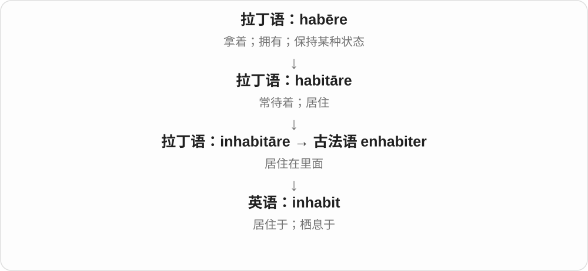

# 0644 · in- (1), il-, im- — 进入；在内；朝向、在上

[逐词精讲目录](../00_逐词精讲目录.md) · [总目录](../00_总目录_按常用程度.md)

## 核心词根与来源

这页讲表示位置、方向的拉丁 in-，与表示“不”的另一个 in- 分开。它在后接辅音前可变成 im-、il-、ir-，但看到这些字母不能先断定是哪一个前缀。intend 的伸向目标、incur 的遭遇也说明，实际意思常比“进去”更抽象。

**把一个动作指向里面或某个对象：带进来、住进去、把光照上去。**

拉丁 in-：import 带入；inhabit 住在里面；inclusion 关进一个范围；illuminate 把光照上去。invite 单列拉丁 invitare 起点，内部构成有争议。

- **带入、纳入、住进去**：import, inclusion, incorporate, inhabit
- **朝目标、遭遇后果**：intend, incur
- **照亮与使人明白**：illuminate, illumination, illuminating
- **邀请一系〔内部远源未定〕**：invite, invitation, inviting, invitee, uninvited
- **正式设立**：institute

## 词形与演化规律

im- 常见于 p、b、m 前，il- 在 l 前，ir- 在 r 前；这些是历史语音同化。illuminate 的 il- 不是否定。原目录还列 invite，但 invitare 的更早构成未完全明确，本页保留逐词说明，不编造一个确定的 -vite 词根。

## 单词速览（常用到不常用）

| 单词 | 音标 | 核心意思 |
|---|---|---|
| [institute](#w-1) | 英 /ˈɪnstɪtjuːt/；美 /ˈɪnstɪtuːt/ | 研究所；专门机构；建立、实行〔动词〕 |
| [invite](#w-2) | 动词 /ɪnˈvaɪt/；名词 /ˈɪnvaɪt/ | 邀请；征求；招致；邀请〔非正式名词〕 |
| [invitation](#w-3) | /ˌɪnvɪˈteɪʃən/ | 邀请；请柬；引发某事的诱因 |
| [import](#w-4) | 动词 英 /ɪmˈpɔːt/、美 /ɪmˈpɔːrt/；名词 英 /ˈɪmpɔːt/、美 /ˈɪmpɔːrt/ | 进口；导入；进口商品；意义 |
| [intend](#w-5) | /ɪnˈtend/ | 打算；意在；指定供……使用 |
| [inclusion](#w-6) | /ɪnˈkluːʒən/ | 纳入；包含；包容；内含物 |
| [inviting](#w-7) | /ɪnˈvaɪtɪŋ/ | 诱人的；令人想进去、尝试的；正在邀请 |
| [incorporate](#w-8) | 英 /ɪnˈkɔːpəreɪt/；美 /ɪnˈkɔːrpəreɪt/ | 把……纳入；合并；组成公司或法人 |
| [illumination](#w-9) | /ɪˌluːmɪˈneɪʃən/ | 照明；启发；阐明；手稿彩饰 |
| [inhabit](#w-10) | /ɪnˈhæbɪt/ | 居住在；栖息于；占据某种精神世界 |
| [illuminate](#w-11) | /ɪˈluːmɪneɪt/ | 照亮；阐明；为手稿加彩饰 |
| [incur](#w-12) | 英 /ɪnˈkɜː/；美 /ɪnˈkɜːr/ | 招致；产生需承担的费用或后果 |
| [illuminating](#w-13) | /ɪˈluːmɪneɪtɪŋ/ | 富有启发的；使人明白的；正在照亮 |
| [uninvited](#w-14) | /ˌʌnɪnˈvaɪtɪd/ | 未被邀请的；未经邀请地 |
| [invitee](#w-15) | /ˌɪnvaɪˈtiː/ | 受邀者 |

## 逐词讲解

### 1. institute — 研究所；专门机构；建立、实行〔动词〕

**音标**：英 /ˈɪnstɪtjuːt/；美 /ˈɪnstɪtuːt/

**先抓住这个画面**

把一件事正式立起来：可以立一个专门机构，也可以立一套新办法。

**怎么拆**

动词接拉丁 institutus，名词接 institutum，两者都来自 instituere；现代研究机构义还受法语 Institut 名称用法影响，不是名词从现代动词随手转来这一条路。

**怎么变成今天的意思**

**拉丁 stare → statuere**  
站立 → 使站稳、设立、安排

↓

**拉丁 in- + statuere → instituere**  
设立、安排、教导

↓

**拉丁 institutus → 英语 institute〔动词〕；institutum → institute〔名词〕**  
分别借入：设立；被确立的制度或宗旨

↓

**法语 Institut 的机构名称用法影响英语名词**  
后来常指研究所、学院等专门机构

a research institute 是研究所；institute a new policy 是正式开始执行新政策。动词比较正式，常搭制度、改革和程序。名词与动词常用读音相同。

**常见搭配与例句**

a research institute；institute reforms；institute proceedings。

> She works at an institute that studies urban transport.

她在一家研究城市交通的机构工作。

> The company instituted a new procedure for handling complaints.

公司实行了一套新的投诉处理程序。

**别混淆**

institute 常是专门机构；institution 范围更广，还可说制度和长期习俗。

### 2. invite — 邀请；征求；招致；邀请〔非正式名词〕

**音标**：动词 /ɪnˈvaɪt/；名词 /ˈɪnvaɪt/

**先抓住这个画面**

向人打开一个参与的入口；也可能是自己的做法把某种反应招来了。

**怎么拆**

接拉丁 invitare，经法语 inviter 借入或从较早的 invitation 反构。传统分析把 in- 联系“朝向”，但其余部分不清楚，不能拆成 in + vita“生命”。

**怎么变成今天的意思**

**拉丁语 invitare**  
邀请、招待；更早构成仍有疑问

↓

**法语 inviter 借入，或由英语 invitation 反构 → invite**  
邀请；两条近源解释均有词典支持

invite someone to dinner 是请人吃饭；invite comments 是征求意见；invite trouble 是招惹麻烦。非正式名词 an invite 重音在前，动词重音在后。

**常见搭配与例句**

invite somebody to do something；invite feedback；invite trouble；send an invite。

> We invited our neighbours to join us for dinner.

我们邀请邻居和我们一起吃晚饭。

> The team invited comments on the draft.

团队征求了大家对草稿的意见。

> I have not received an invite yet.

我还没有收到邀请。

**别混淆**

request 是提出请求；invite 常给人参与机会，不保证对方接受。词源也不能硬说成让人“进入生命”。

### 3. invitation — 邀请；请柬；引发某事的诱因

**音标**：/ˌɪnvɪˈteɪʃən/

**先抓住这个画面**

邀请这件事，也可以是把邀请写下来、发给对方的消息。

**怎么拆**

借自拉丁 invitatio，接 invitare；英语名词早于动词 invite，不把历史只画成 invite 加 -ation。

**怎么变成今天的意思**

**拉丁 invitare → invitatio**  
邀请、招待 → 邀请的行为

↓

**拉丁名词借入 → 英语 invitation**  
邀请；英语记录早于动词 invite

an invitation to a party 是参加聚会的邀请；accept or decline an invitation 是接受或婉拒。an invitation to disaster 则比喻某种做法容易招来灾祸。

**常见搭配与例句**

accept an invitation；decline an invitation；an invitation to participate。

> Thank you for the invitation, but I cannot attend this time.

谢谢你的邀请，但这次我无法出席。

> Leaving the fragile boxes in the doorway was an invitation to trouble.

把易碎品箱子留在门口，很容易惹出麻烦。

**别混淆**

invitation 语体普通；invite 作名词更口语，两者不是一个单复数关系。

### 4. import — 进口；导入；进口商品；意义

**音标**：动词 英 /ɪmˈpɔːt/、美 /ɪmˈpɔːrt/；名词 英 /ˈɪmpɔːt/、美 /ˈɪmpɔːrt/

**先抓住这个画面**

import 是把外面的东西带进来：国外商品进来，外部数据进入软件。正式用法还可指某句话或事情“带来的意义”。

**怎么拆**

拉丁语 in-（向内）+ portāre（携带），n 在 p 前同化成 m。

**怎么变成今天的意思**

进口与导入保留空间方向；the import of his words 则问他的话意味着什么。这条“承载意义”的线也通向 important。

**常见搭配与例句**

import goods（进口商品）；import data（导入数据）；an import from…（从……进口的商品）；the full import of…（……的完整含义）。

> The country imports most of its coffee.

这个国家的大部分咖啡依靠进口。

> She did not immediately grasp the import of his words.

她没有立刻领会他话中的含义。

**别混淆**

import 向内，export 向外。作名词谈“意义”时较正式，不能每次看到 import 都翻成进口。

### 5. intend — 打算；意在；指定供……使用

**音标**：/ɪnˈtend/

**先抓住这个画面**

intend 是把心思朝某个目标指去：还没做，也已经有了打算。

**怎么拆**

in-（朝向）+ tendere → intendere，经法语 entendre 传入。

**怎么变成今天的意思**

intend to do 是打算做；be intended for 是原本为某人、某用途准备。

**常见搭配与例句**

intend to return；intend someone to do；be intended for beginners。

> We intend to reopen the shop in June.

我们打算六月重新开店。

> This guide is intended for beginners.

这份指南是为初学者准备的。

**别混淆**

intend 是意愿；tend to 是倾向。The book is intended for children 说目标读者。

### 6. inclusion — 纳入；包含；包容；内含物

**音标**：/ɪnˈkluːʒən/

**先抓住这个画面**

让某个成员进入范围，或者看见材料里包着的东西。

**怎么拆**

借拉丁 inclūsiō，接 inclūdere“围在里面”；现代对应 include，但名词也有独立借入路线。

**怎么变成今天的意思**

**拉丁 claudere；分词 clausus**  
关上、围住、使结束；复合词常变为 -cludere / -clusus

↓

**拉丁 inclūdere → inclūsiō → 英语 inclusion**  
围在里面 → 纳入、包含

↓

**英语社会与材料用法**  
让成员参与；材料内部的包裹物

社会语境的 inclusion 不只是在名单上写一个名字，还常关注能否实际参与。宝石里的 an inclusion 则是晶体形成时包住的其他物质，不是社会概念。

**常见搭配与例句**

inclusion in；the inclusion of；social inclusion；a mineral inclusion。

> The committee approved the inclusion of a practical workshop.

委员会批准把一个实操工作坊纳入活动。

> A tiny mineral inclusion is visible inside the crystal.

晶体内部可以看到一粒微小的矿物包裹体。

**别混淆**

diversity 说成员有哪些不同；inclusion 说这些成员能否进入并参与，两者相关但不是同一个问题。

### 7. inviting — 诱人的；令人想进去、尝试的；正在邀请

**音标**：/ɪnˈvaɪtɪŋ/

**先抓住这个画面**

不必真的开口邀请，样子或气氛就让人想靠近。

**怎么拆**

invite 去末尾 e 加 -ing；可作动词分词，也可转成有吸引力的形容词。

**怎么变成今天的意思**

**拉丁语 invitare**  
邀请、招待；更早构成仍有疑问

↓

**法语 inviter 借入，或由英语 invitation 反构 → invite**  
邀请；两条近源解释均有词典支持

↓

**英语 invite + -ing → inviting**  
在邀请 → 仿佛在招呼人靠近

an inviting room 让人想进去坐坐；an inviting smell 让人想尝一口。形容词 inviting 不要求有人发出正式邀请。

**常见搭配与例句**

an inviting smile；an inviting atmosphere；look inviting。

> The café looked warm and inviting on the rainy evening.

在那个下雨的傍晚，咖啡馆看起来温暖又诱人。

> They are inviting local artists to take part in the exhibition.

他们正在邀请本地艺术家参加展览。

**别混淆**

invited 是被邀请的；inviting 是正在邀请，或本身显得吸引人，方向相反。

### 8. incorporate — 把……纳入；合并；组成公司或法人

**音标**：英 /ɪnˈkɔːpəreɪt/；美 /ɪnˈkɔːrpəreɪt/

**先抓住这个画面**

原来单独放着的材料，现在成为整体的一部分，像食材混进面团。

**怎么拆**

晚期拉丁 incorporare、incorporatus 接 in-“进入”与 corporare“成为一体”。常用动词词尾 /eɪt/；少见形容词用法可读 /ət/，另有古旧否定 in- 的异义。

**怎么变成今天的意思**

**拉丁语 corpus，属格 corporis**  
身体；由此提取 corpor- 词干

↓

**晚期拉丁语 in- + corporare → incorporare、incorporatus**  
使进入一个整体、合为一体

↓

**中古英语 incorporaten → incorporate**  
纳入、合并；组成法人组织

incorporate feedback into a plan 是把反馈真正放进计划；incorporate a company 是完成相应的公司组织程序。它不只表示并排摆放，常意味着成为结构的一部分。

**常见搭配与例句**

incorporate something into；incorporate ideas；incorporate a business。

> We incorporated the students’ suggestions into the timetable.

我们把学生的建议纳入了时间表。

> The founders decided to incorporate the business.

创办人决定把业务注册为公司。

**别混淆**

include 只需包含；incorporate 更强调融入整体。企业 incorporate 也不等于必然与另一家公司合并。

### 9. illumination — 照明；启发；阐明；手稿彩饰

**音标**：/ɪˌluːmɪˈneɪʃən/

**先抓住这个画面**

把照亮当作一件事或一种结果：眼前亮起来，脑子里也可能一下明白了。

**怎么拆**

接晚期拉丁 illuminatio，可经法语借入；英语名词早于 illuminate，不只用英语动词换尾解释。

**怎么变成今天的意思**

**拉丁 in- + luminare → illuminare**  
把光照上去；in- 在 l 前同化为 il-

↓

**晚期拉丁 illuminatio → 法语或直接借入 → 英语 illumination**  
照亮、启迪的名词；后来也用于照明和彩饰

adequate illumination 是足够照明；provide illumination on a subject 是帮助说明。复数 illuminations 也可指节庆灯饰，或手稿中的彩饰。

**常见搭配与例句**

provide illumination；street illumination；a moment of illumination。

> The room needs better illumination for detailed work.

要在这个房间里做精细工作，需要更好的照明。

> The letters provide valuable illumination on her early career.

这些信件为理解她的早期职业经历提供了宝贵线索。

**别混淆**

illumination 是照明或阐明；illustration 可以是配图或例证，两者常有帮助理解的作用，但并非同一个词。

### 10. inhabit — 居住在；栖息于；占据某种精神世界

**音标**：/ɪnˈhæbɪt/

**先抓住这个画面**

某个地方不是只路过，而是人在那里生活、动物在那里栖息，用 inhabit。

**怎么拆**

经古法语 enhabiter 来自拉丁语 inhabitāre：in-（在里面）+ habitāre（居住）。

**怎么变成今天的意思**

这里 in- 不是“不”。现代也会说角色 inhabit a different world，把生活其中的感觉扩展到想象、精神或文化世界。

**常见搭配与例句**

inhabit an island；species that inhabit rivers；inhabit a fictional world。

> Several rare species inhabit this forest.

几种珍稀物种栖息在这片森林中。

> The characters seem to inhabit a world of their own.

这些角色仿佛生活在自己的世界里。

**别混淆**

inhabit 直接接地点，不加 in：inhabit the island。live 则通常说 live on the island。

### 11. illuminate — 照亮；阐明；为手稿加彩饰

**音标**：/ɪˈluːmɪneɪt/

**先抓住这个画面**

把光打到暗处：既可以真看清房间，也可以看懂原先不清楚的问题。

**怎么拆**

接拉丁 illuminare 的分词 illuminatus，也有从英语 illumination 反构的解释；il- 是“朝向、在上”的 in- 同化，不是否定。

**怎么变成今天的意思**

**拉丁 in- + luminare → illuminare**  
把光照上去；in- 在 l 前同化为 il-

↓

**拉丁 illuminatus 借入，或英语 illumination 反构 → illuminate**  
照亮、阐明；来源解释有两说

lamps illuminate the path 是灯把路照亮；an example illuminates an idea 是例子让观点变清楚。illuminated manuscripts 还指有彩饰、金银装饰的手稿，不是带电子背光的书。

**常见搭配与例句**

illuminate a room；illuminate a problem；an illuminated manuscript。

> Small lamps illuminated the path through the garden.

小灯照亮了穿过花园的小路。

> Her example helped illuminate the difference between the two approaches.

她的例子帮助说明了这两种方法的区别。

**别混淆**

light up 很日常；illuminate 更正式，也特别适合把复杂问题讲清楚。

### 12. incur — 招致；产生需承担的费用或后果

**音标**：英 /ɪnˈkɜː/；美 /ɪnˈkɜːr/

**先抓住这个画面**

你采取行动，接着“跑进”一笔费用或一种责任里，最后要由自己承担。

**怎么拆**

拉丁语 in-（进入）+ currere（跑）形成 incurrere，经法语进入英语。

**怎么变成今天的意思**

现代通常接 cost、debt、loss 等负担，也可以接 anger“招惹愤怒”。并非主动想要结果，只是行动带来了它。

**常见搭配与例句**

incur costs；incur a debt；incur losses；incur someone’s anger。

> Changing the booking may incur an extra fee.

更改预订可能产生额外费用。

> The business incurred heavy losses last year.

这家企业去年遭受了严重亏损。

**别混淆**

occur 是某事发生，不及物；incur 是某人或机构招致某事，需要宾语。Costs occurred 不如 costs were incurred 符合常见搭配。

### 13. illuminating — 富有启发的；使人明白的；正在照亮

**音标**：/ɪˈluːmɪneɪtɪŋ/

**先抓住这个画面**

听完或看完，原先模糊的一块忽然清楚了。

**怎么拆**

illuminate + -ing；作形容词时常从照亮转为帮助理解。

**怎么变成今天的意思**

**拉丁 in- + luminare → illuminare**  
把光照上去；in- 在 l 前同化为 il-

↓

**拉丁 illuminatus 借入，或英语 illumination 反构 → illuminate**  
照亮、阐明；来源解释有两说

↓

**英语 illuminate + -ing → illuminating**  
照亮、阐明 → 有启发的

an illuminating discussion 是有启发的讨论；an illuminating comparison 把差别展示得清楚。它不是只说内容有趣，而是说让人懂得更多。

**常见搭配与例句**

an illuminating example；an illuminating discussion；highly illuminating。

> The comparison was especially illuminating for new readers.

这个比较对刚接触这一主题的读者尤其有启发。

> We had an illuminating conversation about how the decision was made.

我们聊了这个决定是如何做出的，谈话很有启发。

**别混淆**

interesting 说引人兴趣；illuminating 进一步说它帮助你理解了什么。

### 14. uninvited — 未被邀请的；未经邀请地

**音标**：/ˌʌnɪnˈvaɪtɪd/

**先抓住这个画面**

没有收到邀请，却出现在那里，或主动介入别人的事。

**怎么拆**

日耳曼来源的否定 un- + invited；中间 invite 的 in- 不应误当第二个否定前缀。

**怎么变成今天的意思**

**拉丁语 invitare**  
邀请、招待；更早构成仍有疑问

↓

**法语 inviter 借入，或由英语 invitation 反构 → invite**  
邀请；两条近源解释均有词典支持

↓

**英语 invite → invited；un- + invited → uninvited**  
被邀请的 → 未被邀请的

an uninvited guest 是不请自来的客人；arrive uninvited 中形容词补充说明来的状态。也可说 uninvited advice，指别人没要却主动给的意见。

**常见搭配与例句**

an uninvited guest；arrive uninvited；uninvited advice。

> An uninvited guest appeared just before dinner.

晚饭前来了一个不请自来的客人。

> He turned up uninvited and expected to join the meeting.

他未经邀请就来了，还以为能参加会议。

**别混淆**

unexpected 只是出乎意料；uninvited 明说没受邀请。受邀的人提前到，也可能 unexpected。

### 15. invitee — 受邀者

**音标**：/ˌɪnvaɪˈtiː/

**先抓住这个画面**

邀请发出后，站在收件人这一边的人。

**怎么拆**

invite + -ee；-ee 在这里标出接受邀请的人。

**怎么变成今天的意思**

**拉丁语 invitare**  
邀请、招待；更早构成仍有疑问

↓

**法语 inviter 借入，或由英语 invitation 反构 → invite**  
邀请；两条近源解释均有词典支持

↓

**英语 invite + -ee → invitee**  
邀请 → 受邀的人

the list of invitees 是受邀名单。这个词不保证人已经答应出席，也不同于活动当天实际到场的人数。

**常见搭配与例句**

a list of invitees；all invitees；send details to invitees。

> Each invitee received a link to the programme.

每位受邀者都收到了一份活动安排链接。

> Several invitees were unable to attend.

几位受邀者无法出席。

**别混淆**

inviter 是发出邀请者；invitee 是收到邀请者。attendee 才着重说参加活动的人。

## 这一组要分清什么

import 的 im- 表示带入，impossible 的 im- 是否定。uninvited 的否定由 un- 承担。illumination、invitation 两个英语名词都早于相应现代动词，词尾相似不等于历史顺序相同。

## 串起来练习

比较 import、illuminate、inhabit 的动作方向；说明 uninvited 中哪一部分才表示否定。用一个例子说明 illuminating 为什么也能形容谈话。
