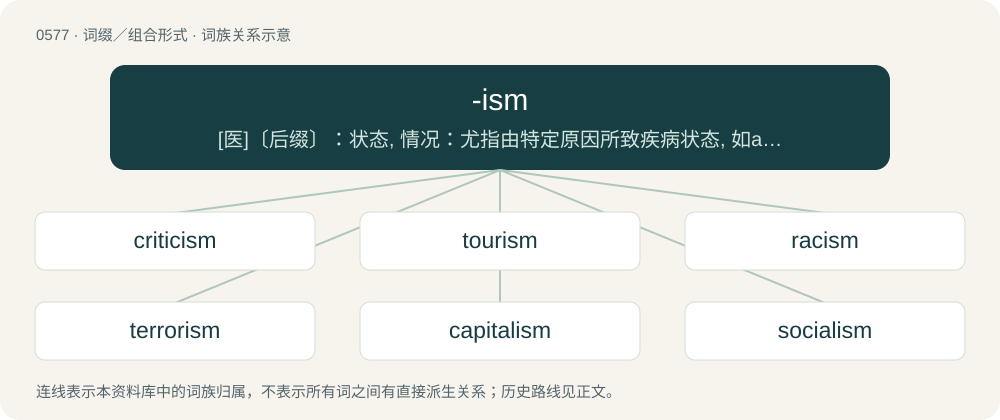

# 0649 · -ism — \[医\]〔后缀〕：状态, 情况：尤指由特定原因所致疾病状态, 如alcoholism（酒精中毒）

[总目录](../00_总目录_按常用程度.md)

**类型**：词缀／组合形式　｜　**来源语言**：见词源记录

## 核心含义与来源

- 核心含义：\[医\]〔后缀〕：状态, 情况：尤指由特定原因所致疾病状态, 如alcoholism（酒精中毒）
- 英文含义：Used to form nouns of action, process, or result based on the accompanying verb ending in -ise or -ize.
- 词形：-ism

**来源记录 1**（后缀／后置成分；Used to form nouns of action, process, or result based on the accompanying verb ending in -ise or -ize.）

Ultimately from Ancient Greek -ισμός (-ismós), a suffix that forms abstract nouns of action, state, condition, doctrine, from the stem of verbs in -ίζειν (-ízein) (whence English -ize). Doublet of -ismus. Many English nouns in -ism are loans of Greek nouns in -ισμός (-ismós), often via Latin and French, such as Judaism, a learned English formation from Latin attested from c. 1500 and ultimately from Ancient Greek Ἰουδαϊσμός (Ioudaïsmós). In Late Latin, the -ismus suffix became the ordinary ending for names of religions and ecclesiastical or philosophical systems or schools of thought, thus chrīstiānismus (whence 16th c. Christianism) in Tertullian, a trend continued in Medieval Latin, with e.g. pāgānismus attested by the 8th century. From the 16th century, such formations became very common in English, until the early 18th century mostly restricted to either root words of Greek or Latin origin (heroism, patriotism) or proper names (Calvinism, Lutheranism). Productivity from root words with evidently non-Latin and non-Greek origin dates to the late 18th century (e.g. blackguardism). Reflecting this productivity, use of ism as a standalone noun is attested in Edward Pettit (1680) and becomes common from the mid-18th century. The narrowed sense of forming terms for ideologies based on the belief of superiority is based on coinages such as racism (1932) or sexism (1936) and productive since the 1970s.

## 词族图

## 单词速览（常用到不常用）

| 单词 | 音标 | 释义 |
|---|---|---|
| [criticism](#w-1) | /ˈkɹɪtɪsɪzm̩/ | n. 批评, 评论, 非难；\[法\] 批判, 批评, 评论 |
| [tourism](#w-2) | 英 /ˈtʊəɹɪzəm/；美 /ˈtʊɹɪzəm/ | n. 观光业, 游览；\[经\] 旅游业 |
| [racism](#w-3) | 美 /ˈɹeɪsɪzm̩/ | n. 种族主义, 种族偏见；\[法\] 种族主义, 种族歧视, 种族歧视主张 |
| [terrorism](#w-4) | /ˈtɛɹəɹɪzəm/ | n. 恐怖主义, 恐怖统治, 恐怖状态；\[法\] 胁迫, 暴政, 恐怖政治 |
| [capitalism](#w-5) | 英 /ˈkapɪt(ə)lɪz(ə)m/；美 /ˈkæp.ə.təlˌɪzm̩/ | n. 资本主义；\[经\] 资本主义 |
| [socialism](#w-6) | 英 /ˈsəʊʃəlɪzəm/；美 /ˈsoʊʃəlɪzəm/ | n. 社会主义, 社会主义运动 |
| [nationalism](#w-7) | 英 /ˈnæʃənəlɪz(ə)m/；美 /ˈnæʃ(ə)nəˌlɪzəm/ | n. 民族主义, 民族特性 |
| [metabolism](#w-8) | 英 /mɪˈtab.ə.lɪz.əm/；美 /məˈtæb.əˌlɪz.əm/ | n. 新陈代谢, 变态；\[化\] 新陈代谢; 代谢 |
| [realism](#w-9) | /ˈɹi.əlɪzəm/ | n. 写实主义, 现实, 实在论；\[法\] 现实主义 |
| [activism](#w-10) | 英 /ˈæk.tɪ.vɪ.zəm/ | n. 激进主义, 行动主义, 能动论；\[法\] 激进主义, 行动主义 |
| [optimism](#w-11) | 英 /ˈɒptɪmɪzəm/；美 /ˈɑptɪmɪzəm/ | n. 乐观主义, 乐观, 乐天；\[医\] 乐观主义, 乐观 |
| [organism](#w-12) | 英 /ˈɔː.ɡə.nɪ.zəm/；美 /ˈɔɹ.ɡəˌnɪz.əm/ | n. 生物, 有机体, 社会组织；\[医\] 生物\[体\],\[有\]机体 |
| [patriotism](#w-13) | 英 /ˈpætɹi.əˌtɪzəm/；美 /ˈpeɪtɹi.əˌtɪzəm/ | n. 爱国心, 爱国精神, 爱国主义 |
| [sexism](#w-14) | /ˈsɛksɪzm̩/ | n. 性别歧视, 歧视女性 |
| [liberalism](#w-15) | /ˈlɪ.b(ə.)ɹə.lɪz.əm/ | n. 自由主义 |
| [symbolism](#w-16) | /ˈsɪmbəˌlɪzəm/ | n. 象征主义, 符号论；\[医\] 象征主义 |
| [alcoholism](#w-17) | 英 /ˈælkəhɒˌlɪzəm/；美 /ˈælkə(ˌ)hɔˌlɪzəm/ | n. 酗酒, 酒精中毒；\[化\] 酒中毒 |
| [conservatism](#w-18) | 英 /kənˈsɜːvətɪzəm/；美 /kənˈsɝvətɪzəm/ | n. 保守, 守旧性, 保守主义, \[the\]保守党的主张和政策, 保守党；\[医\] 保守性 |
| [professionalism](#w-19) | /pɹəˈfɛʃənəˌlɪzəm/ | n. 职业特性, 专业技巧, 职业行为, 职业作风, (褒)专业人员的特质, 职业化；\[经\] 职业特性, 职业作风, 职业化 |
| [skepticism](#w-20) | 美 /ˈskɛp.tɪˌsɪ.zəm/ | n. 怀疑论；\[医\] 多疑癖 |
| [imperialism](#w-21) | 英 /ɪmˈpɪə.ɹi.ə.lɪ.z(ə)m/；美 /ɪmˈpɪ.ɹi.əˌlɪ.zəm/ | n. 帝国主义, 帝制；\[法\] 帝国主义 |
| [catholicism](#w-22) | /kəˈθɔləsɪzm/ | 【英文】The state or quality of being catholic or universal; catholicity. |
| [colonialism](#w-23) | 英 /kəˈləʊ.njə.lɪ.zəm/；美 /kəˈloʊ.njə.lɪ.zəm/ | n. 殖民主义 |
| [extremism](#w-24) | 英 /ɪkˈstɹiː.mɪ.zəm/；美 /ɪkˈstɹi.mɪ.zəm/ | n. 极端倾向, 极端论, 过激主义 |
| [heroism](#w-25) | 英 /ˈhɛɹəʊɪzəm/；美 /ˈhɛɹoʊɪzəm/ | n. 英勇, 勇敢事迹, 豪侠行为 |
| [plagiarism](#w-26) | 英 /ˈpleɪd͡ʒəɹɪzəm/ | n. 剽窃, 抄袭, 剽窃物；\[法\] 抄袭, 剽窃, 剽窃作品 |
| [cynicism](#w-27) | 英 /ˈsɪn.ɪˌsɪzəm/ | n. 犬儒主义 |
| [modernism](#w-28) | /ˈmɒdənizm/ | n. 现代作风, 现代主义, 现代思想 |
| [idealism](#w-29) | /ʌɪˈdɪəlɪz(ə)m/ | n. 唯心主义, 观念论, 唯心论, 理想主义 |
| [multiculturalism](#w-30) | 英 /ˌmʌltɪˈkʌltʃəɹəˌlɪz(ə)m/ | n. 多元文化 |
| [mysticism](#w-31) | 英 /ˈmɪs.tɪˌsɪz.əm/ | n. 神秘, 神秘教, 模糊思想 |
| [narcissism](#w-32) | 英 /ˈnɑːsəˌsɪzm/；美 /ˈnɑɹsəˌsɪzm/ | n. 自我陶醉, 自恋；\[医\] 自爱欲, 恋已癖 |
| [magnetism](#w-33) | 英 /ˈmæɡ.nəˌtɪz.əm/ | n. 磁性, 吸引力, 磁学, 催眠术；\[化\] 磁学 |
| [secularism](#w-34) | 英 /ˈsɛkjʊləɹɪzəm/；美 /ˈsɛkjələɹɪzəm/ | n. 现世主义, 宗教与教育分离论 |
| [anarchism](#w-35) | 英 /ˈanəkɪz(ə)m/；美 /ˈænəɹˌkɪzəm/ | n. 无政府主义；\[经\] 无政府主义 |
| [populism](#w-36) |  | 【英文】A political doctrine or philosophy that proposes that the rights and powers of ordinary people are exploited by a privileged elite, and supports their struggle to overcome this. |
| [cannibalism](#w-37) | /ˈkanɪbəlɪz(ə)m/ | n. 嗜食同类, 食人, 嗜血成性 |
| [authoritarianism](#w-38) | 美 /ɔˌθɔːɹɪˈtɛːɹiən.ɪzm̩/ | n. 独裁主义；权力主义 |
| [individualism](#w-39) | /ˌɪn.dɪˈvɪ.dʒu.əˌlɪ.zəm/ | n. 个人主义, 个人特征；\[经\] 个人主义 |
| [humanism](#w-40) | 英 /ˈhjuːmənɪz(ə)m/；美 /ˈhjumənɪz(ə)m/ | n. 人本主义, 人文主义, 人道主义；\[法\] 人道主义, 人文主义, 人本主义 |
| [athleticism](#w-41) | /æθˈlɛtɪsɪzəm/ | n. 体育活动, 对运动的热爱 |
| [consumerism](#w-42) | 英 /kənˈsjumərɪzm̩/；美 /kənˈsumərɪzm̩/ | n. 保护消费者利益运动 |
| [federalism](#w-43) | /ˈfedərəliz(ə)m/ | n. 联邦制, 联邦主义；\[法\] 联邦制 |
| [pessimism](#w-44) | /ˈpɛsɪmɪzəm/ | n. 悲观, 悲观情绪, 悲观主义；\[医\] 悲观主义 |
| [romanticism](#w-45) | /ɹəʊˈmæntɪsɪzəm/ | n. 浪漫主义精神, 浪漫主义 |
| [fundamentalism](#w-46) | /ˌfʌndəˈmentəlɪzəm/ | n. 基要主义 |
| [minimalism](#w-47) | 英 /ˈmɪnɪməlɪzəm/；美 /ˈmɪn.ə.məl.ɪz.əm/ | 最低纲领,极保守行动 |
| [pluralism](#w-48) | /ˈpluərəlizm/ | n. 多数状态, 多重性, 多元论, 兼任；\[法\] 多元论 |
| [radicalism](#w-49) | /ˈradɪkəlɪz(ə)m/ | n. 激进主义 |
| [evangelism](#w-50) | /iˈvændʒəlizm/ | n. 福音传道, 福音传道者的工作, 福音主义 |
| [totalitarianism](#w-51) | /,təjtæliˈteəriənizəm/ | n. 极权主义；\[法\] 极权主义 |
| [protectionism](#w-52) | /pɹəˈtɛk.ʃə.nɪ.zəm/ | n. 贸易保护主义, 贸易保护制；\[经\] 保护(贸易)主义, 保护(贸易)制 |
| [naturalism](#w-53) | /ˈnatʃ(ə)rəlɪz(ə)m/ | n. 自然主义, 本能行动 |
| [feudalism](#w-54) | /ˈfju.də.lɪ.zəm/ | n. 封建主义, 封建制度 |
| [surrealism](#w-55) | 英 /səˈɹiː(.ə)l.ɪz.əm/ | n. 超现实主义；\[法\] 超现实主义 |
| [creationism](#w-56) | /kɹiˈeɪʃənɪzəm/ | n. 创造宇宙说, 特别创造说 |
| [determinism](#w-57) | 英 /dɪˈtɜːmɪnɪzəm/ | n. 决定论；\[化\] 决定论 |
| [fanaticism](#w-58) | 美 /fəˈnæɾ.ɪ.sɪ.zm̩/；/fəˈnæt.ɪ.sɪ.zəm/ | n. 狂热, 入迷 |
| [unionism](#w-59) | /ˈjuːnjənizm/ | n. 工会主义, 联合主义, 联邦主义 |
| [separatism](#w-60) | /ˈsepərətizm/ | n. 分离主义 |
| [environmentalism](#w-61) | /in,vaiərənˈmentlizm/ | n. 环境保护论, 环境论 |
| [recidivism](#w-62) | 英 /rɪˈsɪdɪvɪzm̩/ | n. 累犯；\[医\] 复发趋向, 再发趋向, 再犯趋向 |
| [formalism](#w-63) | 英 /ˈfɔːməlɪz(ə)m/；美 /ˈfɔɹml̩ˌɪzm̩/ | n. 拘泥形式, 形式主义；\[法\] 形式主义 |
| [hypothyroidism](#w-64) | /ˌhaɪpəˈθaɪɹɔɪˌdɪzəm/ | n. 甲状腺功能减退；\[医\] 甲状腺机能减退 |
| [relativism](#w-65) | /ˈrelətivizm/ | n. 相对论, 相对主义 |
| [republicanism](#w-66) | /riˈpʌblikənizm/ | n. 共和主义 |
| [tribalism](#w-67) | 英 /ˈtɹaɪ.bə.lɪ.zəm/ | n. 部落制, 部落文化, 部落主义 |
| [exceptionalism](#w-68) |  | n. 例外论 |
| [veganism](#w-69) |  | \[医\] 绝对素食主义 |
| [bilingualism](#w-70) |  | n. 使用两种语言 |
| [pacifism](#w-71) | /ˈpæsɪfɪzəm/ | n. 和平主义, 反战论, 不抵抗主义；\[法\] 和平主义, 非战主义, 不抵抗主义者 |
| [escapism](#w-72) | /ɪˈskeɪpɪzəm/ | n. 逃避现实, 逃避主义 |
| [elitism](#w-73) | /ɪˈliːtɪzəm/ | n. 精英主义 |
| [lyricism](#w-74) | /ˈlirisizm/ | n. 抒情风格, 抒情诗体, 抒情方式抒情 |
| [libertarianism](#w-75) | 英 /lɪbəˈtɛːɹɪənɪz(ə)m/ | 自由意志论, 公民拥有充分自由权论, 自由主义 |
| [revisionism](#w-76) | /ɹɪˈvɪʒəˌnɪzəm/ | n. 修正主义；\[法\] 修正主义 |
| [dualism](#w-77) | /ˈdjuːəlizm/ | n. 双重性, 二元论；\[医\] 二元论 |
| [rationalism](#w-78) | 英 /ˈɹæʃ(ə)nəlɪzəm/ | n. 合理主义, 理性论, 纯理论 |
| [vegetarianism](#w-79) | 英 /vɛd͡ʒɪˈtɛəɹi.ənɪzəm/；美 /vɛd͡ʒɪˈtɛɹi.ənɪzəm/ | n. 素食主义；\[医\] 素食主义 |
| [existentialism](#w-80) | 英 /ˌɛɡzɪˈstɛnʃəlɪz(ə)m/；美 /ˌɛɡzəˈstɛn(t)ʃəˌlɪzəm/ | n. 存在主义 |
| [hedonism](#w-81) | 英 /ˈhɛdənɪzəm/；美 /ˈhiːdənɪzəm/ | n. 快乐论, 享乐主义；\[医\] 享乐主义, 欢乐主义 |
| [theism](#w-82) | /ˈθiː.ɪz.əm/ | n. 有神论, 一神论, 茶中毒；\[医\] 茶中毒 |
| [urbanism](#w-83) | /ˈɜː(ɹ)bənɪzəm/ | n. 城市居民的生活方式, 城市化 |
| [globalism](#w-84) | /ˈɡləʊ.bəl.ɪz.əm/ | n. 全球主义,全球政策 |
| [parallelism](#w-85) | 英 /ˈpaɹəlɛlɪz(ə)m/ | n. 平行, 对应, 类似, 比拟；\[计\] 并行性 |
| [spiritualism](#w-86) | /ˈspɪɹɪtjuəlɪzəm/ | n. 唯灵论 |
| [absenteeism](#w-87) | 英 /æb.sənˈtiːˌɪz.m̩/；美 /ˌæb.sənˈtiˌɪz.m̩/ | n. 经常无故缺席, 旷职, 旷工, 旷课；\[经\] 有计划的怠工, 旷工 |
| [expressionism](#w-88) | 美 /ɛksˈpɹɛˈʃən.ɪzm/ | n. 表现主义 |
| [sectarianism](#w-89) | 英 /sɛkˈtɛɹ.i.ən.ɪz.əm/ | n. 宗派主义；教派意识 |
| [perfectionism](#w-90) | 英 /pəˈfɛk.ʃ(ə).nɪ.z(ə)m/；美 /pɚˈfɛk.ʃə.nɪ.zm̩/ | n. 至善论, 过度追求尽善尽美, 圆满论；\[医\] 至善主义 |
| [eroticism](#w-91) | 美 /ɪˈɹɑtəˌsɪzm̩/ | n. 性爱倾向, 性欲亢进；\[医\] 性欲, 色情 |
| [cronyism](#w-92) | 英 /ˈkɹəʊnɪɪz(ə)m/；美 /ˈkɹoʊniˌɪzəm/ | n. 任人唯亲 |
| [isolationism](#w-93) | 美 /ˌaɪsəˈleɪʃəˌnɪzəm/ | n. 孤立主义 |
| [opportunism](#w-94) | /.ɒpəˈtjuːnizm/ | n. 机会主义 |
| [progressivism](#w-95) | 英 /prəˈɡrɛsᵻvɪz(ə)m/；美 /prəˈɡrɛsɪˌvɪzəm/ | n. 进步党主义, 进步人士的政见, 进步教育理论 |
| [anachronism](#w-96) | 英 /əˈnæ.kɹə.nɪ.z(ə)m/ | n. 时代错误, 不合潮流的人(物)；\[法\] 时代错误, 落伍的事物 |
| [egalitarianism](#w-97) | /i.ɡæliˈtεəriənizəm/ | n. 平等主义, 平均主义 |
| [sensationalism](#w-98) | /senˈseiʃənəliz(ə)m/ | n. 故意使用的煽情手段, 耸人听闻的题材, 耸人听闻的手法, 危言耸听, 哗众取宠 |
| [utilitarianism](#w-99) | /,juːtiliˈteəriənizəm/ | n. 功利主义；\[法\] 功利主义 |
| [intellectualism](#w-100) | /,intəˈlektjjəlizəm,-tʃjə-/ | n. 智力活动, 唯理智论 |
| [methodism](#w-101) | /ˈmeθədizm/ | n. 循道宗教义, 严守规定法则, 拘泥形式；\[医\] 方法医学(古西腊和罗马) |
| [collectivism](#w-102) | /kəˈlektivizm/ | n. 集体主义(制度)；\[经\] 集体主义 |
| [empiricism](#w-103) | /emˈpirisizm/ | n. 经验主义, 庸医的医术, 经验论；\[医\] 经验\[主义\]医学 |
| [classicism](#w-104) | /ˈklæsisizm/ | n. 古典主义, 古典风格, 古典崇拜, 古典知识, 古典成语 |
| [futurism](#w-105) | /ˈfjuːt͡ʃəɹɪzəm/ | n. 未来派 |
| [despotism](#w-106) | /ˈdɛspətɪzəm/ | n. 独裁, 专制, 专制政治；\[法\] 专制政体, 专制政治 |
| [volcanism](#w-107) | /ˈvɒlkənizm/ | n. 火山作用 |
| [absolutism](#w-108) | 英 /ˈæb.sə.luː.tɪz.m̩/；美 /ˈæb.səˌluˌtɪz.m̩/ | n. 专制主义, 专制政体论, 绝对主义；\[法\] 专制主义, 专制政治论, 绝对主义 |
| [astigmatism](#w-109) | 美 /əˈstɪɡmətɪzm̩/ | n. 散光；\[化\] 像散 |
| [botulism](#w-110) | 英 /ˈbɒt.jʊl.ɪz.əm/；美 /ˈbɑ.t͡ʃəˌlɪz.əm/ | n. 肉毒中毒；\[医\] 肉毒中毒 |
| [hypnotism](#w-111) | /ˈhɪpnətɪzəm/ | n. 催眠术, 催眠状态；\[医\] 催眠状态, 催眠术 |
| [internationalism](#w-112) | /.intəˈnæʃənəlizm/ | n. 国际主义, 国际性；\[经\] 国际主义 |
| [lesbianism](#w-113) | /ˈlɛzbiəˌnɪzəm/ | \[医\] 女子同性恋爱的 |
| [shamanism](#w-114) | /ˈʃeɪmənɪzəm/ | \[医\] 宗教性激动 |
| [universalism](#w-115) | 英 /ˌjuːnɪˈvɜːsəlˌɪzəm/；美 /ˌjuːnəˈvɝsəlˌɪzəm/ | n. 普救论, 普遍性, 普遍特征 |
| [commercialism](#w-116) | /kˈm\\\\ːʃəˈliz(ə)m/ | n. 商业主义, 商业精神, 利润第一主义, 商业习惯, 商业用语；\[经\] 商业主义, 利润第一主义, 商业精神 |
| [hooliganism](#w-117) | /ˈhu.lɪ.ɡən.ɪz.əm/ | n. 流氓行为；\[法\] 流氓行为 |
| [masochism](#w-118) | 英 /ˈmæs.ə.kɪ.zəm/ | n. 被虐待狂, 受虐狂；\[医\] 受虐狂 |
| [fetishism](#w-119) | /ˈfiːtiʃizm/ | n. 拜物教, 盲目崇拜, 拜物主义；\[医\] 恋物癖 |
| [positivism](#w-120) | 英 /ˈpɒzɪtɪvˌɪzm/；美 /ˈpɑzɪtɪvˌɪzm/ | n. 实证论, 实证主义；\[法\] 实在法主义, 实证主义 |
| [truism](#w-121) | /tɹuːizəm/ | n. 自明之理, 众所周知, 老生常谈；\[法\] 老生常谈, 陈词滥调 |
| [voyeurism](#w-122) | /ˈvɔɪəˌrɪz(ə)m/ | n. 观淫癖 |
| [ageism](#w-123) | /ˈeɪd͡ʒ.ɪzm̩/ | \[法\] 年龄歧视 |
| [asceticism](#w-124) | 美 /əˈsɛt.əˌsɪz.əm/ | n. 禁欲主义, 苦行生涯；\[医\] 制欲主义 |
| [regionalism](#w-125) | /ˈriːdʒənə,lizəm/ | n. 行政区的划分, 地方主义, 地方色彩, 地区性, 地区特征 |
| [corporatism](#w-126) | /ˈkɔːpərətizəm/ | n. '各阶级合作'主义 |
| [dwarfism](#w-127) | 英 /ˈdwɔːfɪzəm/；美 /ˈdwɔɹfɪzəm/ | n. 矮小 |
| [orientalism](#w-128) |  | 【英文】The tendency to represent eastern subjects, to assume stylistical characteristics original of the East, especially in 19th century Europe. |
| [expansionism](#w-129) | /ɛkˈspænʃənɪzəm/ | n. 膨胀主义, 领土扩张政策；\[法\] 扩张主义, 膨胀主义者 |
| [constructivism](#w-130) | /kənˈstɹʌktɪvɪzm/ | n. 构成主义, 构成派舞美艺术 |
| [evangelicalism](#w-131) | /,iːvænˈdʒelikəlizəm/ | n. 福音派的教义, 福音主义 |
| [hyperthyroidism](#w-132) | 英 /ˌhaɪ̯pəˈθaɪ̯ɹɔɪ̯ˌdɪzəm/ | n. 甲状腺功能亢进症；\[医\] 甲状腺机能亢进 |
| [volunteerism](#w-133) | /ˌvɒlənˈtɪərɪzəm/ | n. 自愿捐助维持主义； 志愿兵制度 |
| [albinism](#w-134) | 英 /ˈælbəˌnɪzəm/ | n. 白化病；\[医\] 白化病 |
| [constitutionalism](#w-135) | 英 /ˌkɒnstɪˈtjuːʃənəˌlɪzəm/；美 /ˌkɑnstɪˈtuʃənəˌlɪzəm/ | n. 立宪；\[法\] 立宪制度, 立宪主义, 宪法论 |
| [eclecticism](#w-136) | /ekˈlektisizm/ | n. 折衷派, 折衷主义, 折衷说；\[医\] 折衷\[主义\]医学 |
| [favouritism](#w-137) |  | n. 偏爱, 徇私, 宠信, 得宠, 偏袒 |
| [localism](#w-138) | 英 /ˈləʊkəlɪz(ə)m/；美 /ˈloʊkəˌlɪzəm/ | n. 有地方色彩, 土话, 方言, 地方主义；\[法\] 地方主义, 地方观念 |
| [traditionalism](#w-139) | /trəˈdiʃənlizm/ | n. 传统主义 |
| [fatalism](#w-140) | /ˈfeɪ.təl.ɪz.əm/ | n. 宿命论 |
| [monasticism](#w-141) | /məˈnæstisizm/ | n. 修道院生活, 修道院制度 |
| [vigilantism](#w-142) | /,vidʒiˈlæntizəm/ | \[美\]治安维持会的政策\[制度, 做法\] |
| [exhibitionism](#w-143) | /ɛksɪˈbɪʃənɪzm/ | n. 自我宣传癖, 裸露癖, 喜出风头癖；\[医\] 露出欲, 露出狂 |
| [factionalism](#w-144) | /ˈfækʃənəlizm/ | n. 党派性, 党派活动, 派系分裂倾向 |
| [structuralism](#w-145) | /ˈstrʌktʃərəlizm/ | n. 结构主义 |
| [egotism](#w-146) | /ˈegəutizm/ | n. 自我中心癖, 自负；\[医\] 利己主义, 唯我主义 |
| [mannerism](#w-147) | /ˈmænəˌɹɪzəm/ | n. 矫揉造作, 习性；\[医\] 装相, 作态 |
| [puritanism](#w-148) | /ˈpjuəritənizm/ | n. 清教, 清教主义 |
| [parasitism](#w-149) | /ˈpæɹəs(a)ɪˌtɪzm̩/ | n. 寄生, 寄生习惯, 寄生状态, 寄生现象；\[医\] 寄生; 寄生物感染 |
| [paternalism](#w-150) | 英 /pəˈtɜːnəlɪzəm/；美 /pəˈtɝnəlɪzəm/ | n. 家长式作风, 家长式统治；\[经\] 家长作风 |
| [humanitarianism](#w-151) | /hjuːmæniˈteəriəniz(ə)m/ | n. 人道主义, 博爱主义 |
| [deism](#w-152) | 英 /ˈdiːɪz(ə)m/ | n. 自然神论 |
| [neuroticism](#w-153) |  | \[医\] 神经过敏症 |
| [occultism](#w-154) | /əˈkʌltizm/ | n. 神秘学 |
| [vampirism](#w-155) | /ˈvæmpaiərizəm/ | n. 勾引, 诱惑, 吮人膏血, 勒索钱财 |
| [leftism](#w-156) | /ˈleftizəm/ | n. 左派观点, 在倾行为 |
| [metamorphism](#w-157) | 英 /mɛtəˈmɔːfɪz(ə)m/ | n. 变态, 变形, 变质 |
| [legalism](#w-158) | /ˈliː^əlizəm/ | n. 文牍主义；\[法\] 条文主义, 墨守法律条文, 合法主义 |
| [ableism](#w-159) | /ˈeɪ.bə.lɪ.zəm/ | n. 健全至上（对能力缺失者的歧视或偏见, 尤指针对身体残障人士） |
| [cosmopolitanism](#w-160) | /ˌkɑzməˈpɑlɪtənɪzm̩/ | n. 世界主义；\[法\] 世界主义, 世界大同主义 |
| [essentialism](#w-161) | 英 /ɪˈsɛnʃəlɪz(ə)m/；美 /əˈsɛn(t)ʃəˌlɪzəm/ | n. 基本教育论, 本质先于存在论 |
| [functionalism](#w-162) | /ˈfʌŋkʃənəlɪzəm/ | n. 功能论, 机能心理学, 功能主义, 实用第一主义 |
| [classism](#w-163) | 美 /ˈklæsɪzəm/ | n. 阶级歧视, 阶级优越论 |
| [jingoism](#w-164) | /ˈd͡ʒɪŋɡəʊɪz(ə)m/ | n. 侵略主义, 大国沙文主义 |
| [objectivism](#w-165) | /əbˈd͡ʒɛk.tɪ.vɪ.zəm/ | n. 客观主义 |
| [specialism](#w-166) | /ˈspeʃəlizm/ | n. 专长, 专业 |
| [behaviorism](#w-167) | /biˈheiviəriz(ə)m/ | n. 行为主义 |
| [statism](#w-168) | 英 /ˈsteɪtɪzm/；美 /ˈsteɪdɪzm/ | n. 中央集权制；\[法\] 国家主义 |
| [denialism](#w-169) | 英 /dɪˈnaɪ(j)əlɪzəm/ | 【英文】The practice of rejecting propositions which are strongly supported by scientific or historical evidence, and often of seeking to influence policy processes and outcomes accordingly. |
| [mercantilism](#w-170) | 英 /ˈmɜːkəntɪlɪzəm/；美 /ˈmɝkəntɪlɪzəm/ | n. 重商主义, 商业理论, 商业活动, 商界习俗, 商用术语；\[经\] 重商主义, 商业活动, 商用术语 |
| [animism](#w-171) | /ˈænɪmɪzəm/ | n. 万物有灵论；\[医\] 灵气说, 泛灵论 |
| [communalism](#w-172) | /ˈkɒmjunəlizm/ | n. 地方自治主义 |
| [defeatism](#w-173) | 英 /dɪˈfiːtɪzəm/ | n. 失败主义 |
| [historicism](#w-174) | /hisˈtɔːrisizəm/ | n. 历史相对论 |
| [multilingualism](#w-175) | 美 /mʌltiˈlɪŋɡwəlɪzəm/ | 多语制; 多语现象 |
| [solipsism](#w-176) | /ˈsɒlɪpsɪzəm/ | n. 唯我论；\[医\] 唯我论 |
| [nativism](#w-177) | /ˈneitivizm/ | n. 先天论, 乡土主义, 本土主义 |
| [obstructionism](#w-178) | 英 /əbˈstɹʌk.ʃən.ɪz(.ə)m/ | n. 妨碍议程的手段,蓄意阻挠 |
| [reductionism](#w-179) | /riˈdʌkʃənizm/ | n. 简化论 |
| [ecumenism](#w-180) | /iːˈkjuː.mə.nɪzm/ | 泛基督教主义 |
| [scientism](#w-181) | /ˈsaiəntizm/ | n. 科学至上主义, 科学态度 |
| [hypogonadism](#w-182) | /,haipəuˈ^ɔnæ,dizəm/ | n. \[医\]性腺机能减退, 生殖官能不良 |
| [centralism](#w-183) | /ˈsɛntɹəlɪzəm/ | n. 中央集权制；\[法\] 中央集权制, 中央集权主义 |
| [centrism](#w-184) | /ˈsɛnˌtrɪz(ə)m/ | n. 中间路线,中间派的政策,温和主义 |
| [primitivism](#w-185) | /ˈprimitivizəm/ | n. 原始主义, 原始的风格, 质朴的风格 |
| [exoticism](#w-186) | /igˈzɒtisizm/ | n. 异国风味, 异族事物, 洋派 |
| [jihadism](#w-187) | /d͡ʒɪˈhæd.ɪz.əm/ | 【英文】The ideological movement within modern Islamism that advocates armed jihad and hostility against non-believers. |
| [tokenism](#w-188) |  | n. 装门面, 表面文章 |
| [amateurism](#w-189) | /ˈæmətəːrizm/ | n. 外行做法, 业余身份 |
| [mutualism](#w-190) | 英 /ˈmjuː.tʃʊ.əˌlɪz.m̩/；美 /ˈmju.t͡ʃu.əˌlɪz.m̩/ | n. 互助论, 互利共生；\[医\] 共生, 共栖 |
| [abolitionism](#w-191) | 美 /ˌæb.əˈlɪʃ.əˌnɪz.m̩/ | n. 废除主义, 废奴主义；\[医\] 活体解剖禁止论 |
| [brutalism](#w-192) | /ˈbruːtəlizm/ | n. 兽性, 残忍 |
| [colloquialism](#w-193) | 英 /kəˈləʊ.kwi.əˌlɪz.əm/；美 /kəˈloʊ.kwi.əˌlɪz.əm/ | n. 口语, 口语用法, 口语词, 方言, 口语体 |
| [literalism](#w-194) | /ˈlitərəlizm/ | n. 拘泥于字句 |
| [multilateralism](#w-195) |  | n. 多边贸易 |
| [ventriloquism](#w-196) | /vɛnˈtɹɪloʊˌkwɪzəm/ | n. 口技, 腹语口技 |
| [neologism](#w-197) | 英 /niːˈɒləd͡ʒɪzəm/；美 /niˈɑləˌd͡ʒɪzəm/ | n. 新语, 使用新语, 创造新语；\[医\] 新语症; 语词新作, 新词症 |
| [presbyterianism](#w-198) |  | 【英文】That form of church government which invests presbyters with all spiritual power, and admits no prelates over them; also, the faith and polity of the Presbyterian churches, taken collectively. |
| [scholasticism](#w-199) | 美 /skəˈlæstɪˌsɪzəm/ | n. 繁琐哲学, 墨守成规, 经院哲学；\[法\] 宗教哲学 |

## 逐词详解

### 1. criticism

**词性**：名词　｜　**音标**：/ˈkɹɪtɪsɪzm̩/

**中文释义**：n. 批评, 评论, 非难；\[法\] 批判, 批评, 评论

**英文义项**：The act of criticising; a critical judgment passed or expressed. / A critical observation or detailed examination and review.

**构词拆分**：critic + -ism

**词源与演化**：

From critic + -ism.

**例句**：

> The politician received a lot of public criticism for his controversial stance on the issue.

该用例对应义项：The act of criticising; a critical judgment passed or expressed.

### 2. tourism

**词性**：名词　｜　**音标**：英 /ˈtʊəɹɪzəm/；美 /ˈtʊɹɪzəm/

**中文释义**：n. 观光业, 游览；\[经\] 旅游业

**英文义项**：The act of travelling or sightseeing, particularly away from one's home. / The industry in which such travels and sightseeing are organized.

**构词拆分**：tour + -ism

**词源与演化**：

From tour + -ism.

**例句**：

> Tourism brings a lot of tax revenue to the area.

该用例对应义项：The industry in which such travels and sightseeing are organized.

### 3. racism

**词性**：名词　｜　**音标**：美 /ˈɹeɪsɪzm̩/

**中文释义**：n. 种族主义, 种族偏见；\[法\] 种族主义, 种族歧视, 种族歧视主张

**英文义项**：The belief that there are distinct human races with inherent differences which determine their abilities, and generally that some are superior and others inferior. / The policies, practices, or systems (e.g. government or political) promoting this belief or promoting the dominance of one or more races over others.

**构词拆分**：race + -ism

**词源与演化**：

Borrowed from French racisme, equivalent to race + -ism.

**例句**：

> Martin Luther King spoke out against racism.

该用例对应义项：The policies, practices, or systems (e.g. government or political) promoting this belief or promoting the dominance of one or more races over others.

### 4. terrorism

**词性**：名词　｜　**音标**：/ˈtɛɹəɹɪzəm/

**中文释义**：n. 恐怖主义, 恐怖统治, 恐怖状态；\[法\] 胁迫, 暴政, 恐怖政治

**英文义项**：The use of unlawful violence against people or property to achieve political objectives. / The use of intimidation or bullying tactics.

**构词拆分**：By surface analysis, terror + -ism

**词源与演化**：

From French terrorisme, from terreur + -isme. By surface analysis, terror + -ism. The word first appears in English in 1795 in reference to the Jacobin radicals of France, who ruled during the Reign of Terror.

**例句**：

> We consider cyber terrorism to pose a serious threat to international security.

### 5. capitalism

**词性**：名词　｜　**音标**：英 /ˈkapɪt(ə)lɪz(ə)m/；美 /ˈkæp.ə.təlˌɪzm̩/

**中文释义**：n. 资本主义；\[经\] 资本主义

**英文义项**：A socio-economic system based on private ownership of resources, and capital and their exploitation for profit. / An economic system based on private control of the means of production and the exploitation of labour by capital.

**构词拆分**：capital + -ism

**词源与演化**：

Borrowed from French capitalisme (“the condition of one who is rich”); equivalent to capital + -ism. Derived from Proto-Indo-European \*káput (“head”), ultimately from Proto-Indo-European \*kap-. First used in English by novelist William Thackeray in The Newcomes \[1854-1855\].

**例句**：

> In that country, people thought that Market Capitalism was the natural order.

### 6. socialism

**词性**：名词　｜　**音标**：英 /ˈsəʊʃəlɪzəm/；美 /ˈsoʊʃəlɪzəm/

**中文释义**：n. 社会主义, 社会主义运动

**英文义项**：Any of various economic and political theories advocating collective or governmental ownership and administration of the means of production and distribution of goods. / A system of social and economic equality in which there is no private property.

**构词拆分**：social + -ism

**词源与演化**：

Attested since 1832; either from French socialisme or from social + -ism.

**例句**：

> Socialism has potential and good intentions, but it rarely works in practice.

### 7. nationalism

**词性**：名词　｜　**音标**：英 /ˈnæʃənəlɪz(ə)m/；美 /ˈnæʃ(ə)nəˌlɪzəm/

**中文释义**：n. 民族主义, 民族特性

**英文义项**：A more extreme form of patriotism; the idea of a more extreme support for one's country, people or culture. / Support for the creation of a sovereign nation (which does not currently exist).

**构词拆分**：national + -ism

**词源与演化**：

Borrowed from French nationalisme, equivalent to national + -ism.

**例句**：

> Communists, socialists, and Islamists are against nationalism.

该用例对应义项：A more extreme form of patriotism; the idea of a more extreme support for one's country, people or culture.

### 8. metabolism

**词性**：名词　｜　**音标**：英 /mɪˈtab.ə.lɪz.əm/；美 /məˈtæb.əˌlɪz.əm/

**中文释义**：n. 新陈代谢, 变态；\[化\] 新陈代谢; 代谢

**英文义项**：The chemical processes that occur within a living organism in order to maintain life. / The rate at which these processes occur for a given organism

**构词拆分**：Ancient Greek μεταβολή (metabolḗ, “change”) + -ism

**词源与演化**：

From Ancient Greek μεταβολή (metabolḗ, “change”) + -ism, from μεταβάλλω (metabállō, “to change, to alter”) + -η (-ē, action noun suffix).

**用法示例／搭配（非完整句）**：

> Small animals have a much higher metabolism than large animals because they lose more body heat

该用例对应义项：The rate at which these processes occur for a given organism

### 9. realism

**词性**：名词　｜　**音标**：/ˈɹi.əlɪzəm/

**中文释义**：n. 写实主义, 现实, 实在论；\[法\] 现实主义

**英文义项**：A concern for fact or reality and rejection of the impractical and visionary. / An artistic representation of reality as it is.

**构词拆分**：real + -ism

**词源与演化**：

From real + -ism.

**例句**：

> He stood agape for a moment in front of the painting, surprised at its realism.

### 10. activism

**词性**：名词　｜　**音标**：英 /ˈæk.tɪ.vɪ.zəm/

**中文释义**：n. 激进主义, 行动主义, 能动论；\[法\] 激进主义, 行动主义

**英文义项**：The practice of using action to achieve a result, such as political demonstration or a strike in support of or in opposition to an issue.

**构词拆分**：active + -ism

**词源与演化**：

From active + -ism.

**例句**：

> Slacktivism is a portmanteau formed out of the words slacker and activism.

### 11. optimism

**词性**：名词　｜　**音标**：英 /ˈɒptɪmɪzəm/；美 /ˈɑptɪmɪzəm/

**中文释义**：n. 乐观主义, 乐观, 乐天；\[医\] 乐观主义, 乐观

**英文义项**：A tendency to expect the best, or at least, a favourable outcome. / The doctrine that this world is the best of all possible worlds.

**词源与演化**：

From French optimisme, equivalent to Latin optimus + -ism.

**例句**：

> I love her youth, her beauty and above all her optimism that everything will turn out fine.

该用例对应义项：A tendency to expect the best, or at least, a favourable outcome.

### 12. organism

**词性**：名词　｜　**音标**：英 /ˈɔː.ɡə.nɪ.zəm/；美 /ˈɔɹ.ɡəˌnɪz.əm/

**中文释义**：n. 生物, 有机体, 社会组织；\[医\] 生物\[体\],\[有\]机体

**英文义项**：A discrete and complete living thing, such as animal, plant, fungus or microorganism. / Something with many separate interdependent parts, seen as being like a living thing; an organic system.

**构词拆分**：organ + -ism

**词源与演化**：

First attested in 1701; from organ + -ism, from Ancient Greek ὄργανον (órganon, “a tool, instrument”), from Proto-Indo-European \*werǵ- (“work”). Compare New Latin organismus.

**例句**：

> The Dead Sea is a perfectly viable ecosystem for a halophile organism.

### 13. patriotism

**词性**：名词　｜　**音标**：英 /ˈpætɹi.əˌtɪzəm/；美 /ˈpeɪtɹi.əˌtɪzəm/

**中文释义**：n. 爱国心, 爱国精神, 爱国主义

**英文义项**：Love of one's country; devotion to the welfare of one's compatriots; passion which inspires one to serve one's country. / The actions of a patriot.

**构词拆分**：patriot + -ism

**词源与演化**：

From patriot + -ism.

**例句**：

> They rode the same wave of popular patriotism.

该用例对应义项：love of country and willingness to sacrifice for it

### 14. sexism

**词性**：名词　｜　**音标**：/ˈsɛksɪzm̩/

**中文释义**：n. 性别歧视, 歧视女性

**英文义项**：The belief that people of one sex (or gender) are inherently different from those of another sex, and generally that one sex is superior to others. / Discrimination against, or different treatment of, people on the basis of sex or gender, including the expectation that people should adhere to stereotypical social roles (gender roles) based on sex; (in particular, especially) discrimination against women.

**构词拆分**：sex + -ism

**词源与演化**：

From sex + -ism.

**例句**：

> The sexism of making and promoting violent films for men and romantic comedies for women.

该用例对应义项：Discrimination against, or different treatment of, people on the basis of sex or gender, including the expectation that people should adhere to stereotypical social roles (gender roles) based on sex; (in particular, especially) discrimination against women.

### 15. liberalism

**词性**：名词　｜　**音标**：/ˈlɪ.b(ə.)ɹə.lɪz.əm/

**中文释义**：n. 自由主义

**英文义项**：The quality of being liberal. / Any political movement founded on the autonomy and personal freedom of the individual, progress and reform, and government by law with the consent of the governed.

**构词拆分**：liberal + -ism

**词源与演化**：

Circa 1819, from French libéralisme circa 1818. Equivalent to liberal + -ism.

**例句**：

> There appears to be growing contest between authoritarianism and liberalism right now.

### 16. symbolism

**词性**：名词　｜　**音标**：/ˈsɪmbəˌlɪzəm/

**中文释义**：n. 象征主义, 符号论；\[医\] 象征主义

**英文义项**：Representation of a concept through symbols or underlying meanings of objects or qualities. / An art movement originating in late 19th-century France and Belgium, seeking to represent absolute truths symbolically through language and metaphorical images, mainly as a reaction against naturalism and realism.

**构词拆分**：symbol + -ism

**词源与演化**：

From symbol + -ism, sense 2 being a semantic loan from French symbolisme.

**例句**：

> The symbolism behind this Cistercian chapel's sculptural motifs is still not completely understood.

### 17. alcoholism

**词性**：名词　｜　**音标**：英 /ˈælkəhɒˌlɪzəm/；美 /ˈælkə(ˌ)hɔˌlɪzəm/

**中文释义**：n. 酗酒, 酒精中毒；\[化\] 酒中毒

**英文义项**：A chronic disease caused by compulsive and uncontrollable consumption of alcoholic beverages, leading to addiction and deterioration in health and social functioning. / Acute alcohol poisoning.

**构词拆分**：alcohol + -ism

**词源与演化**：

From alcohol + -ism. Derived from New Latin alcoholismus chronicus, coined by the Swedish professor of medicine Magnus Huss in 1849.

**例句**：

> He sought treatment for alcoholism at a rehabilitation clinic.

该用例对应义项：A chronic disease caused by compulsive and uncontrollable consumption of alcoholic beverages, leading to addiction and deterioration in health and social functioning.

### 18. conservatism

**词性**：名词　｜　**音标**：英 /kənˈsɜːvətɪzəm/；美 /kənˈsɝvətɪzəm/

**中文释义**：n. 保守, 守旧性, 保守主义, \[the\]保守党的主张和政策, 保守党；\[医\] 保守性

**英文义项**：A political philosophy that advocates traditional values. / A risk-averse attitude or approach.

**构词拆分**：conservative + -ism；conservate + -ism

**词源与演化**：

Either irregularly from conservative + -ism or from conservate + -ism; ultimately from Latin cōnservāre (“to conserve; to keep, guard, observe”).

**例句**：

> There is a growing trend in religious conservatism in Algeria.

### 19. professionalism

**词性**：名词　｜　**音标**：/pɹəˈfɛʃənəˌlɪzəm/

**中文释义**：n. 职业特性, 专业技巧, 职业行为, 职业作风, (褒)专业人员的特质, 职业化；\[经\] 职业特性, 职业作风, 职业化

**英文义项**：The status, methods, character or standards expected of a professional or of a professional organization, such as reliability, discretion, evenhandedness, and fair play. / The use of professionals rather than amateurs in any sport etc.

**构词拆分**：professional + -ism

**词源与演化**：

From professional + -ism.

**例句**：

> There is only one ideology at our company and it's professionalism.

### 20. skepticism

**词性**：名词　｜　**音标**：美 /ˈskɛp.tɪˌsɪ.zəm/

**中文释义**：n. 怀疑论；\[医\] 多疑癖

**英文义项**：The practice or philosophy of being a skeptic. / A studied attitude of questioning and doubt.

**构词拆分**：skeptic + -ism

**词源与演化**：

From New Latin scepticismus; equivalent to skeptic + -ism.

**例句**：

> Real skeptics also apply skepticism to fringe voices, not just mainstream ones.

### 21. imperialism

**词性**：名词　｜　**音标**：英 /ɪmˈpɪə.ɹi.ə.lɪ.z(ə)m/；美 /ɪmˈpɪ.ɹi.əˌlɪ.zəm/

**中文释义**：n. 帝国主义, 帝制；\[法\] 帝国主义

**英文义项**：The policy of forcefully extending a nation's authority by territorial gain or by the establishment of economic and political dominance over other nations. / Any undue extension of political, intellectual, or other forms of authority, particularly in regards to systems that benefit the Western world at the cost of the Global South.

**构词拆分**：imperial + -ism

**词源与演化**：

From imperial + -ism.

**例句**：

> Heart of Darkness raises important questions about imperialism, as well as racism.

### 22. catholicism

**词性**：名词　｜　**音标**：/kəˈθɔləsɪzm/

**英文义项**：The state or quality of being catholic or universal; catholicity. / Liberality of sentiment; breadth of view.

**构词拆分**：catholic + -ism

**词源与演化**：

From catholic + -ism.

**例句**：

> About 1.2 billion people worldwide profess Catholicism - the world's largest Christian faith.

### 23. colonialism

**词性**：名词　｜　**音标**：英 /kəˈləʊ.njə.lɪ.zəm/；美 /kəˈloʊ.njə.lɪ.zəm/

**中文释义**：n. 殖民主义

**英文义项**：The seizure of geographical area to extract its natural resources or exploit the labor of the indigenous peoples to remotely benefit a distant country. / The subjugation of a weaker country, population, or people by a dominant country, population, or people.

**构词拆分**：colonial + -ism

**词源与演化**：

From colonial + -ism.

**例句**：

> The Kabyle people no longer want to be dominated by Arab-Islamic colonialism.

### 24. extremism

**词性**：名词　｜　**音标**：英 /ɪkˈstɹiː.mɪ.zəm/；美 /ɪkˈstɹi.mɪ.zəm/

**中文释义**：n. 极端倾向, 极端论, 过激主义

**英文义项**：Extreme ideas or actions, primarily in politics or religion.

**构词拆分**：extreme + -ism

**词源与演化**：

From extreme + -ism.

**例句**：

> The slogan for the day against extremism was, "multicolored instead of brown".

### 25. heroism

**词性**：名词　｜　**音标**：英 /ˈhɛɹəʊɪzəm/；美 /ˈhɛɹoʊɪzəm/

**中文释义**：n. 英勇, 勇敢事迹, 豪侠行为

**英文义项**：The qualities characteristic of a hero, such as courage, bravery, fortitude, selflessness, etc.; the display of such qualities.

**构词拆分**：hero + -ism

**词源与演化**：

From French héroïsme, equivalent to hero + -ism.

**例句**：

> He showed great heroism in battle.

该用例对应义项：the qualities of a hero or heroine; exceptional or heroic courage when facing danger (especially in battle)

### 26. plagiarism

**词性**：名词　｜　**音标**：英 /ˈpleɪd͡ʒəɹɪzəm/

**中文释义**：n. 剽窃, 抄袭, 剽窃物；\[法\] 抄袭, 剽窃, 剽窃作品

**英文义项**：Copying of another person's ideas, text, or other creative work, and presenting it as one's own, especially without permission; plagiarizing. / Text or other work resulting from this act.

**构词拆分**：plagiary + -ism

**词源与演化**：

From plagiary + -ism.

**例句**：

> The novel was awash in plagiarism, with entire passages lifted verbatim.

该用例对应义项：Text or other work resulting from this act.

### 27. cynicism

**词性**：名词　｜　**音标**：英 /ˈsɪn.ɪˌsɪzəm/

**中文释义**：n. 犬儒主义

**英文义项**：A distrustful attitude. / An emotion of jaded negativity, or a general distrust of the integrity or professed motives of others, due to belief that people are motivated solely by disguised self-interest.

**构词拆分**：cynic + -ism

**词源与演化**：

From Cynicism, cynic + -ism; compare cynism.

**例句**：

> Cynicism is just a mean way to tell the truth.

### 28. modernism

**词性**：名词　｜　**音标**：/ˈmɒdənizm/

**中文释义**：n. 现代作风, 现代主义, 现代思想

**英文义项**：Modern or contemporary ideas, thought, practices, etc. / Anything that is characteristic of modernity.

**构词拆分**：modern + -ism

**词源与演化**：

From modern + -ism.

**例句**：

> Postmodernism is the period after modernism and that period's collective output.

### 29. idealism

**词性**：名词　｜　**音标**：/ʌɪˈdɪəlɪz(ə)m/

**中文释义**：n. 唯心主义, 观念论, 唯心论, 理想主义

**英文义项**：The property of a person of having high ideals that are usually unrealizable or at odds with practical life. / The practice or habit of giving or attributing ideal form or character to things; treatment of things in art or literature according to ideal standards or patterns;—opposed to realism.

**构词拆分**：ideal + -ism

**词源与演化**：

First attested 1796, from ideal + -ism.

**例句**：

> His wide-eyed idealism is really starting to get on my nerves.

### 30. multiculturalism

**词性**：名词　｜　**音标**：英 /ˌmʌltɪˈkʌltʃəɹəˌlɪz(ə)m/

**中文释义**：n. 多元文化

**英文义项**：The characteristics of an organization, society, city etc. which has many different ethnic or national cultures mingling freely; political or social policies which support or encourage such coexistence. / The cultural Marxism conspiracy theory.

**构词拆分**：multicultural + -ism

**词源与演化**：

From multicultural + -ism.

**例句**：

> Sexual assaults skyrocket after countries open their doors to “multiculturalism”.

### 31. mysticism

**词性**：名词　｜　**音标**：英 /ˈmɪs.tɪˌsɪz.əm/

**中文释义**：n. 神秘, 神秘教, 模糊思想

**英文义项**：The beliefs, ideas, or thoughts of mystics. / A doctrine of direct communication or spiritual intuition of divine truth.

**构词拆分**：mystic + -ism

**词源与演化**：

From mystic + -ism, from Old French mistique (“mysterious, full of mystery”), from Latin mysticus (“mystical, mystic, of secret rites”), from Ancient Greek μυστικός (mustikós, “secret, mystic”), from μύστης (mústēs, “one who has been initiated, initiate”) from μῡ́ω (mū́ō, “to close one's lips or eyes; initiate into the mysteries”). Compare Asturian misticismu, Catalan misticisme, French mysticisme, German Mystizismus, Italian misticismo, Portuguese misticismo, Sicilian misticisimu, Spanish misticismo.

**例句**：

> A muddy stream of mysticism is inundating the consciousness of the British and American bourgeoisie.

### 32. narcissism

**词性**：名词　｜　**音标**：英 /ˈnɑːsəˌsɪzm/；美 /ˈnɑɹsəˌsɪzm/

**中文释义**：n. 自我陶醉, 自恋；\[医\] 自爱欲, 恋已癖

**英文义项**：A self-centered personality trait in which the person is infatuated with their own characteristics and image that are idealized while others and their differences are devalued in comparison (unless sameness kindles spectacular affinity that forms a rerouting of one's self-love, i.e. the person can see themselves in the other). / Sexual desire for one's own body.

**构词拆分**：By surface analysis, Narciss(us) (“character in Greek mythology who became obsessed with his own reflection”) + -ism

**词源与演化**：

From obsolete German Narzissismus (now Narzissmus by haplology), from Narziss (“Narcissus”) + -ism. By surface analysis, Narciss(us) (“character in Greek mythology who became obsessed with his own reflection”) + -ism.

**例句**：

> Narcissism, paranoia and a tendency to bullying have characterized Tom since his unhappy childhood.

### 33. magnetism

**词性**：名词　｜　**音标**：英 /ˈmæɡ.nəˌtɪz.əm/

**中文释义**：n. 磁性, 吸引力, 磁学, 催眠术；\[化\] 磁学

**英文义项**：The property of being magnetic. / The science which treats of magnetic phenomena.

**构词拆分**：magnet + -ism

**词源与演化**：

From magnet + -ism.

**例句**：

> Until then, electricity and magnetism had been thought of as unrelated phenomena.

### 34. secularism

**词性**：名词　｜　**音标**：英 /ˈsɛkjʊləɹɪzəm/；美 /ˈsɛkjələɹɪzəm/

**中文释义**：n. 现世主义, 宗教与教育分离论

**英文义项**：Neutrality towards all religions. / The political belief in the separation of church and state, i.e. the position that religious belief should not influence public and governmental decisions.

**构词拆分**：secular + -ism

**词源与演化**：

From secular + -ism.

**用法示例／搭配（非完整句）**：

> state secularism

该用例对应义项：Neutrality towards all religions.

### 35. anarchism

**词性**：名词　｜　**音标**：英 /ˈanəkɪz(ə)m/；美 /ˈænəɹˌkɪzəm/

**中文释义**：n. 无政府主义；\[经\] 无政府主义

**英文义项**：A political and philosophical belief that all forms of government are undesirable, unnecessary, or unethical, and as such that society would function without a state. / A political and philosophical belief that proposes the establishment of a stateless society as well as the abolition of authority and hierarchy in most or all forms.

**构词拆分**：anarchy + -ism

**词源与演化**：

From anarchy + -ism.

**例句**：

> I'm a centrist. I think communism and anarchism both make good points.

### 36. populism

**词性**：名词

**英文义项**：A political doctrine or philosophy that proposes that the rights and powers of ordinary people are exploited by a privileged elite, and supports their struggle to overcome this. / The practice of appealing to the interests of the common people.

**词源与演化**：

From Latin populus + English -ism.

**例句**：

> There is resurgent populism around the globe, not just in this country.

### 37. cannibalism

**词性**：名词　｜　**音标**：/ˈkanɪbəlɪz(ə)m/

**中文释义**：n. 嗜食同类, 食人, 嗜血成性

**英文义项**：The act of eating another of one's own species. / An act in which one thing consumes or takes over another of the same kind.

**构词拆分**：cannibal + -ism

**词源与演化**：

From cannibal + -ism.

**例句**：

> First the emigrants, then you. Solidarity is our response to social cannibalism.

### 38. authoritarianism

**词性**：名词　｜　**音标**：美 /ɔˌθɔːɹɪˈtɛːɹiən.ɪzm̩/

**中文释义**：n. 独裁主义；权力主义

**英文义项**：A form of government in which the governing body has absolute, or almost absolute, control. Typically this control is maintained by force, and little heed is paid to public opinion or the judicial system.

**构词拆分**：authoritarian + -ism

**词源与演化**：

From authoritarian + -ism.

**例句**：

> There appears to be growing contest between authoritarianism and liberalism right now.

### 39. individualism

**词性**：名词　｜　**音标**：/ˌɪn.dɪˈvɪ.dʒu.əˌlɪ.zəm/

**中文释义**：n. 个人主义, 个人特征；\[经\] 个人主义

**英文义项**：The tendency for a person to act without reference to others, particularly in matters of style, fashion or mode of thought. / The moral stance, political philosophy, or social outlook that promotes independence and self-reliance of individual people, while opposing the interference with each person's choices by society, the state, or any other group or institution.

**构词拆分**：individual + -ism

**词源与演化**：

Borrowed from French individualisme, equivalent to individual + -ism.

**例句**：

> Art is the most intense mode of individualism that the world has known.

### 40. humanism

**词性**：名词　｜　**音标**：英 /ˈhjuːmənɪz(ə)m/；美 /ˈhjumənɪz(ə)m/

**中文释义**：n. 人本主义, 人文主义, 人道主义；\[法\] 人道主义, 人文主义, 人本主义

**英文义项**：The study of the humanities or the liberal arts; literary (especially classical) scholarship. / An ethical system that centers on humans and their values, needs, interests, abilities, dignity and freedom; especially used for a secular one which rejects theistic religion and superstition.

**构词拆分**：human + -ism

**词源与演化**：

From human + -ism, borrowed from German Humanismus, coined by Friedrich Immanuel Niethammer in 1808.

**例句**：

> They tried to save the stork with a broken wing out of humanism.

### 41. athleticism

**词性**：名词　｜　**音标**：/æθˈlɛtɪsɪzəm/

**中文释义**：n. 体育活动, 对运动的热爱

**英文义项**：The state of being an athlete, or of taking part in athletic events. / A show of athletic prowess.

**构词拆分**：athletic + -ism

**词源与演化**：

From athletic + -ism.

### 42. consumerism

**词性**：名词　｜　**音标**：英 /kənˈsjumərɪzm̩/；美 /kənˈsumərɪzm̩/

**中文释义**：n. 保护消费者利益运动

**英文义项**：A materialistic attachment to possessions with a heavy use of consumables; a lifestyle based on such tendencies. / An economic theory that increased consumption is beneficial to a nation's economy in the long run.

**构词拆分**：consumer + -ism

**词源与演化**：

From consumer + -ism.

**例句**：

> Do the Germans have any other concerns in life apart from consumerism?

### 43. federalism

**词性**：名词　｜　**音标**：/ˈfedərəliz(ə)m/

**中文释义**：n. 联邦制, 联邦主义；\[法\] 联邦制

**英文义项**：A system of national government in which power is divided between a central authority and a number of regions with delimited self-governing authority. / The belief that such a system is superior to other forms of government.

**构词拆分**：By surface analysis, federal + -ism

**词源与演化**：

From French fédéralisme. By surface analysis, federal + -ism.

**例句**：

> Simpson's authoritative rule is bringing an end to our long-cherished federalism.

### 44. pessimism

**词性**：名词　｜　**音标**：/ˈpɛsɪmɪzəm/

**中文释义**：n. 悲观, 悲观情绪, 悲观主义；\[医\] 悲观主义

**英文义项**：A general belief that bad things will happen. / The doctrine that this world is the worst of all possible worlds.

**词源与演化**：

From French pessimisme, from Latin pessimus (“worst”) + -ism, superlative of malus (“bad”). As a doctrine, from German Pessimismus as used by the German philosopher Arthur Schopenhauer in 1819.

**例句**：

> Sadness is a gift from heaven, pessimism is a disease of the spirit.

### 45. romanticism

**词性**：名词　｜　**音标**：/ɹəʊˈmæntɪsɪzəm/

**中文释义**：n. 浪漫主义精神, 浪漫主义

**英文义项**：A romantic quality, spirit or action.

**构词拆分**：romantic + -ism

**词源与演化**：

From romantic + -ism.

**例句**：

> In Asia, the French language is often associated with romanticism.

### 46. fundamentalism

**词性**：名词　｜　**音标**：/ˌfʌndəˈmentəlɪzəm/

**中文释义**：n. 基要主义

**英文义项**：The tendency to reduce a religion to its most fundamental tenets, based on strict interpretation of core texts. / A rigid conformity to any set of basic tenets.

**构词拆分**：fundamental + -ism

**词源与演化**：

From fundamental + -ism. First used in the 1910s by American Christians.

**例句**：

> Kabye people fought terrorism and Islamic fundamentalism fiercely in the 1990s.

### 47. minimalism

**词性**：名词　｜　**音标**：英 /ˈmɪnɪməlɪzəm/；美 /ˈmɪn.ə.məl.ɪz.əm/

**中文释义**：最低纲领,极保守行动

**英文义项**：A style of art that emphasises extreme simplicity of form. / A style of music that emphasises extreme simplicity of rhythms and melodic forms to achieve a trancelike effect.

**构词拆分**：minimal + -ism

**词源与演化**：

From minimal + -ism.

**例句**：

> He enjoys the pared-down simplicity of minimalism.

### 48. pluralism

**词性**：名词　｜　**音标**：/ˈpluərəlizm/

**中文释义**：n. 多数状态, 多重性, 多元论, 兼任；\[法\] 多元论

**英文义项**：The quality or state of being plural, or in the plural number. / The state of a pluralist; the holding of more than one ecclesiastical living at a time.

**构词拆分**：plural + -ism

**词源与演化**：

From plural + -ism.

**例句**：

> Pluralism is the only way forward.

### 49. radicalism

**词性**：名词　｜　**音标**：/ˈradɪkəlɪz(ə)m/

**中文释义**：n. 激进主义

**英文义项**：Any of various radical social or political movements that aim at fundamental change in the structure of society

**构词拆分**：radical + -ism

**词源与演化**：

From radical + -ism.

**例句**：

> There has been a significant increase of religious radicalism in Algeria.

### 50. evangelism

**词性**：名词　｜　**音标**：/iˈvændʒəlizm/

**中文释义**：n. 福音传道, 福音传道者的工作, 福音主义

**英文义项**：The process of evangelizing.

**构词拆分**：evangel + -ism

**词源与演化**：

From evangel + -ism.

**例句**：

> Evangelical Christians prioritize evangelism and sharing their faith journey.

### 51. totalitarianism

**词性**：名词　｜　**音标**：/,təjtæliˈteəriənizəm/

**中文释义**：n. 极权主义；\[法\] 极权主义

**英文义项**：A system of government in which the people have virtually no authority and the state wields absolute control, for example, a dictatorship.

**构词拆分**：totalitarian + -ism

**词源与演化**：

1938, from totalitarian + -ism, modeled after Italian totalitarismo (1923, by Giovanni Amendola) and German terms such as Totalstaat (1927, The Concept of the Political, by Carl Schmitt).

**例句**：

> The New World Order is an atheist new communist totalitarianism.

### 52. protectionism

**词性**：名词　｜　**音标**：/pɹəˈtɛk.ʃə.nɪ.zəm/

**中文释义**：n. 贸易保护主义, 贸易保护制；\[经\] 保护(贸易)主义, 保护(贸易)制

**英文义项**：A system or policy of protecting the domestic producers of a product from foreign competition by imposing tariffs, quotas, duties or other barriers on importations. / Linguistic purism.

**构词拆分**：protection + -ism

**词源与演化**：

Borrowed from French protectionnisme, equivalent to protection + -ism.

**例句**：

> The International Monetary Fund says the global economic outlook is "brightening," but warns that "protectionism" and geopolitical tensions could hurt economic growth.

### 53. naturalism

**词性**：名词　｜　**音标**：/ˈnatʃ(ə)rəlɪz(ə)m/

**中文释义**：n. 自然主义, 本能行动

**英文义项**：A state of nature; conformity to nature. / The doctrine that denies a supernatural agency in the miracles and revelations recorded in religious texts and in spiritual influences.

**构词拆分**：natural + -ism

**词源与演化**：

From natural + -ism. Compare French naturalisme.

**例句**：

> Mannerism is an art style characterized by deviation from earlier Renaissance works, no longer striving for naturalism but for a certain unnatural beauty.

### 54. feudalism

**词性**：名词　｜　**音标**：/ˈfju.də.lɪ.zəm/

**中文释义**：n. 封建主义, 封建制度

**英文义项**：A social system based on personal ownership of resources and personal fealty between a suzerain (lord) and a vassal (subject). Defining characteristics are direct ownership of resources, personal loyalty, and a hierarchical social structure reinforced by religion.

**构词拆分**：feudal + -ism

**词源与演化**：

From feudal + -ism.

**例句**：

> Historians say the Black Death hastened the end of feudalism.

### 55. surrealism

**词性**：名词　｜　**音标**：英 /səˈɹiː(.ə)l.ɪz.əm/

**中文释义**：n. 超现实主义；\[法\] 超现实主义

**英文义项**：An artistic movement and an aesthetic philosophy that aims for the liberation of the mind by emphasizing the critical and imaginative powers of the subconscious. / Art with a surreal aesthetic or narrative, regardless of whether or not it is linked to the surrealist movement.

**构词拆分**：surreal + -ism

**词源与演化**：

Borrowed from French surréalisme. By surface analysis, sur- + realism or surreal + -ism.

**例句**：

> Dalí is the surrealist for people who don't like surrealism.

### 56. creationism

**词性**：名词　｜　**音标**：/kɹiˈeɪʃənɪzəm/

**中文释义**：n. 创造宇宙说, 特别创造说

**英文义项**：The Abrahamic doctrine that each individual human soul is created by God, as opposed to traducianism. / Any creationary belief, especially a belief that the origin of things is due to an event or process of creation brought about by the deliberate act of any divine agency, such as a Creator God.

**构词拆分**：creation + -ism

**词源与演化**：

From creation + -ism.

**例句**：

> Creationism denies the theory of evolution of species.

该用例对应义项：the literal belief in the account of Creation given in the Book of Genesis

### 57. determinism

**词性**：名词　｜　**音标**：英 /dɪˈtɜːmɪnɪzəm/

**中文释义**：n. 决定论；\[化\] 决定论

**英文义项**：The doctrine that all actions are determined by the current state and immutable laws of the universe, with no possibility of choice. / The property of having behavior determined only by initial state and input.

**构词拆分**：determine + -ism

**词源与演化**：

Borrowed from French déterminisme, equivalent to determine + -ism.

**例句**：

> Is the idea of free will compatible with determinism?

### 58. fanaticism

**词性**：名词　｜　**音标**：美 /fəˈnæɾ.ɪ.sɪ.zm̩/；/fəˈnæt.ɪ.sɪ.zəm/

**中文释义**：n. 狂热, 入迷

**英文义项**：The characteristic or practice of being a fanatic.

**构词拆分**：fanatic + -ism

**词源与演化**：

From fanatic + -ism.

**例句**：

> Fanaticism is a monster a thousand times more dangerous than philosophical atheism.

### 59. unionism

**词性**：名词　｜　**音标**：/ˈjuːnjənizm/

**中文释义**：n. 工会主义, 联合主义, 联邦主义

**英文义项**：The support of advocacy of a union, especially of a trade union. / Support for the North (the Union) during the American Civil War.

**构词拆分**：union + -ism

**词源与演化**：

From union + -ism.

### 60. separatism

**词性**：名词　｜　**音标**：/ˈsepərətizm/

**中文释义**：n. 分离主义

**英文义项**：A theory or doctrine which supports a state of separation between organizations, institutions, or other societal groups (e.g. between church and state) or between different political jurisdictions (e.g. a country and its former colony). / The practice of treating members of different societal groups in a politically, legally, or economically different manner.

**构词拆分**：separate + -ism

**词源与演化**：

From separate + -ism.

**例句**：

> She wrote an essay expounding the tenets of Scottish separatism.

该用例对应义项：A theory or doctrine which supports a state of separation between organizations, institutions, or other societal groups (e.g. between church and state) or between different political jurisdictions (e.g. a country and its former colony).

### 61. environmentalism

**词性**：名词　｜　**音标**：/in,vaiərənˈmentlizm/

**中文释义**：n. 环境保护论, 环境论

**英文义项**：A theory that views environment, rather than heredity or culture, as the important factor in the development of an individual or group. / A political and social ideology that seeks to prevent the environment from degradation by human activity.

**构词拆分**：environmental + -ism

**词源与演化**：

From environmental + -ism.

**例句**：

> The color green is often associated with environmentalism.

### 62. recidivism

**词性**：名词　｜　**音标**：英 /rɪˈsɪdɪvɪzm̩/

**中文释义**：n. 累犯；\[医\] 复发趋向, 再发趋向, 再犯趋向

**英文义项**：Committing new offenses after a crime committed in the past. / Chronic repetition of criminal or other antisocial behavior.

**词源与演化**：

From French récidivisme, from Latin recidīvus (“returning, recurring”). Compare recidivous, -ism. By surface analysis, recidive + -ism.

**例句**：

> The increase in criminal activity was attributed to recidivism.

该用例对应义项：Committing new offenses after a crime committed in the past.

### 63. formalism

**词性**：名词　｜　**音标**：英 /ˈfɔːməlɪz(ə)m/；美 /ˈfɔɹml̩ˌɪzm̩/

**中文释义**：n. 拘泥形式, 形式主义；\[法\] 形式主义

**英文义项**：Strict adherence to a given form of conduct, practice etc. / One of several alternative computational paradigms for a given theory.

**构词拆分**：formal + -ism

**词源与演化**：

From formal + -ism.

### 64. hypothyroidism

**词性**：名词　｜　**音标**：/ˌhaɪpəˈθaɪɹɔɪˌdɪzəm/

**中文释义**：n. 甲状腺功能减退；\[医\] 甲状腺机能减退

**英文义项**：The disease state caused by insufficient production of thyroid hormone by the thyroid gland.

**构词拆分**：hypo- + thyroid + -ism；hypo- (“under”) + thyroid + -ism

**词源与演化**：

Coined c. between 1900 and 1905 from hypo- (“under”) + thyroid + -ism.

### 65. relativism

**词性**：名词　｜　**音标**：/ˈrelətivizm/

**中文释义**：n. 相对论, 相对主义

**英文义项**：The theory, especially in ethics or aesthetics, that conceptions of truth and moral values are not absolute but are relative to the persons or groups holding them. / A specific such theory, advocated by a particular philosopher or school of thought.

**构词拆分**：relative + -ism

**词源与演化**：

From relative + -ism.

**例句**：

> It's important to take cultural relativism into account before judging another culture.

### 66. republicanism

**词性**：名词　｜　**音标**：/riˈpʌblikənizm/

**中文释义**：n. 共和主义

**英文义项**：The political ideology of being a citizen in a state as a republic under which the people hold popular sovereignty.

**构词拆分**：republican + -ism

**词源与演化**：

From republican + -ism.

### 67. tribalism

**词性**：名词　｜　**音标**：英 /ˈtɹaɪ.bə.lɪ.zəm/

**中文释义**：n. 部落制, 部落文化, 部落主义

**英文义项**：The condition of being tribal. / A feeling of identity and loyalty to one's tribe.

**构词拆分**：tribal + -ism

**词源与演化**：

From tribal + -ism.

**例句**：

> Shame on you! You still believe in primitive tribalism!

### 68. exceptionalism

**词性**：名词

**中文释义**：n. 例外论

**英文义项**：The state of being special, exceptional or unique. / The belief that something (a nation, species etc.) is exceptional, superior, or does not conform to an established norm.

**构词拆分**：exceptional + -ism

**词源与演化**：

From exceptional + -ism.

**例句**：

> Israel will not be able to defend its exceptionalism for ever.

### 69. veganism

**词性**：名词

**中文释义**：\[医\] 绝对素食主义

**英文义项**：A way of life which strictly avoids animal products and services involving the use of living animals. / Strict vegetarianism; the practice of eating neither meat nor other animal products, such as fish, milk and milk products, eggs, and honey.

**构词拆分**：vegan + -ism

**词源与演化**：

From vegan + -ism.

**例句**：

> Demonstrators in Paris promote veganism as one way to curb greenhouse emissions.

### 70. bilingualism

**词性**：名词

**中文释义**：n. 使用两种语言

**英文义项**：The condition of being bilingual; the ability to speak two languages.

**构词拆分**：bilingual + -ism

**词源与演化**：

From bilingual + -ism.

**例句**：

> Bilingualism among children in Canada is on the rise.

### 71. pacifism

**词性**：名词　｜　**音标**：/ˈpæsɪfɪzəm/

**中文释义**：n. 和平主义, 反战论, 不抵抗主义；\[法\] 和平主义, 非战主义, 不抵抗主义者

**英文义项**：The conviction that it is morally wrong to settle disputes (especially between countries) by war or other violent means. / The ethical avoidance of inflicting harm on others in one's daily life.

**构词拆分**：pacific + -ism

**词源与演化**：

From French pacifisme, from pacifique; pacific + -ism.

**例句**：

> Pacifism is the only rational position to take in this situation.

### 72. escapism

**词性**：名词　｜　**音标**：/ɪˈskeɪpɪzəm/

**中文释义**：n. 逃避现实, 逃避主义

**英文义项**：An inclination to escape from routine or reality into fantasy. / A genre of book, film etc. that one uses to indulge this tendency.

**构词拆分**：escape + -ism

**词源与演化**：

From escape + -ism.

**例句**：

> His alcohol problem was a form of escapism.

该用例对应义项：an inclination to retreat from unpleasant realities through diversion or fantasy

### 73. elitism

**词性**：名词　｜　**音标**：/ɪˈliːtɪzəm/

**中文释义**：n. 精英主义

**英文义项**：The belief that a society or system should be run by an elite. / The superior attitude or behaviour associated with an elite.

**构词拆分**：elite + -ism

**词源与演化**：

From elite + -ism. First attested in the 1930s.

**例句**：

> The words "elitist" and "elitism" are often used by anti-intellectuals.

### 74. lyricism

**词性**：名词　｜　**音标**：/ˈlirisizm/

**中文释义**：n. 抒情风格, 抒情诗体, 抒情方式抒情

**英文义项**：Great enthusiasm. / The emotional style of lyric poetry.

**构词拆分**：lyric + -ism

**词源与演化**：

From lyric + -ism.

### 75. libertarianism

**词性**：名词　｜　**音标**：英 /lɪbəˈtɛːɹɪənɪz(ə)m/

**中文释义**：自由意志论, 公民拥有充分自由权论, 自由主义

**英文义项**：A political philosophy maintaining that all persons are the absolute owners of their own lives, and should be free to do whatever they wish with their persons or property, provided they allow others that same liberty. / The doctrine of free will, as opposed to necessitarianism.

**构词拆分**：libertarian + -ism

**词源与演化**：

From libertarian + -ism.

**例句**：

> Libertarianism suffuses the beliefs of the billionaire class.

### 76. revisionism

**词性**：名词　｜　**音标**：/ɹɪˈvɪʒəˌnɪzəm/

**中文释义**：n. 修正主义；\[法\] 修正主义

**英文义项**：The advocacy of a revision of some accepted theory, doctrine or a view of historical events. / An evolutionary form of Marxism, abandoning some of its original principles.

**构词拆分**：revision + -ism

**词源与演化**：

From revision + -ism.

**例句**：

> Most countries indulge in a little historical revisionism.

### 77. dualism

**词性**：名词　｜　**音标**：/ˈdjuːəlizm/

**中文释义**：n. 双重性, 二元论；\[医\] 二元论

**英文义项**：Duality; the condition of being double. / The view that the world consists of, or is explicable in terms of, two fundamental principles, such as mind and matter or good and evil.

**构词拆分**：dual + -ism

**词源与演化**：

From dual + -ism.

**例句**：

> You can tell it's Western by the dualism.

### 78. rationalism

**词性**：名词　｜　**音标**：英 /ˈɹæʃ(ə)nəlɪzəm/

**中文释义**：n. 合理主义, 理性论, 纯理论

**英文义项**：The theory that reason is a source of knowledge independent of and superior to sense perception. / The theory that knowledge may be derived by deductions from a priori concepts (such as axioms, postulates or earlier deductions).

**构词拆分**：rational + -ism

**词源与演化**：

From rational + -ism.

### 79. vegetarianism

**词性**：名词　｜　**音标**：英 /vɛd͡ʒɪˈtɛəɹi.ənɪzəm/；美 /vɛd͡ʒɪˈtɛɹi.ənɪzəm/

**中文释义**：n. 素食主义；\[医\] 素食主义

**英文义项**：The practice of following a vegetarian diet.

**构词拆分**：vegetarian + -ism

**词源与演化**：

Attested since circa 1847, when the British Vegetarian Society was founded. From vegetarian + -ism.

**例句**：

> At around 10%, Germany has the highest rate of vegetarianism in Europe.

### 80. existentialism

**词性**：名词　｜　**音标**：英 /ˌɛɡzɪˈstɛnʃəlɪz(ə)m/；美 /ˌɛɡzəˈstɛn(t)ʃəˌlɪzəm/

**中文释义**：n. 存在主义

**英文义项**：A 20th-century philosophical movement emphasizing the uniqueness of each human existence in freely making its self-defining choices; also (generally), a philosophy which emphasizes existence over essence. / The philosophical views of a particular thinker associated with the existentialist movement.

**构词拆分**：existential + -ism

**词源与演化**：

From existential + -ism (suffix forming the names of schools of thought, systems, or theories), modelled after German Existentialismus. The word was popularized by the French philosopher Jean-Paul Sartre (1905–1980) in his work L’existentialisme est un humanisme (Existentialism is a Humanism, 1946).

**例句**：

> Sartre’s existentialism is atheistic, but the existentialism of Marcel is distinctly Christian.

该用例对应义项：The philosophical views of a particular thinker associated with the existentialist movement.

### 81. hedonism

**词性**：名词　｜　**音标**：英 /ˈhɛdənɪzəm/；美 /ˈhiːdənɪzəm/

**中文释义**：n. 快乐论, 享乐主义；\[医\] 享乐主义, 欢乐主义

**英文义项**：The philosophical belief that prioritizes happiness, particularly sensual pleasure as the highest good in life. / A general devotion to the pursuit of pleasure.

**词源与演化**：

From Ancient Greek ἡδονή (hēdonḗ, “pleasure”) + English -ism. First attested in 1856.

**例句**：

> Hedonism is a lot of fun.

### 82. theism

**词性**：名词　｜　**音标**：/ˈθiː.ɪz.əm/

**中文释义**：n. 有神论, 一神论, 茶中毒；\[医\] 茶中毒

**英文义项**：Belief in the existence of at least one deity. / Belief in the existence of a personal creator god, goddess, gods and/or goddesses present and active in the governance and organization of the world and the universe. The God may be known by or through revelation.

**构词拆分**：theo- + -ism

### 83. urbanism

**词性**：名词　｜　**音标**：/ˈɜː(ɹ)bənɪzəm/

**中文释义**：n. 城市居民的生活方式, 城市化

**英文义项**：The study of cities, their geographic, economic, political, social, and cultural environment. / The culture or way of life of people who live in cities.

**构词拆分**：urban + -ism

**词源与演化**：

From urban + -ism.

### 84. globalism

**词性**：名词　｜　**音标**：/ˈɡləʊ.bəl.ɪz.əm/

**中文释义**：n. 全球主义,全球政策

**英文义项**：An ideology based on the belief that people, goods and information ought to be able to cross national borders unfettered. / A socio-economic system dedicated to free trade and free access to markets.

**构词拆分**：global + -ism

**词源与演化**：

From global + -ism.

### 85. parallelism

**词性**：名词　｜　**音标**：英 /ˈpaɹəlɛlɪz(ə)m/

**中文释义**：n. 平行, 对应, 类似, 比拟；\[计\] 并行性

**英文义项**：The state or condition of being parallel; agreement in direction, tendency, or character. / The state of being in agreement or similarity; resemblance, correspondence, analogy.

**构词拆分**：parallel + -ism

**词源与演化**：

From parallel + -ism and from Late Latin parallelismus.

**例句**：

> The undeniable parallelism between US and British imperialist ambitions suggests that London should seriously consider the proposition of becoming an American state.

### 86. spiritualism

**词性**：名词　｜　**音标**：/ˈspɪɹɪtjuəlɪzəm/

**中文释义**：n. 唯灵论

**英文义项**：A doctrine, opposing materialism, that claims transcendency of the divine being, the altogether spiritual character of reality and the value of inwardness of consciousness. / A belief that the dead communicate with the living, especially through a medium. Used in a broader sense than spiritism.

**构词拆分**：spiritual + -ism

**词源与演化**：

From spiritual + -ism. In Allan Kardec's book The Spirits Book (1857) (Le Livre des Esprits in the original French), in which a distinction between spiritism and spiritualism is defined.

**例句**：

> Philosophically spiritualism shows a strong tendency to develop into either panpsychism or transcendentalism.

### 87. absenteeism

**词性**：名词　｜　**音标**：英 /æb.sənˈtiːˌɪz.m̩/；美 /ˌæb.sənˈtiˌɪz.m̩/

**中文释义**：n. 经常无故缺席, 旷职, 旷工, 旷课；\[经\] 有计划的怠工, 旷工

**英文义项**：The state of being absent, especially frequently or without good reason; the practice of an absentee. / The practice of absenting oneself from the country or district where one's estate is situated.

**构词拆分**：absentee + -ism

**词源与演化**：

From absentee + -ism.

### 88. expressionism

**词性**：名词　｜　**音标**：美 /ɛksˈpɹɛˈʃən.ɪzm/

**中文释义**：n. 表现主义

**英文义项**：A movement in the arts in which the artist did not depict objective reality, but rather a subjective expression of their inner experiences. / A somewhat analogous genre in early 20th century music.

**构词拆分**：expression + -ism

**词源与演化**：

Borrowed from French expressionnisme, equivalent to expression + -ism.

**例句**：

> Abstract Expressionism is art that shows emotions and ideas through non-representational forms.

### 89. sectarianism

**词性**：名词　｜　**音标**：英 /sɛkˈtɛɹ.i.ən.ɪz.əm/

**中文释义**：n. 宗派主义；教派意识

**英文义项**：Rigid adherence to a particular sect, denomination, ideology, or party. / A political system in which power is shared among religious sects based on a constitutional formula distributing public offices among these sects.

**构词拆分**：sectarian + -ism

**词源与演化**：

From sectarian + -ism.

**例句**：

> In Lebanese sectarianism, one half of the members of parliament are Christians and the other half are Muslims.

该用例对应义项：A political system in which power is shared among religious sects based on a constitutional formula distributing public offices among these sects.

### 90. perfectionism

**词性**：名词　｜　**音标**：英 /pəˈfɛk.ʃ(ə).nɪ.z(ə)m/；美 /pɚˈfɛk.ʃə.nɪ.zm̩/

**中文释义**：n. 至善论, 过度追求尽善尽美, 圆满论；\[医\] 至善主义

**英文义项**：An unwillingness to settle for anything less than perfection. / A belief that spiritual perfection may be achieved during life, or that it should be striven for.

**构词拆分**：perfection + -ism

**词源与演化**：

From perfection + -ism.

**例句**：

> His perfectionism seemed excessive to his students.

该用例对应义项：a disposition to feel that anything less than perfect is unacceptable

### 91. eroticism

**词性**：名词　｜　**音标**：美 /ɪˈɹɑtəˌsɪzm̩/

**中文释义**：n. 性爱倾向, 性欲亢进；\[医\] 性欲, 色情

**英文义项**：the state of being erotic, or of being sexually aroused / sexual excitement, especially if abnormally persistent

**构词拆分**：erotic + -ism

**词源与演化**：

From erotic + -ism.

**例句**：

> There is a subtle difference between eroticism and pornography.

### 92. cronyism

**词性**：名词　｜　**音标**：英 /ˈkɹəʊnɪɪz(ə)m/；美 /ˈkɹoʊniˌɪzəm/

**中文释义**：n. 任人唯亲

**英文义项**：Favouritism to friends without regard for their qualifications; especially (politics), in their appointment to political positions.

**构词拆分**：crony (“close friend”) + -ism (suffix forming names of a tendency of action, behaviour, condition, opinion, or state belonging to a class or group of persons)

**词源与演化**：

From crony (“close friend”) + -ism (suffix forming names of a tendency of action, behaviour, condition, opinion, or state belonging to a class or group of persons).

### 93. isolationism

**词性**：名词　｜　**音标**：美 /ˌaɪsəˈleɪʃəˌnɪzəm/

**中文释义**：n. 孤立主义

**英文义项**：A national (or group) policy of non-interaction with other nations (or groups).

**构词拆分**：isolation + -ism

**词源与演化**：

From isolation + -ism.

**例句**：

> The United States once favored a policy of isolationism.

### 94. opportunism

**词性**：名词　｜　**音标**：/.ɒpəˈtjuːnizm/

**中文释义**：n. 机会主义

**英文义项**：The practice of taking advantage of any situations or people to achieve an end, often with no regard for principles or consequences. / The political line of Communist Party members who zealously support the Party, but whose trait is that they yield to the mood of the moment, they are unable to resist what is fashionable, leading to the sacrifice of the permanent and essential interests of the Party to the momentary and minor interests.

**构词拆分**：opportune + -ism

**词源与演化**：

From French opportunisme, equivalent to opportune + -ism.

### 95. progressivism

**词性**：名词　｜　**音标**：英 /prəˈɡrɛsᵻvɪz(ə)m/；美 /prəˈɡrɛsɪˌvɪzəm/

**中文释义**：n. 进步党主义, 进步人士的政见, 进步教育理论

**英文义项**：A political ideology that favours progress towards better conditions in society.

**构词拆分**：progressive + -ism

**词源与演化**：

From progressive + -ism.

**例句**：

> A period of reform had now begun, and after 1909 a wave of "progressivism" overspread the country.

### 96. anachronism

**词性**：名词　｜　**音标**：英 /əˈnæ.kɹə.nɪ.z(ə)m/

**中文释义**：n. 时代错误, 不合潮流的人(物)；\[法\] 时代错误, 落伍的事物

**英文义项**：A chronological mistake; the erroneous dating of an event, circumstance, or object. / A person or thing which seems to belong to a different time or period of time.

**构词拆分**：ana- + chrono- + -ism

**词源与演化**：

From New Latin anachronismus, from Ancient Greek ἀναχρονισμός (anakhronismós), from ἀναχρονίζομαι (anakhronízomai, “referring to the wrong time”), from ἀνά (aná, “up against”) + χρονίζω (khronízō, “spending time”), from χρόνος (khrónos, “time”). Analyzable as ana- + chrono- + -ism.

**例句**：

> A soldier is an anachronism of which we must get rid.

### 97. egalitarianism

**词性**：名词　｜　**音标**：/i.ɡæliˈtεəriənizəm/

**中文释义**：n. 平等主义, 平均主义

**英文义项**：The political doctrine that holds that all people in a society should have equal rights from birth.

**构词拆分**：egalitarian + -ism

**词源与演化**：

From egalitarian + -ism.

### 98. sensationalism

**词性**：名词　｜　**音标**：/senˈseiʃənəliz(ə)m/

**中文释义**：n. 故意使用的煽情手段, 耸人听闻的题材, 耸人听闻的手法, 危言耸听, 哗众取宠

**英文义项**：The use of sensational subject matter, style or methods, or the sensational subject matter itself; behavior, published materials, or broadcasts that are intentionally controversial, exaggerated, lurid, loud, or attention-grabbing. Especially applied to news media in a pejorative sense that they are reporting in a manner to gain audience or notoriety but at the expense of accuracy and professionalism. / A theory of philosophy that all knowledge is ultimately derived from the senses.

**构词拆分**：sensational + -ism

**词源与演化**：

From sensational + -ism.

**例句**：

> The tabloids relied on sensationalism to maintain their circulation.

该用例对应义项：the journalistic use of subject matter that appeals to vulgar tastes

### 99. utilitarianism

**词性**：名词　｜　**音标**：/,juːtiliˈteəriənizəm/

**中文释义**：n. 功利主义；\[法\] 功利主义

**英文义项**：A system of ethics based on the premise that something's value may be measured by its usefulness. / The theory that action should be directed toward achieving the "greatest happiness for the greatest number of people" (hedonistic universalism), or one of various related theories.

**构词拆分**：utilitarian + -ism

**词源与演化**：

From utilitarian + -ism.

### 100. intellectualism

**词性**：名词　｜　**音标**：/,intəˈlektjjəlizəm,-tʃjə-/

**中文释义**：n. 智力活动, 唯理智论

**英文义项**：The use or development of the intellect. / The doctrine that knowledge is derived from pure reason.

**构词拆分**：intellectual + -ism

**词源与演化**：

From intellectual + -ism.

**例句**：

> Criticism of "elitism" is often a veiled attack on intellectualism.

### 101. methodism

**词性**：名词　｜　**音标**：/ˈmeθədizm/

**中文释义**：n. 循道宗教义, 严守规定法则, 拘泥形式；\[医\] 方法医学(古西腊和罗马)

**英文义项**：The practice of adhering (often excessively) to methods.

**构词拆分**：method + -ism

**词源与演化**：

From method + -ism.

### 102. collectivism

**词性**：名词　｜　**音标**：/kəˈlektivizm/

**中文释义**：n. 集体主义(制度)；\[经\] 集体主义

**英文义项**：An economic system in which the means of production and distribution are owned and controlled by the people collectively / The practice or principle of giving a group priority over each individual in it.

**构词拆分**：collective + -ism

**词源与演化**：

From collective + -ism.

**例句**：

> Algeria forced collectivism upon farmers in the 1970s and 1980s.

### 103. empiricism

**词性**：名词　｜　**音标**：/emˈpirisizm/

**中文释义**：n. 经验主义, 庸医的医术, 经验论；\[医\] 经验\[主义\]医学

**英文义项**：A doctrine which holds that the only or, at least, the most reliable source of human knowledge is experience, especially perception by means of the physical senses. (Often contrasted with rationalism.) / A pursuit of knowledge purely through experience, especially by means of observation and sometimes by experimentation.

**构词拆分**：empiric + -ism

**词源与演化**：

From empiric + -ism.

**例句**：

> The prosaic materialism of the majority condemns as madness the flashes of super-sight which penetrate the common veil of obvious empiricism.

### 104. classicism

**词性**：名词　｜　**音标**：/ˈklæsisizm/

**中文释义**：n. 古典主义, 古典风格, 古典崇拜, 古典知识, 古典成语

**英文义项**：All the classical traditions of the art and architecture of ancient Greece and Rome, especially the aspects of simplicity, elegance and proportion. / Classical scholarship.

**构词拆分**：classic + -ism

**词源与演化**：

From classic + -ism.

**例句**：

> Classicism often derived its models from the ancient Greeks and Romans.

该用例对应义项：a movement in literature and art during the 17th and 18th centuries in Europe that favored rationality and restraint and strict forms

### 105. futurism

**词性**：名词　｜　**音标**：/ˈfjuːt͡ʃəɹɪzəm/

**中文释义**：n. 未来派

**英文义项**：An early 20th century avant-garde art movement focused on speed, the mechanical, and the modern, which took a deeply antagonistic attitude to traditional artistic conventions. / The study and prediction of possible futures.

**构词拆分**：future + -ism

**词源与演化**：

From future + -ism.

### 106. despotism

**词性**：名词　｜　**音标**：/ˈdɛspətɪzəm/

**中文释义**：n. 独裁, 专制, 专制政治；\[法\] 专制政体, 专制政治

**英文义项**：Government by a despot or despots: rule by a singular authority, either a single person or a tight-knit group, which rules with absolute power, especially in a cruel and oppressive way.

**构词拆分**：despot + -ism

**词源与演化**：

From French despotisme; equivalent to despot + -ism.

**例句**：

> Property is the right to use & abuse; it engenders despotism.

### 107. volcanism

**词性**：名词　｜　**音标**：/ˈvɒlkənizm/

**中文释义**：n. 火山作用

**英文义项**：Any of the natural phenomena and processes associated with the action of volcanos, geysers and fumaroles

**构词拆分**：volcan(o) + -ism

**词源与演化**：

From French volcanisme, from volcan (“volcano”); and/or directly from volcan(o) + -ism.

### 108. absolutism

**词性**：名词　｜　**音标**：英 /ˈæb.sə.luː.tɪz.m̩/；美 /ˈæb.səˌluˌtɪz.m̩/

**中文释义**：n. 专制主义, 专制政体论, 绝对主义；\[法\] 专制主义, 专制政治论, 绝对主义

**英文义项**：Doctrine of preordination; doctrine of absolute decrees; doctrine that God acts in an absolute manner. / The principles or practice of absolute or arbitrary government; Synonym of despotism.

**构词拆分**：absolute + -ism

**词源与演化**：

First attested in 1753 (in the theological sense); attested in 1830 in the political sense. From absolute + -ism, based after French absolutisme.

**例句**：

> We cannot mistake absolutism for principle, or substitute spectacle for politics, or treat name-calling as reasoned debate.

### 109. astigmatism

**词性**：名词　｜　**音标**：美 /əˈstɪɡmətɪzm̩/

**中文释义**：n. 散光；\[化\] 像散

**英文义项**：A defect of a lens such that light rays coming from a point do not meet at a focal point so that the image is blurred. / A disorder of the vision, usually due to a misshapen cornea, such that light does not focus correctly on the retina causing a blurred image.

**词源与演化**：

From a- (negative prefix) + stem of Ancient Greek στίγμα (stígma, “mark, point”) + -ism. Coined by English polymath William Whewell in 1846.

**例句**：

> Contact lenses are more able to correct strong astigmatism.

### 110. botulism

**词性**：名词　｜　**音标**：英 /ˈbɒt.jʊl.ɪz.əm/；美 /ˈbɑ.t͡ʃəˌlɪz.əm/

**中文释义**：n. 肉毒中毒；\[医\] 肉毒中毒

**英文义项**：Poisoning caused by the toxin from Clostridium botulinum, an anaerobic bacterium that grows in improperly prepared food.

**词源与演化**：

From German Botulismus, from Latin botulus (“sausage”), the first identified source of the disease, + -ism.

**例句**：

> Botulism, brucellosis, Lyme-disease and tetanus are infectious, but not contagious diseases.

### 111. hypnotism

**词性**：名词　｜　**音标**：/ˈhɪpnətɪzəm/

**中文释义**：n. 催眠术, 催眠状态；\[医\] 催眠状态, 催眠术

**英文义项**：The art of inducing hypnosis.

**构词拆分**：hypnotise + -ism

**词源与演化**：

From hypnotise + -ism.

**例句**：

> Ivan asked Rima about a book about hypnotism.

### 112. internationalism

**词性**：名词　｜　**音标**：/.intəˈnæʃənəlizm/

**中文释义**：n. 国际主义, 国际性；\[经\] 国际主义

**英文义项**：Political, economic and cultural cooperation between nations. / A loanword that occurs in several languages with the same or similar meaning and etymology.

**构词拆分**：international + -ism

**词源与演化**：

From international + -ism.

**例句**：

> America has its own Labor Day to discourage proletarian internationalism.

### 113. lesbianism

**词性**：名词　｜　**音标**：/ˈlɛzbiəˌnɪzəm/

**中文释义**：\[医\] 女子同性恋爱的

**英文义项**：Female homosexuality; the state of a woman being sexually attracted to other women.

**构词拆分**：lesbian + -ism

**词源与演化**：

From lesbian + -ism.

### 114. shamanism

**词性**：名词　｜　**音标**：/ˈʃeɪmənɪzəm/

**中文释义**：\[医\] 宗教性激动

**英文义项**：Any of a range of traditional beliefs and practices concerned with communication with the spirit world.

**构词拆分**：shaman + -ism

**词源与演化**：

From shaman + -ism.

### 115. universalism

**词性**：名词　｜　**音标**：英 /ˌjuːnɪˈvɜːsəlˌɪzəm/；美 /ˌjuːnəˈvɝsəlˌɪzəm/

**中文释义**：n. 普救论, 普遍性, 普遍特征

**英文义项**：The state of being universal; universality. / The concept or belief that some ideas have universal application or applicability.

**构词拆分**：universal + -ism

**词源与演化**：

From universal + -ism.

**例句**：

> Unitarian Universalism is neither theistic nor avowedly atheistic.

### 116. commercialism

**词性**：名词　｜　**音标**：/kˈm\\\\ːʃəˈliz(ə)m/

**中文释义**：n. 商业主义, 商业精神, 利润第一主义, 商业习惯, 商业用语；\[经\] 商业主义, 利润第一主义, 商业精神

**英文义项**：The practices, methods, aims, and spirit of commerce or business. / A tendency to value profit over everything else.

**构词拆分**：commercial + -ism

**词源与演化**：

From commercial + -ism.

**例句**：

> I cannot help but be concerned about the commercialism of Hollywood movies.

### 117. hooliganism

**词性**：名词　｜　**音标**：/ˈhu.lɪ.ɡən.ɪz.əm/

**中文释义**：n. 流氓行为；\[法\] 流氓行为

**英文义项**：unruly, aggressive behavior; behavior associated with hooligans / an offence analogous to disorderly conduct or breach of the peace in several post-Soviet jurisdictions and historically in the People's Republic of China

**构词拆分**：hooligan + -ism

**词源与演化**：

From hooligan + -ism.

**例句**：

> The police are having a blitz on drink driving, hooliganism and hoon driving this weekend.

### 118. masochism

**词性**：名词　｜　**音标**：英 /ˈmæs.ə.kɪ.zəm/

**中文释义**：n. 被虐待狂, 受虐狂；\[医\] 受虐狂

**英文义项**：The (often sexual) enjoyment of receiving pain or humiliation.

**词源与演化**：

From German Masochismus, coined alongside Sadismus in 1886 by Richard von Krafft-Ebing in his book Psychopathia Sexualis. Named after Leopold von Sacher-Masoch, whose novel "Venus in Furs" explores a sadomasochistic relationship, + -ism.

**例句**：

> BDSM stands for Bondage and Discipline, Dominance and Submission, and Sadism and Masochism.

### 119. fetishism

**词性**：名词　｜　**音标**：/ˈfiːtiʃizm/

**中文释义**：n. 拜物教, 盲目崇拜, 拜物主义；\[医\] 恋物癖

**英文义项**：The belief that natural objects have supernatural powers, or that something created by people has power over people. / A form of paraphilia where the object of attraction is an inanimate object or a part of a person's body.

**构词拆分**：fetish + -ism

**词源与演化**：

From fetish + -ism.

### 120. positivism

**词性**：名词　｜　**音标**：英 /ˈpɒzɪtɪvˌɪzm/；美 /ˈpɑzɪtɪvˌɪzm/

**中文释义**：n. 实证论, 实证主义；\[法\] 实在法主义, 实证主义

**英文义项**：A doctrine that states that the only authentic knowledge is scientific knowledge, and that such knowledge can only come from positive affirmation of theories through strict scientific method, refusing every form of metaphysics. / A school of thought in jurisprudence in which the law is seen as separated from moral values; i.e., the law is posited by lawmakers (people).

**构词拆分**：By surface analysis, positiv(e) + -ism

**词源与演化**：

Borrowed from French positivisme, from positif (“positive”). By surface analysis, positiv(e) + -ism.

### 121. truism

**词性**：名词　｜　**音标**：/tɹuːizəm/

**中文释义**：n. 自明之理, 众所周知, 老生常谈；\[法\] 老生常谈, 陈词滥调

**英文义项**：A self-evident or obvious truth. / A banality or cliché.

**构词拆分**：true + -ism

**词源与演化**：

From true + -ism.

**例句**：

> To say that technology changes rapidly is to utter a truism.

### 122. voyeurism

**词性**：名词　｜　**音标**：/ˈvɔɪəˌrɪz(ə)m/

**中文释义**：n. 观淫癖

**英文义项**：The derivation of sexual satisfaction by watching unsuspecting people secretly, especially when those being watched are undressed or undressing, toileting, or engaging in sexual activity. / The derivation of satisfaction by obsessively watching or following sensational or sordid subjects.

**构词拆分**：voyeur + -ism

**词源与演化**：

From voyeur + -ism.

### 123. ageism

**词性**：名词　｜　**音标**：/ˈeɪd͡ʒ.ɪzm̩/

**中文释义**：\[法\] 年龄歧视

**英文义项**：The treating of a person or people, especially older people, differently from others based on assumptions, prejudices or/and stereotypes relating to their age.

**构词拆分**：age + -ism

**词源与演化**：

From age + -ism. Coined by American academic Robert N. Butler in 1969.

**例句**：

> I was portraying a character falling victim to his own ageism.

### 124. asceticism

**词性**：名词　｜　**音标**：美 /əˈsɛt.əˌsɪz.əm/

**中文释义**：n. 禁欲主义, 苦行生涯；\[医\] 制欲主义

**英文义项**：The principles and practices of an ascetic; extreme self-denial and austerity.

**构词拆分**：ascetic + -ism

**词源与演化**：

From ascetic + -ism.

### 125. regionalism

**词性**：名词　｜　**音标**：/ˈriːdʒənə,lizəm/

**中文释义**：n. 行政区的划分, 地方主义, 地方色彩, 地区性, 地区特征

**英文义项**：Affection, often excessive, for one's own region and to everything related to it. / The belief that most or nearly all political power should be decentralized to regional governments.

**构词拆分**：regional + -ism

**词源与演化**：

From regional + -ism.

**例句**：

> I try to avoid this regionalism when speaking to an international audience.

### 126. corporatism

**词性**：名词　｜　**音标**：/ˈkɔːpərətizəm/

**中文释义**：n. '各阶级合作'主义

**英文义项**：The principle or practice of corporate action; (in later use chiefly) specifically, a political ideology which advocates for government and social organization by collective interest groups.

**构词拆分**：corporate + -ism

**词源与演化**：

From corporate + -ism.

**例句**：

> Individualism is in danger of being swamped by a kind of corporatism.

该用例对应义项：control of a state or organization by large interest groups

### 127. dwarfism

**词性**：名词　｜　**音标**：英 /ˈdwɔːfɪzəm/；美 /ˈdwɔɹfɪzəm/

**中文释义**：n. 矮小

**英文义项**：The condition of being a dwarf (person of short stature). / The quality of being puny or inferior.

**构词拆分**：dwarf + -ism

**词源与演化**：

From dwarf + -ism.

### 128. orientalism

**词性**：名词

**英文义项**：The tendency to represent eastern subjects, to assume stylistical characteristics original of the East, especially in 19th century Europe. / An Eastern word, expression, or custom.

**构词拆分**：Oriental + -ism

**词源与演化**：

From French orientalisme, from oriental (“eastern, Oriental”). In the sense “patronizing Western attitude” popularized by Edward Said's 1978 book Orientalism. Equivalent to Oriental + -ism.

**例句**：

> A university thesis describes the "Orientalism" that imbues sci-fi in the West.

### 129. expansionism

**词性**：名词　｜　**音标**：/ɛkˈspænʃənɪzəm/

**中文释义**：n. 膨胀主义, 领土扩张政策；\[法\] 扩张主义, 膨胀主义者

**英文义项**：The policy, of a nation, of expanding its territory or its economic influence.

**构词拆分**：expansion + -ism

**词源与演化**：

From expansion + -ism.

**例句**：

> Vietnam is getting seriously frightened by the expansionism of China.

### 130. constructivism

**词性**：名词　｜　**音标**：/kənˈstɹʌktɪvɪzm/

**中文释义**：n. 构成主义, 构成派舞美艺术

**英文义项**：A Russian movement in modern art characterized by the creation of nonrepresentational geometric objects using industrial materials. / A style of modern architecture that flourished in the Soviet Union in the 1920s and early 1930s.

**构词拆分**：constructive + -ism

**词源与演化**：

From constructive + -ism.

**例句**：

> Constructivism was born in Russia around 1920.

### 131. evangelicalism

**词性**：名词　｜　**音标**：/,iːvænˈdʒelikəlizəm/

**中文释义**：n. 福音派的教义, 福音主义

**英文义项**：Contemporary Protestant movement based on energetic proselytism and a renewed focus on the Bible and in the belief in its inerrancy. / Christian fundamentalism.

**构词拆分**：evangelical + -ism

**词源与演化**：

From evangelical + -ism.

### 132. hyperthyroidism

**词性**：名词　｜　**音标**：英 /ˌhaɪ̯pəˈθaɪ̯ɹɔɪ̯ˌdɪzəm/

**中文释义**：n. 甲状腺功能亢进症；\[医\] 甲状腺机能亢进

**英文义项**：The excessive production of hormones by the thyroid. / The pathological condition resulting from these excess hormones.

**构词拆分**：hyper- + thyroid + -ism

**词源与演化**：

From hyper- + thyroid + -ism.

**例句**：

> In hyperthyroidism, or high thyroid gland activity, the gland removes iodide ions from the blood stream more rapidly than normal.

### 133. volunteerism

**词性**：名词　｜　**音标**：/ˌvɒlənˈtɪərɪzəm/

**中文释义**：n. 自愿捐助维持主义； 志愿兵制度

**英文义项**：Reliance on volunteers to perform a social or educational function. / The tendency to volunteer; the activity of volunteering.

**构词拆分**：volunteer + -ism

**词源与演化**：

From volunteer + -ism.

**例句**：

> His volunteerism eventually burned him out.

该用例对应义项：The tendency to volunteer; the activity of volunteering.

### 134. albinism

**词性**：名词　｜　**音标**：英 /ˈælbəˌnɪzəm/

**中文释义**：n. 白化病；\[医\] 白化病

**英文义项**：Congenital lack of melanin pigmentation in the skin, eyes, and hair or feathers (or more rarely only in the eyes); the condition of being albino.

**构词拆分**：albino + -ism

**词源与演化**：

From albino + -ism.

**例句**：

> Albinism cases in turtles have already been reported.

### 135. constitutionalism

**词性**：名词　｜　**音标**：英 /ˌkɒnstɪˈtjuːʃənəˌlɪzəm/；美 /ˌkɑnstɪˈtuʃənəˌlɪzəm/

**中文释义**：n. 立宪；\[法\] 立宪制度, 立宪主义, 宪法论

**英文义项**：A constitutional system of governance. / Adherence to constitutional principles.

**构词拆分**：constitutional + -ism

**词源与演化**：

From constitutional + -ism.

### 136. eclecticism

**词性**：名词　｜　**音标**：/ekˈlektisizm/

**中文释义**：n. 折衷派, 折衷主义, 折衷说；\[医\] 折衷\[主义\]医学

**英文义项**：The quality of being eclectic. / An approach to thought that draws upon multiple theories.

**构词拆分**：eclectic + -ism

**词源与演化**：

From eclectic + -ism.

### 137. favouritism

**词性**：名词

**中文释义**：n. 偏爱, 徇私, 宠信, 得宠, 偏袒

**英文义项**：The unfair favouring of one person or group at the expense of another.

**构词拆分**：favourite + -ism

**词源与演化**：

From favourit(e) + -ism.

**例句**：

> It looks a bit like favouritism to me.

### 138. localism

**词性**：名词　｜　**音标**：英 /ˈləʊkəlɪz(ə)m/；美 /ˈloʊkəˌlɪzəm/

**中文释义**：n. 有地方色彩, 土话, 方言, 地方主义；\[法\] 地方主义, 地方观念

**英文义项**：Attachment to or preference for a particular local place, especially the place where one lives; hence, feelings, opinions, or policies which emphasize or focus on local phenomena; (countable) an instance of this. / The policy or practice of giving more control and decision-making power to local authorities or residents, rather than to the central government; also, support for this.

**构词拆分**：local + -ism

**词源与演化**：

From local (adjective) + -ism (suffix forming names of tendencies of action, behaviour, condition, opinion, or state belonging to classes or groups of persons), originally modelled after French localisme. Sense 3.2 (“approach to understanding linguistic expressions in terms of movement and position”) was coined by the British linguist John Lyons (1932–2020) in his book Semantics (1977).

### 139. traditionalism

**词性**：名词　｜　**音标**：/trəˈdiʃənlizm/

**中文释义**：n. 传统主义

**英文义项**：The adherence to traditional views or practices, especially with regard to cultural or religious matters. / The continuation of theological rituals on the basis that the ritual has always completed, rather than the ritual being a manifestation of theology.

**构词拆分**：traditional + -ism

**词源与演化**：

From traditional + -ism.

**例句**：

> Traditionalism means that one prefers a silver salt shaker which does not pour any salt over one from plastic which actually pours salt.

### 140. fatalism

**词性**：名词　｜　**音标**：/ˈfeɪ.təl.ɪz.əm/

**中文释义**：n. 宿命论

**英文义项**：The doctrine that all events are subject to fate or inevitable necessity, or determined in advance in such a way that human beings cannot alter them.

**构词拆分**：fatal + -ism

**词源与演化**：

From fatal + -ism.

**例句**：

> Your fatalism is ruining everyone's mood.

### 141. monasticism

**词性**：名词　｜　**音标**：/məˈnæstisizm/

**中文释义**：n. 修道院生活, 修道院制度

**英文义项**：The practice of renouncing all worldly pursuits in order to fully devote one's life to spiritual work.

**构词拆分**：monastic + -ism

**词源与演化**：

From monastic (“relating to monks”) + -ism.

**例句**：

> Indeed monasticism was becoming popular, and the Merovingian period witnessed the foundation of numberless cloisters.

### 142. vigilantism

**词性**：名词　｜　**音标**：/,vidʒiˈlæntizəm/

**中文释义**：\[美\]治安维持会的政策\[制度, 做法\]

**英文义项**：The activities of a vigilante; acting outside of legal authority, often violently, to punish or avenge a crime, right a perceived wrong, etc.

**构词拆分**：vigilante + -ism

**词源与演化**：

From vigilante + -ism.

### 143. exhibitionism

**词性**：名词　｜　**音标**：/ɛksɪˈbɪʃənɪzm/

**中文释义**：n. 自我宣传癖, 裸露癖, 喜出风头癖；\[医\] 露出欲, 露出狂

**英文义项**：The practice or character trait of deliberately drawing attention to oneself. / The practice or character trait of deliberately displaying one's genitals, female nipples, or buttocks in public for sexual gratification.

**构词拆分**：exhibition + -ism

**词源与演化**：

From exhibition + -ism.

**例句**：

> I feel an aversion toward all this exhibitionism.

### 144. factionalism

**词性**：名词　｜　**音标**：/ˈfækʃənəlizm/

**中文释义**：n. 党派性, 党派活动, 派系分裂倾向

**英文义项**：The splitting of a group into factions. / Conflict between factions.

**构词拆分**：factional + -ism

**词源与演化**：

From factional + -ism.

### 145. structuralism

**词性**：名词　｜　**音标**：/ˈstrʌktʃərəlizm/

**中文释义**：n. 结构主义

**英文义项**：A theory of sociology that views elements of society as part of a cohesive, self-supporting structure. / A school of biological thought that deals with the law-like behaviour of the structure of organisms and how it can change, emphasising that organisms are wholes, and therefore that change in one part must necessarily take into account the inter-connected nature of the entire organism.

**构词拆分**：structural + -ism

**词源与演化**：

From structural + -ism.

**例句**：

> Structuralism has value in modern literature.

### 146. egotism

**词性**：名词　｜　**音标**：/ˈegəutizm/

**中文释义**：n. 自我中心癖, 自负；\[医\] 利己主义, 唯我主义

**英文义项**：A tendency to talk excessively about oneself. / A belief that one is superior to or more important than others.

**词源与演化**：

From Latin ego (“I”) + -t- (perhaps modelled on dogmatism, despotism, idiotism) + -ism.

**例句**：

> Conceit, arrogance and egotism are the essentials of patriotism.

### 147. mannerism

**词性**：名词　｜　**音标**：/ˈmænəˌɹɪzəm/

**中文释义**：n. 矫揉造作, 习性；\[医\] 装相, 作态

**英文义项**：A noticeable personal habit, a verbal or other (often, but not necessarily unconscious) habitual behavior peculiar to an individual. / Exaggerated or affected style in art, speech, or other behavior.

**构词拆分**：manner + -ism

**词源与演化**：

From manner + -ism.

**例句**：

> Tom has a hard time hiding behind a mask because of this characteristic mannerism.

### 148. puritanism

**词性**：名词　｜　**音标**：/ˈpjuəritənizm/

**中文释义**：n. 清教, 清教主义

**英文义项**：Strict and austere religious conduct. / Extreme strictness regarding moral scruples.

**构词拆分**：puritan + -ism

**词源与演化**：

Borrowed from French puritanisme, equivalent to puritan + -ism.

**例句**：

> With the rise of Puritanism the very existence of Christmas was threatened.

### 149. parasitism

**词性**：名词　｜　**音标**：/ˈpæɹəs(a)ɪˌtɪzm̩/

**中文释义**：n. 寄生, 寄生习惯, 寄生状态, 寄生现象；\[医\] 寄生; 寄生物感染

**英文义项**：Interaction between two organisms, in which one organism (the parasite) benefits and the other (the host) is harmed. / A similar interaction between people or things.

**构词拆分**：parasite + -ism

**词源与演化**：

From parasite + -ism. Cognate with French parasitisme and Portuguese and Spanish parasitismo.

**例句**：

> We accused her of parasitism in taking his hard-earned money for new dresses.

该用例对应义项：A similar interaction between people or things.

### 150. paternalism

**词性**：名词　｜　**音标**：英 /pəˈtɜːnəlɪzəm/；美 /pəˈtɝnəlɪzəm/

**中文释义**：n. 家长式作风, 家长式统治；\[经\] 家长作风

**英文义项**：The treatment of people in a fatherly manner, especially by caring for them and sometimes being stern with them. / The guiding of people in a manner that limits their autonomy in the name of their own well-being.

**构词拆分**：paternal + -ism

**词源与演化**：

From paternal + -ism.

### 151. humanitarianism

**词性**：名词　｜　**音标**：/hjuːmæniˈteəriəniz(ə)m/

**中文释义**：n. 人道主义, 博爱主义

**英文义项**：A humanitarian philosophy or practice.

**构词拆分**：humanitarian + -ism

**词源与演化**：

From humanitarian + -ism.

**例句**：

> He should get an award for his humanitarianism.

### 152. deism

**词性**：名词　｜　**音标**：英 /ˈdiːɪz(ə)m/

**中文释义**：n. 自然神论

**英文义项**：A philosophical belief in the existence of a god (or goddess) knowable through human reason; especially, a belief in a creator god unaccompanied by any belief in supernatural phenomena or specific religious doctrines. / Belief in a god who ceased to intervene with existence after acting as the cause of the cosmos.

**构词拆分**：Latin deus (“god, deity”) + -ism

**词源与演化**：

From French déisme, from Latin deus (“god, deity”) + -ism.

### 153. neuroticism

**词性**：名词

**中文释义**：\[医\] 神经过敏症

**英文义项**：The quality or state of being neurotic

**构词拆分**：neurotic + -ism

**词源与演化**：

From neurotic + -ism.

**例句**：

> Your neuroticism is getting out of hand.

该用例对应义项：The quality or state of being neurotic

### 154. occultism

**词性**：名词　｜　**音标**：/əˈkʌltizm/

**中文释义**：n. 神秘学

**英文义项**：The study of the supernatural / A belief in occult powers and the hope of controlling them

**构词拆分**：occult + -ism

**词源与演化**：

Borrowed from French occultisme, analyzable as occult + -ism.

### 155. vampirism

**词性**：名词　｜　**音标**：/ˈvæmpaiərizəm/

**中文释义**：n. 勾引, 诱惑, 吮人膏血, 勒索钱财

**英文义项**：Systemic lupus erythematosus (autoimmune disease) / The state of being a vampire.

**构词拆分**：vampire + -ism

**词源与演化**：

From vampire + -ism.

**例句**：

> Sami was attracted to the life of vampirism.

### 156. leftism

**词性**：名词　｜　**音标**：/ˈleftizəm/

**中文释义**：n. 左派观点, 在倾行为

**英文义项**：Belief in the principles of left-wing politics.

**构词拆分**：left + -ism

**词源与演化**：

From left + -ism.

**例句**：

> Ted Kaczynski's bad critique of leftism has found him many supporters on the far right.

### 157. metamorphism

**词性**：名词　｜　**音标**：英 /mɛtəˈmɔːfɪz(ə)m/

**中文释义**：n. 变态, 变形, 变质

**英文义项**：The process by which rocks are changed into other forms by the application of heat and/or pressure. / The process by which insects develop through life stages, for example, those of embryo, larva, pupa and imago. The life cycle of the butterfly is one of complete metamorphosis, in which the embryo grows within the egg, hatches into the larval stage caterpillar, enters the pupal stage within its chrysalis, and finally emerges as an adult butterfly imago.

**构词拆分**：metamorphosis + -ism

**词源与演化**：

From metamorphosis + -ism, after French métamorphisme.

### 158. legalism

**词性**：名词　｜　**音标**：/ˈliː^əlizəm/

**中文释义**：n. 文牍主义；\[法\] 条文主义, 墨守法律条文, 合法主义

**英文义项**：The focusing on the text of written law to the exclusion of the intent of law, elevating strict adherence to law over justice, mercy, grace and common sense. / A belief that salvation is attained or maintained by adherence to the requirements of moral law; salvation by works rather than by faith alone.

**构词拆分**：legal + -ism

**词源与演化**：

From legal + -ism. Piecewise doublet of loyalism.

### 159. ableism

**词性**：名词　｜　**音标**：/ˈeɪ.bə.lɪ.zəm/

**中文释义**：n. 健全至上（对能力缺失者的歧视或偏见, 尤指针对身体残障人士）

**英文义项**：Discrimination or prejudice against individuals with physical, intellectual, psychiatric, or other disabilities. / An instance of ableism.

**构词拆分**：able + -ism

**词源与演化**：

From able + -ism, modelled on racism, sexism, etc.

**例句**：

> A favorite tool in dealing with blatant racism is blatant ableism.

### 160. cosmopolitanism

**词性**：名词　｜　**音标**：/ˌkɑzməˈpɑlɪtənɪzm̩/

**中文释义**：n. 世界主义；\[法\] 世界主义, 世界大同主义

**英文义项**：The idea that all of humanity belongs to a single moral community. / Transnationalism.

**构词拆分**：cosmopolitan + -ism

**词源与演化**：

From cosmopolitan + -ism. The sense referring obliquely to Jewishness comes from the long era in which all Jews lived in the Jewish diaspora because Jews had been banished from the ancient Jewish homeland and no new homeland yet existed. In Soviet use it was rooted in fear of transnationalism generally but took on coded or dogwhistle antisemitic qualities that were not explicitly separable from the generality.

**用法示例／搭配（非完整句）**：

> rootless cosmopolitanism

该用例对应义项：Jewishness.

### 161. essentialism

**词性**：名词　｜　**音标**：英 /ɪˈsɛnʃəlɪz(ə)m/；美 /əˈsɛn(t)ʃəˌlɪzəm/

**中文释义**：n. 基本教育论, 本质先于存在论

**英文义项**：The view that objects have properties that are essential to them. / The view that all members of certain groups of people (such as those with the same race, gender, age, or sexual orientation) have common, essential traits inherent to the defining feature of the group; (also) behavior or statement(s) that reflect such a view.

**构词拆分**：essential + -ism

**词源与演化**：

From essential + -ism.

### 162. functionalism

**词性**：名词　｜　**音标**：/ˈfʌŋkʃənəlɪzəm/

**中文释义**：n. 功能论, 机能心理学, 功能主义, 实用第一主义

**英文义项**：A doctrine, in several fields, that the function of something should be reflected in its design and the materials used in its construction. / The definition of mental states in terms of their causes and effects.

**构词拆分**：functional + -ism

**词源与演化**：

From functional + -ism.

### 163. classism

**词性**：名词　｜　**音标**：美 /ˈklæsɪzəm/

**中文释义**：n. 阶级歧视, 阶级优越论

**英文义项**：Discrimination or prejudice that is based on social class, especially against those of lower social class.

**构词拆分**：class + -ism

**词源与演化**：

From class + -ism.

### 164. jingoism

**词性**：名词　｜　**音标**：/ˈd͡ʒɪŋɡəʊɪz(ə)m/

**中文释义**：n. 侵略主义, 大国沙文主义

**英文义项**：Excessive patriotism or aggressive nationalism, especially with regards to foreign policy. / A jingoistic attitude, comment, etc.

**构词拆分**：jingo + -ism

**词源与演化**：

From jingo + -ism.

**例句**：

> It's important to distinguish between patriotism and jingoism.

### 165. objectivism

**词性**：名词　｜　**音标**：/əbˈd͡ʒɛk.tɪ.vɪ.zəm/

**中文释义**：n. 客观主义

**英文义项**：The state of being objective; objectivity. / Moral objectivism.

**构词拆分**：objective + -ism

**词源与演化**：

From objectiv(e) + -ism. First attested in 1854.

### 166. specialism

**词性**：名词　｜　**音标**：/ˈspeʃəlizm/

**中文释义**：n. 专长, 专业

**英文义项**：Speciality. / The concentration of one's efforts upon a particular field of study.

**构词拆分**：special + -ism

**词源与演化**：

From special + -ism.

### 167. behaviorism

**词性**：名词　｜　**音标**：/biˈheiviəriz(ə)m/

**中文释义**：n. 行为主义

**英文义项**：An approach focusing on observable behavior which, generally assuming that behavior is determined by the environment and denying any independent significance for mind, largely ignores any pathophysiological processes which may, or may not, underlie subjective, behavioral phenomena. / The theory that a mental state is identical to the disposition or tendency to behave in accordance with the physical causes; statements about the mind are reducible to statements of physical behavior.

**构词拆分**：behavior + -ism

**词源与演化**：

From behavior + -ism.

**例句**：

> Supporters of behaviorism claim that to be "in pain" is nothing more than the tendency to wince, yelp, scream "ouch!" and so on.

该用例对应义项：The theory that a mental state is identical to the disposition or tendency to behave in accordance with the physical causes; statements about the mind are reducible to statements of physical behavior.

### 168. statism

**词性**：名词　｜　**音标**：英 /ˈsteɪtɪzm/；美 /ˈsteɪdɪzm/

**中文释义**：n. 中央集权制；\[法\] 国家主义

**英文义项**：The belief that most or all political power should be centralized in national governments. / The belief that most or nearly all political power should be decentralized to provincial governments.

**构词拆分**：stat(e) + -ism

**词源与演化**：

From stat(e) + -ism. Doublet of etatism. First attested in c. 1600.

### 169. denialism

**词性**：名词　｜　**音标**：英 /dɪˈnaɪ(j)əlɪzəm/

**英文义项**：The practice of rejecting propositions which are strongly supported by scientific or historical evidence, and often of seeking to influence policy processes and outcomes accordingly.

**构词拆分**：denial + -ism

**词源与演化**：

From denial + -ism.

**用法示例／搭配（非完整句）**：

> climate denialism; vaccine denialism; Holocaust denialism

该用例对应义项：The practice of rejecting propositions which are strongly supported by scientific or historical evidence, and often of seeking to influence policy processes and outcomes accordingly.

### 170. mercantilism

**词性**：名词　｜　**音标**：英 /ˈmɜːkəntɪlɪzəm/；美 /ˈmɝkəntɪlɪzəm/

**中文释义**：n. 重商主义, 商业理论, 商业活动, 商界习俗, 商用术语；\[经\] 重商主义, 商业活动, 商用术语

**英文义项**：The theory that holds that the prosperity of a nation depends upon its supply of capital, and that the global volume of trade is unchangeable.

**构词拆分**：mercantile + -ism

**词源与演化**：

From mercantile + -ism.

### 171. animism

**词性**：名词　｜　**音标**：/ˈænɪmɪzəm/

**中文释义**：n. 万物有灵论；\[医\] 灵气说, 泛灵论

**英文义项**：A belief that spirits inhabit some or all classes of natural objects or phenomena. / A belief that an immaterial force animates the universe.

**构词拆分**：anima + -ism

**词源与演化**：

From anima + -ism, from Latin anima (“life", "breath", "soul”). Dated sense from German Animismus, coined c. 1720 by physicist/chemist Georg Ernst Stahl (1660-1734) See anima mundi.

**例句**：

> Animism is common among primitive peoples.

该用例对应义项：the doctrine that all natural objects and the universe itself have souls

### 172. communalism

**词性**：名词　｜　**音标**：/ˈkɒmjunəlizm/

**中文释义**：n. 地方自治主义

**英文义项**：The communal ownership of property. / Any social system based around a community.

**构词拆分**：communal + -ism

**词源与演化**：

From communal + -ism.

### 173. defeatism

**词性**：名词　｜　**音标**：英 /dɪˈfiːtɪzəm/

**中文释义**：n. 失败主义

**英文义项**：Acceptance of defeat without struggle.

**构词拆分**：defeat + -ism

**词源与演化**：

From defeat + -ism, after French défaitisme, coined in 1915 by Russian writer Grigorij Aleksinskij as a translation of Russian пораже́нчество (poražénčestvo), also coined by him as a derivation of порази́ть (porazítʹ, “to strike, defeat”).

**例句**：

> Objective assessment is good, but defeatism will reduce our potentials even when the prospects for victory have never been nearer.

该用例对应义项：Acceptance of defeat without struggle.

### 174. historicism

**词性**：名词　｜　**音标**：/hisˈtɔːrisizəm/

**中文释义**：n. 历史相对论

**英文义项**：A theory that events are influenced by historical conditions, rather than by people. / The use of historical styles in contemporary art.

**构词拆分**：historic + -ism

**词源与演化**：

Calque of German Historismus, historic + -ism.

### 175. multilingualism

**词性**：名词　｜　**音标**：美 /mʌltiˈlɪŋɡwəlɪzəm/

**中文释义**：多语制; 多语现象

**英文义项**：The condition of being multilingual; the ability to speak multiple languages.

**构词拆分**：multilingual + -ism

**词源与演化**：

From multilingual + -ism.

### 176. solipsism

**词性**：名词　｜　**音标**：/ˈsɒlɪpsɪzəm/

**中文释义**：n. 唯我论；\[医\] 唯我论

**英文义项**：The idea that the self is all that exists or that can be proven to exist. / Self-absorption, an unawareness of the views, needs or desires of others; self-centeredness; egoism.

**词源与演化**：

From Latin sōlus (“alone”) + ipse (“self”) + -ism.

**例句**：

> I went to a class on solipsism and nobody else was there.

### 177. nativism

**词性**：名词　｜　**音标**：/ˈneitivizm/

**中文释义**：n. 先天论, 乡土主义, 本土主义

**英文义项**：A policy of favoring native-born inhabitants over immigrants. / The policy of perpetuating the culture of the natives of a colonised country.

**构词拆分**：native + -ism

**词源与演化**：

From native + -ism.

### 178. obstructionism

**词性**：名词　｜　**音标**：英 /əbˈstɹʌk.ʃən.ɪz(.ə)m/

**中文释义**：n. 妨碍议程的手段,蓄意阻挠

**英文义项**：A deliberate policy of obstructing something, especially a political process or body.

**构词拆分**：obstruction + -ism

**词源与演化**：

From obstruction + -ism.

### 179. reductionism

**词性**：名词　｜　**音标**：/riˈdʌkʃənizm/

**中文释义**：n. 简化论

**英文义项**：An approach to studying complex systems or ideas by reducing them to a set of simpler components. / A philosophical position which holds that a complex system is nothing but the sum of its parts, and that an account of it can be reduced to accounts of individual constituents. In a reductionist framework, the phenomena that can be explained completely in terms of relations between other more fundamental phenomena are called "epiphenomena".

**构词拆分**：reduction + -ism

**词源与演化**：

From reduction + -ism.

### 180. ecumenism

**词性**：名词　｜　**音标**：/iːˈkjuː.mə.nɪzm/

**中文释义**：泛基督教主义

**英文义项**：Ecumenical doctrines and practices, especially as manifested in the ecumenical movement.

**构词拆分**：ecumene + -ism

**词源与演化**：

From ecumene + -ism.

**例句**：

> Tom doesn't know the difference between ecumenism and communism.

### 181. scientism

**词性**：名词　｜　**音标**：/ˈsaiəntizm/

**中文释义**：n. 科学至上主义, 科学态度

**英文义项**：The belief that the scientific method and the assumptions and research methods of the physical sciences are applicable to all other disciplines (such as the humanities and social sciences), or that those other disciplines are not as valuable. / The belief that all truth is exclusively discovered through science.

**构词拆分**：scientific + -ism

**词源与演化**：

From scient- (in either Classical Latin scientia or scientific) + -ism. Compare scientist.

### 182. hypogonadism

**词性**：名词　｜　**音标**：/,haipəuˈ^ɔnæ,dizəm/

**中文释义**：n. \[医\]性腺机能减退, 生殖官能不良

**英文义项**：A sexual reproductive system impairment characteristic of gonadal dysfunction; defective sex hormone production by the gonads (ovaries or testes).

**构词拆分**：hypo- + gonad + -ism

**词源与演化**：

From hypo- + gonad + -ism.

### 183. centralism

**词性**：名词　｜　**音标**：/ˈsɛntɹəlɪzəm/

**中文释义**：n. 中央集权制；\[法\] 中央集权制, 中央集权主义

**英文义项**：A system that centralizes, especially an administration of some kind.

**构词拆分**：central + -ism

**词源与演化**：

From central + -ism.

### 184. centrism

**词性**：名词　｜　**音标**：/ˈsɛnˌtrɪz(ə)m/

**中文释义**：n. 中间路线,中间派的政策,温和主义

**英文义项**：Any moderate political philosophy that avoids extremes.

**构词拆分**：centre + -ism

**词源与演化**：

From centre + -ism.

**例句**：

> I am not a fan of centrism.

### 185. primitivism

**词性**：名词　｜　**音标**：/ˈprimitivizəm/

**中文释义**：n. 原始主义, 原始的风格, 质朴的风格

**英文义项**：The state or quality of being primitive. / The opinion that life was better or more moral among primitive peoples, or among children, and has deteriorated with civilization.

**构词拆分**：primitive + -ism

**词源与演化**：

From primitive + -ism.

### 186. exoticism

**词性**：名词　｜　**音标**：/igˈzɒtisizm/

**中文释义**：n. 异国风味, 异族事物, 洋派

**英文义项**：The state of being exotic. / Something exotic.

**构词拆分**：exotic + -ism

**词源与演化**：

From exotic + -ism.

**例句**：

> He loved the exoticism of Egypt.

该用例对应义项：the quality of being exotic

### 187. jihadism

**词性**：名词　｜　**音标**：/d͡ʒɪˈhæd.ɪz.əm/

**英文义项**：The ideological movement within modern Islamism that advocates armed jihad and hostility against non-believers.

**构词拆分**：jihad + -ism

**词源与演化**：

Late 1970s, from jihad + -ism.

### 188. tokenism

**词性**：名词

**中文释义**：n. 装门面, 表面文章

**英文义项**：A policy of formally complying with efforts to achieve a goal by making small, token gestures; especially to hire a minimal number of ethnically diverse or disadvantaged people.

**构词拆分**：token + -ism

**词源与演化**：

From token + -ism.

### 189. amateurism

**词性**：名词　｜　**音标**：/ˈæmətəːrizm/

**中文释义**：n. 外行做法, 业余身份

**英文义项**：The set of beliefs and practices of or relating to amateurs. / The opinion or conviction that sports ought not to be played for money.

**构词拆分**：amateur + -ism

**词源与演化**：

From amateur + -ism.

### 190. mutualism

**词性**：名词　｜　**音标**：英 /ˈmjuː.tʃʊ.əˌlɪz.m̩/；美 /ˈmju.t͡ʃu.əˌlɪz.m̩/

**中文释义**：n. 互助论, 互利共生；\[医\] 共生, 共栖

**英文义项**：Any interaction between two species that benefits both; typically involves the exchange of substances or services. / An economic theory and anarchist school of thought that advocates a society where each person might possess a means of production, either individually or collectively, with trade representing equivalent amounts of labor in the free market.

**构词拆分**：mutual + -ism

**词源与演化**：

From mutual + -ism. Compare French mutualisme and Italian, Portuguese, and Spanish mutualismo.

### 191. abolitionism

**词性**：名词　｜　**音标**：美 /ˌæb.əˈlɪʃ.əˌnɪz.m̩/

**中文释义**：n. 废除主义, 废奴主义；\[医\] 活体解剖禁止论

**英文义项**：Support for the abolition of something; the tenets of abolitionists. / Support for the abolition of prisons.

**构词拆分**：abolition + -ism

**词源与演化**：

From abolition + -ism.

**例句**：

> Abolitionism was an effort to end slavery and the slave trade.

### 192. brutalism

**词性**：名词　｜　**音标**：/ˈbruːtəlizm/

**中文释义**：n. 兽性, 残忍

**英文义项**：Brutal, violent behaviour; savagery.

**构词拆分**：brutal + -ism

**词源与演化**：

From brutal + -ism.

**例句**：

> Brutalism is a controversial architectural style.

### 193. colloquialism

**词性**：名词　｜　**音标**：英 /kəˈləʊ.kwi.əˌlɪz.əm/；美 /kəˈloʊ.kwi.əˌlɪz.əm/

**中文释义**：n. 口语, 口语用法, 口语词, 方言, 口语体

**英文义项**：A colloquial word or phrase; a common spoken expression. / A colloquial manner of speaking.

**构词拆分**：colloquial + -ism

**词源与演化**：

From colloquial + -ism.

### 194. literalism

**词性**：名词　｜　**音标**：/ˈlitərəlizm/

**中文释义**：n. 拘泥于字句

**英文义项**：Literal interpretation or understanding; adherence to the exact letter or precise significance, as in interpreting or translating. / The style of art portraying a subject as literally and accurately as possible.

**构词拆分**：literal + -ism

**词源与演化**：

From literal + -ism.

### 195. multilateralism

**词性**：名词

**中文释义**：n. 多边贸易

**英文义项**：Unbiased trade between nations, in contrast to bilateralism. / A system by which nations consult others in matters of foreign policy, by way of organisations such as the United Nations.

**构词拆分**：multilateral + -ism

**词源与演化**：

From multilateral + -ism.

**例句**：

> Algeria's engagement in regional initiatives and partnerships exemplifies a commitment to multilateralism and the pursuit of shared prosperity.

### 196. ventriloquism

**词性**：名词　｜　**音标**：/vɛnˈtɹɪloʊˌkwɪzəm/

**中文释义**：n. 口技, 腹语口技

**英文义项**：The art of projecting one's voice without moving the lips so that it appears to come from another source, such as a dummy.

**构词拆分**：ventriloquy + -ism

**词源与演化**：

From ventriloquy + -ism.

### 197. neologism

**词性**：名词　｜　**音标**：英 /niːˈɒləd͡ʒɪzəm/；美 /niˈɑləˌd͡ʒɪzəm/

**中文释义**：n. 新语, 使用新语, 创造新语；\[医\] 新语症; 语词新作, 新词症

**英文义项**：A word or phrase which has recently been coined; a new word or phrase. / An existing word or phrase which has gained a new meaning.

**词源与演化**：

From French néologisme, from Ancient Greek νέος (néos, “new”) + λόγος (lógos, “word”) + -ism.

**例句**：

> The ghastly neologism of the year 2011 is "Kebab murders".

### 198. presbyterianism

**词性**：名词

**英文义项**：That form of church government which invests presbyters with all spiritual power, and admits no prelates over them; also, the faith and polity of the Presbyterian churches, taken collectively.

**构词拆分**：presbyterian + -ism

**词源与演化**：

From presbyterian + -ism.

### 199. scholasticism

**词性**：名词　｜　**音标**：美 /skəˈlæstɪˌsɪzəm/

**中文释义**：n. 繁琐哲学, 墨守成规, 经院哲学；\[法\] 宗教哲学

**英文义项**：A tradition or school of philosophy, originating in the Middle Ages, that combines classical philosophy with Catholic theology.

**构词拆分**：scholastic + -ism

**词源与演化**：

From scholastic + -ism.
