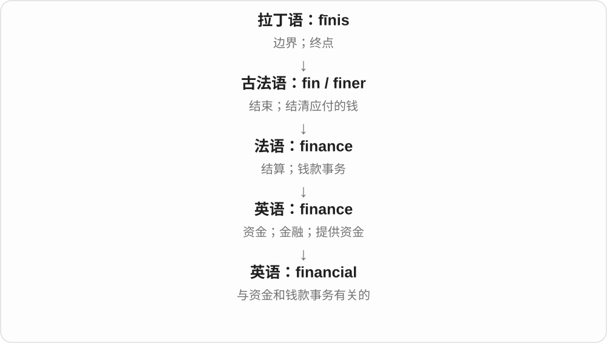
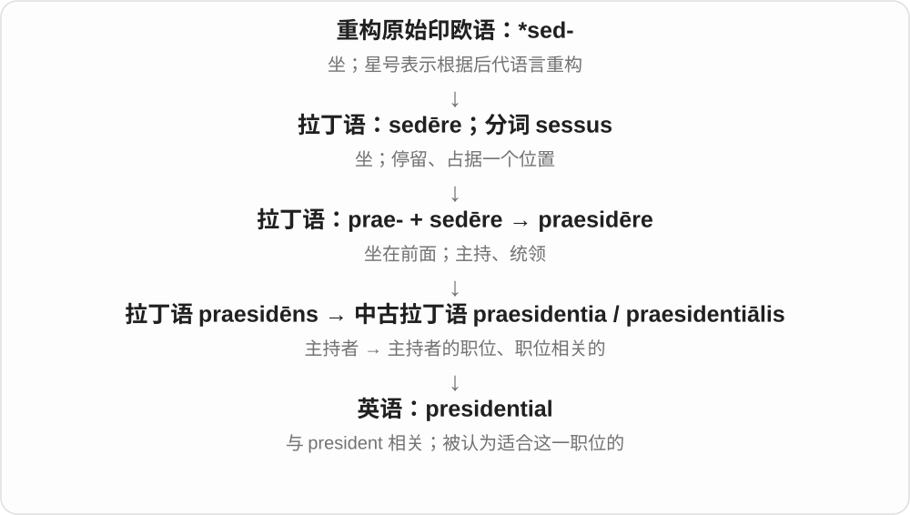
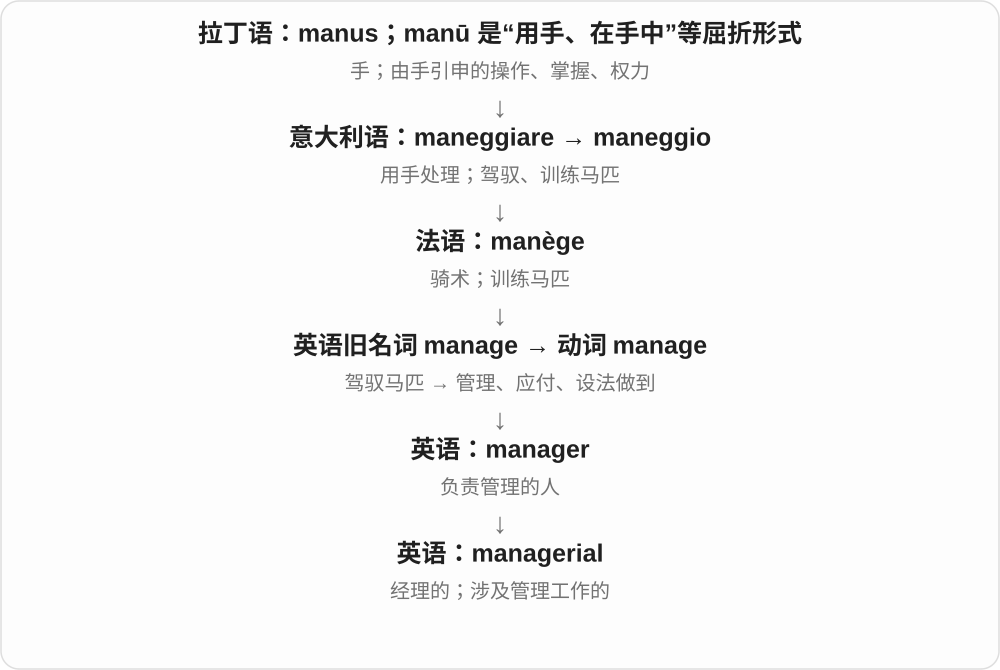
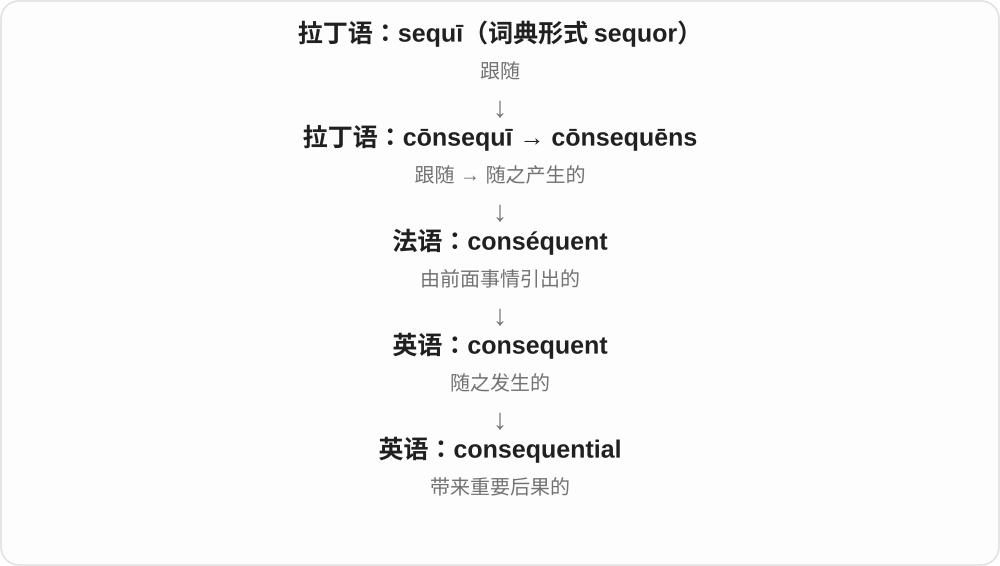
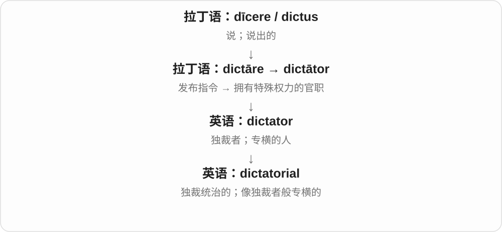
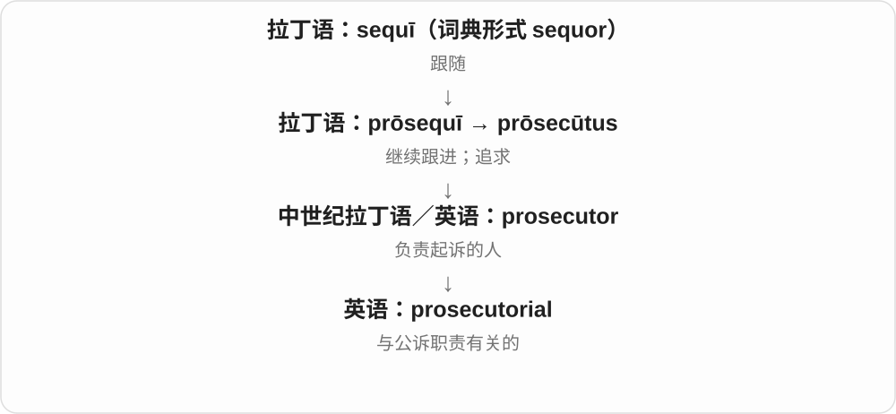
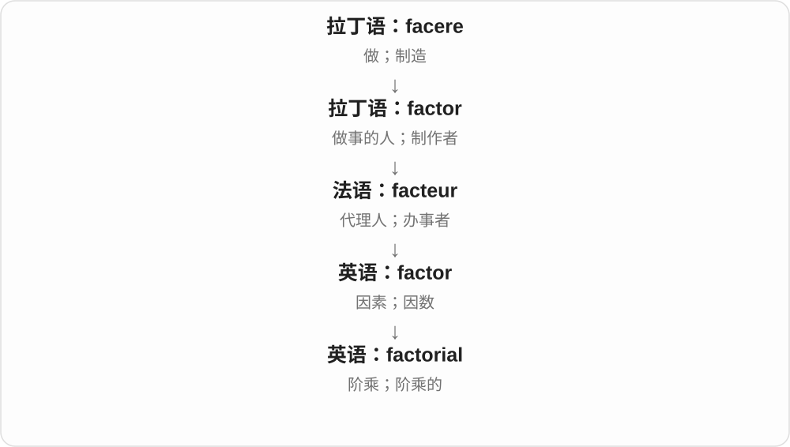
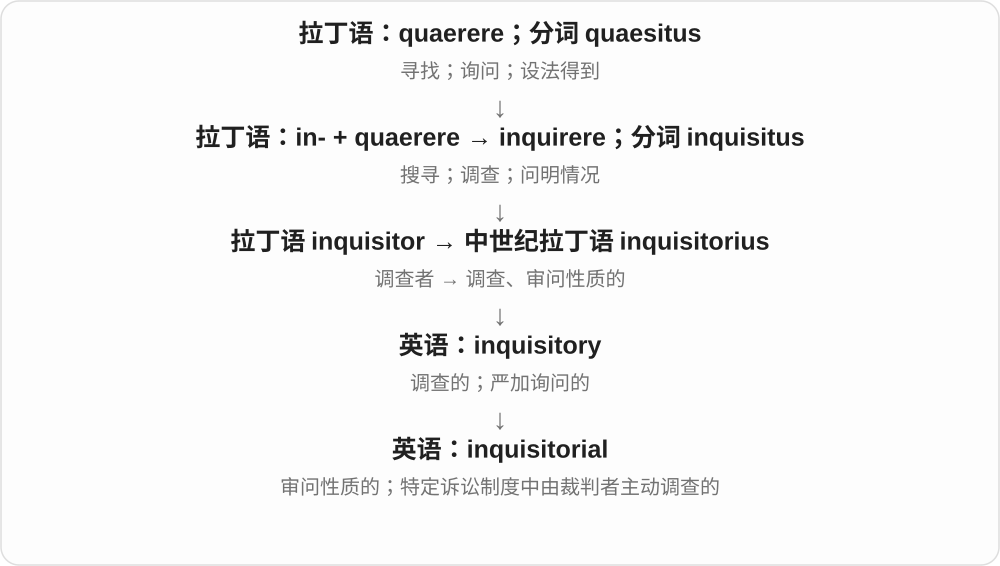

# 0657 · -ial — 与……有关；具有相应性质

[逐词精讲目录](../00_逐词精讲目录.md) · [总目录](../00_总目录_按常用程度.md)

## 核心词根与来源

先看它与哪个词、哪个领域连着。financial plan 是财务计划，presidential election 是总统选举，torrential rain 是倾盆雨；有的很透明，有的必须查借入历史。

**-IAL：把相关领域、对象或性质连起来**

finance／financial 金融、财务相关；torrent／torrential 像急流倾下；jovial 则有木星与旧占星观念的历史，不能硬拆成 joy。

- **急流与倾泻**：torrent · torrential
- **旧占星命名到性情**：jovial
- **财务、政治和地方**：financial · presidential · provincial · ministerial
- **管理、学习和写作**：managerial · tutorial · editorial · authorial
- **场景、结果和关系**：circumstantial · consequential · tangential · referential

## 词形与演化规律

与 -al 相联，接拉丁 -ialis，i 有时属于原词干，后来也被当作连接成分。不能每次都给 i 编一个独立词义。financial 等常有法语、拉丁语历史；torrent／torrential 可以作现代词形对应看；jovial 接 Iov-、Jove 的神名材料。整词重音和末段发音会变化，不能总用基础词读音原样相加。

## 单词速览（按词族由简到繁）

同一基础词的相关扩展放在一起，先读基础形式，再读扩展；各组之间优先读常用的。具体词源关系见各词讲解。

| 单词 | 音标 | 核心意思 |
|---|---|---|
| [financial](#w-1) | /faɪˈnænʃəl/；也读 /fɪˈnænʃəl/ | 财务的；金融的 |
| [presidential](#w-2) | /ˌprezɪˈdenʃəl/ | 总统的；主席、总裁职位相关的；有总统风范的 |
| [racial](#w-3) | /ˈreɪʃəl/ | 种族的；与种族有关的 |
| [editorial](#w-4) | 英 /ˌedɪˈtɔːriəl/；美 /ˌedɪˈtɔːriəl/ | 编辑的、编务的；社论 |
| [provincial](#w-5) | 英、美 /prəˈvɪnʃəl/ | 省级的；地方的；眼界狭窄的 |
| [tutorial](#w-6) | 英 /tjuːˈtɔːriəl/；美 /tuːˈtɔːriəl/ | 辅导课；教程、操作指南；辅导的 |
| [managerial](#w-7) | 英 /ˌmænɪˈdʒɪəriəl/；美 /ˌmænɪˈdʒɪriəl/ | 管理方面的；经理、主管的 |
| [ministerial](#w-8) | 英 /ˌmɪnɪˈstɪəriəl/；美 /ˌmɪnɪˈstɪriəl/ | 部长的；牧师的；依规定执行的 |
| [torrent](#w-32) | 英 /ˈtɒrənt/；美 /ˈtɔːrənt/ 或 /ˈtɑːrənt/ | 急流；奔流；大量涌来的事物 |
| [torrential](#w-17) | /təˈrenʃl/ | 倾泻般的；湍急猛烈的 |
| [entrepreneurial](#w-9) | 英 /ˌɒntrəprəˈnɜːriəl/；美 /ˌɑːntrəprəˈnɜːriəl/ | 创业的、有创业精神的、善于开创的 |
| [exponential](#w-10) | 英、美 /ˌekspəˈnenʃəl/ | 指数的；按比例成倍增长的 |
| [microbial](#w-11) | 英 /maɪˈkrəʊbiəl/；美 /maɪˈkroʊbiəl/ | 微生物的；由微生物引起或参与的 |
| [gubernatorial](#w-12) | 英 /ˌɡuːbənəˈtɔːriəl/；美 /ˌɡuːbərnəˈtɔːriəl/ | 美国州长的；州长职位相关的 |
| [circumstantial](#w-13) | 英 /ˌsɜːkəmˈstænʃəl/；美 /ˌsɜːrkəmˈstænʃəl/ | 间接的；与情况有关的；详述细节的 |
| [proverbial](#w-14) | 英 /prəˈvɜːbiəl/；美 /prəˈvɜrbiəl/ | 谚语中的；众所周知的；典型到常被提起的 |
| [consequential](#w-15) | 英 /ˌkɒnsɪˈkwenʃəl/；美 /ˌkɑːnsəˈkwenʃəl/ | 影响重大的；随之产生的 |
| [dictatorial](#w-16) | 英 /ˌdɪktəˈtɔːriəl/；美 /ˌdɪktəˈtɔːriəl/ | 独裁的；专横的 |
| [jovial](#w-18) | 英 /ˈdʒəʊviəl/；美 /ˈdʒoʊviəl/ | 快活友善的；开朗愉快的 |
| [tangential](#w-19) | /tænˈdʒenʃəl/ | 切线方向的；仅有间接关系的；离题的 |
| [referential](#w-20) | 英、美 /ˌrefəˈrenʃəl/ | 指称的；涉及参照或引用的 |
| [prosecutorial](#w-21) | 英 /ˌprɒsɪkjuːˈtɔːriəl/；美 /ˌprɑːsəkjuːˈtɔːriəl/ | 检察工作的；公诉方的 |
| [curatorial](#w-22) | 英 /ˌkjʊərəˈtɔːriəl/；美 /ˌkjʊrəˈtɔːriəl/ | 策展的；馆藏管理的 |
| [factorial](#w-23) | /fækˈtɔːɹi.əl/ | 阶乘；阶乘的 |
| [janitorial](#w-24) | /ˌdʒænɪˈtɔːriəl/ | 楼宇保洁维护的；清洁工作的 |
| [sartorial](#w-25) | 英 /sɑːˈtɔːriəl/；美 /sɑːrˈtɔːriəl/ | 服装的；穿着打扮方面的 |
| [authorial](#w-27) | /ɔːˈθɔːriəl/ | 作者的；体现作者意图或风格的 |
| [ambassadorial](#w-28) | 英 /æmˌbæsəˈdɔːriəl/；美 /æmˌbæsəˈdɔːriəl/ | 大使的；与大使职责有关的 |
| [inferential](#w-30) | 英、美 /ˌɪnfəˈrenʃəl/ | 推理的；推断得出的 |
| [inquisitorial](#w-31) | 英 /ɪnˌkwɪzɪˈtɔːriəl/；美 /ɪnˌkwɪzəˈtɔriəl/ | 盘问式的；审问的；调查式诉讼的 |

## 逐词讲解

### 1. financial — 财务的；金融的

**音标**：/faɪˈnænʃəl/；也读 /fɪˈnænʃəl/

**先抓住这个画面**

financial 就是“与钱怎样进来、出去、筹到和管理有关”。financial trouble 不是钱包难用，而是钱周转出了问题。

**怎么拆**

finance + -ial，去掉词末 e，再形成形容词。末尾这部分读 /ʃəl/，不是把 finance 原样读完再加一个音节。

**怎么变成今天的意思**

finance 已从“结清钱款”发展到资金管理；financial 再把它变成描述某种状况、机构或活动的词。

**常见搭配与例句**

financial support（资金支持）；financial problems（财务问题）；a financial report（财务报告）。

> The project needs financial support from several organizations.

这个项目需要几个组织提供资金支持。

> She reads the financial report before each meeting.

每次开会前，她都会阅读财务报告。

**别混淆**

financial 常聚焦资金、账目和融资；economic 更常谈经济活动、生产消费和整体经济状况。

### 2. presidential — 总统的；主席、总裁职位相关的；有总统风范的

**音标**：/ˌprezɪˈdenʃəl/

**先抓住这个画面**

presidential 把某项活动或表现连到 president 的职位上：选举、职责、办公室，或被认为适合这个职位的举止。

**怎么拆**

现代可拆 president + -ial；词源也可追到中古拉丁 praesidentiālis，与 praesidentia“主持者职位”相连。

**怎么变成今天的意思**

presidential election 多译总统选举；presidential manner 是被评价为有领导风范。后者是评价，不是证明某人实际担任总统。

**常见搭配与例句**

a presidential election；presidential duties；look presidential。

> The museum displays documents from an early presidential election.

博物馆展出了早期总统选举的文件。

> The speech was praised for its calm, presidential tone.

这篇讲话因语气镇定、有总统风范而受到称赞。

**别混淆**

president 是人或职位称谓；presidential 是形容词，修饰与该职位相关的事物。

### 3. racial — 种族的；与种族有关的

**音标**：/ˈreɪʃəl/

**先抓住这个画面**

只说这件事涉及种族分类、身份或关系；本身还没说立场是支持还是反对歧视。

**怎么拆**

race 的种族分支 + -ial，去 e，形成相关形容词；读音中 c 对应 /ʃ/，和 racism 中 /s/ 不同。

**怎么变成今天的意思**

**另一支：法语 race、意大利语 razza → 英语群体 race**  
血统、类别等，更远来源不确定

↓

**race + -ial → racial**  
种族 → 与种族有关的

racial identity 种族身份，racial equality 种族平等，racial discrimination 种族歧视；被修饰的名词决定具体在讲什么。

**常见搭配与例句**

racial equality；racial identity；racial discrimination；racial diversity。

> The course discusses racial identity in literature.

课程讨论文学中的种族身份。

> The organisation works to promote racial equality.

这个组织致力于促进种族平等。

**别混淆**

racial 种族相关，racist 种族主义的；racial equality 种族平等恰恰不是 racist equality。

### 4. editorial — 编辑的、编务的；社论

**音标**：英 /ˌedɪˈtɔːriəl/；美 /ˌedɪˈtɔːriəl/

**先抓住这个画面**

editorial team 是做内容编辑的一组人；an editorial 则是表达报刊立场、观点的评论文章。不是所有被编辑过的文章都自动是社论。

**怎么拆**

editor + -ial，先形成与编辑有关的形容词；名词从相关评论文章用法发展。重音移到 -tor- 部分。

**怎么变成今天的意思**

**拉丁 ēdere〔给出、发布〕→ ēditor → 英语 editor**  
发布、把作品推出去的人

↓

**editor + -ial → editorial〔形容词〕→ 社论名词**  
编务相关 → 编辑立场的评论文章

an editorial team 编辑团队，editorial policy 编辑方针，write an editorial 写社论，an editorial on education 关于教育的社论。

**常见搭配与例句**

an editorial team；editorial policy；write an editorial；an editorial on。

> The editorial team meets every Monday.

编辑团队每周一开会。

> The newspaper published an editorial on public transport.

报纸发表了一篇讨论公共交通的社论。

**别混淆**

editorial 社论常表达立场，news report 新闻报道以报道事实为主；editorial work 则是编务，不是每项工作都在写社论。

### 5. provincial — 省级的；地方的；眼界狭窄的

**音标**：英、美 /prəˈvɪnʃəl/

**先抓住这个画面**

本来只说与某个省或地方有关；带贬义时，则暗示只熟悉小圈子、见识不够开阔。

**怎么拆**

拉丁语 provincia → provincialis，经古法语 provincial 进入英语。现代可看出 province 与 -ial 的联系，远源争议随 province 保留。

**怎么变成今天的意思**

**拉丁语 provincia → provincialis**  
辖区 → 省区的；provincia 的更早来源未定

↓

**古法语 provincial → 英语 provincial**  
地方的；后引申为视野局促的

a provincial government 是省级政府，中性；provincial attitudes 常是批评眼界狭窄。不能一见这个词就把地方居民翻成没见识的人。

**常见搭配与例句**

provincial government；a provincial town；a provincial outlook。

> The provincial government announced a new transport plan.

省政府公布了一项新的交通计划。

> Travel challenged some of his provincial assumptions.

旅行冲击了他一些眼界狭窄的想当然。

**别混淆**

local 只是当地的；provincial 的贬义要靠上下文判断，不能从地域自动推断性格。

### 6. tutorial — 辅导课；教程、操作指南；辅导的

**音标**：英 /tjuːˈtɔːriəl/；美 /tuːˈtɔːriəl/

**先抓住这个画面**

tutor 带你学，tutorial 就是这类辅导，或者把一步步指导做成文字、视频。大学小组讨论课与网上教程共享引导学习的核心。

**怎么拆**

tutor + -ial，先作与辅导教师有关的形容词，再转为辅导课、教程名词。

**怎么变成今天的意思**

**拉丁 tueor 看护、保护 → tutor 看护者**  
经法语 tuteur、中古英语 tutour → tutor

↓

**tutor + -ial → tutorial**  
辅导的 → 辅导课、文字或视频教程

a video tutorial 视频教程，a tutorial on editing 编辑教程，attend a tutorial 上辅导课。

**常见搭配与例句**

a video tutorial；a tutorial on；a tutorial group。

> The tutorial shows how to edit a short video.

教程演示怎样剪辑一段短视频。

> We discussed the essay in a small tutorial group.

我们在小组辅导课里讨论了文章。

**别混淆**

tutorial 往往引导你做、学某件事；manual 手册可更全面地供查阅，实际作品也有重叠。

### 7. managerial — 管理方面的；经理、主管的

**音标**：英 /ˌmænɪˈdʒɪəriəl/；美 /ˌmænɪˈdʒɪriəl/

**先抓住这个画面**

managerial 把注意力放在“管人、管事”的职责上，像排计划、协调资源、作出组织决定。

**怎么拆**

manager + -ial，形成与管理者、管理职责相关的形容词。

**怎么变成今天的意思**

managerial skills 是管理能力；a managerial position 是管理岗位，不要求职位名称一定写 manager。

**常见搭配与例句**

managerial responsibility；managerial skills；a managerial role。

> The promotion brought new managerial responsibilities.

晋升带来了新的管理职责。

> She has technical expertise but little managerial experience.

她有专业技术知识，但管理经验不多。

**别混淆**

technical skills 是专业技术能力；managerial skills 是组织协调能力，一个岗位可能同时需要两者。

### 8. ministerial — 部长的；牧师的；依规定执行的

**音标**：英 /ˌmɪnɪˈstɪəriəl/；美 /ˌmɪnɪˈstɪriəl/

**先抓住这个画面**

通常是在说部长或牧师的职责；某些行政法律语境则强调照章办事，不自行裁量。

**怎么拆**

借自法语 ministeriel，追到拉丁语 ministerialis，与 ministerium“服务、职务”相关；现代可对照 minister + -ial 理解。

**怎么变成今天的意思**

**拉丁语：minor / minus**  
较小、较少；小于另一方

↓

**拉丁语：minister**  
居从属位置的服务者、助手

↓

**拉丁语 ministerium**  
服务、职务

↓

**拉丁语 ministerialis → 法语 ministeriel → 英语 ministerial**  
职务相关的；部长、牧师的

a ministerial meeting 是部长级会议。ministerial duty 在某些法律语境中指依法必须执行的程序性职责，不能一律译成部长职责。

**常见搭配与例句**

ministerial responsibility；ministerial duties；a ministerial meeting。

> The issue will be discussed at a ministerial meeting.

这个问题将在部长级会议上讨论。

> The article distinguishes ministerial duties from discretionary decisions.

文章区分了照章执行的职责和可自行裁量的决定。

**别混淆**

ministerial 可涉政治或宗教；administrative 通常指一般事务管理。

### 9. torrent — 急流；奔流；大量涌来的事物

**音标**：英 /ˈtɒrənt/；美 /ˈtɔːrənt/ 或 /ˈtɑːrənt/

**先抓住这个画面**

不是一点点滴，而是一大股水猛冲下来，是 a torrent；骂声、消息一下涌来，也像水流一样。

**怎么拆**

经法语、意大利语等相应形式接拉丁 torrens、torrent-。历史形容词有汹涌、猛烈等义，不是今天 tor 山丘 + rent 租金的组合。

**怎么变成今天的意思**

**拉丁 torrens、torrent- → 法语等相应形式**  
奔腾、汹涌的水流；词族还关联烘烤、炽烈等材料

↓

**英语 torrent → torrential**  
急流、大量涌来；倾泻般的

a torrent of water 一股急流；a torrent of criticism 一片猛烈批评；torrents of rain 倾盆大雨。

**常见搭配与例句**

a torrent of；torrents of rain。

> Rain turned the narrow stream into a torrent.

雨把狭窄溪流变成了急流。

> The decision drew a torrent of criticism.

这个决定招来了一片猛烈批评。

**别混淆**

torrent 是猛烈奔流；stream 更一般说流。网络里的 torrent 还有特定文件共享语境，不从普通急流义推定每一种技术细节。

### 10. torrential — 倾泻般的；湍急猛烈的

**音标**：/təˈrenʃl/

**先抓住这个画面**

雨下得像一股股水往下倒，最常说 torrential rain；不是任何小雨都配这个强度词。

**怎么拆**

torrent + -ial → torrential。字形能看见 torrent，整词的重音、末段读音会变，按完整音标记。

**怎么变成今天的意思**

**拉丁 torrens、torrent- → 法语等相应形式**  
奔腾、汹涌的水流；词族还关联烘烤、炽烈等材料

↓

**英语 torrent → torrential**  
急流、大量涌来；倾泻般的

torrential rain 倾盆大雨；torrential downpours 暴雨。

**常见搭配与例句**

torrential rain；torrential downpours。

> The match was cancelled because of torrential rain.

比赛因倾盆大雨取消。

> Torrential downpours flooded the streets.

暴雨淹了街道。

**别混淆**

torrential 强调水流、降雨猛烈；frequent rain 只说下雨频繁，频繁也可能每次都很小。

### 11. entrepreneurial — 创业的、有创业精神的、善于开创的

**音标**：英 /ˌɒntrəprəˈnɜːriəl/；美 /ˌɑːntrəprəˈnɜːriəl/

**先抓住这个画面**

看到机会就主动组织资源、想办法做出新业务，这种劲头可叫 entrepreneurial。它也能描述已有组织中的开创能力，不只给公司创始人用。

**怎么拆**

entrepreneur + -ial，形成相关性质形容词，增加 -ial 后尾部读出 /riəl/。

**怎么变成今天的意思**

**古法语 entreprendre 承担、着手**  
entre- + prendre 拿取；词整体已有承担事业义

↓

**entrepreneur 承担、经营者 → 英语**  
历史借入、再借入，发展为创业经营者

↓

**英语后缀扩展**  
entrepreneurship 创业活动、精神；entrepreneurial 创业相关性质

entrepreneurial skills 创业能力，an entrepreneurial spirit 创业、开拓精神，an entrepreneurial approach 主动开创新机会的做法。

**常见搭配与例句**

an entrepreneurial spirit；entrepreneurial skills。

> She brought an entrepreneurial spirit to the community project.

她为社区项目带来了主动开创的精神。

> The workshop helps students develop entrepreneurial skills.

工作坊帮助学生发展创业能力。

**别混淆**

entrepreneurial 是性质，entrepreneur 是人，entrepreneurship 是活动或精神；不是用长短程度区分职位高低。

### 12. exponential — 指数的；按比例成倍增长的

**音标**：英、美 /ˌekspəˈnenʃəl/

**先抓住这个画面**

每一步都乘上相同的倍数，越往后增加的量越大。

**怎么拆**

exponent + -ial，数学中的 exponent 是指数；派生后重音移到 -nen-。

**怎么变成今天的意思**

**拉丁语 pōnere；过去分词 positus**  
放、安置；已经放好的

↓

**拉丁 ex- + pōnere → expōnere → expōnēns**  
摆出来、解释 → 展示或解释者

↓

**英语 exponent**  
阐述者、代表人物；数学中的指数

↓

**英语 exponent + -ial → exponential**  
与指数有关的；按指数规律变化的

每小时翻倍是指数增长；每小时增加十个是线性增长。exponential function 也可表示衰减，不能把这个词一律译成“暴涨”。

**常见搭配与例句**

exponential growth；exponential decay；an exponential function。

> A population that doubles each year follows exponential growth.

一个每年翻倍的种群遵循指数增长规律。

> The model uses an exponential decay curve.

这个模型使用指数衰减曲线。

**别混淆**

rapid 只说快；exponential 在严格语境中要求特定的倍增或衰减规律。

### 13. microbial — 微生物的；由微生物引起或参与的

**音标**：英 /maɪˈkrəʊbiəl/；美 /maɪˈkroʊbiəl/

**先抓住这个画面**

从微生物本身转到它们的活动、群落和作用。

**怎么拆**

现代可分析 microbe 去 e + -ial；历史词源也联系新拉丁 microbion + -al，属于近代微生物命名词族。

**怎么变成今天的意思**

**希腊 mikros 小 → 组合形式 micro-**  
通常说小；在计量单位前严格表示百万分之一

↓

**法语 microbe 与相应新拉丁 microbion**  
微生物的近代名称

↓

**英语 microbial**  
接这组词干形成形容词；现代与 microbe + -ial 对应

microbial activity 是微生物活动；microbial contamination 是微生物污染。并非出现 microbial 就一定在说危险，也可能是发酵或生态分解。

**常见搭配与例句**

microbial activity；microbial growth；microbial communities；microbial contamination。

> Warm conditions increased microbial activity in the compost.

温暖条件增强了堆肥中的微生物活动。

> The study compares microbial communities in two lakes.

这项研究比较了两个湖泊中的微生物群落。

**别混淆**

bacterial 专指细菌相关；microbial 可以涉及更广的微生物。不要把两个范围一概等同。

### 14. gubernatorial — 美国州长的；州长职位相关的

**音标**：英 /ˌɡuːbənəˈtɔːriəl/；美 /ˌɡuːbərnəˈtɔːriəl/

**先抓住这个画面**

新闻里读到 gubernatorial election，直接理解为“州长选举”。这个长词保留了 governor 背后更古老的拉丁词形。

**怎么拆**

由拉丁 gubernator“治理者、州长这一职称的上游词”配合英语形容词构词形式 -ial，形成 gubernatorial。它与 governor 是同族不同形，不是英语 governor 按规则改一个词尾就自动变来的。

**怎么变成今天的意思**

**希腊 kybernan → 拉丁 gubernare → gubernator**  
掌舵 → 治理 → 治理者

↓

**拉丁词干 gubernator- + 形容词构词形式 → gubernatorial**  
英语中州长职务相关的，尤见美国用法

常修饰 election、candidate、campaign、race，谈竞选州长或州长职务事务。它不是一般的“政治的”或“政府的”，也不用于把市长选举说得更正式。

**常见搭配与例句**

a gubernatorial election；a gubernatorial candidate；a gubernatorial campaign；the gubernatorial race。

> Two candidates remained in the gubernatorial race.

州长竞选中还剩两名候选人。

> Education was a central issue in the gubernatorial debate.

教育是州长候选人辩论中的一个核心议题。

**别混淆**

governmental 是政府相关，gubernatorial 是州长职务相关；presidential 是总统相关，mayoral 是市长相关。

### 15. circumstantial — 间接的；与情况有关的；详述细节的

**音标**：英 /ˌsɜːkəmˈstænʃəl/；美 /ˌsɜːrkəmˈstænʃəl/

**先抓住这个画面**

没有直接拍到事情发生，却能从时间、物品和其他周边事实推断，这类证据常叫 circumstantial evidence。

**怎么拆**

拉丁语 circumstantia 的基础加形容词后缀；现代可对照 circumstance + -ial。

**怎么变成今天的意思**

重点在由周边情况作推断，不是亲眼直接看见。正式旧用法也可指把具体情节讲得很详细。

**常见搭配与例句**

circumstantial evidence；a circumstantial account；purely circumstantial。

> The detective assembled several pieces of circumstantial evidence.

侦探收集了几项间接证据。

> The connection remained circumstantial rather than directly observed.

这种联系仍是根据周边情况推断出来的，没有被直接观察到。

**别混淆**

circumstantial evidence 不等于无效证据，也不自动等于充分证据；词本身只说明间接推断的类型。

### 16. proverbial — 谚语中的；众所周知的；典型到常被提起的

**音标**：英 /prəˈvɜːbiəl/；美 /prəˈvɜrbiəl/

**先抓住这个画面**

一句熟话里的形象，被借到眼前的场景；或者某种特点出名到人人都知道。

**怎么拆**

接晚期拉丁 proverbialis，来自 proverbium；现代能联系 proverb + -ial，但保留拉丁形容词借入史。

**怎么变成今天的意思**

**拉丁 verbum**  
词；话语

↓

**拉丁 proverbium → proverbialis**  
谚语 → 谚语相关的

↓

**英语 proverbial**  
谚语中的；广为人知、典型的

the proverbial needle in a haystack 借大家熟悉的“大海捞针”式形象；his proverbial patience 是他出了名的耐心，不要求真有一句古谚语专门写他。

**常见搭配与例句**

the proverbial needle in a haystack；proverbial wisdom；proverbial patience。

> Finding the missing file felt like searching for the proverbial needle in a haystack.

找那份丢失的文件，感觉就像人们常说的大海捞针。

> Even her proverbial patience began to wear thin.

连她那出了名的耐心也开始耗尽了。

**别混淆**

proverbial 可指真正谚语里的内容，也可泛指出了名的特点。它不是“动词之前的”，pro- 在这里不能机械按位置拆。

### 17. consequential — 影响重大的；随之产生的

**音标**：英 /ˌkɒnsɪˈkwenʃəl/；美 /ˌkɑːnsəˈkwenʃəl/

**先抓住这个画面**

一个看似小的决定能把后面许多事情一起带动，它就是 consequential：后果有分量。

**怎么拆**

consequent + -ial，构成描述性质的形容词。

**怎么变成今天的意思**

重要义来自“会产生重要后果”。专业文字中也可直接表示由前事引起的，比如 consequential changes。

**常见搭配与例句**

a consequential decision；a consequential change；consequential effects。

> Choosing the site was a consequential decision.

选址是一个影响重大的决定。

> The report overlooks several consequential changes.

报告忽略了几项影响重大的变化。

**别混淆**

consequent 通常说随之而来的；consequential 很常强调影响重大。confidential“保密的”则完全不同。

### 18. dictatorial — 独裁的；专横的

**音标**：英 /ˌdɪktəˈtɔːriəl/；美 /ˌdɪktəˈtɔːriəl/

**先抓住这个画面**

别人还没来得及讨论，就听到一句“按我说的办”。dictatorial 形容这种不容别人参与或反对的作风。

**怎么拆**

dictator + -ial，构成描述其制度或行为方式的形容词，重音随词尾改变。

**怎么变成今天的意思**

它既能形容政权，也能批评管理风格。形容普通老板时，通常是比喻他控制欲强、不给人商量余地。

**常见搭配与例句**

a dictatorial regime；a dictatorial manner；dictatorial control。

> Her dictatorial manner discouraged people from offering ideas.

她专横的作风让大家不敢提出想法。

> The essay examines the rise of dictatorial power.

文章考察了独裁权力的兴起。

**别混淆**

decisive 是能果断作决定；dictatorial 是专横地替所有人作决定。果断本身不等于专横。

### 19. jovial — 快活友善的；开朗愉快的

**音标**：英 /ˈdʒəʊviəl/；美 /ˈdʒoʊviəl/

**先抓住这个画面**

一进门就热情说笑，让周围也松快起来，这种开心、好相处的气氛或人可叫 jovial。

**怎么拆**

经法语、意大利语或晚期拉丁 Iovialis 的材料，原与 Jupiter、Jove 木星、朱庇特相关。旧占星观念认为受木星影响者乐观开朗，因而发展出快活义；这是词义历史，不是性格的科学解释。

**怎么变成今天的意思**

**拉丁 Iov- 等 + -alis → Iovialis**  
与朱庇特、木星有关的

↓

**欧洲语言 jovial 等 → 英语 jovial**  
受旧占星性情观念影响，走向快活友善

a jovial host 快活热情的主人；a jovial mood 欢快心情。

**常见搭配与例句**

a jovial manner；a jovial laugh。

> Our jovial host greeted everyone with a joke.

快活热情的主人用一个笑话迎接大家。

> The meeting ended in a jovial mood.

会议在轻松愉快的气氛中结束。

**别混淆**

jovial 是开朗快活，juvenile 是少年、幼稚的；相近开头不代表同一意思。它也不是 joy 后面直接加 vial。

### 20. tangential — 切线方向的；仅有间接关系的；离题的

**音标**：/tænˈdʒenʃəl/

**先抓住这个画面**

数学里沿切线方向，讨论里只是擦到主题边缘。

**怎么拆**

tangent + -ial；中间 -ti- 常读 /ʃ/，重音从 tangent 开头移到后面。

**怎么变成今天的意思**

**拉丁 tangere；完成分词 tactus**  
碰、触及、达到

↓

**拉丁 tangens → 英语 tangent**  
触及的 → 切线；偏离主题的支线

↓

**英语 tangent + -ial → tangential**  
沿切线的；仅间接相关的

tangential velocity 是沿切线方向的速度；a tangential remark 是与中心问题只有边缘联系的评论。后者未必完全无关，却容易把话题带远。

**常见搭配与例句**

tangential velocity；tangential force；tangential to；a tangential remark。

> The wheel’s rim has a tangential velocity at each point.

轮缘上每一点的速度都沿相应的切线方向。

> That historical detail is tangential to our main question.

那个历史细节与我们的主要问题只有间接联系。

**别混淆**

irrelevant 可以完全无关；tangential 常保留一点关联，只是关联碰到边缘，没进入核心。

### 21. referential — 指称的；涉及参照或引用的

**音标**：英、美 /ˌrefəˈrenʃəl/

**先抓住这个画面**

一个词、符号或记录，能把人引向它所对应的另一个对象。

**怎么拆**

reference + -ial，名词词尾改成 -ential 的形容词形式。

**怎么变成今天的意思**

**拉丁语：ferre；第一人称 ferō**  
带、承载；承受；生出

↓

**拉丁语：re- + ferre → referre**  
带回；报告；提交处理

↓

**两种分析：英语 refer 加名词后缀；或法语 référence 借入**  
法语支线常追到中世纪拉丁 \*referentia；此形式在部分词源资料中标为重构

↓

**英语：reference**  
提及；参照、引用；推荐证明

↓

**英语：reference → referential**  
具有指称或参照作用的

referential meaning 着眼于表达指向什么。数据库中的 referential integrity 要求相关引用保持有效，如订单引用的客户确实存在。

**常见搭配与例句**

referential meaning；referential expression；referential integrity。

> The essay examines the referential meaning of the phrase.

这篇文章讨论该短语的指称意义。

> Deleting that customer would break referential integrity.

删除那个客户会破坏引用完整性。

**别混淆**

referential 说是否在指向某物；reverential 是恭敬的，拼写与来源都不同。

### 22. prosecutorial — 检察工作的；公诉方的

**音标**：英 /ˌprɒsɪkjuːˈtɔːriəl/；美 /ˌprɑːsəkjuːˈtɔːriəl/

**先抓住这个画面**

把镜头从“谁起诉”转到“这是谁的职责、权限或行为”：与公诉工作相关，就是 prosecutorial。

**怎么拆**

prosecutor + -ial，形成相关性质的形容词。

**怎么变成今天的意思**

常见于讨论权力、判断和职业行为的正式文字。它描述职能来源，不自行评价行为好坏。

**常见搭配与例句**

prosecutorial decisions；prosecutorial discretion；prosecutorial conduct。

> The report reviews prosecutorial decisions in several cases.

报告审视了几起案件中的公诉决定。

> The course includes a discussion of prosecutorial ethics.

课程包含对检察职业伦理的讨论。

**别混淆**

judicial 是司法、审判相关的更宽词或特指法官职责；prosecutorial 明确指公诉方工作。

### 23. curatorial — 策展的；馆藏管理的

**音标**：英 /ˌkjʊərəˈtɔːriəl/；美 /ˌkjʊrəˈtɔːriəl/

**先抓住这个画面**

展品怎么选、故事怎么讲、藏品怎么照管，这些专业判断属于 curatorial work。

**怎么拆**

curator + -ial，形成“与馆藏管理或策展有关的”形容词。

**怎么变成今天的意思**

它可描述团队、决策和实践。不是展览里每一件搬运或售票工作都自动叫 curatorial。

**常见搭配与例句**

a curatorial team；curatorial decisions；curatorial practice。

> The curatorial team chose a chronological arrangement.

策展团队选择按时间顺序布展。

> The archive records the curator’s early curatorial decisions.

档案记录了这位策展人早期的策展决策。

**别混淆**

curatorial 侧重藏品与展示内容的专业管理；administrative 更一般地指行政事务。

### 24. factorial — 阶乘；阶乘的

**音标**：/fækˈtɔːɹi.əl/

**先抓住这个画面**

从五开始往下，把五、四、三、二、一全部乘起来，得到的就是 five factorial，写作 5!。

**怎么拆**

factor + -ial，和因数、相乘有关；数学中固定为阶乘术语。

**怎么变成今天的意思**

把一串整数作乘法因子连接起来，形成特殊运算名称。非负整数阶乘里约定 0! = 1。

**常见搭配与例句**

five factorial；factorial notation；a factorial expression。

> Five factorial equals one hundred and twenty.

五的阶乘等于一百二十。

> The exclamation mark denotes a factorial here.

这里的感叹号表示阶乘。

**别混淆**

factor 是因数，factorial 是阶乘，后缀改变后不是“比较大的因数”。

### 25. janitorial — 楼宇保洁维护的；清洁工作的

**音标**：/ˌdʒænɪˈtɔːriəl/

**先抓住这个画面**

把清洁、整理和日常照管这些工作，作为一类服务来说明。

**怎么拆**

英语 janitor + -ial，形成表示相关工作的形容词。它不是另一个职业名称，也不是 January 的形容词。

**怎么变成今天的意思**

**拉丁 ianua → ianitor**  
门、入口 → 看门的人

↓

**英语 janitor**  
早期迎接、看门的人 → 建筑的清洁与日常维护人员

↓

**英语 janitor + -ial → janitorial**  
与清洁维护人员及其工作有关的

janitorial services 常指为办公楼、学校等提供保洁服务；janitorial supplies 是这类工作使用的清洁用品。公司招标、物业安排或职位描述里很常见。它强调服务类别，不必机械译成看门的。

**常见搭配与例句**

janitorial services；janitorial staff；janitorial supplies；janitorial work。

> The office hired a company to provide janitorial services.

办公室请了一家公司提供保洁服务。

> Janitorial supplies are stored in the locked cupboard.

保洁用品存放在上锁的柜子里。

**别混淆**

janitor 是做这项工作的人，janitorial 描述相关服务、用品或职责。cleaning 更通用，janitorial 常用于楼宇和机构场景。

### 26. sartorial — 服装的；穿着打扮方面的

**音标**：英 /sɑːˈtɔːriəl/；美 /sɑːrˈtɔːriəl/

**先抓住这个画面**

把镜头对准一个人怎么穿衣、衣服怎么剪裁搭配。

**怎么拆**

拉丁 sarcire 缝补的分词词干 sart- → 晚期拉丁 sartor 裁缝 → 新拉丁 sartorius 裁缝的 → sartorial。

**怎么变成今天的意思**

**拉丁 sarcire／sart- → sartor**  
缝补 → 裁缝

↓

**新拉丁 sartorius → 英语 sartorial**  
裁缝的 → 剪裁、服装与穿着方面的

sartorial choices 就是穿衣选择，sartorial elegance 就是穿着优雅。这是时尚评论或带点幽默的正式说法；你可以理解成“在穿衣这件事上”。词本身没有保证穿得好，sartorial disaster 还可以说穿搭灾难。

**常见搭配与例句**

sartorial elegance；sartorial choices；sartorial style；a sartorial disaster。

> His sartorial choices became bolder after he left the office job.

离开办公室工作后，他的穿衣选择变得更大胆了。

> The magazine praised her sartorial elegance.

杂志称赞了她优雅的穿着。

**别混淆**

stylish 直接夸有型；sartorial 只是圈定服装穿搭这个领域。这里来自拉丁缝补，不是希腊 sarc- 肉。

### 27. authorial — 作者的；体现作者意图或风格的

**音标**：/ɔːˈθɔːriəl/

**先抓住这个画面**

把注意力放在写作背后那位作者的声音、选择和意图上。

**怎么拆**

author + -ial，形成“与作者有关”的形容词。

**怎么变成今天的意思**

**拉丁 augēre；分词 auctus**  
使增加、成长；已经增长的

↓

**拉丁 auctor → 古法语 autor／盎格鲁法语 autour → 中古英语 auctour**  
促成者、创始者 → 作者

↓

**现代英语 author**  
作者；某事的发起者；撰写

↓

**英语 author + -ial → authorial**  
属于作者、来自作者的

authorial voice 是作品中体现出来的作者风格或声音；authorial intention 是作者想表达什么。它不等于人物所说的每一句话都代表作者本人。

**常见搭配与例句**

authorial voice；authorial intention；authorial control。

> The revised chapter preserves her distinctive authorial voice.

修改后的章节保留了她鲜明的作者风格。

> The essay separates the narrator’s opinions from authorial intention.

这篇文章把叙述者的观点与作者意图区分开。

**别混淆**

authoritative 是可靠有权威的；authorial 只是与作者有关，不能用来夸一本资料准确。

### 28. ambassadorial — 大使的；与大使职责有关的

**音标**：英 /æmˌbæsəˈdɔːriəl/；美 /æmˌbæsəˈdɔːriəl/

**先抓住这个画面**

不再说这位大使是谁，而是说某项职责、任命、住所属于大使这个职位，就是 ambassadorial。

**怎么拆**

ambassador + -ial，形成相关形容词。重音转移到 /dɔː/，不是在 ambassador 原读音后随便附上一个词尾。

**怎么变成今天的意思**

**较早欧洲形式中与任务、差事、服务相关的成分**  
受派遣、执行使命的人

↓

**古法语、盎格鲁诺曼语 ambassadeur 等 → 英语 ambassador**  
正式使节、大使；后来也可说形象代表

↓

**ambassador + -ial → ambassadorial**  
大使职位、身份或职责相关的

ambassadorial duties 大使职责，an ambassadorial appointment 大使任命，an ambassadorial residence 大使官邸。正式文体中较常见。

**常见搭配与例句**

ambassadorial duties；an ambassadorial appointment。

> Her ambassadorial duties included attending official ceremonies.

她的大使职责包括参加正式典礼。

> The announcement concerned an ambassadorial appointment.

公告涉及一项大使任命。

**别混淆**

ambassadorial 比 diplomatic 外交的范围窄；一般外交工作、措辞不一定专属大使。

### 29. inferential — 推理的；推断得出的

**音标**：英、美 /ˌɪnfəˈrenʃəl/

**先抓住这个画面**

结论是沿着线索推出来的，证据没有把答案原样直接摆在你面前。

**怎么拆**

现代可按 inference + -ial 理解；词源还可分析为中世纪拉丁 inferentia 词干加英语 -al。

**怎么变成今天的意思**

**拉丁语：ferre；第一人称 ferō**  
带、承载；承受；生出

↓

**拉丁语：in- + ferre → inferre**  
带入；提出；推断

↓

**中世纪拉丁语：inferentia**  
推论

↓

**英语：inferentia 词干 + -al；亦分析为 inference + -ial**  
形成与推论有关的形容词

↓

**英语：inferential**  
推理的；根据推论得出的

inferential reasoning 是根据已知条件推结果。inferential statistics 则用样本帮助判断总体，并考虑不确定性。

**常见搭配与例句**

inferential reasoning；inferential evidence；inferential statistics。

> The detective’s argument was inferential rather than based on a confession.

侦探的论证来自推理，而非嫌疑人的供认。

> The course introduces descriptive and inferential statistics.

这门课介绍描述统计和推断统计。

**别混淆**

descriptive statistics 描述已收集的数据；inferential statistics 进一步估计或判断更大总体。

### 30. inquisitorial — 盘问式的；审问的；调查式诉讼的

**音标**：英 /ɪnˌkwɪzɪˈtɔːriəl/；美 /ɪnˌkwɪzəˈtɔriəl/

**先抓住这个画面**

inquisitorial 像一束不肯移开的灯，持续照着细节追问；在法律术语里，也可以中性地描述主动调查事实的制度。

**怎么拆**

与 inquisitor、inquisitory 同族，有从英语 inquisitory 加 -ial 的词源分析；现代也很容易联系 inquisitor“审问者”理解其性质。

**怎么变成今天的意思**

an inquisitorial tone 是审讯般的口气。inquisitorial system 指一种程序结构，不能只因字面联想到宗教裁判，就把所有这类制度都理解成迫害。

**常见搭配与例句**

an inquisitorial tone；inquisitorial questioning；an inquisitorial system。

> Her inquisitorial tone made the conversation uncomfortable.

她审讯般的语气让谈话变得不舒服。

> The textbook contrasts inquisitorial and adversarial procedures.

教材比较了调查式与对抗式的诉讼程序。

**别混淆**

inquisitive 可以是友好的好奇；inquisitorial 在普通对话里通常更有压迫感。法律技术用法需另看制度语境。

## 这一组要分清什么

jovial 快活的，不是 juvenile 少年的；torrential 强调降雨猛烈；tutorial 可作教程名词，editorial 可作社论名词，末尾 -ial 不能保证所有整词只有一种词性。

## 串起来练习

The editorial discussed financial support after the torrential rain.

社论讨论了暴雨后的财务支持。
