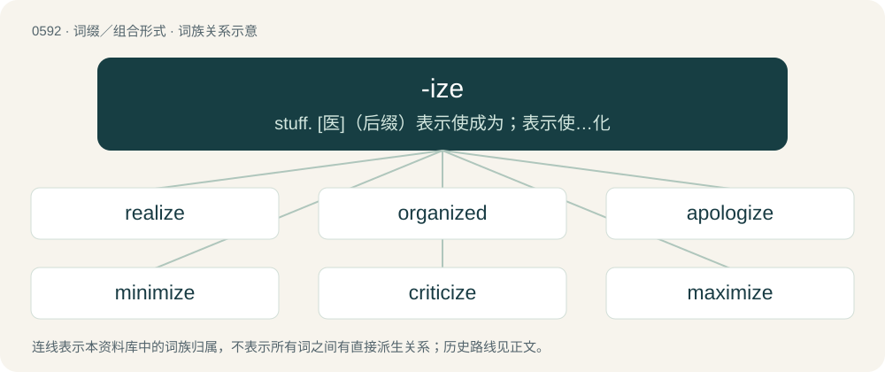

# 0663 · -ize — stuff. \[医\]（后缀）表示使成为；表示使…化

[总目录](../00_总目录_按常用程度.md)

**类型**：词缀／组合形式　｜　**来源语言**：见词源记录

## 核心含义与来源

- 核心含义：stuff. \[医\]（后缀）表示使成为；表示使…化
- 英文含义：to make what is denoted by the noun/adjective
- 词形：-ize

**来源记录 1**（后缀／后置成分；to make what is denoted by the noun/adjective）

From Middle English -isen, from Middle French -iser, from Late Latin -izāre, from Ancient Greek -ίζω (-ízō), from Proto-Indo-European \*-idyé- (verbal suffix). Cognate with Old English -ettan (verbal suffix).

## 词族图

## 单词速览（常用到不常用）

| 单词 | 音标 | 释义 |
|---|---|---|
| [realize](#w-1) | 英 /ˈɹɪə.laɪz/；美 /ˈɹi(.ə)ˌlaɪz/ | vt. 了解, 实现, 使显得逼真, 变卖；vi. 变卖 |
| [organized](#w-2) | 英 /ˈɔːɡənaɪzd/；美 /ˈɔɹɡənaɪzd/ | a. 有组织的, 组织起来的 |
| [apologize](#w-3) | 英 /əˈpɒləˌd͡ʒaɪz/；美 /əˈpɑləˌd͡ʒaɪz/ | vi. 道歉, 辩解 |
| [minimize](#w-4) | 英 /ˈmɪn.ɪ.maɪz/；美 /ˈmɪn.ɪˌmaɪz/ | vt. 将...减到最少；vt. 最小化；vi. 最小化 |
| [criticize](#w-5) | /ˈkɹɪtɪsaɪz/ | v. 批评, 吹毛求疵, 非难 |
| [maximize](#w-6) | /ˈmæksəmaɪz/ | vt. 取...最大值, 使增加(或扩大)到最大限度；\[计\] 最大化 |
| [stabilize](#w-7) | 英 /ˈsteɪ.bəˌlaɪz/ | vt. 使安定, 使稳固；vi. 稳定, 安定 |
| [capitalize](#w-8) | /ˈkæpətəˌlaɪz/ | vt. 以大写字母写, 使资本化, 估计...的价值；\[经\] 资本化, 收益的现值化 |
| [prioritize](#w-9) | 英 /pɹaɪˈɒɹ.ə.taɪz/；美 /pɹaɪˈoɹ.ə.taɪz/ | vt. 按优先次序列出, 优先考虑 |
| [specialize](#w-10) | /ˈspɛʃəˌlaɪz/ | vt. 使特殊化, 列举, 特别指明, 限定...的范围；vi. 成为专家, 专攻 |
| [customize](#w-11) | 英 /ˈkʌs.tə.maɪ̯z/ | vt. 定制, 按规格改制, 定做；\[计\] 定制 |
| [visualize](#w-12) | 英 /ˈvɪʒʊəlaɪz/；美 /ˈvɪʒuəˌlaɪz/ | vt. 使看得见, 使具体化, 想象, 设想；vi. 想象, 显形 |
| [legalize](#w-13) | /ˈliːɡəlaɪz/ | vt. 法律上认为正当, 使合法化；\[法\] 使合法化, 法律上认可, 使符法律 |
| [summarize](#w-14) | 英 /ˈsʌməˌɹaɪz/ | v. 概述, 总结 |
| [socialize](#w-15) | 美 /ˈsoʊʃəlaɪz/ | vt. 使社会化, 使社会主义化, 使适合社会需要；vi. (美)(非正式)参加社交活动, 发生社交往来 |
| [jeopardize](#w-16) | 英 /ˈd͡ʒɛp.ə.dʌɪz/；美 /ˈd͡ʒɛp.ɚ.daɪz/ | vt. 危害, 使受危困, 使陷危地 |
| [modernize](#w-17) | 英 /ˈmɒdənaɪz/；美 /ˈmɑdɚnaɪz/ | vi. 现代化；vt. 使现代化 |
| [normalize](#w-18) | 英 /ˈnɔː.mə.laɪz/；美 /ˈnɔɹ.mə.laɪz/ | vt. 使常态化, 使合标准, 使合规格；\[计\] 规格化 |
| [materialize](#w-19) | /məˈtɪɹiəlaɪz/ | vt. 赋予实质, 使体现, 物质化；vi. 成有形, 体现, 实现 |
| [synthesize](#w-20) | 美 /ˈsɪnθəsaɪz/ | v. 综合, 合成 |
| [subsidize](#w-21) | 英 /ˈsʌbsɪdaɪz/ | vt. 补助, 资助, 贿赂；\[经\] 资助, 津贴, 给...补助金 |
| [categorize](#w-22) | 英 /ˈkætɪɡəˌɹaɪz/；美 /ˈkætəɡəˌɹaɪz/ | vt. 分类, 归类 |
| [generalize](#w-23) | 英 /ˈd͡ʒɛn.(ə.)ɹə.laɪz/ | vt. 一般化, 概括, 推广；vi. 形成概念, 笼统讲 |
| [finalize](#w-24) | /ˈfaɪ.nə.laɪz/ | vt. 使结束, 定稿；vi. 定局 |
| [revitalize](#w-25) | 英 /ɹiːˈvaɪt(ə)laɪz/；美 /ɹiˈvaɪt(ə)ˌlaɪz/ | vt. 使恢复生气, 使复活, 使复兴 |
| [revolutionize](#w-26) | 英 /ˌɹɛv.əˈl(j)uː.ʃəˌnaɪz/；美 /ˌɹɛv.əˈl(j)u.ʃəˌnaɪz/ | vt. 向...鼓吹革命, 使发生革命性剧变 |
| [fantasize](#w-27) | 美 /ˈfæntəˌsaɪz/；/ˈfæntəˌsaɪz/ | vt.vi. 想象, 出现幻想, 产生幻想, 使幻想化, 幻想 |
| [familiarize](#w-28) | /fəˈmɪliəɹaɪ̯z/ | vt. 使熟悉, 使熟知, 使通俗化 |
| [terrorize](#w-29) | /ˈtɛɹəɹaɪz/ | vt. 使惊恐, 恐吓；vi. 实施恐怖统治 |
| [colonize](#w-30) | 英 /ˈkɒlənaɪz/；美 /ˈkɑlənaɪz/ | vi. 开拓殖民地；vt. 殖民于, 移植于 |
| [energize](#w-31) | 英 /ˈɛnəd͡ʒaɪz/；美 /ˈɛnɚd͡ʒaɪz/ | vt. 使活跃, 激励, 供给...能量；\[电\] 激励 |
| [scrutinize](#w-32) | 英 /ˈskɹuːtɨnaɪz/；美 /ˈskɹutn̩ˌaɪz/ | vt.vi. 细看, 仔细检查, 审查, 细阅；\[法\] 细看, 细阅, 仔细检查 |
| [legitimize](#w-33) | 英 /ləˈd͡ʒɪtɪmaɪz/；美 /ləˈd͡ʒɪtɪˌmaɪz/ | vt. 使…合法；立为嫡嗣 |
| [unionized](#w-34) | 英 /ˈjuːnjənaɪzd/；美 /ˈjunjənaɪzd/ | a. 组织成工会的；未电离的 |
| [penalize](#w-35) | 英 /ˈpiː.nəl.aɪz/ | vt. 处刑, 对...处罚(刑), 使不利；\[法\] 处罚, 对...处以刑事惩罚 |
| [patronize](#w-36) | 英 /ˈpætɹəˌnaɪz/；美 /ˈpeɪtɹəˌnaɪz/ | vt. 保护, 支援, 赞助, 庇护, 惠顾 |
| [standardize](#w-37) | 英 /ˈstæn.də.daɪz/；美 /ˈstæn.dɚˌdaɪz/ | vt. 使标准化, 使合于标准, 用标准检验；\[计\] 标准化; 规格化 |
| [synchronize](#w-38) | 英 /ˈsɪŋ.kɹəˌnaɪz/；美 /ˈsɪŋ.kɹəˌnaɪz/ | vt. 使同步, 使合拍；vi. 同时发生；\[计\] 同步 |
| [personalize](#w-39) | 英 /ˈpɜː.sə.nə.laɪz/；美 /ˈpɝ.sə.nəˌlaɪz/ | vt. (贬)使个人化, 体现, 使人格化, 在(物品)上标明姓名/标出地址/标出记号 |
| [sterilize](#w-40) | /ˈstɛɹɪlaɪz/ | vt. 使成不毛, 使绝育, 杀菌, 使不起作用；\[医\] 灭菌, 消毒; 绝育 |
| [fertilize](#w-41) | /ˈfɜː(ɹ)tɪlaɪz/ | vt. 施肥, 使丰饶, 使受精 |
| [conceptualize](#w-42) | /kənˈseptjuəlaiz/ | vt. 使概念化；\[计\] 概念表达 |
| [criminalize](#w-43) |  | \[法\] 使有罪, 定罪 |
| [equalize](#w-44) | 英 /ˈiːkwəlaɪz/；美 /ˈikwəˌlaɪz/ | vt. 使相等, 补偿；vi. 相等 |
| [privatize](#w-45) | 美 /ˈpɹaɪvətaɪz/ | vt.vi. 私有化 |
| [hypnotize](#w-46) | /ˈhɪpnətaɪ̯z/ | vt. 施催眠术, 使恍惚, 使着迷；\[医\] 催眠 |
| [internalize](#w-47) | 美 /ɪnˈtɝnəlaɪz/ | vt. 使内在化 |
| [theorize](#w-48) | 英 /ˈθɪə.ɹaɪz/；美 /ˈθɪɹ.aɪz/ | vi. 建立理论, 讲理论, 推理 |
| [localize](#w-49) | 英 /ˈləʊkəlaɪz/；美 /ˈloʊkəlaɪz/ | vt.vi. 使地方化, 使具有地方性, 使限制于局部, 确定起源, 集中, 局限；\[计\] 局部化, 定位, 定域 |
| [moisturize](#w-50) | /ˈmɔɪs.t͡ʃəɹaɪz/ | vi. 增加湿气, 增加水分；vt. 使增加水分 |
| [hypothesize](#w-51) | 英 /haɪˈpɒθ.ɪ.saɪz/；美 /haɪˈpɑ.θəˌsaɪz/ | vt. 假设, 假定 |
| [idolize](#w-52) | /ˈaɪdəlaɪz/ | vt. 把...当偶像崇拜, 极端崇拜, 醉心于；vi. 崇拜偶像 |
| [formalize](#w-53) | 英 /ˈfɔː(ɹ).mə.laɪz/；美 /ˈfɔɹ.məlaɪːz/ | vt. 使正式, 使整形, 形式化；vi. 拘泥于形式 |
| [monopolize](#w-54) | /məˈnɒpəlʌɪz/ | vt. 独占, 垄断；\[经\] 垄断, 专营, 专利 |
| [vaporize](#w-55) | /ˈveipəraiz/ | v. (使)蒸发 |
| [incentivize](#w-56) | /ɪnˈsɛntɪvaɪz/ | vt. 以物质刺激鼓励 |
| [popularize](#w-57) | /ˈpɒpjuləraiz/ | vt. 使成通俗性, 使平易, 使普及；vi. 通俗化 |
| [unionize](#w-58) | /ˈjuːnjənaɪz/ | vi.vt. (使)成立工会, (使)加入工会 |
| [humanize](#w-59) | 英 /ˈhjuː.mə.naɪz/ | vt. 赋予人性, 教化, 使通人情；vi. 变为有人性, 变得有情, 有教化 |
| [initialize](#w-60) | /ɪˈnɪʃəlaɪz/ | vt. 预置；\[计\] 初始化 |
| [centralize](#w-61) | /ˈsɛntɹəlaɪz/ | vt. 集聚, 集中, 施行中央集权；vi. 集中 |
| [sanitize](#w-62) | 美 /ˈsænətaɪz/ | vt. 对...采取卫生措施, 消毒, 使无害；\[医\] 卫生处理 |
| [commercialize](#w-63) | 英 /kəˈmɜːʃəˌlaɪz/；美 /kəˈmɚʃəˌlaɪz/ | vt. 使商业化, 使商品化, 使能营利, 在...发展商业；\[经\] 使商业化, 使商品化, 在...发展商业 |
| [marginalize](#w-64) | 英 /ˈmɑːdʒɪnəlaɪz/；美 /ˈmɑɹdʒɪnəlaɪz/ | vt.使处于社会边缘,使脱离社会发展进程, 忽视,排斥 |
| [oxidize](#w-65) | /ˈɒksɪdaɪz/ | vt. 使氧化, 使生锈；vi. 氧化 |
| [crystallize](#w-66) | /ˈkɹɪstəlaɪz/ | vt. 使结晶, 使具体化；vi. 结晶, 具体化 |
| [immobilize](#w-67) | /iˈməubilaiz/ | vt. 使不动, 使固定, 使不能移动；\[医\] 制动, 固定 |
| [memorialize](#w-68) | /məˈmɔːɹi.əˌlaɪz/ | vt. 提出请愿书, 纪念 |
| [itemize](#w-69) | /ˈaɪtəmaɪz/ | vt. 分条详述, 详细列举；\[经\] 分项, 详细列明 |
| [romanticize](#w-70) | 英 /rə(ʊ)ˈmantɪsaɪz/；美 /roʊˈmæntɪsaɪz/ | vi. 有浪漫思想, 以浪漫方式行事, 以浪漫风格描写；vt. 使浪漫化 |
| [digitize](#w-71) | 英 /ˈdɪd͡ʒɪtaɪz/；美 /ˈdɪd͡ʒɪˌtaɪz/ | vt. 使成为数字, 使计数化, 使数字化；\[计\] 数字化 |
| [evangelize](#w-72) | /ɪˈvænd͡ʒəlaɪz/ | vt. 传福音, 使信基督教；vi. 传福音, 传道 |
| [polarize](#w-73) | 英 /ˈpəʊ.lə.ɹaɪz/；美 /ˈpoʊ.lə.ɹaɪz/ | v. (使)偏振, (使)极化, (使)两极分化 |
| [contextualize](#w-74) | /kənˈtɛkstʃʊəlʌɪz/ | vt.将(音素、单词等)置于上下文中研究, ( 通过介绍来龙去脉) 使( 事件、 活动等) 溶入背景 |
| [politicize](#w-75) | /pəˈlɪtɪˌsaɪz/ | vi. 搞政治；vt. 使具有政治性 |
| [verbalize](#w-76) | /ˈvɜɹbəlaɪz/ | vt. 以言语表现, 使变成动词；vi. 用言辞表达, 累赘, 唠叨 |
| [victimize](#w-77) | /ˈvɪktɪmaɪz/ | vt. 使牺牲, 使受害；\[法\] 使受害, 使作牺牲, 欺骗 |
| [accessorize](#w-78) | /əkˈsɛsəɹaɪz/ | vt. 附加, 补充；vi. 穿戴装饰品 |
| [vandalize](#w-79) | /ˈvændəlaɪz/ | vt. 肆意破坏；\[法\] 摧残文化, 破坏财产 |
| [liberalize](#w-80) | 英 /ˈlɪbəɹəlaɪz/ | vt. 宽大, 使自由主义化；vi. 自由主义化 |
| [weaponize](#w-81) | /ˈwɛpənaɪz/ | vt. 把…改装成武器, 使武器化 |
| [institutionalize](#w-82) | /ˌɪnstɪˈtjuːʃənəˌlaɪz/ | vt. 使制度化, 使成为惯常的行为, 使一成不变, 把...送进疯人院 |
| [democratize](#w-83) | 英 /dɪˈmɒkɹətaɪz/；美 /dɪˈmɑkɹətaɪz/ | v. (使)民主化 |
| [compartmentalize](#w-84) | 英 /kɒmpɑː(ɹ)tˈmɛnt(ə)laɪz/；美 /kəmˌpɑɹtˈmɛntəlˌaɪz/ | vt. 划分 |
| [plagiarize](#w-85) | /ˈpleɪd͡ʒəɹaɪz/ | v. 剽窃, 抄袭 |
| [trivialize](#w-86) | /ˈtɹɪviəlaɪz/ | vt. 使平凡, 使琐碎 |
| [idealize](#w-87) | 英 /aɪˈdɪəlaɪz/；美 /aɪˈdiəˌlaɪz/ | vt. 使理想化；vi. 理想化, 形成思想, 描述理想 |
| [radicalize](#w-88) | /ˈɹædɪkəlaɪz/ | vt. 使激进 |
| [sexualize](#w-89) | 美 /ˈsɛk.ʃu.əl.aɪz/ | vt. 使有性别, 使有性特征 |
| [satirize](#w-90) | /ˈsatɪrʌɪz/ | vt. 讽刺, 挖苦；vi. 写讽刺作品 |
| [popularise](#w-91) | /ˈpɒpjʊləɹaɪz/ | vt.vi. 使通俗化, 使受欢迎, 使大众化, 使普及, 宣传, 推广 |
| [pressurize](#w-92) | /ˈpɹɛʃəɹaɪz/ | vt. 迫使, 使增压, 密封, 使耐压；\[化\] 增压 |
| [sensitize](#w-93) | /ˈsensitaiz/ | vt. 使敏感, 使具有感光性；vi. 变得敏感 |
| [actualize](#w-94) | /ˈæktju.əlaɪz/ | vt. 实行, 使现实化 |
| [civilize](#w-95) | /ˈsivilaiz/ | vt. 使开化, 使文明；vi. 变文明 |
| [immortalize](#w-96) | /ɪˈmɔː(ɹ).təˌlaɪz/ | vt. 使不灭, 使名垂千古 |
| [immunize](#w-97) | 美 /ˈɪm.ju.naɪz/ | vt. 使免疫, 赋予免疫性 |
| [vocalize](#w-98) | 美 /ˈvoʊ.kə.laɪz/ | vt. 使发声, 使发成元音；vi. 发声, 练声, 元音化 |
| [epitomize](#w-99) | 英 /əˈpɪt.əˌmaɪz/ | vt. 摘要, 概括 |
| [proselytize](#w-100) | 英 /ˈpɹɒs.əl.ɪ.taɪz/；美 /ˈpɹɑ.sə.lɪ.taɪz/ | vt. 使改变宗教信仰；vi. 劝诱改变宗教信仰 |
| [metastasize](#w-101) | 英 /mɪˈtæstəsaɪz/；美 /məˈtæstəˌsaɪz/ | vi. 转移；\[医\] 转移, 迁徒 |
| [economize](#w-102) | 英 /iˈkɒnəmaɪz/；美 /iˈkɑnəmaɪz/ | v. 节约, 节省, 有效地利用 |

## 逐词详解

### 1. realize

**词性**：动词　｜　**音标**：英 /ˈɹɪə.laɪz/；美 /ˈɹi(.ə)ˌlaɪz/

**中文释义**：vt. 了解, 实现, 使显得逼真, 变卖；vi. 变卖

**英文义项**：To become aware of, understand, or appreciate (a fact or situation, especially something which has been true for some time). / To sense (something) strongly or vividly as if real.

**构词拆分**：real + -ize；real (adjective) + -ize (suffix denoting the making of what is indicated by the word it is attached to)

**词源与演化**：

From real (adjective) + -ize (suffix denoting the making of what is indicated by the word it is attached to), possibly modelled after French réaliser, Middle French réaliser (“to make real; to convert (something) into assets or cash”), from real (“actual, real”) + -iser (suffix denoting the making of what is indicated by the word it is attached to). Real is derived from Old French reel, from Latin reālis (“actual, real”), from rēs (“deed; event; matter; thing”) (ultimately from Proto-Indo-European \*reh₁ís (“goods; wealth”)) + -ālis (suffix forming adjectives of relationship).

**例句**：

> She desperately yelled at her young daughter, frantic to make her realize what she had done.

该用例对应义项：To become aware of, understand, or appreciate (a fact or situation, especially something which has been true for some time).

### 2. organized

**词性**：形容词　｜　**音标**：英 /ˈɔːɡənaɪzd/；美 /ˈɔɹɡənaɪzd/

**中文释义**：a. 有组织的, 组织起来的

**英文义项**：Of a musical instrument, having keys (like an organ); keyed.

**构词拆分**：organ (“musical instrument”) + -ize

**词源与演化**：

From organ (“musical instrument”) + -ize, calque of German organisierte/organisirte.

**例句**：

> Cesar Chavez organized the first successful farm workers union in American history.

### 3. apologize

**词性**：动词　｜　**音标**：英 /əˈpɒləˌd͡ʒaɪz/；美 /əˈpɑləˌd͡ʒaɪz/

**中文释义**：vi. 道歉, 辩解

**英文义项**：To make an apology or excuse; to acknowledge some fault or offense, with expression of regret for it, by way of amends / To express regret that a certain event has occurred.

**构词拆分**：apology + -ize

**词源与演化**：

From apology + -ize, from ἀπολογία (apología, “a speech in defense”), from ἀπολογέομαι (apologéomai, “to speak in one’s defense”), from ἀπόλογος (apólogos, “an account, story”), compound of ἀπο- (apo-, “from, off”) and λόγος (lógos, “speech”); compare also ἀπολογίζομαι (apologízomai, “to render an account”).

**例句**：

> The child was told to apologize for being rude to the guests.

### 4. minimize

**词性**：动词　｜　**音标**：英 /ˈmɪn.ɪ.maɪz/；美 /ˈmɪn.ɪˌmaɪz/

**中文释义**：vt. 将...减到最少；vt. 最小化；vi. 最小化

**英文义项**：To make (something) smaller or as small as possible; shrink; reduce. / To relegate or assign (something) to a less insignificant status; diminish.

**构词拆分**：Latin minimus + -ize

**词源与演化**：

From Latin minimus + -ize.

**例句**：

> The insurance adjuster tried to minimize the extent of the damage to lessen the company's exposure to liability.

该用例对应义项：To relegate or assign (something) to a less insignificant status; diminish.

### 5. criticize

**词性**：动词　｜　**音标**：/ˈkɹɪtɪsaɪz/

**中文释义**：v. 批评, 吹毛求疵, 非难

**英文义项**：To find fault (with something). / To evaluate (something), assessing its merits and faults.

**构词拆分**：critic + -ize

**词源与演化**：

From critic + -ize; first element from Ancient Greek κριτικός (kritikós, “of or for judging, able to discern”), from κρίσις (krísis, “decision, judgement”).

**例句**：

> Before you criticize someone, you should walk a mile in their shoes.

### 6. maximize

**词性**：动词　｜　**音标**：/ˈmæksəmaɪz/

**中文释义**：vt. 取...最大值, 使增加(或扩大)到最大限度；\[计\] 最大化

**英文义项**：To make as large as possible. / To expand (a window) to fill the main display area.

**词源与演化**：

From Latin maximus + English -ize.

**例句**：

> Strive to maximize your potential.

该用例对应义项：To make as large as possible.

### 7. stabilize

**词性**：动词　｜　**音标**：英 /ˈsteɪ.bəˌlaɪz/

**中文释义**：vt. 使安定, 使稳固；vi. 稳定, 安定

**英文义项**：To make stable. / To become stable.

**构词拆分**：stable + -ize

**词源与演化**：

From stable + -ize.

**例句**：

> The country will stabilize after the next election ends.

该用例对应义项：To become stable.

### 8. capitalize

**词性**：动词　｜　**音标**：/ˈkæpətəˌlaɪz/

**中文释义**：vt. 以大写字母写, 使资本化, 估计...的价值；\[经\] 资本化, 收益的现值化

**英文义项**：In writing or editing, to write (something: either an entire word or text, or just the initial letter(s) thereof) in capital letters, in upper case. / To contribute or acquire capital (money or other resources) for.

**构词拆分**：capital + -ize

**词源与演化**：

From capital + -ize, the first element ultimately from Latin capitālis (“of the head”).

**例句**：

> The home team took several shots on goal but was unable to capitalize until late in the game.

该用例对应义项：To profit or to obtain an advantage.

### 9. prioritize

**词性**：动词　｜　**音标**：英 /pɹaɪˈɒɹ.ə.taɪz/；美 /pɹaɪˈoɹ.ə.taɪz/

**中文释义**：vt. 按优先次序列出, 优先考虑

**英文义项**：To value, do, or choose something first, or before other things. / To arrange or list a group of things in order of priority or importance.

**构词拆分**：priority + -ize

**词源与演化**：

From priority + -ize. First attested in 1967 as U.S. government jargon, becoming more widespread through the 1970s and ’80s, but still denounced as officialese by purists into the 1990s.

**例句**：

> When I don't have time to buy everything at the store, I prioritize fresh fruit and vegetables over foods like rice or noodles.

该用例对应义项：To value, do, or choose something first, or before other things.

### 10. specialize

**词性**：动词　｜　**音标**：/ˈspɛʃəˌlaɪz/

**中文释义**：vt. 使特殊化, 列举, 特别指明, 限定...的范围；vi. 成为专家, 专攻

**英文义项**：To specify: to mention specifically. / To narrow in scope.

**构词拆分**：special + -ize

**词源与演化**：

From special + -ize.

**例句**：

> The number of students who specialize in biology will increase from now on.

### 11. customize

**词性**：动词　｜　**音标**：英 /ˈkʌs.tə.maɪ̯z/

**中文释义**：vt. 定制, 按规格改制, 定做；\[计\] 定制

**英文义项**：To build or alter according to personal preferences or specifications.

**构词拆分**：custom + -ize

**词源与演化**：

From custom + -ize. First attested in 1934 in American English.

**例句**：

> This game lets you customize your own mech for battle.

### 12. visualize

**词性**：动词　｜　**音标**：英 /ˈvɪʒʊəlaɪz/；美 /ˈvɪʒuəˌlaɪz/

**中文释义**：vt. 使看得见, 使具体化, 想象, 设想；vi. 想象, 显形

**英文义项**：To perceive (something) visually; to see. / To depict (something) in a way which can be seen.

**构词拆分**：visual + -ize (suffix forming verbs denoting the doing or making of what is denoted by the adjectives or nouns to which it is attached)

**词源与演化**：

From visual + -ize (suffix forming verbs denoting the doing or making of what is denoted by the adjectives or nouns to which it is attached).

**用法示例／搭配（非完整句）**：

> to visualize data using a chart

该用例对应义项：To depict (something) in a way which can be seen.

### 13. legalize

**词性**：动词　｜　**音标**：/ˈliːɡəlaɪz/

**中文释义**：vt. 法律上认为正当, 使合法化；\[法\] 使合法化, 法律上认可, 使符法律

**英文义项**：To make legal or permit under law. Either by decriminalising something that has been illegal or by specifically permitting it.

**构词拆分**：legal + -ize

**词源与演化**：

From legal + -ize. Piecewise doublet of loyalize.

**例句**：

> There is a debate whether or not to legalize some of the softer drugs.

该用例对应义项：To make legal or permit under law. Either by decriminalising something that has been illegal or by specifically permitting it.

### 14. summarize

**词性**：动词　｜　**音标**：英 /ˈsʌməˌɹaɪz/

**中文释义**：v. 概述, 总结

**英文义项**：To prepare a summary of (something). / To give a recapitulation of the salient facts; to recapitulate or review.

**构词拆分**：summary + -ize

**词源与演化**：

From summary + -ize.

**例句**：

> Jim was asked to summarize the document by Wednesday.

该用例对应义项：To prepare a summary of (something).

### 15. socialize

**词性**：动词　｜　**音标**：美 /ˈsoʊʃəlaɪz/

**中文释义**：vt. 使社会化, 使社会主义化, 使适合社会需要；vi. (美)(非正式)参加社交活动, 发生社交往来

**英文义项**：To interact with others, especially personally, informally and off the clock rather than formally and officially. / To instruct (somebody), usually subconsciously and mostly by example, in the etiquette of a society.

**构词拆分**：social + -ize

**词源与演化**：

From social + -ize.

**用法示例／搭配（非完整句）**：

> hoping to socialize a bit at the company holiday party

该用例对应义项：To interact with others, especially personally, informally and off the clock rather than formally and officially.

### 16. jeopardize

**词性**：动词　｜　**音标**：英 /ˈd͡ʒɛp.ə.dʌɪz/；美 /ˈd͡ʒɛp.ɚ.daɪz/

**中文释义**：vt. 危害, 使受危困, 使陷危地

**英文义项**：To put in jeopardy, to threaten.

**构词拆分**：jeopardy + -ize

**词源与演化**：

From jeopardy + -ize.

**例句**：

> I don't want to do anything to jeopardize my friendship with you.

### 17. modernize

**词性**：动词　｜　**音标**：英 /ˈmɒdənaɪz/；美 /ˈmɑdɚnaɪz/

**中文释义**：vi. 现代化；vt. 使现代化

**英文义项**：To make (something old or outdated) up to date, or modern in style or function by adding or changing equipment, designs, etc. / To become modern in appearance, or adopt modern ways

**构词拆分**：modern + -ize

**词源与演化**：

From modern + -ize or French moderniser.

**例句**：

> Algeria needs to invest on a grand scale to modernize its infrastructure.

### 18. normalize

**词性**：动词　｜　**音标**：英 /ˈnɔː.mə.laɪz/；美 /ˈnɔɹ.mə.laɪz/

**中文释义**：vt. 使常态化, 使合标准, 使合规格；\[计\] 规格化

**英文义项**：To make normal, to bring into alignment with an established standard. / To consider normal, to treat as standard in the face of older norms.

**构词拆分**：normal + -ize

**词源与演化**：

From normal + -ize.

**例句**：

> We'll need to normalize these statements before we can compare them.

该用例对应义项：To format in a standardized manner, to make consistent.

### 19. materialize

**词性**：动词　｜　**音标**：/məˈtɪɹiəlaɪz/

**中文释义**：vt. 赋予实质, 使体现, 物质化；vi. 成有形, 体现, 实现

**英文义项**：To cause to take physical form, or to cause an object to appear. / To take physical form, to appear seemingly from nowhere.

**构词拆分**：material + -ize

**词源与演化**：

From material + -ize.

**例句**：

> Unless you put some effort in, your successes won't materialize overnight.

### 20. synthesize

**词性**：动词　｜　**音标**：美 /ˈsɪnθəsaɪz/

**中文释义**：v. 综合, 合成

**英文义项**：To combine two or more things to produce a new product. / To be combined producing a new, more complex product.

**构词拆分**：synthesis + -ize

**词源与演化**：

From synthesis + -ize. First attested in 1830.

**例句**：

> Her theory synthesizes ideas from several different disciplines.

该用例对应义项：To combine two or more things to produce a new product.

### 21. subsidize

**词性**：动词　｜　**音标**：英 /ˈsʌbsɪdaɪz/

**中文释义**：vt. 补助, 资助, 贿赂；\[经\] 资助, 津贴, 给...补助金

**英文义项**：To assist (someone or something) by granting a subsidy.

**构词拆分**：subsidy + -ize

**词源与演化**：

From subsidy + -ize.

**例句**：

> The city should subsidize small businesses in industries with large overhead costs.

### 22. categorize

**词性**：动词　｜　**音标**：英 /ˈkætɪɡəˌɹaɪz/；美 /ˈkætəɡəˌɹaɪz/

**中文释义**：vt. 分类, 归类

**英文义项**：To assign a category; to divide into classes.

**构词拆分**：category + -ize

**词源与演化**：

From category + -ize.

**例句**：

> First, categorize incoming messages according to the needed actions.

该用例对应义项：To assign a category; to divide into classes.

### 23. generalize

**词性**：动词　｜　**音标**：英 /ˈd͡ʒɛn.(ə.)ɹə.laɪz/

**中文释义**：vt. 一般化, 概括, 推广；vi. 形成概念, 笼统讲

**英文义项**：To speak in generalities, or in vague terms. / To infer or induce from specific cases to more general cases or principles.

**构词拆分**：general + -ize

**词源与演化**：

From general + -ize.

**例句**：

> In general, people who generalize are imbeciles, but only in general.

### 24. finalize

**词性**：动词　｜　**音标**：/ˈfaɪ.nə.laɪz/

**中文释义**：vt. 使结束, 定稿；vi. 定局

**英文义项**：To make final or firm; to finish or complete. / To prepare (an object) for garbage collection by calling its finalizer.

**构词拆分**：final + -ize

**词源与演化**：

From final + -ize.

**例句**：

> As soon as we get the plane tickets, we'll finalize our reservations with the hotel.

该用例对应义项：To make final or firm; to finish or complete.

### 25. revitalize

**词性**：动词　｜　**音标**：英 /ɹiːˈvaɪt(ə)laɪz/；美 /ɹiˈvaɪt(ə)ˌlaɪz/

**中文释义**：vt. 使恢复生气, 使复活, 使复兴

**英文义项**：American and Oxford British English standard spelling of revitalise.

**构词拆分**：re- + vital + -ize

**词源与演化**：

From re- + vital + -ize.

**例句**：

> City planners hope that new businesses will revitalize the downtown area.

### 26. revolutionize

**词性**：动词　｜　**音标**：英 /ˌɹɛv.əˈl(j)uː.ʃəˌnaɪz/；美 /ˌɹɛv.əˈl(j)u.ʃəˌnaɪz/

**中文释义**：vt. 向...鼓吹革命, 使发生革命性剧变

**英文义项**：To radically or significantly change (something), as in a revolution.

**构词拆分**：revolution + -ize

**词源与演化**：

From revolution + -ize.

**例句**：

> Carlos is excited about the potential of genetic engineering to revolutionize medicine.

### 27. fantasize

**词性**：动词　｜　**音标**：美 /ˈfæntəˌsaɪz/；/ˈfæntəˌsaɪz/

**中文释义**：vt.vi. 想象, 出现幻想, 产生幻想, 使幻想化, 幻想

**英文义项**：To indulge in fantasy; to imagine things only possible in fantasy. / To portray in the mind, using fantasy.

**构词拆分**：fantasy + -ize

**词源与演化**：

From fantasy + -ize.

**例句**：

> I fantasize about a life that doesn't so closely resemble hell.

### 28. familiarize

**词性**：动词　｜　**音标**：/fəˈmɪliəɹaɪ̯z/

**中文释义**：vt. 使熟悉, 使熟知, 使通俗化

**英文义项**：To make or become familiar with something or someone.

**构词拆分**：familiar + -ize

**词源与演化**：

From familiar + -ize.

**例句**：

> I took some time to familiarize myself with the layout of her kitchen before I got to cooking for her.

该用例对应义项：To make or become familiar with something or someone.

### 29. terrorize

**词性**：动词　｜　**音标**：/ˈtɛɹəɹaɪz/

**中文释义**：vt. 使惊恐, 恐吓；vi. 实施恐怖统治

**英文义项**：To fill (someone) with terror; to terrify. / To coerce (someone) by using threats or violence.

**构词拆分**：terror + -ize

**词源与演化**：

From terror + -ize.

**例句**：

> The gang continued to terrorize the neighborhood.

该用例对应义项：To fill (someone) with terror; to terrify.

### 30. colonize

**词性**：动词　｜　**音标**：英 /ˈkɒlənaɪz/；美 /ˈkɑlənaɪz/

**中文释义**：vi. 开拓殖民地；vt. 殖民于, 移植于

**英文义项**：To settle (a place) with colonists, and hence make (a place) into a colony. / To settle among and establish control over (the indigenous people of an area).

**构词拆分**：colony + -ize

**词源与演化**：

From colony + -ize.

**例句**：

> We must colonize other planets if we are not to become extinct.

### 31. energize

**词性**：动词　｜　**音标**：英 /ˈɛnəd͡ʒaɪz/；美 /ˈɛnɚd͡ʒaɪz/

**中文释义**：vt. 使活跃, 激励, 供给...能量；\[电\] 激励

**英文义项**：To invigorate; to make energetic. / To supply with energy, especially electricity; to turn on power to (something).

**构词拆分**：energy + -ize

**词源与演化**：

From energy + -ize.

**例句**：

> Whenever we energize that circuit we blow a fuse.

该用例对应义项：To supply with energy, especially electricity; to turn on power to (something).

### 32. scrutinize

**词性**：动词　｜　**音标**：英 /ˈskɹuːtɨnaɪz/；美 /ˈskɹutn̩ˌaɪz/

**中文释义**：vt.vi. 细看, 仔细检查, 审查, 细阅；\[法\] 细看, 细阅, 仔细检查

**英文义项**：To examine something with great care or detail, as to look for hidden or obscure flaws. / To audit accounts etc in order to verify them.

**构词拆分**：scrutiny + -ize

**词源与演化**：

From scrutiny + -ize.

**用法示例／搭配（非完整句）**：

> to scrutinize the conduct or motives of individuals

该用例对应义项：To examine something with great care or detail, as to look for hidden or obscure flaws.

### 33. legitimize

**词性**：动词　｜　**音标**：英 /ləˈd͡ʒɪtɪmaɪz/；美 /ləˈd͡ʒɪtɪˌmaɪz/

**中文释义**：vt. 使…合法；立为嫡嗣

**英文义项**：To make legitimate.

**构词拆分**：legitimate + -ize

**词源与演化**：

From legitimate + -ize.

**例句**：

> Certain things are easier to legalize than legitimize.

### 34. unionized

**词性**：形容词　｜　**音标**：英 /ˈjuːnjənaɪzd/；美 /ˈjunjənaɪzd/

**中文释义**：a. 组织成工会的；未电离的

**英文义项**：Organized into a trades union or trades unions.

**构词拆分**：union + -ize

**词源与演化**：

From unionize, from union + -ize.

**例句**：

> Most of the workers are unionized.

### 35. penalize

**词性**：动词　｜　**音标**：英 /ˈpiː.nəl.aɪz/

**中文释义**：vt. 处刑, 对...处罚(刑), 使不利；\[法\] 处罚, 对...处以刑事惩罚

**英文义项**：To subject to a penalty, especially for the infringement of a rule or regulation. / To impose a handicap on.

**构词拆分**：penal + -ize

**词源与演化**：

From penal + -ize.

**例句**：

> Sanctions are a tool to deter and penalize countries for their war crimes.

### 36. patronize

**词性**：动词　｜　**音标**：英 /ˈpætɹəˌnaɪz/；美 /ˈpeɪtɹəˌnaɪz/

**中文释义**：vt. 保护, 支援, 赞助, 庇护, 惠顾

**英文义项**：To act as a patron of; to defend, protect, or support. / To be a customer of (an establishment), especially a regular customer.

**构词拆分**：patron + -ize (verb ending)

**词源与演化**：

From patron + -ize (verb ending); or from Old French patroniser, from Medieval Latin patronizāre (“to lead a galley as patron”). Piecewise doublet of patternize.

**例句**：

> We patronize this store.

该用例对应义项：be a regular customer or client of

### 37. standardize

**词性**：动词　｜　**音标**：英 /ˈstæn.də.daɪz/；美 /ˈstæn.dɚˌdaɪz/

**中文释义**：vt. 使标准化, 使合于标准, 用标准检验；\[计\] 标准化; 规格化

**英文义项**：American and Oxford British standard spelling of standardise.

**构词拆分**：standard + -ize

**词源与演化**：

From standard + -ize.

**例句**：

> It's difficult to standardize language for a multi-ethnic nation.

### 38. synchronize

**词性**：动词　｜　**音标**：英 /ˈsɪŋ.kɹəˌnaɪz/；美 /ˈsɪŋ.kɹəˌnaɪz/

**中文释义**：vt. 使同步, 使合拍；vi. 同时发生；\[计\] 同步

**英文义项**：To occur at the same time or with coordinated timing. / To cause (video and audio) to play in a coordinated way.

**构词拆分**：syn- + chrono- + -ize

**词源与演化**：

From Ancient Greek συγχρονίζω (sunkhronízō), equivalent to syn- + chrono- + -ize.

**例句**：

> Let's synchronize our efforts.

该用例对应义项：make synchronous and adjust in time or manner

### 39. personalize

**词性**：动词　｜　**音标**：英 /ˈpɜː.sə.nə.laɪz/；美 /ˈpɝ.sə.nəˌlaɪz/

**中文释义**：vt. (贬)使个人化, 体现, 使人格化, 在(物品)上标明姓名/标出地址/标出记号

**英文义项**：To adapt something to the needs or tastes of an individual. / To represent something abstract as a person; to embody.

**构词拆分**：personal + -ize

**词源与演化**：

From personal + -ize.

**例句**：

> I think it would be difficult to personalize every wedding invitation.

### 40. sterilize

**词性**：动词　｜　**音标**：/ˈstɛɹɪlaɪz/

**中文释义**：vt. 使成不毛, 使绝育, 杀菌, 使不起作用；\[医\] 灭菌, 消毒; 绝育

**英文义项**：To deprive of the ability to procreate. / To make unable to produce; to make unprofitable.

**构词拆分**：sterile + -ize

**词源与演化**：

From sterile + -ize.

**例句**：

> I had to sterilize the pacifier before giving it to the little child.

### 41. fertilize

**词性**：动词　｜　**音标**：/ˈfɜː(ɹ)tɪlaɪz/

**中文释义**：vt. 施肥, 使丰饶, 使受精

**英文义项**：To make (the soil) more fertile by adding nutrients to it. / To make more creative or intellectually productive.

**构词拆分**：fertile + -ize

**词源与演化**：

From French fertiliser; equivalent to fertile + -ize.

**用法示例／搭配（非完整句）**：

> to fertilize one's imagination

该用例对应义项：To make more creative or intellectually productive.

### 42. conceptualize

**词性**：动词　｜　**音标**：/kənˈseptjuəlaiz/

**中文释义**：vt. 使概念化；\[计\] 概念表达

**英文义项**：To interpret a phenomenon by forming a concept. / To conceive the idea for something.

**构词拆分**：conceptual + -ize

**词源与演化**：

From conceptual + -ize.

**例句**：

> The best way to conceptualize looting is as similar to pollution, a byproduct of the economics of the antiquities trade.

### 43. criminalize

**词性**：动词

**中文释义**：\[法\] 使有罪, 定罪

**英文义项**：To make (something) a crime; to make illegal under criminal law; to ban. / To treat as a criminal.

**构词拆分**：criminal + -ize

**词源与演化**：

From criminal + -ize.

**例句**：

> In the 1970s, the Algerian government attempted to criminalize Berber.

### 44. equalize

**词性**：动词　｜　**音标**：英 /ˈiːkwəlaɪz/；美 /ˈikwəˌlaɪz/

**中文释义**：vt. 使相等, 补偿；vi. 相等

**英文义项**：To make equal; to cause to correspond in amount or degree. / To make the scoreline equal by scoring points.

**构词拆分**：equal + -ize

**词源与演化**：

From equal + -ize.

**用法示例／搭配（非完整句）**：

> to equalize accounts, burdens, or taxes

该用例对应义项：To make equal; to cause to correspond in amount or degree.

### 45. privatize

**词性**：动词　｜　**音标**：美 /ˈpɹaɪvətaɪz/

**中文释义**：vt.vi. 私有化

**英文义项**：To release government control (of a business or industry) to private industry. / To render (a variable, etc.) private in scope.

**构词拆分**：private + -ize

**词源与演化**：

From private + -ize.

**例句**：

> The government has now abandoned its plans to privatize parts of the health service.

### 46. hypnotize

**词性**：动词　｜　**音标**：/ˈhɪpnətaɪ̯z/

**中文释义**：vt. 施催眠术, 使恍惚, 使着迷；\[医\] 催眠

**英文义项**：To induce a state of hypnosis in.

**构词拆分**：hypnot(ic) + -ize (verbal derivational suffix)

**词源与演化**：

Derived from hypnot(ic) + -ize (verbal derivational suffix).

**例句**：

> The magician claimed he could hypnotize anyone in the audience.

该用例对应义项：To induce a state of hypnosis in.

### 47. internalize

**词性**：动词　｜　**音标**：美 /ɪnˈtɝnəlaɪz/

**中文释义**：vt. 使内在化

**英文义项**：To make something internal; to incorporate it in oneself. / To process new information in one's mind.

**构词拆分**：internal + -ize

**词源与演化**：

From internal + -ize.

**例句**：

> You are not going to get good at socialising by approaching social situations like it's a formula where you do 1, 2 and 3 from a book, but books can definitely help you internalize useful things if you get what I'm saying.

该用例对应义项：To make something internal; to incorporate it in oneself.

### 48. theorize

**词性**：动词　｜　**音标**：英 /ˈθɪə.ɹaɪz/；美 /ˈθɪɹ.aɪz/

**中文释义**：vi. 建立理论, 讲理论, 推理

**英文义项**：To formulate a theory, especially about some specific subject. / To speculate.

**构词拆分**：theory + -ize

**词源与演化**：

From theory + -ize. First use appears c. 1599 in the text A pil to purge melancholie.

**例句**：

> I theorize a terrorist breeding ground and terrorize a rigorist network.

### 49. localize

**词性**：动词　｜　**音标**：英 /ˈləʊkəlaɪz/；美 /ˈloʊkəlaɪz/

**中文释义**：vt.vi. 使地方化, 使具有地方性, 使限制于局部, 确定起源, 集中, 局限；\[计\] 局部化, 定位, 定域

**英文义项**：To make local; to fix in, or assign to, a definite place. / To adapt (a product or service) for use in a particular country or region, typically by translating text into the language of that country and modifying currencies, date formats, etc.

**构词拆分**：local + -ize

**词源与演化**：

From local + -ize. Compare French localiser.

**例句**：

> We need to localize our software for the Japanese market.

该用例对应义项：To adapt (a product or service) for use in a particular country or region, typically by translating text into the language of that country and modifying currencies, date formats, etc.

### 50. moisturize

**词性**：动词　｜　**音标**：/ˈmɔɪs.t͡ʃəɹaɪz/

**中文释义**：vi. 增加湿气, 增加水分；vt. 使增加水分

**英文义项**：To make more moist. / To make more humid.

**构词拆分**：moisture + -ize

**词源与演化**：

From moisture + -ize.

**用法示例／搭配（非完整句）**：

> moisturize your skin

该用例对应义项：To make more moist.

### 51. hypothesize

**词性**：动词　｜　**音标**：英 /haɪˈpɒθ.ɪ.saɪz/；美 /haɪˈpɑ.θəˌsaɪz/

**中文释义**：vt. 假设, 假定

**英文义项**：To assume or assert tentatively on uncertain grounds.

**构词拆分**：hypothesis + -ize

**词源与演化**：

From hypothesis + -ize.

**例句**：

> I can only hypothesize that he came here for the necklace.

### 52. idolize

**词性**：动词　｜　**音标**：/ˈaɪdəlaɪz/

**中文释义**：vt. 把...当偶像崇拜, 极端崇拜, 醉心于；vi. 崇拜偶像

**英文义项**：To make an idol of, or to worship as an idol. / To adore excessively; to revere immoderately.

**构词拆分**：idol + -ize

**词源与演化**：

From idol + -ize.

**例句**：

> Many young fans idolize pop stars.

该用例对应义项：To adore excessively; to revere immoderately.

### 53. formalize

**词性**：动词　｜　**音标**：英 /ˈfɔː(ɹ).mə.laɪz/；美 /ˈfɔɹ.məlaɪːz/

**中文释义**：vt. 使正式, 使整形, 形式化；vi. 拘泥于形式

**英文义项**：To give something a definite form; to shape. / To develop into a definite form.

**构词拆分**：formal + -ize

**词源与演化**：

From formal + -ize.

**例句**：

> Taiwan knows very well that it can't formalize its independence.

### 54. monopolize

**词性**：动词　｜　**音标**：/məˈnɒpəlʌɪz/

**中文释义**：vt. 独占, 垄断；\[经\] 垄断, 专营, 专利

**英文义项**：To have a monopoly on something. / To dominate or to get total control of something by excluding everyone else.

**构词拆分**：monopoly + -ize

**词源与演化**：

From monopoly + -ize.

**例句**：

> Teachers try not to let any one student monopolize a class discussion.

该用例对应义项：To dominate or to get total control of something by excluding everyone else.

### 55. vaporize

**词性**：动词　｜　**音标**：/ˈveipəraiz/

**中文释义**：v. (使)蒸发

**英文义项**：To turn into vapor.

**构词拆分**：vapor + -ize

**词源与演化**：

From vapor + -ize.

**例句**：

> The increase in support did not vaporize on polling day itself.

### 56. incentivize

**词性**：动词　｜　**音标**：/ɪnˈsɛntɪvaɪz/

**中文释义**：vt. 以物质刺激鼓励

**英文义项**：To provide incentives for; to encourage. / To provide incentives to.

**构词拆分**：incentive + -ize

**词源与演化**：

From incentive + -ize.

**例句**：

> The US government seeks to incentivize home ownership through a favorable tax system.

该用例对应义项：To provide incentives for; to encourage.

### 57. popularize

**词性**：动词　｜　**音标**：/ˈpɒpjuləraiz/

**中文释义**：vt. 使成通俗性, 使平易, 使普及；vi. 通俗化

**英文义项**：American and Oxford British spelling of popularise.

**构词拆分**：popular + -ize

**词源与演化**：

From popular + -ize.

**例句**：

> That book's done a lot to popularize chemistry.

### 58. unionize

**词性**：动词　｜　**音标**：/ˈjuːnjənaɪz/

**中文释义**：vi.vt. (使)成立工会, (使)加入工会

**英文义项**：To organize workers into a trade union.

**构词拆分**：union + -ize

**词源与演化**：

From union + -ize.

**例句**：

> My uncle got roughed up by some corporate thugs after they caught him trying to unionize their workers.

该用例对应义项：To organize workers into a trade union.

### 59. humanize

**词性**：动词　｜　**音标**：英 /ˈhjuː.mə.naɪz/

**中文释义**：vt. 赋予人性, 教化, 使通人情；vi. 变为有人性, 变得有情, 有教化

**英文义项**：To make human; to give or cause to have the fundamental properties of a human. / To make sympathetic or relatable.

**构词拆分**：human + -ize

**词源与演化**：

From human + -ize.

**用法示例／搭配（非完整句）**：

> to humanize vaccine lymph

该用例对应义项：To convert into something human or belonging to humans.

### 60. initialize

**词性**：动词　｜　**音标**：/ɪˈnɪʃəlaɪz/

**中文释义**：vt. 预置；\[计\] 初始化

**英文义项**：To assign initial values to something. / To assign an initial value to a variable.

**构词拆分**：initial + -ize

**词源与演化**：

From initial + -ize.

**例句**：

> Before you can use them, you first need to initialize the variables.

### 61. centralize

**词性**：动词　｜　**音标**：/ˈsɛntɹəlaɪz/

**中文释义**：vt. 集聚, 集中, 施行中央集权；vi. 集中

**英文义项**：To move things physically towards the centre; to consolidate or concentrate / To move power to a single, central authority

**构词拆分**：central + -ize

**词源与演化**：

From central + -ize.

**例句**：

> We need to centralize the powers to create a better way of life.

### 62. sanitize

**词性**：动词　｜　**音标**：美 /ˈsænətaɪz/

**中文释义**：vt. 对...采取卫生措施, 消毒, 使无害；\[医\] 卫生处理

**英文义项**：To rid of microorganisms by cleaning or disinfecting. / To make something, such as a dramatic work, more acceptable by removing potentially offensive material.

**构词拆分**：sanity + -ize

**词源与演化**：

From sanitary. By surface analysis, sanity + -ize.

**例句**：

> Remember to sanitize your query parameters to avoid SQL injection exploits.

该用例对应义项：To filter (text) to ensure it does not contain any characters that will cause problems for or be interpreted in an adverse way by the receiving system.

### 63. commercialize

**词性**：动词　｜　**音标**：英 /kəˈmɜːʃəˌlaɪz/；美 /kəˈmɚʃəˌlaɪz/

**中文释义**：vt. 使商业化, 使商品化, 使能营利, 在...发展商业；\[经\] 使商业化, 使商品化, 在...发展商业

**英文义项**：To bring into commerce from an earlier condition (such as idea alone, experimental prototypes alone, or one-off custom builds only). / To apply business methodology to something in order to profit (such as introducing salability to a resource that comes from, or rightfully belongs to, the commons).

**构词拆分**：commercial + -ize

**词源与演化**：

From commercial + -ize.

**用法示例／搭配（非完整句）**：

> the work required not only to invent a device but also to commercialize it

该用例对应义项：To bring into commerce from an earlier condition (such as idea alone, experimental prototypes alone, or one-off custom builds only).

### 64. marginalize

**词性**：动词　｜　**音标**：英 /ˈmɑːdʒɪnəlaɪz/；美 /ˈmɑɹdʒɪnəlaɪz/

**中文释义**：vt.使处于社会边缘,使脱离社会发展进程, 忽视,排斥

**英文义项**：To relegate (something, especially a topic or a group of people) to the margins or to a lower limit; to exclude socially or otherwise. / To find a marginal distribution of a joint probability distribution.

**构词拆分**：marginal + -ize

**词源与演化**：

From marginal + -ize.

**例句**：

> We must not marginalize the poor in our society.

该用例对应义项：relegate to a lower or outer edge, as of specific groups of people

### 65. oxidize

**词性**：动词　｜　**音标**：/ˈɒksɪdaɪz/

**中文释义**：vt. 使氧化, 使生锈；vi. 氧化

**英文义项**：To combine with oxygen or otherwise make an oxide. / To increase the valence (or the positive charge) of an element by removing electrons.

**构词拆分**：oxide + -ize

**词源与演化**：

From oxide + -ize.

**例句**：

> Don't leave the metal exposed to the air or it will oxidize.

### 66. crystallize

**词性**：动词　｜　**音标**：/ˈkɹɪstəlaɪz/

**中文释义**：vt. 使结晶, 使具体化；vi. 结晶, 具体化

**英文义项**：To make something form into crystals. / To assume a crystalline form.

**构词拆分**：crystal + -ize

**词源与演化**：

From crystal + -ize. The double l reflects the classical stem found in its etyma, Latin crystallus and Ancient Greek κρύσταλλος (krústallos), rather than the simplified spelling of the English base noun. Compare Hellenistic Greek κρυσταλλίζειν (krustallízein, “to shine like crystal”), post‐classical Latin crystallizare (“to change into crystal”), and French cristalliser.

**例句**：

> He tried to crystallize his thoughts.

该用例对应义项：cause to take on a definite and clear shape

### 67. immobilize

**词性**：动词　｜　**音标**：/iˈməubilaiz/

**中文释义**：vt. 使不动, 使固定, 使不能移动；\[医\] 制动, 固定

**英文义项**：To render motionless; to stop moving or stop from moving. / To render incapable of action.

**构词拆分**：immobile + -ize

**词源与演化**：

From French immobiliser, equivalent to immobile + -ize.

**例句**：

> It is best to immobilize the injury until a doctor can examine it.

该用例对应义项：To render motionless; to stop moving or stop from moving.

### 68. memorialize

**词性**：动词　｜　**音标**：/məˈmɔːɹi.əˌlaɪz/

**中文释义**：vt. 提出请愿书, 纪念

**英文义项**：To provide a memorial for someone; to commemorate. / To convert (someone’s profile) into a memorial site/page (e.g. on Facebook).

**构词拆分**：memorial + -ize

**词源与演化**：

From memorial + -ize.

### 69. itemize

**词性**：动词　｜　**音标**：/ˈaɪtəmaɪz/

**中文释义**：vt. 分条详述, 详细列举；\[经\] 分项, 详细列明

**英文义项**：To state in items, or by particulars

**构词拆分**：item + -ize

**词源与演化**：

From item + -ize.

**用法示例／搭配（非完整句）**：

> to itemize the cost of a railroad

该用例对应义项：To state in items, or by particulars

### 70. romanticize

**词性**：动词　｜　**音标**：英 /rə(ʊ)ˈmantɪsaɪz/；美 /roʊˈmæntɪsaɪz/

**中文释义**：vi. 有浪漫思想, 以浪漫方式行事, 以浪漫风格描写；vt. 使浪漫化

**英文义项**：To interpret, view, or portray something in a romantic (unrealistic, idealized) manner. / To think or act in a romantic manner.

**构词拆分**：romantic + -ize

**词源与演化**：

From romantic + -ize.

**例句**：

> Don't romanticize this uninteresting and hard work!

该用例对应义项：interpret romantically

### 71. digitize

**词性**：动词　｜　**音标**：英 /ˈdɪd͡ʒɪtaɪz/；美 /ˈdɪd͡ʒɪˌtaɪz/

**中文释义**：vt. 使成为数字, 使计数化, 使数字化；\[计\] 数字化

**英文义项**：To represent something (such as an image or sound) as a structured sequence of binary digits. / To quantize a continuous or analog value; to convert it into a discrete value.

**构词拆分**：digit + -ize

**词源与演化**：

From digit + -ize.

**例句**：

> He bought a device to digitize the data.

该用例对应义项：put into digital form, as for use in a computer

### 72. evangelize

**词性**：动词　｜　**音标**：/ɪˈvænd͡ʒəlaɪz/

**中文释义**：vt. 传福音, 使信基督教；vi. 传福音, 传道

**英文义项**：To tell people about (a particular branch of) Christianity, especially in order to convert them; to preach the gospel to. / To preach any ideology to those who have not yet been converted to it.

**构词拆分**：evangel + -ize

**词源与演化**：

From Old French évangéliser, equivalent to evangel + -ize, from Late Latin evangelizare, from Ancient Greek εὐαγγελίζω (euangelízō). Displaced native Old English godspellian (literally “to gospel”).

### 73. polarize

**词性**：动词　｜　**音标**：英 /ˈpəʊ.lə.ɹaɪz/；美 /ˈpoʊ.lə.ɹaɪz/

**中文释义**：v. (使)偏振, (使)极化, (使)两极分化

**英文义项**：To cause to have a polarization. / To cause a group to be divided into extremes.

**构词拆分**：polar + -ize

**词源与演化**：

From French polariser, equivalent to polar + -ize.

**例句**：

> The strong sentiments the candidate voiced only served to polarize his constituency.

### 74. contextualize

**词性**：动词　｜　**音标**：/kənˈtɛkstʃʊəlʌɪz/

**中文释义**：vt.将(音素、单词等)置于上下文中研究, ( 通过介绍来龙去脉) 使( 事件、 活动等) 溶入背景

**英文义项**：To place something or someone in a particular context.

**构词拆分**：contextual + -ize

**词源与演化**：

From contextual + -ize.

### 75. politicize

**词性**：动词　｜　**音标**：/pəˈlɪtɪˌsaɪz/

**中文释义**：vi. 搞政治；vt. 使具有政治性

**英文义项**：To engage in or discuss politics. / To give something political characteristics; to turn into a political issue.

**构词拆分**：politic + -ize

**词源与演化**：

From politic + -ize.

**例句**：

> Changing the Senate rules now will only further politicize the Supreme Court.

### 76. verbalize

**词性**：动词　｜　**音标**：/ˈvɜɹbəlaɪz/

**中文释义**：vt. 以言语表现, 使变成动词；vi. 用言辞表达, 累赘, 唠叨

**英文义项**：To speak or to use words to express. / To adapt (a word of another part of speech) as a verb.

**构词拆分**：verbal + -ize

**词源与演化**：

Partly from Middle French verbaliser and partly from verbal + -ize.

**例句**：

> Bill became tongue-tied and could not verbalize his thoughts in the presence of the girl he had a crush on.

该用例对应义项：To speak or to use words to express.

### 77. victimize

**词性**：动词　｜　**音标**：/ˈvɪktɪmaɪz/

**中文释义**：vt. 使牺牲, 使受害；\[法\] 使受害, 使作牺牲, 欺骗

**英文义项**：To make (someone) a victim or sacrifice. / To punish unjustly.

**构词拆分**：victim + -ize

**词源与演化**：

From victim + -ize.

**例句**：

> The police are known to victimize anyone who isn't local to that town.

### 78. accessorize

**词性**：动词　｜　**音标**：/əkˈsɛsəɹaɪz/

**中文释义**：vt. 附加, 补充；vi. 穿戴装饰品

**英文义项**：To furnish with accessories. / To wear or to choose accessories.

**构词拆分**：accessory + -ize

**词源与演化**：

From accessory + -ize. First attested in 1939 in American English.

### 79. vandalize

**词性**：动词　｜　**音标**：/ˈvændəlaɪz/

**中文释义**：vt. 肆意破坏；\[法\] 摧残文化, 破坏财产

**英文义项**：American, Canadian, and Oxford British English standard spelling of vandalise.

**构词拆分**：vandal + -ize

**词源与演化**：

From vandal + -ize.

### 80. liberalize

**词性**：动词　｜　**音标**：英 /ˈlɪbəɹəlaɪz/

**中文释义**：vt. 宽大, 使自由主义化；vi. 自由主义化

**英文义项**：to make liberal, free. / to become liberal, free.

**构词拆分**：liberal + -ize

**词源与演化**：

From liberal + -ize.

**例句**：

> Algeria needs to make serious moves to liberalize.

### 81. weaponize

**词性**：动词　｜　**音标**：/ˈwɛpənaɪz/

**中文释义**：vt. 把…改装成武器, 使武器化

**英文义项**：To make into a weapon. / To make more effective as a weapon.

**构词拆分**：weapon + -ize

**词源与演化**：

From weapon + -ize. First use appears c. 1938. See cite below.

**例句**：

> To weaponize anthrax it is made more distributable, not more virulent.

该用例对应义项：To make more effective as a weapon.

### 82. institutionalize

**词性**：动词　｜　**音标**：/ˌɪnstɪˈtjuːʃənəˌlaɪz/

**中文释义**：vt. 使制度化, 使成为惯常的行为, 使一成不变, 把...送进疯人院

**英文义项**：To establish as a normal practice. / To commit a person to confinement in an institution.

**构词拆分**：institutional + -ize

**词源与演化**：

From institutional + -ize.

**例句**：

> We need to institutionalize the testing of organic products.

### 83. democratize

**词性**：动词　｜　**音标**：英 /dɪˈmɒkɹətaɪz/；美 /dɪˈmɑkɹətaɪz/

**中文释义**：v. (使)民主化

**英文义项**：To make democratic. / To broaden access to (something), especially for the sake of egalitarianism.

**构词拆分**：By surface analysis, democrat(ic) + -ize

**词源与演化**：

From French démocratiser. By surface analysis, democrat(ic) + -ize.

**例句**：

> You cannot democratize a starving people.

### 84. compartmentalize

**词性**：动词　｜　**音标**：英 /kɒmpɑː(ɹ)tˈmɛnt(ə)laɪz/；美 /kəmˌpɑɹtˈmɛntəlˌaɪz/

**中文释义**：vt. 划分

**英文义项**：To separate something into different categories, or compartments.

**构词拆分**：compartmental + -ize

**词源与演化**：

From compartmental + -ize.

**例句**：

> You cannot compartmentalize your life like this!

该用例对应义项：separate into isolated compartments or categories

### 85. plagiarize

**词性**：动词　｜　**音标**：/ˈpleɪd͡ʒəɹaɪz/

**中文释义**：v. 剽窃, 抄袭

**英文义项**：To use, and pass off as one's own, someone else's writing, speech, ideas, or other intellectual or creative work, especially in an academic context; to commit plagiarism.

**构词拆分**：plagiary + -ize

**词源与演化**：

From plagiary + -ize, ultimately from Latin plagiare (“to kidnap, to abduct”).

**例句**：

> It’s unethical to plagiarize someone else’s work for personal gain.

该用例对应义项：To use, and pass off as one's own, someone else's writing, speech, ideas, or other intellectual or creative work, especially in an academic context; to commit plagiarism.

### 86. trivialize

**词性**：动词　｜　**音标**：/ˈtɹɪviəlaɪz/

**中文释义**：vt. 使平凡, 使琐碎

**英文义项**：To make something appear trivial

**构词拆分**：trivial + -ize

**词源与演化**：

From trivial + -ize.

**例句**：

> Don't trivialize the seriousness of the issue!

该用例对应义项：make trivial or insignificant

### 87. idealize

**词性**：动词　｜　**音标**：英 /aɪˈdɪəlaɪz/；美 /aɪˈdiəˌlaɪz/

**中文释义**：vt. 使理想化；vi. 理想化, 形成思想, 描述理想

**英文义项**：To regard something as ideal. / To conceive or form an ideal.

**构词拆分**：ideal + -ize

**词源与演化**：

From ideal + -ize. Compare French idéaliser.

**例句**：

> A sociopath would idealize you one minute and demonize you the next minute.

### 88. radicalize

**词性**：动词　｜　**音标**：/ˈɹædɪkəlaɪz/

**中文释义**：vt. 使激进

**英文义项**：To make radical. / To become radical; to adopt a radical political stance.

**构词拆分**：radical + -ize

**词源与演化**：

From radical + -ize.

### 89. sexualize

**词性**：动词　｜　**音标**：美 /ˈsɛk.ʃu.əl.aɪz/

**中文释义**：vt. 使有性别, 使有性特征

**英文义项**：To render sexual, or apply sex appeal to (a person, thing, or concept). / To distinguish as belonging to separate sexes.

**构词拆分**：sexual + -ize

**词源与演化**：

From sexual + -ize.

**例句**：

> Children’s beauty pageants sexualize childhood.

该用例对应义项：To render sexual, or apply sex appeal to (a person, thing, or concept).

### 90. satirize

**词性**：动词　｜　**音标**：/ˈsatɪrʌɪz/

**中文释义**：vt. 讽刺, 挖苦；vi. 写讽刺作品

**英文义项**：To make a satire of; to mock.

**构词拆分**：satire + -ize

**词源与演化**：

From satire + -ize.

### 91. popularise

**词性**：动词　｜　**音标**：/ˈpɒpjʊləɹaɪz/

**中文释义**：vt.vi. 使通俗化, 使受欢迎, 使大众化, 使普及, 宣传, 推广

**英文义项**：To make something popular. / To present information in a form less difficult for the general public to understand or enjoy, especially by excluding details and jargon found in technical or academic publications.

**构词拆分**：popular + -ize

**词源与演化**：

From popular + -ise.

### 92. pressurize

**词性**：动词　｜　**音标**：/ˈpɹɛʃəɹaɪz/

**中文释义**：vt. 迫使, 使增压, 密封, 使耐压；\[化\] 增压

**英文义项**：To put (physical) pressure on; to put under pressure. / To coerce, put under duress; to pressure.

**构词拆分**：pressure + -ize

**词源与演化**：

From pressure + -ize.

**例句**：

> The captain will pressurize the cabin for the passengers' comfort.

该用例对应义项：increase the pressure in or of

### 93. sensitize

**词性**：动词　｜　**音标**：/ˈsensitaiz/

**中文释义**：vt. 使敏感, 使具有感光性；vi. 变得敏感

**英文义项**：To make (someone or something) sensitive or responsive to certain stimuli. / To make (someone) increasingly aware of, in a concerned or sensitive way.

**构词拆分**：sensitive + -ize

**词源与演化**：

From sensitive + -ize.

**例句**：

> Sensitize the photographic film.

该用例对应义项：make (a material) sensitive to light, often of a particular colour, by coating it with a photographic emulsion

### 94. actualize

**词性**：动词　｜　**音标**：/ˈæktju.əlaɪz/

**中文释义**：vt. 实行, 使现实化

**英文义项**：To make real; to realize. / To become actual or real.

**构词拆分**：actual + -ize

**词源与演化**：

From actual + -ize.

**例句**：

> Despite me wanting to go to this place for a long time, I never had the courage to actualize my dream.

### 95. civilize

**词性**：动词　｜　**音标**：/ˈsivilaiz/

**中文释义**：vt. 使开化, 使文明；vi. 变文明

**英文义项**：American and Oxford British standard spelling of civilise.

**构词拆分**：civil + -ize

**词源与演化**：

Borrowed from French civiliser, corresponding to civil + -ize.

**例句**：

> The Romans tried to civilize the ancient Britons.

### 96. immortalize

**词性**：动词　｜　**音标**：/ɪˈmɔː(ɹ).təˌlaɪz/

**中文释义**：vt. 使不灭, 使名垂千古

**英文义项**：To remove the effects of normal apoptosis.

**构词拆分**：immortal + -ize

**词源与演化**：

From immortal + -ize.

**例句**：

> The exploiting classes try to immortalize false worldviews to affirm and strengthen their domination.

### 97. immunize

**词性**：动词　｜　**音标**：美 /ˈɪm.ju.naɪz/

**中文释义**：vt. 使免疫, 赋予免疫性

**英文义项**：To make someone or something immune to something. / To inoculate someone, and thus produce immunity from a disease.

**构词拆分**：immune + -ize

**词源与演化**：

From French immuniser, equivalent to immune + -ize.

**例句**：

> It is important to immunize children against polio.

### 98. vocalize

**词性**：动词　｜　**音标**：美 /ˈvoʊ.kə.laɪz/

**中文释义**：vt. 使发声, 使发成元音；vi. 发声, 练声, 元音化

**英文义项**：To express with the voice, to utter. / To produce noises or calls from the throat.

**构词拆分**：vocal + -ize

**词源与演化**：

From vocal + -ize.

### 99. epitomize

**词性**：动词　｜　**音标**：英 /əˈpɪt.əˌmaɪz/

**中文释义**：vt. 摘要, 概括

**英文义项**：To make an epitome of; to shorten; to condense. / To be an epitome of.

**构词拆分**：epitome + -ize

**词源与演化**：

From epitome + -ize.

**例句**：

> Anna's radiant smile and graceful demeanor epitomize the elegance and poise commonly associated with Russian women.

### 100. proselytize

**词性**：动词　｜　**音标**：英 /ˈpɹɒs.əl.ɪ.taɪz/；美 /ˈpɹɑ.sə.lɪ.taɪz/

**中文释义**：vt. 使改变宗教信仰；vi. 劝诱改变宗教信仰

**英文义项**：To advertise one’s religious beliefs; to convert (someone) to one’s own faith or religious movement or encourage them to do so. / To coerce into religious conversion.

**构词拆分**：proselyte + -ize

**词源与演化**：

From proselyte + -ize.

**用法示例／搭配（非完整句）**：

> It is illegal to proselytize \[children\] in some countries

该用例对应义项：To advertise one’s religious beliefs; to convert (someone) to one’s own faith or religious movement or encourage them to do so.

### 101. metastasize

**词性**：动词　｜　**音标**：英 /mɪˈtæstəsaɪz/；美 /məˈtæstəˌsaɪz/

**中文释义**：vi. 转移；\[医\] 转移, 迁徒

**英文义项**：Of a disease (especially cancer) or a tumour: to form a metastasis (“a secondary focus away from the primary site”) in (a body organ). / To disseminate or spread (something, often an undesirable thing), especially in a destructive manner.

**构词拆分**：metastasis + -ize (suffix forming verbs meaning to do things denoted by the adjectives or nouns the suffix is attached to)

**词源与演化**：

From metastasis + -ize (suffix forming verbs meaning to do things denoted by the adjectives or nouns the suffix is attached to). Metastasis is a learned borrowing from Late Latin metastasis (“(rhetoric) rapid or sudden transition from one argument, point, or topic to another”), and from its etymons Koine Greek μετάστασις (metástasis, “(rhetoric) rapid or sudden transition from one argument, point, or topic to another”) and Ancient Greek μετάστασις (metástasis, “change; removal; (medicine) movement of disease, pain, etc., from one part of the body to another”), from μετᾰ- (metă-, prefix denoting change in condition or position) (possibly ultimately from Proto-Indo-European \*meth₂) + στᾰ́σῐς (stắsĭs, “condition, state; position”) (ultimately from Proto-Indo-European \*steh₂- (“to stand (up)”)), modelled after μεθιστάναι (methistánai, “to change; to remove”). The use of French métastase (“metastasis”) to refer to the spread of cancer was coined in 1829 by the French gynecologist Joseph Récamier (1774–1852).

### 102. economize

**词性**：动词　｜　**音标**：英 /iˈkɒnəmaɪz/；美 /iˈkɑnəmaɪz/

**中文释义**：v. 节约, 节省, 有效地利用

**英文义项**：To practice being economical (by using things sparingly or in moderation, and by avoiding waste or extravagance). / To use frugally.

**构词拆分**：economy + -ize

**词源与演化**：

From economy + -ize.

**例句**：

> I try to economize my spare time.

该用例对应义项：use cautiously and frugally
