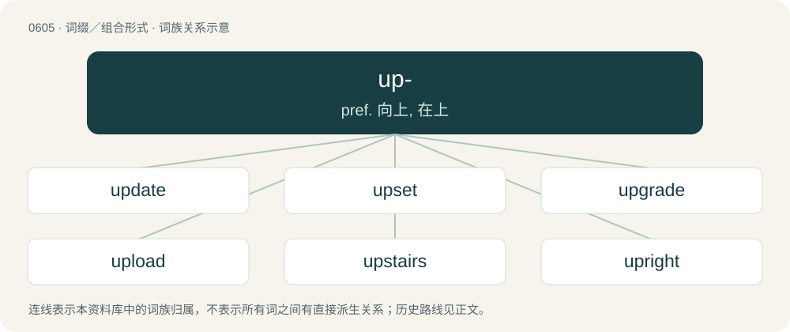

# 0675 · up- — pref. 向上, 在上

[总目录](../00_总目录_按常用程度.md)

**类型**：词缀／组合形式　｜　**来源语言**：见词源记录

## 核心含义与来源

- 核心含义：pref. 向上, 在上
- 英文含义：Used to indicate increase.
- 词形：up-

**来源记录 1**（前缀／前置成分；Used to indicate increase.）

From Middle English up-, from Old English ūp- (“up-”), from ūp (“up, from above”). Cognate with Dutch op- (“up-”), German auf- (“up-”). More at up.

## 词族图

## 单词速览（常用到不常用）

| 单词 | 音标 | 释义 |
|---|---|---|
| [update](#w-1) | /ˈʌp.deɪt/ | vt. 更新, 使现代化；n. 更新；\[计\] 更新 |
| [upset](#w-2) | 英 /ʌpˈsɛt/ | a. 弄翻的, 混乱的, 心烦的；vt. 弄翻, 颠覆, 推翻, 打乱, 使不适, 使心烦；vi. 翻倒 |
| [upgrade](#w-3) | /ˈʌp.ɡɹeɪd/ | n. 上坡, 升级, 上升；adv. 往上；vt. 使升级, 提升, 改良品种 |
| [upload](#w-4) | 英 /ˌʌpˈləʊd/；美 /ˈʌpˌloʊd/ | \[计\] 上装, 加载, 储入 |
| [upstairs](#w-5) | 英 /ˌʌpˈstɛəz/；美 /ˌʌpˈstɛɹz/ | a. 楼上的；adv. 在楼上, 向楼上, 处于更高地位；n. 楼层 |
| [upright](#w-6) | /ˈʌpɹaɪt/ | a. 正直的, 诚实的, 公正的, 垂直的, 竖式的；\[化\] 立杆 |
| [upstream](#w-7) | /ʌpˈstɹiːm/ | adv. 向上游, 逆流地；a. 向上游的, 逆流而上的 |
| [upbeat](#w-8) | /ʌpˈbit/ | n. 弱拍, 上升, 兴旺；a. 上升的, 乐观的 |
| [uphold](#w-9) | /ˌʌpˈhəʊld/ | vt. 支撑, 赞成, 鼓励, 举起, 坚持；\[法\] 确认, 赞成, 支持 |
| [uptake](#w-10) | /ˈʌpteɪk/ | n. 举起, 拿起, 理解, 上风井, 摄入, 吸收；\[化\] 摄取 |
| [uplift](#w-11) | /ʌpˈlɪft/ | n. 抬起, 道德的向上, 精神的高涨；vt. 提高, 抬起；vi. 上升 |
| [upland](#w-12) | 英 /ˈʌplənd/；美 /ˈʌplənd/ | n. 山地, 高地, 高原；a. 高地的, 山地的 |
| [upstart](#w-13) | 英 /ˈʌp.stɑːt/；美 /ˈʌp.stɑɹt/ | n. 新贵, 暴发户, 自命不凡者；a. 暴富的 |
| [uptick](#w-14) | /ˈʌptɪk/ | \[商\](股票)报升(成交价格比上一个交易高的成交或价格) |
| [upstanding](#w-15) | /ʌpˈstændɪŋ/ | a. 直立的, 姿势笔直的, 正直的 |
| [upshot](#w-16) | 英 /ˈʌpʃɒt/；美 /ˈʌpʃɑt/ | n. 结果, 结局, (论证的)要点 |
| [upsurge](#w-17) | /ˈʌpsəːdʒ/ | vi. 高涨, 涌起；n. 增长, 高潮 |
| [upswing](#w-18) | 英 /ˈʌpswɪŋ/ | n. 回升时期, 上升, 向上摆动, 跃进；\[经\] 上升, 向上摆动 |
| [upturned](#w-19) | /ʌpˈtəːnd/ | a. 朝上的, 翻过来的, 翻转的 |
| [upmarket](#w-20) | /ˌʌpˈmɑːkɪt/ | a. 高级的, 高档的, 高端的 |
| [upriver](#w-21) | /ˈʌpˈrivə/ | a. 上游的, 向水源的 |
| [uproot](#w-22) | 英 /ˌʌpˈɹuːt/；美 /ˌʌpˈɹut/ | vt. 连根拔起, 根除 |
| [upturn](#w-23) | 英 /ˈʌp.tɜːn/；美 /ˈʌp.tɝn/ | n. 情况好转, 向上趋势；v. (使)向上, 转朝上, 翻转 |
| [upwind](#w-24) | /ʌpˈwɪnd/ | a. 迎风的, 顶风的；adv. 迎风地, 顶风地 |
| [upwelling](#w-25) | /ʌpˈweliŋ/ | n. 上涌, 上升流(指海水由较深层上升到较浅层的过程) |
| [upstage](#w-26) | /ʌpˈsteɪd͡ʒ/ | a. 在舞台后部的, 傲慢的, 自负的；adv. 在舞台后方；vt. 抢戏 |
| [upend](#w-27) | /ʌpˈɛnd/ | v. 颠倒, 倒放 |
| [uptrend](#w-28) | /ˈʌptrend/ | n. 上升趋势, 好转趋势 |
| [upvote](#w-29) | 英 /ˈʌpˌvəʊt/；美 /ˈʌpˌvoʊt/ | 【英文】A vote for something that increases a cumulative tally of popularity. |
| [upfield](#w-30) | /ʌpˈfiːld/ | (足球等运动中)向前场的\[地\], 高磁场 |
| [updraft](#w-31) | /ˈʌpdrɑːft/ | a. 向上通风的 |
| [upsell](#w-32) |  | vi. 向上促销；增销 |
| [upregulation](#w-33) |  | 【英文】The process, in the regulation of gene expression, in which the number, or activity of receptors increases in order to increase sensitivity. |
| [updo](#w-34) | /ʌpˈdəʊ/ | n. 高髻（一种头发在头顶盘起的女子发式） |

## 逐词详解

### 1. update

**词性**：名词　｜　**音标**：/ˈʌp.deɪt/

**中文释义**：vt. 更新, 使现代化；n. 更新；\[计\] 更新

**英文义项**：An additional piece of information, an addition to existing information. / An advisement providing more up-to-date information than currently known.

**构词拆分**：up- + date

**词源与演化**：

From up- + date. Earliest usages from 1940s (see Citations).

**例句**：

> I just made an update to the Wikipedia article on guerrillas.

该用例对应义项：A modification of something to a more recent, up-to-date version; (in software) a minor upgrade.

### 2. upset

**词性**：形容词　｜　**音标**：英 /ʌpˈsɛt/

**中文释义**：a. 弄翻的, 混乱的, 心烦的；vt. 弄翻, 颠覆, 推翻, 打乱, 使不适, 使心烦；vi. 翻倒

**英文义项**：Angry, distressed, or unhappy / Feeling unwell, nauseated, or ready to vomit.

**构词拆分**：up- + set

**词源与演化**：

From Middle English upset (“the act of setting up; establishment”), from Middle English upsetten, corresponding to up- + set. Cognate with Middle Low German upset (“setup; arrangement”).

**例句**：

> My children often get upset with their classmates.

该用例对应义项：Angry, distressed, or unhappy

### 3. upgrade

**词性**：名词　｜　**音标**：/ˈʌp.ɡɹeɪd/

**中文释义**：n. 上坡, 升级, 上升；adv. 往上；vt. 使升级, 提升, 改良品种

**英文义项**：An upward grade or slope. / An improved component or replacement item, usually applied to technology.

**构词拆分**：From up- + grade.

**词源与演化**：

From up- + grade.

**例句**：

> With my phone company, I get a free upgrade every twelve months if I keep topping up 10 pounds a month.

该用例对应义项：An improved component or replacement item, usually applied to technology.

### 4. upload

**词性**：动词　｜　**音标**：英 /ˌʌpˈləʊd/；美 /ˈʌpˌloʊd/

**中文释义**：\[计\] 上装, 加载, 储入

**英文义项**：To transfer data to a computer on a network, especially to a server on the Internet. / To transfer jurisdiction and responsibility of a government asset or service to a higher level of government.

**构词拆分**：From up- + load.

**词源与演化**：

From up- + load.

**例句**：

> You will have to convert your photograph to a jpg format if you wish to upload it.

该用例对应义项：To transfer data to a computer on a network, especially to a server on the Internet.

### 5. upstairs

**词性**：形容词　｜　**音标**：英 /ˌʌpˈstɛəz/；美 /ˌʌpˈstɛɹz/

**中文释义**：a. 楼上的；adv. 在楼上, 向楼上, 处于更高地位；n. 楼层

**英文义项**：Located on a higher floor or level of a building. / Pertaining to a pitched ball that is high, and usually outside the strike zone.

**构词拆分**：up- + stair + -s

**词源与演化**：

From up- + stair + -s.

**例句**：

> We rent out the upstairs bedroom to a student.

该用例对应义项：Located on a higher floor or level of a building.

### 6. upright

**词性**：形容词　｜　**音标**：/ˈʌpɹaɪt/

**中文释义**：a. 正直的, 诚实的, 公正的, 垂直的, 竖式的；\[化\] 立杆

**英文义项**：Vertical; erect. / In its proper orientation; not overturned.

**构词拆分**：up- + right

**词源与演化**：

From Middle English upright, uppryght, upriht, from Old English upriht (“upright; erect”), from Proto-Germanic \*upprehtaz, equivalent to up- + right. Cognate with Saterland Frisian apgjucht (“upright”), West Frisian oprjocht (“upright”), Dutch oprecht (“upright”), German Low German uprecht (“upright”), German aufrecht (“upright”), Swedish upprätt (“upright”), Icelandic uppréttur (“upright”).

**例句**：

> My brother didn't get angry when his son knocked over the lamp; he simply called the boy over and helped him set it upright again.

该用例对应义项：In its proper orientation; not overturned.

### 7. upstream

**词性**：形容词　｜　**音标**：/ʌpˈstɹiːm/

**中文释义**：adv. 向上游, 逆流地；a. 向上游的, 逆流而上的

**英文义项**：In a direction against the flow of a current or stream of fluid (typically water); upriver. / Occurring earlier than something else; (also, usually, especially) being an influence on something else; causing a consequence for something else.

**构词拆分**：up- + stream

**词源与演化**：

From up- + stream.

**例句**：

> Input entry is upstream of input validation in the runtime process.

该用例对应义项：Occurring earlier than something else; (also, usually, especially) being an influence on something else; causing a consequence for something else.

### 8. upbeat

**词性**：形容词　｜　**音标**：/ʌpˈbit/

**中文释义**：n. 弱拍, 上升, 兴旺；a. 上升的, 乐观的

**英文义项**：Having a fast pace, tempo, or beat. / Having a positive, lively, or perky tone, attitude, etc.

**构词拆分**：From up- + beat.

**词源与演化**：

From up- + beat.

**例句**：

> The notes are easy, but it's an upbeat tune and should be played fairly quickly.

该用例对应义项：Having a fast pace, tempo, or beat.

### 9. uphold

**词性**：动词　｜　**音标**：/ˌʌpˈhəʊld/

**中文释义**：vt. 支撑, 赞成, 鼓励, 举起, 坚持；\[法\] 确认, 赞成, 支持

**英文义项**：To hold up; to lift on high; to elevate. / To keep erect; to support; to sustain; to keep from falling.

**构词拆分**：up- + hold

**词源与演化**：

From Middle English upholden, equivalent to up- + hold. Compare Dutch ophouden (“to stop, cease, hold up”), German aufhalten (“to stop, halt, detain”). Compare also Middle Low German upholt, Old Norse upphald (“uphold, support”).

**例句**：

> During the war, these guys sacrificed their life to uphold our freedom.

### 10. uptake

**词性**：名词　｜　**音标**：/ˈʌpteɪk/

**中文释义**：n. 举起, 拿起, 理解, 上风井, 摄入, 吸收；\[化\] 摄取

**英文义项**：Understanding; comprehension. / Absorption, especially of food or nutrient by an organism.

**构词拆分**：up- + take

**词源与演化**：

From Middle English uptaken (“to take up, lift”), partial calque of earlier Middle English upnimen (“to take up, lift”), equivalent to up- + take. Compare Swedish upptaga, uppta (“to take up”).

**例句**：

> They developed paper napkins with a greater uptake of liquids.

该用例对应义项：a process of taking up or using up or consuming

### 11. uplift

**词性**：动词　｜　**音标**：/ʌpˈlɪft/

**中文释义**：n. 抬起, 道德的向上, 精神的高涨；vt. 提高, 抬起；vi. 上升

**英文义项**：To raise something or someone to a higher physical, social, moral, intellectual, spiritual, or emotional level. / To raise (a nonsentient species) into sentience.

**构词拆分**：up- + lift

**词源与演化**：

From up- + lift.

**例句**：

> Tebboune is trying to uplift the living conditions of the people.

### 12. upland

**词性**：名词　｜　**音标**：英 /ˈʌplənd/；美 /ˈʌplənd/

**中文释义**：n. 山地, 高地, 高原；a. 高地的, 山地的

**英文义项**：The area in the interior of a country with a generally higher elevation.

**构词拆分**：up- + land

**词源与演化**：

From Middle English upland, from Old English ūpland (“the country”); equivalent to up- + land. The word as an adjective developed in Middle English.

**例句**：

> They had a load of coals behind them—a fuel that could only be got into the upland by this particular route.

### 13. upstart

**词性**：名词　｜　**音标**：英 /ˈʌp.stɑːt/；美 /ˈʌp.stɑɹt/

**中文释义**：n. 新贵, 暴发户, 自命不凡者；a. 暴富的

**英文义项**：One who has suddenly gained wealth, power, or other prominence, but either has not received social acceptance or has become arrogant or presumptuous. / The meadow saffron.

**构词拆分**：up- + start

**词源与演化**：

From Middle English upstarten, upsterten, equivalent to up- + start.

**例句**：

> The upstart tried to pass for a man of culture.

### 14. uptick

**词性**：名词　｜　**音标**：/ˈʌptɪk/

**中文释义**：\[商\](股票)报升(成交价格比上一个交易高的成交或价格)

**英文义项**：A small increase or upward change in something that has been steady or declining. / A stock market transaction or quote at a price above a preceding one.

**构词拆分**：From up- + tick.

**词源与演化**：

From up- + tick.

**例句**：

> Many fear an uptick in the violence.

### 15. upstanding

**词性**：形容词　｜　**音标**：/ʌpˈstændɪŋ/

**中文释义**：a. 直立的, 姿势笔直的, 正直的

**英文义项**：Honest; reputable; respectable.

**构词拆分**：From up- + standing.

**词源与演化**：

From up- + standing.

**例句**：

> An upstanding merchant will exchange a faulty product.

该用例对应义项：Honest; reputable; respectable.

### 16. upshot

**词性**：名词　｜　**音标**：英 /ˈʌpʃɒt/；美 /ˈʌpʃɑt/

**中文释义**：n. 结果, 结局, (论证的)要点

**英文义项**：The final result, or outcome of something. / A concise summary.

**构词拆分**：up- + shot

**词源与演化**：

Presumed from up- + shot, referring to the last shot in a match of archery.

**例句**：

> One of the major upshots of prefab building is its decreased environmental impact.

该用例对应义项：A positive aspect or consequence, often either unexpected or in contrast to other negative aspects.

### 17. upsurge

**词性**：名词　｜　**音标**：/ˈʌpsəːdʒ/

**中文释义**：vi. 高涨, 涌起；n. 增长, 高潮

**英文义项**：A sudden strong rise or flow.

**构词拆分**：From up- + surge.

**词源与演化**：

From up- + surge.

**例句**：

> An upsurge of emotion.

该用例对应义项：a sudden or abrupt strong increase

### 18. upswing

**词性**：名词　｜　**音标**：英 /ˈʌpswɪŋ/

**中文释义**：n. 回升时期, 上升, 向上摆动, 跃进；\[经\] 上升, 向上摆动

**英文义项**：An upward swing. / An upward trend or an increase in activity.

**构词拆分**：From up- + swing.

**词源与演化**：

From up- + swing.

**例句**：

> Newspapers reported an upswing in the company's sales last month.

该用例对应义项：An upward trend or an increase in activity.

### 19. upturned

**词性**：形容词　｜　**音标**：/ʌpˈtəːnd/

**中文释义**：a. 朝上的, 翻过来的, 翻转的

**英文义项**：Turned over; inverted; capsized. / Turned up at the end.

**构词拆分**：From up- + turned.

**词源与演化**：

From up- + turned.

**例句**：

> A small upturned nose.

该用例对应义项：(used of noses) turned up at the end

### 20. upmarket

**词性**：形容词　｜　**音标**：/ˌʌpˈmɑːkɪt/

**中文释义**：a. 高级的, 高档的, 高端的

**英文义项**：Designed for customers with a high income.

**构词拆分**：From up- + market.

**词源与演化**：

From up- + market.

**例句**：

> He turned up in well-cut clothes...and upmarket felt hats.

该用例对应义项：designed for consumers with high incomes

### 21. upriver

**词性**：形容词　｜　**音标**：/ˈʌpˈrivə/

**中文释义**：a. 上游的, 向水源的

**英文义项**：Towards the source of a river.

**构词拆分**：From up- + river.

**词源与演化**：

From up- + river.

**例句**：

> According to the map, there should be a bridge about three miles upriver.

### 22. uproot

**词性**：动词　｜　**音标**：英 /ˌʌpˈɹuːt/；美 /ˌʌpˈɹut/

**中文释义**：vt. 连根拔起, 根除

**英文义项**：To tear up (a plant, etc.) by the roots, or as if by the roots; to extirpate, to root up. / To destroy (something) utterly; to eradicate, exterminate.

**构词拆分**：up- (prefix indicating a higher direction or position) + root (“to tear up by the roots; (figuratively) to remove forcibly from a place; to eradicate, exterminate”, verb)

**词源与演化**：

From up- (prefix indicating a higher direction or position) + root (“to tear up by the roots; (figuratively) to remove forcibly from a place; to eradicate, exterminate”, verb). Root is derived from root (“underground part of a plant”, noun), from Middle English rote, from Old English rōt, rōte, from Old Norse rót, from Proto-Germanic \*wrōts, ultimately from Proto-Indo-European \*wréh₂ds (“root”).

**例句**：

> Uproot the vine that has spread all over the garden.

该用例对应义项：pull up by or as if by the roots

### 23. upturn

**词性**：名词　｜　**音标**：英 /ˈʌp.tɜːn/；美 /ˈʌp.tɝn/

**中文释义**：n. 情况好转, 向上趋势；v. (使)向上, 转朝上, 翻转

**英文义项**：An upward turn or trend, especially in business activity or profit.

**构词拆分**：up- + turn

**词源与演化**：

From Middle English upturnen, equivalent to up- + turn.

**例句**：

> You'll often see a sales upturn after returning to the full price.

### 24. upwind

**词性**：形容词　｜　**音标**：/ʌpˈwɪnd/

**中文释义**：a. 迎风的, 顶风的；adv. 迎风地, 顶风地

**英文义项**：Exposed to the wind.

**构词拆分**：up- + wind

**词源与演化**：

From up- + wind.

### 25. upwelling

**词性**：名词　｜　**音标**：/ʌpˈweliŋ/

**中文释义**：n. 上涌, 上升流(指海水由较深层上升到较浅层的过程)

**英文义项**：An upward movement from a lower source. / the oceanographic phenomenon that occurs when strong, usually seasonal, winds push water away from the coast, bringing cold, nutrient-rich deep waters up to the surface

**构词拆分**：From up- + welling.

**词源与演化**：

From up- + welling.

### 26. upstage

**词性**：形容词　｜　**音标**：/ʌpˈsteɪd͡ʒ/

**中文释义**：a. 在舞台后部的, 傲慢的, 自负的；adv. 在舞台后方；vt. 抢戏

**英文义项**：At the rear of a stage.

**构词拆分**：up- + stage

**词源与演化**：

From up- + stage. The figurative uses “haughty” and “to draw attention away” derive from actors moving to a higher and thus more visible position on a sloped stage.

**例句**：

> The minimalist play used no upstage scenery.

该用例对应义项：At the rear of a stage.

### 27. upend

**词性**：动词　｜　**音标**：/ʌpˈɛnd/

**中文释义**：v. 颠倒, 倒放

**英文义项**：To end up; to set on end. / To tip or turn over.

**构词拆分**：up- + end

**词源与演化**：

From up- + end.

**例句**：

> By the middle of March 2020, the COVID-19 pandemic upended normal life for virtually all Americans.

该用例对应义项：To affect or upset drastically.

### 28. uptrend

**词性**：名词　｜　**音标**：/ˈʌptrend/

**中文释义**：n. 上升趋势, 好转趋势

**英文义项**：An upward trend, or an upturn.

**构词拆分**：up- + trend

**词源与演化**：

From up- + trend.

**例句**：

> At Wall Street, some insiders made a killing by going short, when everyone had been sucked into an unsustainable uptrend.

### 29. upvote

**词性**：名词　｜　**音标**：英 /ˈʌpˌvəʊt/；美 /ˈʌpˌvoʊt/

**英文义项**：A vote for something that increases a cumulative tally of popularity.

**构词拆分**：up- + vote

**词源与演化**：

From up- + vote.

**例句**：

> Tom uses sock puppet accounts to upvote his posts.

### 30. upfield

**词性**：形容词　｜　**音标**：/ʌpˈfiːld/

**中文释义**：(足球等运动中)向前场的\[地\], 高磁场

**英文义项**：Towards the upper part of a field. / Away from the defending team's end of the playing field.

**构词拆分**：From up- + field.

**词源与演化**：

From up- + field.

### 31. updraft

**词性**：名词　｜　**音标**：/ˈʌpdrɑːft/

**中文释义**：a. 向上通风的

**英文义项**：an upward current of air, especially a strong one

**构词拆分**：From up- + draft.

**词源与演化**：

From up- + draft.

### 32. upsell

**词性**：动词

**中文释义**：vi. 向上促销；增销

**英文义项**：To persuade a customer to buy more items, or more expensive items, than they had intended.

**构词拆分**：From up- + sell.

**词源与演化**：

From up- + sell.

**例句**：

> I gave up on subscribing to their SaaS because they wouldn't quit the constant attempts to upsell.

该用例对应义项：To persuade a customer to buy more items, or more expensive items, than they had intended.

### 33. upregulation

**词性**：名词

**英文义项**：The process, in the regulation of gene expression, in which the number, or activity of receptors increases in order to increase sensitivity.

**构词拆分**：From up- + regulation.

**词源与演化**：

From up- + regulation.

### 34. updo

**词性**：名词　｜　**音标**：/ʌpˈdəʊ/

**中文释义**：n. 高髻（一种头发在头顶盘起的女子发式）

**英文义项**：A woman's hairdo in which most hair is kept above the neck.

**构词拆分**：up- + do

**词源与演化**：

From up- + do.
