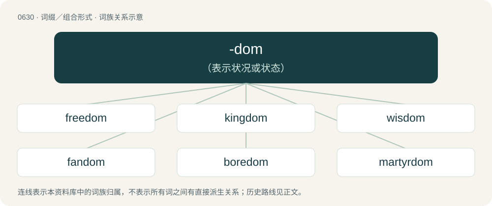

# 0702 · -dom — （表示状况或状态）

[总目录](../00_总目录_按常用程度.md)

**类型**：词缀／组合形式　｜　**来源语言**：见词源记录

## 核心含义与来源

- 核心含义：（表示状况或状态）
- 英文含义：Forms nouns denoting the condition or state of the root word.
- 词形：-dom

**多个词源／构词路径**：同一拼写可能有不同来源；以下按词性和含义分别列出。

**来源记录 1**（后缀／后置成分；Forms nouns denoting the condition or state of the root word.）

From Middle English -dom, from Old English -dōm (“-dom: state, condition, power, authority, property, right, office, quality”, suffix), from Proto-West Germanic \*-dōm, from Proto-Germanic \*-dōmaz. Cognate with Scots -dom (“-dom”), North Frisian -dom (“-dom”), West Frisian -dom (“-dom”), Dutch -dom (“-dom”), Low German -dom (“-dom”), German -tum (“-dom”), Danish -dom (“-dom”) -dømme (“-dom”), Swedish -dom (“-dom”) -döme (“-dom”), Norwegian -dom (“-dom”), Icelandic -dómur (“-dom”), Norwegian Bokmål -dømme, Norwegian Nynorsk -døme. Same as Old English dōm (“doom, judgment, sentence, condemnation, ordeal, judicial sentence, decree, ordinance, law, custom; justice, equity; direction, ruling, governing, command; might, power, supremacy, majesty, glory, magnificence, splendor, reputation, honor, praise, dignity, authority; state, condition”). No relation to English domain or dominion. More at doom.

**来源记录 2**（后缀／后置成分；Forms uncountable nouns denoting a type of domination.）

From dom, shortening of variously domination, dominance, or dominator.

## 词族图

## 单词速览（常用到不常用）

| 单词 | 音标 | 释义 |
|---|---|---|
| [freedom](#w-1) | 英 /ˈfɹiːdəm/；美 /ˈfɹi.dəm/ | n. 自由, 坦率, 特权；\[法\] 自由, 自主, 免除 |
| [kingdom](#w-2) | 英 /ˈkɪŋdəm/ | n. 王国, 领域；\[医\] 界(动物,植物,矿物) |
| [wisdom](#w-3) | 英 /ˈwɪzdəm/ | n. 智慧, 明智行为, 学识, 名言, 贤人 |
| [fandom](#w-4) | /ˈfændəm/ | n. 运动迷, 影迷 |
| [boredom](#w-5) | 英 /ˈbɔː.dəm/；美 /ˈbɔɹ.dəm/ | n. 厌烦, 厌倦, 令人厌烦的事物 |
| [martyrdom](#w-6) | 英 /ˈmɑː(ɹ).tə(ɹ).dəm/ | n. 殉教, 殉难, 殉节 |
| [stardom](#w-7) | 美 /ˈstɑɹdəm/ | n. 明星身分, 明星们 |
| [femdom](#w-8) | 英 /ˈfɛmˌdɒm/；美 /ˈfɛmˌdɑm/ | 【英文】Female domination; a sexual practice in which women dominate men or other people. |
| [fiefdom](#w-9) | /ˈfiːf.dəm/ | n. 封地, 采邑（等于fief） |
| [officialdom](#w-10) | /əˈfɪ.ʃəl.dəm/ | n. 官场, 官僚圈子, 公务员, 官僚主义；\[法\] 官场, 公务员界, 官吏 |
| [earldom](#w-11) | 美 /ˈəɹldəm/ | n. 伯爵的身分 |
| [dukedom](#w-12) | 英 /ˈdjuːk.dəm/；美 /ˈdjuk.dəm/ | n. 公爵领土, 公国, 公爵的地位 |
| [superstardom](#w-13) | /ˈsjuːpə,stɑːdəm/ | 超级明星界 |

## 逐词详解

### 1. freedom

**词性**：名词　｜　**音标**：英 /ˈfɹiːdəm/；美 /ˈfɹi.dəm/

**中文释义**：n. 自由, 坦率, 特权；\[法\] 自由, 自主, 免除

**英文义项**：The state of being free. / The lack of a specific constraint, or of constraints in general; a state of being free, unconstrained.

**构词拆分**：free + -dom

**词源与演化**：

From Middle English fredom, freedom, from Old English frēodōm (“freedom, state of free-will, charter, emancipation, deliverance”), from Proto-West Germanic \*frijadōm (“freedom”). Equivalent to free + -dom. Cognate with North Frisian fridoem (“freedom”), Dutch vrijdom (“freedom”), Low German frīdom (“freedom”), Middle High German vrītuom (“freedom”), Norwegian fridom (“freedom”).

**例句**：

> Having recently been released from prison, he didn't know what to do with his newfound freedom.

该用例对应义项：The state of being free.

### 2. kingdom

**词性**：名词　｜　**音标**：英 /ˈkɪŋdəm/

**中文释义**：n. 王国, 领域；\[医\] 界(动物,植物,矿物)

**英文义项**：A realm having a king or queen as its actual or nominal sovereign. / A realm, region, or conceptual space where something is dominant.

**构词拆分**：king + -dom

**词源与演化**：

From Middle English kingdom, kyngdom, from Old English cyningdōm from Proto-Germanic \*kuningadōmaz, equivalent to king + -dom. Cognate with Scots kingdom, West Frisian keuningdom, Dutch koningdom, German Königtum, Danish kongedømme, Swedish kungadöme, and Icelandic konungdómur. Etymology tree Proto-Indo-European \*ǵenh₁- Proto-Indo-European \*-yós Proto-Germanic \*kunją Proto-Indo-European \*-n̥kʷo-der.? Proto-Indo-European \*-nós Proto-Indo-European \*-iHnos Proto-Germanic \*-īnaz Proto-Indo-European \*-kos Proto-Germanic \*-gaz ? Proto-Germanic \*-ingaz Proto-Germanic \*kuningaz Proto-Indo-European \*dʰeh₁- Proto-Indo-European \*-mos Proto-Indo-European \*dʰóh₁mos Proto-Germanic \*dōmaz Proto-Germanic \*-dōmaz Proto-Germanic \*kuningadōmaz Proto-West Germanic \*kuningadōm Old English cyningdōm Middle English kingdom English kingdom

**用法示例／搭配（非完整句）**：

> the kingdom of the dead

该用例对应义项：A realm, region, or conceptual space where something is dominant.

### 3. wisdom

**词性**：名词　｜　**音标**：英 /ˈwɪzdəm/

**中文释义**：n. 智慧, 明智行为, 学识, 名言, 贤人

**英文义项**：An element of personal character that enables one to distinguish the wise from the unwise. / A piece of wise advice.

**构词拆分**：wise + -dom

**词源与演化**：

From Middle English wisdom, from Old English wīsdōm (“wisdom”), from Proto-West Germanic \*wīsadōm, from Proto-Germanic \*wīsadōmaz (“wisdom”), corresponding to wise + -dom. Cognate with Scots wisdom, wysdom (“wisdom”), West Frisian wiisdom (“wisdom”), Dutch wijsdom (“wisdom”), German Weistum (“legal sentence”), Danish/Norwegian/Swedish visdom (“wisdom”), Icelandic vísdómur (“wisdom”).

**例句**：

> With a little more wisdom, he would not have got in trouble.

### 4. fandom

**词性**：名词　｜　**音标**：/ˈfændəm/

**中文释义**：n. 运动迷, 影迷

**英文义项**：The fans of a sport, activity, work, person etc., taken as a group. / The subculture of enthusiasts, especially of TV shows.

**构词拆分**：fan + -dom

**词源与演化**：

From fan + -dom.

**例句**：

> The furry fandom, like many other fandoms, has its own slang.

### 5. boredom

**词性**：名词　｜　**音标**：英 /ˈbɔː.dəm/；美 /ˈbɔɹ.dəm/

**中文释义**：n. 厌烦, 厌倦, 令人厌烦的事物

**英文义项**：The state of being bored. / An instance or period of being bored; a bored state.

**构词拆分**：bore + -dom

**词源与演化**：

From bore + -dom.

**例句**：

> Mark kept switching tasks at work to avoid the pain of boredom.

### 6. martyrdom

**词性**：名词　｜　**音标**：英 /ˈmɑː(ɹ).tə(ɹ).dəm/

**中文释义**：n. 殉教, 殉难, 殉节

**英文义项**：The condition of a martyr; the death or suffering of a martyr; the death or suffering on account of adherence to the Christian faith, or to any cause. / Extreme suffering, affliction; torment; torture, especially without reason.

**构词拆分**：martyr + -dom

**词源与演化**：

From Middle English martyrdome, martirdom, marterdom, from Old English martyrdōm (“martyrdom”), corresponding to martyr + -dom. Cognate with German Märtyrertum (“martyrdom”), Danish martyrdom (“martyrdom”), Swedish martyrdom (“martyrdom”), Norwegian martyrdom (“martyrdom”).

**例句**：

> What do you think are the problems that underlie your obsession with martyrdom?

### 7. stardom

**词性**：名词　｜　**音标**：美 /ˈstɑɹdəm/

**中文释义**：n. 明星身分, 明星们

**英文义项**：The status or position of a performer acknowledged to be a star; fame; celebrity.

**构词拆分**：star + -dom

**词源与演化**：

From star + -dom.

**例句**：

> Stardom meant nothing to her.

该用例对应义项：the status of being acknowledged as a star

### 8. femdom

**词性**：名词　｜　**音标**：英 /ˈfɛmˌdɒm/；美 /ˈfɛmˌdɑm/

**英文义项**：Female domination; a sexual practice in which women dominate men or other people. / A female dominator in sadomasochistic sexual practices.

**构词拆分**：fem- + -dom

**词源与演化**：

From fem- + -dom (“domination”).

**例句**：

> Femdom is short for Female Domination.

### 9. fiefdom

**词性**：名词　｜　**音标**：/ˈfiːf.dəm/

**中文释义**：n. 封地, 采邑（等于fief）

**英文义项**：Any organization in the control of a dominant individual.

**构词拆分**：From fief + -dom.

**词源与演化**：

From fief + -dom.

**例句**：

> This community isn't your personal fiefdom.

### 10. officialdom

**词性**：名词　｜　**音标**：/əˈfɪ.ʃəl.dəm/

**中文释义**：n. 官场, 官僚圈子, 公务员, 官僚主义；\[法\] 官场, 公务员界, 官吏

**英文义项**：The people elected to government or employed in the civil service. / The state of being official

**构词拆分**：official + -dom

**词源与演化**：

From official + -dom.

### 11. earldom

**词性**：名词　｜　**音标**：美 /ˈəɹldəm/

**中文释义**：n. 伯爵的身分

**英文义项**：The rank of being an earl. / The territory controlled by an earl.

**构词拆分**：earl + -dom

**词源与演化**：

From Middle English erldom, from Old English eorldōm, equivalent to earl + -dom. Compare English jarldom. Cognate also with Scots eirldome, ȝerledom, erldom (“earldom”).

### 12. dukedom

**词性**：名词　｜　**音标**：英 /ˈdjuːk.dəm/；美 /ˈdjuk.dəm/

**中文释义**：n. 公爵领土, 公国, 公爵的地位

**英文义项**：A region ruled by a duke or duchess. / The rank or title of a duke.

**构词拆分**：duke + -dom

**词源与演化**：

From late Middle English dukdom, dukedom; equivalent to duke + -dom.

### 13. superstardom

**词性**：名词　｜　**音标**：/ˈsjuːpə,stɑːdəm/

**中文释义**：超级明星界

**英文义项**：The status or position of a superstar.

**构词拆分**：superstar + -dom；super- + stardom

**词源与演化**：

From superstar + -dom or super- + stardom.

**例句**：

> Tom never quite achieved international superstardom, but he's always in demand at village fetes.
