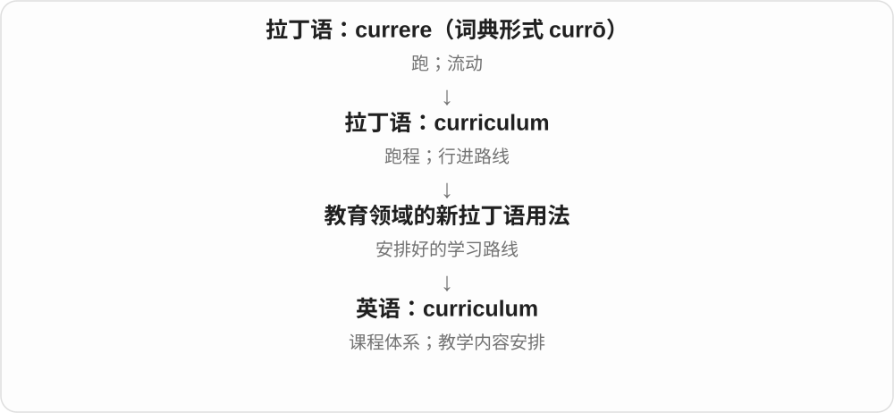
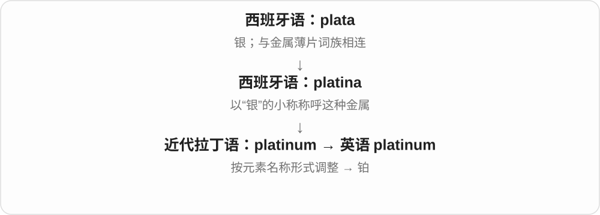

# 0722 · -um — 拉丁借词与近代科学名称保留的结尾

[逐词精讲目录](../00_逐词精讲目录.md) · [总目录](../00_总目录_按常用程度.md)

## 核心词根与来源

拉丁语里的语法结尾随着整个词进入英语，各词又按英语习惯发展。album、curriculum、medium 等并不因为同结尾就意义相同；科学名称的 -um 是另一种命名运用。

**-UM：常是借入时留下的旧词形，先看整个词的历史**

forum 讨论场所，datum 一项依据，addendum 该补上的内容；platinum 看近代元素命名。

- **讨论、依据与文件补充**：forum · datum · addendum · memorandum
- **其他拉丁词形借入与学术用语**：album · curriculum · medium · bacterium
- **近代元素名称的结尾**：platinum
- **forum → forums：从公共广场到讨论场所**：forums

## 词形与演化规律

拉丁原词形式 → 英语整体借入；datum／data、addendum／addenda 保留旧对举；forum 常复数 forums，album 常 albums。

拉丁 forum 公共广场、集市场所借入英语，后来用于讨论场所、网络论坛。现代规则复数保留 -um 加 -s，另有拉丁式复数 fora。

## 单词速览（按词族由简到繁）

同一基础词的相关扩展放在一起，先读基础形式，再读扩展；各组之间优先读常用的。具体词源关系见各词讲解。

| 单词 | 音标 | 核心意思 |
|---|---|---|
| [album](#w-4) | /ˈælbəm/ | 相册；集邮册；音乐专辑 |
| [medium](#w-5) | /ˈmiːdiəm/ | 中等的；媒介；介质；灵媒 |
| [forum](#w-6) | 英 /ˈfɔːrəm/；美 /ˈfɔːrəm/ | 论坛、讨论会；古罗马公共广场；网络论坛 |
| [forums](#w-12) | 英 /ˈfɔːrəmz/；美 /ˈfɔːrəmz/ | 论坛；讨论场所、交流平台〔复数〕 |
| [curriculum](#w-7) | 英 /kəˈrɪkjʊləm/；美 /kəˈrɪkjələm/ | 课程体系；教学内容安排 |
| [platinum](#w-1) | 英 /ˈplætɪnəm/；美 /ˈplætɪnəm/ | 铂；白金；白金级的 |
| [memorandum](#w-8) | /ˌmeməˈrændəm/ | 备忘录；书面说明、通知 |
| [bacterium](#w-9) | 英 /bækˈtɪəriəm/；美 /bækˈtɪriəm/ | 一个细菌；某一种细菌〔单数形式〕 |
| [addendum](#w-10) | /əˈdendəm/ | 补遗、附加说明、补充文件 |
| [datum](#w-11) | /ˈdeɪtəm/，也读 /ˈdætəm/ | 一项数据、已知事实；基准点、基准面 |

## 逐词讲解

### 1. album — 相册；集邮册；音乐专辑

**音标**：/ˈælbəm/

**先抓住这个画面**

把照片、邮票或一组录音收在一起，形成一个有边界的合集。

**怎么拆**

拉丁 album 原指涂白供题写的板，是 albus 的中性形式。后来的纪念题名册、收藏册把名称带入英语；音乐中的 album 又沿用合集的意思。

**怎么变成今天的意思**

**拉丁 albus 白色的**  
由白板、蛋白、色素与反光程度分出不同词

↓

**拉丁 album 白板 → 近代拉丁 album amicorum 友人题名册**  
从可书写的白色表面转到收藏、留念的册子

↓

**英语 album**  
相册、收藏册；后来也指一组录音组成的专辑

photo album 的核心是一本收集照片的册子；music album 是成组发行的作品，今天不需要有实体纸页或唱片。别因为外观变成数字文件，就误以为 album 必须换词。

**常见搭配与例句**

a photo album；a debut album；release an album；a stamp album。

> We put the wedding photographs in an album.

我们把婚礼照片放进了一本相册。

> The singer recorded her first album at home.

这位歌手在家里录制了她的第一张专辑。

**别混淆**

single 常指单曲，album 通常收录多首作品；playlist 是播放列表，未必作为一张专辑发行。albumen 不是 album 的复数。

### 2. medium — 中等的；媒介；介质；灵媒

**音标**：/ˈmiːdiəm/

**先抓住这个画面**

大小上站在两端中间，就是 medium；信息从这边传到那边，夹在中间承载它的东西，也是 medium。

**怎么拆**

直接借自拉丁语 medium，是 medius“中间的”的相关名词用法。

**怎么变成今天的意思**

“居中的”保留在 medium size；“起中间作用的东西”扩展为传播媒介、物理介质、绘画材料。灵媒义则指自称在生者与亡者之间传话的人。

**常见搭配与例句**

medium size；a medium of communication；a storage medium；an artistic medium。

> I usually wear a medium, but this jacket is too small.

我通常穿中号，但这件外套太小了。

> Clay is her favourite artistic medium.

黏土是她最喜欢的创作材料。

**别混淆**

medium 描述中等尺寸通常中性；mediocre 评价质量平庸，常带失望。衣服尺码 medium 不等于衣服品质差。

### 3. forum — 论坛、讨论会；古罗马公共广场；网络论坛

**音标**：英 /ˈfɔːrəm/；美 /ˈfɔːrəm/

**先抓住这个画面**

先有大家来往、交易、议事的公共广场，再有交换意见的场所。搬到网上，帖子与回复围成了一个 forum。

**怎么拆**

借自拉丁 forum 公共场所、广场。-um 是拉丁原词形的一部分，英语整体借入；更远与外部、门等词族的联系有讨论。

**怎么变成今天的意思**

**拉丁中性单数等语法形式保留在借词里**  
album、curriculum、medium 等各有具体原词结构

↓

**拉丁 forum 公共广场 → 英语 forum**  
讨论场所、会议；网络论坛

a public forum 公共讨论平台，an online forum 网络论坛，a forum for discussion 讨论场所。复数常 forums，也有拉丁式 fora。

**常见搭配与例句**

an online forum；a forum for debate；post on a forum。

> She posted the question on an online forum.

她把问题发到了网络论坛。

> The meeting provided a forum for residents to discuss the plan.

会议为居民讨论计划提供了场所。

**别混淆**

forum 强调讨论空间或组织起来的讨论；一个网站可以含论坛，但并非每个网站都是论坛。

### 4. forums — 论坛；讨论场所、交流平台〔复数〕

**音标**：英 /ˈfɔːrəmz/；美 /ˈfɔːrəmz/

**先抓住这个画面**

古人聚在广场讨论，现代人聚在会场、网站讨论，都可以借 forum 这个场所名来讲。多个这样的地方就是 forums。

**怎么拆**

forum + -s → forums，保留 -um 再加英语复数；forum 直接接拉丁 forum 集市、公共广场。另有拉丁式复数 fora，现代两个形式均见。

**怎么变成今天的意思**

**拉丁 forum 集市、公共场所 → 英语 forum**  
从公共集会处扩展讨论场所

↓

**forum + -s → forums**  
现代规则复数，也有源语言式 fora

online forums 是网络论坛；public forums 是公共讨论平台；forums for exchanging ideas 是交流想法的场所。

**常见搭配与例句**

online forums；public forums；forums for discussion。

> She found useful advice on several online forums.

她在几个网络论坛上找到了有用建议。

> The university provides forums for open discussion.

大学提供公开讨论的平台。

**别混淆**

forum 是讨论的平台、场所，post 是帖子；一个论坛里可以有很多帖子，不能把两个层级都混称 forums。

### 5. curriculum — 课程体系；教学内容安排

**音标**：英 /kəˈrɪkjʊləm/；美 /kəˈrɪkjələm/

**先抓住这个画面**

把学生将走过的学习路线画成一张图：学什么、怎样衔接，组成了 curriculum。

**怎么拆**

拉丁语 curriculum 原指跑程、行进路线，来自 currere；教育领域把它用于安排好的学习进程。

**怎么变成今天的意思**

它通常比单独一门 course 范围更大，可指学校或专业整体的教学内容。复数可用 curricula，也可用 curriculums。

**常见搭配与例句**

the school curriculum；curriculum design；part of the curriculum。

> The school added environmental studies to its curriculum.

学校把环境研究加入课程体系。

> Teachers helped design the new curriculum.

教师们参与设计了新的课程安排。

**别混淆**

curriculum 是总体学习安排；syllabus 常是某门课的教学大纲。实际用法有重叠，仍要看所指范围。

### 6. platinum — 铂；白金；白金级的

**音标**：英 /ˈplætɪnəm/；美 /ˈplætɪnəm/

**先抓住这个画面**

一种银白色金属；历史名称把它与银联系起来，但它是另一种元素。

**怎么拆**

来自近代拉丁语 platinum，改造自西班牙语 platina；platina 是 plata“银”的小称。plata 本有金属薄片一支，属于 plate 的同源网络。

**怎么变成今天的意思**

化学符号 Pt。platinum blonde 是浅得近乎银白的金发；platinum album 是白金唱片称号，具体认证门槛因地区和制度不同。

**常见搭配与例句**

a platinum ring；platinum blonde hair；a platinum album。

> The ring is made of platinum.

这枚戒指是铂金做的。

> Her latest album went platinum.

她最新的专辑获得了白金唱片认证。

**别混淆**

platinum 是铂；white gold 是白色金合金，不是同一种材料。

### 7. memorandum — 备忘录；书面说明、通知

**音标**：/ˌmeməˈrændəm/

**先抓住这个画面**

把需要记住、传达或留待查阅的事情写成文件，免得只靠口头和记性。

**怎么拆**

直接借拉丁 memorandum，是 memorandus“应当记住的”的中性单数，来自 memorare。字面上相当于“一件应当记住的事”，后来指记下它的文件。

**怎么变成今天的意思**

**拉丁 memor**  
记着的；放在心上的

↓

**拉丁 memorare → memorandus 的中性单数 memorandum**  
使人记起 → 应当记住的事

↓

**拉丁 memorandum → 英语 memorandum**  
需要记下的事 → 备忘录、书面说明

工作中可指内部说明或正式记录；memorandum of understanding 常译谅解备忘录。普通复数 memorandums 与拉丁式 memoranda 都可见；简称 memo 更日常。

**常见搭配与例句**

issue a memorandum；an internal memorandum；a memorandum on；memoranda。

> The director circulated a memorandum explaining the new approval process.

主管发出了一份备忘录，说明新的审批流程。

> The archive contains several memoranda about the proposed library.

档案馆保存了几份有关拟建图书馆的备忘录。

**别混淆**

memo 是它的缩略形式，语气通常更日常；memoir 是回忆录。文件叫 memorandum，并不只意味着给自己写的小提醒。

### 8. bacterium — 一个细菌；某一种细菌〔单数形式〕

**音标**：英 /bækˈtɪəriəm/；美 /bækˈtɪriəm/

**先抓住这个画面**

当句子要明确说一个细菌，或以单数指某种细菌时，用这个形式。

**怎么拆**

借科学拉丁 bacterium，追到希腊 baktērion“小杆”。英语保留了拉丁式单复数配对：-um 对应复数 -a；不能套普通词的规则随意写成 bacterias。

**怎么变成今天的意思**

**古希腊语 baktērion**  
小杆、小棍，与 baktron / baktēria 杖、棍相关

↓

**19 世纪科学拉丁 bacterium；复数 bacteria**  
借杆状外形给微生物命名

↓

**英语 bacterium / bacteria**  
细菌的单数与复数；现代范围不限杆状

a single bacterium 聚焦一个微小细胞。This bacterium is common in soil 也可用一个单数名称概括某一类细菌，就像“这种动物”可以用单数说法。具体是哪种用法，由句子决定。

**常见搭配与例句**

a single bacterium；a bacterium found in soil；identify a bacterium。

> The animation shows a single bacterium dividing into two cells.

动画展示了一个细菌分裂成两个细胞。

> This bacterium is commonly found in soil.

这种细菌常见于土壤中。

**别混淆**

bacterium is 与 bacteria are 成对记。细菌名称源于杆状联想，不意味着 every bacterium 都像一根小棍。

### 9. addendum — 补遗、附加说明、补充文件

**音标**：/əˈdendəm/

**先抓住这个画面**

正文写完了，还有一段需要加进去，就把它作为 addendum。名字本来就说“该加上的东西”。

**怎么拆**

借自拉丁 addendum，是 addere 添加的动形词中性单数用法。ad- 朝向与 -dere 放、置的成分形成 addere；英语把整个形式用作补充内容名。

**怎么变成今天的意思**

**拉丁中性单数等语法形式保留在借词里**  
album、curriculum、medium 等各有具体原词结构

↓

**addere 添加 → addendum 需要加上的东西 → addendum**  
文件、书籍的补遗、附加内容

an addendum to a report 报告补充说明，issue an addendum 发布补遗；复数常 addenda，也有 addendums。

**常见搭配与例句**

an addendum to；a short addendum。

> The author added a short addendum to the report.

作者给报告加了一段简短补充。

> The corrections appear in an addendum.

更正内容列在补遗里。

**别混淆**

addendum 通常是对既有文本的补充；appendix 附录还可原本就是整体设计的一部分，两者有重叠。

### 10. datum — 一项数据、已知事实；基准点、基准面

**音标**：/ˈdeɪtəm/，也读 /ˈdætəm/

**先抓住这个画面**

data 一堆数据里单独拿出一项，可以叫 datum；测高程时先定一个共同参照面，这个参照也叫 datum。两者都像先放下一个用来推理、测量的依据。

**怎么拆**

接拉丁 datum 给出的东西，是 dare 给的分词 datus 的中性单数名词用法；data 原是相应复数。英语保留该单项词及测量基准等专门义。

**怎么变成今天的意思**

**拉丁中性单数等语法形式保留在借词里**  
album、curriculum、medium 等各有具体原词结构

↓

**dare 给 → datum 已给出的东西 → datum**  
作为依据的一项事实、数据；测量基准

a single datum 一项数据，a vertical datum 高程基准，a reference datum 参考基准。

**常见搭配与例句**

a single datum；a reference datum。

> One datum was missing from the table.

表中缺少一项数据。

> All heights were measured from the same datum.

所有高度都从同一个基准测起。

**别混淆**

现代 data 常按不可数集合名词使用，也有专业文体按复数；不必在普通英语里强行每次都换回 datum。

## 这一组要分清什么

-um 不是英语通用单数后缀，也没有所有词都必须 -um 变 -a 的规则；逐词掌握通行复数。

## 串起来练习

The forum discussed an addendum containing a missing datum.

论坛讨论了一份补充文件，里面补入了缺失的一项数据。
