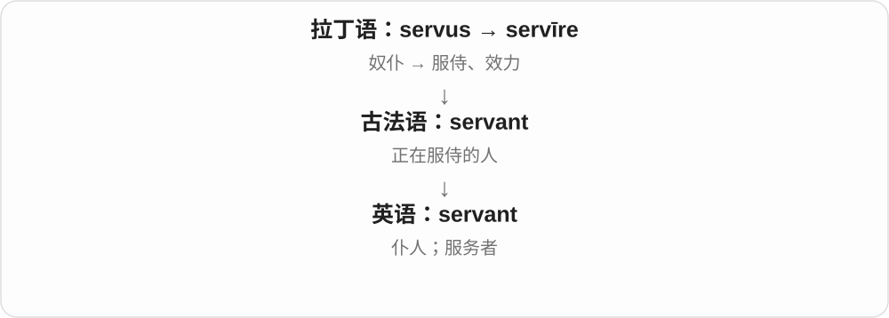
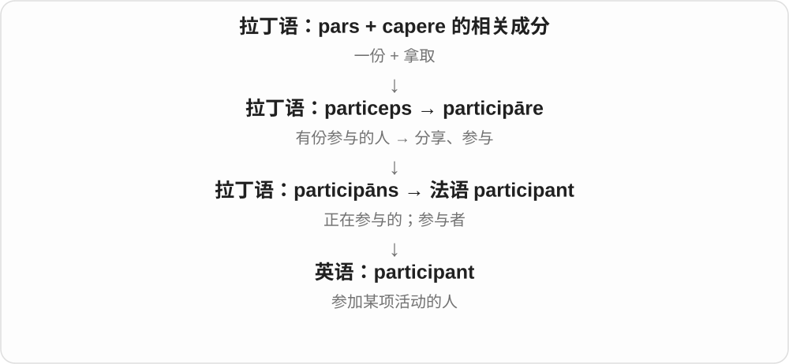
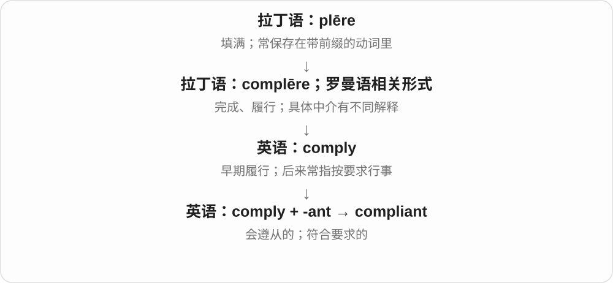
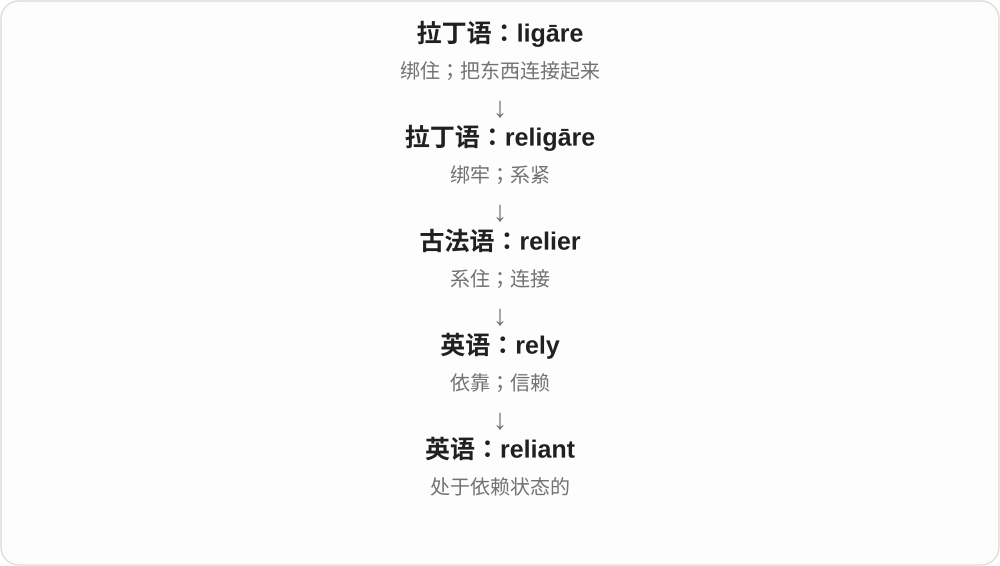
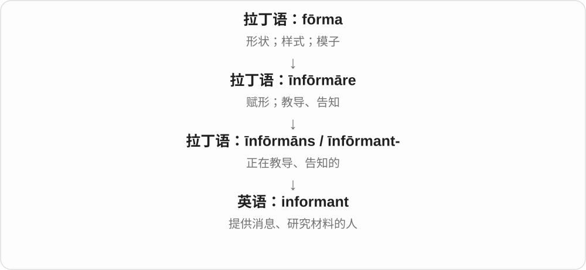
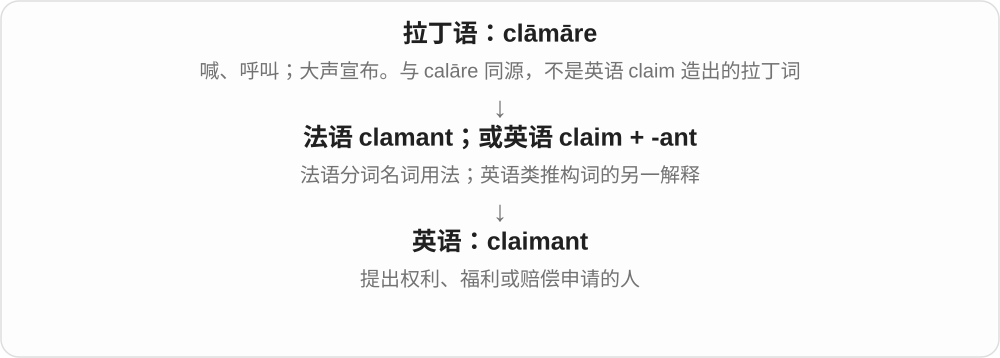
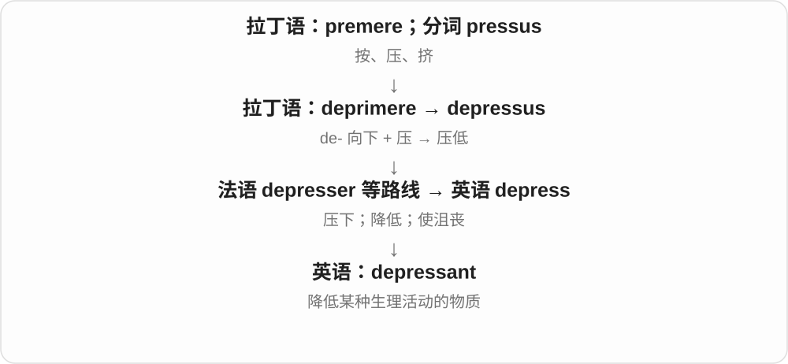
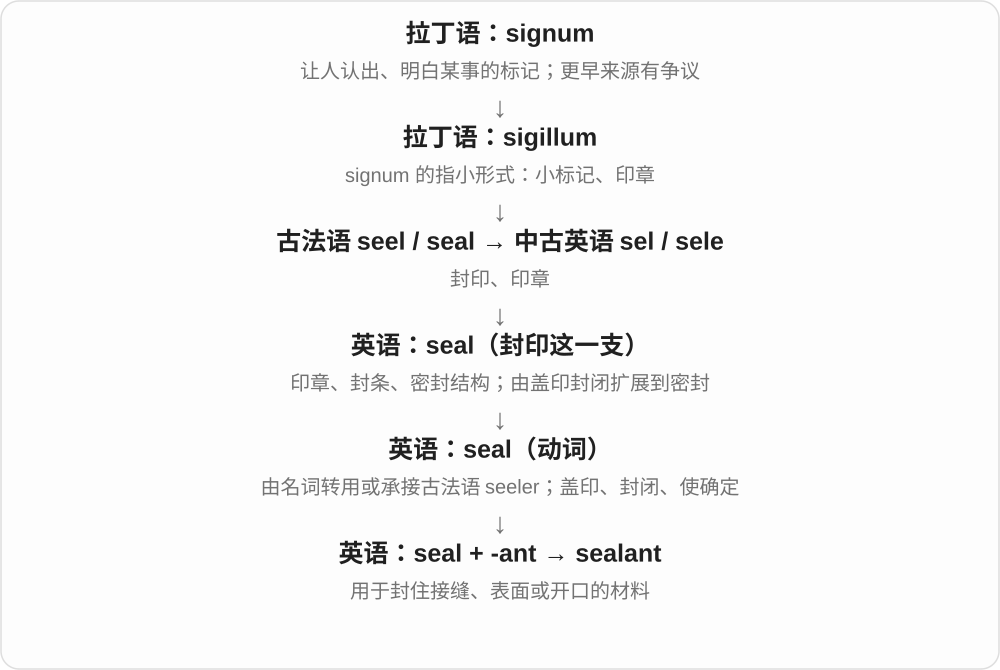
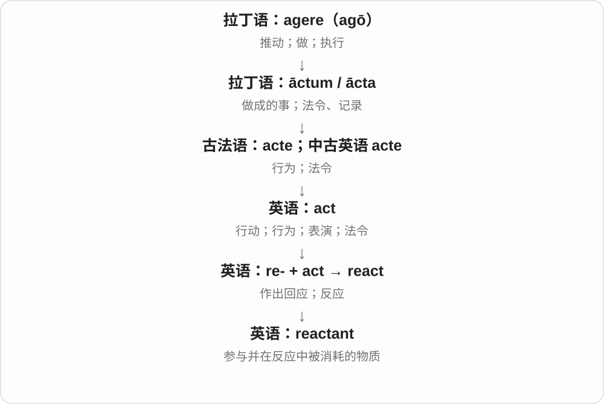
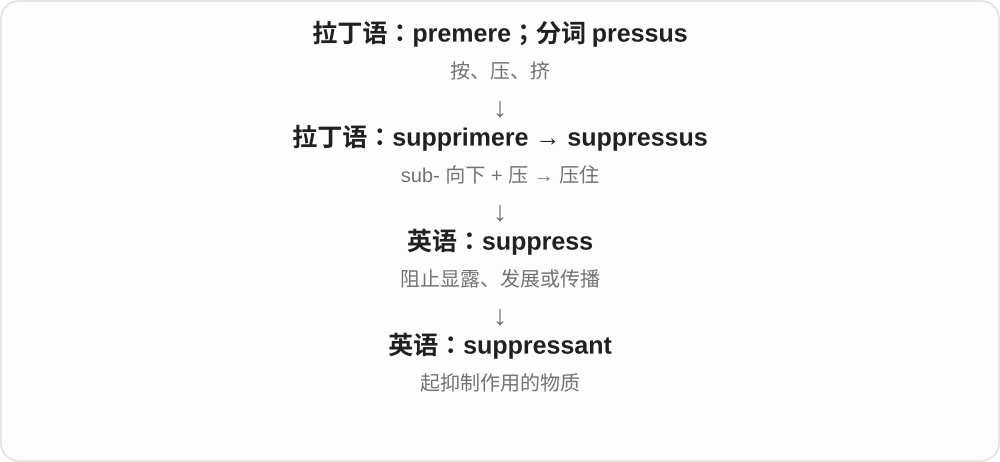

# 0726 · -ant — 某种作用、活动中的人、物；具有某种性质的

[逐词精讲目录](../00_逐词精讲目录.md) · [总目录](../00_总目录_按常用程度.md)

## 核心词根与来源

常见 -ant 可接拉丁现在分词 -ant- 及法语相应材料；有完整借词，也有英语后续构词。它与 -ent 有历史上的对应，但现代拼写往往需要逐词确认。

**ANT：先分词性，再判断是人、起作用的物质还是性质**

debutant 是首次登场的人，lubricant 是起润滑作用的物质，luxuriant 是形容草木繁茂；三个都不能套成做某事的人。

- **人物与参与角色**：debutant · debutante；servant · participant · accountant · informant · claimant · assailant · celebrant
- **起作用的物质、器件**：lubricate · lubricant；disinfect · disinfectant；irritate · irritant；coolant · propellant · hydrant · pollutant · retardant · depressant · sealant · reactant · suppressant · dopant · accelerant
- **性质、态度和生长**：luxury · luxuriant · luxuriate；avoid · avoidant；resistant · reluctant · rampant · compliant · reliant · buoyant · cognizant · ascendant
- **其他已固定用法**：determinant · protestant
- **irritant 刺激源与 irritation 产生的感受、过程**：irritant · irritate · irritates · irritated · irritating · irritation · irritations

## 词形与演化规律

lubricate ↔ lubricant；disinfect ↔ disinfectant；irritate ↔ irritant；debut 与法语 débutant／débutante 对应；avoid + -ant → avoidant。luxuriant 与 luxury、luxuriate 同族，却不是简单的现代词先后相加史。

-ant 可命名引起刺激的人、物，-ation 是过程、状态名称；物理刺激与心理烦躁按场景认。

## 单词速览（按词族由简到繁）

同一基础词的相关扩展放在一起，先读基础形式，再读扩展；各组之间优先读常用的。具体词源关系见各词讲解。

| 单词 | 音标 | 核心意思 |
|---|---|---|
| [avoid](#w-36) | /əˈvɔɪd/ | 避开；避免 |
| [avoidant](#w-32) | /əˈvɔɪdənt/ | 倾向回避的；回避性的 |
| [debut](#w-37) | 英 /ˈdeɪbjuː/、/ˈdebjuː/；美 /deɪˈbjuː/ | 首次登场、首秀；首次推出、亮相 |
| [debutant](#w-27) | /ˈdebjuːtɑːnt/，亦有其他首元音、末音节读法 | 首次公开登场的人〔尤见于体育、演艺〕 |
| [debutante](#w-42) | 常见 /ˈdebjuːtɑːnt/，亦有末音节重读等变体 | 初入社交界的年轻女性；首次亮相的女性〔特定语境〕 |
| [luxury](#w-38) | 英 /ˈlʌkʃəri/；美 /ˈlʌɡʒəri/，亦有相近变体 | 奢华；奢侈品；难得的享受 |
| [luxurious](#w-39) | 英 /lʌɡˈʒʊəriəs/；美 /lʌɡˈʒʊriəs/ | 奢华舒适的；极为享受的 |
| [luxuriant](#w-30) | 英 /lʌɡˈʒʊəriənt/；美 /lʌɡˈʒʊriənt/ | 繁茂的、浓密的；丰富华美的 |
| [luxuriate](#w-44) | 英 /lʌɡˈʒʊərieɪt/；美 /lʌɡˈʒʊrieɪt/ | 尽情享受、沉浸于〔令人舒服的东西〕；繁盛生长〔较少见〕 |
| [servant](#w-1) | 英 /ˈsɜːvənt/；美 /ˈsɜːrvənt/ | 仆人；服务者 |
| [resistant](#w-2) | /rɪˈzɪstənt/ | 有抵抗力的；耐受的；抗拒的 |
| [protestant](#w-3) | 宗教义通常写 Protestant：英 /ˈprɒtɪstənt/；美 /ˈprɑːtɪstənt/ | 新教徒；新教的；抗议者〔旧式或专门用法〕 |
| [reluctant](#w-4) | /rɪˈlʌktənt/ | 不情愿的；勉强的 |
| [participant](#w-5) | 英 /pɑːˈtɪsɪpənt/；美 /pɑːrˈtɪsəpənt/ | 参与者；参加者 |
| [accountant](#w-6) | /əˈkaʊntənt/ | 会计；会计师 |
| [irritate](#w-40) | /ˈɪrɪteɪt/ | 使烦躁、惹恼；刺激〔皮肤等〕 |
| [irritating](#w-45) | /ˈɪrɪteɪtɪŋ/ | 令人烦躁、刺激性的；正在刺激、惹烦 |
| [irritated](#w-46) | /ˈɪrɪteɪtɪd/ | 烦躁、不耐烦的；受刺激不适的；刺激了 |
| [irritation](#w-47) | /ˌɪrɪˈteɪʃən/ | 恼怒、烦躁；刺激、不适；烦心事 |
| [irritations](#w-49) | /ˌɪrɪˈteɪʃənz/ | 烦心事、引起不快的小事〔复数〕；多次刺激、不适 |
| [irritates](#w-48) | /ˈɪrɪteɪts/ | 使烦躁；刺激、使不适〔第三人称单数〕 |
| [irritant](#w-23) | /ˈɪrɪtənt/ | 刺激物；令人烦恼的事物；有刺激性的 |
| [rampant](#w-7) | /ˈræmpənt/ | 猖獗、失控蔓延的；〔纹章〕以后肢立起的 |
| [compliant](#w-8) | 英、美 /kəmˈplaɪənt/ | 符合规定的；顺从的；易变形的〔技术〕 |
| [reliant](#w-9) | /rɪˈlaɪənt/ | 依赖……的 |
| [informant](#w-10) | 英 /ɪnˈfɔːmənt/；美 /ɪnˈfɔːrmənt/ | 提供信息的人；消息来源；线人 |
| [coolant](#w-12) | /ˈkuːlənt/ | 冷却剂；冷却液 |
| [claimant](#w-13) | 英、美 /ˈkleɪmənt/ | 申请领取者；索赔人；提出权利要求的人 |
| [assailant](#w-14) | /əˈseɪlənt/ | 袭击者、攻击者 |
| [lubricate](#w-43) | /ˈluːbrɪkeɪt/ | 润滑；使顺畅〔比喻〕 |
| [lubricant](#w-15) | 英 /ˈluːbrɪkənt/；美 /ˈluːbrɪkənt/ | 润滑剂；起润滑作用的 |
| [buoyant](#w-16) | 英 /ˈbɔɪənt/；美 /ˈbɔɪənt/、/ˈbuːjənt/ | 有浮力的；轻快乐观的；市场等旺盛的 |
| [propellant](#w-17) | /prəˈpelənt/ | 推进剂；喷射剂；推进的 |
| [determinant](#w-18) | 英 /dɪˈtɜːmɪnənt/；美 /dɪˈtɜːrmɪnənt/ | 决定因素；行列式〔数学〕 |
| [ascendant](#w-19) | 英、美 /əˈsendənt/ | 上升的；势头正盛的；上升星座 |
| [cognizant](#w-20) | 英 /ˈkɒɡnɪzənt/；美 /ˈkɑːɡnɪzənt/ | 知悉的；意识到的 |
| [disinfect](#w-41) | /ˌdɪsɪnˈfekt/ | 消毒；清除计算机病毒〔技术比喻〕 |
| [disinfectant](#w-21) | /ˌdɪsɪnˈfektənt/ | 消毒剂；消毒用的 |
| [hydrant](#w-22) | /ˈhaɪdrənt/ | 消火栓；消防取水口 |
| [pollutant](#w-24) | 英、美 /pəˈluːtənt/ | 污染物 |
| [retardant](#w-25) | 英 /rɪˈtɑːdənt/；美 /rɪˈtɑːrdənt/ | 阻滞剂；阻燃剂；起延缓作用的 |
| [depressant](#w-26) | 英 /dɪˈpresənt/；美 /dɪˈpresənt/ | 抑制剂；降低某种活动的物质；抑制性的 |
| [sealant](#w-28) | /ˈsiːlənt/ | 密封胶；密封材料 |
| [celebrant](#w-29) | 英 /ˈselɪbrənt/；美 /ˈseləbrənt/ | 仪式主持人；庆祝者、参与者〔视语境〕 |
| [reactant](#w-31) | /riˈæktənt/ | 反应物 |
| [suppressant](#w-33) | 英 /səˈpresənt/；美 /səˈpresənt/ | 抑制剂；起抑制作用的物质 |
| [dopant](#w-34) | 英 /ˈdəʊpənt/；美 /ˈdoʊpənt/ | 掺杂剂、掺杂物 |
| [accelerant](#w-35) | /əkˈselərənt/ | 促进物、促进剂；〔尤指〕助燃物 |

## 逐词讲解

### 1. avoid — 避开；避免

**音标**：/əˈvɔɪd/

**先抓住这个画面**

不想撞上障碍，就绕着走；不想发生误会，就提前说清楚。avoid 可以是避开对象，也可以是设法不让某事发生。

**怎么拆**

经法语相应形式进入英语，较早有清空、腾出的意义材料，与 void、vacuous 的较远历史材料相关；现代不等于把 a 与 void 随意拼出全部词义。

**怎么变成今天的意思**

**古法语 esvuidier、盎格鲁诺曼语相应形式**  
清空、腾空等旧义

↓

**中古英语 avoiden → avoid**  
从清空、离开等走到避开、避免

avoid someone 避开某人；avoid a mistake 避免错误；avoid doing something 避免做某事。

**常见搭配与例句**

avoid doing；avoid a collision。

> We left early to avoid the traffic.

我们早早出发，避开车流。

> Try to avoid making the same mistake again.

尽量别再犯同样的错误。

**别混淆**

avoid 后接动词通常用 -ing：avoid making mistakes；不是 avoid to make。prevent 更常用 prevent someone from doing。

### 2. avoidant — 倾向回避的；回避性的

**音标**：/əˈvɔɪdənt/

**先抓住这个画面**

碰上难谈的话题，总先退开、换话题、不回应，这种倾向可以用 avoidant 描述。

**怎么拆**

avoid 回避 + -ant 形成形容词。avoid 的较早来源与排空、离开的法语材料相连，现代组合里先抓主动避开这层关系。

**怎么变成今天的意思**

**avoid + -ant**  
具有回避倾向

↓

**avoidant**  
回避性的态度、行为或特定术语

avoidant behaviour 回避行为；an avoidant response 回避性的反应。心理学中还有更具体的术语含义，普通形容不等于自动给一个人作诊断。

**常见搭配与例句**

avoidant behaviour；an avoidant response。

> His avoidant response left the practical question unanswered.

他回避性的回应没有回答那个实际问题。

> The article discusses avoidant behaviour in difficult conversations.

文章讨论了艰难对话中的回避行为。

**别混淆**

avoidant 倾向避开，avoidable 可以避免；avoidance 则是回避这个名词。词性和主动、被动关系不相同。

### 3. debut — 首次登场、首秀；首次推出、亮相

**音标**：英 /ˈdeɪbjuː/、/ˈdebjuː/；美 /deɪˈbjuː/

**先抓住这个画面**

第一次在某个公开舞台上出现：歌手首次演出、球员首场比赛、新作品首次推出，都可用 debut。

**怎么拆**

借法语 début，接 débuter 开始、先出手，较早与球类中首先击球的表达有关，再扩到公开亮相。词尾 t 通常不发音，不是 debt 债务的另一种拼写。

**怎么变成今天的意思**

**法语 débuter → début**  
先出手、开场 → 首次亮相

↓

**英语 debut**  
首秀、首次推出及相应动词

make one’s debut 首次登场；a debut album 首张专辑；debut a new model 首次推出新型号。要说明首秀在哪个领域、城市或级别，不是说此前一切经历都为零。

**常见搭配与例句**

make a debut；a debut novel；debut on stage。

> The singer made her stage debut at sixteen.

这位歌手十六岁首次登台。

> The company debuted its new design at the exhibition.

公司在展览上首次推出了新设计。

**别混淆**

debut 强调首次公开出现，beginning 泛指开始；debt 债务读 /det/，拼写和读音都不同。

### 4. debutant — 首次公开登场的人〔尤见于体育、演艺〕

**音标**：/ˈdebjuːtɑːnt/，亦有其他首元音、末音节读法

**先抓住这个画面**

第一次代表球队出场，或第一次登上某类公开舞台，这个人可叫 debutant，不是说他整个人生才刚开始。

**怎么拆**

借法语 débutant，来自 débuter 首次登场的现在分词；现代可与 debut + -ant 对照，不能当作“首次出场的蚂蚁”。

**怎么变成今天的意思**

**法语 débuter → débutant**  
首次公开亮相 → 首次亮相者

↓

**英语 debutant**  
首次登场的人

an international debutant 首次参加国际比赛的选手；a film debutant 初登银幕者。看这次首秀限定在哪个级别，不一定此前从无经验。

**常见搭配与例句**

a young debutant；an international debutant。

> The debutant scored twice in her first match.

这位首次登场的选手在首场比赛中两次得分。

> The film pairs a veteran actor with a debutant.

影片让一位资深演员与一位初登银幕者搭档。

**别混淆**

beginner 是一般初学者，debutant 强调第一次公开登场；一个经验丰富的人也可能首次参加某一赛事而成为该赛事的 debutant。

### 5. debutante — 初入社交界的年轻女性；首次亮相的女性〔特定语境〕

**音标**：常见 /ˈdebjuːtɑːnt/，亦有末音节重读等变体

**先抓住这个画面**

传统上，一位年轻女性第一次正式进入上流社交场合，会被称为 debutante；读时代小说、社交舞会报道时常见。

**怎么拆**

借法语 débutante，是 débutant 的阴性形式。法语书写的 -e 标示这一性别对应，不是英语随便在任何 -ant 后加 e 都能形成女性名词。

**怎么变成今天的意思**

**法语 débutant → 阴性 débutante**  
首次登场者的女性形式

↓

**英语 debutante 的社会用法**  
传统上正式进入社交界的年轻女性

a debutante ball 社交初入舞会；a young debutante 初入社交界的年轻女性。较广的首次登场女性义要看具体文体，不宜一律套给所有女性新人。

**常见搭配与例句**

a debutante ball；a society debutante。

> The novel follows a debutante during her first social season.

小说讲述一位年轻女性初入社交界的第一个社交季。

> The museum displayed a dress worn at a debutante ball.

博物馆展出了一件曾在初入社交界舞会上穿过的礼服。

**别混淆**

debutant 常强调首次公开出场，不限女性；debutante 在英语里有特别强的传统社交文化色彩，两者不只是任意的男女互换标签。

### 6. luxury — 奢华；奢侈品；难得的享受

**音标**：英 /ˈlʌkʃəri/；美 /ˈlʌɡʒəri/，亦有相近变体

**先抓住这个画面**

不是维持生活必不可少，却让人觉得舒服、讲究、享受的东西。也可以是难得有一个完全空闲的下午。

**怎么拆**

经古法语 luxurie 接拉丁 luxuria 过量、繁盛、放纵等材料；英语早期道德评价较强，后来更多形成奢华、舒适享受的常见义。

**怎么变成今天的意思**

**拉丁 luxuria → 法语 luxurie → 英语早期 luxury**  
过量、放纵、丰盛等

↓

**现代 luxury**  
奢华生活；非必需却令人享受之物

live in luxury 过奢华生活；a luxury hotel 豪华酒店；the luxury of time 难得有充裕时间。既可说生活方式，也可数一种非必需的享受。

**常见搭配与例句**

luxury goods；a luxury hotel；an affordable luxury。

> A quiet afternoon felt like a luxury after the busy week.

忙了一周后，一个安静的下午简直成了难得的享受。

> The shop sells luxury luggage and accessories.

这家店出售高档行李箱和配饰。

**别混淆**

necessity 必需品，luxury 非必需的享受，但具体标准受生活情境影响；luxury 不是任何 expensive 昂贵东西的自动同义词。

### 7. luxurious — 奢华舒适的；极为享受的

**音标**：英 /lʌɡˈʒʊəriəs/；美 /lʌɡˈʒʊriəs/

**先抓住这个画面**

软床、精致用具、宽敞浴室让人觉得舒适又讲究，就是 luxurious；也可把一次不用赶时间的热水澡说成难得享受。

**怎么拆**

经法语 luxurios 接拉丁 luxuriosus，与 luxuria、luxury 的丰富、过度、奢华材料相联；旧义不只现代豪华。

**怎么变成今天的意思**

**拉丁 luxuria、luxuriosus → 法语相应形式**  
繁盛、过多、奢华等材料

↓

**现代 luxurious**  
奢华舒适；令人享受

a luxurious hotel 奢华酒店；a luxurious bath 很享受的泡澡；luxurious comfort 极舒适的享受。

**常见搭配与例句**

a luxurious room；a luxurious feeling。

> The hotel offered luxurious rooms overlooking the bay.

酒店提供俯瞰海湾的奢华客房。

> She enjoyed a luxurious hour of doing absolutely nothing.

她享受了一个什么也不做的惬意小时。

**别混淆**

luxurious 是奢华舒适；luxuriant 常说植物茂盛、头发浓密，不能因为都有 luxur- 就全译豪华。

### 8. luxuriant — 繁茂的、浓密的；丰富华美的

**音标**：英 /lʌɡˈʒʊəriənt/；美 /lʌɡˈʒʊriənt/

**先抓住这个画面**

雨水充足，植物一层层长满，看上去旺盛、浓密；也可说头发浓密、文字意象丰盛。

**怎么拆**

经法语或直接接拉丁 luxurians，来自 luxuriare 过量、茂盛生长，和 luxury 属同一旧词族；不是先有现代奢侈品义，再给它套 -ant 就会长出叶子。

**怎么变成今天的意思**

**拉丁 luxuriare → luxurians**  
大量生长 → 茂盛的

↓

**英语 luxuriant**  
植被、头发繁茂浓密；形象丰富华美

luxuriant vegetation 繁茂植被；luxuriant hair 浓密头发；luxuriant imagery 丰富华美的意象。重点在旺盛、丰厚而富吸引力。

**常见搭配与例句**

luxuriant vegetation；luxuriant growth。

> Luxuriant vegetation covered the hillside.

繁茂的植被覆盖着山坡。

> The poet is known for her luxuriant imagery.

这位诗人以丰富华美的意象闻名。

**别混淆**

luxurious 豪华舒适的；luxuriant 繁盛浓密的。a luxurious hotel 豪华酒店，luxuriant plants 茂盛植物，不能只按奢华、丰富的中文近义互换。

### 9. luxuriate — 尽情享受、沉浸于〔令人舒服的东西〕；繁盛生长〔较少见〕

**音标**：英 /lʌɡˈʒʊərieɪt/；美 /lʌɡˈʒʊrieɪt/

**先抓住这个画面**

热水澡、安静日光、终于不用赶时间的早晨，你让自己在那份舒服里多待一会儿，就是 luxuriate in。

**怎么拆**

借拉丁 luxuriatus，来自 luxuriare 过量、繁盛、放纵的词族。英语较早也有旺盛生长义，今天常用的享受义与 luxury 很容易对照。

**怎么变成今天的意思**

**拉丁 luxuriare／luxuriatus**  
繁盛生长、尽情享用等

↓

**英语 luxuriate**  
沉浸享受；旧有繁盛生长义

luxuriate in the sunshine 尽情享受阳光；luxuriate in silence 沉浸在安静里。常和 in 连用，不等于只陈述某样东西很贵。

**常见搭配与例句**

luxuriate in；luxuriate in the warmth。

> She luxuriated in the warmth of the afternoon sun.

她尽情享受午后阳光的温暖。

> After the deadline, he luxuriated in a morning with no appointments.

截止日期过去后，他尽情享受了一个没有约会安排的早晨。

**别混淆**

enjoy 享受非常广，luxuriate 更有放慢下来、舒舒服服浸在其中的感觉；不一定要花很多钱。

### 10. servant — 仆人；服务者

**音标**：英 /ˈsɜːvənt/；美 /ˈsɜːrvənt/

**先抓住这个画面**

传统家庭中专门替主人做家务、服侍起居的人；某些固定搭配里则是为公众办事的人。

**怎么拆**

来自古法语 servant，即 servir“服侍”的现在分词；现代能看出 serve 与 -ant。

**怎么变成今天的意思**

普通 servant 带旧式主仆关系的色彩。civil servant 是公务员，不是私人家仆。现代职业名称通常用更具体的职位。

**常见搭配与例句**

a household servant；a civil servant；a public servant。

> The novel describes the daily life of a household servant.

小说描写了一名家仆的日常生活。

> She worked as a civil servant for many years.

她做了多年公务员。

**别混淆**

employee 是受雇员工的通称；servant 不适合随便称呼所有员工。

### 11. resistant — 有抵抗力的；耐受的；抗拒的

**音标**：/rɪˈzɪstənt/

**先抓住这个画面**

外界想让它改变，它不容易被改变。

**怎么拆**

借法语 résistant，源自动词 résister；现代可对应 resist + -ant。

**怎么变成今天的意思**

**拉丁 sistere〔与 stāre“站”相关〕**  
使站住、放置；站定、停住

↓

**拉丁 re- + sistere → resistere**  
站住抵挡、顶回去

↓

**法语 résister → résistant → 英语 resistant**  
能够抵抗的；不易受到影响的

resistant to heat 说耐热，resistant to change 说抗拒改变。这个词常表示相对耐受，未承诺任何条件下都不受损；具体耐到什么程度要看说明。

**常见搭配与例句**

resistant to heat；resistant to change；resistant materials。

> The coating is resistant to moisture.

这层涂层具有耐潮性。

> Some team members were resistant to the new routine.

部分组员不愿接受新的工作流程。

**别混淆**

resilient 强调受冲击后能恢复；resistant 强调不容易被影响，关注点不同。

### 12. protestant — 新教徒；新教的；抗议者〔旧式或专门用法〕

**音标**：宗教义通常写 Protestant：英 /ˈprɒtɪstənt/；美 /ˈprɑːtɪstənt/

**先抓住这个画面**

这个名称记住的是一次公开声明、提出异议的历史；后来成为广泛宗教传统的名称。

**怎么拆**

宗教名称接拉丁 prōtestāns“公开声明者”，与16世纪宗教改革中的抗议有关；不是对每位信徒日常性格的描述。

**怎么变成今天的意思**

**拉丁 testis；testārī**  
见证人；作证、声明

↓

**拉丁 prōtestārī → prōtestāns / protestant-**  
郑重声明 → 声明、抗议者

↓

**法、德等宗教改革语境 → 英语 Protestant**  
新教徒；新教的

宗教义通常首字母大写，涉及多种教派。小写 protestant 在旧文或专门语境里也可说抗议的、抗议者；现代普通“抗议者”更常用 protester。

**常见搭配与例句**

a Protestant church；Protestant traditions。

> The course examines several Protestant traditions.

课程研究几种新教传统。

> The town has both Protestant and Catholic churches.

这座小镇既有新教教堂，也有天主教教堂。

**别混淆**

protester 是参与抗议的人；Protestant 通常是宗教身份，不能把参加示威的人一律叫 Protestant。

### 13. reluctant — 不情愿的；勉强的

**音标**：/rɪˈlʌktənt/

**先抓住这个画面**

嘴上可能答应，心里却还往后缩，不太想做，这种态度就是 reluctant。不是做不到，而是意愿上不积极。

**怎么拆**

借拉丁 reluctans，与 re- 向后及 luctari 挣扎、抗争相联；历史的抵抗画面走成心里的不愿意。

**怎么变成今天的意思**

**拉丁 re- + luctari → reluctari、reluctans**  
向后对抗、挣扎抵抗

↓

**英语 reluctant、reluctance**  
不情愿的；不情愿、迟疑的状态

be reluctant to do 不愿做；a reluctant agreement 勉强的同意；a reluctant hero 不情愿承担角色的英雄。

**常见搭配与例句**

reluctant to admit；reluctant to leave。

> She was reluctant to admit that she needed help.

她不太情愿承认自己需要帮助。

> He gave a reluctant nod.

他勉强点了点头。

**别混淆**

reluctant 是不情愿，unable 是不能；有能力但不愿做，与想做却做不到不同。

### 14. participant — 参与者；参加者

**音标**：英 /pɑːˈtɪsɪpənt/；美 /pɑːrˈtɪsəpənt/

**先抓住这个画面**

活动名单上真正加入这件事的人，就是 participant；他可能是选手、讨论者，也可能是研究中的参加者。

**怎么拆**

从拉丁语 participāns“正在参与的”经法语 participant 传入；现代可与 participate 的词干及 -ant 联系。

**怎么变成今天的意思**

这里把“参与”这个动作转成人的身份。它没有自带获胜、专业或领导地位，只说明是这项活动的一员。

**常见搭配与例句**

a study participant；an active participant；participants in a workshop。

> Each participant received a copy of the schedule.

每位参加者都拿到了一份日程表。

> The study included eighty adult participants.

这项研究有八十名成年参与者。

**别混淆**

spectator 是看的人；participant 是参与的人。研究参加者也不一定是病人，不能见到 participant 就译成患者。

### 15. accountant — 会计；会计师

**音标**：/əˈkaʊntənt/

**先抓住这个画面**

不只是把数字加起来的人，还要整理、检查和解释一笔笔财务记录，让账目说得清。

**怎么拆**

来自古法语 acontant／相关中古法语形式，是 aconter“算账、交代”的现在分词；现代可以看成 account + -ant，但职业名并非只在英语中临时拼成。

**怎么变成今天的意思**

**拉丁 putare**  
修剪、清理；计算、考虑、判断

↓

**拉丁 com- 一起 + putare → computare**  
合起来计算、盘算

↓

**古法语 aconter → 现在分词 acontant**  
算账、交代账目 → 做这件事的人

↓

**中古英语 → accountant**  
从事会计工作的人

通常指处理财务记录的专业人员。是否具有某种执业资格，要看 certified、chartered 等具体称谓和制度，单独 accountant 不包办所有资格判断。

**常见搭配与例句**

an accountant for a company；a chartered accountant；consult an accountant。

> The accountant checked the figures before the report was issued.

报告发布前，会计核对了数字。

> She works as an accountant for a small theatre.

她在一家小剧院做会计。

**别混淆**

bookkeeper 常更侧重日常记账；accountant 通常可涉及更广的整理、分析与报告工作。

### 16. irritate — 使烦躁、惹恼；刺激〔皮肤等〕

**音标**：/ˈɪrɪteɪt/

**先抓住这个画面**

滴水声反复响，让你越来越烦，是 irritate；某种材料让皮肤发痒、发红，也是 irritate。共同点是引起不舒服的反应。

**怎么拆**

借拉丁 irritatus，来自 irritare 激起、刺激；现代有 -ate 动词形式，不从英语 ir- 不加一个现代 rit 构词。

**怎么变成今天的意思**

**拉丁 irritare 激起、刺激 → irritatus、irritabilis**  
刺激某物；容易被刺激的性质

↓

**英语 irritate、irritable、irritability**  
使烦躁、刺激；易怒；易激惹程度

irritate someone 惹恼某人；irritate the skin 刺激皮肤；irritating 令人烦、刺激性的。

**常见搭配与例句**

irritate someone；irritate the skin。

> The constant noise irritated her.

持续的噪声让她烦躁。

> The rough fabric irritated his skin.

粗糙的布料刺激了他的皮肤。

**别混淆**

irritate 可说心理烦躁或身体刺激；frustrate 常说受阻后的挫败，二者可能同场出现但不等义。

### 17. irritating — 令人烦躁、刺激性的；正在刺激、惹烦

**音标**：/ˈɪrɪteɪtɪŋ/

**先抓住这个画面**

那个噪声、动作总让人烦，是 irritating；烦躁的人则是 irritated。先看谁在引起反应，谁在受影响。

**怎么拆**

irritate 去末尾 e，加完整 -ing。分词可以讲正在刺激的动作，也能形容有这种影响的事物。

**怎么变成今天的意思**

**拉丁 irritare → irritatus → 英语 irritate**  
激起、刺激、使烦恼；整词借入

↓

**现代 irritate 的常见分支**  
使人烦躁；使身体部位受刺激、不适

↓

**irritate + -ing → irritating〔去 e〕**  
正在惹烦；能引起烦躁、刺激的性质

an irritating noise 是令人烦躁的声音，irritating dust 是会造成刺激的灰尘。

**常见搭配与例句**

an irritating habit 烦人的习惯；find it irritating 觉得它烦人。

> The clock made an irritating clicking sound.

时钟发出烦人的咔嗒声。

> I found the repeated interruptions irritating.

我觉得反复被打断很烦。

**别混淆**

annoying 与心理烦躁的 irritating 很接近，irritating 还常进入皮肤、眼睛等身体刺激语境。

### 18. irritated — 烦躁、不耐烦的；受刺激不适的；刺激了

**音标**：/ˈɪrɪteɪtɪd/

**先抓住这个画面**

人被反复打断后心里烦，皮肤被刺激后不舒服，都可以是 irritated。它常描写受到影响的一方。

**怎么拆**

irritate 去末尾 e，加完整 -ed，/t/ 后读 /ɪd/。过去分词再作形容词，描述被刺激、惹烦后的状态。

**怎么变成今天的意思**

**拉丁 irritare → irritatus → 英语 irritate**  
激起、刺激、使烦恼；整词借入

↓

**现代 irritate 的常见分支**  
使人烦躁；使身体部位受刺激、不适

↓

**irritate + -ed → irritated〔去 e〕**  
过去刺激、惹烦；受到刺激后的状态

irritated by the noise 是被噪声惹烦，irritated skin 是受刺激不适的皮肤。

**常见搭配与例句**

sound irritated 听着不耐烦；irritated by interruptions 被打断得烦躁。

> She sounded irritated by the repeated questions.

反复的问题让她听起来有些不耐烦。

> His skin felt irritated after contact with the rough fabric.

接触粗糙布料后，他的皮肤感觉不适。

**别混淆**

irritated 是受刺激、感到烦的，irritating 是造成烦恼、刺激的；对象角色不同。

### 19. irritation — 恼怒、烦躁；刺激、不适；烦心事

**音标**：/ˌɪrɪˈteɪʃən/

**先抓住这个画面**

心理上像小东西反复戳着，让人烦；身体上则是皮肤、眼睛等受刺激的不适。irritation 把这种反应拿来当名词谈。

**怎么拆**

名词经法语 irritacion 或直接拉丁 irritatio 借入。现代能对应 irritate 去 e + -ion，但名词的英语记录更早，不能说它必由现代英语动词新造。

**怎么变成今天的意思**

**拉丁 irritare → irritatio；古法语 irritacion 等**  
刺激、激起及相应活动名词

↓

**中古英语 irritation 的借入 → 现代用途**  
早有身体刺激义，后来常说恼怒；英语记录早于 irritate 这一动词形式

with irritation 是带着烦躁，skin irritation 是皮肤刺激不适；a minor irritation 还可指一件小烦心事。

**常见搭配与例句**

show irritation 露出不耐烦；a source of irritation 烦恼来源。

> He could not hide his irritation at the delay.

他掩饰不住对耽误的不耐烦。

> The dust caused irritation in his eyes.

灰尘让他的眼睛受到刺激。

**别混淆**

irritant 是引起反应的人、物，irritation 是产生的刺激、不快，或具体烦心事；原因和反应分开。

### 20. irritations — 烦心事、引起不快的小事〔复数〕；多次刺激、不适

**音标**：/ˌɪrɪˈteɪʃənz/

**先抓住这个画面**

车晚点、门吱响、消息反复打断，一件件让人烦的小事，可以数作 irritations。

**怎么拆**

irritation + -s，末尾 /n/ 后读 /z/。在可数用途里数烦心事、刺激事件；基础名词本有法语、拉丁借入路线。

**怎么变成今天的意思**

**拉丁 irritare → irritatio；古法语 irritacion 等**  
刺激、激起及相应活动名词

↓

**中古英语 irritation 的借入 → 现代用途**  
早有身体刺激义，后来常说恼怒；英语记录早于 irritate 这一动词形式

↓

**irritation + -s → irritations**  
一件件烦心事、刺激事件

daily irritations 是日常小烦恼；minor irritations 是小麻烦，常与重大问题区别开。

**常见搭配与例句**

little irritations 小烦心事；a series of irritations 一连串不快。

> We laughed about the day’s small irritations.

我们笑着聊起这一天的小烦心事。

> The delays were among several irritations during the trip.

延误是旅途中几件烦心事之一。

**别混淆**

抽象感受的 irritation 常不可数；irritations 更容易把让人不快的事分成一件件数。

### 21. irritates — 使烦躁；刺激、使不适〔第三人称单数〕

**音标**：/ˈɪrɪteɪts/

**先抓住这个画面**

像有东西反复碰到敏感处：在心里是惹烦，在皮肤、眼睛等部位是刺激。irritates 关注引起这个反应的东西。

**怎么拆**

irritate + -s，保留末尾 e，/t/ 后读 /s/。基础词借拉丁 irritatus、irritare，不把开头 ir- 一律当现代否定前缀。

**怎么变成今天的意思**

**拉丁 irritare → irritatus → 英语 irritate**  
激起、刺激、使烦恼；整词借入

↓

**现代 irritate 的常见分支**  
使人烦躁；使身体部位受刺激、不适

↓

**irritate + -s → irritates**  
它使人烦躁、使某部位受刺激

irritates me 是惹我烦，irritates the eyes 是刺激眼睛；心理与身体反应分开选中文。

**常见搭配与例句**

irritates the skin 刺激皮肤；really irritates me 真让我烦。

> That repetitive sound irritates me.

那种反复的声音让我烦躁。

> The dust irritates her eyes.

灰尘刺激她的眼睛。

**别混淆**

irritates 关注刺激、不快反应，frustrates 常额外带目标受阻、做不成的烦；不是所有烦都一样。

### 22. irritant — 刺激物；令人烦恼的事物；有刺激性的

**音标**：/ˈɪrɪtənt/

**先抓住这个画面**

一粒灰尘让眼睛不舒服，是物理上的 irritant；一个反复响的提示音让人心烦，也可比喻成 irritant。

**怎么拆**

借法语 irritant 等相应形式，远接拉丁 irritare 激起、刺激；现代对应 irritate 的词干 + -ant。它可指起刺激作用的东西，并非一定指某个人。

**怎么变成今天的意思**

**拉丁、法语相关 irritant 材料**  
引起刺激的

↓

**英语 irritant**  
刺激物；烦恼来源

a skin irritant 皮肤刺激物；a constant irritant 持续让人烦恼的事。刺激与过敏不是同一个概念，词本身不能替代具体原因判断。

**常见搭配与例句**

a minor irritant；an irritant substance。

> Dust can be an irritant to the eyes.

灰尘可能刺激眼睛。

> The repeated notifications became a constant irritant.

反复弹出的通知成了持续让人心烦的东西。

**别混淆**

irritable 易怒、容易被激惹的，irritating 令人烦的，irritant 则常作起作用的东西这个名词；主动刺激与容易受刺激要分清。

### 23. rampant — 猖獗、失控蔓延的；〔纹章〕以后肢立起的

**音标**：/ˈræmpənt/

**先抓住这个画面**

像狮子立起、凶势压过来，后来用来形容坏现象不受控制地增长；rumours run rampant 就是谣言四处疯传。

**怎么拆**

接古法语 ramper 的分词 rampant 等旧形式，先有动物立起、凶猛义，再发展成未受抑制的蔓延。-ant 是历史分词构词成分。

**怎么变成今天的意思**

**古法语 ramper**  
爬、攀登、动物以后肢立起；更早来源有不同分析

↓

**ramper 的分词 rampant 等 → rampant**  
后肢立起、凶猛 → 失控增长

run rampant 猖獗、泛滥，rampant corruption 腐败猖獗，a lion rampant 纹章中立起的狮子。

**常见搭配与例句**

run rampant；rampant corruption。

> Rumours ran rampant after the announcement.

公告发布后，谣言四处疯传。

> The shield bears a lion rampant.

盾徽上有一头以后肢立起的狮子。

**别混淆**

rampant 常用于被认为不好的、失控的增长，不是中性 widespread 到处都有的完全同义词。

### 24. compliant — 符合规定的；顺从的；易变形的〔技术〕

**音标**：英、美 /kəmˈplaɪənt/

**先抓住这个画面**

对要求能配合、对标准能达到。用在人身上可以是听话；用在产品上就是合乎规定。

**怎么拆**

comply + -ant，形成形容词。

**怎么变成今天的意思**

compliant with a standard 是符合标准。形容人时，有时带“太容易顺从”的评价；描述材料时还可指受力后较易变形。

**常见搭配与例句**

compliant with standards；a compliant child；a compliant material。

> The new equipment is compliant with the published safety standard.

新设备符合公布的安全标准。

> She was cooperative without being blindly compliant.

她愿意配合，但不会盲目顺从。

**别混淆**

compatible 是能相容、能一起使用；compliant 是满足某项要求。能兼容不等于已经合规。

### 25. reliant — 依赖……的

**音标**：/rɪˈlaɪənt/

**先抓住这个画面**

reliant 描述一个人或系统需要某种支持才能运行的状态。它通常和 on 连用，后面交代依赖什么。

**怎么拆**

rely + -ant；-ant 构成表示状态的形容词。与 reliable 的方向不同：reliant 是“依靠别人的”，reliable 是“可让别人依靠的”。

**怎么变成今天的意思**

词义仍围绕依靠，只是从动作变为主语的状态。a country reliant on imports 就是一个依赖进口的国家，不表示这个国家本身值得信赖。

**常见搭配与例句**

be reliant on…；heavily reliant on…；less reliant on outside help。

> The business is heavily reliant on one supplier.

这家企业高度依赖一家供应商。

> She became less reliant on others as her confidence grew.

随着信心增强，她对他人的依赖减少了。

**别混淆**

reliant ≠ reliable。可以把两者放在一句话里理解：一个 reliant on others 的人，依赖的是 reliable people。

### 26. informant — 提供信息的人；消息来源；线人

**音标**：英 /ɪnˈfɔːmənt/；美 /ɪnˈfɔːrmənt/

**先抓住这个画面**

你无法直接知道某件事，有个人把自己掌握的情况告诉你，他就是 informant。

**怎么拆**

现代能看成 inform + -ant；词源另追到拉丁语 īnfōrmāns，词干 īnfōrmant-，是 īnfōrmāre“教导、告知”的现在分词。

**怎么变成今天的意思**

调查语境常指线人；语言学或田野研究中也可指提供语言、文化材料的人，不必秘密行动。

**常见搭配与例句**

a police informant；a confidential informant；a key informant。

> An informant told investigators where the documents were kept.

一名消息提供者告诉调查人员，文件存放在哪里。

> The researcher checked the expression with a local informant.

研究者向一位当地受访者核实了这个说法。

**别混淆**

informant 不自动等于 spy“间谍”；研究访谈中的信息提供者也可能公开、自愿参与。

### 27. coolant — 冷却剂；冷却液

**音标**：/ˈkuːlənt/

**先抓住这个画面**

机器运转会发热，这种介质帮忙把热带走；在汽车里常说冷却液。

**怎么拆**

cool + -ant，后缀在这里形成起作用的物质名词。现代可指液体或其他冷却介质，不只一种固定配方。

**怎么变成今天的意思**

**古英语 cōl、cōlian → 英语 cool**  
凉的；冷却；也用于情绪平静

↓

**现代 cool**  
温度不高 → 情绪不热、态度冷淡；口语赞许很酷

↓

**cool + -ant → coolant**  
使冷却的物质 → 冷却剂

engine coolant 发动机冷却液，a coolant leak 冷却液泄漏，coolant level 冷却液液位。

**常见搭配与例句**

engine coolant；coolant level；a coolant leak。

> The mechanic found a coolant leak.

修理工发现冷却液泄漏。

> The manual specifies the correct coolant for this engine.

手册说明了这款发动机应使用的冷却液。

**别混淆**

coolant 是带走热量的介质，cooler 是冷却或保冷设备、容器；ant 是后缀，不是蚂蚁。

### 28. claimant — 申请领取者；索赔人；提出权利要求的人

**音标**：英、美 /ˈkleɪmənt/

**先抓住这个画面**

站出来说“我有资格领这笔钱”或“这项权利属于我”的那个人。是否最终获准，是另一回事。

**怎么拆**

现代可拆 claim + -ant。历史解释包括英语按其他 -ant 人物词类推，以及法语 clamer 的分词名词用法，两条分析不强行串成一条。

**怎么变成今天的意思**

常见于福利申请、财产争议和诉讼语境。a claimant to the throne 是声称有继承王位权利的人；不等于已经被承认为君主。

**常见搭配与例句**

a benefit claimant；a successful claimant；a claimant to the throne。

> Each claimant must provide proof of ownership.

每位认领者都必须提供所有权证明。

> The report records the number of benefit claimants.

报告记录了申请领取福利金的人数。

**别混淆**

applicant 泛指申请人；claimant 特别强调主张自己有某项权利或资格。

### 29. assailant — 袭击者、攻击者

**音标**：/əˈseɪlənt/

**先抓住这个画面**

不是正在争论的任何一方，而是发起攻击、扑向别人的那个人。

**怎么拆**

经古法语 assaillant，来自 assaillir 的现在分词；远接 ad- + salire。现代可联系 assail + -ant，但它有法语整词借入的一层。

**怎么变成今天的意思**

**拉丁 salire**  
跳、跃起；复合词中常变成 -silire

↓

**拉丁 ad- + salire → assilire；通俗拉丁 \*assalire**  
向目标跃去、扑向；星号形式为重构

↓

**古法语 assaillir → assaillant → 英语 assailant**  
正在袭击的 → 袭击者；古法语分词作名词

常见于新闻、警方说明或事件叙述。它说明此人实施袭击，不直接告诉你其具体身份、动机或最终司法结论。较旧用法也有形容词“攻击的”。

**常见搭配与例句**

identify the assailant；an unknown assailant；escape an assailant。

> The witness could not clearly describe the assailant.

目击者无法清楚描述袭击者的样貌。

> She ran into a shop to escape her assailant.

她跑进一家店里躲避袭击她的人。

**别混淆**

opponent 是对手，可能只是比赛或意见不同；assailant 是实施袭击的人。

### 30. lubricate — 润滑；使顺畅〔比喻〕

**音标**：/ˈluːbrɪkeɪt/

**先抓住这个画面**

零件相互摩擦、转得发涩，加上能减少摩擦的物质，让动作顺起来，就是 lubricate。谈合作也能借顺滑作比喻。

**怎么拆**

借拉丁 lubricatus，来自 lubricare 使滑，基础 lubricus 滑的；-ate 对应动词形式。

**怎么变成今天的意思**

**拉丁 lubricus 滑的 → lubricare、lubricatus**  
使表面容易滑动

↓

**英语 lubricate**  
润滑机器；比喻使过程更顺畅

lubricate moving parts 润滑活动部件；lubricate a mechanism 润滑机构；well lubricated 润滑良好。

**常见搭配与例句**

lubricate moving parts；lubricate a mechanism。

> Oil lubricates the moving parts.

油润滑活动部件。

> The technician checked whether the mechanism was properly lubricated.

技术员检查机构是否得到适当润滑。

**别混淆**

lubricate 是减少摩擦的处理，clean 是清洁；部件干净不自动表示润滑充分。

### 31. lubricant — 润滑剂；起润滑作用的

**音标**：英 /ˈluːbrɪkənt/；美 /ˈluːbrɪkənt/

**先抓住这个画面**

两个表面互相磨，添一种能让它们滑得更顺的材料，就是 lubricant 的典型作用。

**怎么拆**

lubricate 的词干 + -ant，远接拉丁 lubricus 滑的。-ant 在这里指起作用的物质，不是做润滑工作的那个人。

**怎么变成今天的意思**

**拉丁润滑、滑动词族 → lubricate**  
使表面滑、润滑

↓

**lubric- + -ant → lubricant**  
起润滑作用的材料

a lubricant for machinery 机械润滑剂；lubricant properties 润滑性质。油是常见例子，但词义不限于所有油，也不保证任何润滑剂都适合任意用途。

**常见搭配与例句**

apply a lubricant；a suitable lubricant。

> The manual lists the lubricant used in the machine.

手册列出了这台机器使用的润滑剂。

> The engineers compared the properties of several lubricants.

工程师比较了几种润滑剂的性质。

**别混淆**

lubricate 是动作，lubricant 是相应物质；fuel 燃料主要提供能量，与润滑功能不同。

### 32. buoyant — 有浮力的；轻快乐观的；市场等旺盛的

**音标**：英 /ˈbɔɪənt/；美 /ˈbɔɪənt/、/ˈbuːjənt/

**先抓住这个画面**

先想一块软木轻轻浮在水上：不往下沉。心情被托起来、市场有活力，也能用 buoyant。

**怎么拆**

与 buoy 浮标、托起的材料相连，英语可对应 buoy + -ant；词源还与法语 bouyant、或西班牙语 boyante 漂浮的相联系，不把英语表面拆分当唯一借入路线。

**怎么变成今天的意思**

**法语或西班牙语相应漂浮词形；buoy 的词族**  
浮着、托起的材料

↓

**英语 buoyant**  
能浮的；情绪、活动被托起般有活力的

a buoyant mood 轻快乐观的心情；buoyant demand 旺盛的需求；a buoyant material 能浮起的材料。比喻义并不都指价格一定上涨。

**常见搭配与例句**

a buoyant mood；buoyant demand。

> Cork is a light, buoyant material.

软木是一种轻而能浮的材料。

> She remained in a buoyant mood after the interview.

面试后她仍然心情轻快、充满信心。

**别混淆**

buoyant 形容具体事物或状态，buoyancy 是浮力、浮性或乐观等名词；两者都不能只按中文浮躁来理解。

### 33. propellant — 推进剂；喷射剂；推进的

**音标**：/prəˈpelənt/

**先抓住这个画面**

这里不是转动的机械，而是为推出东西或推动载具提供作用的材料。

**怎么拆**

propel + -ant，词族接拉丁 prōpellere；-ant 表示具有作用的，也可名词化指材料。

**怎么变成今天的意思**

**拉丁 pellere；过去分词 pulsus**  
推、驱赶、击打

↓

**拉丁 pro- + pellere → prōpellere**  
向前推

↓

**中古英语 propellen → 英语 propel**  
推动；使前进

↓

**英语 propel + -ant → propellant**  
推进 → 起推进作用的；推进剂

火箭语境可包括燃料、氧化剂等推进介质；喷雾罐里则是帮助内容物喷出的气体。不能一律缩成“燃料”。

**常见搭配与例句**

rocket propellant；aerosol propellant；propellant tanks。

> The diagram shows the rocket’s propellant tanks.

图示标出了火箭的推进剂贮箱。

> The aerosol uses a compressed gas as its propellant.

这罐喷雾用压缩气体作喷射剂。

**别混淆**

propeller 是螺旋桨装置；propellant 通常是推进材料，一个是机械，一个是所用介质。

### 34. determinant — 决定因素；行列式〔数学〕

**音标**：英 /dɪˈtɜːmɪnənt/；美 /dɪˈtɜːrmɪnənt/

**先抓住这个画面**

在众多条件里，有一个因素会把结果推向某个方向；数学里，这个名字还给了方阵的一个重要数值。

**怎么拆**

借法语 déterminant，属于 déterminer“确定”的词族；现代可联系 determine 与 -ant。

**怎么变成今天的意思**

**拉丁语 terminus**  
边界；界标；尽头

↓

**拉丁 dētermināre → 法语 déterminer / déterminant**  
确定 → 起决定作用的

↓

**英语 determinant**  
决定因素；行列式

普通用法问“什么决定结果”；数学中二阶行列式是 ad−bc，可帮助判断方阵能否求逆。两个意思都抓住判定作用。

**常见搭配与例句**

a key determinant of；calculate the determinant。

> Access to transport is a major determinant of where people can work.

交通条件是决定人们能去哪里工作的主要因素。

> A square matrix with a nonzero determinant is invertible.

行列式非零的方阵可逆。

**别混淆**

determiner 常是语法里的限定词；determinant 在日常分析中是因素，在数学中是行列式。

### 35. ascendant — 上升的；势头正盛的；上升星座

**音标**：英、美 /əˈsendənt/

**先抓住这个画面**

正沿着上坡走，影响力还在增加。

**怎么拆**

形容词经古法语 ascendant 借入拉丁 ascendēns；不能把历史完全改写成英语 ascend + -ant。

**怎么变成今天的意思**

**拉丁语：ad**  
朝向；靠近；加到

↓

**拉丁语：scandere → ascendere**  
攀登 → 向上爬

↓

**拉丁 ascendēns → 古法语 ascendant → 英语 ascendant**  
正在上升的；另有占星学名词用法

in the ascendant 常指势力正盛。占星学的 the ascendant 指出生时东方地平线上升起的黄道位置或相应星座，是特定术语。

**常见搭配与例句**

in the ascendant；an ascendant power；the ascendant。

> A younger generation of designers was now in the ascendant.

较年轻的一代设计师这时正崭露头角、势头强劲。

> The book describes the company as an ascendant force in the industry.

这本书把该公司描述为行业中迅速崛起的力量。

**别混淆**

ascending 常指实际运动或排列；ascendant 更常指势力增长或占星用法。

### 36. cognizant — 知悉的；意识到的

**音标**：英 /ˈkɒɡnɪzənt/；美 /ˈkɑːɡnɪzənt/

**先抓住这个画面**

某个情况已经在你的认识范围内，你做判断时不能说完全不知道它。

**怎么拆**

在英语中依据 cognizance 重新构成形容词，接 -ant；不是直接把法语现在分词照搬过来。

**怎么变成今天的意思**

**拉丁语：gnoscere / noscere；notus**  
开始认识、了解；已知的

↓

**拉丁语：co- + gnoscere → cognoscere / cognitus**  
认识、辨认、查明

↓

**古法语 conoistre → conoissance / 盎格鲁法语 conysance**  
认识 → 识别、知悉

↓

**中古英语 conisance → cognizance**  
知悉；g 后来按拉丁来源补入拼写

↓

**英语：cognizance → cognizant**  
知悉 → 已意识到的

常用 be cognizant of…，语气比 aware of 正式；也能接 that 从句。

**常见搭配与例句**

cognizant of the risks；fully cognizant。

> We are fully cognizant of the risks involved.

我们充分意识到其中的风险。

> The report shows that officials were cognizant of the problem.

报告显示有关官员知道这个问题。

**别混淆**

cognitive 与认知过程有关；cognizant 是知道具体事情，两个词不能随意互换。

### 37. disinfect — 消毒；清除计算机病毒〔技术比喻〕

**音标**：/ˌdɪsɪnˈfekt/

**先抓住这个画面**

表面看起来干净，还要处理可能导致感染的微生物，这个消毒动作是 disinfect；电脑里也可借来表示清除病毒。

**怎么拆**

接法语 desinfecter，现代对应 dis- 撤除 + infect 感染。不是只把 infect 前加不，就变成没有感染过的形容词。

**怎么变成今天的意思**

**法语 desinfecter；dis- + infect 的对应**  
逆转、消除感染相关因素

↓

**英语 disinfect**  
对物体消毒；计算机中清除病毒

disinfect a surface 给表面消毒；disinfect equipment 给设备消毒；名词 disinfection 消毒。这个词描述处理动作，不由一个词保证任何特定情境的处理结果。

**常见搭配与例句**

disinfect a surface；disinfection of equipment。

> The staff disinfected the work surfaces.

工作人员给操作台面消了毒。

> The manual explains how the equipment is disinfected.

手册说明了这些设备的消毒过程。

**别混淆**

clean 清洁、disinfect 消毒、sterilize 灭菌在专门语境有区别；消毒不等于宣称已消灭所有种类、形态的微生物。

### 38. disinfectant — 消毒剂；消毒用的

**音标**：/ˌdɪsɪnˈfektənt/

**先抓住这个画面**

disinfect 是消毒这个动作，disinfectant 是用于消毒的那种产品、物质，也可放在名词前说明用途。

**怎么拆**

与法语 désinfectant 相连，现代对应 disinfect + -ant；dis-、infect 及参与构词的词尾都保留在这条关系中。

**怎么变成今天的意思**

**disinfect／法语 désinfectant 的对应**  
消毒动作及相应作用

↓

**disinfectant**  
消毒剂；消毒用的

a bottle of disinfectant 一瓶消毒剂；disinfectant spray 消毒喷剂。名词可以数产品种类或一款制剂，具体用法还要按产品说明理解。

**常见搭配与例句**

a surface disinfectant；disinfectant spray。

> The cleaner carried a bottle of disinfectant.

清洁人员带着一瓶消毒剂。

> The label identifies the product as a surface disinfectant.

标签说明这是一种表面消毒剂。

**别混淆**

disinfectant 消毒剂、detergent 洗涤剂、antiseptic 防腐或皮肤消毒相关制剂，常见使用范围不同，不能仅因中文都带清洁就视为可互换。

### 39. hydrant — 消火栓；消防取水口

**音标**：/ˈhaɪdrənt/

**先抓住这个画面**

需要大量用水时，可以把水管接到这里，从供水系统取水。

**怎么拆**

hydr- 水 + -ant 的近代不规则构词；不是 hydrate 的普通现在分词。

**怎么变成今天的意思**

**希腊 hydōr，词干 hydr-**  
水；近代构词常用 hydro-

↓

**美国英语 hydr- + -ant → hydrant**  
与水有关的装置 → 消防等用途取水口

fire hydrant 是最常见搭配。有的露出地面，有的藏在地下接口里，关键是能够接出供水，不是外形必须像小柱子。

**常见搭配与例句**

a fire hydrant；connect to a hydrant；a hydrant outlet。

> The firefighters connected a hose to the hydrant.

消防员把水带接到消火栓上。

> The maintenance team inspected every hydrant on the street.

维护人员检查了街上每个消火栓。

**别混淆**

tap 是一般水龙头；hydrant 多为消防或市政大量供水用途。

### 40. pollutant — 污染物

**音标**：英、美 /pəˈluːtənt/

**先抓住这个画面**

回答“到底是什么把环境弄坏了”：造成污染的某种物质，就是 a pollutant。

**怎么拆**

英语 pollute 去掉词尾 -e，加 -ant，表示产生某种作用的东西。这里 -ant 不表示人，也与 ant“蚂蚁”无关。

**怎么变成今天的意思**

**拉丁 polluere／pollutus → 英语 pollute**  
弄脏、污染

↓

**英语 pollute + -ant → pollutant**  
起污染作用的物质

↓

**现代环境用法**  
空气、水或土壤中的污染物

把污染这个总现象拆开研究时，会识别和测量不同 pollutants。比如排放气体、颗粒或某些化学物质；具体是否构成污染还取决于所在环境和数量等因素。

**常见搭配与例句**

air pollutants；chemical pollutants；remove pollutants；levels of a pollutant。

> The filter removes several pollutants from the water.

这种滤材能去除水中的几种污染物。

> Scientists measured the concentration of each pollutant separately.

科学家分别测量了每种污染物的浓度。

**别混淆**

pollutant 是污染物；polluter 是造成污染的人、企业或其他责任主体。两个词都可数，但指的对象不同。

### 41. retardant — 阻滞剂；阻燃剂；起延缓作用的

**音标**：英 /rɪˈtɑːdənt/；美 /rɪˈtɑːrdənt/

**先抓住这个画面**

给一个过程设一道减速带，让火势或其他反应不那么容易往前发展。

**怎么拆**

借自法语 retardant，与 retarder 延缓的分词形式有关；现代也能按 retard + -ant 理解为起阻滞作用的。

**怎么变成今天的意思**

**拉丁 tardus**  
慢的；迟的

↓

**拉丁 re- + tardare → retardare**  
往后拖，使变慢

↓

**法语 retarder → 英语 retard**  
延缓；阻碍进展

↓

**法语 retardant → 英语 retardant**  
起延缓作用的；延缓用的物质

fire retardant 常指阻燃或延缓火势的材料、药剂；也能作形容词描述有这种作用的东西。核心是降低发展速度或抑制燃烧，不应仅凭这个词就认定完全不会着火。

**常见搭配与例句**

fire retardant；flame retardant；a chemical retardant。

> The crew applied a fire retardant around the threatened area.

作业人员在受威胁区域周边施用了阻燃剂。

> The study compares several retardants used in the manufacturing process.

研究比较了制造过程中使用的几种阻滞剂。

**别混淆**

retardant 强调阻滞作用；retardation 是过程；retard 是动词。具体材料的防火性能还得看条件和指标。

### 42. depressant — 抑制剂；降低某种活动的物质；抑制性的

**音标**：英 /dɪˈpresənt/；美 /dɪˈpresənt/

**先抓住这个画面**

把某种身体活动的“转速”往下调。这里的压低，通常不是指把人的情绪变坏。

**怎么拆**

depress 降低 + -ant 执行作用的事物。

**怎么变成今天的意思**

central nervous system depressant 指抑制中枢神经系统活动的物质。这个分类按作用说，不是“让人抑郁的药”。

**常见搭配与例句**

a nervous system depressant；depressant effects。

> The textbook describes alcohol as a central nervous system depressant.

教科书把酒精描述为一种中枢神经系统抑制物质。

> The glossary explains the term depressant in its pharmacological sense.

词汇表解释了 depressant 在药理学中的含义。

**别混淆**

depressant 与 antidepressant 不是简单的正反药物：前者强调降低神经等活动，后者按用于治疗抑郁来命名。

### 43. sealant — 密封胶；密封材料

**音标**：/ˈsiːlənt/

**先抓住这个画面**

sealant 像填进缝里的一层屏障，把水和空气原本能钻过的空隙堵住。

**怎么拆**

seal + -ant，英语构词，用来命名发挥密封作用的材料。

**怎么变成今天的意思**

常见于窗框、浴室接缝等；具体材料和使用方式因用途不同，不是所有 sealant 都是同一种胶。

**常见搭配与例句**

apply sealant；silicone sealant；a waterproof sealant。

> The old sealant around the window had cracked.

窗户周围的旧密封胶开裂了。

> They used a flexible sealant along the joint.

他们沿接缝使用了一种柔性密封材料。

**别混淆**

adhesive 重点是把东西粘在一起；sealant 重点是封住空隙，有些产品会兼具两种功能。

### 44. celebrant — 仪式主持人；庆祝者、参与者〔视语境〕

**音标**：英 /ˈselɪbrənt/；美 /ˈseləbrənt/

**先抓住这个画面**

婚礼、典礼里主持仪式的人常叫 celebrant；有些用法也说参加庆祝的人，不能只见这个词就认成生日主角。

**怎么拆**

经法语 célébrant 接拉丁 celebrāns，celebrāre 的现在分词。旧宗教举行仪式者背景到现代典礼角色，现代可对应 celebrate 的人物后缀 -ant。

**怎么变成今天的意思**

**拉丁 celeber → celebrāre、celebrātus → celebrate**  
人多、著名等 → 聚集纪念、赞颂、庆祝

↓

**拉丁 celebrāns → 法语 célébrant → celebrant**  
举行仪式者；也有参加庆祝者用法

a wedding celebrant 婚礼主持人，the celebrant at the ceremony 仪式主持人，a civil celebrant 非宗教典礼主持人。

**常见搭配与例句**

a wedding celebrant；a civil celebrant；the celebrant at the ceremony。

> The wedding celebrant welcomed the guests.

婚礼主持人欢迎了来宾。

> They met the celebrant before the ceremony.

典礼前，他们与主持人见了面。

**别混淆**

celebrant 仪式角色，celebrity 名人；庆祝者、主持人含义要看具体传统和搭配，不保证每个 celebrant 是神职人员。

### 45. reactant — 反应物

**音标**：/riˈæktənt/

**先抓住这个画面**

reactant 像化学变化开始时放进去的原料，反应过程中它会被消耗并转变。

**怎么拆**

react + -ant，表示参与反应的物质。

**怎么变成今天的意思**

反应物出现在反应式起始一侧，生成物是变化后的产物。催化剂参与机理，却不按通常的总反应关系被净消耗。

**常见搭配与例句**

a limiting reactant；reactant concentration；reactants and products。

> The diagram labels each reactant and product.

图中标出了每一种反应物和生成物。

> The reaction stops when the limiting reactant is used up.

限制性反应物耗尽时，反应停止。

**别混淆**

reactor 是反应装置；reactant 是反应物；product 是生成物。

### 46. suppressant — 抑制剂；起抑制作用的物质

**音标**：英 /səˈpresənt/；美 /səˈpresənt/

**先抓住这个画面**

把某种反应或活动往下压的物质，名称重点落在它的作用上。

**怎么拆**

suppress + -ant，形成表示作用物的名词或形容词。

**怎么变成今天的意思**

在 cough suppressant、fire suppressant 等搭配里，抑制对象不同。看到词尾不能直接推断它是哪一种药或化学物。

**常见搭配与例句**

a cough suppressant；a fire suppressant；suppressant effects。

> The label identifies the substance as a fire suppressant.

标签把这种物质标为灭火剂。

> The lecture compared cough suppressants with expectorants.

讲座比较了镇咳药与祛痰药。

**别混淆**

suppressant 多指物质；suppression 是抑制这一过程。

### 47. dopant — 掺杂剂、掺杂物

**音标**：英 /ˈdəʊpənt/；美 /ˈdoʊpənt/

**先抓住这个画面**

少量加进材料，用来改变电学、光学等性质的那份物质，是 dopant。它按“起掺杂作用的东西”命名。

**怎么拆**

dope 掺杂去末尾 e + -ant，表示起作用的物质；与 doping 掺杂过程相配。

**怎么变成今天的意思**

**荷兰 doop 蘸酱、浓稠液体 → 英语 dope**  
浓稠配制物、涂料等

↓

**dope + -ant → dopant**  
加入材料、改变其性质的掺杂物

a dopant in a semiconductor 半导体中的掺杂物，dopant concentration 掺杂物浓度。

**常见搭配与例句**

dopant concentration；a semiconductor dopant。

> The diagram shows dopant atoms in the material.

图示展示了材料中的掺杂原子。

> The researchers compared samples with different dopant concentrations.

研究人员比较了掺杂物浓度不同的样品。

**别混淆**

dopant 指加入的物质，doping 指加入、处理过程；这里的 -ant 不限人，也能指物质。

### 48. accelerant — 促进物、促进剂；〔尤指〕助燃物

**音标**：/əkˈselərənt/

**先抓住这个画面**

某个过程本来在走，加了一个因素后跑得更快，这个促进因素可以 accelerant；火灾描述中常指让火势发展的物质。

**怎么拆**

由 accelerate 词族接 -ant，表促成相应作用的物；形式为 acceler- + -ant，不能把完整 -ate 结尾保留后再机械叠加。

**怎么变成今天的意思**

**拉丁 celer 迅速 → accelerare**  
使加快；前缀 ad- 在相邻音前同化

↓

**英语 accelerate 词族**  
加快过程、促成物、测量仪各按后部区分

↓

**acceler- + -ant → accelerant**  
促使过程加快的因素、物质

an accelerant 促进物、助燃物，act as an accelerant 起促进作用；有实物、化学用法，也有抽象发展的比喻。

**常见搭配与例句**

act as an accelerant；a possible accelerant。

> Investigators found no trace of an accelerant at the scene.

调查人员在现场没有发现助燃物的痕迹。

> Better communication acted as an accelerant for the project.

更顺畅的沟通加快了项目推进。

**别混淆**

accelerant 常说促进作用的因素、物质，accelerator 也可说装置、踏板等；具体领域用词各有习惯。

## 这一组要分清什么

lubricant 不等于 fuel；irritable 容易被激惹，irritant 是刺激物等；luxuriant 繁茂与 luxurious 豪华分开；debutante 具有特定社交文化用法。

## 串起来练习

The debutant gave a confident performance in front of the luxuriant garden.

这位首次登场的表演者在繁茂花园前自信地完成了表演。
