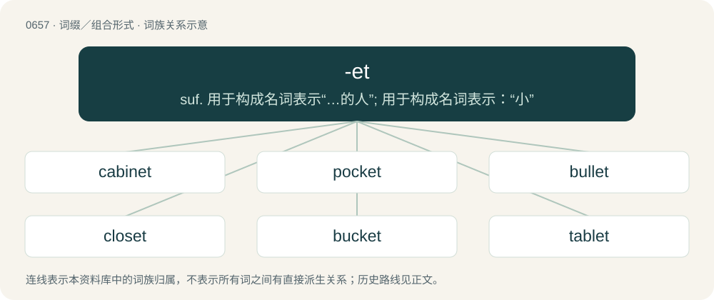

# 0730 · -et — suf. 用于构成名词表示“…的人”; 用于构成名词表示：“小”

[总目录](../00_总目录_按常用程度.md)

**类型**：词缀／组合形式　｜　**来源语言**：见词源记录

## 核心含义与来源

- 核心含义：suf. 用于构成名词表示“…的人”; 用于构成名词表示：“小”
- 英文含义：Used to form diminutives, loosely construed.
- 词形：-et

**多个词源／构词路径**：同一拼写可能有不同来源；以下按词性和含义分别列出。

**来源记录 1**（后缀／后置成分；Used to form diminutives, loosely construed.）

Inherited from Middle English -et, from Old French -et, from Late Latin -ittus, -ettus.

**来源记录 2**（后缀／后置成分；Used to augment verbs, largely monosyllabic, to form verbs with a frequentative or imitative force.）

Uncertain. Perhaps ultimately related to Middle English -ten, -eten, from Old English -ettan; possibly reinforced by Old Norse -ta.

## 词族图

## 单词速览（常用到不常用）

| 单词 | 音标 | 释义 |
|---|---|---|
| [cabinet](#w-1) | 英 /ˈkæb.ɪ.nɪt/；美 /ˈkæb.ɪ.nɪt/ | n. 橱柜, 内阁；a. 内阁的, 细木工做的；\[计\] 机柜 |
| [pocket](#w-2) | 英 /ˈpɒk.ɪt/；美 /ˈpɑ.kɪt/ | n. 口袋, 钱袋, 钱, 容器；vt. 装...在口袋里, 隐藏, 抑制, 私吞, 搁置, 击...入袋；a. 袖珍的, 小型的, 压缩的, 金钱上的 |
| [bullet](#w-3) | /ˈbulit/ | 【英文】A young or little bull; a male calf. |
| [closet](#w-4) | 英 /ˈklɒzɪt/；美 /ˈklɑzɪt/ | n. 壁橱, 小室；a. 秘密的, 空谈的；vt. 把...关入小室 |
| [bucket](#w-5) | 英 /ˈbʌkɪt/；/ˈbʌk.ət/ | n. 桶；\[计\] 存储桶; 桶 |
| [tablet](#w-6) | /ˈtæblət/ | n. 平板, 门牌, 笔记簿, 碑, 匾, 药片；\[化\] 片剂 |
| [helmet](#w-7) | /ˈhɛlmɪt/ | n. 钢盔, 盔, 防护帽；vt. 给...戴头盔 |
| [midget](#w-8) | /ˈmɪd͡ʒɪt/ | n. 侏儒；a. 小型的 |
| [casket](#w-9) | 英 /ˈkæs.kɪt/；美 /ˈkæs.kɪt/ | n. 首饰盒, 小箱, 匣子, 棺材 |
| [nugget](#w-10) | /ˈnʌɡət/ | n. 金块, 贵金属块, 小块；\[化\] 熔核 |
| [snippet](#w-11) | 英 /ˈsnɪpɪt/；美 /ˈsnɪpɪt/ | n. 小片, 片断, 摘录 |
| [corset](#w-12) | /ˈkɔː(ɹ).sɪt/ | n. 紧身褡, 妇女的胸衣；\[医\] 围腰, 胸衣 |
| [trinket](#w-13) | 英 /ˈtɹɪŋkɪt/；/ˈtɹɪŋkət/ | 【英文】A narrow or small watercourse. |
| [triplet](#w-14) | /ˈtɹɪplət/ | n. 三个一组, 三件一套, 三胞胎中的一个；\[计\] 三位字节 |
| [genet](#w-15) | 英 /ˈd͡ʒɛnɪt/ | 【英文】A group of genetically identical individuals (plants, fungi, bacteria etc.) that have grown in a given location, all originating from asexual reproduction of a single ancestor; a group of ramets. |
| [doublet](#w-16) | /ˈdʌblət/ | n. 成对物, 偶极天线, 对称振子, 偶极子, 对偶物；\[计\] 二位字节 |
| [anklet](#w-17) | /ˈæŋklət/ | n. 短袜, 脚镯, 脚镣 |
| [bassinet](#w-18) | 英 /ˌbæsɪˈnɛt/；美 /ˌbæsɪˈnɛt/ | n. 摇篮, 摇篮车 |
| [whippet](#w-19) | /ˈ(h)wipit/ | n. (赛跑用的)小灵狗, 轻型战车 |
| [octet](#w-20) | /ɒkˈtɛt/ | \[计\] 八位二进制数的位组; 八位字节；\[化\] 八隅体; 八角; 八角体; 八重态; 八重线; 八重峰 |

## 逐词详解

### 1. cabinet

**词性**：名词　｜　**音标**：英 /ˈkæb.ɪ.nɪt/；美 /ˈkæb.ɪ.nɪt/

**中文释义**：n. 橱柜, 内阁；a. 内阁的, 细木工做的；\[计\] 机柜

**英文义项**：A storage closet either separate from, or built into, a wall. / A cupboard.

**构词拆分**：cabin + -et

**词源与演化**：

From cabin + -et, influenced by French cabinet. In sense of “a government group”, compare salon, also named for a room used to gather.

**例句**：

> We could see "Cabinet of Dr. Bagoff" written next to the door.

### 2. pocket

**词性**：名词　｜　**音标**：英 /ˈpɒk.ɪt/；美 /ˈpɑ.kɪt/

**中文释义**：n. 口袋, 钱袋, 钱, 容器；vt. 装...在口袋里, 隐藏, 抑制, 私吞, 搁置, 击...入袋；a. 袖珍的, 小型的, 压缩的, 金钱上的

**英文义项**：A bag stitched to an item of clothing, used for carrying small items. / A person's financial resources.

**构词拆分**：poke + -et

**词源与演化**：

From Middle English pocket (“bag, sack”), from Anglo-Norman poket, Old Northern French poquet, poquete, diminutive of poque, poke (“bag, sack”) (compare modern Norman pouquette and modern French pochette from Old French pochete, from puche), from Frankish \*pokō (“pouch”), from Proto-Germanic \*puhô (“bag; pouch”), from Proto-Indo-European \*bew- (“to blow, swell”). Equivalent to poke + -et. Doublet of pochette. Cognate with Middle Dutch poke, Alemannic German Pfoch (“purse, bag”), Old English pocca, pohha (“poke, pouch, pocket, bag”), Old Norse poki (“bag, pocket”). Compare the related poke (“sack or bag”). See also Modern French pochette and Latin bucca.

**例句**：

> The drilling expedition discovered a pocket of natural gas.

该用例对应义项：An enclosed volume of one substance surrounded by another.

### 3. bullet

**词性**：名词　｜　**音标**：/ˈbulit/

**英文义项**：A young or little bull; a male calf.

**构词拆分**：bull + -et

**词源与演化**：

From bull + -et.

### 4. closet

**词性**：名词　｜　**音标**：英 /ˈklɒzɪt/；美 /ˈklɑzɪt/

**中文释义**：n. 壁橱, 小室；a. 秘密的, 空谈的；vt. 把...关入小室

**英文义项**：A small room within a house used to store clothing, food, or other household supplies. / A secret or hiding place, (particularly) the hiding place in English idioms such as in the closet and skeleton in the closet.

**构词拆分**：close + -et

**词源与演化**：

From Middle English closet, from Old French closet, from clos (“private space”) + -et (diminutive suffix), from Latin clausum. Equivalent to close + -et, but generally applied in French solely to small open-air enclosures.

**例句**：

> The closet can be a scary place for a gay teenager.

该用例对应义项：A secret or hiding place, (particularly) the hiding place in English idioms such as in the closet and skeleton in the closet.

### 5. bucket

**词性**：名词　｜　**音标**：英 /ˈbʌkɪt/；/ˈbʌk.ət/

**中文释义**：n. 桶；\[计\] 存储桶; 桶

**英文义项**：A container made of rigid material, often with a handle, used to carry liquids or small items. / The amount held in this container.

**构词拆分**：bouk + -et

**词源与演化**：

From Middle English buket, boket, partly from Old English bucc ("bucket, pitcher"; mod. dialectal buck), equivalent to bouk + -et; and partly from Anglo-Norman buket, buquet (“tub; pail”) (compare Norman boutchet, Norman bouquet), diminutive of Old French buc (“abdomen; object with a cavity”), from Vulgar Latin \*būcus (compare Occitan and Catalan buc, Italian buco, buca (“hole, gap”)), from Frankish \*būk (“belly, stomach”). Both the Old English and Frankish terms derive from Proto-Germanic \*būkaz (“belly, stomach”). More at bouk.

**例句**：

> I need a bucket to carry the water from the well.

该用例对应义项：A container made of rigid material, often with a handle, used to carry liquids or small items.

### 6. tablet

**词性**：名词　｜　**音标**：/ˈtæblət/

**中文释义**：n. 平板, 门牌, 笔记簿, 碑, 匾, 药片；\[化\] 片剂

**英文义项**：A slab of clay, stone or wood used for inscription. / A short scripture written by the founders of the Baháʼí Faith.

**词源与演化**：

From Middle English tablet, from Old French tablete (Modern French tablette), diminutive of table (“table”). Compare English table, -et.

**例句**：

> Many people take vitamin tablets as a food supplement.

该用例对应义项：A pill; a small, easily swallowed portion of a substance in solid form.

### 7. helmet

**词性**：名词　｜　**音标**：/ˈhɛlmɪt/

**中文释义**：n. 钢盔, 盔, 防护帽；vt. 给...戴头盔

**英文义项**：A hard, protective head covering, typically part of armour. / The upper part of a chemist's retort.

**构词拆分**：helm + -et

**词源与演化**：

From Middle English helmet, helmett, a borrowing from Old French helmet, heaumet, a diminutive of helme (Modern French heaume), equivalent to helm + -et. The Old French is itself of Germanic origin (whence Old English helm). Used in English since the 15th century, it has largely displaced helm as the general word.

**例句**：

> Tom took off his bicycle helmet and put it on the table.

### 8. midget

**词性**：名词　｜　**音标**：/ˈmɪd͡ʒɪt/

**中文释义**：n. 侏儒；a. 小型的

**英文义项**：A very small thing; especially one which is conspicuously smaller than expected or by comparison. / A short person.

**词源与演化**：

From midge (chiefly in the figurative sense of “small thing”, literally “small fly”) + -et (diminutive suffix), (from Old English myċġ (“mosquito”), from Proto-Germanic \*mugjō, from Proto-Indo-European \*mus-, \*mu-, \*mew-; cognate with Dutch mug (“mosquito”) and German Mücke (“midge, gnat”)).

**用法示例／搭配（非完整句）**：

> the midget pony

该用例对应义项：A very small thing; especially one which is conspicuously smaller than expected or by comparison.

### 9. casket

**词性**：名词　｜　**音标**：英 /ˈkæs.kɪt/；美 /ˈkæs.kɪt/

**中文释义**：n. 首饰盒, 小箱, 匣子, 棺材

**英文义项**：A little box, e.g. for jewellery. / An urn.

**构词拆分**：cask + -et

**词源与演化**：

Probably from Norman cassette. Possibly reformed by analogy with cask, thus analyzable as cask + -et. Doublet of cassette.

**例句**：

> A pallbearer carries the casket of the deceased at their funeral.

### 10. nugget

**词性**：名词　｜　**音标**：/ˈnʌɡət/

**中文释义**：n. 金块, 贵金属块, 小块；\[化\] 熔核

**英文义项**：A small, compact chunk or clump. / A chicken nugget.

**构词拆分**：nudge (“short, sturdy person or animal”) + -et (“forming diminutives”)

**词源与演化**：

Uncertain, first attested in reference to animals & people in Scotland and in reference to ore chunks in Australia. Possibly from southern English nug (“lump, block”) or Scottish knudge/nudge (“short, sturdy person or animal”) + -et (“forming diminutives”) or from rebracketed alteration of an ingot as a ni(n)got.

**用法示例／搭配（非完整句）**：

> a nugget of wisdom

该用例对应义项：A tidbit of something valuable.

### 11. snippet

**词性**：名词　｜　**音标**：英 /ˈsnɪpɪt/；美 /ˈsnɪpɪt/

**中文释义**：n. 小片, 片断, 摘录

**英文义项**：A small part of something, such as a song or fabric; sample. / A text file containing a relatively small amount of code, useless by itself, along with instructions for inserting that code into a larger codebase.

**构词拆分**：snip + -et

**词源与演化**：

From snip + -et. Compare snippock.

**例句**：

> From the snippet I heard of their rehearsal, they sound pretty good.

该用例对应义项：A small part of something, such as a song or fabric; sample.

### 12. corset

**词性**：动词　｜　**音标**：/ˈkɔː(ɹ).sɪt/

**中文释义**：n. 紧身褡, 妇女的胸衣；\[医\] 围腰, 胸衣

**英文义项**：To enclose in a corset; to wear a corset. / To restrict or confine.

**构词拆分**：corse + -et

**词源与演化**：

From Middle English corset, from Old French corset. Equivalent to corse + -et.

**例句**：

> Mabel dreaded the upcoming ball and the preliminary corseting it would entail.

该用例对应义项：To enclose in a corset; to wear a corset.

### 13. trinket

**词性**：名词　｜　**音标**：英 /ˈtɹɪŋkɪt/；/ˈtɹɪŋkət/

**英文义项**：A narrow or small watercourse.

**构词拆分**：trink (“(UK, dialectal, especially Scotland) channel, watercourse; trench”) + -et (diminutive suffix)

**词源与演化**：

From trink (“(UK, dialectal, especially Scotland) channel, watercourse; trench”) + -et (diminutive suffix); compare Scots trink. Trink is possibly derived from Occitan trencque, trenque (Picardy), from Old French trenche, tranche (“trench”) (modern French tranche), from trenchier (“to cut”); further etymology uncertain, possibly: \* from Latin truncāre, the present active infinitive of truncō (“to maim or mutilate by cutting off pieces; to truncate”), from truncus (“tree trunk; piece cut off”) (possibly from Proto-Indo-European \*twerḱ- (“to carve; to cut off, trim”)) + -ō (suffix forming regular first-conjugation verbs); or \* from Vulgar Latin \*trinicāre (“to cut into three parts”), from Latin tri- (prefix meaning ‘three’) (ultimately from Proto-Indo-European \*tréyes (“three”)) + duplicāre (“to double by dividing, split in two, tear”); possibly also influenced by Gaulish \*trincare (“to cut off (the head)”).

### 14. triplet

**词性**：名词　｜　**音标**：/ˈtɹɪplət/

**中文释义**：n. 三个一组, 三件一套, 三胞胎中的一个；\[计\] 三位字节

**英文义项**：A group of three notes of even rhythm played or written where two of those notes would ordinarily be; a form of tuplet. / A triquark.

**构词拆分**：triple + -et

**词源与演化**：

From triple + -et.

**例句**：

> I am a triplet born on New Year's Eve.

### 15. genet

**词性**：名词　｜　**音标**：英 /ˈd͡ʒɛnɪt/

**英文义项**：A group of genetically identical individuals (plants, fungi, bacteria etc.) that have grown in a given location, all originating from asexual reproduction of a single ancestor; a group of ramets.

**构词拆分**：gene + -et

**词源与演化**：

Coined in the 20th century from gene + -et.

### 16. doublet

**词性**：名词　｜　**音标**：/ˈdʌblət/

**中文释义**：n. 成对物, 偶极天线, 对称振子, 偶极子, 对偶物；\[计\] 二位字节

**英文义项**：A pair of two similar or equal things; couple. / One of two or more different words in a language derived from the same etymological root but having different phonological forms (e.g., toucher and toquer in French or shade and shadow in English). See also Appendix:Glossary#doublet.

**构词拆分**：double + -et (diminutive suffix)

**词源与演化**：

From Middle English doublet, a borrowing from Old French doublet, from double, duble, doble + -et. Equivalent to double + -et (diminutive suffix)

**用法示例／搭配（非完整句）**：

> to throw doublets

该用例对应义项：Either of two dice, each of which, when thrown, has the same number of spots on the face lying uppermost.

### 17. anklet

**词性**：名词　｜　**音标**：/ˈæŋklət/

**中文释义**：n. 短袜, 脚镯, 脚镣

**英文义项**：A piece of jewelry/jewellery, resembling a bracelet but worn around the ankle. / An ankle sock.

**构词拆分**：ankle + -et

**词源与演化**：

From ankle + -et, based on bracelet.

**例句**：

> All Tom could envision was her gold anklet jingling against her bronze skin.

### 18. bassinet

**词性**：名词　｜　**音标**：英 /ˌbæsɪˈnɛt/；美 /ˌbæsɪˈnɛt/

**中文释义**：n. 摇篮, 摇篮车

**英文义项**：A newborn baby's bed, traditionally woven with reeds or straw; a (wicker) cradle.

**构词拆分**：basin + -et

**词源与演化**：

From French bassinet (“small basin”), equivalent to basin + -et. Ernest Klein, however, suggests derivation from French bercelonnette (“cradle”), with influence from bassin(et), to account for the English sense's semantic specialization.

**例句**：

> Tom put the baby in the bassinet.

### 19. whippet

**词性**：名词　｜　**音标**：/ˈ(h)wipit/

**中文释义**：n. (赛跑用的)小灵狗, 轻型战车

**英文义项**：A dog of a certain breed, similar to a small greyhound, originating in Britain and bred for racing.

**构词拆分**：whip (“to move quickly”) + -et

**词源与演化**：

Probably from whip (“to move quickly”) + -et.

### 20. octet

**词性**：名词　｜　**音标**：/ɒkˈtɛt/

**中文释义**：\[计\] 八位二进制数的位组; 八位字节；\[化\] 八隅体; 八角; 八角体; 八重态; 八重线; 八重峰

**英文义项**：A group or set of eight of something. / A group of eight musicians performing together.

**构词拆分**：oct- (“eight”) + -et

**词源与演化**：

From oct- (“eight”) + -et.

**例句**：

> An octet of waiters sang her "Happy Birthday".

该用例对应义项：A group of eight musicians performing together.
