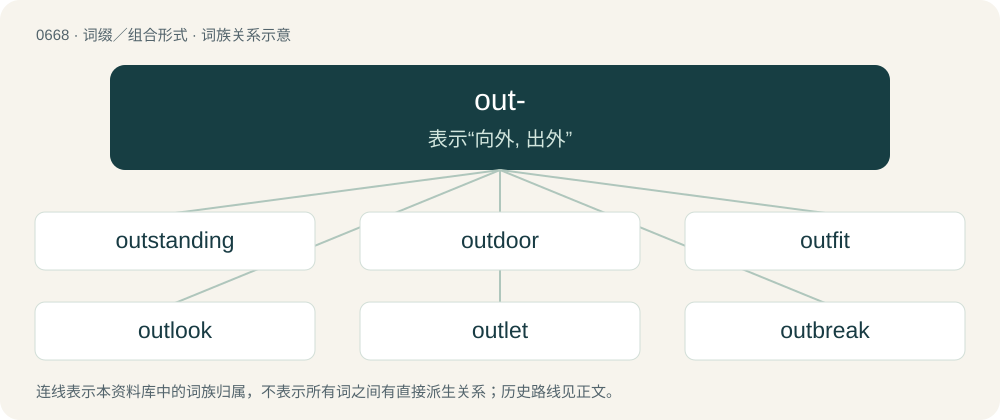

# 0742 · out- — 表示“向外, 出外”

[总目录](../00_总目录_按常用程度.md)

**类型**：词缀／组合形式　｜　**来源语言**：见词源记录

## 核心含义与来源

- 核心含义：表示“向外, 出外”
- 英文含义：External to, on the outside of
- 词形：out-

**来源记录 1**（前缀／前置成分；External to, on the outside of）

From Middle English ut-, from Old English ūt- (“out, without, outside”) (also as ūta-, ūtan- (“from or on the outside, without”), as in ūtanweard (“outward, external”)), from Proto-Germanic \*ūt- (“out-”). Cognate with Dutch uit-, German aus-, Swedish ut-, Icelandic út-. More at out.

## 词族图

## 单词速览（常用到不常用）

| 单词 | 音标 | 释义 |
|---|---|---|
| [outstanding](#w-1) | 英 /ˌaʊtˈstæn.dɪŋ/ | a. 杰出的, 突出的, 未偿付的, 未决定的；\[经\] 未解决的, 未偿付 |
| [outdoor](#w-2) | 英 /aʊtˈdɔː/ | a. 户外的, 屋外的, 露天的 |
| [outfit](#w-3) | /ˈaʊtfɪt/ | n. 用具, 配备, 机构；vt. 配备, 供应；vi. 得到装备 |
| [outlook](#w-4) | 英 /ˈaʊtˌlʊk/ | n. 观点, 景色, 前途, 了望；\[经\] 展望 |
| [outlet](#w-5) | /ˈaʊtlɛt/ | n. 出口, 发泄方法, 市场；\[医\] 出口 |
| [outbreak](#w-6) | /ˈaʊtbɹeɪk/ | n. 爆发, 暴动；\[医\] 暴发 |
| [outrage](#w-7) | /ˈaʊt.ɹeɪd͡ʒ/ | n. 暴行, 侮辱, 愤怒；vt. 凌辱, 虐待, 触犯 |
| [outreach](#w-8) | /ˈaʊtɹiːtʃ/ | vt. 超出...的范围, 作超出能力所及的事而害及自己, 占...的上风, 胜过；vi. 走得太远, 伸出, 展开 |
| [outskirts](#w-9) | 英 /ˈaʊtskɜːts/；美 /ˈaʊtskɝts/ | n. 近郊, 市郊 |
| [outlaw](#w-10) | 英 /ˈaʊt.lɔː/；美 /ˈaʊt.lɔ/ | n. 被剥夺法律保护的人, 罪犯；vt. 使...失去法律保护, 将...逐出社会, 宣告非法, 取缔 |
| [outset](#w-11) | /ˈaʊtsɛt/ | n. 着手, 开头, 最初 |
| [outpost](#w-12) | 美 /ˈaʊtˌpoʊst/ | n. 前哨, 前哨部队, 前哨基地 |
| [outspoken](#w-13) | /.autˈspəukən/ | a. 直言无讳的, 坦率的, 坦白无隐的 |
| [outpatient](#w-14) | /ˈaʊtˌpeɪʃ(ə)nt/ | n. 门诊病人；\[医\] 门诊病人 |
| [outweigh](#w-15) | /ˌaʊtˈweɪ/ | vt. 比...重, 比...重要, 比...有价值 |
| [outcry](#w-16) | 英 /ˈaʊtkɹaɪ/ | n. 尖叫, 倒彩, 强烈抗议, 喊价；vi. 喊叫；vt. 叫得比...响 |
| [outburst](#w-17) | 英 /ˈaʊ̯tˌbɜːst/；美 /ˈaʊ̯tˌbɝst/ | n. 爆发, 突发, 破裂, 暴乱 |
| [outfield](#w-18) | 美 /ˈaʊtfild/ | n. 外场, (思想中的)未知世界, 边境 |
| [outcast](#w-19) | 英 /ˈaʊtkɑːst/；美 /ˈaʊtkæst/ | a. 被逐出的, 被遗弃的, 无家可归的；n. 被驱逐的人, 流浪者 |
| [outflow](#w-20) | /ˈautfləu/ | n. 流出, 流出物；\[医\] 流出, 传出, 流出物 |
| [outperform](#w-21) | 美 /ˌaʊt.pɚˈfɔɹm/ | vt. 胜过；做得比……好 |
| [outbound](#w-22) | 美 /ˈaʊtbaʊnd/ | a. 开往国外的；\[计\] 出站 |
| [outnumber](#w-23) | /aʊtˈnʌmbə(ɹ)/ | vt. 数目超过, 比...多 |
| [outrun](#w-24) | /ˈaʊtɹʌn/ | vt. 超过, 逃脱 |
| [outsource](#w-25) | 英 /ˈaʊtˌsɔːs/；美 /ˈaʊtˌsoɹs/ | vt. 把…外包 |
| [outlay](#w-26) | /ˈaʊtleɪ/ | n. 费用, 经费, 支出；vt. 花费 |
| [outpouring](#w-27) | /.autˈpɒːriŋ/ | n. 注出, 流出, 流露 |
| [outlast](#w-28) | 英 /ˌaʊtˈlɑːst/；美 /ˌaʊtˈlæst/ | vt. 比...长久, 从...中逃生 |
| [outcrop](#w-29) | 英 /ˈaʊt.kɹɒp/；美 /ˈaʊt.kɹɑp/ | n. 露出, 露头, 爆发；vi. 露出地表, 出现 |
| [outdo](#w-30) | 美 /aʊtˈdu/ | vt. 超越, 胜过, 战胜 |
| [outlive](#w-31) | 英 /aʊtˈlɪv/ | vt. 比...经久, 比...活得长, 度过(风暴)而健在 |
| [outgrow](#w-32) | 英 /ˌaʊtˈɡɹəʊ/；美 /ˌɑʊtˈɡɹoʊ/ | vt. 过大而不适于, 长得比...高(或大、快), 成长得不再具有... |
| [outsmart](#w-33) | /aʊtˈsmɑː(ɹ)t/ | vt. 比...更聪明, 打败, 瞒过 |
| [outbid](#w-34) | /aʊtˈbɪd/ | vt. 出高于...的价钱 |
| [outgrowth](#w-35) | /ˈaʊtˌɡroʊθ/ | n. 自然的发展, 结果, 副产物, 分枝；\[医\] 赘疣 |
| [outhouse](#w-36) | 美 /ˈaʊthaʊs/ | n. 外屋, 户外厕所 |
| [outshine](#w-37) | /aʊtˈʃaɪn/ | vt. 光亮强过..., 使相形见绌, 使失色；vi. 发光 |
| [outwit](#w-38) | 英 /aʊtˈwɪt/ | vt. 瞒骗, 以智取胜 |
| [outpace](#w-39) | /.autˈpeis/ | vt. 超过...速度, 赶过 |
| [outstrip](#w-40) | 英 /ˌaʊtˈstɹɪp/；美 /ˌaʊtˈstɹɪp/ | vt. 追过, 胜过, 凌驾 |
| [outrigger](#w-41) | 英 /ˈaʊtˌɹɪɡə/；美 /ˈaʊtˌɹɪɡɚ/ | n. 舷外支架, 突出的梁,桁等 |
| [outtake](#w-42) | 美 /ˈaʊtˌteɪk/ | 通气管, 气孔, 通风道, 烟道 |
| [outland](#w-43) | /ˈautlænd. -lənd/ | n. 靠近边界之土地, 边境地区 |
| [outflank](#w-44) | /.autˈflæŋk/ | vt. 包抄, 迂回, 智胜 |
| [outgroup](#w-45) | /ˈaʊtɡruːp/ | n. 外集团, 外围集团 |
| [outsell](#w-46) | /ɑʊtˈsɛl/ | vt. 卖得比...多, 比...更畅销 |
| [outcall](#w-47) |  | n. 出诊；\[网络\] 电话回访；大众按摩；男店 |
| [outscore](#w-48) | /autˈskɔː/ | vt.得分超过 |
| [outplay](#w-49) | /aʊtˈpleɪ/ | vt. 技术优于..., 胜过, 打败 |
| [outfall](#w-50) | 美 /ˈaʊtˌfɔl/ | n. 河口, 排水口, 袭击 |
| [outsize](#w-51) | /ˈautsaiz/ | a. 特大的；n. 特大号 |
| [outrank](#w-52) | 美 /aʊtˈɹæŋk/；/aʊtˈɹeɪ̯ŋk/ | vt. 在级别方面比...高, 在地位方面比...高, 在身分方面比...高 |

## 逐词详解

### 1. outstanding

**词性**：形容词　｜　**音标**：英 /ˌaʊtˈstæn.dɪŋ/

**中文释义**：a. 杰出的, 突出的, 未偿付的, 未决定的；\[经\] 未解决的, 未偿付

**英文义项**：Prominent or noticeable; sovereign. / Exceptionally good; distinguished from others by its superiority.

**构词拆分**：out- + standing；outstand + -ing

**词源与演化**：

From outstand, equivalent to out- + standing or outstand + -ing.

**例句**：

> You must pay any outstanding corporate card balance immediately.

该用例对应义项：Owed as a debt.

### 2. outdoor

**词性**：形容词　｜　**音标**：英 /aʊtˈdɔː/

**中文释义**：a. 户外的, 屋外的, 露天的

**英文义项**：Situated in, designed to be used in, or carried on in the open air. / Pertaining to charity administered or received away from, or independently from, a workhouse or other institution.

**构词拆分**：out- + door

**词源与演化**：

From out- + door.

**例句**：

> Badminton and other outdoor games.

该用例对应义项：located, suited for, or taking place in the open air

### 3. outfit

**词性**：名词　｜　**音标**：/ˈaʊtfɪt/

**中文释义**：n. 用具, 配备, 机构；vt. 配备, 供应；vi. 得到装备

**英文义项**：A set of clothing (with accessories). / Gear consisting of a set of articles or tools for a specified purpose.

**构词拆分**：out- + fit

**词源与演化**：

Variant of earlier out-fit, from fit out. Equivalent to out- + fit.

**例句**：

> Should we buy it here, or do you think the outfit across town will have a better deal?

该用例对应义项：A business or firm.

### 4. outlook

**词性**：名词　｜　**音标**：英 /ˈaʊtˌlʊk/

**中文释义**：n. 观点, 景色, 前途, 了望；\[经\] 展望

**英文义项**：A place from which something can be viewed. / The view from such a place.

**构词拆分**：out- + look

**词源与演化**：

From out- + look.

**例句**：

> Perched on the edge of the cliff was a hidden outlook.

该用例对应义项：A place from which something can be viewed.

### 5. outlet

**词性**：名词　｜　**音标**：/ˈaʊtlɛt/

**中文释义**：n. 出口, 发泄方法, 市场；\[医\] 出口

**英文义项**：A vent or similar passage to allow the escape of something. / Something which allows for the release of one's desires.

**构词拆分**：out- + let

**词源与演化**：

From Middle English outlete, outeleate, ut-lete, derived from Middle English outleten (“to allow, let out, emit”), equivalent to out- + let. Compare West Frisian útlit (“outlet”), Dutch uitlaat (“outlet”), German Auslass (“outlet”).

**例句**：

> Jamie found doing martial arts was a great outlet for her stress.

该用例对应义项：Something which allows for the release of one's desires.

### 6. outbreak

**词性**：名词　｜　**音标**：/ˈaʊtbɹeɪk/

**中文释义**：n. 爆发, 暴动；\[医\] 暴发

**英文义项**：An eruption; the sudden appearance of a rash, disease, etc. / A sudden increase.

**构词拆分**：out- + break

**词源与演化**：

From Middle English outbreken, oute-breken, from Old English ūtābrecan (“to break out”), equivalent to out- + break. Cognate with Saterland Frisian uutbreeke (“to break out, burst out”), West Frisian útbrekke (“to break out”), Dutch uitbreken (“to break out, burst out”), German ausbrechen (“to break out, erupt”). The noun is cognate with Saterland Frisian Uutbreek (“outbreak”), West Frisian útbrek (“outbreak”), Dutch uitbraak (“outbreak”), and German Ausbruch (“outbreak”), and is comparable to Danish udbrud (“outbreak”), Faroese and Icelandic útbrot (“rash”), Norwegian utbrudd (“outbreak”), and Swedish utbrott (“outbreak”).

**例句**：

> There has been an outbreak of broken windows in the street.

该用例对应义项：An outburst or sudden eruption, especially of violence and mischief.

### 7. outrage

**词性**：动词　｜　**音标**：/ˈaʊt.ɹeɪd͡ʒ/

**中文释义**：n. 暴行, 侮辱, 愤怒；vt. 凌辱, 虐待, 触犯

**英文义项**：To cause or commit an outrage upon; to treat with violence or abuse. / To inspire feelings of outrage in.

**构词拆分**：out- + rage

**词源与演化**：

From Middle English outrage, from Old French outrage, oultrage (“excess”), from Vulgar Latin \*ultrāticum ("a going beyond"), derived from Latin ultrā (“beyond”). Later reanalysed as out- + rage, whence the contemporary pronunciation, though neither of these are etymologically related. The verb is from Middle English outragen, from Old French oultragier.

**例句**：

> Floyd’s death has caused international outrage and days of protests across the nation.

### 8. outreach

**词性**：名词　｜　**音标**：/ˈaʊtɹiːtʃ/

**中文释义**：vt. 超出...的范围, 作超出能力所及的事而害及自己, 占...的上风, 胜过；vi. 走得太远, 伸出, 展开

**英文义项**：The act of reaching out. / The act of raising awareness.

**构词拆分**：out- + reach

**词源与演化**：

From out- + reach.

**例句**：

> He is involved in social outreach, education and environmental initiatives.

该用例对应义项：The act or practice of visiting and providing services (of a charity, church, or other organization) to people who might not otherwise have access to those services.

### 9. outskirts

**词性**：名词　｜　**音标**：英 /ˈaʊtskɜːts/；美 /ˈaʊtskɝts/

**中文释义**：n. 近郊, 市郊

**英文义项**：The area surrounding a city or town; suburb.

**构词拆分**：out- + skirts

**词源与演化**：

From out- + skirts.

**例句**：

> He lived on the outskirts of Paris for a time.

该用例对应义项：The area surrounding a city or town; suburb.

### 10. outlaw

**词性**：名词　｜　**音标**：英 /ˈaʊt.lɔː/；美 /ˈaʊt.lɔ/

**中文释义**：n. 被剥夺法律保护的人, 罪犯；vt. 使...失去法律保护, 将...逐出社会, 宣告非法, 取缔

**英文义项**：A fugitive from the law. / A criminal who is excluded from normal legal rights; one who can be killed at will without legal penalty.

**构词拆分**：out- + law

**词源与演化**：

From Middle English outlawe, outlagh, utlaȝe, from Old English ūtlaga (“outlaw”), borrowed from Old Norse útlagi (“outlaw, fugitive”), equivalent to out- + law. Cognate with Icelandic útlagi (“outlaw”).

**例句**：

> The main character in the play was a bit of an outlaw who refused to shake hands or say thank you.

该用例对应义项：A person who operates outside established norms.

### 11. outset

**词性**：名词　｜　**音标**：/ˈaʊtsɛt/

**中文释义**：n. 着手, 开头, 最初

**英文义项**：An onset; the beginning or initial stage of something.

**构词拆分**：out- + set

**词源与演化**：

From out- + set, replacing earlier outsetting.

**例句**：

> He agreed and understood from the outset, so don't bother explaining again.

该用例对应义项：An onset; the beginning or initial stage of something.

### 12. outpost

**词性**：名词　｜　**音标**：美 /ˈaʊtˌpoʊst/

**中文释义**：n. 前哨, 前哨部队, 前哨基地

**英文义项**：A military post stationed at a distance from the main body of troops. / The body of troops manning such a post.

**构词拆分**：out- + post

**词源与演化**：

From out- + post.

**例句**：

> Sgt. Smith fleeced most of the rest of the outpost of their earnings in their weekly game of craps.

该用例对应义项：The body of troops manning such a post.

### 13. outspoken

**词性**：形容词　｜　**音标**：/.autˈspəukən/

**中文释义**：a. 直言无讳的, 坦率的, 坦白无隐的

**英文义项**：Speaking, or spoken, freely, openly, or boldly; vocal; frank.

**构词拆分**：out- + spoken

**词源与演化**：

From outspeak, equivalent to out- + spoken.

**用法示例／搭配（非完整句）**：

> an outspoken rebuke

该用例对应义项：Speaking, or spoken, freely, openly, or boldly; vocal; frank.

### 14. outpatient

**词性**：名词　｜　**音标**：/ˈaʊtˌpeɪʃ(ə)nt/

**中文释义**：n. 门诊病人；\[医\] 门诊病人

**英文义项**：A patient who receives treatment at a hospital or clinic but is not admitted overnight; a receiver of ambulatory care.

**构词拆分**：out- + patient

**词源与演化**：

From out- + patient.

**例句**：

> An outpatient clinic is the part of a hospital designated for the treatment of outpatients.

### 15. outweigh

**词性**：动词　｜　**音标**：/ˌaʊtˈweɪ/

**中文释义**：vt. 比...重, 比...重要, 比...有价值

**英文义项**：To exceed in weight or mass. / To exceed in importance or value.

**构词拆分**：out- + weigh

**词源与演化**：

From out- + weigh.

**例句**：

> The risks of such a project would clearly outweigh any putative benefit.

### 16. outcry

**词性**：名词　｜　**音标**：英 /ˈaʊtkɹaɪ/

**中文释义**：n. 尖叫, 倒彩, 强烈抗议, 喊价；vi. 喊叫；vt. 叫得比...响

**英文义项**：A loud cry or uproar. / A strong protest.

**构词拆分**：out- + cry

**词源与演化**：

From Middle English outcry, outcri, outcrye, equivalent to out- + cry. The verb is from Middle English outcrien.

**例句**：

> His appearance was greeted with an outcry of jeering.

该用例对应义项：A loud cry or uproar.

### 17. outburst

**词性**：名词　｜　**音标**：英 /ˈaʊ̯tˌbɜːst/；美 /ˈaʊ̯tˌbɝst/

**中文释义**：n. 爆发, 突发, 破裂, 暴乱

**英文义项**：An intense period of activity. / A sudden, often violent expression of emotion

**构词拆分**：By surface analysis, out- + burst

**词源与演化**：

Inherited from Middle English outbersten, outbresten. Cognate with Dutch uitbarsten (“to erupt; burst out”), German ausbersten (“to burst out; erupt”). By surface analysis, out- + burst.

**例句**：

> The man greeted us with an outburst of invective.

该用例对应义项：An intense period of activity.

### 18. outfield

**词性**：名词　｜　**音标**：美 /ˈaʊtfild/

**中文释义**：n. 外场, (思想中的)未知世界, 边境

**英文义项**：The region of the field between the infield and the outer fence. / The region of the field roughly outside of the infield or the wicket-keeper, slips, gully, point, cover, mid off, mid on, midwicket and square leg.

**构词拆分**：out- + field

**词源与演化**：

From out- + field.

**例句**：

> He hit a long fly ball to the outfield in the gap to left.

该用例对应义项：The region of the field between the infield and the outer fence.

### 19. outcast

**词性**：动词　｜　**音标**：英 /ˈaʊtkɑːst/；美 /ˈaʊtkæst/

**中文释义**：a. 被逐出的, 被遗弃的, 无家可归的；n. 被驱逐的人, 流浪者

**英文义项**：To cast out; to banish.

**构词拆分**：out- + cast

**词源与演化**：

From Middle English outcasten, equivalent to out- + cast.

**例句**：

> Boldi became an outcast and a laughing stock for everyone.

### 20. outflow

**词性**：名词　｜　**音标**：/ˈautfləu/

**中文释义**：n. 流出, 流出物；\[医\] 流出, 传出, 流出物

**英文义项**：The process of flowing out. / A fluid that flows out.

**构词拆分**：out- + flow

**词源与演化**：

From Middle English outflowen, from late Old English ūtflōwan (attested in the past tense as ūt flēow), equivalent to out- + flow. The noun is derived from the verb.

**例句**：

> A constant outflow of skilled workers can vitiate a region's economic growth.

### 21. outperform

**词性**：动词　｜　**音标**：美 /ˌaʊt.pɚˈfɔɹm/

**中文释义**：vt. 胜过；做得比……好

**英文义项**：To perform better than something or someone.

**构词拆分**：out- + perform

**词源与演化**：

From out- + perform.

**例句**：

> Multinational corporations outperform traditional corporations operating in just one country.

### 22. outbound

**词性**：形容词　｜　**音标**：美 /ˈaʊtbaʊnd/

**中文释义**：a. 开往国外的；\[计\] 出站

**英文义项**：Leaving or departing; traveling away from; outward bound.

**构词拆分**：out- + bound

**词源与演化**：

From out- + bound.

**例句**：

> In some stations the inbound and outbound platforms are not connected.

### 23. outnumber

**词性**：动词　｜　**音标**：/aʊtˈnʌmbə(ɹ)/

**中文释义**：vt. 数目超过, 比...多

**英文义项**：To be more in number than somebody or something.

**构词拆分**：out- + number

**词源与演化**：

From out- + number.

**例句**：

> Women outnumbered men by two to one.

该用例对应义项：To be more in number than somebody or something.

### 24. outrun

**词性**：动词　｜　**音标**：/ˈaʊtɹʌn/

**中文释义**：vt. 超过, 逃脱

**英文义项**：To run faster than. / To exceed or overextend.

**构词拆分**：out- + run

**词源与演化**：

From out- + run.

**例句**：

> I don't need to outrun the bear; I just need to outrun you.

该用例对应义项：To run faster than.

### 25. outsource

**词性**：动词　｜　**音标**：英 /ˈaʊtˌsɔːs/；美 /ˈaʊtˌsoɹs/

**中文释义**：vt. 把…外包

**英文义项**：To transfer the management or day-to-day execution of a business function to a third-party service provider.

**构词拆分**：out- + source

**词源与演化**：

From out- + source.

**例句**：

> They decided to outsource the design and manufacture of the system to a vendor.

该用例对应义项：To transfer the management or day-to-day execution of a business function to a third-party service provider.

### 26. outlay

**词性**：名词　｜　**音标**：/ˈaʊtleɪ/

**中文释义**：n. 费用, 经费, 支出；vt. 花费

**英文义项**：A laying out or expending; that which is laid out or expended. / The spending of money, or an expenditure.

**构词拆分**：out- + lay

**词源与演化**：

From out- + lay.

**例句**：

> Without too much outlay, you could buy a second-hand car.

该用例对应义项：The spending of money, or an expenditure.

### 27. outpouring

**词性**：名词　｜　**音标**：/.autˈpɒːriŋ/

**中文释义**：n. 注出, 流出, 流露

**英文义项**：The sudden outward flowing of a large amount of something.

**构词拆分**：out- + pouring

**词源与演化**：

From out- + pouring.

**例句**：

> She attacked him with an outpouring of words.

该用例对应义项：a sudden rapid flow (as of water)

### 28. outlast

**词性**：动词　｜　**音标**：英 /ˌaʊtˈlɑːst/；美 /ˌaʊtˈlæst/

**中文释义**：vt. 比...长久, 从...中逃生

**英文义项**：To live, last or remain longer than.

**构词拆分**：out- + last

**词源与演化**：

From out- + last.

**例句**：

> Some think that classical music would outlast pop.

该用例对应义项：To live, last or remain longer than.

### 29. outcrop

**词性**：名词　｜　**音标**：英 /ˈaʊt.kɹɒp/；美 /ˈaʊt.kɹɑp/

**中文释义**：n. 露出, 露头, 爆发；vi. 露出地表, 出现

**英文义项**：A piece of land that stands out (usually into water) from the land surrounding. / A coming out of bedrock or of an unconsolidated deposit to the surface of the ground.

**构词拆分**：out- + crop

**词源与演化**：

From out- + crop.

**例句**：

> The sharp, layered outcrop appeared to pierce the desert sand like an ancient blade.

### 30. outdo

**词性**：动词　｜　**音标**：美 /aʊtˈdu/

**中文释义**：vt. 超越, 胜过, 战胜

**英文义项**：To excel; go beyond in performance; surpass.

**构词拆分**：out- + do

**词源与演化**：

From out- + do.

**例句**：

> I just can't seem to outdo him. I've got a lot to learn.

### 31. outlive

**词性**：动词　｜　**音标**：英 /aʊtˈlɪv/

**中文释义**：vt. 比...经久, 比...活得长, 度过(风暴)而健在

**英文义项**：To live longer than; continue to live after the death of; overlive; survive. / To live through or past (a given time).

**构词拆分**：out- + live

**词源与演化**：

From Middle English outliven, equivalent to out- + live.

**例句**：

> It's not natural for a mother to outlive her child.

### 32. outgrow

**词性**：动词　｜　**音标**：英 /ˌaʊtˈɡɹəʊ/；美 /ˌɑʊtˈɡɹoʊ/

**中文释义**：vt. 过大而不适于, 长得比...高(或大、快), 成长得不再具有...

**英文义项**：To become too big in size or too mature in age or outlook to continue to want, need, use, experience, or accept some object, practice, condition, belief, etc. / To grow faster or larger than.

**构词拆分**：out- + grow

**词源与演化**：

From out- + grow.

**例句**：

> Some people blame God for their troubles, but one must outgrow such notions.

该用例对应义项：To become too big in size or too mature in age or outlook to continue to want, need, use, experience, or accept some object, practice, condition, belief, etc.

### 33. outsmart

**词性**：动词　｜　**音标**：/aʊtˈsmɑː(ɹ)t/

**中文释义**：vt. 比...更聪明, 打败, 瞒过

**英文义项**：To beat in a competition of wits.

**构词拆分**：out- + smart

**词源与演化**：

From out- + smart.

**例句**：

> If you think you can outsmart me, then you've got it all wrong.

### 34. outbid

**词性**：动词　｜　**音标**：/aʊtˈbɪd/

**中文释义**：vt. 出高于...的价钱

**英文义项**：To bid more than (somebody else) in an auction.

**构词拆分**：out- + bid

**词源与演化**：

From out- + bid.

**例句**：

> Ziri outbid everyone at the auction.

### 35. outgrowth

**词性**：名词　｜　**音标**：/ˈaʊtˌɡroʊθ/

**中文释义**：n. 自然的发展, 结果, 副产物, 分枝；\[医\] 赘疣

**英文义项**：A branch or offshoot of a plant. / An appendage of an animal.

**构词拆分**：out- + growth

**词源与演化**：

From out- + growth.

### 36. outhouse

**词性**：名词　｜　**音标**：美 /ˈaʊthaʊs/

**中文释义**：n. 外屋, 户外厕所

**英文义项**：An outbuilding, typically permanent, containing a toilet or seat over a cesspit. / Any outbuilding: any small structure located apart from a main building.

**构词拆分**：out- + house

**词源与演化**：

From Middle English outhous, equivalent to out- + house. Compare Old Norse úthús (“outhouse”).

**例句**：

> Ziri lived in a house so old it had a wooden outhouse.

### 37. outshine

**词性**：动词　｜　**音标**：/aʊtˈʃaɪn/

**中文释义**：vt. 光亮强过..., 使相形见绌, 使失色；vi. 发光

**英文义项**：To shine brighter than something else / To exceed something or someone else, especially in an obvious or flamboyant manner

**构词拆分**：out- + shine

**词源与演化**：

From out- + shine.

**例句**：

> Sami hoped to outshine his siblings by doing well at school.

### 38. outwit

**词性**：动词　｜　**音标**：英 /aʊtˈwɪt/

**中文释义**：vt. 瞒骗, 以智取胜

**英文义项**：To get the better of; to outsmart, to beat in a competition of wits.

**构词拆分**：out- + wit

**词源与演化**：

From out- + wit.

### 39. outpace

**词性**：动词　｜　**音标**：/.autˈpeis/

**中文释义**：vt. 超过...速度, 赶过

**英文义项**：To go faster than; to exceed the pace of.

**构词拆分**：out- + pace

**词源与演化**：

From out- + pace.

**例句**：

> The giraffe couldn't build up enough speed to outpace the lions that were chasing it.

### 40. outstrip

**词性**：动词　｜　**音标**：英 /ˌaʊtˈstɹɪp/；美 /ˌaʊtˈstɹɪp/

**中文释义**：vt. 追过, 胜过, 凌驾

**英文义项**：To move more quickly than (someone or something) so as to outrun or leave it behind. / To exceed or surpass (someone or something).

**构词拆分**：out- (prefix forming verbs with the sense of exceeding or surpassing) + strip (“(obsolete) to move or pass by quickly”)

**词源与演化**：

From out- (prefix forming verbs with the sense of exceeding or surpassing) + strip (“(obsolete) to move or pass by quickly”).

**例句**：

> “The U.N. has assessed that by 2030 the global demand for water will outstrip supply by 40 percent,” he said.

### 41. outrigger

**词性**：名词　｜　**音标**：英 /ˈaʊtˌɹɪɡə/；美 /ˈaʊtˌɹɪɡɚ/

**中文释义**：n. 舷外支架, 突出的梁,桁等

**英文义项**：Any of various projecting beams or spars that provide support for a sailing ship's mast. / A long thin timber, pontoon, or other float attached parallel to a canoe or boat by projecting struts as a means of preventing tipping or capsizing.

**构词拆分**：out- + ligger

**词源与演化**：

Modification of earlier outligger after rig (“to fit out”); equivalent to out- + ligger.

### 42. outtake

**词性**：名词　｜　**音标**：美 /ˈaʊtˌteɪk/

**中文释义**：通气管, 气孔, 通风道, 烟道

**英文义项**：A portion of a recording (a take) that is not included in the final version of a film or a musical album, often because it contains a mistake. / A complete version of a recording or film that is dropped in favour of another version, reject.

**构词拆分**：out- + take

**词源与演化**：

From Middle English outtaken (“to take out”), equivalent to out- + take.

**例句**：

> The DVD for that movie has ten minutes' worth of outtakes.

该用例对应义项：A portion of a recording (a take) that is not included in the final version of a film or a musical album, often because it contains a mistake.

### 43. outland

**词性**：形容词　｜　**音标**：/ˈautlænd. -lənd/

**中文释义**：n. 靠近边界之土地, 边境地区

**英文义项**：Provincial: from a province (of the same land). / Foreign: from abroad, from a foreign land.

**构词拆分**：out- + land

**词源与演化**：

From Middle English outland, outlond, from Old English ūtland (“foreign land, land abroad”), from Proto-Germanic \*ūtlandą (“outland”), equivalent to out- + land. Cognate to Dutch uitland, Afrikaans uitland, German Ausland, Danish udland. The use in the phrase "outland German" is influenced by (or is a calque of) the German cognate of the same meaning, Auslandsdeutsche (see Ausland). The use in the phrase "outland Chinese" is influenced by (or is a calque of) the Chinese term of the same meaning, 華僑 / 华侨 (huáqiáo).

### 44. outflank

**词性**：动词　｜　**音标**：/.autˈflæŋk/

**中文释义**：vt. 包抄, 迂回, 智胜

**英文义项**：To maneuver around and behind the flank of (an opposing force). / To gain a tactical advantage over (a competitor, for example).

**构词拆分**：out- + flank

**词源与演化**：

From out- + flank.

### 45. outgroup

**词性**：名词　｜　**音标**：/ˈaʊtɡruːp/

**中文释义**：n. 外集团, 外围集团

**英文义项**：The group of people who do not belong to one's own social group. / In cladistics, all the taxa included in a study that do not belong to the ingroup that is of immediate interest.

**构词拆分**：out- + group

**词源与演化**：

From out- + group.

**例句**：

> Tom is a member of the outgroup.

### 46. outsell

**词性**：动词　｜　**音标**：/ɑʊtˈsɛl/

**中文释义**：vt. 卖得比...多, 比...更畅销

**英文义项**：To sell more than; to surpass in sales. / To sell at a higher price (than)

**构词拆分**：out- + sell

**词源与演化**：

From out- + sell.

**例句**：

> The company plans to outsell last year’s revenue with the new product.

该用例对应义项：To sell more than; to surpass in sales.

### 47. outcall

**词性**：名词

**中文释义**：n. 出诊；\[网络\] 电话回访；大众按摩；男店

**英文义项**：A visit by a provider of some service, such as a massage therapist or a prostitute, to a client.

**构词拆分**：out- + call

**词源与演化**：

From out- + call.

### 48. outscore

**词性**：动词　｜　**音标**：/autˈskɔː/

**中文释义**：vt.得分超过

**英文义项**：To score more than.

**构词拆分**：out- + score

**词源与演化**：

From out- + score.

### 49. outplay

**词性**：动词　｜　**音标**：/aʊtˈpleɪ/

**中文释义**：vt. 技术优于..., 胜过, 打败

**英文义项**：To excel or defeat in a game; to play better than.

**构词拆分**：out- + play

**词源与演化**：

From out- + play.

**例句**：

> We were outplayed at tennis, but we outplayed them at football.

该用例对应义项：To excel or defeat in a game; to play better than.

### 50. outfall

**词性**：名词　｜　**音标**：美 /ˈaʊtˌfɔl/

**中文释义**：n. 河口, 排水口, 袭击

**英文义项**：A quarrel; a falling out. / The point or place of discharge of a river, drain, culvert, sewer, etc.; mouth; embouchure.

**构词拆分**：out- + fall

**词源与演化**：

From out- + fall. Compare Dutch uitval (“outburst, sally, eruption”), German Ausfall (“falling out, sally”), Swedish utfall (“sally, issue”).

### 51. outsize

**词性**：名词　｜　**音标**：/ˈautsaiz/

**中文释义**：a. 特大的；n. 特大号

**英文义项**：An unusually large garment size.

**构词拆分**：out- + size

**词源与演化**：

From out- + size.

**例句**：

> Because forests are massive sponges of carbon dioxide, reversing their loss would play an outsize role in fighting climate change.

### 52. outrank

**词性**：动词　｜　**音标**：美 /aʊtˈɹæŋk/；/aʊtˈɹeɪ̯ŋk/

**中文释义**：vt. 在级别方面比...高, 在地位方面比...高, 在身分方面比...高

**英文义项**：To be of a higher rank than. / To be more important than.

**构词拆分**：out- + rank

**词源与演化**：

From out- + rank.
